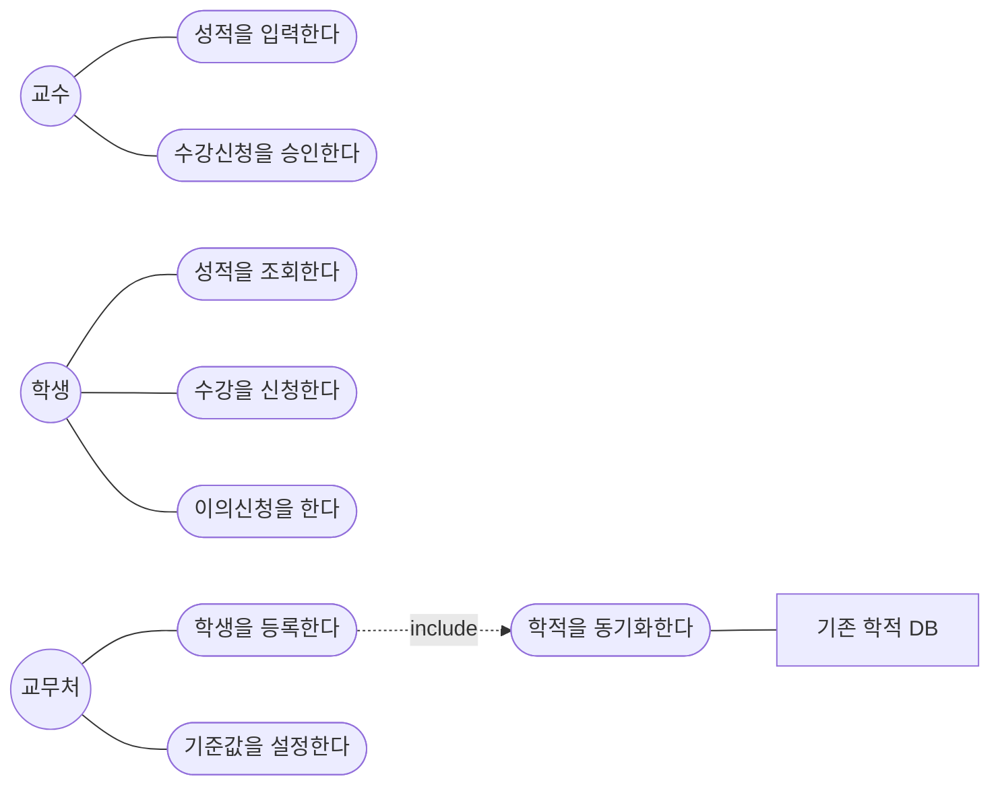
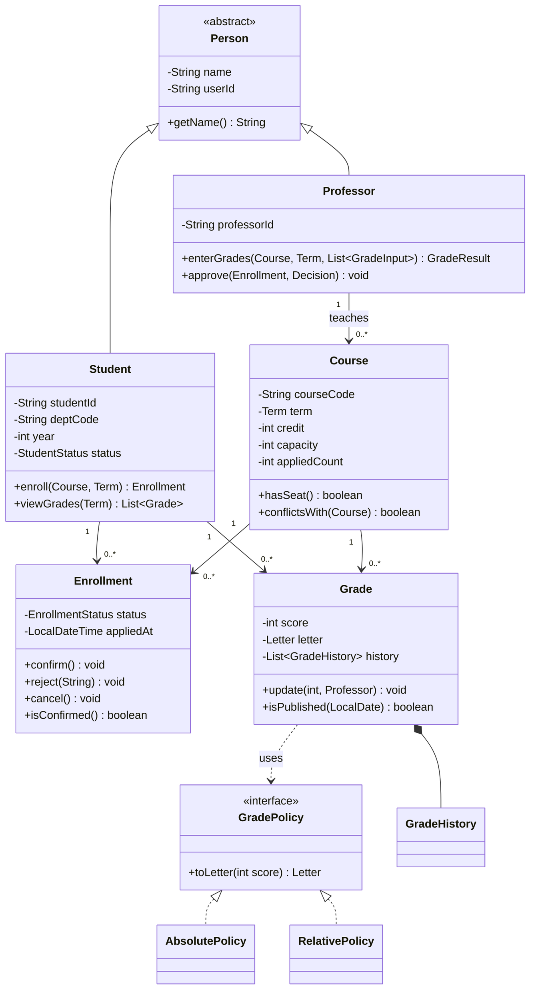
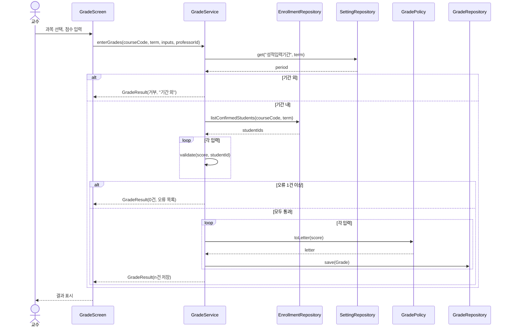
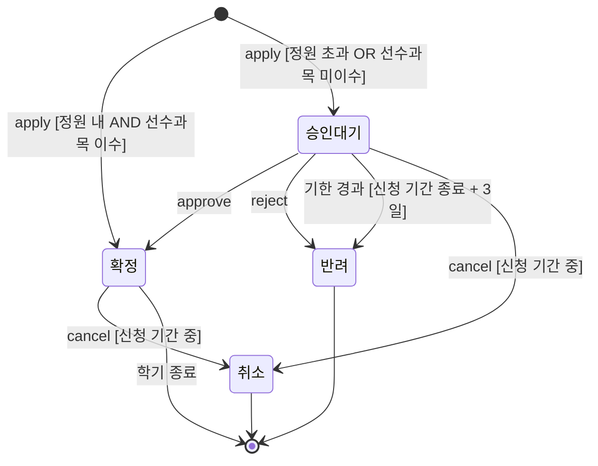
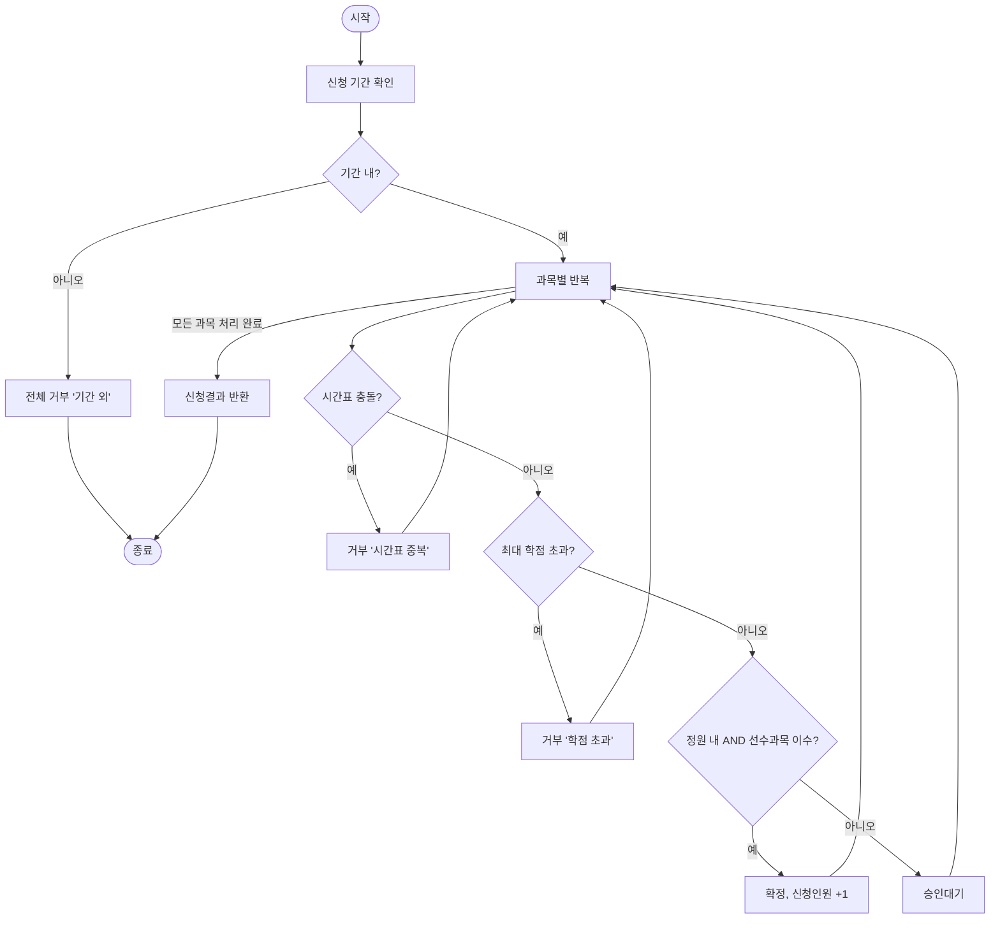

# UML 다이어그램 5종 — 구성 요소와 표기

`sw-design-oo` 7단계에서 읽는다. 모든 예는 mermaid로 쓴다. 텍스트 저장소에서 diff가 보이고 리뷰에서 함께 볼 수 있다.

## 0. UML이란

**Unified Modeling Language.** 럼바우(OMT), 부치(Booch), 제이콥슨(Objectory) 등 제각각이던 객체지향 모델 표기법을 하나로 통합한 **표준 모델링 언어**. **OMG(Object Management Group)** 가 표준으로 지정했다. OMG는 객체 기술 국제 표준화 기구다.

목적:
1. 시스템 요구사항을 **정확하게 명세**한다 (문장보다 그림).
2. 설계 의사결정을 **눈에 보이게** 한다.
3. 분석–설계–구현 간 **간격을 줄인다** (모델이 코드 구조와 연결).
4. 이해관계자 간 **의사소통**을 돕는다 (개발자 ↔ 고객 ↔ 기획자).
5. 실시간 시스템·분산 시스템을 **포함한 어떤 시스템**에도 쓸 수 있다.

| 다이어그램 | 모델링 | 보여 주는 것 |
|-----------|--------|-------------|
| 유스케이스 | 기능 | 액터가 시스템으로 얻는 것 |
| 클래스 | 정적(구조) | 클래스·속성·연산·관계 |
| 시퀀스 | 동적 | 객체 간 메시지의 시간 순서 |
| 상태 | 동적 | 한 객체의 상태 변화 |
| 활동 | 동적 | 처리 흐름, 분기, 병렬 |

## 1. 유스케이스 다이어그램 (Use Case Diagram)

사용자 요구 분석. 시스템이 제공해야 할 기능을 **사용자 관점**에서 표현.

### 구성 요소 (셋뿐이다)

| 요소 | 표기 | 규칙 |
|------|------|------|
| 액터(Actor) | 막대 인간 | 시스템 **밖**의 사용자 또는 외부 시스템. 사람·기계·다른 시스템 |
| 유스케이스(Use Case) | 타원 | 액터가 시스템을 이용해 수행하는 기능. 이름은 **동사구** ("성적을 입력한다") |
| 관계(Relationship) | 선 | 액터–유스케이스 연결. 유스케이스 간 include, extend, 일반화 |

**객체(Object)는 유스케이스 다이어그램의 구성 요소가 아니다.** 객체는 클래스·시퀀스 다이어그램에 등장한다.

- 한 액터는 여러 유스케이스를 쓸 수 있고, 한 유스케이스를 여러 액터가 공유할 수 있다.
- 유스케이스는 "시스템이 사용자에게 제공하는 서비스 단위"다. 내부 처리 단계("DB에서 읽는다")가 아니다.
- include: 항상 포함되는 공통 단계 (로그인). extend: 조건부로 확장되는 단계 (결시 처리).

### 예



### 유스케이스 기술서 (텍스트)

다이어그램 하나마다 핵심 유스케이스는 기술서를 쓴다.

```
유스케이스명: 성적을 입력한다
액터: 교수
목적: 담당 과목 수강생의 점수를 저장한다
사전 조건: 교수가 로그인했고 성적 입력 기간이다
기본 흐름:
  1. 교수가 과목을 선택한다
  2. 시스템이 확정 수강생 목록을 보여 준다
  3. 교수가 점수를 입력한다
  4. 시스템이 범위를 검증하고 등급을 계산해 보여 준다
  5. 교수가 확인하면 시스템이 저장한다
대체 흐름:
  3a. 점수가 범위 밖이면 해당 칸을 표시하고 저장하지 않는다
  5a. 입력 기간이 지났으면 거부하고 교무처 연락처를 보여 준다
사후 조건: 성적이 저장되고 변경 이력이 남는다
```

## 2. 클래스 다이어그램 (Class Diagram)

객체 구조의 **정적 모델링**. 객체지향 분석·설계에서 가장 핵심. 시스템의 뼈대.

### 구성 요소

| 요소 | 표기 |
|------|------|
| 클래스 | 세 구획 상자: 이름 / 속성 / 연산 |
| 속성 | `가시성 이름: 형 [= 기본값]`. 가시성 `-` private, `+` public, `#` protected |
| 연산 | `가시성 이름(매개변수: 형): 반환형` |
| 연관 | 실선. 끝에 다중성 `1`, `0..1`, `*`, `1..*` |
| 집합 | 빈 마름모 (전체 쪽) |
| 합성 | 채운 마름모 (전체 쪽) |
| 상속 | 빈 삼각형 화살표 (상위 쪽) |
| 의존 | 점선 화살표 |
| 추상 클래스 | 이름 기울임 또는 `<<abstract>>` |
| 인터페이스 | `<<interface>>` |

### 예



- 객체 모델링 = 클래스 다이어그램. 럼바우 1단계 산출물.
- 상속은 is-a에만. `Grade`가 `Student`를 상속하지 않는다.
- 연관 끝의 다중성을 빠뜨리지 않는다.

## 3. 시퀀스 다이어그램 (Sequence Diagram)

객체 간 **메시지 교환을 시간 순서**로. 동적 모델링. 럼바우의 사건 추적도가 이것이다.

### 구성 요소

| 요소 | 표기 |
|------|------|
| 객체(참여자) | 위쪽 상자. `객체명: 클래스명` |
| 생명선(Lifeline) | 상자 아래 점선. 시간은 위 → 아래 |
| 활성화(Activation) | 생명선 위 얇은 사각형. 메소드 실행 중 |
| 메시지 | 실선 화살표. 이름 = **호출하는 메소드 이름** |
| 반환 | 점선 화살표 |
| 조건·반복 | `alt`, `opt`, `loop` 박스 |

### 예 — 성적 입력



- 메시지 이름은 클래스 다이어그램의 연산 이름과 **같아야** 한다.
- 메소드는 메시지를 받을 때 실행된다. 외부 입력은 액터 → 화면 객체 메시지로 그린다.

## 4. 상태 다이어그램 (State Diagram)

**한 객체**의 상태 변화. 동적 모델링의 대표 수단.

### 구성 요소

| 요소 | 표기 |
|------|------|
| 상태 | 둥근 사각형 |
| 시작 상태 | 채운 원 |
| 종료 상태 | 테두리 있는 채운 원 |
| 전이 | 화살표. 라벨 `사건 [조건] / 동작` |

### 언제 그리는가

객체가 복잡한 상태 변화를 가질 때. 회원(가입 → 활성 → 정지 → 탈퇴), 결제(대기 → 결제중 → 성공/실패), 수강신청, 이의신청. 상태가 바뀌지 않는 참조 데이터에는 그리지 않는다.

### 예 — 수강신청(Enrollment)



- 상태도의 사건(apply, approve, reject, cancel)은 모두 Enrollment 또는 관련 클래스의 연산이어야 한다.
- 반려 상태에서는 더 이상 전이하지 않는다. 재신청은 새 Enrollment 객체다.

## 5. 활동 다이어그램 (Activity Diagram)

시스템이 수행하는 **기능의 흐름**. 자료 흐름도와 비슷한 역할. 조건 분기와 병렬 처리를 표현. 동적 모델링.

### 구성 요소

| 요소 | 표기 |
|------|------|
| 활동 | 둥근 사각형 |
| 시작·종료 | 채운 원 / 테두리 원 |
| 분기(decision) | 마름모. 나가는 화살표에 `[조건]` |
| 병합(merge) | 마름모 |
| 분할·합류(fork/join) | 굵은 가로선. 병렬 구간 |
| 구획(swimlane) | 책임 주체별 세로 칸 |

### 예 — 수강신청 처리



- 활동 다이어그램은 **흐름**을 그린다. 순서가 있다. (DFD는 순서가 없다.) 둘을 혼동하지 않는다.
- 분기 조건은 반드시 적는다.

## 6. 다이어그램 선택 요령

| 상황 | 다이어그램 |
|------|-----------|
| 사용자에게 "이런 기능이 있다"를 확인받을 때 | 유스케이스 |
| 개발자에게 구조를 전달할 때 | 클래스 |
| 한 기능이 어떤 객체들을 거쳐 처리되는지 | 시퀀스 |
| 한 객체가 어떤 생애주기를 갖는지 | 상태 |
| 분기·반복이 많은 업무 절차 | 활동 |

클래스 다이어그램 하나와 핵심 시퀀스 3~5개, 생애주기 있는 클래스의 상태도가 최소 세트다. 유스케이스는 사용자 확인용으로 분석 초기에, 활동은 복잡한 절차에만 추가한다.

## 7. 자주 틀리는 것

| 틀린 것 | 맞는 것 |
|---------|---------|
| 유스케이스 다이어그램에 객체를 그림 | 액터·유스케이스·관계만 |
| 유스케이스 이름이 명사("성적 입력") | 동사구("성적을 입력한다") |
| OMG = Oh My God | Object Management Group |
| UML은 실시간·분산 시스템에 못 씀 | 어떤 시스템에도 씀 |
| 시퀀스 메시지 이름이 클래스 연산과 다름 | 같아야 한다 |
| 상태도에 시작·종료 없음 | 반드시 표시 |
| 활동 다이어그램과 DFD를 같은 것으로 봄 | 활동은 순서 있음, DFD는 순서 없음 |
| 객체 연산 정의를 "메시지"라고 함 | 연산을 정의하는 것은 메소드. 메시지는 호출 |
| 공통 성질 추출을 "상속"이라고 함 | 공통 성질을 뽑아 상위 클래스를 만드는 것은 추상화. 상속은 그 결과를 물려받는 것 |
