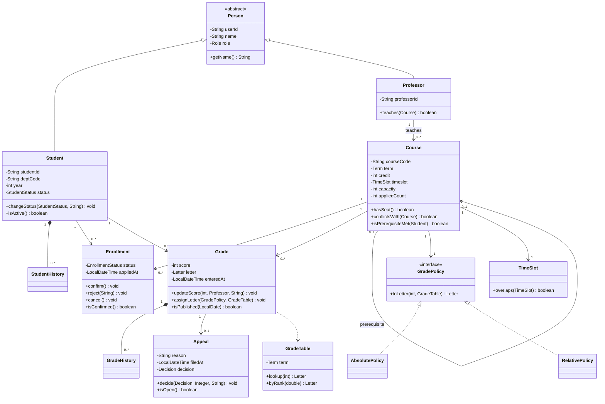
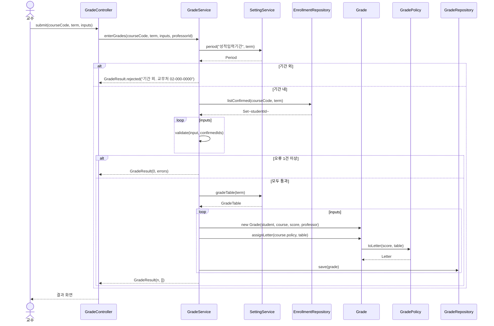
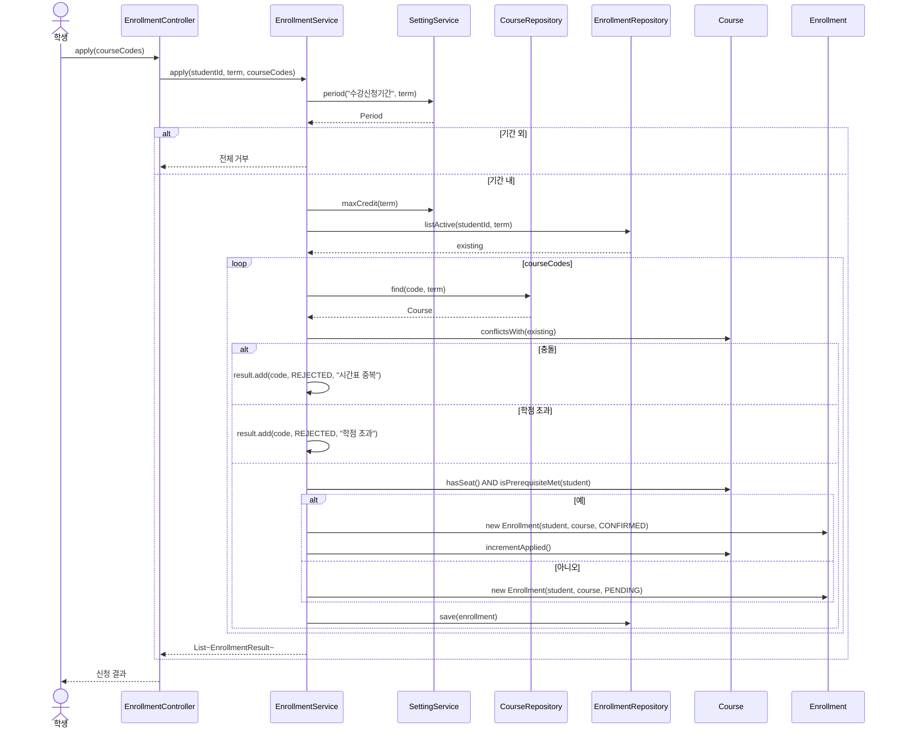
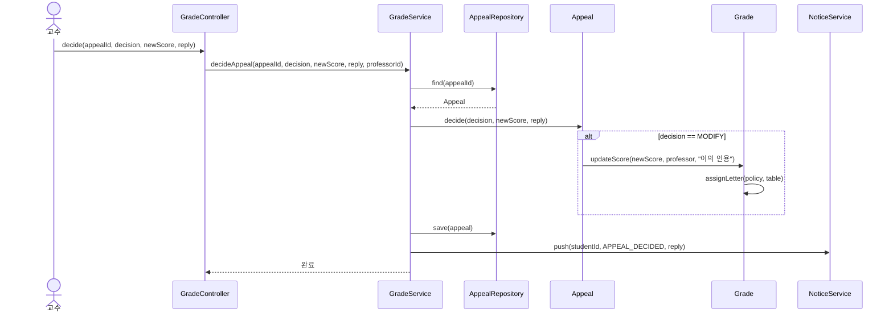
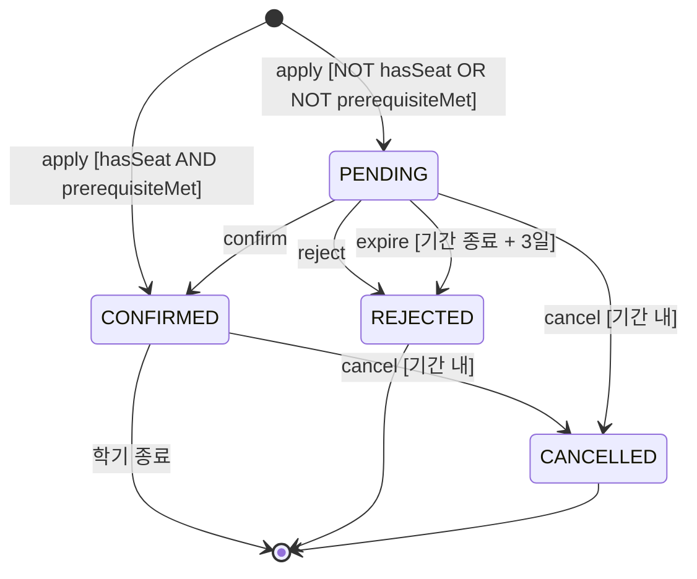
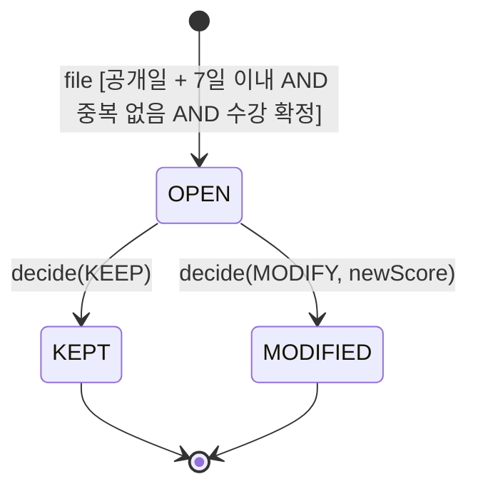
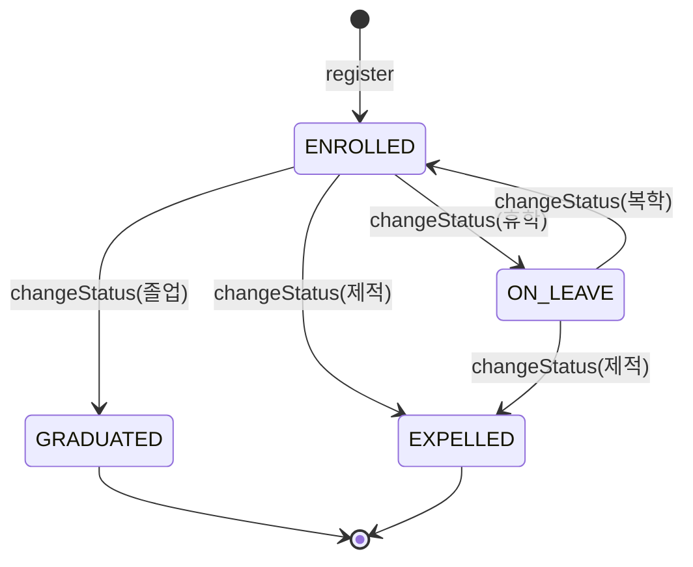
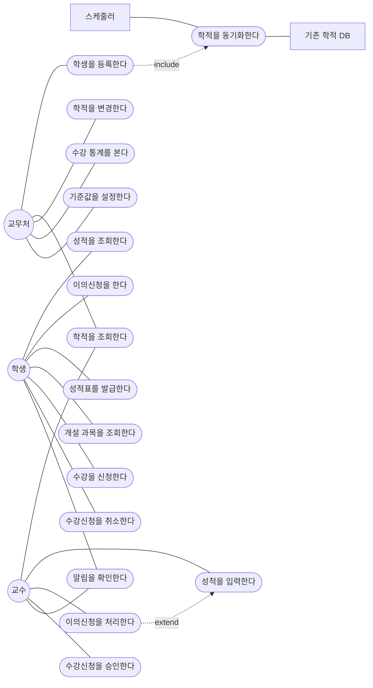
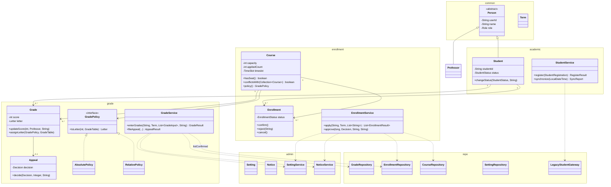
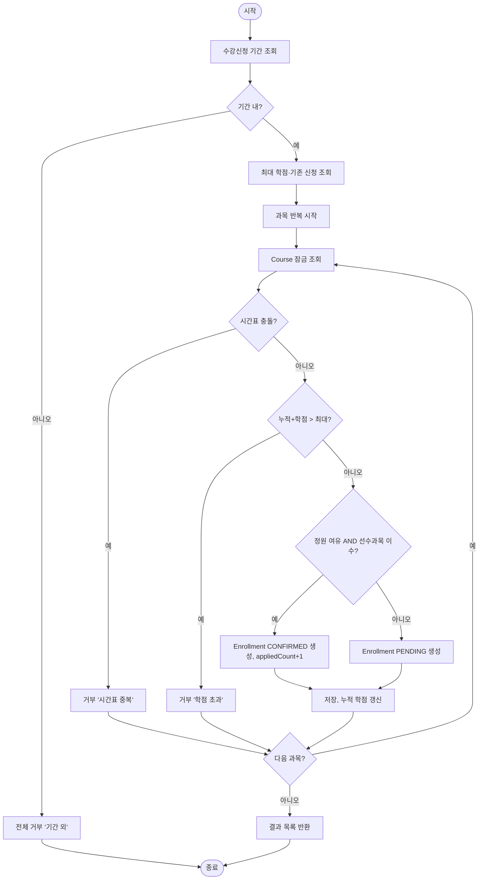

# 학사관리 시스템 객체지향 분석·설계서
> 작성: 2026-03-20 | 버전: v1.0 | 입력: srs.md v1.1

## 0. 개요

### 0.1 설계 방식
객체지향 분석·설계. 구현 언어 Java 17. 웹 프레임워크는 구현 단계에서 선택하되 표현 계층은 Controller 클래스로 추상화한다. 기존 클래스 제약 없음. 기존 학적 DB(Oracle)는 Gateway 클래스로 감싼다.

### 0.2 SRS와의 관계
srs.md v1.1의 FR-001~FR-031(19건), NFR-001~NFR-010 전체. FR-031의 이메일 발송(선택)은 제외하고 알림함만 설계한다.

### 0.3 이 시스템이 객체지향에 적합한 이유
사용자 유형 3종이 12개 화면에서 상호작용하는 **대화식·사용자 중심** 시스템이다. 화면에 보이는 것(학생, 과목, 성적, 수강신청)이 그대로 객체가 되고, 수강신청·이의신청은 생애주기(상태 변화)를 가진다. 배치 처리는 학적 동기화 하나뿐이다.

---

# 1부. 객체지향 분석 (OOA)

## 1. 객체 모델

### 1.1 명사·동사 추출

FR 설명문과 시나리오 S-01~S-08, 자료사전에서 뽑은 명사 42개 중 대표만 적는다. 전체는 부록 C.

| 출처 | 명사 | 분류 | 비고 |
|------|------|------|------|
| FR-001 | 교무처 직원 | 액터 | 시스템 밖. 권한은 Person.role |
| FR-001 | 학생 | 클래스 Student | |
| FR-001 | 학적 | 속성 묶음 → Student | 학번·학과·학년·재학상태 |
| FR-001 | 학번 | 속성 Student.studentId | |
| FR-003 | 학적 변경 이력 | 클래스 StudentHistory | Student에 합성 |
| FR-004 | 기존 학적 DB | 외부 시스템 | LegacyStudentGateway(인프라) |
| FR-010 | 교수 | 클래스 Professor | 담당 과목·승인 권한 저장 필요 |
| FR-010 | 수강생 | = Student | 역할. 별도 클래스 아님 |
| FR-010 | 과목 | 클래스 Course | |
| FR-011 | 성적, 점수 | 클래스 Grade, 속성 Grade.score | |
| FR-011 | 성적 입력 기간 | 클래스 Setting(값) | 교무처가 바꾸는 기준값 |
| FR-012 | 등급 | 속성 Grade.letter (enum Letter) | |
| FR-012 | 등급 기준표 | 클래스 GradeTable | Setting에서 읽음 |
| FR-012 | 상대평가/절대평가 | 다형성 GradePolicy | 과목 속성이자 계산 전략 |
| FR-013 | 수정 이력 | 클래스 GradeHistory | Grade에 합성 |
| FR-015 | 이의신청 | 클래스 Appeal | 생애주기 있음 |
| FR-017 | 성적표 | 클래스 Transcript | 조회 시 생성, 비영속 |
| FR-021 | 수강신청 | 클래스 Enrollment | 생애주기 있음 |
| FR-021 | 시간표 | 속성 Course.timeslot (값 객체 TimeSlot) | |
| FR-021 | 정원, 신청 인원 | 속성 Course.capacity, appliedCount | |
| FR-021 | 선수과목 | 연관 Course → Course | |
| FR-030 | 기준값 | 클래스 Setting | |
| FR-031 | 알림 | 클래스 Notice | |
| 전체 | 화면, 버튼, 메시지 | 제외 | 표현 계층 |
| 전체 | 시스템 | 제외 | |

| 출처 | 동사 | 연산 후보 | 소속 클래스 |
|------|------|-----------|------------|
| FR-001 | 등록하다 | register | StudentService |
| FR-003 | 변경하다 | changeStatus | Student |
| FR-004 | 동기화하다 | synchronize | StudentService + LegacyStudentGateway |
| FR-011 | 입력하다 | enterGrades | GradeService |
| FR-011 | 검증하다 | validate | GradeService (범위), Setting (기간) |
| FR-012 | 계산하다 | toLetter | GradePolicy |
| FR-013 | 수정하다 | updateScore | Grade |
| FR-014 | 조회하다 | viewGrades | GradeService |
| FR-015 | 이의신청하다 | file | Appeal (생성), GradeService.fileAppeal |
| FR-016 | 처리하다 | decide | Appeal |
| FR-017 | 출력하다 | generate | Transcript |
| FR-021 | 신청하다 | apply | EnrollmentService → Enrollment 생성 |
| FR-021 | 충돌하다 | conflictsWith | TimeSlot |
| FR-022 | 승인하다 / 반려하다 | confirm / reject | Enrollment |
| FR-023 | 취소하다 | cancel | Enrollment |
| FR-024 | 집계하다 | summarize | EnrollmentService |
| FR-030 | 설정하다 | set | SettingService |
| FR-031 | 알리다 | push | NoticeService |

### 1.2 클래스 목록
| 클래스 | 책임(한 문장) | 주요 속성 | 주요 연산 |
|--------|--------------|-----------|-----------|
| Person (abstract) | 로그인 사용자의 공통 신원을 가진다 | userId, name, role | getName() |
| Student | 학생의 학적을 보관하고 상태를 바꾼다 | studentId, deptCode, year, status, history | changeStatus(), isActive() |
| StudentHistory | 학적 변경 한 건을 기록한다 | field, oldValue, newValue, reason, changedAt | |
| Professor | 교수의 신원과 담당 과목을 가진다 | professorId, courses | teaches(Course) |
| Course | 개설 과목의 정원·시간·선수과목을 관리한다 | courseCode, term, credit, timeslot, capacity, appliedCount, prerequisite, policy | hasSeat(), conflictsWith(), isPrerequisiteMet() |
| TimeSlot (값) | 요일·교시 구간을 표현하고 겹침을 판정한다 | day, start, end | overlaps() |
| Enrollment | 한 학생의 한 과목 수강신청 생애주기를 관리한다 | student, course, status, appliedAt | confirm(), reject(), cancel(), isConfirmed() |
| Grade | 한 학생의 한 과목 성적과 수정 이력을 보관한다 | student, course, score, letter, enteredBy, history | updateScore(), assignLetter(), isPublished() |
| GradeHistory | 성적 수정 한 건을 기록한다 | oldScore, changedBy, changedAt, reason | |
| GradePolicy (interface) | 점수를 등급으로 바꾸는 규칙을 정의한다 | | toLetter() |
| AbsolutePolicy | 하한 기준표로 등급을 정한다 | | toLetter() |
| RelativePolicy | 분포 기준으로 등급을 정한다 | | toLetter() |
| GradeTable | 학기별 등급 하한과 분포를 가진다 | term, thresholds, distribution | lookup(), byRank() |
| Appeal | 이의신청의 접수부터 결정까지를 관리한다 | grade, reason, filedAt, decision, newScore, reply | decide(), isOpen() |
| Transcript | 공개된 성적으로 성적표를 만든다 | student, term, lines, gpa, issueNo | generate() |
| Setting | 학기별 기준값 한 건을 가진다 | key, term, value, setBy, setAt | |
| Period (값) | 시작·종료 일시 구간을 표현한다 | start, end | contains() |
| Notice | 사용자에게 보낼 알림 한 건을 가진다 | userId, kind, body, createdAt, read | markRead() |
| StudentService | 학적 등록·조회·변경·동기화 유스케이스를 조정한다 | | register(), find(), change(), synchronize() |
| GradeService | 성적 입력·조회·이의 유스케이스를 조정한다 | | enterGrades(), viewGrades(), fileAppeal(), decideAppeal() |
| EnrollmentService | 수강신청·승인·취소·통계 유스케이스를 조정한다 | | apply(), approve(), cancel(), summarize() |
| SettingService | 기준값 설정·조회를 담당한다 | | set(), get(), period() |
| NoticeService | 알림 기록·조회를 담당한다 | | push(), unread() |

Service 클래스는 유스케이스 하나를 조정하는 응용 계층 객체다. 업무 규칙은 엔티티(Grade, Enrollment)와 정책(GradePolicy)에 두고 Service는 순서만 잡는다. Service에 규칙이 들어가면 엔티티가 데이터만 가진 절차지향 구조가 된다.

### 1.3 관계
| From | 관계 | To | 다중성 | 근거 |
|------|------|----|--------|------|
| Person | 상속 | Student, Professor | | 학생·교수는 사용자의 한 종류(is-a). 공통: userId, name |
| Student | 합성 | StudentHistory | 1 : 0..* | 학생이 삭제되면 이력도 의미 없음 |
| Student | 연관 | Enrollment | 1 : 0..* | 학생은 여러 신청을 가짐 |
| Course | 연관 | Enrollment | 1 : 0..* | 과목은 여러 신청을 받음 |
| Student | 연관 | Grade | 1 : 0..* | |
| Course | 연관 | Grade | 1 : 0..* | |
| Professor | 연관 | Course | 1 : 0..* | 담당(teaches) |
| Course | 연관 | Course | 0..1 (prerequisite) | 선수과목 |
| Course | 연관 | GradePolicy | 1 : 1 | 과목의 평가 방식 |
| Grade | 합성 | GradeHistory | 1 : 0..* | |
| Grade | 연관 | Appeal | 1 : 0..1 | 과목·학기당 이의 최대 1건 |
| GradePolicy | 구현 | AbsolutePolicy, RelativePolicy | | 다형성 |
| Course | 값 포함 | TimeSlot | 1 : 1 | |
| Setting | 값 포함 | Period | 0..1 | 기간형 기준값 |

Grade는 Student를 상속하지 않는다. 성적은 학생의 한 종류가 아니라 학생이 가진 것이다(연관).

### 1.4 클래스 다이어그램 (분석 수준)


### 1.5 자료사전 대응
| SRS 자료사전 항목 | 클래스.속성 |
|------------------|------------|
| 학생등록정보 | Student(studentId, name, deptCode, year, phone, guardianPhone) |
| 학적정보 | Student(studentId, name, deptCode, year, status) |
| 성적입력 | GradeInput(studentId, courseCode, term, score, note) — 입력 DTO |
| 검증된 점수 / 검증된 성적 | Grade(score) / Grade(score, letter) |
| 성적레코드 | Grade + GradeHistory |
| 등급기준표 | GradeTable |
| 수강신청 | EnrollmentRequest(studentId, term, courseCodes) — 입력 DTO |
| 신청레코드 | Enrollment |
| 신청결과 | EnrollmentResult(courseCode, status, reason) — 출력 DTO |
| 상태 | EnrollmentStatus enum {CONFIRMED, PENDING, REJECTED, CANCELLED} |
| 이의신청 | Appeal |
| 성적표 | Transcript |
| 기준값설정 | Setting |
| 알림 | Notice |

## 2. 동적 모델

### 2.1 사건 시나리오 (S-03 성적 입력)
| 시나리오 | 사건 | 보내는 객체 | 받는 객체 | 메시지 |
|---------|------|------------|-----------|--------|
| S-03 | 과목 선택 | 교수(액터) | GradeController | selectCourse |
| S-03 | 수강생 조회 | GradeController | GradeService | listStudents(courseCode, term) |
| S-03 | 점수 입력 제출 | 교수 | GradeController | submit(inputs) |
| S-03 | 성적 입력 | GradeController | GradeService | enterGrades(courseCode, term, inputs, professorId) |
| S-03 | 기간 확인 | GradeService | SettingService | period("성적입력기간", term) |
| S-03 | 확정 수강생 확인 | GradeService | EnrollmentRepository | listConfirmed(courseCode, term) |
| S-03 | 등급 부여 | GradeService | Grade | assignLetter(policy, table) |
| S-03 | 등급 계산 | Grade | GradePolicy | toLetter(score, table) |
| S-03 | 저장 | GradeService | GradeRepository | save(grade) |

### 2.2 사건 추적도 (시퀀스)

#### S-03 성적 입력


#### S-07 수강신청


#### S-09 이의신청 처리 (교수)


### 2.3 사건 흐름도
```
[교수] ─submit─▶ GradeController ─enterGrades─▶ GradeService ─┬─period──────▶ SettingService
                                                               ├─listConfirmed▶ EnrollmentRepository
                                                               ├─assignLetter─▶ Grade ─toLetter─▶ GradePolicy
                                                               └─save─────────▶ GradeRepository
[학생] ─apply──▶ EnrollmentController ─apply─▶ EnrollmentService ─┬─period/maxCredit▶ SettingService
                                                                  ├─find─────────▶ CourseRepository
                                                                  ├─conflictsWith▶ Course
                                                                  ├─new/confirm──▶ Enrollment
                                                                  └─save─────────▶ EnrollmentRepository
[교수] ─approve▶ EnrollmentController ─approve▶ EnrollmentService ─confirm/reject▶ Enrollment ─▶ NoticeService
[학생] ─file───▶ GradeController ─fileAppeal─▶ GradeService ─new─▶ Appeal ─▶ NoticeService(교수)
[교수] ─decide─▶ GradeController ─decideAppeal▶ GradeService ─decide▶ Appeal ─updateScore▶ Grade ─▶ NoticeService(학생)
[교무처]─set───▶ AdminController ─set─▶ SettingService ─▶ SettingRepository
[배치 02:00]──▶ StudentService ─synchronize─▶ LegacyStudentGateway ─▶ StudentRepository ─▶ NoticeService(차이 보고)
```

### 2.4 상태도

#### Enrollment

| 사건 | 대응 연산 |
|------|-----------|
| apply | EnrollmentService.apply → new Enrollment(status) |
| confirm | Enrollment.confirm() |
| reject | Enrollment.reject(reason) |
| expire | EnrollmentService.expirePending() (배치) → Enrollment.reject("기한 경과") |
| cancel | Enrollment.cancel() |

#### Appeal

| 사건 | 대응 연산 |
|------|-----------|
| file | GradeService.fileAppeal → new Appeal |
| decide(KEEP) | Appeal.decide(KEEP, null, reply) |
| decide(MODIFY) | Appeal.decide(MODIFY, newScore, reply) → Grade.updateScore |

#### Student (재학 상태)

졸업·제적 전이 시 StudentService가 해당 학생의 활성 Enrollment를 모두 cancel()한다(FR-003).

상태도가 필요 없는 클래스: Course(개설 후 변경 없음), Grade(점수는 바뀌지만 상태 개념은 isPublished 하나), Setting, Notice(read 플래그만).

## 3. 기능 모델

### 3.1 DFD 재사용
srs.md 6.1의 배경도, Level 1, Level 2(프로세스 2, 3)를 그대로 쓴다. 변경 없음.

### 3.2 프로세스 ↔ 연산 대응
| DFD 프로세스 | 클래스.연산 | 입력(매개변수) | 출력(반환) |
|-------------|------------|---------------|-----------|
| 1.1 학생 등록 | StudentService.register | StudentRegistration | RegisterResult |
| 1.2 학적 조회 | StudentService.find | studentId 또는 name, requesterId | List<StudentView> |
| 1.3 학적 변경 | StudentService.change → Student.changeStatus | studentId, field, value, reason | ChangeResult |
| 1.4 학적 DB 동기화 | StudentService.synchronize → LegacyStudentGateway.fetchChanges | since | SyncReport |
| 2.1 수강생 목록 조회 | GradeService.listStudents | courseCode, term, professorId | List<StudentView> |
| 2.2 성적 검증 | GradeService.enterGrades (validate 부분) | inputs, confirmedIds, period | errors |
| 2.3 등급 계산 | Grade.assignLetter → GradePolicy.toLetter | score, GradeTable | Letter |
| 2.4 성적 조회 | GradeService.viewGrades | studentId, term, today | GradeView(letter 또는 "미공개") |
| 2.5 이의신청 처리 | GradeService.fileAppeal / decideAppeal → Appeal.decide | … | AppealResult |
| 2.6 성적표 생성 | Transcript.generate | student, term, grades | PDF |
| 3.1 개설 과목 조회 | EnrollmentService.search → CourseRepository.search | SearchCond | List<CourseView> |
| 3.2 신청 검증·등록 | EnrollmentService.apply → Course.conflictsWith/hasSeat/isPrerequisiteMet → new Enrollment | EnrollmentRequest | List<EnrollmentResult> |
| 3.3 승인 처리 | EnrollmentService.approve → Enrollment.confirm/reject | enrollmentId, decision, reason | ApproveResult |
| 3.4 통계 집계 | EnrollmentService.summarize | term, deptCode 또는 courseCode | Stats |
| 4.1 기준값 설정 | SettingService.set | key, term, value, by | void |
| 4.2 알림 | NoticeService.push | userId, kind, body | void |

### 3.3 제약 검사 위치
| 제약 | 검사 클래스.연산 |
|------|-----------------|
| 성적 입력 기간 (FR-011) | GradeService.enterGrades에서 SettingService.period().contains(now) |
| 점수 0~100 (FR-011, NFR-009) | Grade 생성자와 Grade.updateScore |
| 수강생만 입력 (FR-011) | GradeService.enterGrades에서 confirmedIds 대조 |
| 본인 성적만 조회 (NFR-003) | GradeController에서 로그인 userId와 studentId 대조 + GradeService.viewGrades 재확인 |
| 이의 7일 이내·중복 없음 (FR-015) | GradeService.fileAppeal |
| 시간표 충돌 (FR-021) | Course.conflictsWith → TimeSlot.overlaps |
| 최대 학점 (FR-021) | EnrollmentService.apply |
| 정원·선수과목 (FR-021) | Course.hasSeat, Course.isPrerequisiteMet |
| 수강신청 기간 (FR-021, FR-023) | EnrollmentService.apply/cancel |
| 상태 전이 적법성 | Enrollment.confirm/reject/cancel이 현재 상태를 검사하고 위반 시 IllegalStateException |

## 4. 분석 모델 검증
| 교차 확인 | 결과 |
|-----------|------|
| 연산 ↔ 상태도 사건 | Enrollment 5사건, Appeal 3사건, Student 4사건 모두 연산 대응. 누락 0 |
| 연산 ↔ DFD 프로세스 | 최하위 프로세스 16개 모두 대응. 누락 0 |
| 시퀀스 참여자 ↔ 클래스 | 시퀀스 3개의 참여자 14종 모두 클래스 목록 또는 저장소(5부)에 존재 |
| FR ↔ 클래스 (추적) | FR 19건 모두 담당 클래스·연산 있음 (부록 A) |
| 분석 중 추가된 클래스 | TimeSlot, Period(값 객체), Transcript(비영속). SRS 자료사전에 "요일시간", "기간"으로 있던 것을 객체로 승격 |

이해관계자 확인: 03-18 교무처·교수 대표에게 유스케이스 다이어그램(7장)과 S-03, S-07 시퀀스로 설명. 지적 1건 — "승인대기 자동 반려 기한을 교수가 알 수 있어야 한다" → NoticeService.push(professor, PENDING_REMINDER) 추가, FR-022 처리 규칙에 반영 요청(srs v1.2 예정).

---

# 2부. 객체지향 설계 (OOD)

## 5. 시스템 설계

### 5.1 서브시스템(패키지) 분할
| 패키지 | 계층 | 책임(한 문장) | 포함 클래스 |
|--------|------|--------------|------------|
| web | 표현 | 요청을 받아 응용 서비스를 호출하고 결과를 화면으로 돌려준다 | StudentController, GradeController, EnrollmentController, AdminController, AuthFilter |
| academic | 응용+도메인 | 학생의 학적 생애주기를 관리한다 | Student, StudentHistory, StudentStatus, StudentService |
| grade | 응용+도메인 | 성적의 입력·등급·조회·이의·성적표를 관리한다 | Grade, GradeHistory, Appeal, Transcript, GradePolicy, AbsolutePolicy, RelativePolicy, GradeTable, Letter, GradeService |
| enrollment | 응용+도메인 | 과목과 수강신청 생애주기를 관리한다 | Course, TimeSlot, Enrollment, EnrollmentStatus, EnrollmentService |
| admin | 응용+도메인 | 학기별 기준값과 알림을 관리한다 | Setting, Period, Notice, SettingService, NoticeService |
| common | 도메인 | 모든 패키지가 쓰는 사용자 신원과 학기 값을 정의한다 | Person, Role, Term |
| repo | 인프라 | 영속 객체의 저장·조회와 외부 시스템 연동을 담당한다 | StudentRepository, CourseRepository, EnrollmentRepository, GradeRepository, AppealRepository, SettingRepository, NoticeRepository, LegacyStudentGateway |

묶은 기준: 같은 엔티티 생애주기(통신적 응집 이상). grade 패키지가 10개 클래스로 가장 크지만 모두 Grade 엔티티를 중심으로 한다. common은 Person·Role·Term 세 개만 두고 유틸·설정은 넣지 않는다.

admin의 책임 문장에 "과"가 있다(기준값 **과** 알림). 검증 결과서에서 응집도 검토 대상이 될 것이다. 알림을 별도 notice 패키지로 나누는 것은 2차에서 결정한다.

### 5.2 계층 구조
```
[표현]   web
            │ 호출 (DTO)
[응용]   academic.StudentService  grade.GradeService  enrollment.EnrollmentService  admin.SettingService/NoticeService
            │ 메시지 (엔티티·값)
[도메인] academic.Student  grade.Grade/Appeal/GradePolicy  enrollment.Course/Enrollment  admin.Setting/Notice  common.Person/Term
            │ 저장·조회 (엔티티)
[인프라] repo.*Repository, LegacyStudentGateway
```
응용과 도메인을 같은 패키지에 두되 클래스 역할로 구분한다. 하위(도메인·인프라)는 상위(web, Service)를 import하지 않는다. 엔티티는 Repository를 모른다. Service만 Repository를 호출한다.

### 5.3 동시성
| 동시 접근 지점 | 처리 |
|---------------|------|
| Course.appliedCount (수강신청 첫날 동시 1,000명, NFR-002) | EnrollmentService.apply를 과목 단위 트랜잭션으로. `SELECT … FOR UPDATE`로 Course 행 잠금 후 hasSeat 판정과 incrementApplied를 한 트랜잭션에. 잠금 대기 2초 초과 시 "잠시 후 재시도" 응답 |
| Grade 동시 입력 (같은 과목을 두 교수가) | 과목당 담당 교수 1명 전제(Professor.teaches). 동시 입력은 발생하지 않음. 단 같은 교수의 중복 제출은 enteredAt 비교로 뒤의 것이 이김 + 이력 기록 |
| Setting 변경 중 조회 | Setting은 읽기 우세. 변경은 교무처 1명. 낙관적 잠금(version) |
| 학적 동기화 배치 vs 등록 | 02:00 배치 중 등록 요청은 큐에 넣고 배치 후 처리 (5분 이내) |

### 5.4 자원·배치
- 단일 웹 애플리케이션 프로세스 1개, 교내 가상 서버. 수강신청 기간에는 2개로 수평 확장 가능하도록 세션을 외부(토큰)에 둔다.
- repo 패키지만 DB 연결을 가진다. LegacyStudentGateway만 기존 학적 DB(Oracle) 연결을 가진다.
- 배치(동기화, 승인대기 만료)는 같은 프로세스의 스케줄러에서 02:00, 03:00에 실행.

### 5.5 제어 방식과 경계 조건
- 요청-응답. 화면 요청 → Controller → Service → 엔티티/Repository → 응답.
- 시작: SettingRepository에서 현재 학기 기준값을 캐시에 적재. 기준값이 없으면 "학기 설정 필요" 상태로 관리자 화면만 연다.
- 종료: 진행 중 트랜잭션 완료 후 종료. 배치 중이면 다음 실행에 재개(마지막 처리 시각 저장).
- 장애: 기존 학적 DB 연결 실패 시 동기화만 중단하고 나머지는 정상 동작. NoticeService로 전산실에 알림. 3회 재시도.

## 6. 객체 설계

### 6.1 클래스 명세 (핵심 4개. 전체는 부록 D)

#### Grade
| 항목 | 내용 |
|------|------|
| 패키지 | grade |
| 책임 | 한 학생의 한 과목 성적과 수정 이력을 보관하고, 점수 변경과 등급 부여 규칙을 지킨다 |
| 상위 클래스 / 인터페이스 | 없음 |

속성:
| 이름 | 형 | 가시성 | 제약 |
|------|----|--------|------|
| student | Student | private | not null, 불변 |
| course | Course | private | not null, 불변 |
| score | int | private | 0..100 |
| letter | Letter | private | assignLetter 후 not null |
| enteredBy | Professor | private | not null |
| enteredAt | LocalDateTime | private | |
| history | List<GradeHistory> | private | 합성. 외부에 불변 뷰만 |

연산:
| 시그니처 | 설명 | 사전 조건 | 사후 조건 / 예외 |
|---------|------|----------|-----------------|
| `Grade(Student, Course, int score, Professor by)` | 생성 | score 0..100 | IllegalArgumentException(범위) |
| `void updateScore(int newScore, Professor by, String reason)` | 점수 수정, 이력 추가 | 0..100 | history에 이전 값 추가. 같은 값이면 무시 |
| `void assignLetter(GradePolicy policy, GradeTable table)` | 등급 부여 | | letter 설정. policy에 위임(다형성) |
| `boolean isPublished(LocalDate today, LocalDate publishDate)` | 공개 여부 | | today ≥ publishDate |
| `int getScore()`, `Letter getLetter()`, `List<GradeHistory> getHistory()` | 조회 | | history는 unmodifiableList |

setScore, setLetter는 만들지 않는다.

#### Enrollment
| 항목 | 내용 |
|------|------|
| 패키지 | enrollment |
| 책임 | 한 학생의 한 과목 수강신청 상태 전이를 적법하게 관리한다 |
| 상위 클래스 / 인터페이스 | 없음 |

속성:
| 이름 | 형 | 가시성 | 제약 |
|------|----|--------|------|
| student | Student | private | 불변 |
| course | Course | private | 불변 |
| status | EnrollmentStatus | private | 전이는 메소드로만 |
| appliedAt | LocalDateTime | private | |
| decidedAt | LocalDateTime | private | nullable |
| reason | String | private | 반려·취소 사유 |

연산:
| 시그니처 | 설명 | 사전 조건 | 사후 조건 / 예외 |
|---------|------|----------|-----------------|
| `Enrollment(Student, Course, EnrollmentStatus initial)` | 생성 | initial ∈ {CONFIRMED, PENDING} | |
| `void confirm()` | 승인 | status == PENDING | CONFIRMED. 아니면 IllegalStateException |
| `void reject(String reason)` | 반려 | status == PENDING | REJECTED |
| `void cancel()` | 취소 | status ∈ {CONFIRMED, PENDING} | CANCELLED |
| `boolean isConfirmed()`, `boolean isActive()` | 조회 | | active = CONFIRMED 또는 PENDING |

상태 필드를 외부에서 직접 쓰지 못한다. grade 패키지가 "수강 확정 여부"를 알아야 할 때는 EnrollmentRepository.listConfirmed()로 조회한다(내용 결합 방지).

#### Course
| 항목 | 내용 |
|------|------|
| 패키지 | enrollment |
| 책임 | 개설 과목의 정원·시간표·선수과목·평가 방식을 가지고 신청 가능 여부를 판정한다 |

속성: courseCode, term, name, credit, professor, timeslot(TimeSlot), capacity, appliedCount, prerequisite(Course, nullable), policy(GradePolicy), isRelative

연산:
| 시그니처 | 설명 | 사전 조건 | 사후 조건 / 예외 |
|---------|------|----------|-----------------|
| `boolean hasSeat()` | 정원 여유 | | appliedCount < capacity |
| `boolean conflictsWith(Collection<Course> others)` | 시간표 충돌 | | timeslot.overlaps 중 하나라도 true |
| `boolean isPrerequisiteMet(Student s, GradeRepository gr)` | 선수과목 이수 | | prerequisite null이면 true. 아니면 gr에 D 이상 성적 존재 |
| `void incrementApplied()`, `void decrementApplied()` | 신청 인원 증감 | | 0 ≤ appliedCount ≤ capacity |
| `GradePolicy policy()` | 평가 방식 | | |

`isPrerequisiteMet`가 GradeRepository를 매개변수로 받는 것은 도메인 객체가 저장소를 필드로 갖지 않게 하기 위해서다. 호출하는 EnrollmentService가 넘긴다.

#### GradeService
| 항목 | 내용 |
|------|------|
| 패키지 | grade |
| 책임 | 성적 관련 유스케이스의 순서를 조정하고 저장소와 정책을 연결한다 |
| 의존 | GradeRepository, AppealRepository, EnrollmentRepository(조회만), SettingService, NoticeService |

연산:
| 시그니처 | 설명 |
|---------|------|
| `GradeResult enterGrades(String courseCode, Term term, List<GradeInput> inputs, String professorId)` | S-03. 기간 → 수강생 → 범위 검증 → Grade 생성·등급 → 저장. 오류 1건이라도 있으면 전체 저장 안 함 |
| `GradeView viewGrades(String studentId, Term term, LocalDate today)` | 공개 전이면 letter 대신 "미공개" |
| `AppealResult fileAppeal(String studentId, String courseCode, Term term, String reason, LocalDateTime now)` | 7일·중복·수강 확정 검사 → Appeal 생성 → 교수 알림 |
| `void decideAppeal(long appealId, Decision d, Integer newScore, String reply, String professorId)` | Appeal.decide → (MODIFY면) Grade.updateScore → 학생 알림 |
| `Transcript transcript(String studentId, Term term)` | Transcript.generate 위임 |

### 6.2 알고리즘

#### GradeService.enterGrades
```
enterGrades(courseCode, term, inputs, professorId):
    course ← courseRepo.find(courseCode, term)
    IF course.professor.id ≠ professorId THEN THROW Forbidden
    period ← settingService.period("성적입력기간", term)
    IF NOT period.contains(now()) THEN RETURN GradeResult.rejected("기간 외 입력. 교무처 02-000-0000")
    confirmed ← enrollmentRepo.listConfirmed(courseCode, term)      -- Set<studentId>
    errors ← []
    FOR EACH in IN inputs
        IF in.score NOT IN 0..100 THEN errors.add(in.studentId, "점수 범위")
        ELSE IF in.studentId NOT IN confirmed THEN errors.add(in.studentId, "수강생 아님")
    IF errors 비어있지 않음 THEN RETURN GradeResult(0, errors)
    table ← settingService.gradeTable(term)
    grades ← []
    FOR EACH in IN inputs
        existing ← gradeRepo.find(in.studentId, courseCode, term)
        IF existing 존재 THEN
            existing.updateScore(in.score, professor, "재입력")
            g ← existing
        ELSE
            g ← new Grade(student(in.studentId), course, in.score, professor)
        g.assignLetter(course.policy(), table)
        grades.add(g)
    IF course.isRelative THEN RelativePolicy.rerank(grades, table)    -- 상대평가는 전체 분포로 재부여
    gradeRepo.saveAll(grades)                                           -- 한 트랜잭션
    RETURN GradeResult(grades.size, [])
```

#### AbsolutePolicy.toLetter / RelativePolicy
```
AbsolutePolicy.toLetter(score, table):
    FOR EACH (letter, threshold) IN table.thresholds (내림차순)
        IF score ≥ threshold THEN RETURN letter
    RETURN F

RelativePolicy.toLetter(score, table):
    RETURN table.byRank(percentile)      -- 단독 호출 시 백분위 필요. 실제로는 rerank(grades, table)로 일괄
RelativePolicy.rerank(grades, table):
    grades를 score 내림차순 정렬
    FOR i, g IN grades
        g.letter ← table.distribution에서 (i / n) 구간의 등급
```

#### EnrollmentService.apply
분석 2.2 S-07 시퀀스와 SRS 소단위 명세서 3.2를 따른다. 과목마다 `SELECT … FOR UPDATE`로 Course를 잠근 뒤 hasSeat·incrementApplied를 한 트랜잭션에 묶는다.

### 6.3 상속 구조 재정비
| 조치 | 대상 | 이유 |
|------|------|------|
| 일반화(추상 클래스) | Student, Professor → Person | userId, name, role, getName()이 중복. 둘 다 "사용자의 한 종류" |
| 인터페이스 추출 | AbsolutePolicy, RelativePolicy → GradePolicy | 같은 메시지 toLetter에 다른 동작. 상태 공유 없음 → 추상 클래스 아닌 인터페이스 |
| 상속 거부 | Grade extends Student (초안) | 성적은 학생의 한 종류가 아니다. 연관으로 |
| 상속 거부 | Appeal extends Grade (초안) | 이의는 성적의 한 종류가 아니다. 연관으로 |
| 값 객체 승격 | TimeSlot, Period | 겹침·포함 판정 로직이 세 곳에 중복되어 객체로 |

상속 깊이: Person → Student 1단. 최대 1. 다중 상속 없음.

### 6.4 다형성 적용
| 지점 | 상위 타입 | 구현체 | 대체한 분기 |
|------|----------|--------|------------|
| 등급 계산 | GradePolicy | AbsolutePolicy, RelativePolicy | `if (course.isRelative) … else …`가 enterGrades, decideAppeal, 재계산 배치 3곳에 반복 → Course.policy()로 위임 |
| 알림 채널 (구현 단계 여지) | Notifier | InAppNotifier (현재), MailNotifier (선택 FR-031) | 이메일 추가 시 NoticeService 수정 없음 |

### 6.5 접근 경로
| 경로 | 길이 | 조치 |
|------|------|------|
| enrollment.getStudent().getDept().getName() | 3 | Student에 deptName() 추가해 2로 |
| grade.getCourse().getProfessor().getName() | 3 | 성적표 출력에만 쓰임. Transcript 생성 시 한 번 조회해 라인에 복사 |
| 성적 조회: Student → Grade 목록 | 1 | GradeRepository.listByStudent(studentId, term)에 인덱스 (student_id, term) |
| 수강신청: 학생의 활성 Enrollment → Course → TimeSlot | 2 | EnrollmentRepository.listActive가 Course를 함께 로드(join) |

---

# 3부. UML

## 7. 유스케이스 다이어그램


### 유스케이스 기술서 — UC21 수강을 신청한다
```
액터: 학생
목적: 해당 학기 과목을 신청해 확정 또는 승인대기 상태를 얻는다
사전 조건: 로그인, 수강신청 기간, 재학 상태
기본 흐름:
  1. 학생이 개설 과목을 검색해 과목을 고른다 (UC20 include)
  2. 학생이 신청을 제출한다
  3. 시스템이 과목마다 시간표 충돌, 최대 학점, 정원, 선수과목을 검사한다
  4. 시스템이 과목별 상태(확정/승인대기/거부 사유)를 보여 준다
대체 흐름:
  2a. 기간 외면 전체 거부하고 기간을 안내한다
  3a. 시간표 충돌이면 그 과목만 거부한다
  3b. 정원 초과 또는 선수과목 미이수면 승인대기로 둔다
사후 조건: Enrollment가 생성되고, 확정이면 Course.appliedCount가 1 증가한다
```

## 8. 클래스 다이어그램 (설계 수준, 패키지 포함)


## 9. 시퀀스 다이어그램
2.2의 S-03(성적 입력), S-07(수강신청), S-09(이의 처리) 세 개를 설계 수준으로 확정한다. 메시지 이름은 6.1 클래스 명세의 시그니처와 같다.

## 10. 상태 다이어그램
2.4의 Enrollment, Appeal, Student 세 개. 변경 없음.

## 11. 활동 다이어그램 — 수강신청 처리 (EnrollmentService.apply)


---

# 4부. 패키지 의존도

## 12. 의존도
```
 ┌───────────────────────────────────────────────────────────────┐
 │ web   (Controller 4, AuthFilter)                                │  [표현]
 └──┬──────────────┬──────────────────┬──────────────────┬────────┘
    │ DTO          │ DTO              │ DTO              │ DTO
    ▼              ▼                  ▼                  ▼
 ┌────────┐   ┌──────────┐      ┌────────────┐      ┌─────────┐
 │academic│   │  grade   │      │ enrollment │      │  admin  │        [응용+도메인]
 └──┬─────┘   └─┬──┬───┬─┘      └──┬──┬───┬──┘      └──┬──────┘
    │           │  │   │ 알림       │  │   │ 알림        │
    │           │  │   └───────────┼──┼───┼───────────▶│
    │           │  │ 기간, 기준표    │  │   │ 기간, 학점   │
    │           │  └───────────────┼──┼───┼───────────▶│
    │           │                  │  │   │             │
    │           │ Person, Term     │  │   │             │
    ▼           ▼                  ▼  ▼   ▼             ▼
 ┌───────────────────────────────────────────────────────────────┐
 │ common   (Person, Role, Term)                                   │  [도메인 공통]
 └───────────────────────────────────────────────────────────────┘
    ▲           ▲                  ▲                    ▲
    │ 엔티티      │ 엔티티             │ 엔티티              │ 엔티티
 ┌───────────────────────────────────────────────────────────────┐
 │ repo   (Repository 7, LegacyStudentGateway)                     │  [인프라]
 └───────────────────────────────────────────────────────────────┘
```

| No | From | To | 의존 형태 | 주고받는 것 |
|----|------|----|-----------|-------------|
| D1 | web | academic | 메서드 호출 | StudentRegistration, studentId → RegisterResult, StudentView |
| D2 | web | grade | 메서드 호출 | courseCode, term, List<GradeInput>, professorId → GradeResult, GradeView |
| D3 | web | enrollment | 메서드 호출 | studentId, term, List<courseCode> → List<EnrollmentResult> |
| D4 | web | admin | 메서드 호출 | key, term, value → void; userId → List<Notice> |
| D5 | academic | common | 상속·참조 | Person(상속), Term |
| D6 | academic | repo | 메서드 호출 | Student → void; since → List<StudentChange> |
| D7 | grade | common | 상속·참조 | Person, Term |
| D8 | grade | admin | 메서드 호출 | ("성적입력기간", term) → Period; term → GradeTable; (userId, kind, body) → void |
| D9 | grade | repo | 메서드 호출 | Grade, Appeal → void; (studentId, term) → List<Grade>; (courseCode, term) → Set<studentId> (EnrollmentRepository.listConfirmed) |
| D10 | enrollment | common | 상속·참조 | Person, Term |
| D11 | enrollment | admin | 메서드 호출 | ("수강신청기간", term) → Period; term → int maxCredit; 알림 |
| D12 | enrollment | repo | 메서드 호출 | Course, Enrollment → void; (code, term) → Course (잠금); (studentId, term) → List<Enrollment>; GradeRepository.hasPassed(studentId, prereqCode) → boolean |
| D13 | admin | common | 참조 | Term |
| D14 | admin | repo | 메서드 호출 | Setting, Notice → void; (key, term) → Setting |
| D15 | repo | common | 참조 | Term, Person (엔티티 매핑) |
| D16 | repo | academic, grade, enrollment, admin | 참조 | 엔티티 클래스 (매핑 대상) |

grade와 enrollment 사이에 직접 화살표가 없다. "수강 확정 여부"(D9)와 "선수과목 이수 여부"(D12)는 모두 repo 경유 조회다. 두 응용 패키지를 독립적으로 개발·테스트할 수 있다.

D16(repo → 도메인 패키지)은 인프라가 엔티티 클래스를 알아야 저장할 수 있어 생기는 의존이다. 계층 역행으로 보이지만 "인프라가 도메인 타입을 참조"하는 것은 허용 패턴이다. 역행은 도메인이 인프라를 호출할 때다. 엔티티는 Repository를 모른다.

검증: `/sw-design review` → docs/sw/design-review.md. 예상 검토 항목: admin 응집도(기준값 + 알림), repo 응집도(논리적, 인프라 관례로 조건부 허용), common의 쓰레기통화 방지 제약.

---

# 5부. 구현과 테스트

## 13. 구현 지침
| 설계 요소 | 코드 |
|-----------|------|
| 엔티티 속성 | 모두 `private`. getter는 조회 필요한 것만. setter 없음. 상태 변경은 업무 동사 메소드(`confirm()`, `updateScore()`) |
| Person | `abstract class Person` + `protected` 생성자. Student, Professor가 `extends` |
| GradePolicy | `interface GradePolicy { Letter toLetter(int, GradeTable); }` + `implements` 2개. Course가 `GradePolicy policy` 필드로 보유 |
| 상태 | `enum EnrollmentStatus`, `enum Decision`, `enum Letter`, `enum StudentStatus` |
| 값 객체 | `record TimeSlot(DayOfWeek day, int start, int end)`, `record Period(LocalDateTime start, LocalDateTime end)`. 불변 |
| 생성자 | 필수 필드를 매개변수로. `this.x = x`. 범위 검증은 생성자 안에서 |
| Repository | `interface XxxRepository` (도메인 패키지가 아닌 repo 패키지에 두되 인터페이스는 응용이 참조) + 구현체. 테스트 시 인메모리 구현으로 교체 |
| Service 의존 | 생성자 주입. 필드 주입 금지 |
| 패키지 | `kr.ac.oo.{web, academic, grade, enrollment, admin, common, repo}`. import 방향 = 12장 의존도 |
| 외부 노출 | 패키지 밖에서 쓰는 클래스만 `public`. 엔티티 생성자는 패키지 전용, Service만 생성 |
| 트랜잭션 | Service 메소드 단위. EnrollmentService.apply는 과목별 하위 트랜잭션 + Course 행 잠금 |
| 금지 | 다른 패키지 엔티티 필드 직접 접근, 전역 가변 상태(static 설정), Service에 업무 규칙 집중 |

클래스는 Java(객체지향 언어)로 구현한다. 절차적 언어로 기술하지 않는다.

## 14. 테스트 순서
| 순서 | 단계 | 대상 |
|------|------|------|
| 1 | 단위(클래스) | 값 객체(TimeSlot.overlaps, Period.contains) → 정책(AbsolutePolicy, RelativePolicy) → 엔티티(Grade 범위·이력, Enrollment 상태 전이 적법성, Appeal.decide, Course.hasSeat/conflictsWith) → Service(인메모리 Repository로) |
| 2 | 통합 — 사용 기반 | 의존도 역순: common → repo(실 DB) → admin → academic, grade, enrollment → web |
| 2 | 통합 — 스레드 기반 | S-03 성적 입력 스레드(GradeController, GradeService, Grade, GradePolicy, SettingService, EnrollmentRepository, GradeRepository), S-07 수강신청 스레드(동시 1,000 요청 포함), S-09 이의 처리 스레드 |
| 3 | 검증 | srs.md 추적표 기준. FR 19건 각각 수용 테스트. NFR-001~010 측정 방법대로 |
| 4 | 시스템 | 수강신청 첫날 시나리오(부하), 기존 학적 DB 장애 시나리오, 학기 전환 시나리오 |

단위 테스트 = 클래스 테스트. 각 클래스를 Repository 없이 독립 검증할 수 있도록 엔티티가 저장소를 모르게 설계했다. 상세 케이스는 `/sw-test`가 만든다.

---

# 부록

## A. 추적표
| 요구 ID | 클래스.연산 | 패키지 | 시퀀스 | 비고 |
|---------|------------|--------|--------|------|
| FR-001 | StudentService.register, StudentRepository.save, LegacyStudentGateway.push | academic, repo | | |
| FR-002 | StudentService.find | academic | | 교수 권한: EnrollmentRepository.listConfirmed로 담당 수강생 확인 |
| FR-003 | StudentService.change → Student.changeStatus; Enrollment.cancel(제적·졸업 시) | academic, enrollment | | 상태도 Student |
| FR-004 | StudentService.synchronize → LegacyStudentGateway.fetchChanges | academic, repo | | 배치 02:00 |
| FR-010 | GradeService.listStudents → EnrollmentRepository.listConfirmed | grade, repo | S-03 | |
| FR-011 | GradeService.enterGrades, Grade(생성자) | grade | S-03 | 6.2 알고리즘 |
| FR-012 | Grade.assignLetter → GradePolicy.toLetter | grade | S-03 | 다형성 |
| FR-013 | Grade.updateScore, GradeHistory | grade | S-03 | |
| FR-014 | GradeService.viewGrades, Grade.isPublished | grade | | |
| FR-015 | GradeService.fileAppeal → Appeal | grade | S-09 | 상태도 Appeal |
| FR-016 | GradeService.decideAppeal → Appeal.decide → Grade.updateScore | grade | S-09 | |
| FR-017 | Transcript.generate | grade | | PDF 라이브러리는 구현 선택 |
| FR-020 | EnrollmentService.search → CourseRepository.search | enrollment, repo | | |
| FR-021 | EnrollmentService.apply, Course.conflictsWith/hasSeat/isPrerequisiteMet, Enrollment(생성자) | enrollment | S-07 | 활동도 11장 |
| FR-022 | EnrollmentService.approve → Enrollment.confirm/reject; expirePending 배치 | enrollment | | 상태도 Enrollment |
| FR-023 | EnrollmentService.cancel → Enrollment.cancel, Course.decrementApplied | enrollment | | |
| FR-024 | EnrollmentService.summarize | enrollment | | |
| FR-030 | SettingService.set | admin | | |
| FR-031 | NoticeService.push | admin | | 이메일 제외 |
| NFR-001 | GradeRepository.listByStudent 인덱스, CourseRepository.search 인덱스 | repo | | 6.5 |
| NFR-002 | EnrollmentService.apply 과목별 잠금 | enrollment | | 5.3 |
| NFR-003 | AuthFilter + GradeService.viewGrades 본인 검사 | web, grade | | |
| NFR-004 | Grade.updateScore → GradeHistory | grade | | |
| NFR-008 | GradeTable을 Setting에서 로드 | admin, grade | | |
| NFR-009 | Grade 생성자·updateScore 범위 검증 | grade | | |
| NFR-010 | StudentService.synchronize 차이 보고 | academic | | |

## B. 변경 이력
| 버전 | 날짜 | 변경 내용 | 승인자 |
|------|------|-----------|--------|
| v0.1 | 03-14 | 분석 모델 초안. Grade extends Student 포함 | |
| v0.2 | 03-16 | 상속 재정비(6.3), GradePolicy 인터페이스 추출, 값 객체 승격 | |
| v0.3 | 03-18 | 이해관계자 확인 반영(승인대기 만료 알림), 패키지 의존도 작성 | |
| v1.0 | 03-20 | design-review 합격 반영(grade↔enrollment 직접 의존 제거, repo 경유). 기준선 | 개발사 PM |

## C. 명사 전체 목록
(42개. 1.1 표에 대표 25개를 실었고 나머지 17개는 모두 속성 또는 제외. 생략)

## D. 클래스 명세 전체
(23개 클래스. 6.1에 핵심 4개. 나머지는 같은 양식으로 작성. 생략)
