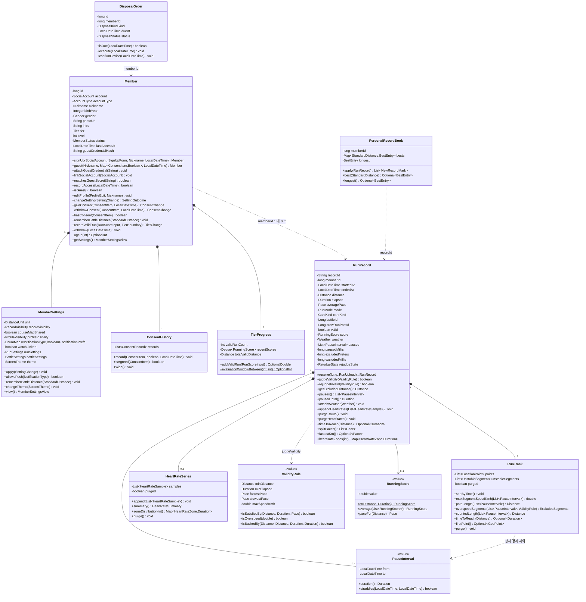
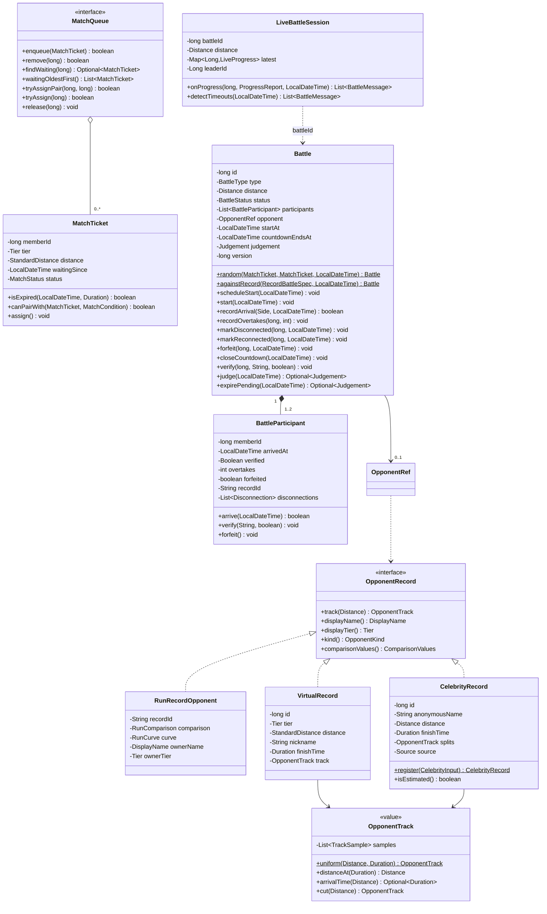
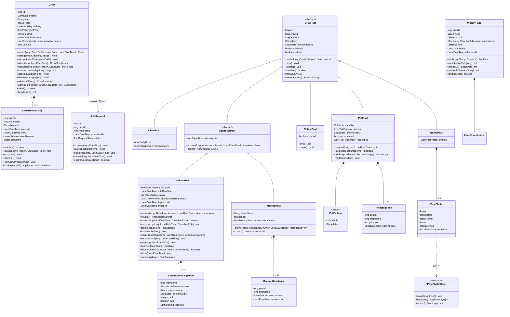
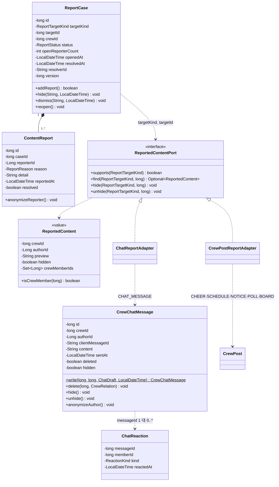
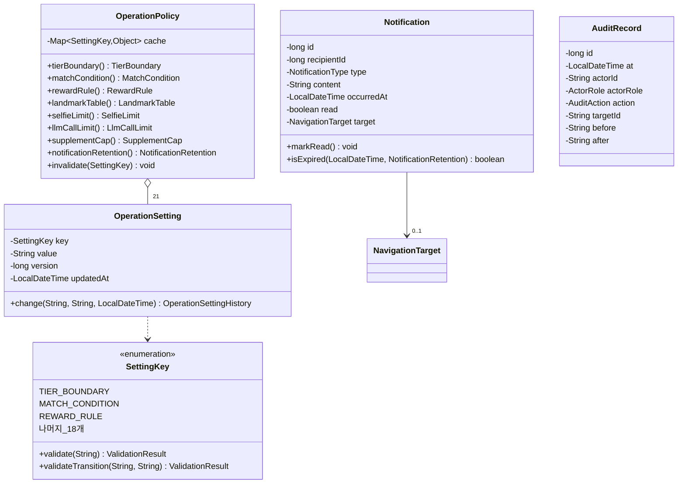

> [런크크 객체지향 분석·설계서](../design-oo.md) 목차 · 이전: [01-02-클래스-목록](01-02-클래스-목록.md) · 다음: [02-동적-모델](02-동적-모델.md)

### 1.3 관계

연관은 "A가 B를 알아야 하는가", 집합은 "B가 A 없이도 있는가", 합성은 "A가 없어지면 B도 없어지는가", 상속은 "B는 A의 한 종류인가"로 판정했다. 다른 패키지의 엔티티는 객체 참조가 아니라 식별자(memberId, crewId, recordId)로 가리킨다. 패키지 사이 결합을 자료 결합으로 낮추기 위해서다(5.6 D-02).

#### 1.3.1 회원·러닝 기록

| From | 관계 | To | 다중성 | 근거 |
|------|------|----|--------|------|
| Member | 값 포함 | SocialAccount | 1 : 0..1 | 제공자종류 + 제공자계정ID (FR-001). 게스트(accountType GUEST)는 없고 연동하면 생긴다 (v0.11, FR-197, FR-198, D-89) |
| Member | 값 포함 | Nickname | 1 : 1 | FR-003 |
| Member | 합성 | MemberSettings | 1 : 1 | 회원이 지워지면 설정도 의미 없다 |
| MemberSettings | 값 포함 | RunSettings, BattleSettings | 1 : 1 | FR-048, FR-109 |
| Member | 합성 | ConsentHistory | 1 : 1 | 탈퇴 때 식별정보와 함께 지운다(FR-017) |
| ConsentHistory | 합성 | ConsentRecord | 1 : 0..* | 이력을 덧붙이기만 한다 |
| Member | 합성 | TierProgress | 1 : 1 | 티어 평가 누계 |
| Member | 값 포함 | TagSet | **삭제** | 러너 성향 태그를 지운다 (v0.11, FR-119, D-91) |
| Member | 연관(식별자) | RunRecord | 1 : 0..* | 기록한다(ERD). RunRecord.memberId |
| RunRecord | 합성 | RunTrack | 1 : 1 | 경로 파기 뒤에도 RunTrack은 남고 포인트만 비워진다 |
| RunRecord | 합성 | PauseInterval | 1 : 0..* | 자유런만, 시간순·겹침 없음, 최대 100개 (v0.11, FR-036, D-93) |
| RunTrack | 의존 | PauseInterval | | maxSegmentSpeedKmh·pathLength가 정지 경계 구간을 뺀다 (v0.11, FR-047, D-94) |
| RunTrack | 합성 | LocationPoint | 1 : 0..* | 30m 이하 포인트만. 파기 뒤 0개 |
| RunTrack | 합성 | UnstableSegment | 1 : 0..* | FR-033 |
| RunRecord | 합성 | HeartRateSeries | 1 : 0..1 | 심박 동의·워치 연동이 있을 때만 |
| HeartRateSeries | 합성 | HeartRateSample | 1 : 0..* | 늦게 온 심박도 덧붙인다(FR-043) |
| RunRecord | 값 포함 | RunningScore | 1 : 0..1 | 유효 러닝만 |
| RunRecord | 값 포함 | Weather | 1 : 0..1 | 조회 실패면 없음 |
| RunRecord | 값 포함 | NewRecordMark | 1 : 0..* | 저장 때 정해진 신기록 표시 |
| RunRecord | 의존 | ValidityRule | | judgeValidity의 매개변수 |
| RunTrack | 의존 | ExcludedSegments | | overspeedSegments의 결과. 정지 구간과 같은 PauseInterval 형식이다 (v0.12, D-190) |
| RunRejudgeService | 의존 | RunRecord, PersonalRecordBook, TierApplier | 1 → 0..* | 무효 기록을 재판정하고 유효가 되면 최고 기록·티어에 반영한다 (v0.12, D-191) |
| Member | 연관(식별자) | PersonalRecordBook | 1 : 1 | 회원별 최고 기록 |
| PersonalRecordBook | 연관(식별자) | RunRecord | 1 : 0..6 | 기준 거리 5개 + 최장 거리 1개의 근거 기록 |
| Member | 연관(식별자) | DisposalOrder | 1 : 0..* | 동의 철회마다 한 건 |

#### 1.3.2 기록 분석·프로필

| From | 관계 | To | 다중성 | 근거 |
|------|------|----|--------|------|
| Member | 연관(식별자) | RunningGoal | 1 : 0..1 | 정한다(ERD) |
| RunningGoal | 합성 | WeeklyGoal | 1 : 0..* | 주마다 하나 |
| RunningGoal | 합성 | DailyPlan | 1 : 0..* | 날짜마다 하나(같은 날 다시 등록하면 바꾼다) |
| Member | 연관(식별자) | Report | 1 : 0..1 | 최근 10회 리포트 하나를 갱신 |
| Report | 값 포함 | FitnessSummary | 1 : 1 | |
| Report | 값 포함 | Comment | 1 : 0..1 | 생성 전에는 없음 |
| CommentGenerator | 구현 | AiCommentGenerator, RuleCommentGenerator, FallbackCommentGenerator | | 다형성 |
| FallbackCommentGenerator | 집합 | CommentGenerator | 1 : 2 | primary, fallback. 생성기는 따로 존재한다 |
| AiCommentGenerator | 연관 | LlmCallQuota | 1 : 1 | 한도 검사 |
| RankingSnapshot | 합성 | RankEntry | 1 : 0..* | 집계 한 번의 결과 |
| ProfileQueryService | 의존 | ProfileDisclosure | | 열람자 관계로 항목을 거른다 |

#### 1.3.3 대결

| From | 관계 | To | 다중성 | 근거 |
|------|------|----|--------|------|
| Member | 연관(식별자) | MatchTicket | 1 : 0..1 | 기다린다(ERD). 언랭은 0 |
| MatchQueue | 집합 | MatchTicket | 1 : 0..* | 대기열은 표를 모아 둘 뿐이다 |
| Battle | 합성 | BattleParticipant | 1 : 1..2 | 랜덤 2명, 기록 대결 1명 |
| BattleParticipant | 연관(식별자) | Member | 0..* : 1 | 참가한다(ERD의 M:N을 대결참가로 풀었다) |
| BattleParticipant | 연관(식별자) | RunRecord | 1 : 0..1 | 증명한다(ERD). 대결ID가 붙은 기록 |
| BattleParticipant | 합성 | Disconnection | 1 : 0..* | FR-090 |
| Battle | 값 포함 | OpponentRef | 1 : 0..1 | 기록 대결만 |
| OpponentRef | 의존 | OpponentRecord | | 종류와 ID로 상대 기록을 찾는다 |
| OpponentRecord | 구현 | RunRecordOpponent, VirtualRecord, CelebrityRecord | | 다형성(6.4) |
| RunRecordOpponent | 값 포함 | RunComparison, RunCurve | 1 : 1 | 고스트·나와의 싸움 상대 기록. RunRecord 엔티티가 아니라 running.RunQueryService가 내준 투영만 가진다(5.6 D-32) |
| CelebrityRecord | 값 포함 | Source | 1 : 1 | 출처 필수(FR-170) |
| CelebrityRecord | 값 포함 | OpponentTrack | 1 : 0..1 | 구간 기록이 없으면 균등 페이스로 만든다(A-006) |
| VirtualRecord | 값 포함 | OpponentTrack | 1 : 1 | 균등 페이스 |
| LiveBattleSession | 연관(식별자) | Battle | 1 : 1 | 진행 중인 랜덤 대결만 |
| Battle | 의존 | ArrivalClaim, Judgement | | judge()의 중간·결과 값 |

#### 1.3.4 크루

| From | 관계 | To | 다중성 | 근거 |
|------|------|----|--------|------|
| Crew | 합성 | CrewMembership(소속 중) | 1 : 1..10 | 구성한다(ERD). 크루장 1명 포함 최대 10명(FR-111) |
| Crew | 합성(역할) | CrewMembership(운영진, role = MANAGER) | 1 : 0..2 | Crew.MAX_MANAGERS. 별도 표 없이 역할로 둔다 (v0.11, FR-204, D-98) |
| Member | 연관(식별자) | CrewMembership(소속 중) | 1 : 0..1 | 1인 1크루(Q-34) |
| Member | 연관(식별자) | CrewMembership(퇴장 이력) | 1 : 0..* | 쿨타임 판정용. 크루 삭제 때 함께 지운다 |
| Crew | 값 포함 | CrewName, InviteCode, TagSet | 1 : 1 | |
| Crew | 연관(식별자) | JoinRequest | 1 : 0..* | 신청한다(ERD) |
| Member | 연관(식별자) | JoinRequest | 1 : 0..* | 크루마다 대기 중 신청은 0..1 |
| Crew | 연관(식별자) | CrewPost | 1 : 0..* | 게시한다(ERD). 크루가 지워지면 함께 지운다 |
| CrewPost | 상속 | CheerPost, SchedulePost, NoticePost, PollPost, BoardPost | | 응원글·일정·공지·투표·게시글은 크루 게시글의 한 종류(is-a). 단일 테이블 crew_post (v0.11, FR-132, FR-205, FR-206, FR-211, D-99) |
| SchedulePost | 상속 | CrewRunPost, MeetupPost | | 크루런·대면 모임은 일정의 한 종류(is-a). 상속 깊이 3 (v0.11, FR-132, D-99) |
| CrewRunPost | 합성 | CrewRunParticipation | 1 : 0..10 | 참여한다(ERD). 크루원 수를 넘지 않는다 |
| MeetupPost | 합성 | MeetupAttendance | 1 : 0..10 | 응답자 수는 크루원 수 이하. GOING은 정원 이하 (v0.11, FR-145) |
| PollPost | 합성 | PollOption | 1 : 2..5 | 찬반이면 서버가 만든 2개 (v0.11, FR-206) |
| PollPost | 합성 | PollResponse | 1 : 0..10 | 한 사람 한 행(크루원 수 이하) (v0.11, FR-207) |
| PollResponse | 연관(값) | PollOption | 0..* : 1 | optionNo (v0.11, FR-207) |
| BoardPost | 합성 | PostPhoto | 1 : 0..5 | 글을 지우면 사진도 지운다 (v0.11, FR-211, D-100) |
| PostPhoto | 의존 | PostPhotoStore | | 바이트는 포트 뒤에 둔다 (v0.11, D-100) |
| NoticePost | 값 포함 | pinned | | 크루마다 고정 3개 이하는 CrewPostService가 crew 행 잠금 안에서 센다 (v0.11, FR-205) |
| CrewRunParticipation | 연관(식별자) | RunRecord | 0..1 : 0..1 | 연결된다(ERD, FR-146) |
| CrewRunLiveSession | 연관(식별자) | CrewRunPost | 1 : 1 | 진행 중인 크루런만 |
| Crew | 연관(식별자) | WeeklyRace | 1 : 0..* | 쌓는다(ERD). 주마다 한 행 |
| WeeklyRace | 합성 | RaceContribution | 1 : 0..10 | 기여한다(ERD) |
| RaceContribution | 연관(식별자) | RunRecord | 1 : 1..* | 합산한 기록ID 목록. 이중 합산 방지 |
| WeeklyRace | 값 포함 | 공동 목표 goal(Distance), achievedAt | 1 : 0..1 | 주마다 목표 0..1, 달성 0..1. 별도 표를 두지 않는다 (v0.11, FR-138, FR-217, D-105) |
| CrewRecommender | 구현 | TagOverlapRecommender | **삭제** | (v0.11, FR-118, D-91) |
| CrewPermissionPolicy | 의존 | CrewRelation, CrewAction | | 권한표. 운영진(MANAGER) 열 추가 (v0.11, FR-128) |
| CrewPostReportAdapter | 구현 | ReportedContentPort(report) | | 크루 게시글을 신고 대상으로 내준다. 패키지 report.target (v0.11, FR-214, D-104) (v0.11 검증, D-135) |

#### 1.3.4a 크루 채팅·신고 (v0.11, FR-208~FR-216, D-101, D-104)

| From | 관계 | To | 다중성 | 근거 |
|------|------|----|--------|------|
| Crew | 연관(식별자) | CrewChatMessage | 1 : 0..* | CrewChatMessage.crewId. 크루가 지워지면 DB FK CASCADE로 지운다(crew는 crew.chat을 모른다) |
| Member | 연관(식별자) | CrewChatMessage | 0..1 : 0..* | authorId. 탈퇴하면 비운다(FR-021) |
| CrewChatMessage | 연관(식별자) | ChatReaction | 1 : 0..* | messageId. 메시지가 지워지면 함께 지운다(ON DELETE CASCADE) |
| Member | 연관(식별자) | ChatReaction | 1 : 0..* | 한 회원·한 메시지·한 종류에 하나 |
| ChatReportAdapter | 구현 | ReportedContentPort | | 채팅 메시지를 신고 대상으로 내준다. 패키지 report.target (v0.11 검증, D-135) |
| ReportCase | 합성 | ContentReport | 1 : 1..* | 대상 하나에 사례 하나, 신고 한 건마다 ContentReport |
| ReportCase | 연관(다형) | 신고 대상(CrewPost 하위·CrewChatMessage) | 0..1 : 1 | targetKind + targetId. ReportedContentPort로만 찾는다. FK 없음(대상이 지워져도 사례가 남는다) |
| Member | 연관(식별자) | ContentReport | 0..1 : 0..* | reporterId. 같은 사례에 같은 신고자 하나(고유 색인) |

#### 1.3.5 Runimal·아바타·리워드 (runimal, avatar, reward)

| From | 관계 | To | 다중성 | 근거 |
|------|------|----|--------|------|
| Member | 연관(식별자) | RunimalProfile | 1 : 1 | 가진다(ERD, 캐릭터의 유형 부분). runimal 패키지 |
| RunimalProfile | 값 포함 | AxisRatios | 1 : 0..1 | 첫 판정 전에는 없음 |
| RunimalJudge | 집합 | AxisEvaluator | 1 : 4 | 축마다 하나 |
| AxisEvaluator | 구현 | CompanionAxisEvaluator, DistanceAxisEvaluator, CourseAxisEvaluator, HabitAxisEvaluator | | 다형성 |
| RunRecord | 연관(식별자) | CourseVerdict | 1 : 0..1 | 유효 러닝만 판정. 경로 파기된 기록은 없음 |
| Member | 연관(식별자) | Avatar | 1 : 1 | 가진다(ERD, 캐릭터의 외형 부분). avatar 패키지 |
| Avatar | 연관 | Face | 1 : 0..1 | 얼굴을 고르기 전에는 없음 |
| Face | 구현 | SelfieFace, DefaultFace | | 다형성 |
| SelfieFace | 값 포함 | SdFaceParts | 1 : 1 | |
| Avatar | 연관(식별자) | ShopItem | 1 : 0..4 | 착용한다(ERD M:N). 부위마다 하나 |
| Avatar | 합성 | UnlockedBackground | 1 : 0..* | 해금한 배경. 해금은 취소하지 않는다 (v0.11, FR-201, D-107) |
| UnlockedBackground | 연관(식별자) | Landmark | 0..* : 0..1 | landmarkKey. 기준값 표에서 빠져도 스냅숏으로 남는다 (v0.11, FR-201, D-107) |
| Avatar | 값 포함 | selectedBackgroundKey | 1 : 0..1 | 해금 행이 있는 키만, 없으면 기본 배경 (v0.11, FR-202) |
| Member | 연관(식별자) | RewardWallet | 1 : 1 | 가진다(ERD). reward 패키지 |
| RewardWallet | 연관(식별자) | RewardAccrual | 1 : 0..* | 적립 내역. 지갑이 컬렉션을 매핑하지 않고 RewardAccrualRepository로 읽는다(v0.10까지 합성) (v0.11, D-109) |
| RewardWallet | 합성 | OwnedItem | 1 : 0..* | 보유 아이템 |
| OwnedItem | 연관(식별자) | ShopItem | 0..* : 1 | 판다(ERD) |
| RewardAccrual | 연관(식별자) | RunRecord 또는 Battle | 0..1 : 1 | 적립 근거(ERD). 같은 근거 이중 적립 금지 |

#### 1.3.6 운영 기준·알림·감사

| From | 관계 | To | 다중성 | 근거 |
|------|------|----|--------|------|
| OperationPolicy | 집합 | OperationSetting | 1 : 21 | 기준 항목마다 한 행 |
| OperationSetting | 연관 | OperationSettingHistory | 1 : 0..* | 변경 이력 |
| ShopCatalog | 합성 | ShopItem | 1 : 0..* | 상점 목록 |
| LandmarkTable | 합성 | Landmark | 1 : 0..* | 3.3.1 목록. Landmark.key는 표 안에서 고유 (v0.11, D-107) |
| Member | 연관(식별자) | Notification | 1 : 0..* | 받는다(ERD). 30일 보존 |
| Notification | 값 포함 | NavigationTarget | 1 : 0..1 | 이동 대상 |
| Member 또는 운영자 | 연관(식별자) | AuditRecord | 1 : 0..* | 남긴다(ERD). 행위자 |

#### 1.3.7 거부한 상속

| 초안 | 거부 이유 | 바꾼 관계 |
|------|-----------|-----------|
| CrewLeader extends Member | 크루장은 러너의 한 종류가 아니라 크루 안에서의 역할이다. 양도하면 역할이 바뀌는데 객체의 클래스는 바뀔 수 없다 | CrewMembership.role (enum CrewRole) |
| CrewManager extends Member | 운영진도 크루장과 같은 이유로 역할이다. 지정·해제로 바뀐다 | CrewMembership.role = MANAGER (v0.11, FR-204, D-98) |
| GuestMember extends Member | 게스트는 회원과 권한·노출이 같고(FR-197) 연동하면 같은 회원ID로 LINKED가 된다. 클래스로 나누면 연동 때 객체 종류를 바꿔야 한다 | Member.accountType (enum AccountType) (v0.11, FR-197, FR-198, D-89) |
| MeetupPost extends CrewRunPost | 대면 모임은 일시·참석 응답만 크루런과 같고 대기실·동시 출발·중계·크루런 상태가 없다(FR-132). 크루런 하위에 두면 쓰지 않는 상태를 물려받는다 | 공통 부분만 추상 SchedulePost로 올리고 둘 다 그 하위 (v0.11, FR-132, D-99) |
| CrewChatMessage extends CrewPost | 채팅은 빈도·보관·삭제 규칙과 생애주기가 게시글과 다르고 다른 패키지(crew.chat)에 있다 | 별도 엔티티. 신고 대상으로는 둘 다 ReportedContentPort를 구현한 어댑터가 내준다 (v0.11, D-101, D-104) |
| Operator extends Member | 운영자는 앱 가입 절차를 거치지 않는 별도 계정이다(A-010). Member의 프로필·티어·설정이 운영자에게 의미 없다 | 값 OperatorId + OperatorWhitelist |
| VirtualRecord extends RunRecord | 가상 기록은 어떤 러너의 기록도 아니며 랭킹·대시보드·크루 집계가 읽으면 안 된다(FR-105). RunRecord를 상속하면 RunRecord를 읽는 모든 집계에 섞인다 | 둘 다 OpponentRecord를 구현(인터페이스) |
| CelebrityRecord extends RunRecord | 유명인 기록에는 회원·위치·심박이 없다. RunRecord의 속성 대부분이 의미 없다 | OpponentRecord 구현 |
| GhostBattle, SelfBattle extends Battle | 상태 전이·판정 규칙이 모든 종류에서 같다. 다른 것은 상대 기록의 출처와 비교 항목뿐이다 | Battle 하나 + BattleType 상수별 메소드 + OpponentRecord |
| CrewRunPost extends Battle | 크루런은 대결이 아니다(승패가 없고 순위만 있다). 참가자 수·상태도 다르다 | 별도 클래스. 진행 중계 원리만 같은 방식으로 설계 |
| BaseEntity (createdAt, updatedAt) 상위 클래스 | 코드 재사용만을 위한 상속이다. "~의 한 종류"가 아니다 | 값 객체 Timestamps를 필드로 둔다(5부 13장) |

### 1.4 클래스 다이어그램 (분석 수준)

전체를 한 장에 그리면 읽을 수 없어 패키지별로 나눴다. 패키지 경계를 넘는 연관은 식별자 연관이므로 점선 의존(`..>`)으로 그렸다.

#### 1.4.1 회원·러닝 기록

#### 1.4.2 기록 분석

```mermaid
classDiagram
    class RunningGoal {
        -long memberId
        -Map~Week,WeeklyGoal~ weeklyGoals
        -SortedMap~LocalDate,DailyPlan~ plans
        +setWeeklyGoal(WeeklyGoal) void
        +putPlan(DailyPlan, LocalDate) void
        +planOn(LocalDate) Optional~DailyPlan~
        +goalOf(Week) Optional~WeeklyGoal~
        +checkOn(LocalDate, DayActual) Optional~PlanCheck~
        +supplementFor(LocalDate, Map~LocalDate,Distance~, Distance) Distance
    }
    class WeeklyGoal {
        <<value>>
        -Week week
        -int count
        -Distance distance
        +achievement(int, Distance) WeeklyAchievement
    }
    class DailyPlan {
        <<value>>
        -LocalDate date
        -Distance distance
        -Pace targetPace
    }
    class Report {
        -long memberId
        -FitnessSummary summary
        -Comment comment
        -LocalDateTime createdAt
        +refresh(FitnessSummary, LocalDateTime) void
        +attachComment(Comment) void
        +hasComment() boolean
    }
    class FitnessSummary {
        <<value>>
        -int fromRun
        -int toRun
        -RunningScore averageScore
        -Distance distanceChange
        -int paceChangeSeconds
        -DayOfWeek frequentDay
        -int frequentHourBand
        +from(List~RunSummary~, List~RunSummary~)$ FitnessSummary
    }
    class CommentGenerator {
        <<interface>>
        +generate(FitnessSummary, CommentContext) Optional~Comment~
    }
    class AiCommentGenerator {
        -LlmCommentGateway gateway
        -LlmCallQuota quota
        -Duration timeout
        +generate(FitnessSummary, CommentContext) Optional~Comment~
    }
    class RuleCommentGenerator {
        -RuleCommentCatalog catalog
        +generate(FitnessSummary, CommentContext) Optional~Comment~
    }
    class FallbackCommentGenerator {
        -CommentGenerator primary
        -CommentGenerator fallback
        +generate(FitnessSummary, CommentContext) Optional~Comment~
    }
    class LlmCallQuota {
        -QuotaCounter counter
        +tryAcquire(long, LocalDate, LlmCallLimit) boolean
    }
    class RankingSnapshot {
        -RankingKind kind
        -AggregationPeriod period
        -LocalDateTime computedAt
        -List~RankEntry~ entries
        +build(RankingKind, AggregationPeriod, LocalDateTime, List~RankScore~)$ RankingSnapshot
        +entryOf(long) Optional~RankEntry~
        +gapToNext(long) Optional~Distance~
    }
    class Streak {
        <<value>>
        +countBack(Set~LocalDate~, LocalDate)$ int
    }
    class LandmarkTable {
        -List~Landmark~ landmarks
        +personalProgressOf(Distance) Optional~LandmarkProgress~
        +crewProgressOf(Distance) LandmarkProgress
    }

    RunningGoal "1" *-- "0..*" WeeklyGoal
    RunningGoal "1" *-- "0..*" DailyPlan
    Report "1" --> "1" FitnessSummary
    CommentGenerator <|.. AiCommentGenerator
    CommentGenerator <|.. RuleCommentGenerator
    CommentGenerator <|.. FallbackCommentGenerator
    FallbackCommentGenerator o-- "2" CommentGenerator
    AiCommentGenerator --> LlmCallQuota
```

#### 1.4.3 대결

#### 1.4.4 크루

크루 운영진은 CrewMembership.role = MANAGER로, 크루당 0..2명이다(Crew.appointManager가 센다). v0.10의 CrewRecommender·TagOverlapRecommender는 지웠다. CrewRunPost의 scheduledAt은 SchedulePost로 올렸고 vote는 다형성 연산 answer로 바꿨다 (v0.11, FR-204, FR-118, FR-145, D-98, D-99, D-91).

#### 1.4.4a 크루 채팅·신고 (v0.11, FR-208~FR-216, D-101, D-104)

crew.chat과 report는 crew와 다른 패키지다. 패키지 경계를 넘는 연결은 점선으로 그렸다. report는 신고 대상을 ReportedContentPort로만 알고, crew·crew.chat이 어댑터로 그 포트를 구현한다.

#### 1.4.5 Runimal·아바타·리워드

RunimalProfile·RunimalJudge·AxisEvaluator·CourseSimilarityJudge는 runimal, Avatar·Face·AppearanceCalculator는 avatar, RewardWallet은 reward 패키지다. 세 묶음 사이에는 Avatar 착용 때 보유 여부를 reward에 묻는 연결 하나만 있다(AvatarService → RewardService.owns).

```mermaid
classDiagram
    %% v0.11 RunimalJudge 태그 매개변수 삭제 (FR-152, D-91), Avatar 배경 (FR-201, FR-202, D-107), RewardWallet 집계 칼럼 (D-109)
    class RunimalProfile {
        -long memberId
        -int validRunCount
        -RunimalType provisionalType
        -RunimalType confirmedType
        -AxisRatios ratios
        +onValidRun(int) JudgeTrigger
        +assignProvisional(RunimalType, AxisRatios, LocalDateTime) void
        +confirm(RunimalType, AxisRatios, LocalDateTime) boolean
        +remainingToNextJudgement() int
        +card() Optional~RunimalCardView~
    }
    class RunimalJudge {
        -List~AxisEvaluator~ evaluators
        +judgeProvisional(RunSample, RunimalRule) Judged
        +judgeConfirmed(RunSample, RunimalRule) Judged
    }
    class AxisEvaluator {
        <<interface>>
        +axis() RunimalAxis
        +ratioOfA(RunSample, RunimalRule) OptionalDouble
    }
    class Avatar {
        -long memberId
        -Face face
        -int creationCount
        -LocalDate lastCreatedOn
        -BodyShape bodyShape
        -SkinTone skinTone
        -EnumMap~ItemSlot,Long~ equipped
        -String selectedBackgroundKey
        -List~UnlockedBackground~ unlockedBackgrounds
        +canCreateSelfie(LocalDate, SelfieLimit) boolean
        +applySelfieFace(SdFaceParts, LocalDate) void
        +chooseDefault(DefaultCharacter) void
        +equip(long, ItemSlot) void
        +unequip(ItemSlot) void
        +updateAppearance(BodyShape, SkinTone) boolean
        +unlock(Collection~Landmark~, LocalDateTime) List~UnlockedBackground~
        +selectBackground(String) void
        +useDefaultBackground() void
    }
    class UnlockedBackground {
        -String landmarkKey
        -String landmarkName
        -LandmarkStage stage
        -Distance distance
        -LocalDateTime unlockedAt
    }
    class Face {
        <<interface>>
        +renderKey() String
    }
    class RewardWallet {
        -long memberId
        -int balance
        -List~OwnedItem~ ownedItems
        -LocalDate lastAccrualDate
        -int lastAccrualDateAmount
        -long version
        +accrue(AccrualRequest, RewardRule, int) Optional~RewardAccrual~
        +accruedOn(LocalDate) OptionalInt
        +purchase(ShopItem, LocalDateTime) void
        +owns(long) boolean
        +accruedFor(AccrualReason, String) int
    }
    class RewardAccrualRepository {
        <<interface>>
        +amountFor(long, AccrualReason, String) int
        +sumOn(long, LocalDate) int
        +save(RewardAccrual) void
    }
    class AppearanceCalculator {
        +bodyShape(AppearanceInput, BodyShapeRule) BodyShape
        +skinTone(List~LocalTime~, SkinToneRule) SkinTone
    }
    class CourseSimilarityJudge {
        +isSameCourse(List~GeoPoint~, List~List~GeoPoint~~, CourseSimilarityRule) boolean
    }

    RunimalJudge o-- "4" AxisEvaluator
    AxisEvaluator <|.. CompanionAxisEvaluator
    AxisEvaluator <|.. DistanceAxisEvaluator
    AxisEvaluator <|.. CourseAxisEvaluator
    AxisEvaluator <|.. HabitAxisEvaluator
    Avatar --> "0..1" Face
    Face <|.. SelfieFace
    Face <|.. DefaultFace
    Avatar "1" *-- "0..*" UnlockedBackground
    RewardWallet ..> RewardAccrualRepository : 적립 내역·날짜 합계
    RewardAccrualRepository ..> RewardAccrual
    RewardWallet "1" *-- "0..*" OwnedItem
```

v0.11: RunimalJudge는 태그 없이 판정한다(D-91). Avatar는 해금한 배경을 UnlockedBackground 스냅숏으로 가진다(D-107). RewardWallet은 적립 내역 컬렉션을 매핑하지 않고 마지막 적립일·그날 합계 칼럼과 RewardAccrualRepository로 하루 상한을 센다(D-109) (v0.11, FR-152, FR-201, D-91, D-107, D-109).

#### 1.4.6 운영 기준·알림·감사

### 1.5 자료사전 대응

srs.md 6.2의 저장소 17개와 레코드를 클래스·속성에 대응시켰다. 요청·응답 흐름 177개는 표현 계층의 입력·출력 객체(Command, View)로 대응하며 전체 목록은 부록 C에 있다. v0.11에서 srs v0.10의 저장소 D18·D19를 더해 19개이고, 7.13.3 자료사전의 새 이름은 1.5.4에 한 표로 모았다 (v0.11, CR-08).

#### 1.5.1 저장소 ↔ 클래스

| 저장소 (srs.md 6.1) | 클래스 | 저장 위치 | 비고 |
|---------------------|--------|-----------|------|
| D1 회원 파일 | Member (+ MemberSettings, ConsentHistory, TierProgress) | PostgreSQL | v0.11: account_type·last_access_at·guest_credential_hash·screen_theme·battle_proximity_alert 추가, tags 삭제(V20) (v0.11, FR-197, FR-203, D-89, D-91) |
| D2 러닝 기록 파일 | RunRecord (+ RunTrack, HeartRateSeries, PauseInterval), PersonalRecordBook | PostgreSQL | 위치 포인트는 별도 테이블(6.5). 정지 구간은 run_record.pauses 칼럼(V21) (v0.11, FR-036). v0.12: excluded_meters·excluded_millis(V27, BIGINT NOT NULL DEFAULT 0, ck_run_record_excluded ≥ 0, 뺀 초과 구간의 거리·시간), rejudge_state(V28, VARCHAR(8) NULL, CHECK PENDING·VALID·DONE·SKIPPED, 부분 색인 idx_run_record_rejudge(rejudge_state, saved_at, record_id) WHERE PENDING·VALID) (D-190, D-191) |
| D3 러닝 목표 파일 | RunningGoal | PostgreSQL | |
| D4 리포트 파일 | Report | PostgreSQL | |
| D5 매칭 대기열 | MatchTicket (MatchQueue 구현) | Redis(기본) 또는 PostgreSQL(대안) | 5.6 D-07 |
| D6 대결 파일 | Battle (+ BattleParticipant) | PostgreSQL | 진행 중 상태는 LiveBattleSession(Redis)에도 |
| D7 유명인 기록 파일 | CelebrityRecord | PostgreSQL | |
| D8 크루 파일 | Crew, CrewMembership, JoinRequest | PostgreSQL | crew_membership.crew_tags 삭제, role에 MANAGER (v0.11, FR-144, FR-204) |
| D9 크루 게시 파일 | CrewPost(CheerPost, SchedulePost(CrewRunPost, MeetupPost), NoticePost, PollPost, BoardPost), CrewRunParticipation, MeetupAttendance, PollOption, PollResponse, PostPhoto | PostgreSQL | 진행 중 크루런은 CrewRunLiveSession(Redis)에도. 단일 테이블 crew_post + crew_meetup_attendance·crew_poll_option·crew_poll_response·crew_photo(V22) (v0.11, D-99, D-100) |
| D10 레이스 파일 | WeeklyRace(+ 공동 목표 goal·achievedAt), RaceContribution | PostgreSQL | 공동목표는 weekly_race 칼럼(V22) (v0.11, FR-138, D-105) |
| D11 캐릭터 파일 | runimal: RunimalProfile, CourseVerdict / avatar: Avatar(+ UnlockedBackground) | PostgreSQL | 캐릭터레코드를 둘로 나눴다(1.5.3). 테이블도 패키지별로 나뉘어 runimal·avatar가 서로의 테이블을 읽지 않는다. 배경은 avatar_background(V25) (v0.11, FR-201, D-107) |
| D12 리워드 파일 | reward: RewardWallet (+ RewardAccrual, OwnedItem) | PostgreSQL | |
| D13 운영 기준 파일 | OperationSetting, OperationSettingHistory | PostgreSQL + 메모리 캐시 | |
| D14 감사 로그 | AuditRecord | PostgreSQL (추가 전용 테이블) | |
| D15 미전송 기록 보관함 | CompletedRun (PendingRunRepository) | 앱 Room DB | 폰 안 |
| D16 가상 기록 파일 | VirtualRecord | PostgreSQL (러닝 기록과 다른 테이블) | FR-105 |
| D17 알림 파일 | Notification | PostgreSQL | |
| D18 크루 채팅 파일 | crew.chat: CrewChatMessage, ChatReaction | PostgreSQL | crew_chat_message·crew_chat_reaction(V23). 보관 기한 없음(E-v011-6) (v0.11, FR-208~FR-210, D-101) |
| D19 신고 파일 | report: ReportCase, ContentReport | PostgreSQL | report_case·content_report(V24). crew 표에 FK 없음 (v0.11, FR-214~FR-216, D-104) |
| (설계 추가) | DisposalOrder | PostgreSQL | 7일 파기 기한 추적. 자료사전 "경로파기지시·심박파기지시" 흐름을 저장 가능한 객체로 바꿨다 |
| (설계 추가) | RankingSnapshot | PostgreSQL + Redis 캐시 | 매일 0시 집계 결과(srs.md 6.3 3.6 "마지막 집계") |

#### 1.5.2 레코드 ↔ 클래스.속성

| SRS 자료사전 항목 | 클래스.속성 |
|------------------|------------|
| 회원레코드 = 회원ID + 계정유형 + (제공자종류) + (제공자계정ID) + 닉네임 + (출생연도) + (성별) + (프로필사진) + (프로필소개) + 티어 + 레벨 + 가입일시 + 마지막접속일시 + 설정 + 동의이력 (srs v0.10) | Member(id, accountType, account.provider, account.providerAccountId, nickname, birthYear, gender, photoUrl, intro, tier, level, joinedAt, lastAccessAt, settings, consents) + guestCredentialHash(설계 추가). {성향태그}·tags 삭제 (v0.11, FR-197, FR-200, D-89, D-91) |
| 설정 = 단위 + 기록공개범위 + 코스지도공유 + 개인정보공개 + {알림종류 + 수신여부} + 워치연동 + 러닝설정 + 대결설정 + 화면테마 | MemberSettings(unit, recordVisibility, courseMapShared, profileVisibility, notificationPrefs, watchLinked, runSettings, battleSettings, theme) (theme v0.11, FR-203) |
| 러닝설정 / 대결설정 | RunSettings(target, voice, vibration, followCoachPlan) / BattleSettings(defaultDistance, voice, vibration, gapAlertInterval, proximityAlert) (proximityAlert v0.11, FR-109) |
| 동의이력 = {동의항목 + 동의여부 + 변경일시} | ConsentHistory.records: List<ConsentRecord(item, agreed, changedAt)> |
| 러닝기록 = 기록ID + 회원ID + 시작일시 + 종료일시 + 거리 + 경과시간 + 평균페이스 + {위치포인트} + {불안정구간} + {정지구간} + (심박기록) + 러닝모드 + (대결ID) + (크루런게시글ID) + 기록공개범위 + 유효여부 + (러닝점수) + (날씨) | RunRecord(recordId, memberId, startedAt, endedAt, distance, elapsed(운동 시간), averagePace, track.points, track.unstableSegments, pauses, heartRates, mode, battleId, crewRunPostId, valid, score, weather) + cardKind, newRecords, pausedMillis(설계 추가). **기록공개범위는 RunRecord에 저장하지 않는다**(5.6 D-04). 정지구간 v0.11, FR-036, D-93 |
| 정지구간 = 정지시작일시 + 정지종료일시 | PauseInterval(from, to) (v0.11, FR-194) |
| 위치포인트 = 측정일시 + 위도 + 경도 + 정확도반경 | LocationPoint(measuredAt, point.latitude, point.longitude, accuracyMeters) |
| 불안정구간 = 시작일시 + 종료일시 + 구간거리 | UnstableSegment(from, to, distance) |
| 심박기록 = {측정일시 + 심박수} | HeartRateSeries.samples: List<HeartRateSample(measuredAt, bpm)> |
| 완료러닝기록 = 러닝기록 + 전송상태 | 앱 CompletedRun(러닝기록 항목 + uploadState) |
| 러닝목표 = 회원ID + (주간목표) + {날짜별계획} | RunningGoal(memberId, weeklyGoals, plans) |
| 주간목표 = 주시작일 + 목표횟수 + 주간목표거리 | WeeklyGoal(week, count, distance) |
| 날짜별계획 = 계획일 + 계획거리 + 목표페이스 | DailyPlan(date, distance, targetPace) |
| 리포트레코드 = 회원ID + 리포트기간 + 체력요약 + (코멘트) + (코멘트출처) + 생성일시 | Report(memberId, summary.fromRun/toRun, summary, comment.text, comment.source, createdAt) |
| 체력요약 = 회원ID + 리포트기간 + 회차 + 러닝점수 + 거리변화 + 페이스변화 + 자주뛰는요일 + 자주뛰는시간대 | FitnessSummary(fromRun, toRun, averageScore, distanceChange, paceChangeSeconds, frequentDay, frequentHourBand) |
| 대기열레코드 = 회원ID + 티어 + 대결거리 + 대기시작일시 + 대기상태 | MatchTicket(memberId, tier, distance, waitingSince, status) |
| 대결레코드 = 대결ID + 대결종류 + 대결거리 + 대결상태 + {참가자ID + (도착일시) + (기록검증결과) + 추월횟수} + (상대기록ID) + (상대기록구분) + (상대표시명) + (상대도착시간) + 생성일시 + (시작일시) + (카운트다운종료일시) + {연결끊김기록} + (대결판정) + (승자ID) + 정정여부 | Battle(id, type, distance, status, participants[memberId, arrivedAt, verified, overtakes], opponent.recordId, opponent.kind, opponent.displayName, opponent.arrivalElapsed, createdAt, startAt, countdownEndsAt, participants[].disconnections, judgement.verdicts, judgement.winnerId, judgement.corrected) |
| 연결끊김기록 = 회원ID + 끊김일시 + (복구일시) | Disconnection(memberId, from, to) — BattleParticipant 안에 둔다 |
| 유명인기록 = 유명인ID + 익명닉네임 + 기록거리 + 완주시간 + ({경과시간 + 누적거리}) + 출처 + 등록일시 | CelebrityRecord(id, anonymousName, distance, finishTime, splits, source, registeredAt) |
| 가상기록 = 가상기록ID + 티어 + 대결거리 + 가상닉네임 + 완주시간 + {경과시간 + 누적거리} | VirtualRecord(id, tier, distance, nickname, finishTime, track) |
| 크루레코드 = 크루ID + 크루명 + 한줄소개 + {성향태그} + 공개여부 + 가입방식 + (크루로고이미지) + 초대코드 + 초대코드만료일시 + 생성일시 | Crew(id, name, intro, tags, visibility, joinPolicy, logoUrl, inviteCode.code, inviteCode.expiresAt, createdAt) |
| 크루멤버십 = 크루ID + 회원ID + 크루역할 + 가입일시 + (퇴장일시) + (퇴장사유) + (크루내소개) | CrewMembership(crewId, memberId, role(LEADER·MANAGER·MEMBER), joinedAt, leftAt, leaveReason, crewIntro). {성향태그}·crewTags 삭제 (v0.11, FR-144, FR-204, D-91) |
| 가입신청레코드 = 가입신청ID + 크루ID + 회원ID + 신청일시 + 신청상태 + (결정일시) | JoinRequest(id, crewId, memberId, requestedAt, status, decidedAt) + reason(설계 추가: 소멸 사유) |
| 크루게시레코드 = 게시글ID + 크루ID + 작성자ID + 게시종류 + 게시내용 + 작성일시 + 삭제여부 + {모집참여} + (크루런상태) + (출발일시) + (크루런종료일시) + (일정종류) + (일정일시) + (장소명) + (정원) + {일정응답} + (공지고정여부) + (투표) + {게시사진} + 숨김여부 (srs v0.10) | CrewPost(id, crewId, authorId, [게시종류 = 하위 클래스, 구분 값 PostKind], body, createdAt, deleted, hidden) + SchedulePost(scheduledAt) + CrewRunPost(distance, voteDeadline, participations, status, departedAt, endedAt) + MeetupPost(placeName, capacity, attendances) + NoticePost(pinned) + PollPost(method, options, closesAt, responses) + BoardPost(photos). 일정종류는 하위 클래스(CrewRunPost·MeetupPost)로 나타낸다 (v0.11, FR-132, FR-205, FR-206, FR-211, D-99) |
| 투표 = 투표질문 + 투표방식 + {선택지} + 마감일시 + {투표응답}, 투표응답 = 회원ID + 선택지번호 + 응답일시 | PollPost(body = 질문, method, options[PollOption(optionNo, label)], closesAt, responses[PollResponse(memberId, optionNo, respondedAt)]) (v0.11, FR-206, FR-207) |
| 게시내용 = 본문 + (모집희망일시) + (크루런거리) + (투표마감일시) | CrewPost.body + CrewRunPost(scheduledAt, distance, voteDeadline) |
| 모집참여 = 회원ID + 참여일시 + 참여응답 + (준비상태) + (도착일시) + (크루런순위) + (중단여부) + (연결기록ID) | CrewRunParticipation(memberId, votedAt, answer(AttendanceAnswer), readiness, arrivedAt, rank, quit, linkedRecordId) (참여응답 = 일정응답, v0.11, FR-145) |
| 레이스레코드 = 크루ID + 주시작일 + 합산거리 + {회원ID + 기여거리 + {기록ID}} | WeeklyRace(crewId, week, total, contributions[RaceContribution(memberId, distance, recordIds)]) |
| 공동목표 = 크루ID + 주시작일 + 목표거리 + 달성여부 + (달성일시) | WeeklyRace(crewId, week)의 goal, achievedAt(null = 미달성) + goalSetBy(설계 추가) (v0.11, FR-138, FR-217, D-105) |
| 캐릭터레코드 = 회원ID + (임시유형) + (확정유형) + 유효러닝횟수 + (얼굴구성) + 아바타생성횟수 + (최근아바타생성일) + 체형 + 피부색 + {착용아이템ID} + (선택배경) + {랜드마크배경} | RunimalProfile(memberId, provisionalType, confirmedType, validRunCount, ratios) + Avatar(memberId, face, creationCount, lastCreatedOn, bodyShape, skinTone, equipped, selectedBackgroundKey, unlockedBackgrounds) (배경 v0.11, FR-201, FR-202) |
| 랜드마크배경 = 랜드마크번호 + 해금일시 | UnlockedBackground(landmarkKey, landmarkName, stage, distance, unlockedAt). 랜드마크번호 대신 Landmark.key (v0.11, FR-201, D-107) |
| 얼굴구성 = [SD얼굴부위 \| 기본캐릭터ID] | Face = SelfieFace(SdFaceParts) 또는 DefaultFace(DefaultCharacter) |
| 리워드레코드 = 회원ID + 리워드잔액 + {적립일시 + 적립량 + 적립사유 + (기록ID)} + {아이템ID + 구매일시} | RewardWallet(memberId, balance, ownedItems[OwnedItem(itemId, purchasedAt)], lastAccrualDate, lastAccrualDateAmount) + RewardAccrualRepository의 RewardAccrual(at, amount, reason, sourceId). 적립 내역은 지갑 컬렉션이 아니다 (v0.11, D-109) |
| 운영기준 = {기준항목 + 기준값} + {상점아이템} + {운영자ID} | OperationSetting(key, value) 행 22개(기준항목 21 + 운영자 목록, v0.8 CR-U02). 상점아이템 → SettingKey.SHOP_ITEMS 값(ShopCatalog), 운영자ID → SettingKey.OPERATOR_WHITELIST 값(OperatorWhitelist) |
| 운영 기준 파일의 {기준항목 + 변경전값 + 변경후값 + 변경일시} | OperationSettingHistory(key, before, after, changedAt, operatorId) |
| 상점아이템 = 아이템ID + 아이템명 + 아이템부위 + 가격 | ShopItem(id, name, slot, price) |
| 랜드마크목록 = {단계 + 랜드마크명 + 랜드마크거리 + 왕복여부} | LandmarkTable.landmarks: List<Landmark(key, stage, name, distance, roundTrip)> (key v0.11, D-107) |
| 감사기록 = 기록일시 + 행위자ID + 행위자역할 + 행위종류 + 대상ID + (변경전값) + (변경후값) | AuditRecord(at, actorId, actorRole, action, targetId, before, after) |
| 알림레코드 = 알림ID + 수신자ID + 알림종류 + 알림내용 + 발생일시 + 읽음여부 + (이동대상) | Notification(id, recipientId, type, content, occurredAt, read, target) |
| 경로파기지시 / 심박파기지시 = 회원ID + 파기기한 | DisposalOrder(memberId, kind = ROUTE / HEART_RATE, dueAt) |
| 개인최고기록목록 = {기준거리 + 최단경과시간 + 기록ID} | PersonalRecordBook.bests: Map<StandardDistance, BestEntry(time, recordId, hasUnstable)> |
| 최장거리기록 = 기록ID + 거리 | PersonalRecordBook.longest: BestEntry(distance, recordId) |
| 크루채팅메시지 = 메시지ID + 크루ID + 작성자ID + 메시지내용 + 작성일시 + {리액션} + 삭제여부 + 숨김여부 | CrewChatMessage(id, crewId, authorId, content, sentAt, deleted, hidden) + clientMessageId(설계 추가, 멱등) + ChatReaction 행 목록 (v0.11, FR-208, FR-210, D-101) |
| 리액션 = 회원ID + 리액션종류 | ChatReaction(messageId, memberId, kind, reactedAt) (v0.11, FR-210) |
| 신고 = 신고ID + 신고자ID + 신고대상종류 + 신고대상ID + 신고사유 + 신고일시 + 신고처리상태 + (처리일시) + (처리자ID) | ContentReport(id, reporterId, reason, detail, reportedAt, resolved) + ReportCase(targetKind, targetId, crewId, status, resolvedAt, resolverId). 대상·상태·처리는 사례(ReportCase)로, 신고자·사유는 신고 한 건(ContentReport)으로 나눴다(1.5.3) (v0.11, FR-214~FR-216, D-104) |

#### 1.5.3 자료사전과 다르게 설계한 곳

| 자료사전 | 설계 | 이유 |
|----------|------|------|
| 러닝기록.기록공개범위 (기록마다 저장) | 저장하지 않고 조회 때 기록 주인의 MemberSettings.recordVisibility를 읽는다 | FR-010 "바꾼 범위는 기존 기록에도 적용한다". 기록마다 저장하면 범위를 바꿀 때 모든 기록을 고쳐야 하고, 놓치면 비공개로 바꾼 기록이 고스트 후보로 남는다(S-04 2c) |
| 캐릭터레코드 (하나) | RunimalProfile(runimal 패키지) + Avatar(avatar 패키지) 둘 | 바뀌는 시점이 다르다(유형은 유효 러닝 3·10회마다, 외형은 매일 0시와 착용 때). 한 클래스에 두면 책임 문장에 "그리고"가 들어간다. v0.2에서 패키지도 나눴다(5.6 D-33) |
| 크루게시레코드 (게시종류 필드) | CrewPost 추상 클래스 + CheerPost, CrewRunPost (v0.11: + SchedulePost, MeetupPost, NoticePost, PollPost, BoardPost, D-99) | 모집글만 크루런 상태·참여·결과를 가진다. 게시종류 필드로 나누면 `if 게시종류 == 모집글` 분기가 조회·삭제·알림·대기실 네 곳에 반복된다(6.4). 테이블은 단일 테이블 crew_post에 구분 값 post_kind를 둔다 (v0.11, D-99) |
| 운영기준 (기준항목 + 기준값 묶음) | OperationSetting 행 + 형식별 값 객체 20종 | 항목마다 값 형식이 다르다(경계값 5개, 목록, 비율). 형식 있는 값 객체로 꺼내야 사용하는 쪽이 문자열을 해석하지 않는다 |
| 대결레코드.{연결끊김기록} (대결에 붙음) | BattleParticipant.disconnections | 끊김은 참가자 한 명의 사건이다 |
| 경로파기지시 (흐름) | DisposalOrder (저장 객체) | 7일 기한 안에 서버·기기 양쪽 파기를 마쳤는지 확인해야 한다(NFR-036). 흐름만으로는 기기 쪽 완료를 추적할 수 없다 |
| (없음) | PersonalRecordBook | 거리별 최고 기록을 조회 때마다 전체 기록에서 계산하면 매칭 통지(FR-086), 나와의 싸움 목록(FR-096), 신기록 표시(FR-186), 프로필(FR-005)이 모두 전체 기록을 읽는다. 저장 때 한 번 갱신한다 |
| (없음) | CourseVerdict | 코스 동일성은 비동기 판정(FR-166)이라 결과를 기록마다 남겨야 축 비율 계산이 다시 판정하지 않는다 |
| (없음) | RunRecord.cardKind | 카드 종류 라벨(FR-068)은 러닝모드만으로 정해지지 않는다(대결 안에서도 배틀런·셀프런·셀럽런). 기기가 아는 값을 함께 받는다 |
| 신고 (한 레코드) | ReportCase(대상 하나) + ContentReport(신고 한 건) 둘 | "서로 다른 신고자 3명"(FR-215)과 "기각하면 자동 숨김을 푼다"(FR-216)는 대상 단위 상태가 필요하다. 신고마다 상태를 두면 같은 대상의 신고를 모두 찾아 함께 바꿔야 한다 (v0.11, D-104) |
| 공동목표 (따로 있는 레코드) | WeeklyRace의 goal·achievedAt 속성 | 크루·주가 같은 행이고 달성 판정이 합산 증가와 같은 트랜잭션의 조건부 갱신이어야 알림이 한 번만 나간다 (v0.11, D-105) |
| 랜드마크배경.랜드마크번호 | 문자열 Landmark.key + 해금 때 스냅숏 | 기준값 표가 바뀌면 순번이 어긋나고 이름은 고칠 때 깨진다. 해금은 취소하지 않는다(FR-201) (v0.11, D-107) |
| 게시종류 일정 + 일정종류 | 추상 SchedulePost + CrewRunPost·MeetupPost, 구분 값 PostKind CREW_RUN·MEETUP | 두 일정은 일시·참석 응답만 같다. 대기실·출발·중계는 크루런만 있다(1.3.7) (v0.11, D-99) |
| (없음) | GuestCredential, Member.guestCredentialHash | 게스트는 소셜 계정이 없어 갱신 토큰(14일)이 만료되면 다시 로그인할 수단이 없다. 기기 자격 증명의 해시만 둔다 (v0.11, D-89) |
| (없음) | CrewChatMessage.clientMessageId | 앱이 같은 메시지를 다시 보내도 한 번만 저장하고 낙관적 표시와 맞춘다 (v0.11, D-101) |

#### 1.5.4 v0.11 자료 이름 ↔ 설계 이름 (F.1.6) (v0.11, CR-01~CR-10)

srs v0.10 7.13.3의 새 자료 이름과 설계 이름의 대응이다. SRS 이름이 정합 작업으로 조금 바뀌어도 설계 이름은 바꾸지 않고 왼쪽 열만 고친다(F.0).

| SRS 자료사전 (v0.10) | 설계 이름 (서버 / 앱) |
|----------------------|----------------------|
| 계정유형 = [게스트 / 연동회원] | `member.AccountType {GUEST, LINKED}` / `domain.account.AccountType` |
| 게스트시작요청 | `web.auth.SignUpController.GuestStartRequest` → `member.GuestStartForm` |
| 계정연동요청 | `web.auth.AuthController.SocialLinkRequest` → `AuthService.linkSocialAccount` |
| 마지막접속일시 | `Member.lastAccessAt` (member.last_access_at) |
| 게시종류 = [응원 / 일정 / 공지 / 투표 / 게시글] | `crew.PostKind {CHEER, CREW_RUN, MEETUP, NOTICE, POLL, BOARD}` — 일정 = CREW_RUN·MEETUP(`SchedulePost` 하위) |
| 일정종류 = [크루런 / 대면모임] | `CrewRunPost` / `MeetupPost` (PostKind CREW_RUN / MEETUP) |
| 일정응답 = [참석 / 불참 / 미정] | `crew.AttendanceAnswer {GOING, NOT_GOING, UNDECIDED}` (v0.10 `VoteAnswer` 개명) |
| 장소명, 정원 | `MeetupPost.placeName`, `MeetupPost.capacity` |
| 투표, 투표방식, 선택지, 투표응답 | `PollPost`, `PollMethod {YES_NO, CHOICES}`, `PollOption(optionNo, label)`, `PollResponse` |
| 공지고정여부 | `NoticePost.pinned` |
| 게시사진 | `crew.PostPhoto` (crew_photo) |
| 크루채팅메시지 | `crew.chat.CrewChatMessage` |
| 리액션, 리액션종류 = [좋아요 / 하트] | `crew.chat.ChatReaction`, `ReactionKind {LIKE, HEART}` |
| 크루 채팅 파일 D18 | crew_chat_message, crew_chat_reaction |
| 신고 | `report.ContentReport`(신고 한 건) + `report.ReportCase`(대상 하나의 처리 단위) |
| 신고대상종류 | `report.ReportTargetKind {CHEER, SCHEDULE, NOTICE, POLL, BOARD, CHAT_MESSAGE}` |
| 신고사유 = [욕설비방 / 음란 / 광고스팸 / 개인정보노출 / 기타] + (신고내용) | `report.ReportReason {ABUSE, SEXUAL, SPAM, PRIVACY, OTHER}` + `detail` |
| 신고처리상태 = [접수 / 자동숨김 / 숨김 / 기각] | `report.ReportStatus {RECEIVED, AUTO_HIDDEN, HIDDEN, DISMISSED}` (ReportCase.status) |
| 신고 파일 D19 | report_case, content_report |
| 공동목표 = 크루ID + 주시작일 + 목표거리 + 달성여부 + (달성일시) | `crew.WeeklyRace`(crewId, weekStart)의 `goal`·`achievedAt` (weekly_race.goal_meters·achieved_at) |
| 일시정지요청 = [일시정지 / 재개] | 폰: `RunTracker.onPauseTapped()`·`onResumeTapped()`, 워치: `PauseRequestMessage.Action {PAUSE, RESUME}` |
| 정지구간 = 정지시작일시 + 정지종료일시 | `running.PauseInterval(from, to)` / `domain.run.PauseInterval(from, to)` / JSON `pauses[{from, to}]` |
| 근접알림 = 거리차 + 알림간격 + [앞섬 / 뒤처짐] | `domain.run.ProximityAlert(gapMeters, interval, isAhead)` / `ProximityMessage` |
| 대결설정.근접알림여부 | `BattleSettings.proximityAlert` / `GuidanceSettings.isProximityAlertOn` |
| 화면테마 = [기기설정따름 / 라이트 / 다크] | `member.ScreenTheme {SYSTEM, LIGHT, DARK}` |
| 랜드마크배경 = 랜드마크번호 + 해금일시 | `avatar.UnlockedBackground(landmarkKey, landmarkName, stage, distance, unlockedAt)` — 랜드마크번호는 문자열 키 `Landmark.key`(D-107) |
| 선택배경 = [기본배경 / 랜드마크번호] | `Avatar.selectedBackgroundKey`(null = 기본 배경) |
| 크루역할 = [크루장 / 운영진 / 크루원] | `crew.CrewRole {LEADER, MANAGER, MEMBER}` |
| 운영진지정요청 | PUT·DELETE /crews/{id}/managers/{memberId} |
| 알림종류 += 9종 | `CREW_NOTICE`, `CREW_POLL`, `POLL_CLOSING_SOON`, `CREW_SCHEDULE`, `CREW_CHAT`, `CREW_GOAL_ACHIEVED`, `MANAGER_CHANGED`, `BACKGROUND_UNLOCKED`, `REPORT_RESOLVED` |

