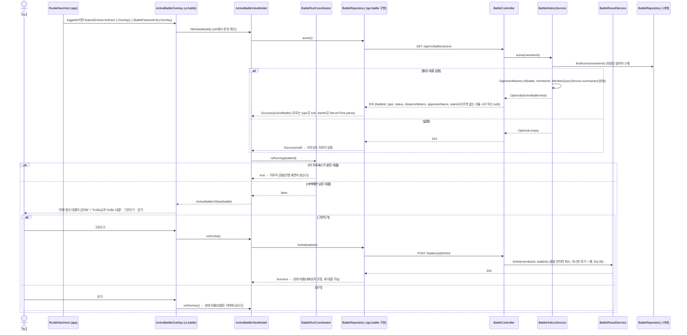
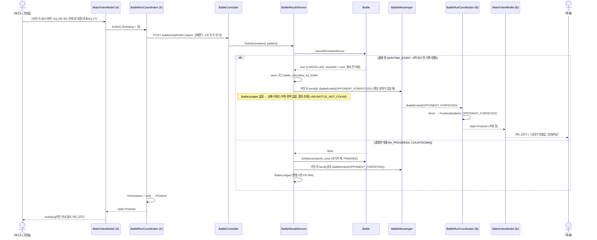
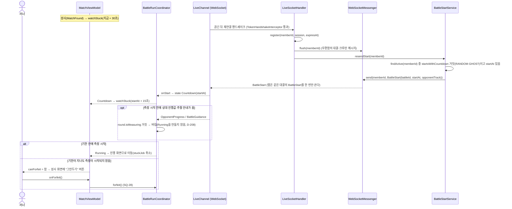
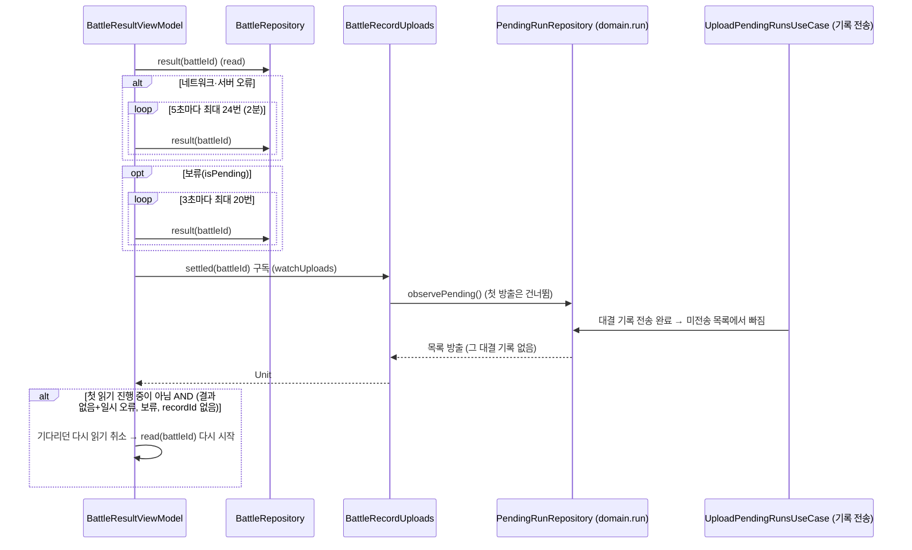

> [런크크 객체지향 분석·설계서](../design-oo.md) 목차 · 이전: [02c-동적-모델-2.4.4](02c-동적-모델-2.4.4.md) · 다음: [03-기능-모델](03-기능-모델.md)

### 2.2 사건 추적도 (이어서: SQ-27~, v0.13)

SQ-01~SQ-26은 [02-동적-모델](02-동적-모델.md) 2.2에 있다. 그 조각이 100KB를 넘어 v0.13(2026-10-28, 배틀런 QA 후속 MR !32) 시퀀스는 이 조각에 쓴다. 상태 전이(Battle의 cancelIfUnstarted)는 02-동적-모델 2.4.2에 더했다. 결정 근거는 5.6 D-200~D-209([05-05](05-05-설계-결정-v0.13.md))다.

#### SQ-27 진행 중 대결 복구 안내 (FR-220, CR-18, D-202) (v0.13)

앱을 강제 종료한 뒤 다시 켜면 서버에는 활성 대결이 남아 새 대결이 막힌다(회원마다 활성 대결 1개). 앱은 로그인한 동안 화면 그래프 위에 붙는 안내로 그 대결을 알려 그만두기로 잠금을 풀게 한다. 이어 달리기·기록 복구는 하지 않는다.

그만두기가 실패하면 BattleErrorText 문구를 본문 자리에 보이고 대화상자를 남긴다. 결과 문구는 패배 규칙 D-201을 따라 "대결에서 졌어요"다.

#### SQ-28 출발 전 포기 = 대결 취소 (FR-094 수정, CR-16, D-200) (v0.13)

#### SQ-29 재연결 BattleStart 재전송과 성사 화면 그만두기 (FR-087, FR-221, CR-19, D-203, D-207, D-208) (v0.13)

resendStart가 예외를 던지면 LiveSocketHandler는 로그(socket_battle_start_resend_failed)만 남기고 연결을 유지한다.

#### SQ-30 그만두기·오프라인 종료 뒤 결과 다시 읽기 (FR-093, D-209) (v0.13)

