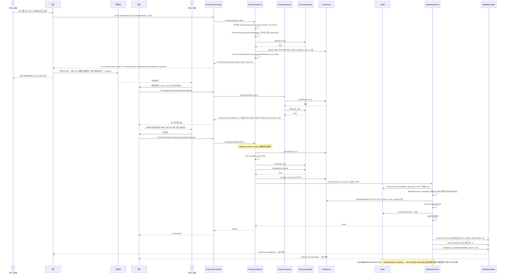
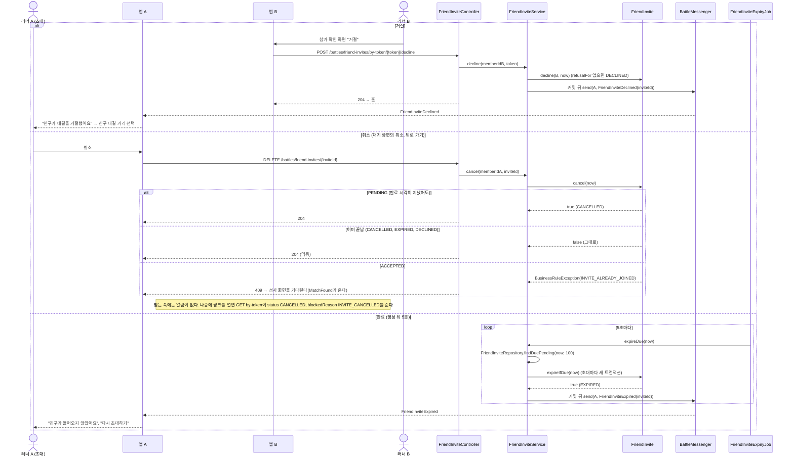
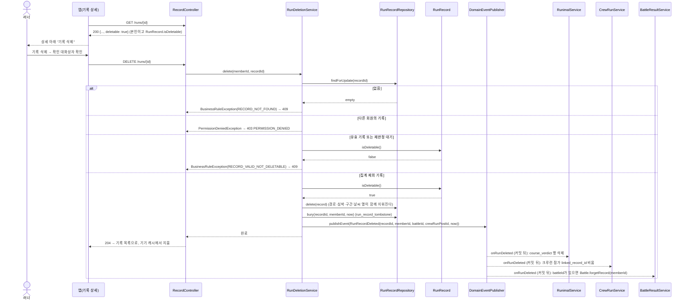
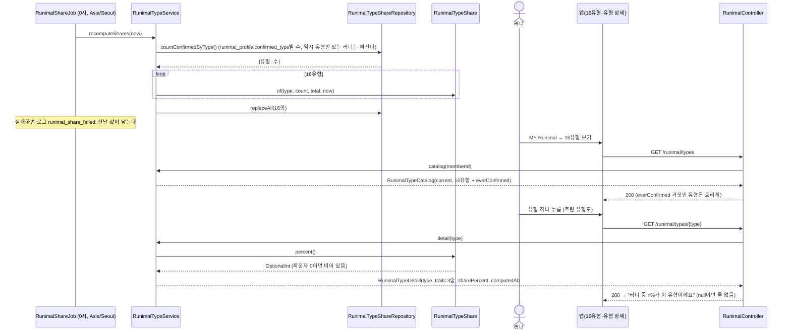
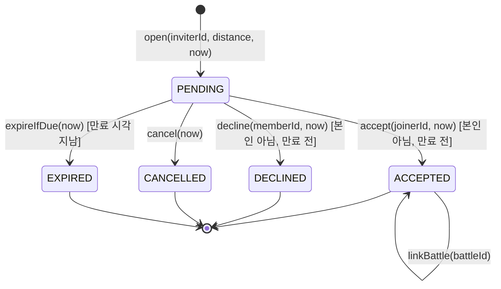

### 2.2 사건 추적도 (이어서: SQ-31~SQ-34, v0.14 서버)
> 작성: 2026-10-30 | 버전: v0.15(SQ-31 linkBattle 위치, SQ-33 발행기·수신자 실패 정책, 탈퇴 전이, [05-10](05-10-설계-결정-v0.15.md)) | 입력: srs.md v0.13(7.13.9 CR-24~CR-51), 코드 origin/develop 7c42b0fe, v0.15는 코드 5885a608

> [런크크 객체지향 분석·설계서](../design-oo.md) 목차 · 이전: [02-02-동적-모델-v0.13](02-02-동적-모델-v0.13.md) · 다음: [02-04-동적-모델-v0.16](02-04-동적-모델-v0.16.md)

SQ-01~SQ-26은 [02-동적-모델](02-동적-모델.md), SQ-27~SQ-30은 [02-02-동적-모델-v0.13](02-02-동적-모델-v0.13.md)에 있다. 이 조각은 v0.14(2026-10-29, 피그마 디자인 반영)의 서버가 관여하는 시퀀스 SQ-31~SQ-34와 상태도 2.4.11 FriendInvite, 2.4.2 Battle에 더하는 전이다. 앱 화면 흐름 시퀀스는 앱 조각(05-07 쪽)이 SQ-35부터 쓴다. 결정 근거는 5.6 D-218~D-249([05-06](05-06-설계-결정-v0.14-서버.md))다. 메시지 이름은 받는 객체의 연산 이름이다.

#### SQ-31 친구 대결 초대와 참가 (FR-227, FR-228, FR-229, FR-086, FR-087, CR-50, D-218~D-222)

초대한 러너 A가 거리를 골라 초대를 만들고 카카오톡으로 링크를 보낸다. 받는 러너 B가 링크로 앱을 열어 참가 확인 화면을 보고 참가하면, 서버는 기존 랜덤 대결의 성사 경로(announceMatch)로 두 사람에게 MatchFound와 BattleStart를 보낸다. 그 뒤 출발·진행·종료는 랜덤 대결과 같다(SQ-03 이후).

두 사람이 거의 같은 때 수락하면 version 충돌(또는 활성 대결 칸 고유 제약 위반, 23505만, v0.15 D-302)로 늦은 쪽 트랜잭션이 다시 실행되고, 다시 읽은 초대가 ACCEPTED라 refusalFor가 INVITE_ALREADY_JOINED를 낸다(409). 초대한 쪽 A가 그사이 다른 대결에 들어갔으면(isInBattleOrQueue 참) 초대를 CANCELLED로 저장해 커밋한 뒤 결과 값으로 B에게 INVITE_CANCELLED를 낸다(예외로 던지면 취소가 롤백된다, D-302). 초대한 사람이 탈퇴하면 초대 행이 지워져 링크는 INVITE_NOT_FOUND다(D-308). 친구 대결은 대기열을 거치지 않으므로 고스트 탐색이 없다.

#### SQ-32 친구 대결 초대 거절, 취소, 만료 (FR-228, FR-229, D-221, D-223, D-224)

정리 작업보다 먼저 받는 쪽이 만료된 링크로 수락하면 FriendInvite.statusAt(now)이 EXPIRED를 돌려줘 INVITE_EXPIRED다(조회 시 판정). 앱 A가 꺼져 있으면 FriendInviteExpired는 우편함(D-06)에 남고, 앱을 다시 켜면 GET /battles/friend-invites/mine이 204라 대기 화면을 복구하지 않는다.

#### SQ-33 집계 제외 기록 삭제 (FR-225, CR-38, D-231, D-232)

수신자가 실패해도 보정 배치는 없다. 읽는 쪽이 견딘다: 대결 결과는 내 기록 ID가 묘비에 있으면 myRecordId를 null로 내고 앱은 "기록 카드" 대신 "기록 목록"을 보인다(D67, v0.15 D-306). 집계 제외 기록은 랭킹·티어·리워드·홈 거리·달력에 들어가 있지 않으므로 다시 집계하지 않는다. 같은 기록 ID가 앱 미전송 보관함에서 다시 올라오면 RunUploadService가 isBuried로 보고 UploadResult.alreadyStored를 돌려줘 앱이 보관함에서 지운다.

#### SQ-34 Runimal 유형 비율 일배치와 유형 상세 (FR-226, FR-153, CR-46, D-245, D-246)

everConfirmed는 RunimalProfile.confirm이 판정 때마다 confirmedHistory에 넣은 유형 집합으로 정한다(V30가 기존 확정 유형으로 채운다).

### 2.4 상태도 (이어서: 2.4.11, v0.14)

#### 2.4.11 FriendInvite (친구 대결 초대) (FR-227~FR-229, CR-50, D-218~D-223)

사건은 FriendInvite의 연산 이름이다. PENDING에서만 다른 상태로 가고, 끝 상태에서는 되돌아가지 않는다. 참가(accept)는 같은 트랜잭션에서 Battle.friend로 대결을 만들어 2.4.2의 WAITING_START로 이어진다.

| 현재 상태 | 사건(연산) | 조건 | 다음 상태 | 부수 동작 |
|-----------|-----------|------|-----------|-----------|
| 시작 | open | 거리 1·3·5·10km. 서비스가 위치 동의, 대기 초대 없음, RunnerAvailability.isBusy 거짓을 먼저 확인 | PENDING | expiresAt = 생성 + 5분, 기본 대결 거리 기억 |
| PENDING | accept | 본인 초대 아님, now < expiresAt, 받는 쪽 바쁘지 않음, 초대한 쪽 대결·대기 없음 | ACCEPTED | BattleStartService.startFriend: Battle.friend 저장 → linkBattle → announceMatch(MatchFound, BattleStart) |
| PENDING | decline | 본인 초대 아님, now < expiresAt | DECLINED | 초대한 쪽에 FriendInviteDeclined |
| PENDING | cancel | 초대한 사람, 만료 시각과 무관 | CANCELLED | 없음(받는 쪽을 모른다) |
| PENDING | expireIfDue | now ≥ expiresAt(정각은 만료) | EXPIRED | 초대한 쪽에 FriendInviteExpired |
| PENDING | accept, decline | now ≥ expiresAt(정리 전) | PENDING 그대로 | 409 INVITE_EXPIRED(statusAt이 EXPIRED) |
| ACCEPTED | cancel | | ACCEPTED 그대로 | 409 INVITE_ALREADY_JOINED |
| DECLINED, CANCELLED, EXPIRED | cancel | | 그대로 | 204(멱등) |
| 끝 상태 | accept, decline | | 그대로 | 409 refusal(): ACCEPTED INVITE_ALREADY_JOINED, DECLINED·CANCELLED INVITE_CANCELLED, EXPIRED INVITE_EXPIRED |
| 모든 상태 | 링크 조회(FriendInviteQuery.view) | | 그대로 | 200 status·blockedReason |
| 모든 상태 | 초대한 사람 또는 참가한 사람 탈퇴(eraseOf) | PENDING이면 먼저 cancel | 행 삭제 | 이후 링크는 409 INVITE_NOT_FOUND, 대결 행은 남음(v0.15 D-308) |

srs 6.4.2의 상태 이름과의 대응: 초대 대기 = PENDING, 초대 취소 = CANCELLED, 초대 만료 = EXPIRED, 초대 거절 = DECLINED, 참가됨 = ACCEPTED.

#### 2.4.2 Battle에 더하는 전이 (v0.14, D-222, D-225, D-228)

> v0.16: 아래 cancelOnForfeit 두 행은 코드에서 없어졌다. 진행 중 그만두기는 모든 종류에서 포기자 패이고, 셀프런·셀럽런 취소는 cancelByRunner다. 현재 상태도는 [02-04 2.4.2](02-04-동적-모델-v0.16.md)다(D-317, D-318).

02-동적-모델 2.4.2의 상태는 그대로이고 아래 전이를 더한다.

| 현재 상태 | 사건(연산) | 조건 | 다음 상태 | 비고 |
|-----------|-----------|------|-----------|------|
| 시작 | Battle.friend(invite, now) | invite ACCEPTED | WAITING_START | type FRIEND, 참가자 2명. 이후 전이는 RANDOM과 같다(startDue → IN_PROGRESS, 실시간 세션 있음) |
| IN_PROGRESS, COUNTDOWN | cancelOnForfeit(now) | type.cancelsOnForfeit() 참(SELF, CELEBRITY) | CANCELLED | 판정·이력·리워드 없음. v0.13의 Battle.forfeit(패)를 대신한다(CR-27) |
| WAITING_START, 시작 보고 전 IN_PROGRESS | cancelOnForfeit(now) | 모든 종류 | CANCELLED | v0.13 cancelIfUnstarted와 같은 조건(D-200) |
| IN_PROGRESS, COUNTDOWN | forfeit(memberId, now) | cancelOnForfeit 거짓(RANDOM, GHOST, FRIEND) | FINISHED(포기자 패) | 그대로. FRIEND 승리는 리워드 없음(D-226) |
