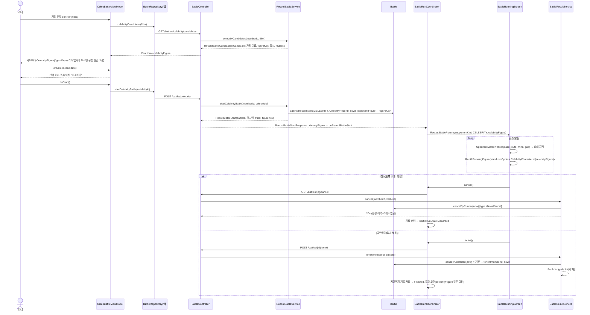
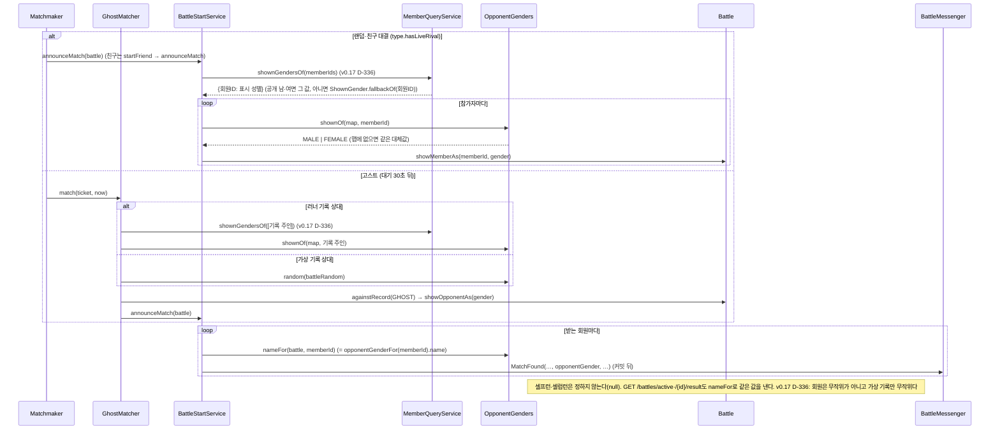
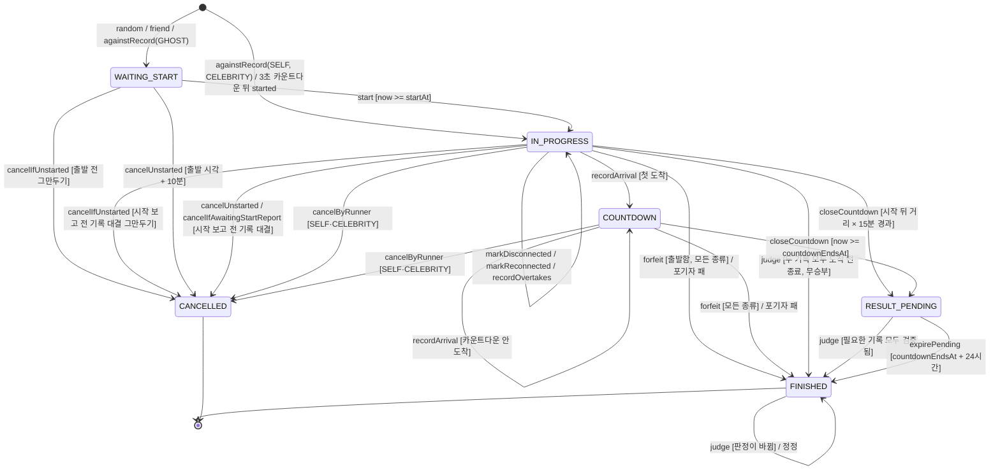

### 2.2 사건 추적도 (이어서: SQ-37~SQ-38, v0.16) · 2.4.2 Battle 상태도 (v0.16)
> 작성: 2026-10-31 | 버전: v0.16 | 입력: srs.md v0.16(7.13.11 CR-63~CR-65·CR-68·CR-70, 7.13.12), 코드 S15P31A207-fig cfbd103c, 결정 D-313~D-330([05-11](05-11-설계-결정-v0.16.md))

> [런크크 객체지향 분석·설계서](../design-oo.md) 목차 · 이전: [02-03-동적-모델-v0.14](02-03-동적-모델-v0.14.md) · 다음: [02-05-동적-모델-v0.19](02-05-동적-모델-v0.19.md)

SQ-01~SQ-26은 [02-동적-모델](02-동적-모델.md), SQ-27~SQ-30은 [02-02](02-02-동적-모델-v0.13.md), SQ-31~SQ-34는 [02-03](02-03-동적-모델-v0.14.md), 앱 SQ-35·SQ-36은 05-09 7절에 있다. 이 조각은 v0.16에서 바뀐 셀럽런 흐름(선택·전용 캐릭터·취소와 그만두기)과 매칭 때 상대 캐릭터 성별을 정하는 흐름, 취소 전이를 더한 대결 상태도를 담는다. 메시지 이름은 코드의 연산 이름이다.

#### SQ-37 셀럽런: 고르기, 전용 캐릭터, 취소와 그만두기 (S-13, FR-097, FR-099, FR-171, FR-232, FR-094, CR-64, CR-68, CR-70, D-315, D-317, D-318, D-324, D-326)

SQ-07(나와의 싸움·유명인 대결)의 셀럽 갈래를 v0.16 화면과 계약으로 다시 그린다. 러너는 카드를 눌러 고르고 아래 "대결하기"로 시작한다. 셀럽 그림 키(celebrityFigure)는 후보 목록·시작 응답·진행·결과에 같은 값으로 실린다. 측정 중 "취소"는 기록 없이 대결을 취소하고, 길게 눌러 그만두면 패로 판정하고 기록을 남긴다.

#### SQ-38 매칭 때 상대 캐릭터 성별 정하기 (FR-233, FR-086, CR-65, D-313, D-314)

랜덤·친구 대결은 성사 알림 직전에 참가자마다, 고스트는 상대 기록을 고를 때 한 번 정해 대결에 남긴다. 응답·실시간 메시지는 member 형식을 싣지 않고 문자열 이름을 싣는다.

#### 2.4.2 Battle (대결) — v0.16 (02-동적-모델 2.4.2와 02-03의 "더하는 전이"를 대신한다)

v0.14의 `cancelOnForfeit`(셀프런·셀럽런 진행 중 포기 = 취소) 전이는 없어졌다. 진행 중 그만두기는 모든 종류에서 포기자 패(FINISHED)이고, 셀프런·셀럽런만 러너 취소(`cancelByRunner`)로 활성 상태 어디서든 CANCELLED가 된다(D-317, D-318).

| 사건 | 대응 연산 | v0.16 변경 |
|------|-----------|-----------|
| friend | BattleStartService.startFriend → Battle.friend(invite, now) | v0.14 그대로 |
| forfeit | BattleResultService.forfeit → Battle.cancelIfUnstarted(now)가 거짓이면 Battle.forfeit(memberId, now) → BattleJudged | 셀프런·셀럽런도 패(D-318). cancelOnForfeit 삭제 |
| cancelByRunner | BattleResultService.cancel → `type.allowsCancel()` 거짓이면 ALREADY_MATCHED, 참이면 Battle.cancelByRunner(now): 활성(WAITING_START·IN_PROGRESS·COUNTDOWN)이 아니면 IllegalStateException(409 INVALID_STATE) | 신규(D-317). 판정·이력·리워드 없음, 늦게 온 기록은 applyRecord가 붙이지 않음 |
| 상대 성별 | Battle.showOpponentAs(gender)(기록 상대), Battle.showMemberAs(memberId, gender)(랜덤·친구) | 상태를 바꾸지 않는 속성 설정. 매칭 때 한 번만(D-313) |

CANCELLED는 활성이 아니며 판정·이력·전적에 나오지 않고 결과 조회는 409 BATTLE_NOT_FOUND다. srs 6.4.2의 "취소" 상태가 CANCELLED다.
