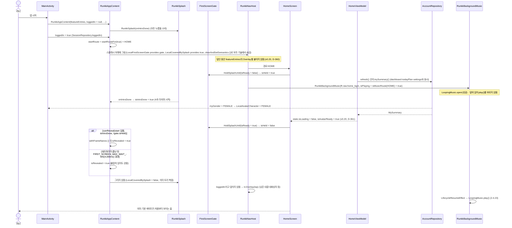
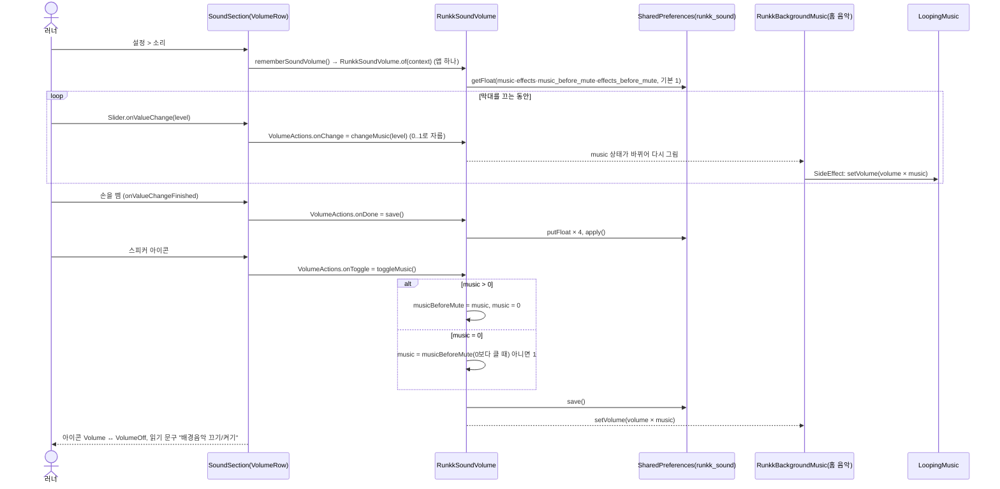
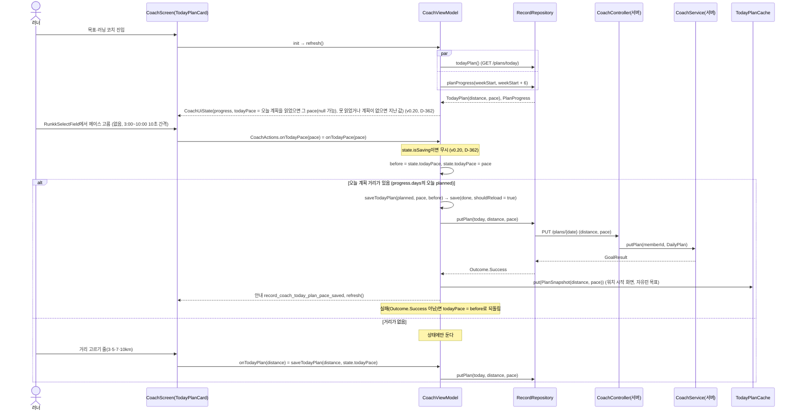
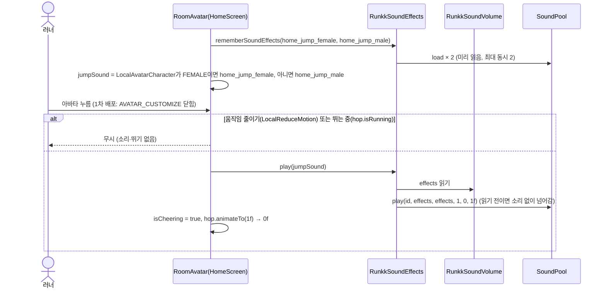
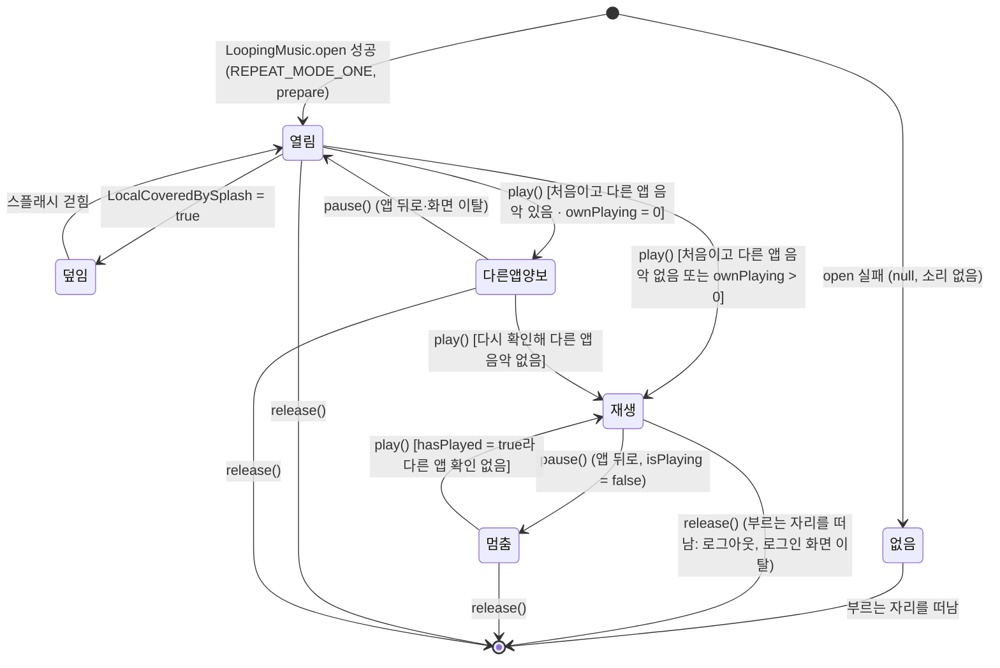
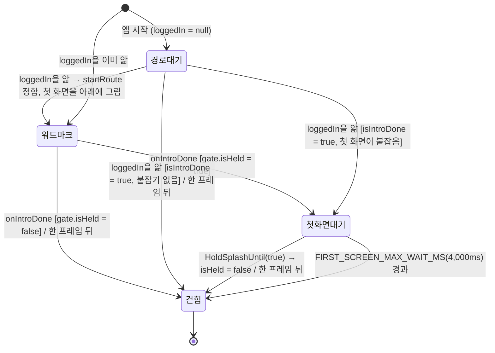

### 2.2 사건 추적도 (이어서: SQ-39~SQ-42, v0.19) · 2.4 상태도 (이어서: 2.4.23~2.4.24, v0.19)
> 작성: 2026-10-31 | 버전: v0.19 | 입력: srs.md v0.17(7.13.13 CR-82~CR-91, FR-234~FR-239, FR-073, FR-048, FR-162), 코드 S15P31A207-fig feature/runkk-figma-v1 242612e9(읽기만 함), 결정 D-344~D-357([05-14](05-14-설계-결정-v0.19.md))

> [런크크 객체지향 분석·설계서](../design-oo.md) 목차 · 이전: [02-04-동적-모델-v0.16](02-04-동적-모델-v0.16.md) · 다음: [02-06-동적-모델-v0.21](02-06-동적-모델-v0.21.md)

SQ-01~SQ-26은 [02-동적-모델](02-동적-모델.md), SQ-27~SQ-30은 [02-02](02-02-동적-모델-v0.13.md), SQ-31~SQ-34는 [02-03](02-03-동적-모델-v0.14.md), 앱 SQ-35·SQ-36은 05-09 7절, SQ-37·SQ-38은 [02-04](02-04-동적-모델-v0.16.md)에 있다. 이 조각은 srs v0.17에서 생긴 앱 흐름 넷(앱 시작과 스플래시 걷기, 소리 크기 바꾸기, 오늘 계획 목표 페이스 저장, 홈 아바타 효과음)과 상태가 바뀌는 앱 객체 둘(배경 음악 재생기, 스플래시)을 담는다. 서버 흐름은 바뀌지 않았다. 메시지 이름은 코드의 함수·연산 이름이다. 컴포저블은 화면이 다시 그려질 때 실행되므로 "메시지"는 컴포저블 호출과 상태 읽기를 함께 가리킨다(0단계의 전제: 메소드는 메시지를 받을 때 실행된다).

#### SQ-39 앱 시작과 스플래시 걷기 (FR-239, FR-162, FR-234, CR-86, D-352, D-353, D-345)

로그인한 러너가 앱을 열면 홈을 스플래시 아래에서 미리 그리고, 홈이 본인 요약(성별 포함)을 다 읽은 뒤에 스플래시를 걷는다. 그래서 기본 캐릭터가 남자로 보였다가 여자로 바뀌는 일이 없다. 홈 배경 음악은 스플래시가 덮고 있는 동안 틀지 않는다.

갈래:

- 로그인하지 않았으면 시작 경로가 LOGIN이다. LoginScreen은 HoldSplashUntil을 부르지 않으므로 워드마크가 끝나면 다음 프레임에 걷힌다. LoginScreen의 `RunkkBackgroundMusic(R.raw.login_bgm)`도 덮인 동안 틀지 않는다. RunkkNavHost의 홈 음악은 `loggedIn`이 거짓이라 부르지 않는다.
- HoldSplashUntil이 놓이기 전에 다시 붙잡히면(`gate.isHeld`가 한 프레임 안에 참으로 돌아오면) `LaunchedEffect(canReveal)`가 취소되어 걷지 않는다. 처음 그린 프레임의 붙잡기가 돈 뒤에 걷으려고 한 프레임을 기다린다.
- 스플래시 없이 홈에 들어오는 경로(로그인 직후)는 RoomAvatar가 `isAvatarReady`가 거짓인 동안(본인 요약을 한 번도 읽지 못함) 아바타를 투명하게 그려 자리만 두고 누름·읽기 문구를 붙이지 않는다. 상단 프로필 얼굴도 그리지 않는다(FR-162, v0.20 D-361이 D-353을 대체).
- 스플래시가 덮고 있는 동안 기능 화면 위 안내(Overlay)는 붙지 않고, 덮인 NavHost는 `clearAndSetSemantics {}`로 TalkBack에서 숨는다. 걷힌 뒤에 Overlay가 붙는다(v0.20, D-360, U11-5).

#### SQ-40 소리 크기 바꾸기 (FR-237, FR-238, CR-85, D-349, D-350)

설정 > 소리 묶음에서 막대를 끄는 동안은 화면 값만 바꾸고(틀고 있는 홈 음악에 바로 들린다), 손을 떼면 기기에 저장한다. 스피커 아이콘은 누를 때마다 바로 저장한다.

효과음 줄은 같은 흐름에서 `changeEffects`·`toggleEffects`를 부른다. 효과음 크기는 다음 `RunkkSoundEffects.play` 때 읽는다(SQ-42). 로그아웃 때 `SettingsRepository.clear()`는 다른 저장 파일을 지우므로 runkk_sound는 남는다(FR-237).

#### SQ-41 오늘 계획 목표 페이스 저장 (FR-073, FR-048, CR-89, D-354)

측정 쪽은 바뀌지 않았다: `FreeRunGoalUseCase.current(todayPlan)`이 `FreeRunGoal.of`로 코치 계획 따르기가 켜져 있으면 오늘 계획 거리·페이스를 목표로 삼고, 1km마다 `Pace.isSlowerThanBy`(목표 × 1.1 이상)면 안내한다(FR-044, FR-048). `save`는 저장 중이면 새 요청을 받지 않는다.

#### SQ-42 홈 아바타 효과음 (FR-236, NFR-046, NFR-044, CR-84, D-351)

아바타 꾸미기가 열려 있으면(2차 배포) 누름은 꾸미기 화면 이동이고 효과음을 내지 않는다. 그때의 동작은 J-8대로 2차 배포 때 정한다.

#### 2.4.23 배경 음악 재생기 (RunkkBackgroundMusic · LoopingMusic) (v0.19, FR-234, FR-235, NFR-045, D-344~D-346)

상태는 LoopingMusic의 속성 `player.playWhenReady`, `hasPlayed`와 부르는 자리의 조건(재개, 덮임, isPlaying)의 조합이다. `play()`를 부르는 조건은 "앱이 재개 상태이고 스플래시에 덮이지 않았고 isPlaying이 참"이고, 그 조건이 깨지면(앱이 뒤로 감, 측정 화면으로 이동) `onPauseOrDispose`가 `pause()`를 부른다.

| 사건 | 연산 | 효과 |
|------|------|------|
| 재생 조건이 참이 됨 | `LoopingMusic.play()` | 이미 재생 중이면 무시. 처음이면 `AudioManager.isMusicActive`와 `ownPlaying`을 보고 양보할지 정한다. 틀면 `hasPlayed = true`, `ownPlaying + 1` |
| 재생 조건이 깨짐 | `LoopingMusic.pause()` | 그 자리에서 멈춤(위치 유지), `ownPlaying − 1` |
| 크기 변경 | `LoopingMusic.setVolume(level)` | 상태는 그대로, 음량만 바뀜(SQ-40) |
| 부르는 자리 이탈 | `LoopingMusic.release()` | `ownPlaying` 정리 뒤 재생기 해제 |

"다른앱양보"는 FR-235의 "다른 앱 음악 때문에 틀지 않은 배경 음악은 앱이 다시 앞으로 오거나 그 화면에 다시 들어올 때 다시 확인한다"이다. `hasPlayed`가 거짓으로 남으므로 다음 `play()`에서 다시 확인한다.

#### 2.4.24 스플래시 (RunkkAppContent) (v0.19, FR-239, D-352)

상태는 RunkkAppContent의 `startRoute`, `isIntroDone`, `isRevealed`와 `FirstScreenGate.isHeld`의 조합이다.

| 상태 | 화면 | 누름 | LocalCoveredBySplash |
|------|------|------|----------------------|
| 경로대기 | 스플래시만 | 스플래시가 소비 | (첫 화면 없음) |
| 워드마크, 첫화면대기 | 스플래시 아래 첫 화면 | 스플래시가 소비 | true |
| 걷힘 | 첫 화면 | 첫 화면 | false |

종료 상태 "걷힘"은 프로세스가 살아 있는 동안 되돌아가지 않는다(다시 스플래시를 띄우지 않는다). 4초 타이머는 `start != null && isIntroDone`이 참이 된 때부터 센다.
