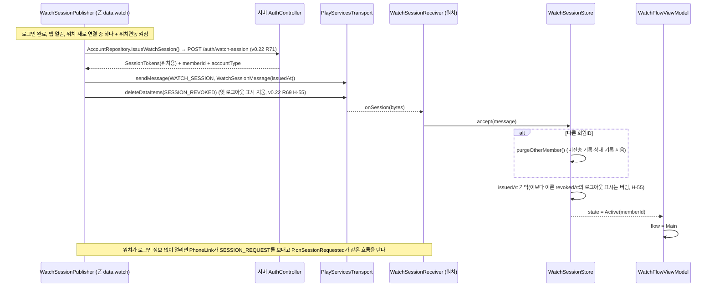
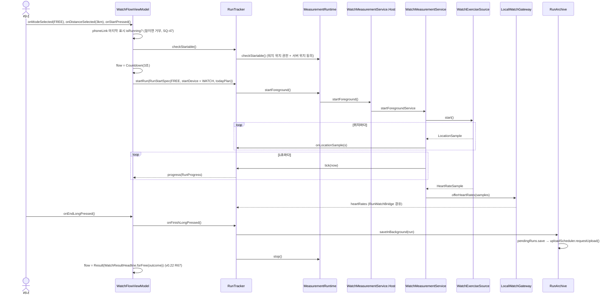
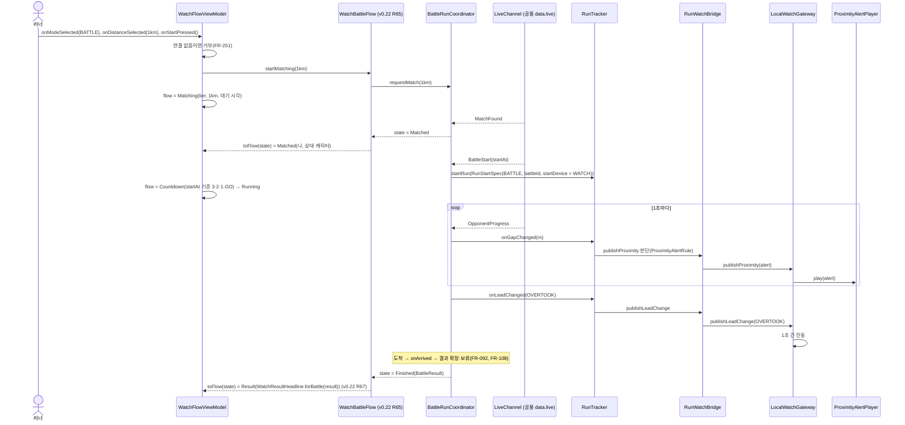
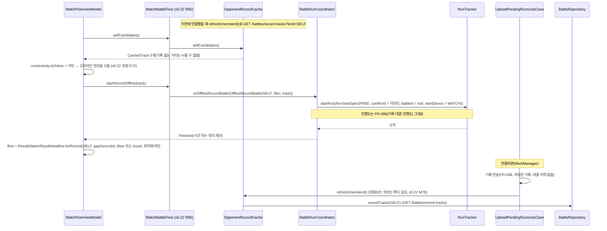
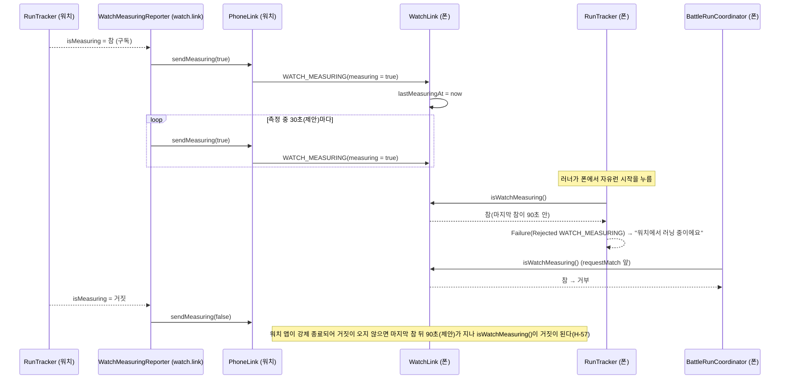
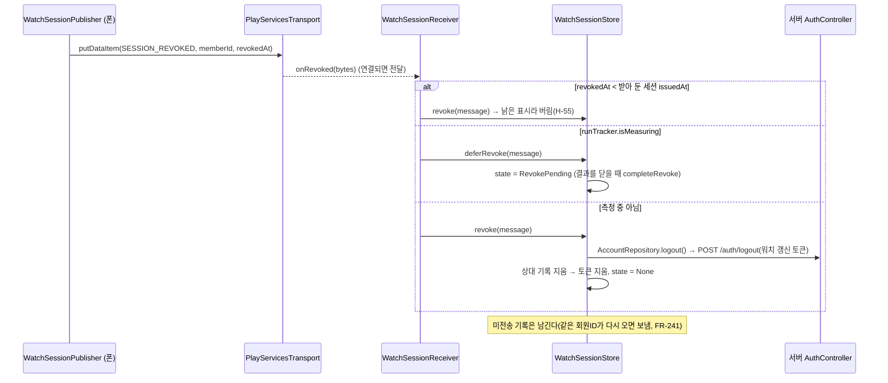
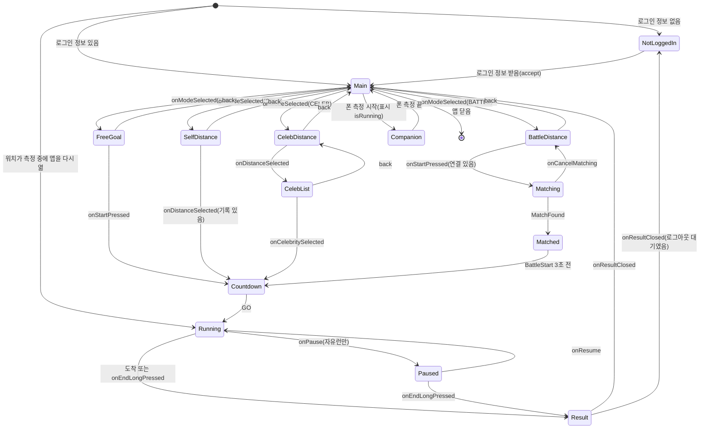
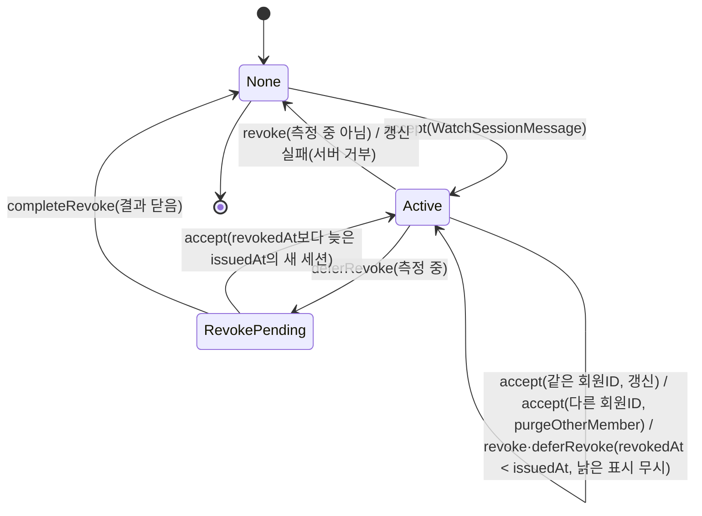

### 2.2 사건 추적도 (이어서: SQ-43~SQ-48, v0.21, v0.22 고침) · 2.4 상태도 (이어서: 2.4.25~2.4.26, v0.21, v0.22 고침)
> 작성: 2026-10-31 | 버전: v0.22 | 입력: design-review.md v0.16(22장 R64~R71, H-55·H-57), srs.md v0.18(7.13.14 CR-92~CR-102, FR-240~FR-260, 시나리오 S-27~S-29), 코드 S15P31A207-watch 6400955a(읽기만 함), 결정 D-365~D-384([05-16](05-16-설계-결정-v0.21.md))

> [런크크 객체지향 분석·설계서](../design-oo.md) 목차 · 이전: [02-05-동적-모델-v0.19](02-05-동적-모델-v0.19.md) · 다음: [03-기능-모델](03-기능-모델.md)

SQ-01~SQ-42는 앞 조각들에 있다(02-05 머리 문단). 이 조각은 srs v0.18의 워치 단독 러닝 시나리오(S-27 워치 자유런, S-28 워치 배틀런, S-29 연결 없는 셀프런)를 객체 사이 메시지로 다시 쓴다. 메시지 이름은 05-16 3절과 기존 클래스(RunTracker, BattleRunCoordinator, RunArchive)의 연산 이름이다. 서버 API는 05-16 7절 사용자 결정(U2 (가) `/auth/watch-session`, U3 (나) `/battles/record-tracks`만)을 따른다.

#### 2.1 사건 시나리오 (객체 관점, v0.21)

| 시나리오 | 객체 관점 |
|----------|-----------|
| S-27 워치 자유런 | WatchModeCarousel이 WatchFlowViewModel에 onModeSelected(FREE)를 보낸다. ViewModel이 onDistanceSelected(3km), onStartPressed를 받아 RunTracker에 checkStartable·startRun을 보낸다. MeasurementRuntime이 WatchMeasurementService.Host에 startForeground를 보내고, 서비스가 WatchExerciseSource에서 받은 위치를 RunTracker.onLocationSample로 넘긴다. 길게 누르면 RunTracker.onFinishLongPressed가 기록을 확정하고 RunArchive가 보관·전송을 예약한다 |
| S-28 워치 배틀런 | ViewModel이 BattleRunCoordinator에 requestMatch(1km)를 보낸다. 실시간 채널이 MatchFound·BattleStart를 주면 BattleRunCoordinator가 RunTracker.startRun을 부른다. 거리 차가 바뀌면 RunWatchBridge가 LocalWatchGateway.publishProximity를 부르고 ProximityAlertPlayer가 비프·진동을 낸다 |
| S-29 연결 없는 셀프런 | ViewModel이 연결 없음을 보고 OpponentRecordCache의 selfCandidates에서 상대를 꺼내 BattleRunCoordinator.onOfflineRecordBattle로 진행한다. 결과는 워치 화면에만 보이고, 기록은 자유런으로 확정해 연결되면 UploadPendingRunsUseCase가 올린다(U3 (나)) |
| 예외: 폰 측정 중 | ViewModel이 PhoneLink의 마지막 표시(isRunning 참)를 보고 시작을 거부하고 WatchFlow.Companion으로 간다 |
| 예외: 로그아웃 | 폰 WatchSessionPublisher가 SESSION_REVOKED를 보내면 WatchSessionReceiver가 측정 중이면 WatchSessionStore.deferRevoke를, 아니면 revoke를 부른다(v0.22 R68) |

#### SQ-43 폰 로그인 → 워치 로그인 정보 받기 (FR-240, FR-242, NFR-050, D-371, D-372)

> v0.23 정정([05-17](05-17-설계-결정-v0.23.md) 4절): 응답은 TokenResponse(accessToken, refreshToken)이고 memberId·accountType은 폰이 아는 값이다(D-395). 폰 앱 프로세스가 없으면 PhoneWatchListenerService가 SESSION_REQUEST를 받는다(D-404).

#### SQ-44 워치 자유런 시작~전송 (FR-243~FR-249, FR-250, FR-255, D-366~D-368, D-378)

#### SQ-45 워치 배틀런 매칭~결과 (FR-257, FR-196, FR-188, FR-249, D-369, D-376)

#### SQ-46 연결 없는 셀프런 ~ 자유런으로 전송 (FR-258, FR-260, FR-250, FR-251, D-377, U3 (나))

#### SQ-47 폰·워치 동시 측정 막기 (FR-252, D-373, v0.22 R69 H-57·R70 M77)

> v0.23 정정(05-17 4절): WatchMeasuringReporter는 RunTracker.notice를 구독한다(D-408). 폰은 프로세스 재시작 직후 30초까지 워치 측정을 모를 수 있다(D-400).

#### SQ-48 로그아웃 따라가기 (FR-241, D-372, v0.22 R68·R69)

> v0.23 정정(05-17 4절): 폰의 로그아웃 감지는 로그인 상태·워치연동 변화다(D-403). 워치연동을 끈 순간은 DELETE /auth/watch-session을 부르고, 로그아웃·탈퇴는 서버가 워치 세션 세대를 올려 워치용 갱신 토큰을 모두 끊는다(D-396).

#### 2.4.25 워치 화면 흐름 (WatchFlow) (v0.21, FR-242~FR-249, FR-251, FR-252, D-374)

> v0.23 정정(05-17 D-414): "뒤로 가기를 받지 않는다"는 하드웨어 뒤로 키를 소비한다는 뜻이다. 메인·미로그인·동행 표시만 앱을 닫고, Result는 "완료"로만 닫히며, Matched·대결 Countdown 중 다시 열면 activeDistance와 대결 상태로 복원한다.

뒤로 가기(back)는 Countdown·Running·Paused·Matched에서는 받지 않는다(측정·대결 중 실수로 빠지지 않게. 종료는 길게 누르기). Matching의 back은 onCancelMatching과 같다.

#### 2.4.26 워치 로그인 상태 (WatchSession) (v0.21, FR-240~FR-242, D-372, v0.22 R68·R69)

> v0.23 정정(05-17 D-406): 다른 회원의 로그아웃 표시는 버리고, RevokePending 중 다른 회원 세션은 거부하며, 이전 회원 보관함 삭제가 실패하면 새 회원 세션을 거부한다.

사건과 연산의 대응: accept·revoke·deferRevoke·completeRevoke는 WatchSessionStore의 연산이고(revoke·deferRevoke 고르기는 WatchSessionReceiver, v0.22 R68), "갱신 실패"는 공용 :data TokenAuthenticator가 갱신을 거부당했을 때 SessionRepository.clear를 부르는 기존 경로다. WatchFlow의 사건(onModeSelected, onStartPressed 등)은 모두 WatchFlowViewModel의 연산이고 MatchFound·BattleStart는 BattleRunCoordinator가 받는 실시간 메시지다.
