> [런크크 객체지향 분석·설계서](../design-oo.md) 목차 · 이전: [01-03-관계-분석-클래스도](01-03-관계-분석-클래스도.md) · 다음: [02b-동적-모델-SQ-15-랭킹-집계와-조](02b-동적-모델-SQ-15-랭킹-집계와-조.md)

## 2. 동적 모델

### 2.1 사건 시나리오

srs.md 2.6 시나리오를 객체 관점으로 다시 썼다. 외부 입력은 액터 → 화면(Controller·ViewModel) 메시지로 쓰고, 메소드는 메시지를 받을 때 실행된다. 시각 사건(매 1초, 매일 0시)은 스케줄러 액터가 보내는 메시지로 쓴다. v0.11에서 srs v0.10의 S-19~S-25를 2.1.6~2.1.12로 더하고 S-01·S-07·S-17을 고쳤다 (v0.11, CR-01~CR-10).

#### 2.1.1 S-01 가입하고 첫 러닝을 저장한다

| 시나리오 | 사건 | 보내는 객체 | 받는 객체 | 메시지 |
|---------|------|------------|-----------|--------|
| S-01 | 소셜 로그인 | 러너 | LoginViewModel | signIn(provider) |
| S-01 | 제공자 토큰 받기 | LoginViewModel | KakaoLoginClient | signIn(activity) |
| S-01 | 서버 로그인 | AuthController | AuthService | login(provider, providerToken) |
| S-01 | 제공자 확인 | AuthService | SocialLoginGateway | authenticate(providerToken) |
| S-01 | 회원 아님 | AuthService | AuthController | LoginResult.signUpRequired(ticket) |
| S-01 | 가입 제출 | SignUpController | SignUpService | signUp(command) (동의 화면 하나, 프로필·태그 없음, v0.11, FR-003, D-90) |
| S-01 | 필수 조건 판정 | SignUpService | SignUpForm | validate() → RequiredConsents.check (v0.11, FR-004, D-90) |
| S-01 | 닉네임 확정 | SignUpService | Nickname | withSuffix(n) (겹칠 때만). 제공자 이름이 없으면 numbered(n) (v0.11, D-90) |
| S-01 | 회원 생성 | SignUpService | Member | signUp(account, form, nickname, now) |
| S-01 | 동의 감사 | SignUpService | AuditService | record(AuditEntry 가입동의) |
| S-01 | 자유런 시작 | 러너 | RunViewModel | startFreeRun() |
| S-01 | 카운트다운 | RunViewModel | StartCountdown | begin() |
| S-01 | 측정 시작 | RunTracker | RunSession | start(at) |
| S-01 | 위치 수신 | FusedLocationProvider(액터) | LocationFilter | accept(sample) |
| S-01 | 1초 갱신 | RunTracker | RunSession | tick(now) |
| S-01 | 길게 눌러 종료 | 러너 | RunViewModel | onFinishLongPressed() |
| S-01 | 종료 요청 | RunViewModel | RunTracker | onFinishLongPressed() |
| S-01 | 기록 확정 | RunTracker | RunSession | finish(now) |
| S-01 | 기기 보관 | RunTracker | PendingRunRepository | save(completedRun) |
| S-01 | 전송 | UploadPendingRunsUseCase | RunController | POST /runs (RunUploadRequest) |
| S-01 | 저장·판정 | RunUploadService | RunRecord | receive(memberId, upload), judgeValidity(rule) |
| S-01 | 저장 사건 | RunUploadService | DomainEventPublisher | publish(RunRecordSaved) |

#### 2.1.2 S-03 랜덤 대결을 한다

| 시나리오 | 사건 | 보내는 객체 | 받는 객체 | 메시지 |
|---------|------|------------|-----------|--------|
| S-03 | 배틀런 누름 | 러너 | BattleController | POST /battles/match (distance) |
| S-03 | 매칭 요청 | BattleController | MatchingService | requestMatch(memberId, distance) |
| S-03 | 대기 등록 | MatchingService | MatchQueue | enqueue(ticket) |
| S-03 | 1초 경과 | 스케줄러 | Matchmaker | tick(now) |
| S-03 | 후보 판정 | Matchmaker | MatchTicket | canPairWith(other, condition) |
| S-03 | 원자적 배정 | Matchmaker | MatchQueue | tryAssignPair(a, b) |
| S-03 | 대결 생성 | Matchmaker | Battle | random(a, b, now) |
| S-03 | 성사 통지 | Matchmaker | BattleStartService | announceMatch(battle) |
| S-03 | 통지 전송 | BattleStartService | BattleMessenger | send(memberId, MatchFound) |
| S-03 | 10초 뒤 출발 | 스케줄러 | BattleClockService | tick(now) → Battle.start(now) |
| S-03 | 진행값 1초마다 | BattleRunCoordinator(앱) | LiveSocketHandler | ProgressReport |
| S-03 | 중계 | LiveSocketHandler | LiveBattleService | onProgress(memberId, battleId, report, now) |
| S-03 | 추월·도착 판정 | LiveBattleService | LiveBattleSession | onProgress(memberId, report, now) |
| S-03 | 첫 도착 기록 | LiveBattleService | Battle | recordArrival(memberId, at) |
| S-03 | 상대 도착 푸시 | LiveBattleService | NotificationService | notify(OPPONENT_ARRIVED) |
| S-03 | 카운트다운 종료 | 스케줄러 | BattleClockService | tick(now) → Battle.closeCountdown(now) |
| S-03 | 기록 업로드 | RunUploadService | DomainEventPublisher | publish(RunRecordSaved(battleId)) |
| S-03 | 검증·판정 | BattleResultService | Battle | verify(memberId, recordId, valid), judge(now) |
| S-03 | 승리 적립 | DomainEventPublisher | RewardService | onBattleJudged(BattleJudged) |

#### 2.1.3 S-07 승인제 크루에 가입한다

| 시나리오 | 사건 | 보내는 객체 | 받는 객체 | 메시지 |
|---------|------|------------|-----------|--------|
| S-07 | 크루 찾기 (태그 AND·키워드) | CrewController | CrewQueryService | search(viewerId, CrewSearch, PageCursor) (추천 요청·태그 일치 계산 삭제, v0.11, FR-117, FR-118, D-91) |
| S-07 | 가입 신청 | CrewController | MembershipService | apply(memberId, JoinTarget.byCrew(crewId)) |
| S-07 | 자격 판정 | MembershipService | JoinEligibility | evaluate(memberships, now) |
| S-07 | 가입 방식 판정 | MembershipService | Crew | admissionFor(target, now) |
| S-07 | 신청 생성 | MembershipService | JoinRequest | new JoinRequest(crewId, memberId, now) |
| S-07 | 크루장 알림 | MembershipService | NotificationService | notify(JOIN_REQUESTED) |
| S-07 | 승인 (크루장 또는 운영진) | CrewAdminController | MembershipService | approveJoin(requesterId, requestId) (v0.11, FR-128) |
| S-07 | 권한 검사 | MembershipService | CrewPermissionPolicy | check(relation, VIEW_OR_DECIDE_JOIN) (LEADER·MANAGER 허용, v0.11, FR-128) |
| S-07 | 정원·소속 확인 후 소속 | MembershipService | Crew | admit(memberId, now) |
| S-07 | 신청 승인 | MembershipService | JoinRequest | approve(now) |
| S-07 | 결과 알림 | MembershipService | NotificationService | notify(JOIN_DECIDED) |

#### 2.1.4 S-17 크루런으로 같은 시간에 각자 달린다

| 시나리오 | 사건 | 보내는 객체 | 받는 객체 | 메시지 |
|---------|------|------------|-----------|--------|
| S-17 | 크루런 일정 작성 | CrewPostController | CrewPostService | writeCrewRun(memberId, crewId, draft) |
| S-17 | 일정 생성 | CrewPostService | CrewRunPost | new CrewRunPost(…) (작성자 참석) |
| S-17 | 모집 알림 | CrewPostService | NotificationService | notify(CREW_RUN_RECRUIT) |
| S-17 | 참석 응답 | CrewPostController | CrewPostService | answerAttendance(memberId, postId, GOING) → CrewRunPost.answer(memberId, GOING, now) (v0.10 vote, v0.11, FR-145, D-99) |
| S-17 | 30분 전 | 스케줄러 | CrewRunService | tick(now) → CrewRunPost.openLobby(now, rule) |
| S-17 | 10분 전 알림 | CrewRunService | NotificationService | notify(CREW_RUN_SOON) |
| S-17 | 대기실 입장 | CrewRunController | CrewRunService | enterLobby(memberId, postId) |
| S-17 | 준비 완료 | CrewRunController | CrewRunService | toggleReady(memberId, postId) → CrewRunPost.toggleReady(memberId) |
| S-17 | 모집희망일시 | 스케줄러 | CrewRunService | tick(now) → CrewRunPost.depart(now, rule) |
| S-17 | 출발 신호 | CrewRunService | CrewRunMessenger | send(memberId, CrewRunStart) |
| S-17 | 진행값 | CrewRunCoordinator(앱) | LiveSocketHandler | 진행값 메시지(CREW_RUN, postId, ProgressReport) |
| S-17 | 채널 전달 | LiveSocketHandler | CrewRunLiveService | onProgress(memberId, postId, report, now) |
| S-17 | 중계 | CrewRunLiveService | CrewRunLiveSession | onProgress(memberId, report, now) |
| S-17 | 도착 기록 저장 | RunUploadService | DomainEventPublisher | publish(RunRecordSaved(crewRunPostId)) |
| S-17 | 러닝 연결·도착 | CrewRunService | CrewRunPost | linkRun(memberId, recordId), recordArrival(memberId, at) |
| S-17 | 종료 판정 | 스케줄러 | CrewRunService | tick(now) → shouldClose(now, rule), close(now) |
| S-17 | 주간 거리 합산 | DomainEventPublisher | WeeklyRaceService | onRunSaved(event) → WeeklyRace.add(…) |

#### 2.1.5 S-12 회원 탈퇴, S-15 위치 동의 철회

| 시나리오 | 사건 | 보내는 객체 | 받는 객체 | 메시지 |
|---------|------|------------|-----------|--------|
| S-12 | 탈퇴 확인(화면 확인 뒤) | MeController | WithdrawalService | withdraw(memberId) |
| S-12 | 진행 중 대결 확인 | WithdrawalService | ActiveBattleGuard | check(memberId) |
| S-12 | 크루장 확인 | WithdrawalService | CrewLeaderGuard | check(memberId) |
| S-12 | 식별정보 삭제 | WithdrawalService | Member | withdraw(now) |
| S-12 | 탈퇴 사건 | WithdrawalService | DomainEventPublisher | publish(MemberWithdrawn) |
| S-12 | 패키지별 삭제 | DomainEventPublisher | 각 패키지 WithdrawalListener | onMemberWithdrawn(event) |
| S-15 | 위치 동의 끄기 | MeController | MemberSettingService | withdrawConsent(memberId, LOCATION) |
| S-15 | 동의 철회 | MemberSettingService | Member | withdrawConsent(LOCATION, now) |
| S-15 | 철회 사건 | MemberSettingService | DomainEventPublisher | publish(ConsentWithdrawn(LOCATION)) |
| S-15 | 파기 지시 | DomainEventPublisher | DisposalService | onConsentWithdrawn(event) → new DisposalOrder |
| S-15 | 매일 실행 | 스케줄러 | DisposalService | executeDue(now) → RunRecord.purgeRoute() |
| S-15 | 기기 파기 | SyncDisposalsUseCase(앱) | DisposalService | pendingFor(memberId), confirmDevice(memberId, orderId) |

#### 2.1.6 S-19 게스트로 시작하고 나중에 소셜 계정을 연동한다 (v0.11, FR-197~FR-200, D-89, D-90)

| 시나리오 | 사건 | 보내는 객체 | 받는 객체 | 메시지 |
|---------|------|------------|-----------|--------|
| S-19 | 게스트로 시작 | 러너 | StartAsGuestUseCase(앱) | invoke(consents) |
| S-19 | 게스트 생성 요청 | SignUpController | SignUpService | startAsGuest(GuestStartForm) (POST /members/guest) |
| S-19 | 필수 동의·만 14세 | SignUpService | GuestStartForm | validate() |
| S-19 | 닉네임 자동 부여 | SignUpService | Nickname | numbered(n) |
| S-19 | 게스트 회원 생성 | SignUpService | Member | guest(nickname, consents, now) → 저장으로 회원 ID 확정 (D-128) |
| S-19 | 자격 증명 발급 | SignUpService | GuestCredential | issue(memberId, random) |
| S-19 | 자격 증명 해시 붙이기 | SignUpService | Member | attachGuestCredential(hash) (D-128) |
| S-19 | 자격 증명 보관 | StartAsGuestUseCase | SessionRepository(앱) | saveGuestCredential(credential) |
| S-19 | 갱신 토큰 만료 뒤 재개 | TokenAuthenticator(앱 api.core) | AuthService | resumeGuest(credential, now) (POST /auth/guest/session) |
| S-19 | 소셜 계정 연동 | AuthController | AuthService | linkSocialAccount(memberId, provider, providerToken) (POST /me/social-account) |
| S-19 | 연동 | AuthService | Member | linkSocialAccount(account) |
| S-19 | 1년 미접속 파기 | 스케줄러(3시) | WithdrawalService | withdrawIdleGuests(now) |

#### 2.1.7 S-20 자유런 중 일시정지하고 재개한다 (v0.11, FR-194, FR-195, D-93)

| 시나리오 | 사건 | 보내는 객체 | 받는 객체 | 메시지 |
|---------|------|------------|-----------|--------|
| S-20 | 일시정지 누름 | 러너 | RunViewModel → RunTracker | onPauseTapped() |
| S-20 | 정지 | RunTracker | RunSession | pause(now) (자유런이 아니면 거짓) |
| S-20 | 워치 재개 | PhoneLink(워치) | RunWatchBridge → RunTracker | PauseRequestMessage(RESUME) → 내부 리스너 |
| S-20 | 재개 | RunTracker | RunSession | resume(now) |
| S-20 | 정지 55분 | RunTracker | RunCoach | play(Guidance(PAUSE_AUTO_END_SOON)) (tick의 PauseLimit 검사) |
| S-20 | 정지 60분 자동 종료 | RunTracker | RunSession | end(now) → RunArchive.saveInBackground(run, onFailed) |
| S-20 | 기록 전송·판정 | RunUploadService | RunRecord | receive(memberId, upload(pauses)), judgeValidity(rule) |

#### 2.1.8 S-21 대결 중 워치 근접 알림을 받는다 (v0.11, FR-196, FR-188, D-96)

| 시나리오 | 사건 | 보내는 객체 | 받는 객체 | 메시지 |
|---------|------|------------|-----------|--------|
| S-21 | 격차 갱신 | BattleRunCoordinator | RunTracker | onGapChanged(gapMeters) |
| S-21 | 근접 알림 계산 | RunTracker | RunCoach → ProximityAlertRule | proximityOf(gapMeters, isWatchConnected) → evaluate(…), RunWatchBridge → shouldSend(…) (D-119) |
| S-21 | 워치로 전송 | RunTracker | RunWatchBridge | publishProximity(alert?) |
| S-21 | 재생 | WatchLink | ProximityAlertPlayer(워치) | ProximityMessage |
| S-21 | 추월 순간 | BattleRunCoordinator | RunTracker | onLeadChanged(kind) → RunWatchBridge.publishLeadChange(kind) |

#### 2.1.9 S-22 크루 구성원이 공지·투표·채팅·게시판으로 소통한다 (v0.11, FR-204~FR-213, FR-218)

| 시나리오 | 사건 | 보내는 객체 | 받는 객체 | 메시지 |
|---------|------|------------|-----------|--------|
| S-22 | 운영진 지정 | CrewAdminController | CrewService | appointManager(leaderId, crewId, targetId) → Crew.appointManager(targetId) |
| S-22 | 지정 알림·감사 | CrewService | NotificationService / AuditService | notify(MANAGER_CHANGED) / record(MANAGER_APPOINT) |
| S-22 | 공지 작성·고정 | CrewPostController | CrewPostService | writeNotice(memberId, crewId, NoticeDraft), pin(memberId, postId, true) |
| S-22 | 공지 알림 | CrewPostService | CrewNewsNotifier | announce(post, authorId) (CREW_NOTICE) |
| S-22 | 투표 만들기 | CrewPostController | CrewPostService | writePoll(memberId, crewId, PollDraft) |
| S-22 | 투표 응답·변경 | CrewPostService | PollPost | respond(memberId, optionNo, now) |
| S-22 | 마감 1시간 전 | 스케줄러(1분) | CrewPostService | remindClosingPolls(now) → PollPost.nonRespondents, markReminded |
| S-22 | 채팅 보내기 | ChatController | CrewChatService | post(memberId, crewId, ChatDraft) |
| S-22 | 리액션 | ChatController | CrewChatService | react(memberId, messageId, LIKE) |
| S-22 | 사진 게시글 | CrewPostController | CrewPostService | writeBoard(memberId, crewId, BoardDraft) → PostPhotoStore.save |
| S-22 | 앨범 | CrewPostController | CrewPostService | album(memberId, crewId, cursor) |
| S-22 | 본인 글 삭제 | CrewPostService | CrewPost | delete(requesterId, relation) |

#### 2.1.10 S-23 크루 콘텐츠를 신고하고 운영자가 처리한다 (v0.11, FR-214~FR-216, D-104)

| 시나리오 | 사건 | 보내는 객체 | 받는 객체 | 메시지 |
|---------|------|------------|-----------|--------|
| S-23 | 신고 | ReportController | ReportService | submit(reporterId, ReportCommand) |
| S-23 | 대상 확인 | ReportService | ReportedContentPort | find(targetKind, targetId) |
| S-23 | 신고 누적 | ReportService | ReportCase | addReport() |
| S-23 | 자동 숨김 | ReportService | ReportedContentPort | hide(targetKind, targetId) |
| S-23 | 운영자 처리 | ReportAdminController | ReportService | hide(operatorId, caseId) / dismiss(operatorId, caseId) (v0.11 검증, D-138) |
| S-23 | 결과 알림·감사 | ReportService | NotificationService / AuditService | notify(REPORT_RESOLVED) / record(REPORT_HIDE) |

#### 2.1.11 S-24 대면 모임 일정을 만들고 참석한다 (v0.11, FR-132, FR-133, FR-145, D-99)

| 시나리오 | 사건 | 보내는 객체 | 받는 객체 | 메시지 |
|---------|------|------------|-----------|--------|
| S-24 | 대면 모임 작성 | CrewPostController | CrewPostService | writeMeetup(memberId, crewId, MeetupDraft) |
| S-24 | 일정 알림 | CrewPostService | CrewNewsNotifier | announce(post, authorId) (CREW_SCHEDULE) |
| S-24 | 참석·불참·미정 | CrewPostController | CrewPostService | answerAttendance(memberId, postId, answer) |
| S-24 | 정원 검사 | CrewPostService | MeetupPost | answer(memberId, answer, now) (다형성, SchedulePost) |
| S-24 | 일정 목록 | CrewPostController | CrewPostService | list(memberId, crewId, PostQuery) → MeetupPost.counts() |

#### 2.1.12 S-25 크루가 주간 공동 목표를 달성한다 (v0.11, FR-138, FR-140, FR-141, FR-217, D-105)

| 시나리오 | 사건 | 보내는 객체 | 받는 객체 | 메시지 |
|---------|------|------------|-----------|--------|
| S-25 | 목표 정하기 | CrewController | WeeklyRaceService | setGoal(memberId, crewId, goal, now) → WeeklyRace.setGoal(goal, setterId) |
| S-25 | 거리 합산 | DomainEventPublisher | WeeklyRaceService | onRunSaved(event) |
| S-25 | 달성 판정 | WeeklyRaceService | WeeklyRaceRepository | markAchievedIfReached(crewId, week) |
| S-25 | 달성 알림 | WeeklyRaceService | NotificationService | notify(CREW_GOAL_ACHIEVED) (크루원 모두) |
| S-25 | 진행률·축하 카드 | CrewController | WeeklyRaceService | status(viewerId, crewId) → RaceStatusView(goalProgressPercent, celebration) |

배경 해금(S-11 7단계, FR-201·FR-202)은 SQ-24에서 객체 관점으로 그렸다 (v0.11, FR-201).

### 2.2 사건 추적도 (시퀀스)

필수 FR이 걸린 핵심 시나리오 24개다(v0.11에서 SQ-18~SQ-24 추가). 메시지 이름은 6.1 클래스 명세의 연산 이름과 같다. 반환은 점선이다 (v0.11, CR-01~CR-10).

#### SQ-01 러닝 측정과 기록 확정 (앱, S-01 4~5, FR-030~FR-036, FR-180~FR-182)

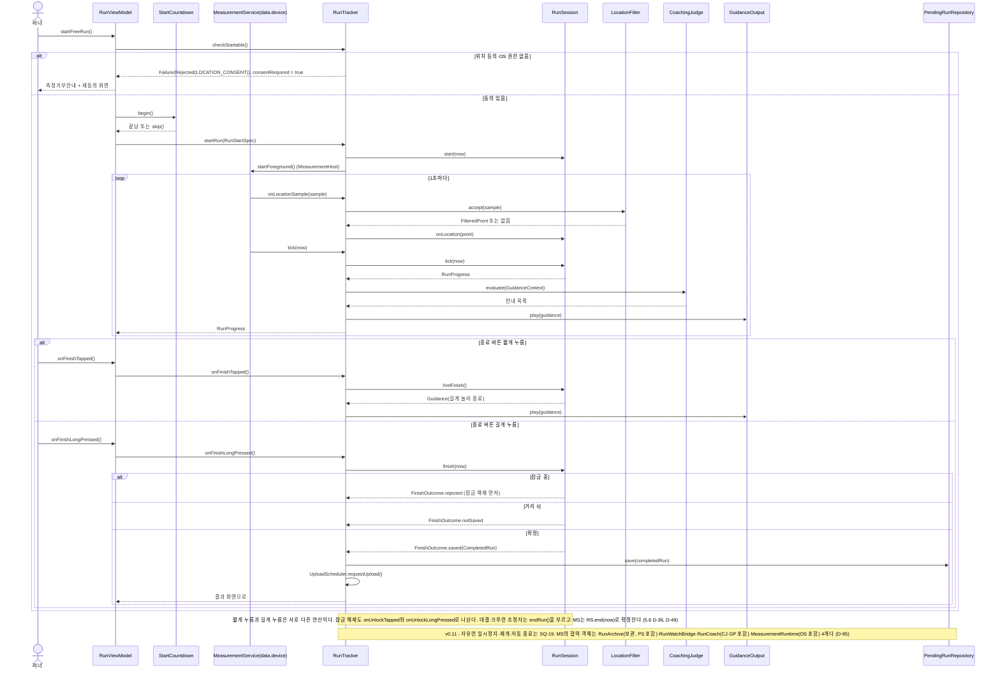

#### SQ-02 러닝 기록 업로드와 저장 사건 (S-01 6, S-09, S-18, FR-038~FR-040, FR-047, FR-184)

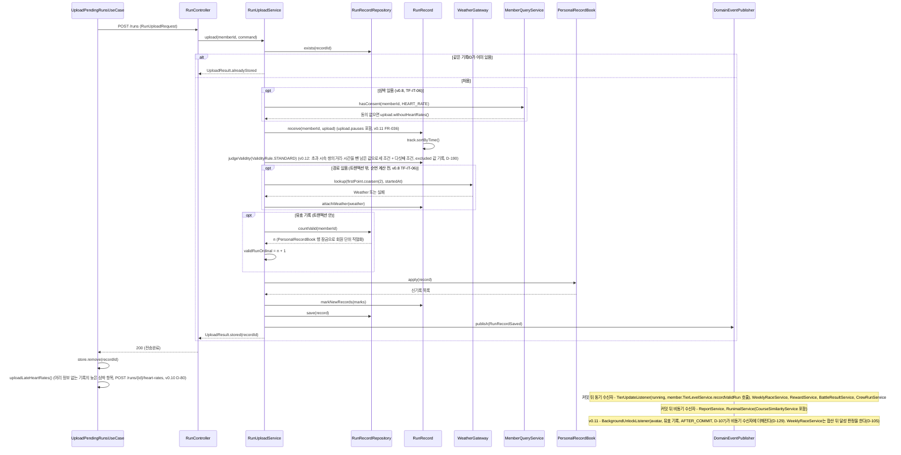

#### SQ-03 랜덤 매칭과 자동 출발 (S-03 1~3, FR-080~FR-083, FR-085~FR-087)

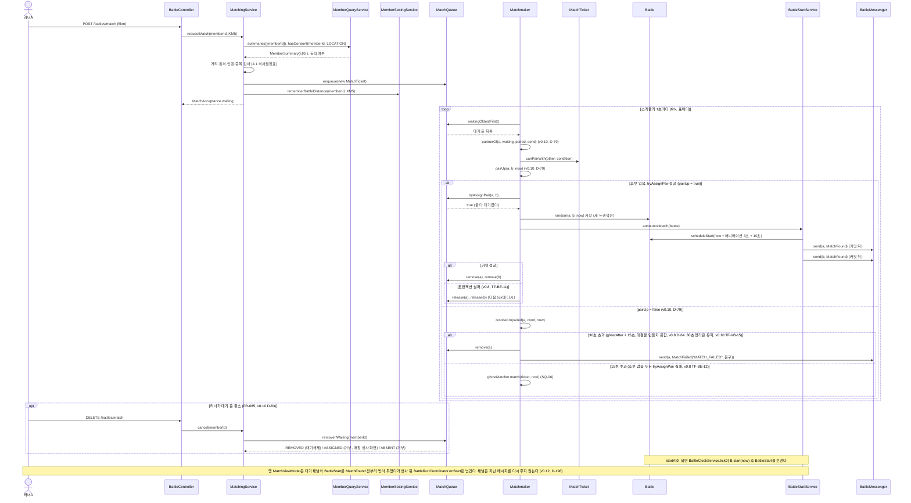

#### SQ-04 랜덤 대결 진행 중계와 도착 (S-03 4~5, FR-088~FR-091, FR-102, FR-107, FR-188)

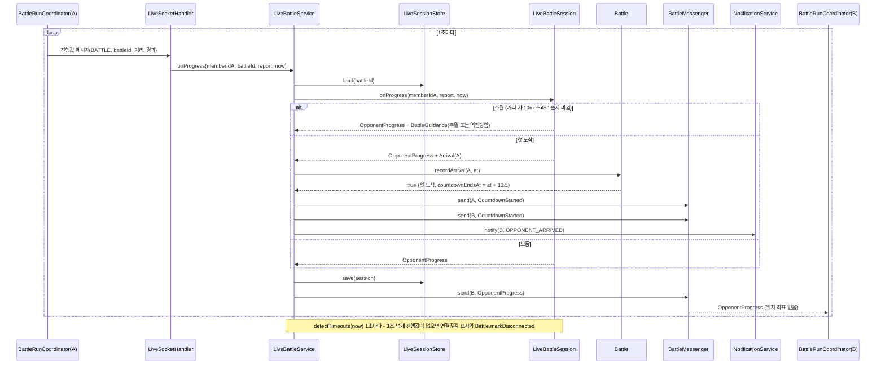

#### SQ-05 대결 결과 판정과 보류·정정 (S-03 6, FR-092, FR-093, FR-103, FR-108)

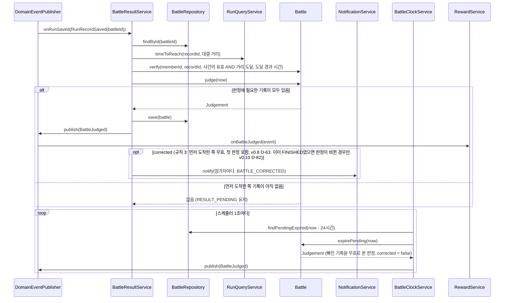

앱 결과 화면(v0.12 구현 반영, CR-15, D-197): 서버는 판정을 앱에 알리지 않는다. BattleResultViewModel은 결과가 보류(RESULT_PENDING)면 3초마다 최대 20번(1분) BattleRepository.result(battleId)를 다시 읽고 그동안 "결과를 확인하고 있어요"를 보인다. 판정이 오면 같은 화면에 결과를, 1분 뒤에도 보류면 "결과가 늦어지고 있어요"와 "결과 다시 보기"를 보인다.

#### SQ-06 고스트 자동 매칭 (S-04, FR-083, FR-095, FR-104)

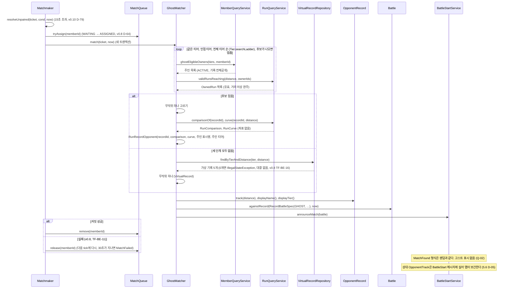

#### SQ-07 나와의 싸움·유명인 대결 (S-05, FR-096~FR-100, FR-189)

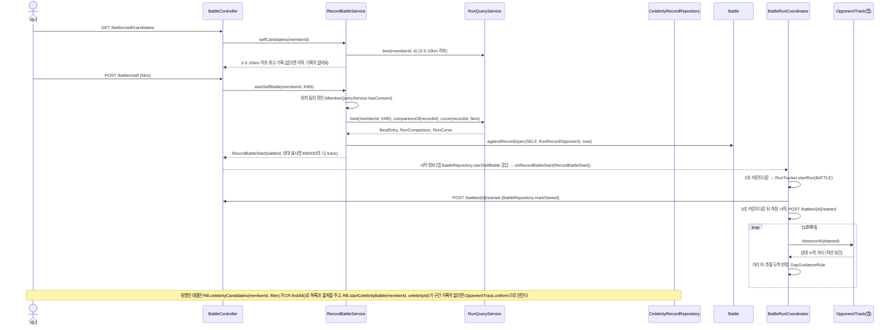

#### SQ-08 승인제 크루 가입 (S-07, FR-117, FR-121, FR-123, FR-124, FR-128)

v0.11: FR-118(추천)이 지워졌고, 가입 결정은 크루장과 운영진이 한다(권한 VIEW_OR_DECIDE_JOIN) (v0.11, FR-118, FR-128, D-91).

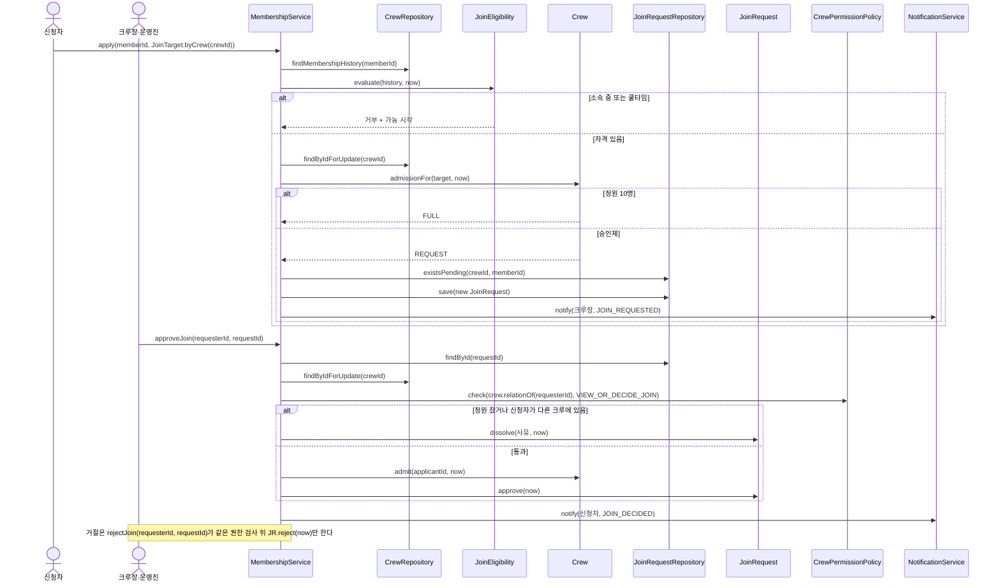

#### SQ-09 크루런 출발·중계·결과 (S-17, FR-145~FR-149, FR-190~FR-193)

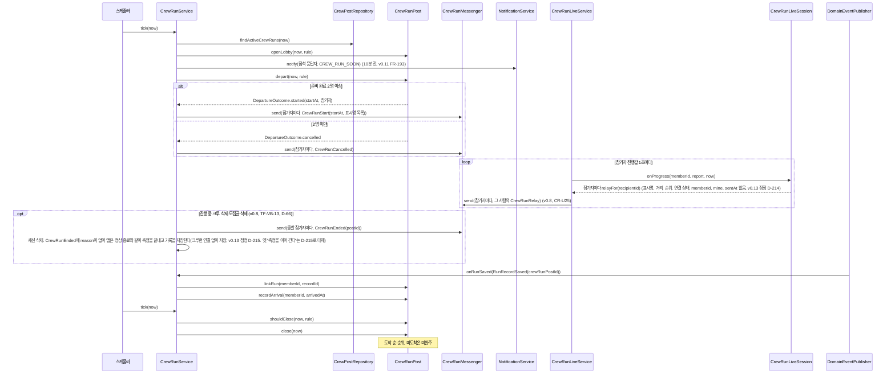

#### SQ-10 Runimal 유형 판정 (S-10, FR-151~FR-154, FR-166)

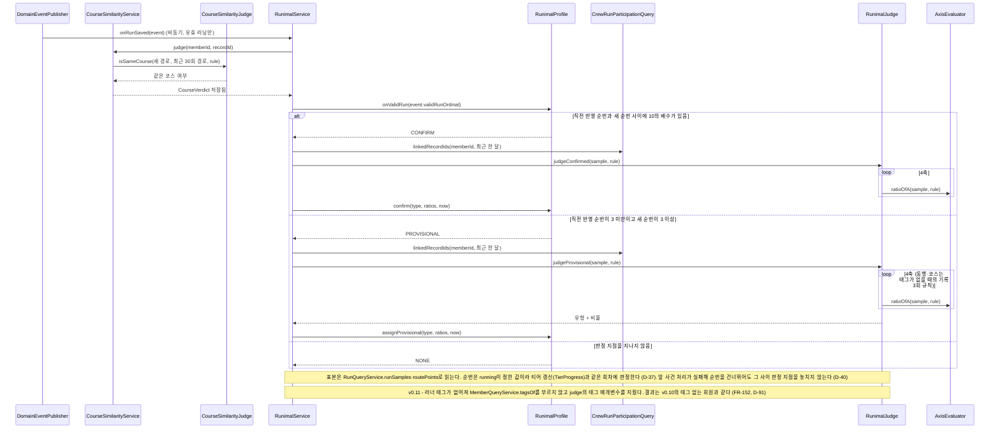

#### SQ-11 셀카 아바타 만들기 (S-11, FR-155~FR-158)

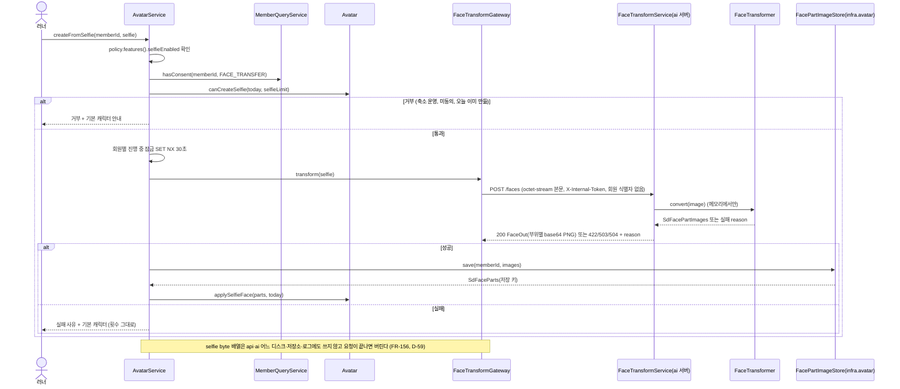

#### SQ-12 회원 탈퇴 (S-12, FR-020, FR-021, FR-024)

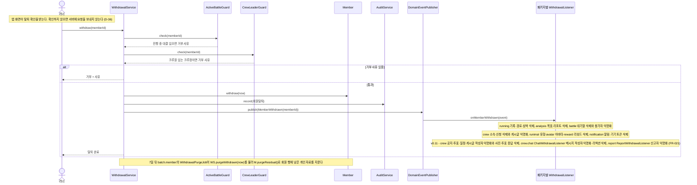

#### SQ-13 위치 동의 철회와 경로 파기 (S-15, FR-013, FR-026, NFR-036)

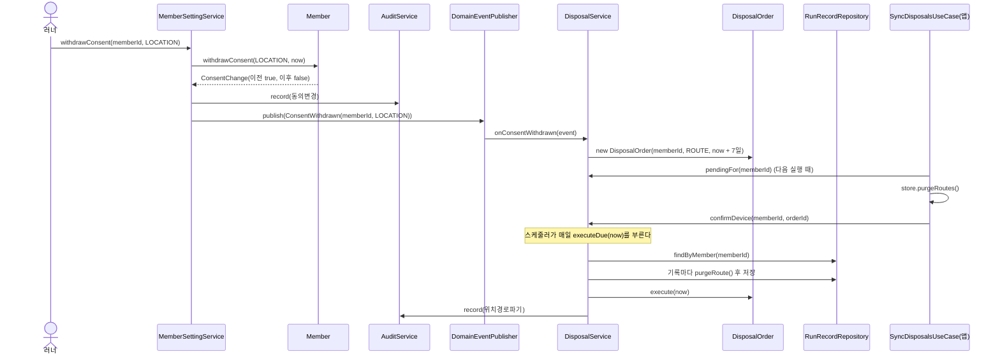

#### SQ-14 알림 발송과 알림함 (S-14, FR-175, FR-178)

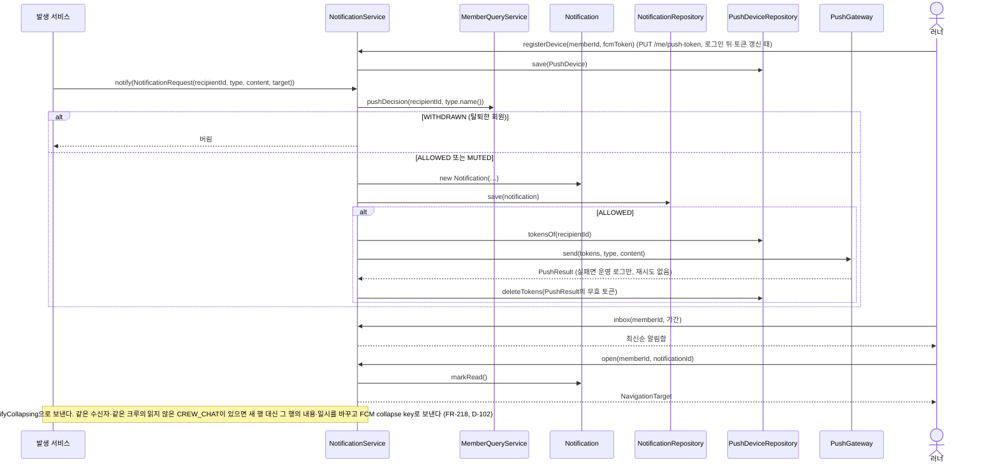

