> [런크크 객체지향 분석·설계서](../design-oo.md) 목차 · 이전: [01-03-관계-분석-클래스도](01-03-관계-분석-클래스도.md) · 다음: [02-02-동적-모델-v0.13](02-02-동적-모델-v0.13.md)

## 2. 동적 모델

### 2.1 사건 시나리오

srs.md 2.6 시나리오를 객체 관점으로 다시 썼다. 외부 입력은 액터 → 화면(Controller·ViewModel) 메시지로 쓰고, 메소드는 메시지를 받을 때 실행된다. 시각 사건(매 1초, 매일 0시)은 스케줄러 액터가 보내는 메시지로 쓴다. v0.11에서 srs v0.10의 S-19~S-25를 2.1.6~2.1.12로 더하고 S-01·S-07·S-17을 고쳤다 (v0.11, CR-01~CR-10).

#### 2.1.1 S-01 가입하고 첫 러닝을 저장한다

| 시나리오 | 사건 | 보내는 객체 | 받는 객체 | 메시지 |
|---------|------|------------|-----------|--------|
| S-01 | 소셜 로그인 | 러너 | LoginViewModel | signIn(provider) |
| S-01 | 제공자 토큰 받기 | LoginViewModel | KakaoLoginClient | signIn(activity) |
| S-01 | 서버 로그인 | AuthController | AuthService | login(provider, providerToken) |
| S-01 | 제공자 확인 | AuthService | SocialLoginGateway | authenticate(providerToken) |
| S-01 | 회원 아님 | AuthService | AuthController | LoginResult.signUpRequired(ticket) |
| S-01 | 가입 제출 | SignUpController | SignUpService | signUp(command) (동의 화면 하나, 프로필·태그 없음, v0.11, FR-003, D-90) |
| S-01 | 필수 조건 판정 | SignUpService | SignUpForm | validate() → RequiredConsents.check (v0.11, FR-004, D-90) |
| S-01 | 닉네임 확정 | SignUpService | Nickname | withSuffix(n) (겹칠 때만). 제공자 이름이 없으면 numbered(n) (v0.11, D-90) |
| S-01 | 회원 생성 | SignUpService | Member | signUp(account, form, nickname, now) |
| S-01 | 동의 감사 | SignUpService | AuditService | record(AuditEntry 가입동의) |
| S-01 | 자유런 시작 | 러너 | RunViewModel | startFreeRun() |
| S-01 | 카운트다운 | RunViewModel | StartCountdown | begin() |
| S-01 | 측정 시작 | RunTracker | RunSession | start(at) |
| S-01 | 위치 수신 | FusedLocationProvider(액터) | LocationFilter | accept(sample) |
| S-01 | 1초 갱신 | RunTracker | RunSession | tick(now) |
| S-01 | 길게 눌러 종료 | 러너 | RunViewModel | onFinishLongPressed() |
| S-01 | 종료 요청 | RunViewModel | RunTracker | onFinishLongPressed() |
| S-01 | 기록 확정 | RunTracker | RunSession | finish(now) |
| S-01 | 기기 보관 | RunTracker | PendingRunRepository | save(completedRun) |
| S-01 | 전송 | UploadPendingRunsUseCase | RunController | POST /runs (RunUploadRequest) |
| S-01 | 저장·판정 | RunUploadService | RunRecord | receive(memberId, upload), judgeValidity(rule) |
| S-01 | 저장 사건 | RunUploadService | DomainEventPublisher | publish(RunRecordSaved) |

#### 2.1.2 S-03 랜덤 대결을 한다

| 시나리오 | 사건 | 보내는 객체 | 받는 객체 | 메시지 |
|---------|------|------------|-----------|--------|
| S-03 | 배틀런 누름 | 러너 | BattleController | POST /battles/match (distance) |
| S-03 | 매칭 요청 | BattleController | MatchingService | requestMatch(memberId, distance) |
| S-03 | 대기 등록 | MatchingService | MatchQueue | enqueue(ticket) |
| S-03 | 1초 경과 | 스케줄러 | Matchmaker | tick(now) |
| S-03 | 후보 판정 | Matchmaker | MatchTicket | canPairWith(other, condition) |
| S-03 | 원자적 배정 | Matchmaker | MatchQueue | tryAssignPair(a, b) |
| S-03 | 대결 생성 | Matchmaker | Battle | random(a, b, now) |
| S-03 | 성사 통지 | Matchmaker | BattleStartService | announceMatch(battle) |
| S-03 | 통지 전송 | BattleStartService | BattleMessenger | send(memberId, MatchFound) |
| S-03 | 10초 뒤 출발 | 스케줄러 | BattleClockService | tick(now) → Battle.start(now) |
| S-03 | 진행값 1초마다 | BattleRunCoordinator(앱) | LiveSocketHandler | ProgressReport |
| S-03 | 중계 | LiveSocketHandler | LiveBattleService | onProgress(memberId, battleId, report, now) |
| S-03 | 추월·도착 판정 | LiveBattleService | LiveBattleSession | onProgress(memberId, report, now) |
| S-03 | 첫 도착 기록 | LiveBattleService | Battle | recordArrival(memberId, at) |
| S-03 | 상대 도착 푸시 | LiveBattleService | NotificationService | notify(OPPONENT_ARRIVED) |
| S-03 | 카운트다운 종료 | 스케줄러 | BattleClockService | tick(now) → Battle.closeCountdown(now) |
| S-03 | 기록 업로드 | RunUploadService | DomainEventPublisher | publish(RunRecordSaved(battleId)) |
| S-03 | 검증·판정 | BattleResultService | Battle | verify(memberId, recordId, valid), judge(now) |
| S-03 | 승리 적립 | DomainEventPublisher | RewardService | onBattleJudged(BattleJudged) |

#### 2.1.3 S-07 승인제 크루에 가입한다

| 시나리오 | 사건 | 보내는 객체 | 받는 객체 | 메시지 |
|---------|------|------------|-----------|--------|
| S-07 | 크루 찾기 (태그 AND·키워드) | CrewController | CrewQueryService | search(viewerId, CrewSearch, PageCursor) (추천 요청·태그 일치 계산 삭제, v0.11, FR-117, FR-118, D-91) |
| S-07 | 가입 신청 | CrewController | MembershipService | apply(memberId, JoinTarget.byCrew(crewId)) |
| S-07 | 자격 판정 | MembershipService | JoinEligibility | evaluate(memberships, now) |
| S-07 | 가입 방식 판정 | MembershipService | Crew | admissionFor(target, now) |
| S-07 | 신청 생성 | MembershipService | JoinRequest | new JoinRequest(crewId, memberId, now) |
| S-07 | 크루장 알림 | MembershipService | NotificationService | notify(JOIN_REQUESTED) |
| S-07 | 승인 (크루장 또는 운영진) | CrewAdminController | MembershipService | approveJoin(requesterId, requestId) (v0.11, FR-128) |
| S-07 | 권한 검사 | MembershipService | CrewPermissionPolicy | check(relation, VIEW_OR_DECIDE_JOIN) (LEADER·MANAGER 허용, v0.11, FR-128) |
| S-07 | 정원·소속 확인 후 소속 | MembershipService | Crew | admit(memberId, now) |
| S-07 | 신청 승인 | MembershipService | JoinRequest | approve(now) |
| S-07 | 결과 알림 | MembershipService | NotificationService | notify(JOIN_DECIDED) |

#### 2.1.4 S-17 크루런으로 같은 시간에 각자 달린다

| 시나리오 | 사건 | 보내는 객체 | 받는 객체 | 메시지 |
|---------|------|------------|-----------|--------|
| S-17 | 크루런 일정 작성 | CrewPostController | CrewPostService | writeCrewRun(memberId, crewId, draft) |
| S-17 | 일정 생성 | CrewPostService | CrewRunPost | new CrewRunPost(…) (작성자 참석) |
| S-17 | 모집 알림 | CrewPostService | NotificationService | notify(CREW_RUN_RECRUIT) |
| S-17 | 참석 응답 | CrewPostController | CrewPostService | answerAttendance(memberId, postId, GOING) → CrewRunPost.answer(memberId, GOING, now) (v0.10 vote, v0.11, FR-145, D-99) |
| S-17 | 30분 전 | 스케줄러 | CrewRunService | tick(now) → CrewRunPost.openLobby(now, rule) |
| S-17 | 10분 전 알림 | CrewRunService | NotificationService | notify(CREW_RUN_SOON) |
| S-17 | 대기실 입장 | CrewRunController | CrewRunService | enterLobby(memberId, postId) |
| S-17 | 준비 완료 | CrewRunController | CrewRunService | toggleReady(memberId, postId) → CrewRunPost.toggleReady(memberId) |
| S-17 | 모집희망일시 | 스케줄러 | CrewRunService | tick(now) → CrewRunPost.depart(now, rule) |
| S-17 | 출발 신호 | CrewRunService | CrewRunMessenger | send(memberId, CrewRunStart) |
| S-17 | 진행값 | CrewRunCoordinator(앱) | LiveSocketHandler | 진행값 메시지(CREW_RUN, postId, ProgressReport) |
| S-17 | 채널 전달 | LiveSocketHandler | CrewRunLiveService | onProgress(memberId, postId, report, now) |
| S-17 | 중계 | CrewRunLiveService | CrewRunLiveSession | onProgress(memberId, report, now) |
| S-17 | 도착 기록 저장 | RunUploadService | DomainEventPublisher | publish(RunRecordSaved(crewRunPostId)) |
| S-17 | 러닝 연결·도착 | CrewRunService | CrewRunPost | linkRun(memberId, recordId), recordArrival(memberId, at) |
| S-17 | 종료 판정 | 스케줄러 | CrewRunService | tick(now) → shouldClose(now, rule), close(now) |
| S-17 | 주간 거리 합산 | DomainEventPublisher | WeeklyRaceService | onRunSaved(event) → WeeklyRace.add(…) |

#### 2.1.5 S-12 회원 탈퇴, S-15 위치 동의 철회

| 시나리오 | 사건 | 보내는 객체 | 받는 객체 | 메시지 |
|---------|------|------------|-----------|--------|
| S-12 | 탈퇴 확인(화면 확인 뒤) | MeController | WithdrawalService | withdraw(memberId) |
| S-12 | 진행 중 대결 확인 | WithdrawalService | ActiveBattleGuard | check(memberId) |
| S-12 | 크루장 확인 | WithdrawalService | CrewLeaderGuard | check(memberId) |
| S-12 | 식별정보 삭제 | WithdrawalService | Member | withdraw(now) |
| S-12 | 탈퇴 사건 | WithdrawalService | DomainEventPublisher | publish(MemberWithdrawn) |
| S-12 | 패키지별 삭제 | DomainEventPublisher | 각 패키지 WithdrawalListener | onMemberWithdrawn(event) |
| S-15 | 위치 동의 끄기 | MeController | MemberSettingService | withdrawConsent(memberId, LOCATION) |
| S-15 | 동의 철회 | MemberSettingService | Member | withdrawConsent(LOCATION, now) |
| S-15 | 철회 사건 | MemberSettingService | DomainEventPublisher | publish(ConsentWithdrawn(LOCATION)) |
| S-15 | 파기 지시 | DomainEventPublisher | DisposalService | onConsentWithdrawn(event) → new DisposalOrder |
| S-15 | 매일 실행 | 스케줄러 | DisposalService | executeDue(now) → RunRecord.purgeRoute() |
| S-15 | 기기 파기 | SyncDisposalsUseCase(앱) | DisposalService | pendingFor(memberId), confirmDevice(memberId, orderId) |

#### 2.1.6 S-19 게스트로 시작하고 나중에 소셜 계정을 연동한다 (v0.11, FR-197~FR-200, D-89, D-90)

| 시나리오 | 사건 | 보내는 객체 | 받는 객체 | 메시지 |
|---------|------|------------|-----------|--------|
| S-19 | 게스트로 시작 | 러너 | StartAsGuestUseCase(앱) | invoke(consents) |
| S-19 | 게스트 생성 요청 | SignUpController | SignUpService | startAsGuest(GuestStartForm) (POST /members/guest) |
| S-19 | 필수 동의·만 14세 | SignUpService | GuestStartForm | validate() |
| S-19 | 닉네임 자동 부여 | SignUpService | Nickname | numbered(n) |
| S-19 | 게스트 회원 생성 | SignUpService | Member | guest(nickname, consents, now) → 저장으로 회원 ID 확정 (D-128) |
| S-19 | 자격 증명 발급 | SignUpService | GuestCredential | issue(memberId, random) |
| S-19 | 자격 증명 해시 붙이기 | SignUpService | Member | attachGuestCredential(hash) (D-128) |
| S-19 | 자격 증명 보관 | StartAsGuestUseCase | SessionRepository(앱) | saveGuestCredential(credential) |
| S-19 | 갱신 토큰 만료 뒤 재개 | TokenAuthenticator(앱 api.core) | AuthService | resumeGuest(credential, now) (POST /auth/guest/session) |
| S-19 | 소셜 계정 연동 | AuthController | AuthService | linkSocialAccount(memberId, provider, providerToken) (POST /me/social-account) |
| S-19 | 연동 | AuthService | Member | linkSocialAccount(account) |
| S-19 | 1년 미접속 파기 | 스케줄러(3시) | WithdrawalService | withdrawIdleGuests(now) |

#### 2.1.7 S-20 자유런 중 일시정지하고 재개한다 (v0.11, FR-194, FR-195, D-93)

| 시나리오 | 사건 | 보내는 객체 | 받는 객체 | 메시지 |
|---------|------|------------|-----------|--------|
| S-20 | 일시정지 누름 | 러너 | RunViewModel → RunTracker | onPauseTapped() |
| S-20 | 정지 | RunTracker | RunSession | pause(now) (자유런이 아니면 거짓) |
| S-20 | 워치 재개 | PhoneLink(워치) | RunWatchBridge → RunTracker | PauseRequestMessage(RESUME) → 내부 리스너 |
| S-20 | 재개 | RunTracker | RunSession | resume(now) |
| S-20 | 정지 55분 | RunTracker | RunCoach | play(Guidance(PAUSE_AUTO_END_SOON)) (tick의 PauseLimit 검사) |
| S-20 | 정지 60분 자동 종료 | RunTracker | RunSession | end(now) → RunArchive.saveInBackground(run, onFailed) |
| S-20 | 기록 전송·판정 | RunUploadService | RunRecord | receive(memberId, upload(pauses)), judgeValidity(rule) |

#### 2.1.8 S-21 대결 중 워치 근접 알림을 받는다 (v0.11, FR-196, FR-188, D-96)

| 시나리오 | 사건 | 보내는 객체 | 받는 객체 | 메시지 |
|---------|------|------------|-----------|--------|
| S-21 | 격차 갱신 | BattleRunCoordinator | RunTracker | onGapChanged(gapMeters) |
| S-21 | 근접 알림 계산 | RunTracker | RunCoach → ProximityAlertRule | proximityOf(gapMeters, isWatchConnected) → evaluate(…), RunWatchBridge → shouldSend(…) (D-119) |
| S-21 | 워치로 전송 | RunTracker | RunWatchBridge | publishProximity(alert?) |
| S-21 | 재생 | WatchLink | ProximityAlertPlayer(워치) | ProximityMessage |
| S-21 | 추월 순간 | BattleRunCoordinator | RunTracker | onLeadChanged(kind) → RunWatchBridge.publishLeadChange(kind) |

#### 2.1.9 S-22 크루 구성원이 공지·투표·채팅·게시판으로 소통한다 (v0.11, FR-204~FR-213, FR-218)

| 시나리오 | 사건 | 보내는 객체 | 받는 객체 | 메시지 |
|---------|------|------------|-----------|--------|
| S-22 | 운영진 지정 | CrewAdminController | CrewService | appointManager(leaderId, crewId, targetId) → Crew.appointManager(targetId) |
| S-22 | 지정 알림·감사 | CrewService | NotificationService / AuditService | notify(MANAGER_CHANGED) / record(MANAGER_APPOINT) |
| S-22 | 공지 작성·고정 | CrewPostController | CrewPostService | writeNotice(memberId, crewId, NoticeDraft), pin(memberId, postId, true) |
| S-22 | 공지 알림 | CrewPostService | CrewNewsNotifier | announce(post, authorId) (CREW_NOTICE) |
| S-22 | 투표 만들기 | CrewPostController | CrewPostService | writePoll(memberId, crewId, PollDraft) |
| S-22 | 투표 응답·변경 | CrewPostService | PollPost | respond(memberId, optionNo, now) |
| S-22 | 마감 1시간 전 | 스케줄러(1분) | CrewPostService | remindClosingPolls(now) → PollPost.nonRespondents, markReminded |
| S-22 | 채팅 보내기 | ChatController | CrewChatService | post(memberId, crewId, ChatDraft) |
| S-22 | 리액션 | ChatController | CrewChatService | react(memberId, messageId, LIKE) |
| S-22 | 사진 게시글 | CrewPostController | CrewPostService | writeBoard(memberId, crewId, BoardDraft) → PostPhotoStore.save |
| S-22 | 앨범 | CrewPostController | CrewPostService | album(memberId, crewId, cursor) |
| S-22 | 본인 글 삭제 | CrewPostService | CrewPost | delete(requesterId, relation) |

#### 2.1.10 S-23 크루 콘텐츠를 신고하고 운영자가 처리한다 (v0.11, FR-214~FR-216, D-104)

| 시나리오 | 사건 | 보내는 객체 | 받는 객체 | 메시지 |
|---------|------|------------|-----------|--------|
| S-23 | 신고 | ReportController | ReportService | submit(reporterId, ReportCommand) |
| S-23 | 대상 확인 | ReportService | ReportedContentPort | find(targetKind, targetId) |
| S-23 | 신고 누적 | ReportService | ReportCase | addReport() |
| S-23 | 자동 숨김 | ReportService | ReportedContentPort | hide(targetKind, targetId) |
| S-23 | 운영자 처리 | ReportAdminController | ReportService | hide(operatorId, caseId) / dismiss(operatorId, caseId) (v0.11 검증, D-138) |
| S-23 | 결과 알림·감사 | ReportService | NotificationService / AuditService | notify(REPORT_RESOLVED) / record(REPORT_HIDE) |

#### 2.1.11 S-24 대면 모임 일정을 만들고 참석한다 (v0.11, FR-132, FR-133, FR-145, D-99)

| 시나리오 | 사건 | 보내는 객체 | 받는 객체 | 메시지 |
|---------|------|------------|-----------|--------|
| S-24 | 대면 모임 작성 | CrewPostController | CrewPostService | writeMeetup(memberId, crewId, MeetupDraft) |
| S-24 | 일정 알림 | CrewPostService | CrewNewsNotifier | announce(post, authorId) (CREW_SCHEDULE) |
| S-24 | 참석·불참·미정 | CrewPostController | CrewPostService | answerAttendance(memberId, postId, answer) |
| S-24 | 정원 검사 | CrewPostService | MeetupPost | answer(memberId, answer, now) (다형성, SchedulePost) |
| S-24 | 일정 목록 | CrewPostController | CrewPostService | list(memberId, crewId, PostQuery) → MeetupPost.counts() |

#### 2.1.12 S-25 크루가 주간 공동 목표를 달성한다 (v0.11, FR-138, FR-140, FR-141, FR-217, D-105)

| 시나리오 | 사건 | 보내는 객체 | 받는 객체 | 메시지 |
|---------|------|------------|-----------|--------|
| S-25 | 목표 정하기 | CrewController | WeeklyRaceService | setGoal(memberId, crewId, goal, now) → WeeklyRace.setGoal(goal, setterId) |
| S-25 | 거리 합산 | DomainEventPublisher | WeeklyRaceService | onRunSaved(event) |
| S-25 | 달성 판정 | WeeklyRaceService | WeeklyRaceRepository | markAchievedIfReached(crewId, week) |
| S-25 | 달성 알림 | WeeklyRaceService | NotificationService | notify(CREW_GOAL_ACHIEVED) (크루원 모두) |
| S-25 | 진행률·축하 카드 | CrewController | WeeklyRaceService | status(viewerId, crewId) → RaceStatusView(goalProgressPercent, celebration) |

배경 해금(S-11 7단계, FR-201·FR-202)은 SQ-24에서 객체 관점으로 그렸다 (v0.11, FR-201).

### 2.2 사건 추적도 (시퀀스)

필수 FR이 걸린 핵심 시나리오 24개다(v0.11에서 SQ-18~SQ-24 추가). 메시지 이름은 6.1 클래스 명세의 연산 이름과 같다. 반환은 점선이다 (v0.11, CR-01~CR-10).

#### SQ-01 러닝 측정과 기록 확정 (앱, S-01 4~5, FR-030~FR-036, FR-180~FR-182)

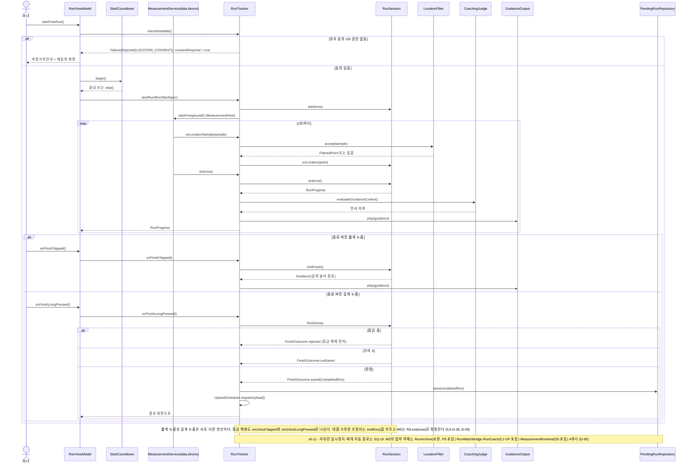

#### SQ-02 러닝 기록 업로드와 저장 사건 (S-01 6, S-09, S-18, FR-038~FR-040, FR-047, FR-184)

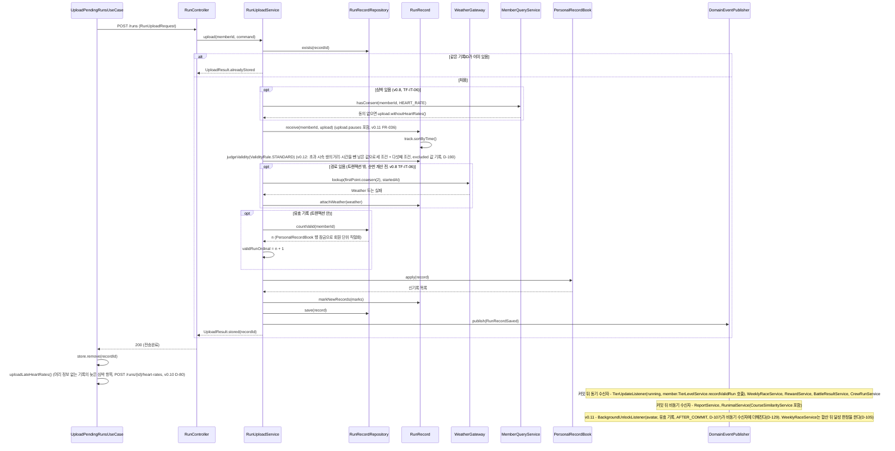

#### SQ-03 랜덤 매칭과 자동 출발 (S-03 1~3, FR-080~FR-083, FR-085~FR-087)

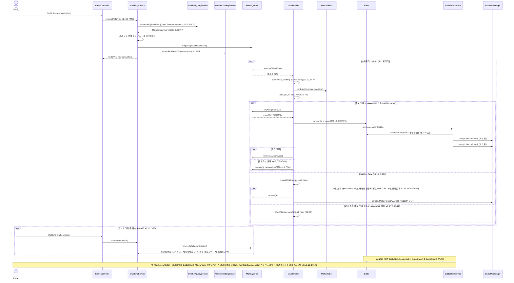

#### SQ-04 랜덤 대결 진행 중계와 도착 (S-03 4~5, FR-088~FR-091, FR-102, FR-107, FR-188)

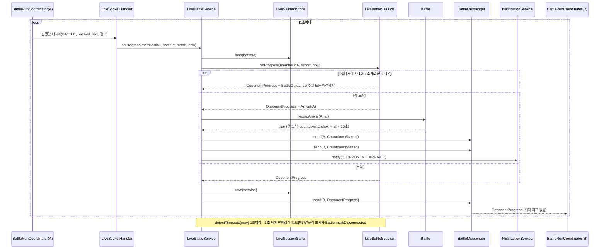

#### SQ-05 대결 결과 판정과 보류·정정 (S-03 6, FR-092, FR-093, FR-103, FR-108)

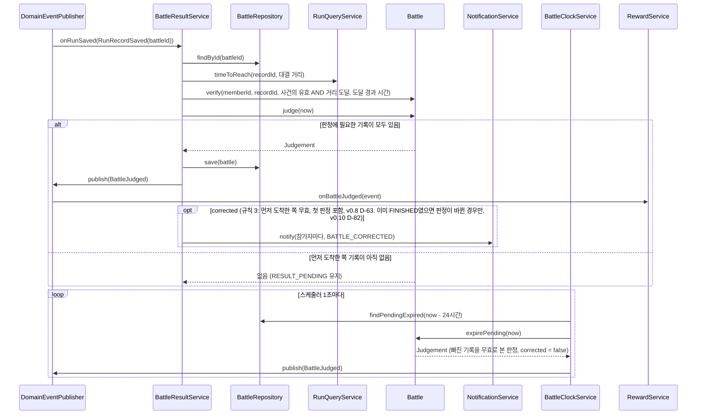

앱 결과 화면(v0.12 구현 반영, CR-15, D-197): 서버는 판정을 앱에 알리지 않는다. BattleResultViewModel은 결과가 보류(RESULT_PENDING)면 3초마다 최대 20번(1분) BattleRepository.result(battleId)를 다시 읽고 그동안 "결과를 확인하고 있어요"를 보인다. 판정이 오면 같은 화면에 결과를, 1분 뒤에도 보류면 "결과가 늦어지고 있어요"와 "결과 다시 보기"를 보인다.

#### SQ-06 고스트 자동 매칭 (S-04, FR-083, FR-095, FR-104)

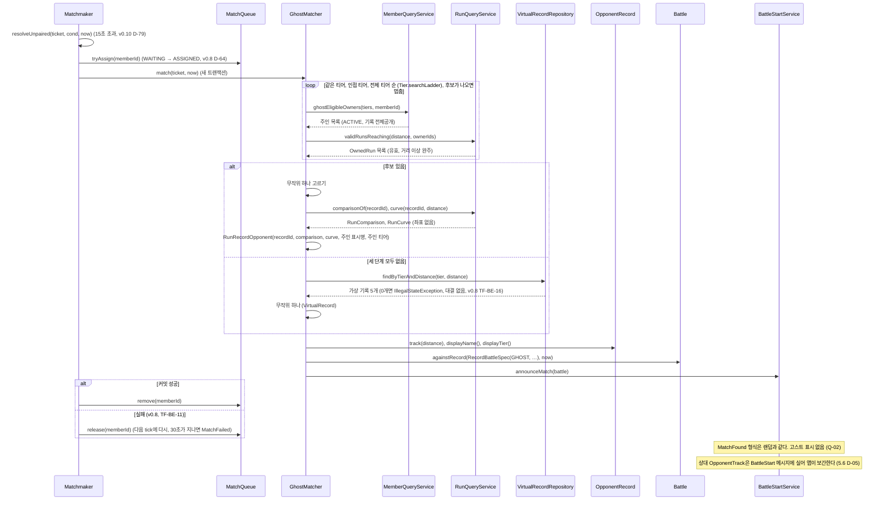

#### SQ-07 나와의 싸움·유명인 대결 (S-05, FR-096~FR-100, FR-189)

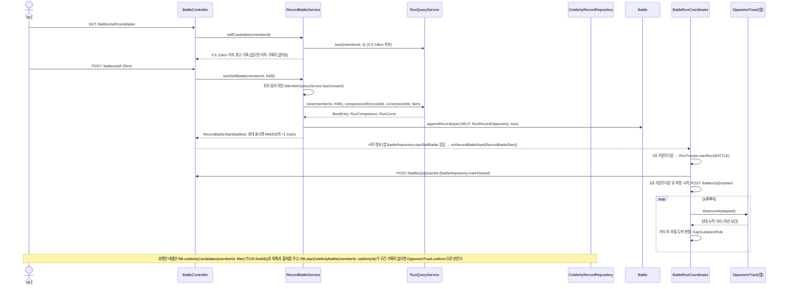

#### SQ-08 승인제 크루 가입 (S-07, FR-117, FR-121, FR-123, FR-124, FR-128)

v0.11: FR-118(추천)이 지워졌고, 가입 결정은 크루장과 운영진이 한다(권한 VIEW_OR_DECIDE_JOIN) (v0.11, FR-118, FR-128, D-91).

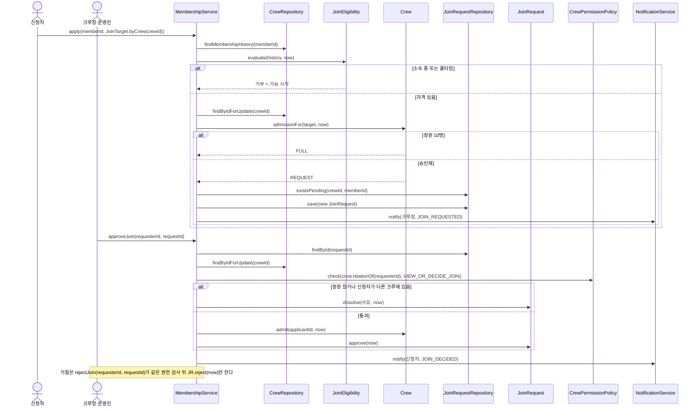

#### SQ-09 크루런 출발·중계·결과 (S-17, FR-145~FR-149, FR-190~FR-193)

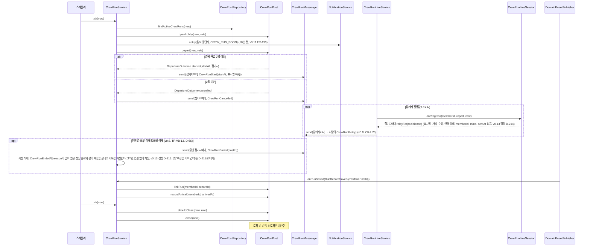

#### SQ-10 Runimal 유형 판정 (S-10, FR-151~FR-154, FR-166)

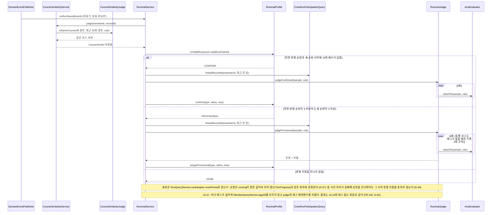

#### SQ-11 셀카 아바타 만들기 (S-11, FR-155~FR-158)

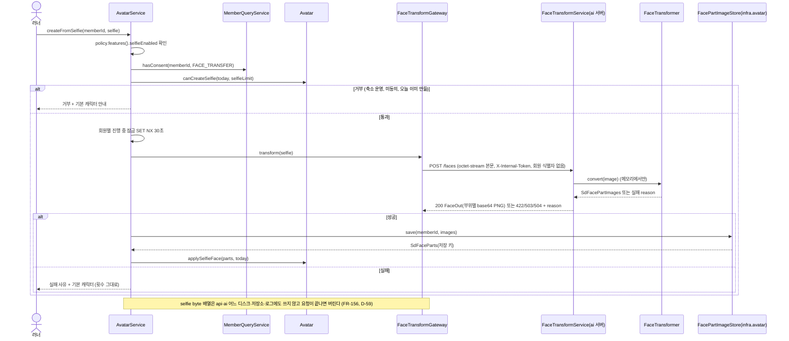

#### SQ-12 회원 탈퇴 (S-12, FR-020, FR-021, FR-024)

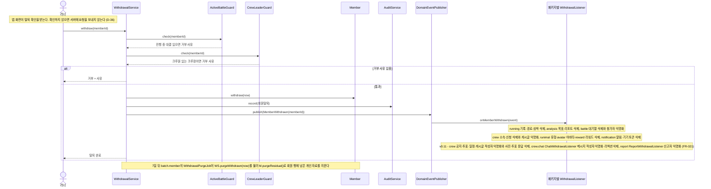

#### SQ-13 위치 동의 철회와 경로 파기 (S-15, FR-013, FR-026, NFR-036)

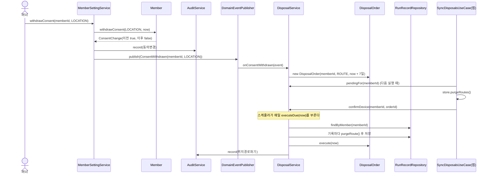

#### SQ-14 알림 발송과 알림함 (S-14, FR-175, FR-178)

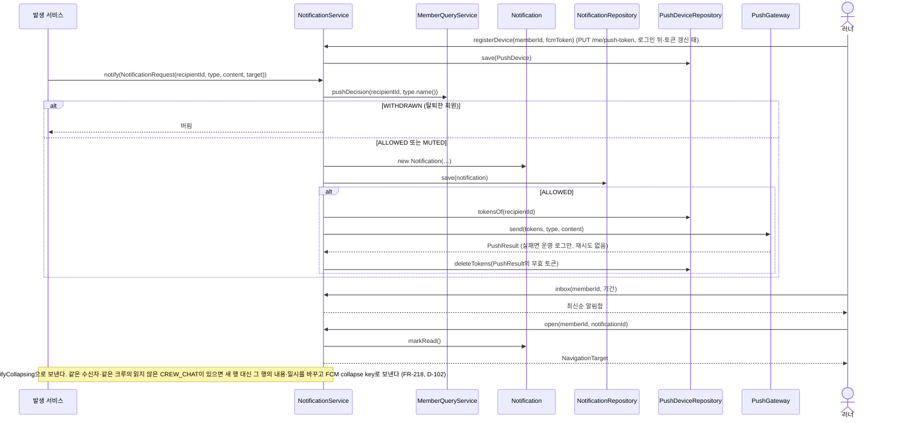

#### SQ-15 랭킹 집계와 조회 (S-16, FR-070, FR-071, FR-137)

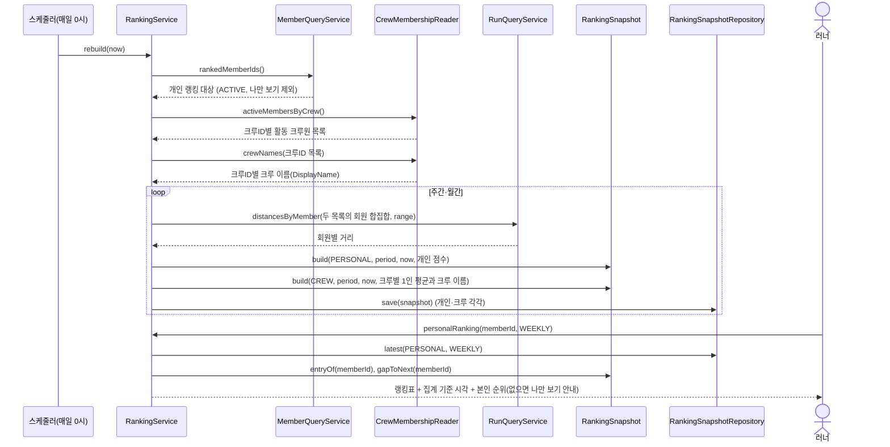

#### SQ-16 리포트 갱신과 코멘트 생성 (S-06, FR-064~FR-067)

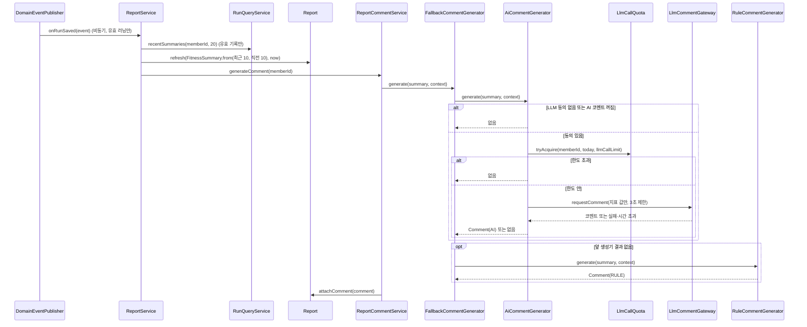

#### SQ-17 로그인과 단계별 가입 (S-01 1~3, FR-001~FR-004, FR-028)

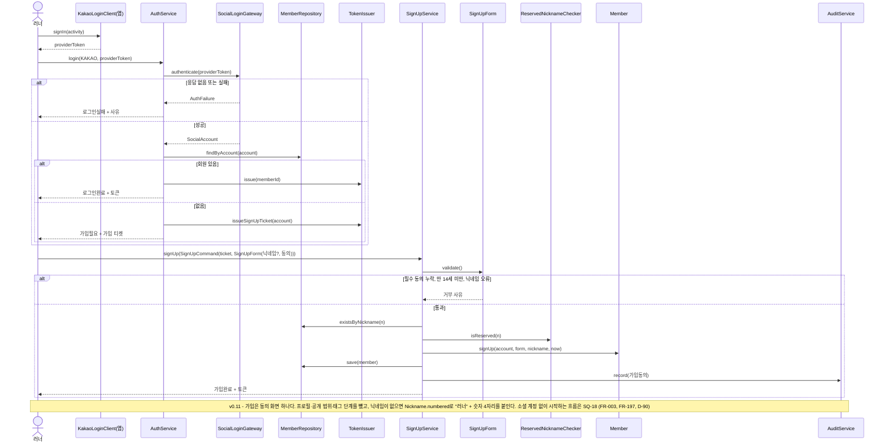

#### SQ-18 게스트 시작·세션 재개·계정 연동 (S-19, FR-197~FR-200, D-89, D-90) (v0.11)

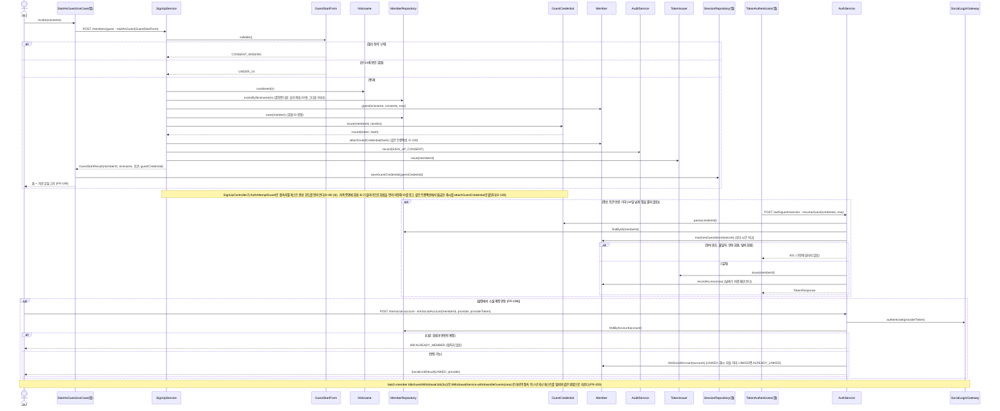

#### SQ-19 자유런 일시정지·재개·자동 종료 (S-20, FR-194, FR-195, FR-034, FR-036, D-93) (v0.11)

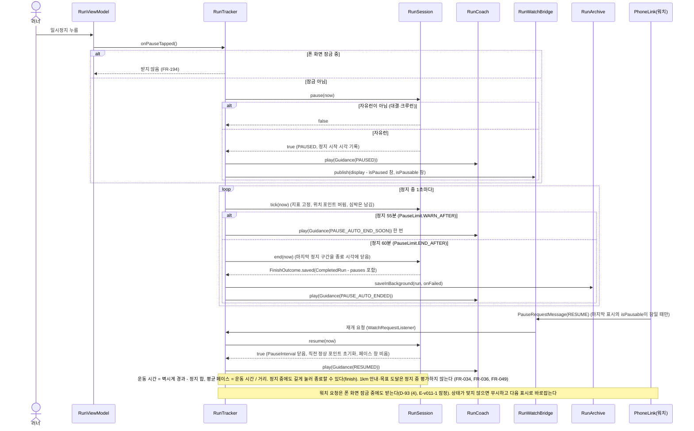

#### SQ-20 대결 근접 알림 폰 → 워치 (S-21, FR-196, FR-188, FR-109, D-96) (v0.11)

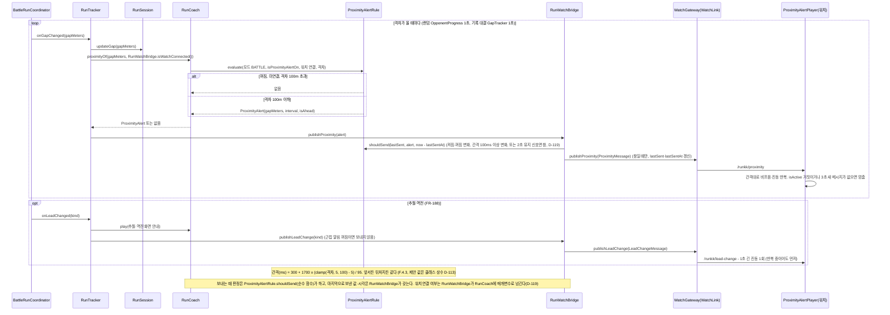

#### SQ-21 크루 채팅 보내기·받기·재연결 메우기 (S-22, FR-208, FR-209, FR-218, NFR-040, D-101~D-103) (v0.11)

```mermaid
sequenceDiagram
    actor 보낸이
    participant CR as ChatRoom(보낸이 앱)
    participant CC as ChatController(web.chat)
    participant CS as CrewChatService
    participant MR as CrewMembershipReader
    participant M as CrewChatMessage
    participant RP as CrewChatMessageRepository
    participant PR as ChatRoomPresence
    participant MG as CrewChatMessenger
    participant NS as NotificationService
    participant CR2 as ChatRoom(받는이 앱)

    CR2->>PR: ChatPresence(crewId, present 참) (LiveChannel.send, 재연결마다 다시)
    보낸이->>CR: send(content)
    CR->>CR: 낙관적 표시(clientMessageId)
    CR->>CC: POST /crews/{id}/chat/messages (ChatPostRequest)
    CC->>CS: post(memberId, crewId, ChatDraft)
    CS->>MR: relationOf(memberId, crewId)
    alt 크루 구성원 아님
        CS-->>CC: 409 NOT_CREW_MEMBER
    else 같은 작성자·같은 clientMessageId가 이미 있음
        CS-->>CC: 200 처음 만든 메시지 (멱등)
    else 처음
        CS->>M: write(crewId, authorId, draft, now) (빈 메시지면 CHAT_EMPTY, 500자 초과면 BODY_TOO_LONG)
        CS->>RP: save(message) (고유 색인 uq_crew_chat_client)
        CS-->>CC: 201 ChatPostResult
        Note over CS,MG: 커밋 뒤 crew.chat 도메인 사건 ChatMessagePosted를 ChatDeliveryListener가 AFTER_COMMIT으로 받아 보낸다(D-101, 06-04 6.1.7a)
        CS->>PR: presentMembers(crewId)
        CS->>MR: activeMemberIds(crewId)
        CS->>MG: send(방 안 ∩ 현재 구성원, CrewChatPosted)
        MG-->>CR2: CrewChatPosted (메일함에 넣지 않음, 연결이 없으면 버림)
        CS->>NS: notifyCollapsing(방 밖 크루원, CREW_CHAT) (D-102)
    end
    Note over CR2: 연결이 끊겼다 다시 붙으면
    CR2->>PR: ChatPresence(crewId, present 참)
    CR2->>CC: GET /crews/{id}/chat/messages?after={마지막 messageId}
    CC->>CS: history(memberId, crewId, ChatCursor(after))
    CS-->>CR2: ChatPage (오래된 것부터, 삭제·숨김 제외)
    Note over CR,CR2: 앱은 대결·크루런·채팅이 연결 하나를 임대로 함께 쓴다(D-103). 4401 TOKEN_EXPIRED면 토큰을 갱신하고 바로 재연결한다(D-110). 폴링 대체 모드는 2초마다 after로 읽는다
```

#### SQ-22 신고 → 자동 숨김 → 운영자 처리 (S-23, FR-214~FR-216, D-104) (v0.11)

```mermaid
sequenceDiagram
    actor 신고자
    actor 운영자
    participant RC as ReportController(web.report)
    participant RS as ReportService
    participant PT as ReportedContentPort
    participant RC2 as ReportedContent
    participant CRp as ReportCaseRepository
    participant C as ReportCase
    participant AC as ReportAdminController
    participant AU as AuditService
    participant NS as NotificationService

    신고자->>RC: POST /reports (ReportRequest)
    RC->>RS: submit(reporterId, ReportCommand)
    RS->>PT: find(targetKind, targetId)
    alt 없음, 삭제, 종류 불일치
        PT-->>RS: 빈 값
        RS-->>RC: 409 REPORT_TARGET_NOT_FOUND
    else 숨김 중 (D-115)
        PT-->>RS: ReportedContent(hidden 참)
        RS-->>RC: 409 REPORT_TARGET_NOT_FOUND
    else 있음
        PT-->>RS: ReportedContent(crewId, authorId, preview, hidden 거짓, crewMemberIds)
        RS->>RC2: isCrewMember(reporterId) (아니면 NOT_CREW_MEMBER, 본인 콘텐츠면 TARGET_INVALID)
        RS->>CRp: 대상의 사례를 잠금 조회 (없으면 만들고, 고유 제약 충돌이면 다시 읽어 잠금)
        RS->>CRp: existsReport(caseId, reporterId) (처리된 신고 포함, 있으면 ALREADY_REPORTED, D-149, v0.11 7.13.5 TF-VC-23)
        opt 사례가 DISMISSED (다른 신고자의 새 신고)
            RS->>C: reopen() (RECEIVED, 열린 신고자 0부터)
        end
        RS->>CRp: ContentReport 저장
        RS->>C: addReport()
        alt 서로 다른 열린 신고자 3명에 닿음
            C-->>RS: true (AUTO_HIDDEN)
            RS->>PT: hide(targetKind, targetId) (같은 트랜잭션)
        else 3명 미만 또는 이미 AUTO_HIDDEN
            C-->>RS: false
        end
        RS-->>RC: 201 ReportResult(reportId, status)
    end
    운영자->>AC: POST /admin/reports/{caseId}/hide 또는 dismiss (OperatorCheckInterceptor 통과)
    AC->>RS: hide(operatorId, caseId) 또는 dismiss(operatorId, caseId)
    RS->>C: hide(operatorId, now) 또는 dismiss(operatorId, now)
    alt 이미 HIDDEN 또는 DISMISSED
        C-->>RS: REPORT_DECIDED
    else HIDE
        RS->>PT: hide(targetKind, targetId) (자동 숨김이면 그대로 유지)
    else DISMISS
        RS->>PT: unhide(targetKind, targetId)
    end
    RS->>AU: record(REPORT_HIDE 또는 REPORT_DISMISS)
    RS->>NS: notify(그 사례의 열린 신고자마다, REPORT_RESOLVED)
    Note over PT: 구현은 report.target의 CrewPostReportAdapter(CHEER·SCHEDULE·NOTICE·POLL·BOARD)와 ChatReportAdapter(CHAT_MESSAGE)다(v0.11 검증, D-135). 채팅이 숨겨지면 방 안 크루원에게 CrewChatRemoved(HIDDEN)가 간다
```

#### SQ-23 공동 목표 설정과 달성 (S-25, FR-138, FR-140, FR-141, FR-217, D-105) (v0.11)

```mermaid
sequenceDiagram
    actor 운영진 as 크루장·운영진
    participant CC as CrewController
    participant WS as WeeklyRaceService
    participant PP as CrewPermissionPolicy
    participant WRp as WeeklyRaceRepository
    participant WR as WeeklyRace
    participant EP as DomainEventPublisher
    participant NS as NotificationService

    운영진->>CC: PUT /crews/{id}/goal (goalMeters)
    CC->>WS: setGoal(memberId, crewId, goal, now)
    WS->>PP: check(relation, SET_GOAL)
    WS->>WRp: 이번 주 행 읽기 (없으면 CREATE_WEEK 한 문장이 만들며 직전 목표를 복사한다, v0.12 U6-6)
    WS->>WR: setGoal(goal, setterId) (1km 미만이면 GOAL_INVALID)
    WS->>WRp: markAchievedIfReached(crewId, week)
    WS-->>CC: RaceStatusView
    EP->>WS: onRunSaved(RunRecordSaved) (유효 러닝)
    WS->>WRp: 합산 원자적 증가 (A-12, 그 주 첫 행이면 CREATE_WEEK가 목표를 이어 쓴다, v0.12 U6-6)
    WS->>WRp: markAchievedIfReached(crewId, week)
    alt 한 행이 바뀜 (achieved_at 없음, 목표 있음, 합산 ≥ 목표)
        WS->>NS: notify(크루원 모두, CREW_GOAL_ACHIEVED) (커밋 뒤)
    else 0행 (목표 없음, 미달, 이미 달성)
        WS-->>EP: 알림 없음
    end
    Note over WS,WRp: setGoal과 reconcileAll도 같은 markAchievedIfReached를 부르고 한 행이 바뀌면 같은 알림을 보낸다. 두 기록이 함께 넘겨도 알림은 한 번이다. reconcileAll은 0시 30분이다(D-88). 코드 cron 기본값 0시 0분은 구현 결함 후보 K-4(부록 E.2)
    Note over CC,WS: GET /crews/{id}/race의 RaceStatusView는 목표 진행률과, 달성한 주에만 CelebrationCard(크루명, 합산, 목표, 참여 인원)를 조회 때 만든다. 기여자는 순위 숫자 없이 거리 내림차순 (FR-140, FR-141)
```

#### SQ-24 랜드마크 배경 해금과 선택 (S-11 7단계, FR-201, FR-202, D-107) (v0.11)

```mermaid
sequenceDiagram
    participant EP as DomainEventPublisher
    participant BL as BackgroundUnlockListener
    participant BS as BackgroundService
    participant RQ as RunQueryService
    participant OP as OperationPolicy
    participant A as Avatar
    participant NS as NotificationService
    actor 러너
    participant AC as AvatarController

    EP->>BL: onRunSaved(RunRecordSaved) (유효 기록, AFTER_COMMIT)
    BL->>BS: unlockReached(memberId, now)
    BS->>RQ: validDistanceOf(memberId) (D-139, v0.11 test.md v0.6 TF-IT-26)
    RQ-->>BS: Distance(누적 유효 거리)
    BS->>OP: landmarkTable()
    BS->>A: unlock(누적 거리 이상인 개인 랜드마크, now)
    A-->>BS: 새로 해금한 UnlockedBackground 목록 (키·이름·단계·거리 스냅숏)
    opt 새로 해금한 것이 있음
        BS->>NS: notify(BACKGROUND_UNLOCKED) (여럿이면 한 건, 넘은 배경 이름 모두, D-148, v0.11 7.13.5 TF-VC-20)
    end
    러너->>AC: GET /avatar/backgrounds
    AC->>BS: backgrounds(memberId, now) (먼저 알림 없이 해금을 채운다)
    BS-->>AC: BackgroundsView(selectedKey, 개인 랜드마크 순서 + 표에서 빠진 해금 배경)
    러너->>AC: PUT /avatar/background (key)
    AC->>BS: choose(memberId, key)
    BS->>A: selectBackground(key) (해금 행이 없으면 BACKGROUND_LOCKED). key가 없으면 AC가 useDefault(memberId) → useDefaultBackground() (v0.11 구현 반영, U5-A-7, D-176)
    Note over BS: batch.avatar BackgroundReconcileJob(0시 10분)의 reconcile(now)가 최근 2일 저장 기록의 회원마다 unlockReached를 부른다. 해금은 취소하지 않는다
```

#### SQ-25 기존 무효 기록의 일회성 재판정 (FR-047, FR-043 예외, CR-11, D-191) (v0.12)

```mermaid
sequenceDiagram
    participant J as RunRejudgeJob
    participant RS as RunRejudgeService
    participant RR as RunRecordRepository
    participant R as RunRecord
    participant PB as PersonalRecordBook
    participant MQ as MemberQueryService
    participant TA as TierApplier
    participant EP as DomainEventPublisher

    J->>RS: run() (ApplicationReadyEvent, runkk.batch.run-rejudge.enabled, D-199: 기동 스레드 밖, 1,000개 또는 60초 상한, 구현 대기)
    loop PENDING 100개씩, 기록마다 새 트랜잭션
        RS->>RR: rejudgeCandidates(PENDING, 100), findForUpdate(id)
        alt 경로 없음
            RS->>RR: moveRejudgeState(id, PENDING, SKIPPED)
        else 경로 있음
            RS->>R: rejudgeInvalid(ValidityRule.STANDARD)
            opt 유효로 바뀜
                RS->>PB: apply(record) (신기록 표시 없음)
            end
            RS->>RR: storeRejudgement(record, PENDING, VALID 또는 DONE)
        end
    end
    loop VALID 100개씩, 기록마다 새 트랜잭션
        RS->>RR: findForUpdate(id)
        RS->>MQ: isActive(memberId)
        opt 활성 회원이고 티어 미반영
            RS->>TA: apply(memberId, recordId, RunScoreInput)
        end
        RS->>RR: moveRejudgeState(id, VALID, DONE)
        RS->>EP: publish(RunRecordRejudged) (활성 회원만)
    end
    Note over EP: 커밋 뒤 RewardService.onRunRejudged(VALID_RUN 적립, 원래 저장일 상한), BackgroundUnlockListener.onRunRejudged(unlockReachedQuietly). 둘 다 알림 없음
```

#### SQ-26 자유런 취소 (FR-219, CR-14, D-194) (v0.12)

v0.13의 SQ-27~SQ-30(진행 중 대결 복구 안내, 출발 전 포기 취소, 재연결 BattleStart 재전송과 성사 화면 그만두기, 결과 다시 읽기)은 이 조각이 100KB를 넘어 [02-02-동적-모델-v0.13](02-02-동적-모델-v0.13.md)에 있다.

```mermaid
sequenceDiagram
    actor 러너
    participant SC as RunScreen
    participant VM as RunViewModel
    participant T as RunTracker
    participant S as RunSession
    participant MR as MeasurementRuntime
    participant WB as RunWatchBridge

    러너->>SC: 취소 버튼
    SC->>VM: onDiscardTapped()
    VM-->>SC: isDiscardConfirming 참 (단계 RUNNING일 때만)
    SC-->>러너: RunkkConfirmDialog(러닝을 취소할까요?)
    alt 취소하기
        러너->>SC: 취소하기
        SC->>VM: onDiscardConfirmed()
        VM->>T: discardRun()
        T->>S: discard() (lock 안)
        alt 자유런, 측정 중, 잠금 아님
            S-->>T: 참 (FINISHED, 기록 없음)
            T->>MR: stop()
            T->>WB: 워치 시작 화면 표시 (워치 측정 종료)
            T-->>VM: ended에 NotSaved
            VM-->>SC: 홈으로
        else 그 사이 잠김
            S-->>T: 거짓 (측정 유지)
        end
    else 계속 달리기
        러너->>SC: 계속 달리기
        SC->>VM: onDiscardDismissed()
    end
    Note over T: RunArchive, takeUnclaimedEnd, 늦은 심박 창에 남기지 않아 전송, 집계, 결과 화면이 없다
```

### 2.3 사건 흐름도

시나리오 25개의 사건을 객체 사이 흐름 한 장으로 모았다. 화살표 위 이름은 메시지(연산)이고, `◇사건`은 도메인 사건(5.6 D-03)이다. 끝에 `(v0.11, …)`이 붙은 줄은 v0.11에서 더하거나 고친 흐름이다 (v0.11, CR-01~CR-10).

```
[러너] ─signIn─▶ SocialLoginClient(앱) ─login─▶ AuthService ─authenticate─▶ SocialLoginGateway ─▶ [소셜 로그인 제공자]
[러너] ─signUp─▶ SignUpService ─validate─▶ SignUpForm ; ─signUp─▶ Member ; ─record─▶ AuditService
[러너] ─changeSetting─▶ MemberSettingService ─changeSetting─▶ Member
[러너] ─giveConsent/withdrawConsent─▶ MemberSettingService ─giveConsent/withdrawConsent─▶ Member ; ─◇ConsentWithdrawn─▶ DisposalService ─▶ DisposalOrder
[러너] ─editProfile─▶ ProfileService ─editProfile─▶ Member
[러너] ─view─▶ ProfileQueryService ─filter─▶ ProfileDisclosure
[러너] ─startAsGuest─▶ SignUpService ─validate─▶ GuestStartForm ; ─numbered─▶ Nickname ; ─issue─▶ GuestCredential ; ─guest─▶ Member   (v0.11, FR-197, D-89)
[앱 TokenAuthenticator] ─resumeGuest─▶ AuthService ─parse─▶ GuestCredential ; ─matchesGuestSecret/recordAccess─▶ Member   (v0.11, D-89)
[러너] ─linkSocialAccount─▶ AuthService ─authenticate─▶ SocialLoginGateway ; ─linkSocialAccount─▶ Member   (v0.11, FR-198, D-90)
[러너] ─changeSetting(THEME, BATTLE_SETTINGS)─▶ MemberSettingService ─changeSetting─▶ Member ─changeTheme─▶ MemberSettings   (v0.11, FR-203, FR-109, D-92)
[스케줄러 3시] ─withdrawIdleGuests─▶ WithdrawalService ─findIdleGuests─▶ MemberRepository ; ─withdraw─▶ Member ─◇MemberWithdrawn─▶ 각 패키지 WithdrawalListener   (v0.11, FR-200)

[위치 센서] ─▶ MeasurementService(data.device) ─onLocationSample/tick─▶ RunTracker ─accept─▶ LocationFilter ─▶ RunSession ; RunTracker ─evaluate─▶ CoachingJudge ─check─▶ GuidanceRule ─▶ GuidanceOutput
[심박 센서] ─▶ HeartRateCollector(워치) ─sendHeartRates─▶ PhoneLink ─▶ WatchLink(data.watch, WatchGateway.heartRates) ─▶ RunTracker ─onHeartRate─▶ RunSession
[러너] ─onFinishTapped/onFinishLongPressed─▶ RunTracker ─hintFinish/finish─▶ RunSession ─CompletedRun─▶ PendingRunRepository ─▶ UploadPendingRunsUseCase ─upload─▶ RunUploadService
BattleRunCoordinator·CrewRunCoordinator ─endRun─▶ RunTracker ─end─▶ RunSession
[러너·워치] ─onPauseTapped/onResumeTapped·PauseRequestMessage─▶ RunTracker(RunWatchBridge 경유) ─pause/resume─▶ RunSession ; RunTracker ─tick(PauseLimit 55·60분)─▶ RunCoach.play / RunSession.end ─▶ RunArchive   (v0.11, FR-194, FR-195, D-93)
BattleRunCoordinator ─onGapChanged/onLeadChanged─▶ RunTracker ─proximityOf─▶ RunCoach ─evaluate─▶ ProximityAlertRule ; RunTracker ─publishProximity/publishLeadChange─▶ RunWatchBridge ─▶ WatchGateway ─▶ ProximityAlertPlayer(워치)   (v0.11, FR-196, D-96)
RunUploadService ─receive/judgeValidity─▶ RunRecord ; ─lookup─▶ WeatherGateway ─▶ [날씨 서비스] ; ─apply─▶ PersonalRecordBook
RunUploadService ─◇RunRecordSaved─┬─▶ TierUpdateListener ─recordValidRun─▶ TierLevelService ─recordValidRun─▶ Member
                                  ├─▶ WeeklyRaceService ─add─▶ WeeklyRace ; ─markAchievedIfReached─▶ WeeklyRaceRepository ; ─notify(CREW_GOAL_ACHIEVED)─▶ NotificationService   (달성 판정 v0.11, FR-217, D-105)
                                  ├─▶ BackgroundUnlockListener ─unlockReached─▶ BackgroundService ─unlock─▶ Avatar ; ─notify(BACKGROUND_UNLOCKED)─▶ NotificationService   (v0.11, FR-201, D-107)
                                  ├─▶ RewardService ─accrue─▶ RewardWallet
                                  ├─▶ BattleResultService ─verify/judge─▶ Battle ─◇BattleJudged─▶ RewardService
                                  ├─▶ CrewRunService ─linkRun/recordArrival─▶ CrewRunPost
                                  ├─▶ ReportService ─refresh─▶ Report ◀─attachComment─ ReportCommentService ─generate─▶ CommentGenerator ─▶ [외부 LLM 서비스]
                                  └─▶ RunimalService ─judge─▶ CourseSimilarityService ; ─onValidRun/assignProvisional/confirm─▶ RunimalProfile

[러너] ─requestMatch─▶ MatchingService ─enqueue─▶ MatchQueue ◀─tick─ Matchmaker ─random─▶ Battle ; ─announceMatch─▶ BattleStartService ─send─▶ BattleMessenger
MatchingService ─rememberBattleDistance─▶ MemberSettingService ─rememberBattleDistance─▶ Member
Matchmaker ─match─▶ GhostMatcher ─ghostEligibleOwners─▶ MemberQueryService ; ─validRunsReaching/curve─▶ RunQueryService ; ─againstRecord─▶ Battle
[러너] ─ProgressReport─▶ LiveBattleService ─onProgress─▶ LiveBattleSession ; ─recordArrival─▶ Battle ; ─notify─▶ NotificationService
[스케줄러] ─tick─▶ BattleClockService ─start/closeCountdown/expirePending─▶ Battle
[러너] ─startSelfBattle/startCelebrityBattle─▶ RecordBattleService ─againstRecord─▶ Battle ; 앱 OpponentTrack.distanceAt

[러너] ─create/changeInfo/transferLeadership/delete─▶ CrewService ─▶ Crew ; ─check─▶ CrewPermissionPolicy
[러너] ─apply/approveJoin/rejectJoin/leave/kick─▶ MembershipService ─evaluate─▶ JoinEligibility ; ─admit/release─▶ Crew ; ─approve/reject─▶ JoinRequest
[러너] ─writeCheer/writeCrewRun/answerAttendance─▶ CrewPostService ─▶ CrewPost/CrewRunPost ; ─notify─▶ NotificationService   (vote → answerAttendance, v0.11, FR-145, D-99)
[크루장] ─appointManager/dismissManager─▶ CrewService ─appointManager/dismissManager─▶ Crew ; ─record─▶ AuditService ; ─notify(MANAGER_CHANGED)─▶ NotificationService   (v0.11, FR-204, D-98)
[러너] ─writeMeetup/writeNotice/writePoll/writeBoard/pin/respondPoll/answerAttendance/album/photo─▶ CrewPostService ─▶ MeetupPost/NoticePost/PollPost/BoardPost (SchedulePost.answer 다형성) ; ─save─▶ PostPhotoStore ; ─announce─▶ CrewNewsNotifier ─notify─▶ NotificationService   (v0.11, FR-132, FR-205~FR-207, FR-211, FR-212, FR-218)
[러너] ─setGoal─▶ WeeklyRaceService ─setGoal─▶ WeeklyRace ; ─markAchievedIfReached─▶ WeeklyRaceRepository   (v0.11, FR-138, D-105)
[러너] ─post/history/react/unreact/delete─▶ CrewChatService ─relationOf─▶ CrewMembershipReader ; ─write/delete─▶ CrewChatMessage ; ─send─▶ CrewChatMessenger(realtime) ; ─notifyCollapsing─▶ NotificationService   (v0.11, FR-208~FR-210, FR-213, D-101, D-102)
[앱] ─ChatPresence─▶ LiveSocketHandler ─▶ ChatPresenceRegistry(ChatRoomPresence 구현)   (v0.11, FR-209)
[러너] ─submit─▶ ReportService ─find/hide─▶ ReportedContentPort(CrewPostReportAdapter·ChatReportAdapter) ; ─addReport/reopen─▶ ReportCase   (v0.11, FR-214, FR-215, D-104)
[러너] ─enterLobby/toggleReady/leaveLobby─▶ CrewRunService ─enterLobby/toggleReady/leaveLobby─▶ CrewRunPost
[스케줄러] ─tick─▶ CrewRunService ─openLobby/depart/close─▶ CrewRunPost ; ─send─▶ CrewRunMessenger
[러너] ─ProgressReport─▶ CrewRunLiveService ─onProgress─▶ CrewRunLiveSession

[러너] ─createFromSelfie─▶ AvatarService ─transform─▶ FaceTransformGateway ─▶ ai 서버 ─▶ [얼굴 변환 서비스]
[러너] ─purchase─▶ ShopService ─purchase─▶ RewardWallet ; ─equip─▶ AvatarService ─owns─▶ RewardService ; ─equip─▶ Avatar
[스케줄러 0시] ─refreshAll─▶ AppearanceService ─bodyShape/skinTone─▶ AppearanceCalculator ; ─updateAppearance─▶ Avatar ; ─notify─▶ NotificationService
[스케줄러 0시] ─rebuild─▶ RankingService ─distancesByMember─▶ RunQueryService ; ─build─▶ RankingSnapshot
[스케줄러 0시] ─reconcileAll─▶ WeeklyRaceService ─crewIdsActiveBetween─▶ CrewRepository ; ─distancesByMember─▶ RunQueryService ; ─▶ WeeklyRace
[스케줄러 20시] ─remindMissedPlans─▶ CoachService ─notify─▶ NotificationService
[스케줄러 3시] ─executeDue─▶ DisposalService ─purgeRoute/purgeHeartRates─▶ RunRecord ; ─expireRequests─▶ MembershipService ─expire─▶ JoinRequest ; ─purgeExpired─▶ NotificationService, AuditService ; ─purgeWithdrawn─▶ WithdrawalService ─purgeResidual─▶ Member
[스케줄러 1분] ─remindClosingPolls─▶ CrewPostService ─nonRespondents/markReminded─▶ PollPost ; ─remindClosing─▶ CrewNewsNotifier   (v0.11, FR-218, D-106)
[스케줄러 1분] ─cancelAbandoned─▶ BattleStartService ─isAbandoned/cancelUnstarted─▶ Battle   (v0.11, CR34-01)
[스케줄러 0시 10분] ─reconcile─▶ BackgroundService ─unlockReached─▶ Avatar ; ─reconcile─▶ TierReconcileService ─tierPendingBetween─▶ RunRecordRepository ; ─apply─▶ TierApplier ─recordValidRun·recordLateValidRun─▶ TierLevelService   (v0.11, D-107, D-108) (v0.11 구현 반영, U5-A-1, D-169)

[운영자] ─요청─▶ web.admin(OperatorCheckInterceptor) ─ensureOperator─▶ OperatorAuthorizer ─verify─▶ OperatorTokenIssuer (확인한 운영자 계정을 요청 속성 actorId로 붙이고, web.admin.celebrity·setting·audit이 아래 서비스에 넘긴다)
[운영자] ─register/delete─▶ CelebrityRecordService ─register─▶ CelebrityRecord ; ─record─▶ AuditService
[운영자] ─change─▶ OperationSettingService ─validate─▶ SettingKey ; ─change─▶ OperationSetting ; ─invalidate─▶ OperationPolicy ; ─◇OperationSettingChanged─▶ VirtualRecordService (티어 경계·가상 기록 규칙이면 regenerate)
[운영자] ─query─▶ AuditService
[운영자] ─cases/resolve─▶ ReportService ─resolve─▶ ReportCase ; ─hide/unhide─▶ ReportedContentPort ; ─record─▶ AuditService ; ─notify(REPORT_RESOLVED)─▶ NotificationService   (v0.11, FR-216, D-104)
NotificationService ─pushDecision─▶ MemberQueryService ; ─tokensOf─▶ PushDeviceRepository ; ─send─▶ PushGateway ─▶ [푸시 알림 서비스]
[앱] ─registerDevice─▶ NotificationService ─save─▶ PushDevice
[러너] ─share─▶ CardSharer ─share─▶ ShareTarget ─▶ [공유 대상 앱]
[러너] ─기록 상세─▶ 앱 CourseMapView ─▶ [외부 지도 서비스]
```

### 2.4 상태도

상태가 2개 이상 바뀌는 클래스 21개에 상태도를 그렸다(v0.10의 15개 + v0.11의 2.4.16~2.4.21). 시작은 `[*]`에서 나오는 전이, 종료는 `[*]`로 들어가는 전이다. 전이 라벨은 `사건 [조건]`이고, 표에서 사건마다 대응 연산을 적었다. v0.11에서 2.4.2 Battle(CANCELLED), 2.4.5·2.4.6 크루런 참석 응답, 2.4.7 RunSession(PAUSED), 2.4.13 CrewMembership(운영진), 2.4.14 Notification(묶음 알림)을 고쳤다 (v0.11, CR34-01, FR-194, FR-204, D-102).

상태도가 필요 없는 클래스: Crew(존재·삭제 두 상태뿐이고 삭제는 행 제거), RunRecord(유효 여부는 저장 때 한 번 정해지고 바뀌지 않는다. 경로 파기는 RunTrack의 purged 플래그 하나), CelebrityRecord·VirtualRecord(등록 뒤 바뀌지 않는다), OperationSetting(값만 바뀌고 상태 개념이 없다), RewardWallet(잔액만 바뀐다), AuditRecord(고치지 않는다), WeeklyRace의 합산(이번 주·지난 주는 저장 상태가 아니라 Week.contains(now)로 계산한다. v0.11의 공동 목표는 상태가 있어 2.4.18에 그렸다), ContentReport(resolved 플래그 하나이고 처리 상태는 ReportCase가 가진다), UnlockedBackground·PostPhoto·ChatReaction·PollResponse(만들고 지울 뿐이다) (v0.11, D-104, D-105).

#### 2.4.1 MatchTicket (매칭 대기)

```mermaid
stateDiagram-v2
    [*] --> WAITING : requestMatch [거리·동의·티어·중복 검사 통과]
    WAITING --> ASSIGNED : tryAssignPair [같은 티어·같은 거리 후보, 둘 다 WAITING]
    WAITING --> ASSIGNED : tryAssign [대기 15초 초과] / 고스트 매칭
    WAITING --> [*] : cancel [removeIfWaiting = REMOVED]
    WAITING --> [*] : giveUp [대기 30초를 넘음] / MatchFailed
    ASSIGNED --> WAITING : release [대결 저장·고스트 매칭 트랜잭션 실패]
    ASSIGNED --> [*] : 대결 생성 커밋 뒤 대기열에서 제거
```

| 사건 | 대응 연산 |
|------|-----------|
| requestMatch | MatchingService.requestMatch → MatchQueue.enqueue(new MatchTicket) |
| tryAssignPair | Matchmaker.tick → partnerOf → MatchTicket.canPairWith → pairUp → MatchQueue.tryAssignPair → MatchTicket.assign (v0.10, D-79) |
| cancel | MatchingService.cancel → MatchQueue.removeIfWaiting(WAITING일 때만 원자적으로 지움. ASSIGNED·ABSENT면 거부) (v0.10, TF-IT-16, D-83) |
| tryAssign (v0.8) | Matchmaker.tick → resolveUnpaired(v0.10, D-79) → MatchTicket.isExpired(now, 15초) → MatchQueue.tryAssign → GhostMatcher.match. 후보가 있었지만 tryAssignPair가 실패한 대기자도 15초가 지났으면 여기로 온다(FR-083, TF-BE-12) |
| release (v0.8) | 트랜잭션 실패 → MatchQueue.release. 다음 tick에 다시 짝·고스트를 찾는다(TF-BE-11, D-64) |
| giveUp (v0.8) | Matchmaker.tick → resolveUnpaired(v0.10, D-79) → MatchTicket.isExpired(now, 30초)(넘음, 정각 제외, v0.10 TF-VB-15) → MatchQueue.remove → BattleMessenger.send(MatchFailed) (D-64) |

#### 2.4.2 Battle (대결)

> v0.16: 이 상태도의 최신판은 [02-04 2.4.2](02-04-동적-모델-v0.16.md)다(친구 대결 생성, 그만두기 = 모든 종류 패, 셀프런·셀럽런 cancelByRunner, D-317, D-318).

```mermaid
stateDiagram-v2
    [*] --> WAITING_START : random 또는 againstRecord(GHOST)
    [*] --> IN_PROGRESS : againstRecord(SELF, CELEBRITY) / 3초 카운트다운 뒤 started
    WAITING_START --> IN_PROGRESS : start [now >= startAt]
    IN_PROGRESS --> IN_PROGRESS : markDisconnected / markReconnected / recordOvertakes
    IN_PROGRESS --> COUNTDOWN : recordArrival [첫 도착]
    IN_PROGRESS --> FINISHED : forfeit [랜덤 대결]
    IN_PROGRESS --> RESULT_PENDING : closeCountdown [시작 뒤 거리 × 15분 경과]
    IN_PROGRESS --> FINISHED : judge [두 기록 모두 도착 전 종료, 무승부]
    COUNTDOWN --> COUNTDOWN : recordArrival [카운트다운 안 도착]
    COUNTDOWN --> RESULT_PENDING : closeCountdown [now >= countdownEndsAt]
    RESULT_PENDING --> FINISHED : judge [필요한 기록 모두 검증됨] / 규칙 3이면 정정
    RESULT_PENDING --> FINISHED : expirePending [countdownEndsAt + 24시간] / 정정 아님
    FINISHED --> FINISHED : judge [판정이 바뀜] / 정정
    WAITING_START --> CANCELLED : cancelUnstarted [출발 시각 + 10분이 지나도 시작 못 함]
    IN_PROGRESS --> CANCELLED : cancelUnstarted [시작 보고 전 기록 대결, 생성 + 10분]
    IN_PROGRESS --> CANCELLED : cancelIfAwaitingStartReport [시작 보고 전 기록 대결, 새 기록 대결이 대신함]
    WAITING_START --> CANCELLED : cancelIfUnstarted [출발 전 포기, v0.13 D-200]
    IN_PROGRESS --> CANCELLED : cancelIfUnstarted [시작 보고 전 기록 대결 포기, v0.13 D-200]
    COUNTDOWN --> FINISHED : forfeit [랜덤 대결]
    FINISHED --> [*]
    CANCELLED --> [*]
```

| 사건 | 대응 연산 |
|------|-----------|
| random / againstRecord | Battle.random(a, b, now), Battle.againstRecord(spec, now) |
| start | BattleClockService.tick → Battle.start(now) (기록 대결은 RecordBattleService.markStarted → Battle.start) |
| markDisconnected / markReconnected | LiveBattleService.detectTimeouts → Battle.markDisconnected; onProgress → Battle.markReconnected |
| recordOvertakes | LiveBattleService → Battle.recordOvertakes(memberId, count) (카운트다운 종료 때 한 번에 기록) |
| recordArrival | LiveBattleService.onProgress → Battle.recordArrival; 기록 상대는 BattleClockService.tick → Battle.recordArrival(OPPONENT_SIDE) |
| forfeit | BattleResultService.forfeit → Battle.cancelIfUnstarted(now)가 거짓일 때(출발한 대결, IN_PROGRESS·COUNTDOWN) Battle.forfeit(memberId, now). 포기한 쪽 패 (v0.13, D-200) |
| cancelIfUnstarted | BattleResultService.forfeit → Battle.cancelIfUnstarted(now). 출발 전(WAITING_START, 시작 보고 전 기록 대결) 포기는 승패·리워드 없이 CANCELLED로 끝나고 랜덤 상대에게 BattleEnded(OPPONENT_FORFEITED)만 간다. 결과 조회는 409 BATTLE_NOT_FOUND (v0.13, CR-16, D-200) |
| closeCountdown | BattleClockService.tick → Battle.closeCountdown(now) (최대 시간 초과도 같은 연산, 6.2) |
| judge | BattleResultService.onRunSaved → Battle.verify → Battle.judge(now), BattleClockService.tick(closeCountdown 뒤). WAITING_START·포기 뒤에는 판정하지 않는다. 먼저 도착한 쪽이 무효(규칙 3)면 보류 뒤 첫 판정이어도 corrected = true이고 BATTLE_CORRECTED를 보낸다. 상대에게 유효한 도착이 없으면 두 참가자 모두 무승부다 (v0.8, TF-BE-08, TF-VB-02, TF-VB-03, TF-BE-10, D-63). 이미 FINISHED인 대결에 늦은 기록이 와 판정이 같으면 정정이 아니다 (v0.10, TF-BE-20, D-82) |
| expirePending | BattleClockService.tick → Battle.expirePending(now). 정정 아님(srs.md 6.3 4.5) |
| cancelUnstarted | batch.battle AbandonedBattleJob(1분) → BattleStartService.cancelAbandoned(now) → BattleRepository.findAbandoned → Battle.isAbandoned(now) → Battle.cancelUnstarted(now). ABANDON_AFTER = 10분: 출발 예약 대결은 출발 시각(없으면 생성 시각)부터, 시작 보고 없는 기록 대결은 생성 시각부터 센다 (v0.11, CR34-01) |
| cancelIfAwaitingStartReport | RecordBattleService가 새 기록 대결을 만들 때 시작 보고 전의 이전 기록 대결을 CANCELLED로 끝낸다(그 밖의 활성 대결이면 거짓을 돌려주고 새 대결을 거부) (v0.11, CR34-01) |

CANCELLED는 활성이 아니고 판정·이력·전적에 나오지 않는다. 활성 상태(WAITING_START, IN_PROGRESS, COUNTDOWN)로 드나들 때 battle_participant.active_member_id를 맞춰 "회원마다 활성 대결 1개"를 고유 제약이 지킨다(V15·V17). 시작 보고가 없는 기록 대결은 도착 시각을 몰라 판정할 수 없으므로 취소로 잃는 결과가 없다 (v0.11, CR34-01).

#### 2.4.3 BattleParticipant 연결 상태 (랜덤 대결 진행 중)

```mermaid
stateDiagram-v2
    [*] --> CONNECTED : start
    CONNECTED --> DISCONNECTED : detectTimeouts [진행값 3초 넘게 없음]
    DISCONNECTED --> CONNECTED : onProgress [진행값 다시 옴]
    CONNECTED --> ARRIVED : recordArrival
    DISCONNECTED --> ARRIVED : recordArrival [업로드 기록으로 도착 확인]
    CONNECTED --> FORFEITED : forfeit
    ARRIVED --> [*]
    FORFEITED --> [*]
    CONNECTED --> [*] : closeCountdown [미도착, 미완주]
    DISCONNECTED --> [*] : closeCountdown [미도착, 미완주]
```

| 사건 | 대응 연산 |
|------|-----------|
| detectTimeouts | LiveBattleSession.detectTimeouts → Battle.markDisconnected → BattleParticipant.disconnections에 추가 |
| onProgress | LiveBattleSession.onProgress → Battle.markReconnected |
| recordArrival | BattleParticipant.arrive(at) |
| forfeit | BattleParticipant.forfeit() |

#### 2.4.4 JoinRequest (가입 신청)

```mermaid
stateDiagram-v2
    [*] --> PENDING : apply [승인제, 크루ID로 신청, 자격 통과, 대기 중 신청 없음]
    PENDING --> APPROVED : approve [크루장, 정원 미만, 신청자 미소속]
    PENDING --> DISSOLVED : dissolve [승인 시점 정원 10명 또는 신청자가 다른 크루 소속]
    PENDING --> REJECTED : reject [크루장]
    PENDING --> CANCELLED : cancel [신청자 본인]
    PENDING --> EXPIRED : expire [신청 뒤 7일]
    PENDING --> [*] : 크루 삭제 또는 신청자 탈퇴 (행 삭제)
    APPROVED --> [*]
    DISSOLVED --> [*]
    REJECTED --> [*]
    CANCELLED --> [*]
    EXPIRED --> [*]
```

| 사건 | 대응 연산 |
|------|-----------|
| apply | MembershipService.apply → new JoinRequest(crewId, memberId, now) |
| approve | MembershipService.approveJoin(requesterId, requestId) → Crew.admit → JoinRequest.approve(now) |
| dissolve | MembershipService.approveJoin(requesterId, requestId) → JoinRequest.dissolve(사유, now) |
| reject | MembershipService.rejectJoin(requesterId, requestId) → JoinRequest.reject(now) |
| cancel | MembershipService.cancel → JoinRequest.cancel(memberId, now) |
| expire | MembershipService.expireRequests(now) → JoinRequest.expire(now) (batch.crew의 JoinRequestExpiryJob이 3시에 부른다). 승인·거절 요청 때도 같은 연산으로 먼저 확인해 7일이 지났으면 EXPIRED로 바꾸고 409 JOIN_REQUEST_EXPIRED로 거부한다 (v0.8, TF-VB-10, D-69). 배치가 먼저 EXPIRED로 바꾼 신청에 온 승인·거절도 같은 사유로 거부한다 (v0.10, TF-IT-17) |
| 크루 삭제·탈퇴 | CrewService.delete, CrewWithdrawalListener.onMemberWithdrawn → JoinRequestRepository.delete |

#### 2.4.5 CrewRunPost (크루런)

```mermaid
stateDiagram-v2
    [*] --> VOTING : writeCrewRun [모집희망일시 > 지금, 거리 1·3·5·10km]
    VOTING --> VOTING : answer [응답 마감 전, 소속 크루원]
    VOTING --> LOBBY_OPEN : openLobby [now >= 모집희망일시 - 30분]
    LOBBY_OPEN --> LOBBY_OPEN : enterLobby / toggleReady / leaveLobby
    LOBBY_OPEN --> RUNNING : depart [now >= 모집희망일시, 준비 완료 2명 이상]
    LOBBY_OPEN --> CANCELLED : depart [준비 완료 2명 미만]
    RUNNING --> RUNNING : recordArrival / quit / linkRun
    RUNNING --> FINISHED : close [모두 도착·그만둠 또는 출발 + 거리 × 15분]
    VOTING --> DELETED : delete
    LOBBY_OPEN --> DELETED : delete
    RUNNING --> DELETED : delete
    FINISHED --> [*]
    CANCELLED --> [*]
    DELETED --> [*]
```

| 사건 | 대응 연산 |
|------|-----------|
| writeCrewRun | CrewPostService.writeCrewRun → new CrewRunPost(…) |
| answer | CrewPostService.answerAttendance → CrewRunPost.answer(memberId, answer, now) (SchedulePost.answer 다형성. v0.10 vote, 상태 이름 VOTING은 "참석 응답을 받는 중"이라는 뜻으로 그대로 둔다) (v0.11, FR-145, D-99) |
| openLobby | CrewRunService.tick → CrewRunPost.openLobby(now, rule) |
| enterLobby / toggleReady / leaveLobby | CrewRunService.enterLobby / toggleReady / leaveLobby → CrewRunPost.enterLobby / toggleReady / leaveLobby |
| depart | CrewRunService.tick → CrewRunPost.depart(now, rule) |
| recordArrival / linkRun | CrewRunService.onRunSaved → CrewRunPost.linkRun, recordArrival |
| quit | CrewRunService.quit → CrewRunPost.quit(memberId, now) |
| close | CrewRunService.tick → CrewRunPost.shouldClose → close(now) |
| delete | CrewPostService.delete → CrewPost.delete(requesterId, relation) (DELETED는 deleted 플래그. 작성자 본인 또는 크루장·운영진, v0.11 FR-213), 크루 삭제는 CrewService.delete. 두 경우 모두 CrewRunService.endByDeletion: RUNNING이면 CrewRunEnded(DELETED), LOBBY_OPEN이면 CrewRunCancelled, 세션 삭제. 참가자 러닝은 멈추지 않고 저장된 기록은 남으며 크루런 연결만 끊긴다 (v0.8, TF-VB-13, D-66) |

#### 2.4.6 CrewRunParticipation 준비 상태

```mermaid
stateDiagram-v2
    [*] --> NOT_ENTERED : answer(GOING)
    NOT_ENTERED --> ENTERING : enterLobby
    ENTERING --> READY : toggleReady
    READY --> ENTERING : toggleReady
    ENTERING --> NOT_ENTERED : leaveLobby
    READY --> NOT_ENTERED : leaveLobby
    READY --> RUNNING : depart [준비 완료]
    ENTERING --> EXCLUDED : depart [준비 안 함]
    NOT_ENTERED --> EXCLUDED : depart
    RUNNING --> ARRIVED : recordArrival
    RUNNING --> QUIT : quit
    RUNNING --> DNF : close [미도착]
    ARRIVED --> [*]
    QUIT --> [*]
    DNF --> [*]
    EXCLUDED --> [*]
```

| 사건 | 대응 연산 |
|------|-----------|
| answer(GOING) | CrewRunPost.answer → CrewRunParticipation.changeAnswer. UNDECIDED·NOT_GOING은 참가자가 아니다 (v0.11, FR-145, D-99) |
| enterLobby | CrewRunPost.enterLobby (응답이 없으면 GOING으로 더한 뒤 readiness = ENTERING) |
| toggleReady | CrewRunPost.toggleReady → CrewRunParticipation.toggleReady() |
| leaveLobby | CrewRunPost.leaveLobby |
| depart | CrewRunPost.depart (READY만 참가자로 남긴다) |
| recordArrival | CrewRunPost.recordArrival → CrewRunParticipation.arrive(at) |
| quit | CrewRunPost.quit → CrewRunParticipation.quit() |
| close | CrewRunPost.close (미도착 참가자 rank = 없음, 미완주) |

#### 2.4.7 RunSession (앱 측정)

```mermaid
stateDiagram-v2
    [*] --> COUNTDOWN : begin [위치 동의 있음, 자유런·셀프런·셀럽런]
    [*] --> RUNNING : start [대결 시작 신호 또는 크루런 시작 신호의 시작일시]
    [*] --> REJECTED : start [위치 동의 없음 또는 워치 시작인데 폰 미연결]
    COUNTDOWN --> RUNNING : 3초 경과 또는 skip
    RUNNING --> LOCKED : lock
    LOCKED --> LOCKED : hintUnlock [짧게 누름] / 안내만
    LOCKED --> RUNNING : unlock [길게 누름]
    RUNNING --> PAUSED : pause [자유런, 화면 잠금 아님] / 정지 구간 시작
    PAUSED --> RUNNING : resume / 정지 구간 닫음, 재개 첫 포인트 거리 제외
    PAUSED --> PAUSED : tick [정지 55분] / 자동 종료 안내 한 번
    PAUSED --> PAUSED : hintFinish [짧게 누름] / 안내만
    PAUSED --> FINISHED : finish [길게 누름] / 마지막 정지 구간을 종료 시각에 닫음
    PAUSED --> FINISHED : end [정지 60분, RunTracker가 부름] / 자동 종료
    LOCKED --> PAUSED_LOCKED : pause [워치 요청, 자유런] / 정지 구간 시작, 잠금 유지
    PAUSED --> PAUSED_LOCKED : lock
    PAUSED_LOCKED --> LOCKED : resume [워치 요청] / 정지 구간 닫음
    PAUSED_LOCKED --> PAUSED : unlock [길게 누름]
    PAUSED_LOCKED --> PAUSED_LOCKED : hintUnlock [짧게 누름] / 안내만
    PAUSED_LOCKED --> PAUSED_LOCKED : tick [정지 55분] / 자동 종료 안내 한 번
    PAUSED_LOCKED --> FINISHED : end [정지 60분, RunTracker가 부름] / 마지막 정지 구간을 종료 시각에 닫음
    RUNNING --> RUNNING : hintFinish [짧게 누름] / 안내만
    RUNNING --> FINISHED : finish [길게 누름]
    RUNNING --> FINISHED : end [도착·카운트다운 종료·그만두기, 조정자가 부름]
    LOCKED --> FINISHED : end [조정자가 부름, 잠금과 무관]
    RUNNING --> FINISHED : discard [자유런, 잠금 아님, 확인 대화상자] / 기록 없음 (v0.12)
    PAUSED --> FINISHED : discard [자유런, 확인 대화상자] / 열린 정지 구간 버림, 기록 없음 (v0.12)
    FINISHED --> [*] : CompletedRun 보관 (거리 0이거나 취소면 보관 안 함)
    REJECTED --> [*]
```

| 사건 | 대응 연산 |
|------|-----------|
| begin / skip | StartCountdown.begin(), skip() |
| start | RunSession.start(at) |
| lock | RunTracker.lockScreen() → RunSession.lock() |
| hintUnlock / unlock | RunTracker.onUnlockTapped() → RunSession.hintUnlock(), onUnlockLongPressed() → RunSession.unlock() |
| hintFinish / finish | RunTracker.onFinishTapped() → RunSession.hintFinish(), onFinishLongPressed() → RunSession.finish(now) (화면 전용) |
| end | RunTracker.endRun() → RunSession.end(now) (BattleRunCoordinator·CrewRunCoordinator 전용, 길게 누르기 규칙 없음). v0.11: 정지 60분(PauseLimit.END_AFTER)이면 RunTracker.tick이 같은 저장 규칙으로 부른다 (v0.11, FR-195, D-93) |
| pause / resume | RunTracker.onPauseTapped()·onResumeTapped() 또는 워치 PauseRequestMessage(RunWatchBridge → WatchRequestListener) → RunSession.pause(now)·resume(now). RunMode.FREE가 아니면 pause가 거짓을 돌려준다. 폰 버튼은 잠금 중 받지 않는다. 잠금 중(LOCKED) 워치 요청은 잠금을 유지한 채 PAUSED_LOCKED로 간다 (v0.11, FR-194, D-93, D-120) |
| tick [정지 55분] | RunTracker.tick → PauseLimit.WARN_AFTER 검사 → RunCoach.play(Guidance(PAUSE_AUTO_END_SOON)) (v0.11, FR-195) |
| discard | RunViewModel.onDiscardConfirmed → RunTracker.discardRun() → RunSession.discard(). RunMode.isDiscardable(FREE)이 아니거나 잠금 중이거나 측정 중이 아니면 거짓. 참이면 RunTracker가 측정 서비스·워치 측정을 끝내고 ended로 NotSaved를 보낸다(보관·전송 없음) (v0.12 구현 반영, CR-14, FR-219, D-194) |

v0.11의 PAUSED는 자유런만 들어간다. 워치 일시정지 요청은 폰 화면 잠금 중에도 받는다(D-93 (4), E-v011-1 잠정). 그러면 LOCKED에서 정지로 가는 길이 생긴다. 정지해도 폰 화면 잠금은 풀지 않으므로 잠금 중 정지를 상태 PAUSED_LOCKED로 따로 둔다: 폰 버튼(재개·정지)은 받지 않고, 워치 RESUME이면 LOCKED로, 길게 눌러 잠금을 풀면 PAUSED로 간다. 정지 한도(55·60분)는 PAUSED와 같다 (v0.11, FR-194, D-93, D-120).

#### 2.4.8 CompletedRun (앱 기기 보관 → 전송)

```mermaid
stateDiagram-v2
    [*] --> NOT_SENT : save [러닝 확정, 거리 > 0]
    NOT_SENT --> SENDING : uploadAll
    SENDING --> NOT_SENT : 전송 실패 [재전송 대기, 20건·7일 넘으면 안내]
    SENDING --> SENT_HEADER : 서버 저장 끝 / remove (경로·심박을 지우고 머리 정보만 남김)
    SENT_HEADER --> NOT_SENT : appendHeartRates [늦은 심박 도착] / 머리 정보 + 심박으로 다시 보관
    SENT_HEADER --> [*] : 최근 보낸 30건을 넘음 / 로그아웃·탈퇴
    NOT_SENT --> NOT_SENT : purgeRoute / purgeHeartRates [동의 철회 파기 지시]
    NOT_SENT --> [*] : 회원 탈퇴 / 로컬 삭제
```

| 사건 | 대응 연산 |
|------|-----------|
| save | PendingRunRepository.save(completedRun) |
| uploadAll | UploadPendingRunsUseCase() → RetryPolicy.nextDelay(attempt) |
| 서버 저장 끝 | PendingRunRepository.remove(recordId). 보낸 기록의 머리 정보(경로·심박 없음)는 기간이 아니라 건수(최근 보낸 30건)로 남긴다. FR-043은 늦은 심박을 기간 제한 없이 덧붙이게 하므로(TC-1433) 시간으로 지우지 않는다. 머리 정보가 없는 기록의 늦은 심박은 보관함이 심박만 담은 항목(LateHeartRates)으로 남기고 UploadPendingRunsUseCase의 private uploadLateHeartRates가 RunUploadRemote.appendHeartRates(POST /runs/{id}/heart-rates)로 보낸다(CR-U26) (v0.8, TF-AN-16, D-77, v0.10, D-80) |
| purgeRoute / purgeHeartRates | SyncDisposalsUseCase → PendingRunRepository.purgeRoutes() / purgeHeartRates(). purgeHeartRates는 늦은 심박 항목(LateHeartRates)도 지운다 (v0.10, TF-VA-31) |

#### 2.4.9 Member (회원)

```mermaid
stateDiagram-v2
    [*] --> ACTIVE : signUp [필수 동의 3종 + 만 14세 이상]
    [*] --> ACTIVE : guest [게스트로 시작, 필수 동의 3종 + 만 14세 이상]
    ACTIVE --> ACTIVE : editProfile / changeSetting / giveConsent / withdrawConsent / recordValidRun / recordAccess / linkSocialAccount
    ACTIVE --> WITHDRAWN : withdraw [진행 중 대결 없음, 크루원 있는 크루장 아님]
    ACTIVE --> WITHDRAWN : withdrawIdleGuests [게스트, 마지막 접속 뒤 1년]
    WITHDRAWN --> [*] : purgeResidual [탈퇴 뒤 7일, 남은 개인 자료 삭제]
```

| 사건 | 대응 연산 |
|------|-----------|
| signUp | Member.signUp(account, form, nickname, now) |
| editProfile / changeSetting / giveConsent / withdrawConsent | Member.editProfile, changeSetting, giveConsent, withdrawConsent (MemberSettingService가 부른다) |
| recordValidRun | running.TierUpdateListener → TierLevelService.recordValidRun(memberId, RunScoreInput) → Member.recordValidRun(input, boundary) |
| withdraw | WithdrawalService.withdraw(memberId) → Member.withdraw(now) (탈퇴 확인은 앱 화면에서 끝난 뒤) |
| purgeResidual | WithdrawalService.purgeWithdrawn(now) → Member.purgeResidual() (batch.member의 WithdrawalPurgeJob, 3시) |
| guest / recordAccess / linkSocialAccount / withdrawIdleGuests | 계정 유형 상태도 2.4.16 (v0.11, FR-197~FR-200) |

Member의 티어는 따로 상태도를 그리지 않았다. UNRANKED에서 유효 러닝 순번 3에 배치, 10의 배수에 갱신이고, 사건은 recordValidRun 하나다. 순번은 running이 저장 때 정한 validRunOrdinal이다(D-37). 앞 순번의 반영이 실패해 순번을 건너뛰어 와도 "직전 반영 순번 < 판정 지점 ≤ 새 순번"이면 판정한다(D-40).

#### 2.4.10 DisposalOrder (원자료 파기 지시)

```mermaid
stateDiagram-v2
    [*] --> SCHEDULED : onConsentWithdrawn [위치 또는 심박 동의 철회]
    SCHEDULED --> SCHEDULED : confirmDevice [기기 파기 먼저 끝남]
    SCHEDULED --> EXECUTED : execute [서버 파기 끝, 기기 미확인]
    SCHEDULED --> DEVICE_CONFIRMED : execute [서버 파기 끝, 기기 이미 확인]
    EXECUTED --> DEVICE_CONFIRMED : confirmDevice
    DEVICE_CONFIRMED --> [*]
```

| 사건 | 대응 연산 |
|------|-----------|
| onConsentWithdrawn | DisposalService.onConsentWithdrawn → new DisposalOrder(memberId, kind, now + 7일) |
| execute | DisposalService.executeDue(now) → DisposalOrder.execute(now) |
| confirmDevice | DisposalService.confirmDevice → DisposalOrder.confirmDevice(now) |

동의를 다시 해도 이미 만든 지시는 그대로 실행한다. 철회 전에 저장한 경로는 철회로 파기 대상이 되었기 때문이다.

#### 2.4.11 RunimalProfile (Runimal 유형)

```mermaid
stateDiagram-v2
    [*] --> NONE : 가입
    NONE --> NONE : onValidRun [판정 지점을 지나지 않음, 순번 1~2]
    NONE --> PROVISIONAL : assignProvisional [직전 순번 3 미만, 새 순번 3 이상, 사이에 10의 배수 없음]
    NONE --> CONFIRMED : confirm [직전 순번과 새 순번 사이에 10의 배수, 앞 판정 유실]
    PROVISIONAL --> PROVISIONAL : onValidRun [판정 지점을 지나지 않음, 4~9회는 다시 판정 안 함]
    PROVISIONAL --> CONFIRMED : confirm [직전 순번 10 미만, 새 순번 10 이상]
    CONFIRMED --> CONFIRMED : confirm [직전 순번과 새 순번 사이에 10의 배수]
    CONFIRMED --> [*] : 탈퇴
    PROVISIONAL --> [*] : 탈퇴
    NONE --> [*] : 탈퇴
```

| 사건 | 대응 연산 |
|------|-----------|
| onValidRun | RunimalService.onRunSaved → RunimalProfile.onValidRun(event.validRunOrdinal) → JudgeTrigger. 순번은 running이 정하고 RunimalProfile.validRunCount는 직전 반영 순번으로만 쓴다(design-review.md H-05, D-37). 직전 반영 순번 < 판정 지점 ≤ 새 순번이면 그 지점을 판정하고, 지점이 여럿이면 가장 큰 지점 하나만 판정한다(design-review.md H-05', D-40) |
| assignProvisional | RunimalJudge.judgeProvisional → RunimalProfile.assignProvisional |
| confirm | RunimalJudge.judgeConfirmed → RunimalProfile.confirm |

#### 2.4.12 Avatar 체형 (BodyShape)

```mermaid
stateDiagram-v2
    [*] --> STAGE1 : 가입 (최근 7일 0회)
    STAGE1 --> STAGE2 : updateAppearance [최근 7일 1~2회]
    STAGE2 --> STAGE3 : updateAppearance [3~4회]
    STAGE3 --> STAGE4 : updateAppearance [5회 이상]
    STAGE4 --> STAGE3 : updateAppearance [쉰 날 > 4 또는 3~4회]
    STAGE3 --> STAGE2 : updateAppearance [쉰 날 > 4 또는 1~2회]
    STAGE2 --> STAGE1 : updateAppearance [쉰 날 > 4 또는 0회]
    STAGE1 --> STAGE1 : updateAppearance [쉰 날 > 4, 더 내려가지 않음]
    STAGE1 --> [*] : 탈퇴
```

| 사건 | 대응 연산 |
|------|-----------|
| updateAppearance (매일 0시) | AppearanceService.refreshAll → AppearanceCalculator.bodyShape → Avatar.updateAppearance(shape, tone). 바뀌면 NotificationService.notify(BODY_SHAPE_CHANGED) |

여기에 그리지 않은 STAGE1 → STAGE3 같은 건너뛰기 전이도 있다. 쉬지 않은 동안에는 기본 단계가 최근 7일 횟수로 바로 정해지기 때문이다. 쉰 날이 4일을 넘을 때만 하루 한 단계씩 내려간다(FR-163).

#### 2.4.13 CrewMembership (크루 소속)

```mermaid
stateDiagram-v2
    [*] --> ACTIVE_LEADER : create (크루 생성자)
    [*] --> ACTIVE_MEMBER : admit (자유 가입, 초대 코드, 승인)
    ACTIVE_MEMBER --> ACTIVE_LEADER : promote (양도받음)
    ACTIVE_LEADER --> ACTIVE_MEMBER : demote (양도함)
    ACTIVE_MEMBER --> ACTIVE_MANAGER : appointManager [운영진 2명 미만]
    ACTIVE_MANAGER --> ACTIVE_MEMBER : dismissManager
    ACTIVE_MANAGER --> ACTIVE_LEADER : promote (양도받음, 운영진 자리가 빈다)
    ACTIVE_MEMBER --> LEFT : leave(WITHDREW)
    ACTIVE_MEMBER --> LEFT : leave(KICKED)
    ACTIVE_MANAGER --> LEFT : leave(WITHDREW 또는 KICKED) / 역할도 사라짐
    LEFT --> [*] : 크루 삭제 또는 회원 탈퇴 (행 삭제)
    ACTIVE_LEADER --> [*] : 크루 삭제
    ACTIVE_MEMBER --> [*] : 크루 삭제
    ACTIVE_MANAGER --> [*] : 크루 삭제
```

| 사건 | 대응 연산 |
|------|-----------|
| create / admit | Crew.create, Crew.admit → new CrewMembership |
| promote / demote | Crew.transferLeadership → CrewMembership.promote(), demote() |
| leave | MembershipService.leave / kick → Crew.release → CrewMembership.leave(reason, now) |
| appointManager / dismissManager | CrewService.appointManager·dismissManager → (crew 행 잠금 CrewAccess.checkForUpdate) → Crew.appointManager(targetId)·dismissManager(targetId) → CrewMembership.appointManager()(MEMBER → MANAGER)·demote()(→ MEMBER). 3명째는 MANAGER_LIMIT, 소속 크루원이 아니거나 본인·이미 그 역할이면 TARGET_INVALID (v0.11, FR-204, D-98) |

LEFT 상태 행의 leftAt + 24시간까지 JoinEligibility가 가입·생성을 막는다(FR-124). 크루장은 LEFT로 가지 못한다(양도 또는 크루 삭제만, FR-126). 크루장 양도 때 새 크루장이 운영진이었으면 그 자리가 비고 이전 크루장은 MEMBER가 된다(D-98). CrewMembership 쪽 역할 변경 연산은 promote()(→ LEADER), demote()(→ MEMBER, 양도한 크루장과 운영진 해제가 함께 쓴다), appointManager()(MEMBER → MANAGER) 셋이다. F.5.2의 promote·demote에 appointManager 하나를 더했다 (v0.11, FR-204, D-98).

#### 2.4.14 Notification (알림)

```mermaid
stateDiagram-v2
    [*] --> UNREAD : notify [수신자가 탈퇴하지 않음]
    UNREAD --> UNREAD : notifyCollapsing [같은 수신자·같은 크루의 읽지 않은 CREW_CHAT] / 내용·일시 교체
    UNREAD --> READ : open
    UNREAD --> [*] : purgeExpired [30일 경과]
    READ --> [*] : purgeExpired [30일 경과]
```

| 사건 | 대응 연산 |
|------|-----------|
| notify | NotificationService.notify → new Notification |
| notifyCollapsing | CrewChatService → NotificationService.notifyCollapsing. 읽지 않은 같은 크루(target_id = crewId) CREW_CHAT이 없으면 notify와 같이 새로 만든다. 푸시는 collapse key `crew_chat_<crewId>` (v0.11, FR-218, D-102) |
| open | NotificationService.open → Notification.markRead() |
| purgeExpired | NotificationService.purgeExpired(now) → Notification.isExpired(now, retention) (batch.notification의 NotificationPurgeJob, 매일 0시, srs.md 6.3 7.3). 정리 전이라도 보관 기간이 지난 알림은 inbox가 거른다 (v0.8, TF-VC-12, D-67) |

#### 2.4.15 Report (리포트 코멘트)

```mermaid
stateDiagram-v2
    [*] --> SUMMARY_ONLY : refresh [첫 유효 러닝]
    SUMMARY_ONLY --> COMMENTED : attachComment
    COMMENTED --> SUMMARY_ONLY : refresh [새 유효 러닝]
    SUMMARY_ONLY --> SUMMARY_ONLY : refresh
    COMMENTED --> [*] : 탈퇴
    SUMMARY_ONLY --> [*] : 탈퇴
```

| 사건 | 대응 연산 |
|------|-----------|
| refresh | ReportService.onRunSaved → Report.refresh(summary, now) (코멘트를 비운다) |
| attachComment | ReportCommentService.generateComment → Report.attachComment(comment) |

SUMMARY_ONLY 상태의 조회는 "코멘트 준비 중"을 보인다(FR-067).

#### 2.4.16 Member 계정 유형 (accountType) (v0.11, FR-197~FR-200, D-89, D-90)

```mermaid
stateDiagram-v2
    [*] --> GUEST : guest [게스트로 시작, 필수 동의 3종 + 만 14세 이상]
    [*] --> LINKED : signUp [소셜 로그인 뒤 가입]
    GUEST --> GUEST : recordAccess [로그인·토큰 갱신·세션 재개, 날짜가 바뀜]
    GUEST --> LINKED : linkSocialAccount [그 소셜 계정이 다른 회원과 연동되지 않음] / 자격 증명 해시 지움
    LINKED --> LINKED : recordAccess
    GUEST --> WITHDRAWN : withdraw [본인 탈퇴]
    GUEST --> WITHDRAWN : withdrawIdleGuests [마지막 접속 뒤 1년]
    LINKED --> WITHDRAWN : withdraw
    WITHDRAWN --> [*]
```

| 사건 | 대응 연산 |
|------|-----------|
| guest | SignUpService.startAsGuest → GuestStartForm.validate → Member.guest(nickname, consents, credentialHash, now) |
| signUp | SignUpService.signUp → Member.signUp(account, form, nickname, now) (accountType LINKED) |
| recordAccess | AuthService.login·refresh·resumeGuest → Member.recordAccess(now) (날짜가 바뀐 때만 쓰고 true) |
| linkSocialAccount | AuthService.linkSocialAccount → Member.linkSocialAccount(account). 이미 LINKED면 ALREADY_LINKED, 다른 회원과 연동된 계정이면 AuthService가 ALREADY_MEMBER로 거부 |
| withdraw | WithdrawalService.withdraw → Member.withdraw(now) (guestCredentialHash도 지운다) |
| withdrawIdleGuests | batch.member IdleGuestWithdrawalJob(3시) → WithdrawalService.withdrawIdleGuests(now) → MemberRepository.findIdleGuests(now − GUEST_IDLE_LIMIT) → Member.withdraw(now) |

LINKED는 GUEST로 돌아가지 않는다(D-90). WITHDRAWN은 계정 유형이 아니라 MemberStatus이고(2.4.9), 계정 유형과 함께 보이려고 같은 그림에 그렸다.

#### 2.4.17 ReportCase (신고 사례) (v0.11, FR-214~FR-216, D-104)

```mermaid
stateDiagram-v2
    [*] --> RECEIVED : submit [대상의 첫 신고] / 사례 생성
    RECEIVED --> RECEIVED : addReport [서로 다른 열린 신고자 3명 미만]
    RECEIVED --> AUTO_HIDDEN : addReport [서로 다른 열린 신고자 3명 이상] / hide
    RECEIVED --> HIDDEN : hide / port.hide
    RECEIVED --> DISMISSED : dismiss
    AUTO_HIDDEN --> HIDDEN : hide / 숨김 유지
    AUTO_HIDDEN --> DISMISSED : dismiss / unhide
    DISMISSED --> RECEIVED : reopen [기각 뒤 새 신고] / 열린 신고자 0부터
    HIDDEN --> [*]
```

| 사건 | 대응 연산 |
|------|-----------|
| submit | ReportService.submit → ReportedContentPort.find → (report_case 행 잠금, 없으면 생성) → ContentReport 저장 |
| addReport | ReportService.submit → ReportCase.addReport() (RECEIVED이고 열린 신고자 3 이상이면 AUTO_HIDDEN, true) → ReportedContentPort.hide (같은 트랜잭션) |
| hide / dismiss | ReportService.hide·dismiss(operatorId, caseId) → ReportCase.hide·dismiss(operatorId, now) → ReportedContentPort.hide / unhide. 이미 HIDDEN·DISMISSED면 REPORT_DECIDED (v0.11 검증, D-138) |
| reopen | ReportService.submit → ReportCase.reopen() (DISMISSED에 새 신고가 오면). 같은 신고자의 재신고는 reopen 전에 ALREADY_REPORTED로 거부한다(D-149) (v0.11, 7.13.5 TF-VC-23) |

숨긴 대상은 ReportedContentPort.find가 찾지 않아 HIDDEN·AUTO_HIDDEN 사례에는 새 신고가 들어오지 않는다. 신고 한 건(ContentReport)은 상태 없이 resolved 플래그만 가지며, 처리하면 그 사례의 열린 신고 모두가 resolved가 된다. srs 6.4.7은 신고 한 건의 상태도이고 기각 뒤 전이가 없지만, 설계는 대상 단위 사례로 두어 기각 뒤 새 신고가 사례를 다시 연다(D-104) (v0.11, FR-216, D-104).

#### 2.4.18 WeeklyRace 공동 목표 (v0.11, FR-138, FR-217, D-105)

```mermaid
stateDiagram-v2
    [*] --> NO_GOAL : 주 행 생성 [직전 목표 없음, 처음 만든 크루]
    [*] --> GOAL_SET : 주 행 생성 [직전 목표 있음] / CREATE_WEEK가 직전 목표 복사
    NO_GOAL --> GOAL_SET : setGoal [크루장·운영진, 1km 이상]
    GOAL_SET --> GOAL_SET : setGoal [목표 변경] / add [합산 < 목표]
    GOAL_SET --> ACHIEVED : markAchievedIfReached [합산 ≥ 목표, achievedAt 없음] / CREW_GOAL_ACHIEVED
    ACHIEVED --> ACHIEVED : add / setGoal [다시 판정하지 않음]
    NO_GOAL --> [*] : 그 주가 지남
    GOAL_SET --> [*] : 그 주가 지남, 미달성
    ACHIEVED --> [*] : 그 주가 지남
```

| 사건 | 대응 연산 |
|------|-----------|
| 주 행 생성 | WeeklyRaceService.onRunSaved(원자적 증가의 첫 행)·setGoal·reconcileAll이 그 주 행을 처음 만들 때 저장소의 CREATE_WEEK 한 문장(INSERT … 부분 조회 … ON CONFLICT DO NOTHING)이 직전 목표를 복사한다. latestGoalBefore는 부르지 않는다 (v0.12, U6-6) |
| setGoal | WeeklyRaceService.setGoal(memberId, crewId, goal, now) → CrewPermissionPolicy.check(SET_GOAL) → WeeklyRace.setGoal(goal, setterId) (1km 미만이면 GOAL_INVALID) |
| add | WeeklyRaceService.onRunSaved → 합산 원자적 증가(A-12) |
| markAchievedIfReached | WeeklyRaceService.onRunSaved·setGoal·reconcileAll → WeeklyRaceRepository.markAchievedIfReached (조건부 UPDATE … WHERE achieved_at IS NULL AND goal_meters IS NOT NULL AND total_meters >= goal_meters). 한 행이 바뀌면 커밋 뒤 크루원 모두에게 CREW_GOAL_ACHIEVED. WeeklyRace.isAchieved()가 상태를 읽는다 |

"그 주가 지남"은 저장 사건이 아니라 Week.contains(now)로 계산한다. 축하 카드(CelebrationCard)는 ACHIEVED인 주를 조회할 때 만든다.

#### 2.4.19 MeetupPost 참석 (정원) (v0.11, FR-132, FR-145, D-99)

```mermaid
stateDiagram-v2
    [*] --> OPEN : writeMeetup [일시 > 지금, 장소명 1~50자, 정원 2~10]
    OPEN --> OPEN : answer [참석 수 < 정원 또는 NOT_GOING·UNDECIDED]
    OPEN --> FULL : answer(GOING) [참석 수가 정원에 닿음]
    FULL --> FULL : answer(GOING) [새 참석] / SCHEDULE_FULL 거부
    FULL --> OPEN : answer(NOT_GOING·UNDECIDED) [참석자가 응답을 바꿈]
    OPEN --> CLOSED : 일정 일시가 지남
    FULL --> CLOSED : 일정 일시가 지남
    CLOSED --> CLOSED : answer / VOTE_CLOSED 거부
    OPEN --> DELETED : delete
    FULL --> DELETED : delete
    CLOSED --> DELETED : delete
    CLOSED --> [*]
    DELETED --> [*]
```

| 사건 | 대응 연산 |
|------|-----------|
| writeMeetup | CrewPostService.writeMeetup(memberId, crewId, MeetupDraft) → new MeetupPost(…) (일시 위반이면 SCHEDULE_INVALID, 길이·범위 위반은 400(D-155). 작성자는 GOING으로 들어간다(D-151)) (v0.11, test.md v0.6 TF-IT-21, TF-IT-32) |
| answer | CrewPostService.answerAttendance → MeetupPost.answer(memberId, answer, now) (SchedulePost 다형성). 동시 응답은 게시글 낙관적 잠금 + 재시도, 소진되면 CONCURRENT_UPDATE |
| delete | CrewPostService.delete → CrewPost.delete(requesterId, relation) (작성자 또는 크루장·운영진) |

OPEN·FULL·CLOSED는 저장 필드가 아니라 attendances의 GOING 수와 scheduledAt으로 계산한다. 대면 모임에는 대기실·동시 출발·중계가 없다(FR-132).

#### 2.4.20 PollPost (투표) (v0.11, FR-206, FR-207, FR-218, D-106)

```mermaid
stateDiagram-v2
    [*] --> OPEN : writePoll [질문 1~200자, 찬반 또는 선택지 2~5개, 마감 > 지금]
    OPEN --> OPEN : respond [마감 전, 크루 구성원, 있는 선택지] / 응답 저장 또는 변경
    OPEN --> OPEN : markReminded [마감 1시간 전, 한 번] / POLL_CLOSING_SOON
    OPEN --> CLOSED : 마감 일시가 지남
    CLOSED --> CLOSED : respond / POLL_CLOSED 거부
    OPEN --> DELETED : delete
    CLOSED --> DELETED : delete
    CLOSED --> [*]
    DELETED --> [*]
```

| 사건 | 대응 연산 |
|------|-----------|
| writePoll | CrewPostService.writePoll(memberId, crewId, PollDraft) → new PollPost(…) (위반이면 POLL_INVALID). 찬반이면 서버가 "찬성"·"반대" 두 선택지를 만든다 |
| respond | CrewPostService.respondPoll → PollPost.respond(memberId, optionNo, now) (없는 선택지면 POLL_INVALID, 마감 뒤면 POLL_CLOSED) |
| markReminded | batch.crew PollReminderJob(1분) → CrewPostService.remindClosingPolls(now) → PollPost.nonRespondents(현재 크루원) → CrewNewsNotifier.remindClosing → PollPost.markReminded() |
| 마감 일시가 지남 | 저장 사건이 아니라 PollPost.isClosed(now)로 계산한다 |

#### 2.4.21 크루 콘텐츠 노출 (CrewPost·CrewChatMessage 공통) (v0.11, FR-213, FR-215, FR-216)

```mermaid
stateDiagram-v2
    [*] --> VISIBLE : 작성
    VISIBLE --> HIDDEN : hide [자동 숨김 또는 운영자 숨김]
    HIDDEN --> VISIBLE : unhide [운영자 기각]
    VISIBLE --> DELETED : delete [작성자 본인 또는 크루장·운영진]
    DELETED --> [*]
```

| 사건 | 대응 연산 |
|------|-----------|
| hide / unhide | ReportedContentPort.hide·unhide → report.target CrewPostReportAdapter → CrewPostService.hideReported·unhideReported → CrewPost.hide()·unhide(), ChatReportAdapter → CrewChatService.hideReported·unhideReported → CrewChatMessage.hide()·unhide() (채팅이면 CrewChatRemoved(HIDDEN)) (v0.11 검증, D-135) |
| delete | CrewPostService.delete → CrewPost.delete(requesterId, relation), CrewChatService.delete → CrewChatMessage.delete(requesterId, relation). 남의 콘텐츠면 감사 POST_FORCE_DELETE·CHAT_FORCE_DELETE |

isVisible()은 !deleted && !hidden이다. 목록·앨범·채팅 조회는 VISIBLE만 보인다(FR-212). 숨김 중인 콘텐츠의 삭제 요청은 받지 않는다(POST_NOT_FOUND·CHAT_MESSAGE_NOT_FOUND). 운영자 처리 전에 신고 근거가 사라지지 않게 하려는 것이라 HIDDEN → DELETED 전이가 없다(D-126). 크루런 일정의 크루런 상태는 2.4.5, 대면 모임은 2.4.19가 따로 가진다.

#### 2.4.22 RunRecord 재판정 표시 (rejudgeState) (v0.12, FR-047, CR-11, D-191)

```mermaid
stateDiagram-v2
    [*] --> PENDING : V28 배포 [judged AND NOT valid]
    PENDING --> SKIPPED : rejudgeOne [경로 없음]
    PENDING --> DONE : rejudgeOne [새 규칙으로도 무효] / 남은 거리·시간·제외 값 저장
    PENDING --> VALID : rejudgeOne [새 규칙으로 유효] / 최고 기록 갱신
    VALID --> DONE : applyOne / 티어 늦은 반영, RunRecordRejudged 발행
    DONE --> [*]
    SKIPPED --> [*]
```

| 사건 | 대응 연산 |
|------|-----------|
| V28 배포 | Flyway V28__run_record_rejudge.sql(UPDATE … SET rejudge_state = 'PENDING' WHERE judged AND NOT valid). 그 뒤 받은 기록은 표시가 없다(null) |
| rejudgeOne | RunRejudgeService 1단계 → RunRecordRepository.findForUpdate → RunRecord.rejudgeInvalid(STANDARD) → storeRejudgement(record, PENDING, VALID·DONE) 또는 moveRejudgeState(id, PENDING, SKIPPED) |
| applyOne | RunRejudgeService 2단계 → TierApplier.apply(활성 회원, 미반영일 때) → moveRejudgeState(id, VALID, DONE) → RunRecordRejudged |

표시가 바뀐 행은 다시 고르지 않으므로 몇 번 기동해도 결과가 같다. 실패한 기록은 표시를 그대로 둬 다음 기동이 잇는다.
