> [런크크 객체지향 분석·설계서](../design-oo.md) 목차 · 이전: [02-동적-모델](02-동적-모델.md) · 다음: [02c-동적-모델-2.4.4](02c-동적-모델-2.4.4.md)
#### SQ-15 랭킹 집계와 조회 (S-16, FR-070, FR-071, FR-137)

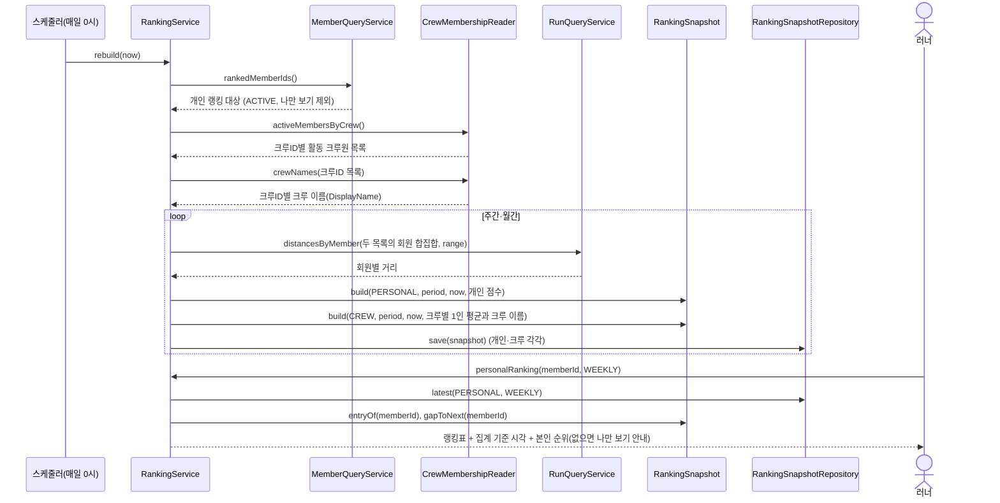

#### SQ-16 리포트 갱신과 코멘트 생성 (S-06, FR-064~FR-067)

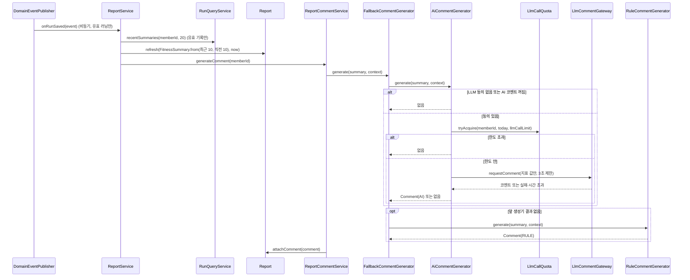

#### SQ-17 로그인과 단계별 가입 (S-01 1~3, FR-001~FR-004, FR-028)

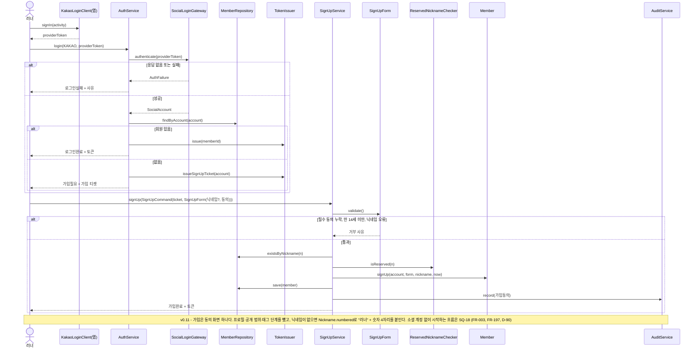

#### SQ-18 게스트 시작·세션 재개·계정 연동 (S-19, FR-197~FR-200, D-89, D-90) (v0.11)

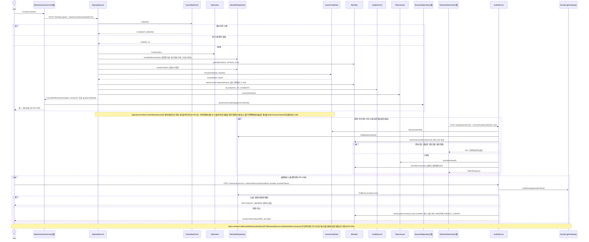

#### SQ-19 자유런 일시정지·재개·자동 종료 (S-20, FR-194, FR-195, FR-034, FR-036, D-93) (v0.11)

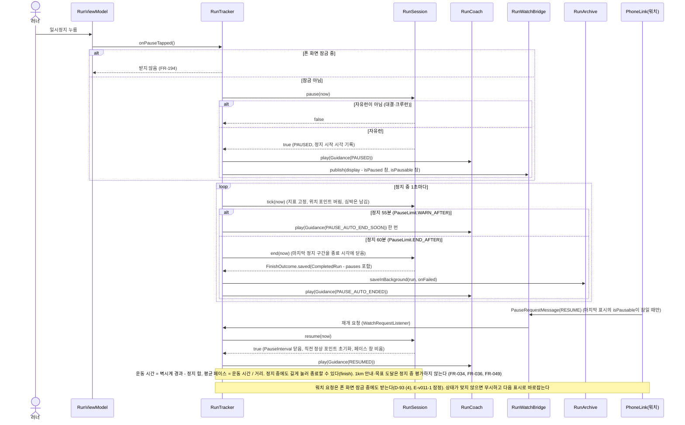

#### SQ-20 대결 근접 알림 폰 → 워치 (S-21, FR-196, FR-188, FR-109, D-96) (v0.11)

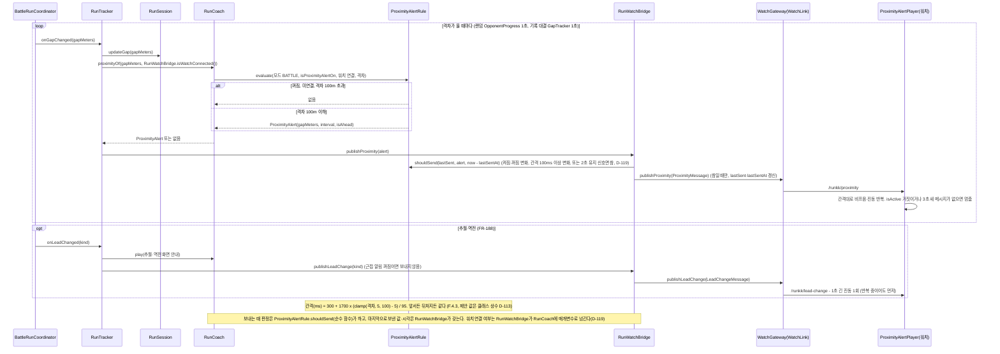

#### SQ-21 크루 채팅 보내기·받기·재연결 메우기 (S-22, FR-208, FR-209, FR-218, NFR-040, D-101~D-103) (v0.11)

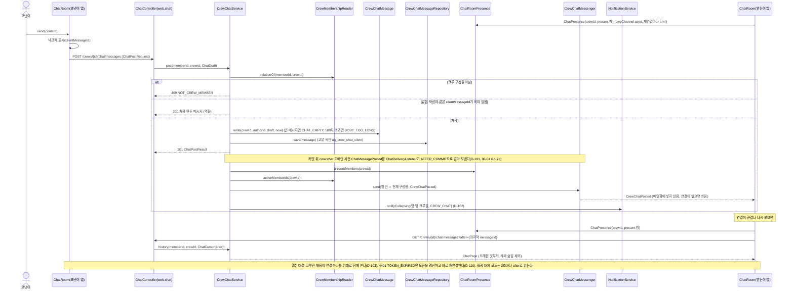

#### SQ-22 신고 → 자동 숨김 → 운영자 처리 (S-23, FR-214~FR-216, D-104) (v0.11)

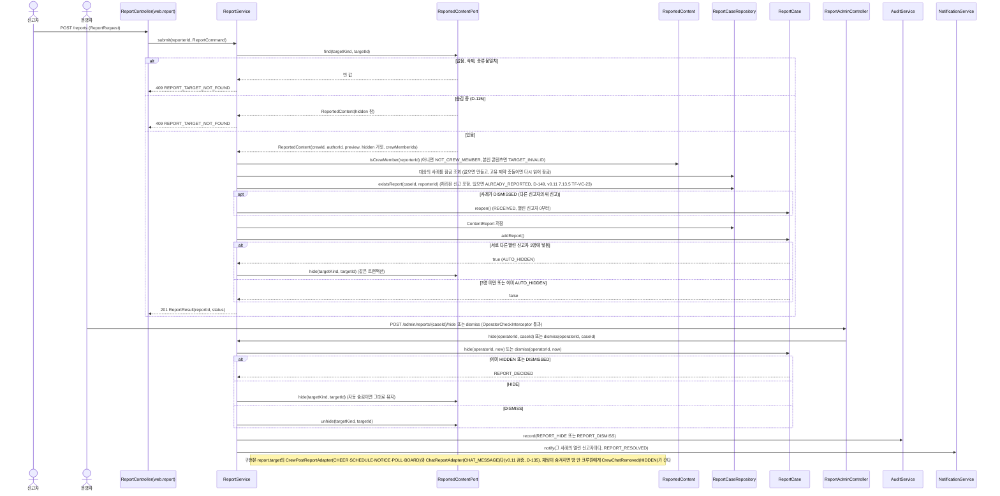

#### SQ-23 공동 목표 설정과 달성 (S-25, FR-138, FR-140, FR-141, FR-217, D-105) (v0.11)

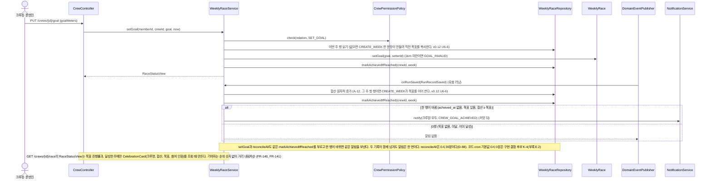

#### SQ-24 랜드마크 배경 해금과 선택 (S-11 7단계, FR-201, FR-202, D-107) (v0.11)

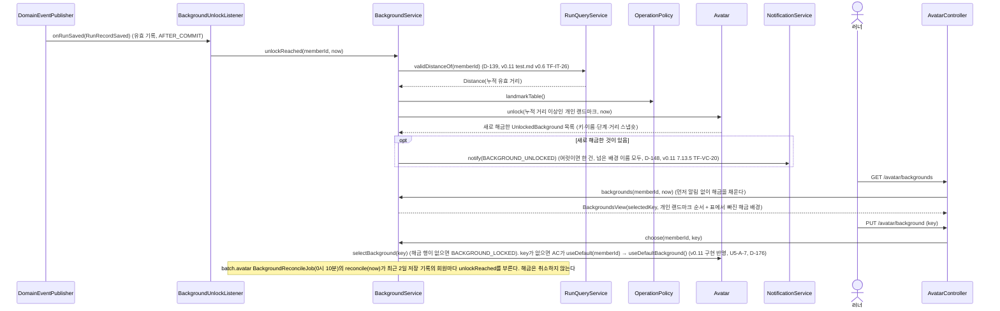

#### SQ-25 기존 무효 기록의 일회성 재판정 (FR-047, FR-043 예외, CR-11, D-191) (v0.12)

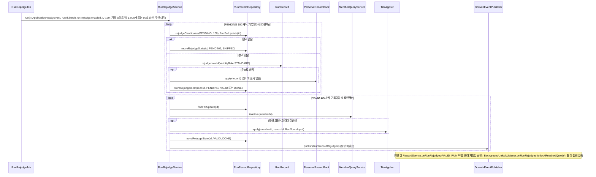

#### SQ-26 자유런 취소 (FR-219, CR-14, D-194) (v0.12)

v0.13의 SQ-27~SQ-30(진행 중 대결 복구 안내, 출발 전 포기 취소, 재연결 BattleStart 재전송과 성사 화면 그만두기, 결과 다시 읽기)은 이 조각이 100KB를 넘어 [02-02-동적-모델-v0.13](02-02-동적-모델-v0.13.md)에 있다.

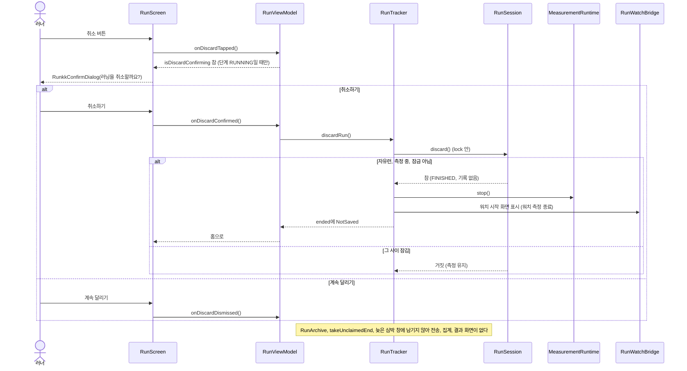

### 2.3 사건 흐름도

시나리오 25개의 사건을 객체 사이 흐름 한 장으로 모았다. 화살표 위 이름은 메시지(연산)이고, `◇사건`은 도메인 사건(5.6 D-03)이다. 끝에 `(v0.11, …)`이 붙은 줄은 v0.11에서 더하거나 고친 흐름이다 (v0.11, CR-01~CR-10).

```
[러너] ─signIn─▶ SocialLoginClient(앱) ─login─▶ AuthService ─authenticate─▶ SocialLoginGateway ─▶ [소셜 로그인 제공자]
[러너] ─signUp─▶ SignUpService ─validate─▶ SignUpForm ; ─signUp─▶ Member ; ─record─▶ AuditService
[러너] ─changeSetting─▶ MemberSettingService ─changeSetting─▶ Member
[러너] ─giveConsent/withdrawConsent─▶ MemberSettingService ─giveConsent/withdrawConsent─▶ Member ; ─◇ConsentWithdrawn─▶ DisposalService ─▶ DisposalOrder
[러너] ─editProfile─▶ ProfileService ─editProfile─▶ Member
[러너] ─view─▶ ProfileQueryService ─filter─▶ ProfileDisclosure
[러너] ─startAsGuest─▶ SignUpService ─validate─▶ GuestStartForm ; ─numbered─▶ Nickname ; ─issue─▶ GuestCredential ; ─guest─▶ Member   (v0.11, FR-197, D-89)
[앱 TokenAuthenticator] ─resumeGuest─▶ AuthService ─parse─▶ GuestCredential ; ─matchesGuestSecret/recordAccess─▶ Member   (v0.11, D-89)
[러너] ─linkSocialAccount─▶ AuthService ─authenticate─▶ SocialLoginGateway ; ─linkSocialAccount─▶ Member   (v0.11, FR-198, D-90)
[러너] ─changeSetting(THEME, BATTLE_SETTINGS)─▶ MemberSettingService ─changeSetting─▶ Member ─changeTheme─▶ MemberSettings   (v0.11, FR-203, FR-109, D-92)
[스케줄러 3시] ─withdrawIdleGuests─▶ WithdrawalService ─findIdleGuests─▶ MemberRepository ; ─withdraw─▶ Member ─◇MemberWithdrawn─▶ 각 패키지 WithdrawalListener   (v0.11, FR-200)

[위치 센서] ─▶ MeasurementService(data.device) ─onLocationSample/tick─▶ RunTracker ─accept─▶ LocationFilter ─▶ RunSession ; RunTracker ─evaluate─▶ CoachingJudge ─check─▶ GuidanceRule ─▶ GuidanceOutput
[심박 센서] ─▶ HeartRateCollector(워치) ─sendHeartRates─▶ PhoneLink ─▶ WatchLink(data.watch, WatchGateway.heartRates) ─▶ RunTracker ─onHeartRate─▶ RunSession
[러너] ─onFinishTapped/onFinishLongPressed─▶ RunTracker ─hintFinish/finish─▶ RunSession ─CompletedRun─▶ PendingRunRepository ─▶ UploadPendingRunsUseCase ─upload─▶ RunUploadService
BattleRunCoordinator·CrewRunCoordinator ─endRun─▶ RunTracker ─end─▶ RunSession
[러너·워치] ─onPauseTapped/onResumeTapped·PauseRequestMessage─▶ RunTracker(RunWatchBridge 경유) ─pause/resume─▶ RunSession ; RunTracker ─tick(PauseLimit 55·60분)─▶ RunCoach.play / RunSession.end ─▶ RunArchive   (v0.11, FR-194, FR-195, D-93)
BattleRunCoordinator ─onGapChanged/onLeadChanged─▶ RunTracker ─proximityOf─▶ RunCoach ─evaluate─▶ ProximityAlertRule ; RunTracker ─publishProximity/publishLeadChange─▶ RunWatchBridge ─▶ WatchGateway ─▶ ProximityAlertPlayer(워치)   (v0.11, FR-196, D-96)
RunUploadService ─receive/judgeValidity─▶ RunRecord ; ─lookup─▶ WeatherGateway ─▶ [날씨 서비스] ; ─apply─▶ PersonalRecordBook
RunUploadService ─◇RunRecordSaved─┬─▶ TierUpdateListener ─recordValidRun─▶ TierLevelService ─recordValidRun─▶ Member
                                  ├─▶ WeeklyRaceService ─add─▶ WeeklyRace ; ─markAchievedIfReached─▶ WeeklyRaceRepository ; ─notify(CREW_GOAL_ACHIEVED)─▶ NotificationService   (달성 판정 v0.11, FR-217, D-105)
                                  ├─▶ BackgroundUnlockListener ─unlockReached─▶ BackgroundService ─unlock─▶ Avatar ; ─notify(BACKGROUND_UNLOCKED)─▶ NotificationService   (v0.11, FR-201, D-107)
                                  ├─▶ RewardService ─accrue─▶ RewardWallet
                                  ├─▶ BattleResultService ─verify/judge─▶ Battle ─◇BattleJudged─▶ RewardService
                                  ├─▶ CrewRunService ─linkRun/recordArrival─▶ CrewRunPost
                                  ├─▶ ReportService ─refresh─▶ Report ◀─attachComment─ ReportCommentService ─generate─▶ CommentGenerator ─▶ [외부 LLM 서비스]
                                  └─▶ RunimalService ─judge─▶ CourseSimilarityService ; ─onValidRun/assignProvisional/confirm─▶ RunimalProfile

[러너] ─requestMatch─▶ MatchingService ─enqueue─▶ MatchQueue ◀─tick─ Matchmaker ─random─▶ Battle ; ─announceMatch─▶ BattleStartService ─send─▶ BattleMessenger
MatchingService ─rememberBattleDistance─▶ MemberSettingService ─rememberBattleDistance─▶ Member
Matchmaker ─match─▶ GhostMatcher ─ghostEligibleOwners─▶ MemberQueryService ; ─validRunsReaching/curve─▶ RunQueryService ; ─againstRecord─▶ Battle
[러너] ─ProgressReport─▶ LiveBattleService ─onProgress─▶ LiveBattleSession ; ─recordArrival─▶ Battle ; ─notify─▶ NotificationService
[스케줄러] ─tick─▶ BattleClockService ─start/closeCountdown/expirePending─▶ Battle
[러너] ─startSelfBattle/startCelebrityBattle─▶ RecordBattleService ─againstRecord─▶ Battle ; 앱 OpponentTrack.distanceAt

[러너] ─create/changeInfo/transferLeadership/delete─▶ CrewService ─▶ Crew ; ─check─▶ CrewPermissionPolicy
[러너] ─apply/approveJoin/rejectJoin/leave/kick─▶ MembershipService ─evaluate─▶ JoinEligibility ; ─admit/release─▶ Crew ; ─approve/reject─▶ JoinRequest
[러너] ─writeCheer/writeCrewRun/answerAttendance─▶ CrewPostService ─▶ CrewPost/CrewRunPost ; ─notify─▶ NotificationService   (vote → answerAttendance, v0.11, FR-145, D-99)
[크루장] ─appointManager/dismissManager─▶ CrewService ─appointManager/dismissManager─▶ Crew ; ─record─▶ AuditService ; ─notify(MANAGER_CHANGED)─▶ NotificationService   (v0.11, FR-204, D-98)
[러너] ─writeMeetup/writeNotice/writePoll/writeBoard/pin/respondPoll/answerAttendance/album/photo─▶ CrewPostService ─▶ MeetupPost/NoticePost/PollPost/BoardPost (SchedulePost.answer 다형성) ; ─save─▶ PostPhotoStore ; ─announce─▶ CrewNewsNotifier ─notify─▶ NotificationService   (v0.11, FR-132, FR-205~FR-207, FR-211, FR-212, FR-218)
[러너] ─setGoal─▶ WeeklyRaceService ─setGoal─▶ WeeklyRace ; ─markAchievedIfReached─▶ WeeklyRaceRepository   (v0.11, FR-138, D-105)
[러너] ─post/history/react/unreact/delete─▶ CrewChatService ─relationOf─▶ CrewMembershipReader ; ─write/delete─▶ CrewChatMessage ; ─send─▶ CrewChatMessenger(realtime) ; ─notifyCollapsing─▶ NotificationService   (v0.11, FR-208~FR-210, FR-213, D-101, D-102)
[앱] ─ChatPresence─▶ LiveSocketHandler ─▶ ChatPresenceRegistry(ChatRoomPresence 구현)   (v0.11, FR-209)
[러너] ─submit─▶ ReportService ─find/hide─▶ ReportedContentPort(CrewPostReportAdapter·ChatReportAdapter) ; ─addReport/reopen─▶ ReportCase   (v0.11, FR-214, FR-215, D-104)
[러너] ─enterLobby/toggleReady/leaveLobby─▶ CrewRunService ─enterLobby/toggleReady/leaveLobby─▶ CrewRunPost
[스케줄러] ─tick─▶ CrewRunService ─openLobby/depart/close─▶ CrewRunPost ; ─send─▶ CrewRunMessenger
[러너] ─ProgressReport─▶ CrewRunLiveService ─onProgress─▶ CrewRunLiveSession

[러너] ─createFromSelfie─▶ AvatarService ─transform─▶ FaceTransformGateway ─▶ ai 서버 ─▶ [얼굴 변환 서비스]
[러너] ─purchase─▶ ShopService ─purchase─▶ RewardWallet ; ─equip─▶ AvatarService ─owns─▶ RewardService ; ─equip─▶ Avatar
[스케줄러 0시] ─refreshAll─▶ AppearanceService ─bodyShape/skinTone─▶ AppearanceCalculator ; ─updateAppearance─▶ Avatar ; ─notify─▶ NotificationService
[스케줄러 0시] ─rebuild─▶ RankingService ─distancesByMember─▶ RunQueryService ; ─build─▶ RankingSnapshot
[스케줄러 0시] ─reconcileAll─▶ WeeklyRaceService ─crewIdsActiveBetween─▶ CrewRepository ; ─distancesByMember─▶ RunQueryService ; ─▶ WeeklyRace
[스케줄러 20시] ─remindMissedPlans─▶ CoachService ─notify─▶ NotificationService
[스케줄러 3시] ─executeDue─▶ DisposalService ─purgeRoute/purgeHeartRates─▶ RunRecord ; ─expireRequests─▶ MembershipService ─expire─▶ JoinRequest ; ─purgeExpired─▶ NotificationService, AuditService ; ─purgeWithdrawn─▶ WithdrawalService ─purgeResidual─▶ Member
[스케줄러 1분] ─remindClosingPolls─▶ CrewPostService ─nonRespondents/markReminded─▶ PollPost ; ─remindClosing─▶ CrewNewsNotifier   (v0.11, FR-218, D-106)
[스케줄러 1분] ─cancelAbandoned─▶ BattleStartService ─isAbandoned/cancelUnstarted─▶ Battle   (v0.11, CR34-01)
[스케줄러 0시 10분] ─reconcile─▶ BackgroundService ─unlockReached─▶ Avatar ; ─reconcile─▶ TierReconcileService ─tierPendingBetween─▶ RunRecordRepository ; ─apply─▶ TierApplier ─recordValidRun·recordLateValidRun─▶ TierLevelService   (v0.11, D-107, D-108) (v0.11 구현 반영, U5-A-1, D-169)

[운영자] ─요청─▶ web.admin(OperatorCheckInterceptor) ─ensureOperator─▶ OperatorAuthorizer ─verify─▶ OperatorTokenIssuer (확인한 운영자 계정을 요청 속성 actorId로 붙이고, web.admin.celebrity·setting·audit이 아래 서비스에 넘긴다)
[운영자] ─register/delete─▶ CelebrityRecordService ─register─▶ CelebrityRecord ; ─record─▶ AuditService
[운영자] ─change─▶ OperationSettingService ─validate─▶ SettingKey ; ─change─▶ OperationSetting ; ─invalidate─▶ OperationPolicy ; ─◇OperationSettingChanged─▶ VirtualRecordService (티어 경계·가상 기록 규칙이면 regenerate)
[운영자] ─query─▶ AuditService
[운영자] ─cases/resolve─▶ ReportService ─resolve─▶ ReportCase ; ─hide/unhide─▶ ReportedContentPort ; ─record─▶ AuditService ; ─notify(REPORT_RESOLVED)─▶ NotificationService   (v0.11, FR-216, D-104)
NotificationService ─pushDecision─▶ MemberQueryService ; ─tokensOf─▶ PushDeviceRepository ; ─send─▶ PushGateway ─▶ [푸시 알림 서비스]
[앱] ─registerDevice─▶ NotificationService ─save─▶ PushDevice
[러너] ─share─▶ CardSharer ─share─▶ ShareTarget ─▶ [공유 대상 앱]
[러너] ─기록 상세─▶ 앱 CourseMapView ─▶ [외부 지도 서비스]
```

### 2.4 상태도

상태가 2개 이상 바뀌는 클래스 21개에 상태도를 그렸다(v0.10의 15개 + v0.11의 2.4.16~2.4.21). 시작은 `[*]`에서 나오는 전이, 종료는 `[*]`로 들어가는 전이다. 전이 라벨은 `사건 [조건]`이고, 표에서 사건마다 대응 연산을 적었다. v0.11에서 2.4.2 Battle(CANCELLED), 2.4.5·2.4.6 크루런 참석 응답, 2.4.7 RunSession(PAUSED), 2.4.13 CrewMembership(운영진), 2.4.14 Notification(묶음 알림)을 고쳤다 (v0.11, CR34-01, FR-194, FR-204, D-102).

상태도가 필요 없는 클래스: Crew(존재·삭제 두 상태뿐이고 삭제는 행 제거), RunRecord(유효 여부는 저장 때 한 번 정해지고 바뀌지 않는다. 경로 파기는 RunTrack의 purged 플래그 하나), CelebrityRecord·VirtualRecord(등록 뒤 바뀌지 않는다), OperationSetting(값만 바뀌고 상태 개념이 없다), RewardWallet(잔액만 바뀐다), AuditRecord(고치지 않는다), WeeklyRace의 합산(이번 주·지난 주는 저장 상태가 아니라 Week.contains(now)로 계산한다. v0.11의 공동 목표는 상태가 있어 2.4.18에 그렸다), ContentReport(resolved 플래그 하나이고 처리 상태는 ReportCase가 가진다), UnlockedBackground·PostPhoto·ChatReaction·PollResponse(만들고 지울 뿐이다) (v0.11, D-104, D-105).

#### 2.4.1 MatchTicket (매칭 대기)

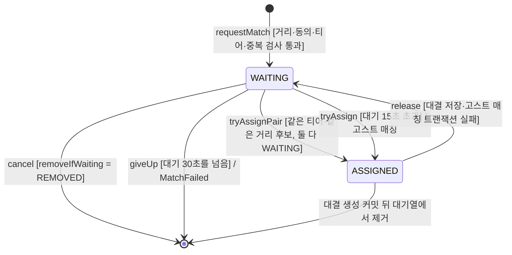

| 사건 | 대응 연산 |
|------|-----------|
| requestMatch | MatchingService.requestMatch → MatchQueue.enqueue(new MatchTicket) |
| tryAssignPair | Matchmaker.tick → partnerOf → MatchTicket.canPairWith → pairUp → MatchQueue.tryAssignPair → MatchTicket.assign (v0.10, D-79) |
| cancel | MatchingService.cancel → MatchQueue.removeIfWaiting(WAITING일 때만 원자적으로 지움. ASSIGNED·ABSENT면 거부) (v0.10, TF-IT-16, D-83) |
| tryAssign (v0.8) | Matchmaker.tick → resolveUnpaired(v0.10, D-79) → MatchTicket.isExpired(now, 15초) → MatchQueue.tryAssign → GhostMatcher.match. 후보가 있었지만 tryAssignPair가 실패한 대기자도 15초가 지났으면 여기로 온다(FR-083, TF-BE-12) |
| release (v0.8) | 트랜잭션 실패 → MatchQueue.release. 다음 tick에 다시 짝·고스트를 찾는다(TF-BE-11, D-64) |
| giveUp (v0.8) | Matchmaker.tick → resolveUnpaired(v0.10, D-79) → MatchTicket.isExpired(now, 30초)(넘음, 정각 제외, v0.10 TF-VB-15) → MatchQueue.remove → BattleMessenger.send(MatchFailed) (D-64) |

#### 2.4.2 Battle (대결)

> v0.16: 이 상태도의 최신판은 [02-04 2.4.2](02-04-동적-모델-v0.16.md)다(친구 대결 생성, 그만두기 = 모든 종류 패, 셀프런·셀럽런 cancelByRunner, D-317, D-318).

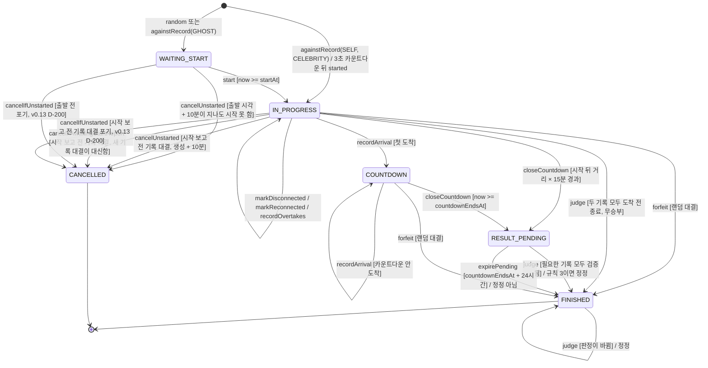

| 사건 | 대응 연산 |
|------|-----------|
| random / againstRecord | Battle.random(a, b, now), Battle.againstRecord(spec, now) |
| start | BattleClockService.tick → Battle.start(now) (기록 대결은 RecordBattleService.markStarted → Battle.start) |
| markDisconnected / markReconnected | LiveBattleService.detectTimeouts → Battle.markDisconnected; onProgress → Battle.markReconnected |
| recordOvertakes | LiveBattleService → Battle.recordOvertakes(memberId, count) (카운트다운 종료 때 한 번에 기록) |
| recordArrival | LiveBattleService.onProgress → Battle.recordArrival; 기록 상대는 BattleClockService.tick → Battle.recordArrival(OPPONENT_SIDE) |
| forfeit | BattleResultService.forfeit → Battle.cancelIfUnstarted(now)가 거짓일 때(출발한 대결, IN_PROGRESS·COUNTDOWN) Battle.forfeit(memberId, now). 포기한 쪽 패 (v0.13, D-200) |
| cancelIfUnstarted | BattleResultService.forfeit → Battle.cancelIfUnstarted(now). 출발 전(WAITING_START, 시작 보고 전 기록 대결) 포기는 승패·리워드 없이 CANCELLED로 끝나고 랜덤 상대에게 BattleEnded(OPPONENT_FORFEITED)만 간다. 결과 조회는 409 BATTLE_NOT_FOUND (v0.13, CR-16, D-200) |
| closeCountdown | BattleClockService.tick → Battle.closeCountdown(now) (최대 시간 초과도 같은 연산, 6.2) |
| judge | BattleResultService.onRunSaved → Battle.verify → Battle.judge(now), BattleClockService.tick(closeCountdown 뒤). WAITING_START·포기 뒤에는 판정하지 않는다. 먼저 도착한 쪽이 무효(규칙 3)면 보류 뒤 첫 판정이어도 corrected = true이고 BATTLE_CORRECTED를 보낸다. 상대에게 유효한 도착이 없으면 두 참가자 모두 무승부다 (v0.8, TF-BE-08, TF-VB-02, TF-VB-03, TF-BE-10, D-63). 이미 FINISHED인 대결에 늦은 기록이 와 판정이 같으면 정정이 아니다 (v0.10, TF-BE-20, D-82) |
| expirePending | BattleClockService.tick → Battle.expirePending(now). 정정 아님(srs.md 6.3 4.5) |
| cancelUnstarted | batch.battle AbandonedBattleJob(1분) → BattleStartService.cancelAbandoned(now) → BattleRepository.findAbandoned → Battle.isAbandoned(now) → Battle.cancelUnstarted(now). ABANDON_AFTER = 10분: 출발 예약 대결은 출발 시각(없으면 생성 시각)부터, 시작 보고 없는 기록 대결은 생성 시각부터 센다 (v0.11, CR34-01) |
| cancelIfAwaitingStartReport | RecordBattleService가 새 기록 대결을 만들 때 시작 보고 전의 이전 기록 대결을 CANCELLED로 끝낸다(그 밖의 활성 대결이면 거짓을 돌려주고 새 대결을 거부) (v0.11, CR34-01) |

CANCELLED는 활성이 아니고 판정·이력·전적에 나오지 않는다. 활성 상태(WAITING_START, IN_PROGRESS, COUNTDOWN)로 드나들 때 battle_participant.active_member_id를 맞춰 "회원마다 활성 대결 1개"를 고유 제약이 지킨다(V15·V17). 시작 보고가 없는 기록 대결은 도착 시각을 몰라 판정할 수 없으므로 취소로 잃는 결과가 없다 (v0.11, CR34-01).

#### 2.4.3 BattleParticipant 연결 상태 (랜덤 대결 진행 중)

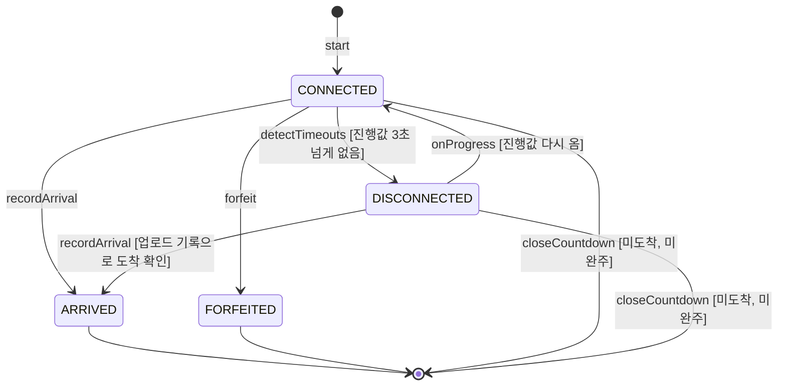

| 사건 | 대응 연산 |
|------|-----------|
| detectTimeouts | LiveBattleSession.detectTimeouts → Battle.markDisconnected → BattleParticipant.disconnections에 추가 |
| onProgress | LiveBattleSession.onProgress → Battle.markReconnected |
| recordArrival | BattleParticipant.arrive(at) |
| forfeit | BattleParticipant.forfeit() |

