> [런크크 객체지향 분석·설계서](../design-oo.md) 목차 · 이전: [02b-동적-모델-SQ-15-랭킹-집계와-조](02b-동적-모델-SQ-15-랭킹-집계와-조.md) · 다음: [02-02-동적-모델-v0.13](02-02-동적-모델-v0.13.md)
#### 2.4.4 JoinRequest (가입 신청)

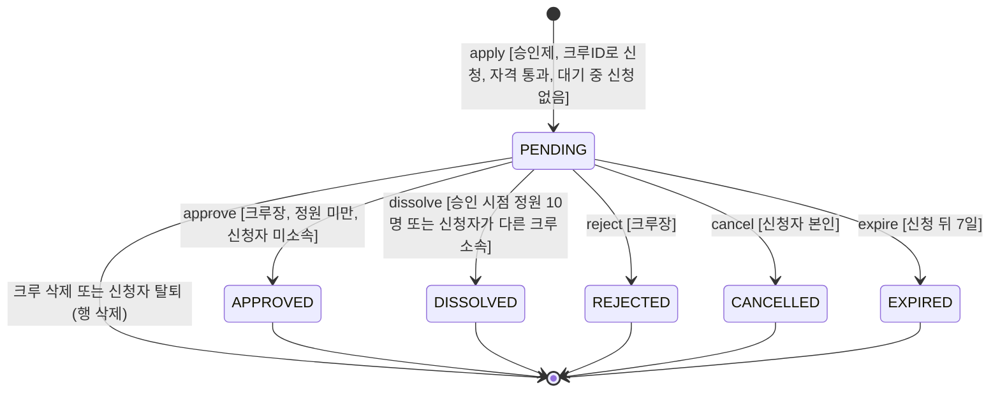

| 사건 | 대응 연산 |
|------|-----------|
| apply | MembershipService.apply → new JoinRequest(crewId, memberId, now) |
| approve | MembershipService.approveJoin(requesterId, requestId) → Crew.admit → JoinRequest.approve(now) |
| dissolve | MembershipService.approveJoin(requesterId, requestId) → JoinRequest.dissolve(사유, now) |
| reject | MembershipService.rejectJoin(requesterId, requestId) → JoinRequest.reject(now) |
| cancel | MembershipService.cancel → JoinRequest.cancel(memberId, now) |
| expire | MembershipService.expireRequests(now) → JoinRequest.expire(now) (batch.crew의 JoinRequestExpiryJob이 3시에 부른다). 승인·거절 요청 때도 같은 연산으로 먼저 확인해 7일이 지났으면 EXPIRED로 바꾸고 409 JOIN_REQUEST_EXPIRED로 거부한다 (v0.8, TF-VB-10, D-69). 배치가 먼저 EXPIRED로 바꾼 신청에 온 승인·거절도 같은 사유로 거부한다 (v0.10, TF-IT-17) |
| 크루 삭제·탈퇴 | CrewService.delete, CrewWithdrawalListener.onMemberWithdrawn → JoinRequestRepository.delete |

#### 2.4.5 CrewRunPost (크루런)

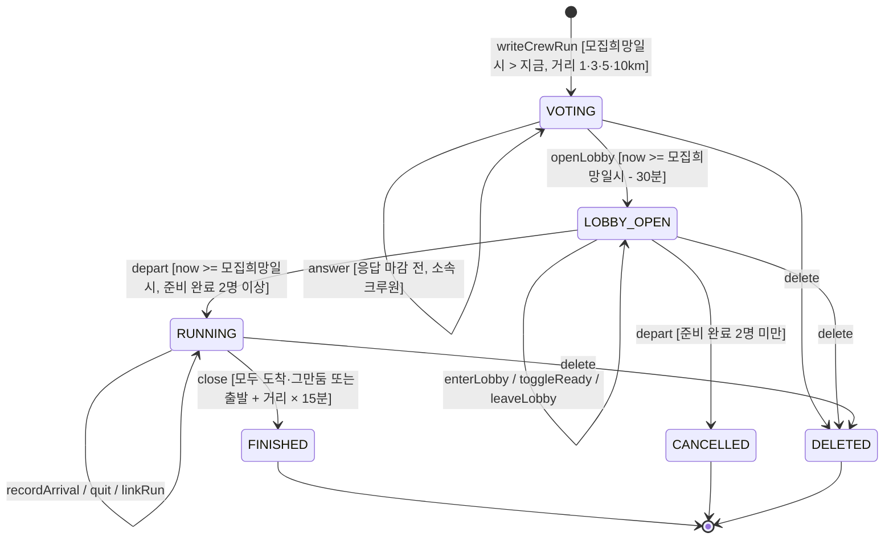

| 사건 | 대응 연산 |
|------|-----------|
| writeCrewRun | CrewPostService.writeCrewRun → new CrewRunPost(…) |
| answer | CrewPostService.answerAttendance → CrewRunPost.answer(memberId, answer, now) (SchedulePost.answer 다형성. v0.10 vote, 상태 이름 VOTING은 "참석 응답을 받는 중"이라는 뜻으로 그대로 둔다) (v0.11, FR-145, D-99) |
| openLobby | CrewRunService.tick → CrewRunPost.openLobby(now, rule) |
| enterLobby / toggleReady / leaveLobby | CrewRunService.enterLobby / toggleReady / leaveLobby → CrewRunPost.enterLobby / toggleReady / leaveLobby |
| depart | CrewRunService.tick → CrewRunPost.depart(now, rule) |
| recordArrival / linkRun | CrewRunService.onRunSaved → CrewRunPost.linkRun, recordArrival |
| quit | CrewRunService.quit → CrewRunPost.quit(memberId, now) |
| close | CrewRunService.tick → CrewRunPost.shouldClose → close(now) |
| delete | CrewPostService.delete → CrewPost.delete(requesterId, relation) (DELETED는 deleted 플래그. 작성자 본인 또는 크루장·운영진, v0.11 FR-213), 크루 삭제는 CrewService.delete. 두 경우 모두 CrewRunService.endByDeletion: RUNNING이면 CrewRunEnded(DELETED), LOBBY_OPEN이면 CrewRunCancelled, 세션 삭제. 참가자 러닝은 멈추지 않고 저장된 기록은 남으며 크루런 연결만 끊긴다 (v0.8, TF-VB-13, D-66) |

#### 2.4.6 CrewRunParticipation 준비 상태

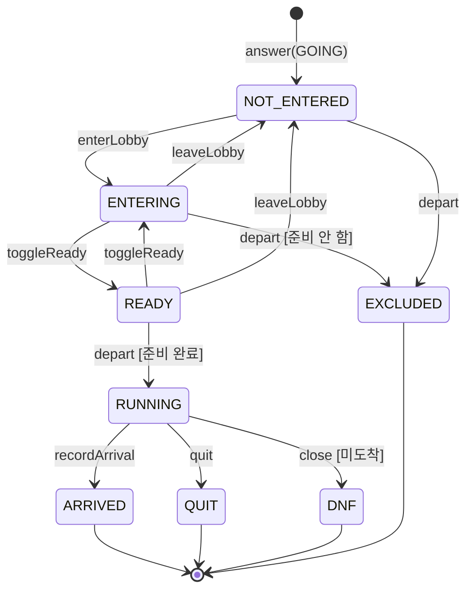

| 사건 | 대응 연산 |
|------|-----------|
| answer(GOING) | CrewRunPost.answer → CrewRunParticipation.changeAnswer. UNDECIDED·NOT_GOING은 참가자가 아니다 (v0.11, FR-145, D-99) |
| enterLobby | CrewRunPost.enterLobby (응답이 없으면 GOING으로 더한 뒤 readiness = ENTERING) |
| toggleReady | CrewRunPost.toggleReady → CrewRunParticipation.toggleReady() |
| leaveLobby | CrewRunPost.leaveLobby |
| depart | CrewRunPost.depart (READY만 참가자로 남긴다) |
| recordArrival | CrewRunPost.recordArrival → CrewRunParticipation.arrive(at) |
| quit | CrewRunPost.quit → CrewRunParticipation.quit() |
| close | CrewRunPost.close (미도착 참가자 rank = 없음, 미완주) |

#### 2.4.7 RunSession (앱 측정)

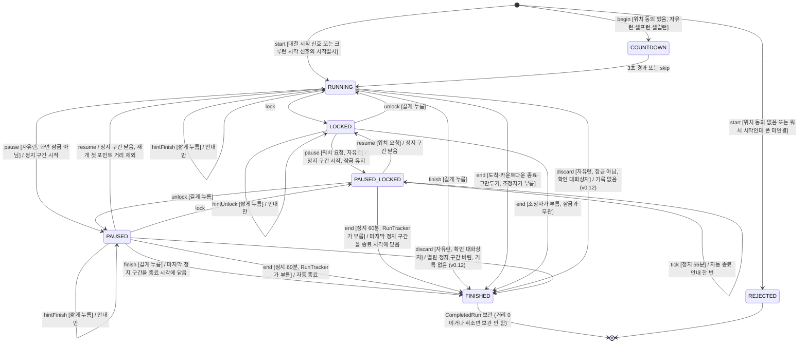

| 사건 | 대응 연산 |
|------|-----------|
| begin / skip | StartCountdown.begin(), skip() |
| start | RunSession.start(at) |
| lock | RunTracker.lockScreen() → RunSession.lock() |
| hintUnlock / unlock | RunTracker.onUnlockTapped() → RunSession.hintUnlock(), onUnlockLongPressed() → RunSession.unlock() |
| hintFinish / finish | RunTracker.onFinishTapped() → RunSession.hintFinish(), onFinishLongPressed() → RunSession.finish(now) (화면 전용) |
| end | RunTracker.endRun() → RunSession.end(now) (BattleRunCoordinator·CrewRunCoordinator 전용, 길게 누르기 규칙 없음). v0.11: 정지 60분(PauseLimit.END_AFTER)이면 RunTracker.tick이 같은 저장 규칙으로 부른다 (v0.11, FR-195, D-93) |
| pause / resume | RunTracker.onPauseTapped()·onResumeTapped() 또는 워치 PauseRequestMessage(RunWatchBridge → WatchRequestListener) → RunSession.pause(now)·resume(now). RunMode.FREE가 아니면 pause가 거짓을 돌려준다. 폰 버튼은 잠금 중 받지 않는다. 잠금 중(LOCKED) 워치 요청은 잠금을 유지한 채 PAUSED_LOCKED로 간다 (v0.11, FR-194, D-93, D-120) |
| tick [정지 55분] | RunTracker.tick → PauseLimit.WARN_AFTER 검사 → RunCoach.play(Guidance(PAUSE_AUTO_END_SOON)) (v0.11, FR-195) |
| discard | RunViewModel.onDiscardConfirmed → RunTracker.discardRun() → RunSession.discard(). RunMode.isDiscardable(FREE)이 아니거나 잠금 중이거나 측정 중이 아니면 거짓. 참이면 RunTracker가 측정 서비스·워치 측정을 끝내고 ended로 NotSaved를 보낸다(보관·전송 없음) (v0.12 구현 반영, CR-14, FR-219, D-194) |

v0.11의 PAUSED는 자유런만 들어간다. 워치 일시정지 요청은 폰 화면 잠금 중에도 받는다(D-93 (4), E-v011-1 잠정). 그러면 LOCKED에서 정지로 가는 길이 생긴다. 정지해도 폰 화면 잠금은 풀지 않으므로 잠금 중 정지를 상태 PAUSED_LOCKED로 따로 둔다: 폰 버튼(재개·정지)은 받지 않고, 워치 RESUME이면 LOCKED로, 길게 눌러 잠금을 풀면 PAUSED로 간다. 정지 한도(55·60분)는 PAUSED와 같다 (v0.11, FR-194, D-93, D-120).

#### 2.4.8 CompletedRun (앱 기기 보관 → 전송)

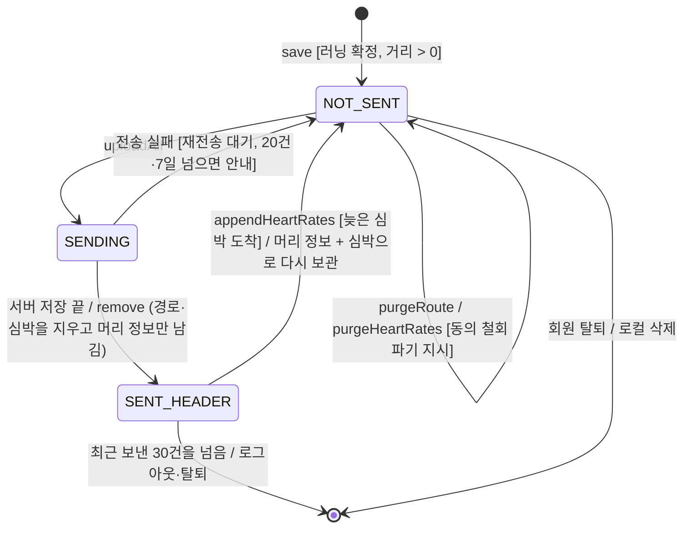

| 사건 | 대응 연산 |
|------|-----------|
| save | PendingRunRepository.save(completedRun) |
| uploadAll | UploadPendingRunsUseCase() → RetryPolicy.nextDelay(attempt) |
| 서버 저장 끝 | PendingRunRepository.remove(recordId). 보낸 기록의 머리 정보(경로·심박 없음)는 기간이 아니라 건수(최근 보낸 30건)로 남긴다. FR-043은 늦은 심박을 기간 제한 없이 덧붙이게 하므로(TC-1433) 시간으로 지우지 않는다. 머리 정보가 없는 기록의 늦은 심박은 보관함이 심박만 담은 항목(LateHeartRates)으로 남기고 UploadPendingRunsUseCase의 private uploadLateHeartRates가 RunUploadRemote.appendHeartRates(POST /runs/{id}/heart-rates)로 보낸다(CR-U26) (v0.8, TF-AN-16, D-77, v0.10, D-80) |
| purgeRoute / purgeHeartRates | SyncDisposalsUseCase → PendingRunRepository.purgeRoutes() / purgeHeartRates(). purgeHeartRates는 늦은 심박 항목(LateHeartRates)도 지운다 (v0.10, TF-VA-31) |

#### 2.4.9 Member (회원)

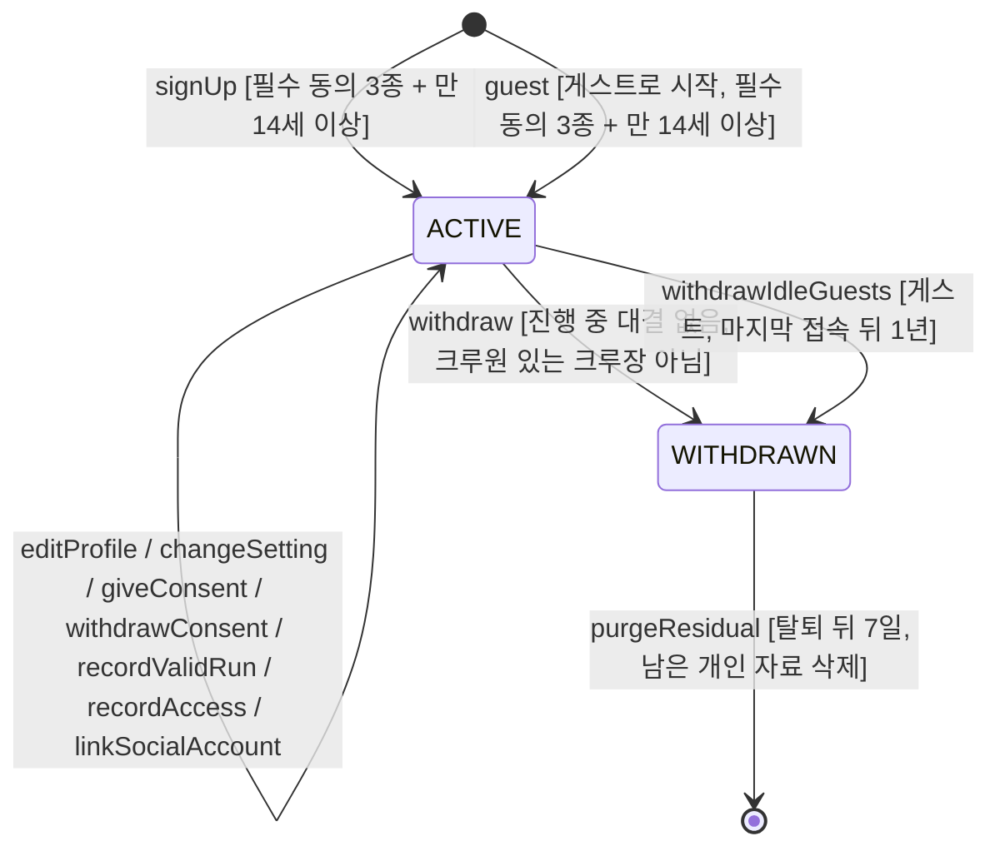

| 사건 | 대응 연산 |
|------|-----------|
| signUp | Member.signUp(account, form, nickname, now) |
| editProfile / changeSetting / giveConsent / withdrawConsent | Member.editProfile, changeSetting, giveConsent, withdrawConsent (MemberSettingService가 부른다) |
| recordValidRun | running.TierUpdateListener → TierLevelService.recordValidRun(memberId, RunScoreInput) → Member.recordValidRun(input, boundary) |
| withdraw | WithdrawalService.withdraw(memberId) → Member.withdraw(now) (탈퇴 확인은 앱 화면에서 끝난 뒤) |
| purgeResidual | WithdrawalService.purgeWithdrawn(now) → Member.purgeResidual() (batch.member의 WithdrawalPurgeJob, 3시) |
| guest / recordAccess / linkSocialAccount / withdrawIdleGuests | 계정 유형 상태도 2.4.16 (v0.11, FR-197~FR-200) |

Member의 티어는 따로 상태도를 그리지 않았다. UNRANKED에서 유효 러닝 순번 3에 배치, 10의 배수에 갱신이고, 사건은 recordValidRun 하나다. 순번은 running이 저장 때 정한 validRunOrdinal이다(D-37). 앞 순번의 반영이 실패해 순번을 건너뛰어 와도 "직전 반영 순번 < 판정 지점 ≤ 새 순번"이면 판정한다(D-40).

#### 2.4.10 DisposalOrder (원자료 파기 지시)

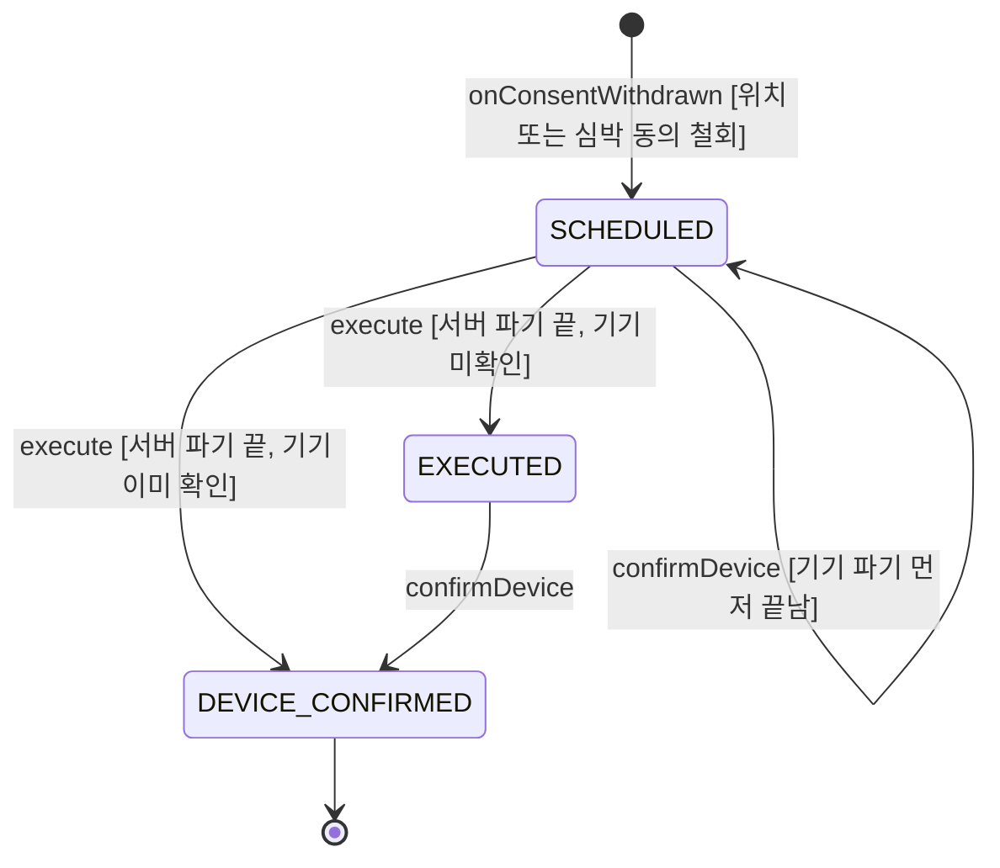

| 사건 | 대응 연산 |
|------|-----------|
| onConsentWithdrawn | DisposalService.onConsentWithdrawn → new DisposalOrder(memberId, kind, now + 7일) |
| execute | DisposalService.executeDue(now) → DisposalOrder.execute(now) |
| confirmDevice | DisposalService.confirmDevice → DisposalOrder.confirmDevice(now) |

동의를 다시 해도 이미 만든 지시는 그대로 실행한다. 철회 전에 저장한 경로는 철회로 파기 대상이 되었기 때문이다.

#### 2.4.11 RunimalProfile (Runimal 유형)

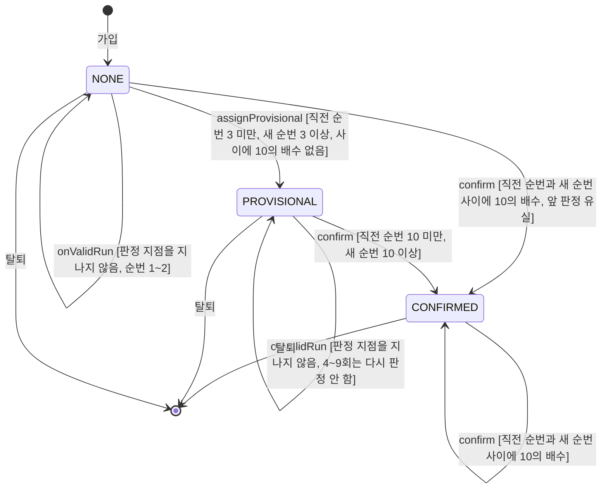

| 사건 | 대응 연산 |
|------|-----------|
| onValidRun | RunimalService.onRunSaved → RunimalProfile.onValidRun(event.validRunOrdinal) → JudgeTrigger. 순번은 running이 정하고 RunimalProfile.validRunCount는 직전 반영 순번으로만 쓴다(design-review.md H-05, D-37). 직전 반영 순번 < 판정 지점 ≤ 새 순번이면 그 지점을 판정하고, 지점이 여럿이면 가장 큰 지점 하나만 판정한다(design-review.md H-05', D-40) |
| assignProvisional | RunimalJudge.judgeProvisional → RunimalProfile.assignProvisional |
| confirm | RunimalJudge.judgeConfirmed → RunimalProfile.confirm |

#### 2.4.12 Avatar 체형 (BodyShape)

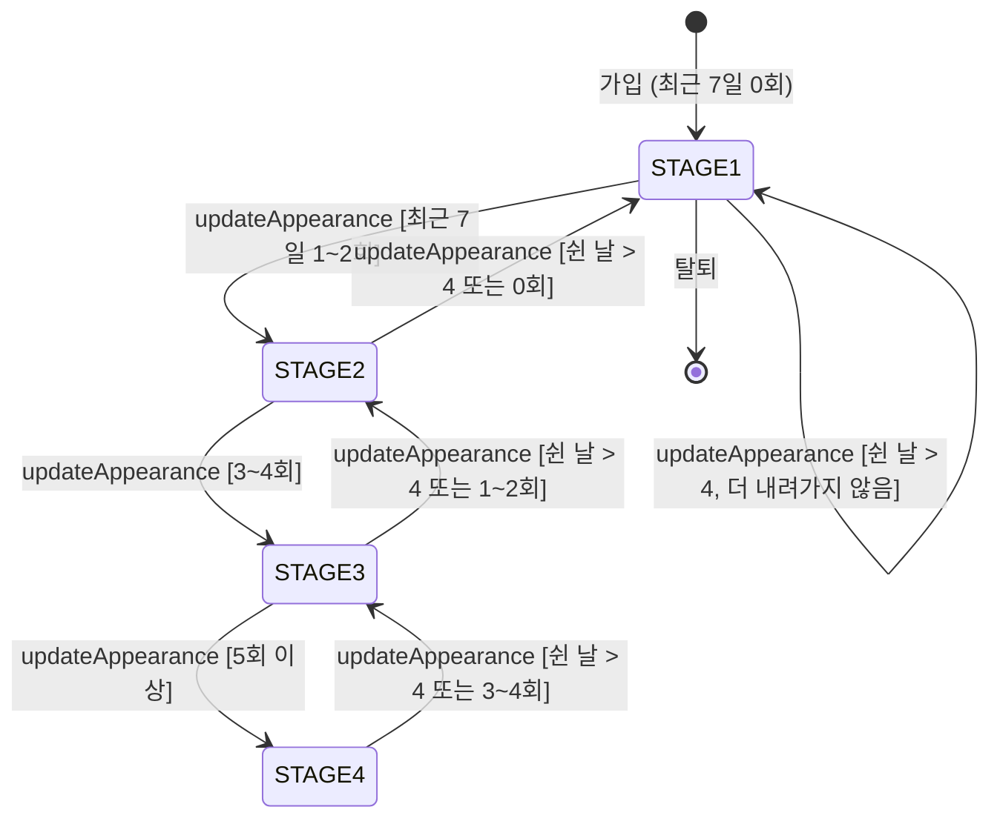

| 사건 | 대응 연산 |
|------|-----------|
| updateAppearance (매일 0시) | AppearanceService.refreshAll → AppearanceCalculator.bodyShape → Avatar.updateAppearance(shape, tone). 바뀌면 NotificationService.notify(BODY_SHAPE_CHANGED) |

여기에 그리지 않은 STAGE1 → STAGE3 같은 건너뛰기 전이도 있다. 쉬지 않은 동안에는 기본 단계가 최근 7일 횟수로 바로 정해지기 때문이다. 쉰 날이 4일을 넘을 때만 하루 한 단계씩 내려간다(FR-163).

#### 2.4.13 CrewMembership (크루 소속)

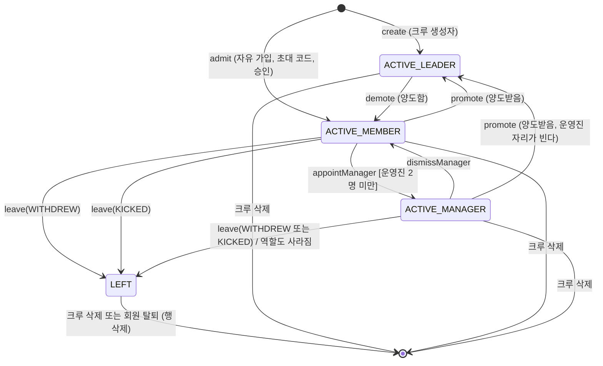

| 사건 | 대응 연산 |
|------|-----------|
| create / admit | Crew.create, Crew.admit → new CrewMembership |
| promote / demote | Crew.transferLeadership → CrewMembership.promote(), demote() |
| leave | MembershipService.leave / kick → Crew.release → CrewMembership.leave(reason, now) |
| appointManager / dismissManager | CrewService.appointManager·dismissManager → (crew 행 잠금 CrewAccess.checkForUpdate) → Crew.appointManager(targetId)·dismissManager(targetId) → CrewMembership.appointManager()(MEMBER → MANAGER)·demote()(→ MEMBER). 3명째는 MANAGER_LIMIT, 소속 크루원이 아니거나 본인·이미 그 역할이면 TARGET_INVALID (v0.11, FR-204, D-98) |

LEFT 상태 행의 leftAt + 24시간까지 JoinEligibility가 가입·생성을 막는다(FR-124). 크루장은 LEFT로 가지 못한다(양도 또는 크루 삭제만, FR-126). 크루장 양도 때 새 크루장이 운영진이었으면 그 자리가 비고 이전 크루장은 MEMBER가 된다(D-98). CrewMembership 쪽 역할 변경 연산은 promote()(→ LEADER), demote()(→ MEMBER, 양도한 크루장과 운영진 해제가 함께 쓴다), appointManager()(MEMBER → MANAGER) 셋이다. F.5.2의 promote·demote에 appointManager 하나를 더했다 (v0.11, FR-204, D-98).

#### 2.4.14 Notification (알림)

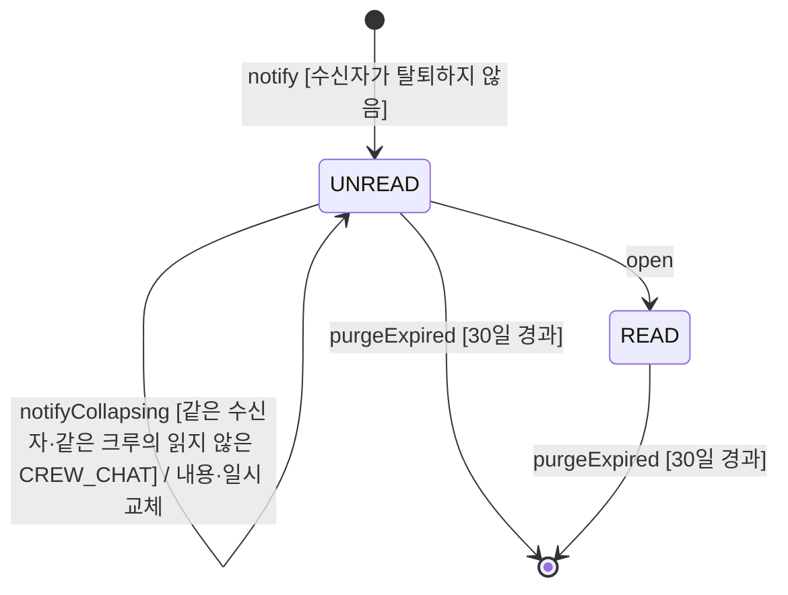

| 사건 | 대응 연산 |
|------|-----------|
| notify | NotificationService.notify → new Notification |
| notifyCollapsing | CrewChatService → NotificationService.notifyCollapsing. 읽지 않은 같은 크루(target_id = crewId) CREW_CHAT이 없으면 notify와 같이 새로 만든다. 푸시는 collapse key `crew_chat_<crewId>` (v0.11, FR-218, D-102) |
| open | NotificationService.open → Notification.markRead() |
| purgeExpired | NotificationService.purgeExpired(now) → Notification.isExpired(now, retention) (batch.notification의 NotificationPurgeJob, 매일 0시, srs.md 6.3 7.3). 정리 전이라도 보관 기간이 지난 알림은 inbox가 거른다 (v0.8, TF-VC-12, D-67) |

#### 2.4.15 Report (리포트 코멘트)

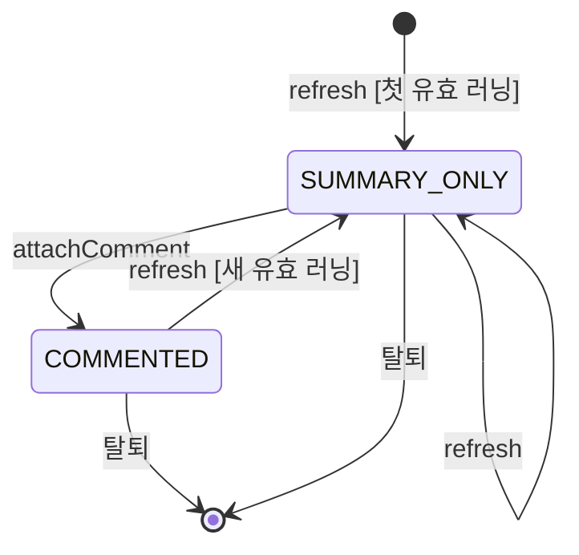

| 사건 | 대응 연산 |
|------|-----------|
| refresh | ReportService.onRunSaved → Report.refresh(summary, now) (코멘트를 비운다) |
| attachComment | ReportCommentService.generateComment → Report.attachComment(comment) |

SUMMARY_ONLY 상태의 조회는 "코멘트 준비 중"을 보인다(FR-067).

#### 2.4.16 Member 계정 유형 (accountType) (v0.11, FR-197~FR-200, D-89, D-90)

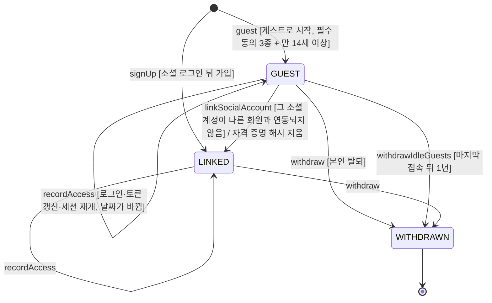

| 사건 | 대응 연산 |
|------|-----------|
| guest | SignUpService.startAsGuest → GuestStartForm.validate → Member.guest(nickname, consents, credentialHash, now) |
| signUp | SignUpService.signUp → Member.signUp(account, form, nickname, now) (accountType LINKED) |
| recordAccess | AuthService.login·refresh·resumeGuest → Member.recordAccess(now) (날짜가 바뀐 때만 쓰고 true) |
| linkSocialAccount | AuthService.linkSocialAccount → Member.linkSocialAccount(account). 이미 LINKED면 ALREADY_LINKED, 다른 회원과 연동된 계정이면 AuthService가 ALREADY_MEMBER로 거부 |
| withdraw | WithdrawalService.withdraw → Member.withdraw(now) (guestCredentialHash도 지운다) |
| withdrawIdleGuests | batch.member IdleGuestWithdrawalJob(3시) → WithdrawalService.withdrawIdleGuests(now) → MemberRepository.findIdleGuests(now − GUEST_IDLE_LIMIT) → Member.withdraw(now) |

LINKED는 GUEST로 돌아가지 않는다(D-90). WITHDRAWN은 계정 유형이 아니라 MemberStatus이고(2.4.9), 계정 유형과 함께 보이려고 같은 그림에 그렸다.

#### 2.4.17 ReportCase (신고 사례) (v0.11, FR-214~FR-216, D-104)

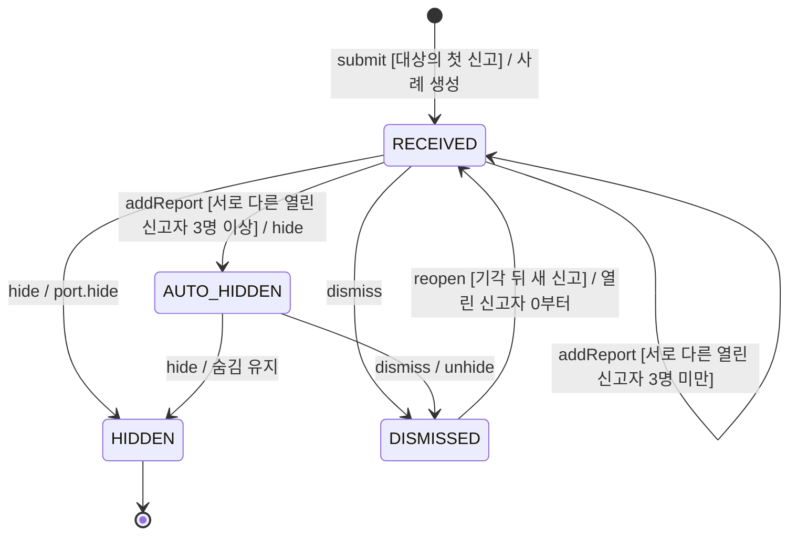

| 사건 | 대응 연산 |
|------|-----------|
| submit | ReportService.submit → ReportedContentPort.find → (report_case 행 잠금, 없으면 생성) → ContentReport 저장 |
| addReport | ReportService.submit → ReportCase.addReport() (RECEIVED이고 열린 신고자 3 이상이면 AUTO_HIDDEN, true) → ReportedContentPort.hide (같은 트랜잭션) |
| hide / dismiss | ReportService.hide·dismiss(operatorId, caseId) → ReportCase.hide·dismiss(operatorId, now) → ReportedContentPort.hide / unhide. 이미 HIDDEN·DISMISSED면 REPORT_DECIDED (v0.11 검증, D-138) |
| reopen | ReportService.submit → ReportCase.reopen() (DISMISSED에 새 신고가 오면). 같은 신고자의 재신고는 reopen 전에 ALREADY_REPORTED로 거부한다(D-149) (v0.11, 7.13.5 TF-VC-23) |

숨긴 대상은 ReportedContentPort.find가 찾지 않아 HIDDEN·AUTO_HIDDEN 사례에는 새 신고가 들어오지 않는다. 신고 한 건(ContentReport)은 상태 없이 resolved 플래그만 가지며, 처리하면 그 사례의 열린 신고 모두가 resolved가 된다. srs 6.4.7은 신고 한 건의 상태도이고 기각 뒤 전이가 없지만, 설계는 대상 단위 사례로 두어 기각 뒤 새 신고가 사례를 다시 연다(D-104) (v0.11, FR-216, D-104).

#### 2.4.18 WeeklyRace 공동 목표 (v0.11, FR-138, FR-217, D-105)

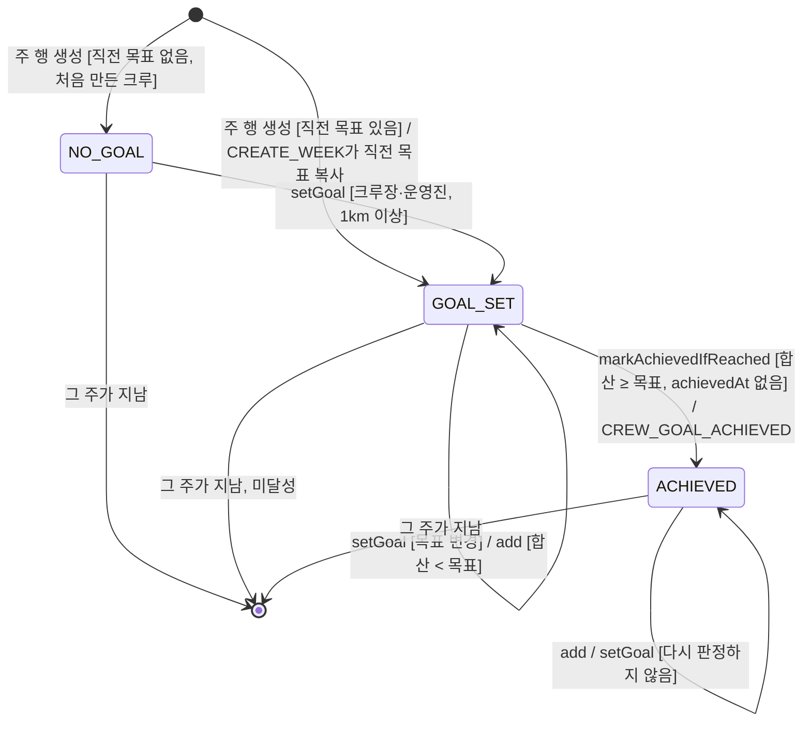

| 사건 | 대응 연산 |
|------|-----------|
| 주 행 생성 | WeeklyRaceService.onRunSaved(원자적 증가의 첫 행)·setGoal·reconcileAll이 그 주 행을 처음 만들 때 저장소의 CREATE_WEEK 한 문장(INSERT … 부분 조회 … ON CONFLICT DO NOTHING)이 직전 목표를 복사한다. latestGoalBefore는 부르지 않는다 (v0.12, U6-6) |
| setGoal | WeeklyRaceService.setGoal(memberId, crewId, goal, now) → CrewPermissionPolicy.check(SET_GOAL) → WeeklyRace.setGoal(goal, setterId) (1km 미만이면 GOAL_INVALID) |
| add | WeeklyRaceService.onRunSaved → 합산 원자적 증가(A-12) |
| markAchievedIfReached | WeeklyRaceService.onRunSaved·setGoal·reconcileAll → WeeklyRaceRepository.markAchievedIfReached (조건부 UPDATE … WHERE achieved_at IS NULL AND goal_meters IS NOT NULL AND total_meters >= goal_meters). 한 행이 바뀌면 커밋 뒤 크루원 모두에게 CREW_GOAL_ACHIEVED. WeeklyRace.isAchieved()가 상태를 읽는다 |

"그 주가 지남"은 저장 사건이 아니라 Week.contains(now)로 계산한다. 축하 카드(CelebrationCard)는 ACHIEVED인 주를 조회할 때 만든다.

#### 2.4.19 MeetupPost 참석 (정원) (v0.11, FR-132, FR-145, D-99)

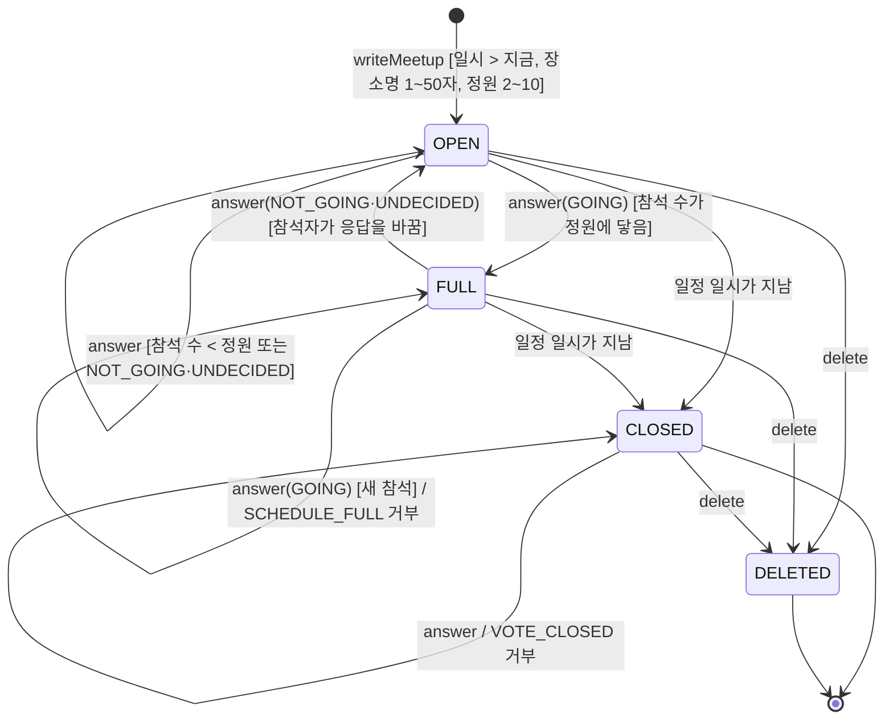

| 사건 | 대응 연산 |
|------|-----------|
| writeMeetup | CrewPostService.writeMeetup(memberId, crewId, MeetupDraft) → new MeetupPost(…) (일시 위반이면 SCHEDULE_INVALID, 길이·범위 위반은 400(D-155). 작성자는 GOING으로 들어간다(D-151)) (v0.11, test.md v0.6 TF-IT-21, TF-IT-32) |
| answer | CrewPostService.answerAttendance → MeetupPost.answer(memberId, answer, now) (SchedulePost 다형성). 동시 응답은 게시글 낙관적 잠금 + 재시도, 소진되면 CONCURRENT_UPDATE |
| delete | CrewPostService.delete → CrewPost.delete(requesterId, relation) (작성자 또는 크루장·운영진) |

OPEN·FULL·CLOSED는 저장 필드가 아니라 attendances의 GOING 수와 scheduledAt으로 계산한다. 대면 모임에는 대기실·동시 출발·중계가 없다(FR-132).

#### 2.4.20 PollPost (투표) (v0.11, FR-206, FR-207, FR-218, D-106)

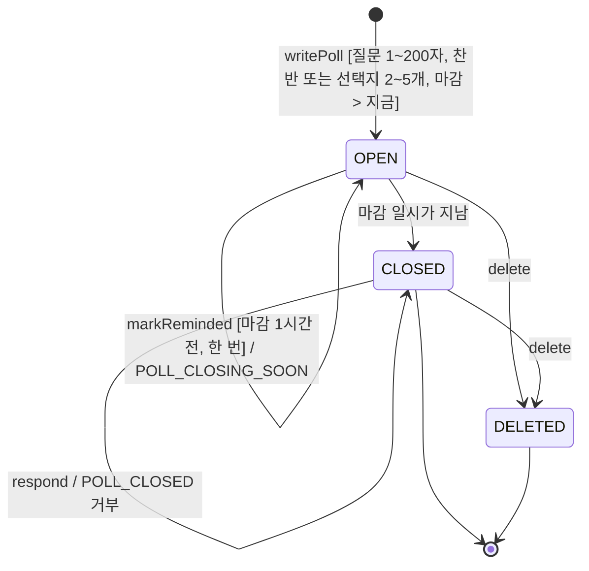

| 사건 | 대응 연산 |
|------|-----------|
| writePoll | CrewPostService.writePoll(memberId, crewId, PollDraft) → new PollPost(…) (위반이면 POLL_INVALID). 찬반이면 서버가 "찬성"·"반대" 두 선택지를 만든다 |
| respond | CrewPostService.respondPoll → PollPost.respond(memberId, optionNo, now) (없는 선택지면 POLL_INVALID, 마감 뒤면 POLL_CLOSED) |
| markReminded | batch.crew PollReminderJob(1분) → CrewPostService.remindClosingPolls(now) → PollPost.nonRespondents(현재 크루원) → CrewNewsNotifier.remindClosing → PollPost.markReminded() |
| 마감 일시가 지남 | 저장 사건이 아니라 PollPost.isClosed(now)로 계산한다 |

#### 2.4.21 크루 콘텐츠 노출 (CrewPost·CrewChatMessage 공통) (v0.11, FR-213, FR-215, FR-216)

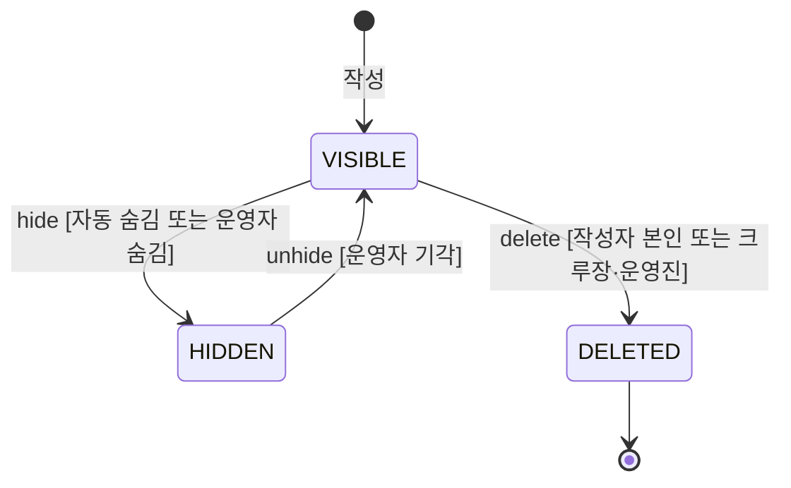

| 사건 | 대응 연산 |
|------|-----------|
| hide / unhide | ReportedContentPort.hide·unhide → report.target CrewPostReportAdapter → CrewPostService.hideReported·unhideReported → CrewPost.hide()·unhide(), ChatReportAdapter → CrewChatService.hideReported·unhideReported → CrewChatMessage.hide()·unhide() (채팅이면 CrewChatRemoved(HIDDEN)) (v0.11 검증, D-135) |
| delete | CrewPostService.delete → CrewPost.delete(requesterId, relation), CrewChatService.delete → CrewChatMessage.delete(requesterId, relation). 남의 콘텐츠면 감사 POST_FORCE_DELETE·CHAT_FORCE_DELETE |

isVisible()은 !deleted && !hidden이다. 목록·앨범·채팅 조회는 VISIBLE만 보인다(FR-212). 숨김 중인 콘텐츠의 삭제 요청은 받지 않는다(POST_NOT_FOUND·CHAT_MESSAGE_NOT_FOUND). 운영자 처리 전에 신고 근거가 사라지지 않게 하려는 것이라 HIDDEN → DELETED 전이가 없다(D-126). 크루런 일정의 크루런 상태는 2.4.5, 대면 모임은 2.4.19가 따로 가진다.

#### 2.4.22 RunRecord 재판정 표시 (rejudgeState) (v0.12, FR-047, CR-11, D-191)

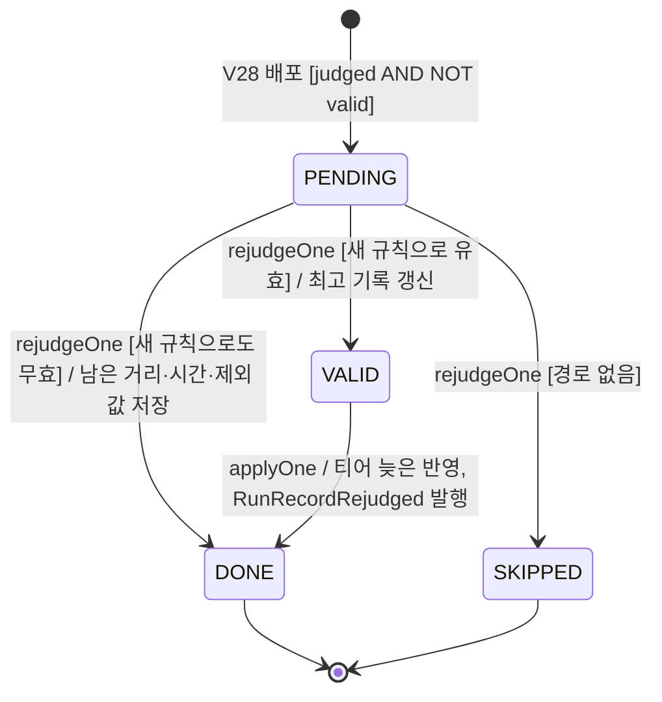

| 사건 | 대응 연산 |
|------|-----------|
| V28 배포 | Flyway V28__run_record_rejudge.sql(UPDATE … SET rejudge_state = 'PENDING' WHERE judged AND NOT valid). 그 뒤 받은 기록은 표시가 없다(null) |
| rejudgeOne | RunRejudgeService 1단계 → RunRecordRepository.findForUpdate → RunRecord.rejudgeInvalid(STANDARD) → storeRejudgement(record, PENDING, VALID·DONE) 또는 moveRejudgeState(id, PENDING, SKIPPED) |
| applyOne | RunRejudgeService 2단계 → TierApplier.apply(활성 회원, 미반영일 때) → moveRejudgeState(id, VALID, DONE) → RunRecordRejudged |

표시가 바뀐 행은 다시 고르지 않으므로 몇 번 기동해도 결과가 같다. 실패한 기록은 표시를 그대로 둬 다음 기동이 잇는다.
