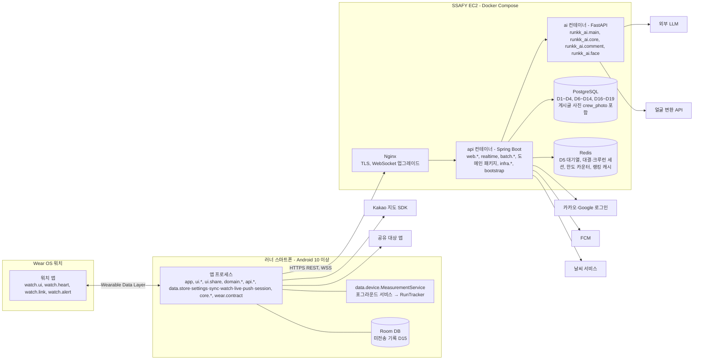

> [런크크 객체지향 분석·설계서](../design-oo.md) 목차 · 이전: [05-01-서브시스템-분할](05-01-서브시스템-분할.md) · 다음: [05-03-API-실시간-메시지](05-03-API-실시간-메시지.md)

### 5.2 계층 구조

```
[표현·구동]  web.auth  web.me  web.notification  web.run  web.record  web.battle  web.crew  web.runimal  web.avatar  web.error
             web.chat  web.report
             web.admin(운영자 확인, 랭킹 다시 계산)  web.admin.celebrity  web.admin.setting  web.admin.audit  web.admin.report
             realtime(WebSocket·폴링, BattleMessenger·CrewRunMessenger·CrewChatMessenger·ChatRoomPresence 구현)
             batch.battle  batch.crew  batch.analysis  batch.avatar  batch.running  batch.member  batch.audit  batch.notification  batch.reward
                 │ Command·View DTO      │ ProgressReport·ChatPresence, 메시지 직렬화   │ now
                 ▼                       ▼                                             ▼
[조립]       profile, operator
                 │ 조회 요청
                 ▼
[응용+도메인] member  running  runimal  battle  reward  avatar  crew  crew.chat  report  analysis
                 │ 값 객체·식별자·조회 투영·발행 패키지의 사건
                 ▼
[도메인 공통] policy  notification  audit  common
                 ▲
                 │ 인터페이스 구현 (의존 역전)
[인프라]     infra.<도메인> 13개(+ infra.chat·infra.report), infra.integration.auth·ai·push·weather
[시작]       bootstrap (컴포넌트 탐색 진입점, DomainEventPublisher 구현, 운영 비밀 값 점검)
```

v0.11: crew.chat·report와 하위 패키지 web.chat·web.report·web.admin.report·infra.chat·infra.report, 코드에 먼저 생긴 batch.reward를 더했다(5.1.1, 61개). web.admin의 랭킹 다시 계산(RankingAdminController)은 CR2-U1로 올린 코드 그대로다 (v0.11, CR2-U1, CR34-02, D-101, D-104)

- 하위 계층이 상위 계층을 import하지 않는다. 도메인 패키지는 web.*·realtime·batch.*를 모른다.
- 도메인이 실시간 메시지를 보내야 할 때는 자기 패키지의 포트(battle.BattleMessenger, crew.CrewRunMessenger, crew.chat.CrewChatMessenger)를 부르고, realtime이 그것을 구현한다(의존 역전). 메시지 형식도 만드는 패키지(battle.live, crew.live, crew.chat.live)에 둔다. 그래서 realtime → battle·crew·crew.chat 한 방향만 있다(D-06). 채팅방 입장 여부도 crew.chat의 포트 ChatRoomPresence를 realtime의 ChatPresenceRegistry가 구현한다(D-101). 저장소·외부 서비스도 같은 방식이다. 인터페이스는 쓰는 쪽 패키지에 있고 구현은 infra.* 에 있다 (v0.11, D-101)
- 패키지 사이 의존은 한 방향만 허용한다. 정렬 순서는 common → audit → policy → member → notification → report → running → runimal → battle → reward → avatar → crew → crew.chat → analysis → report.target·profile·operator이고, 각 패키지는 자기보다 앞에 놓인 패키지에만 의존한다(12.3). 거꾸로 알아야 할 때는 (1) 발행 패키지에 둔 도메인 사건(D-31), (2) 받는 쪽이 정의하고 주는 쪽이 구현하는 포트 인터페이스(WithdrawalGuard, IdleGuestWithdrawalGuard, ReservedNicknameChecker, CrewRunParticipationQuery, BattleMessenger, CrewRunMessenger, CrewChatMessenger, ChatRoomPresence, ReportedContentPort) 중 하나를 쓴다. report는 신고 대상을 모르고 조립 패키지 report.target이 crew·crew.chat의 신고용 공개 연산으로 ReportedContentPort를 구현한다(D-104, F.6.3) (v0.11, D-101, D-104) (v0.11 검증, D-135)
- 다른 패키지의 Repository·엔티티를 쓰지 않는다. 다른 패키지 자료는 그 패키지의 조회 서비스가 내준 투영(RunSummary, RunCurve, RunSampleRow, RunComparison, MemberSummary, MemberPreference, GhostOwner, CrewSummary, AuditRecordView)으로 받는다. 받는 쪽이 절반 미만 항목만 쓰면 좁은 조회 연산을 둔다(D-32, D-41).
- 두 패키지의 조회 결과를 붙이는 곳은 두 가지 방식이 섞여 있다. 대결 결과 화면의 적립량(web.battle의 BattleResultAssembler)과 크루원 목록의 Runimal 유형(web.crew의 CrewMembersAssembler)은 표현 계층이 붙인다. battle → reward 화살표를 만들지 않고(D-33), crew가 runimal보다 안정한 상태에서 runimal의 Fan-In을 표현 계층에서 받게 하려는 것이다(D-46). 기록 상세의 적립량·크루 반영 거리는 analysis가 RewardService·WeeklyRaceService를 직접 읽는다. analysis는 정렬 순서상 reward·crew 뒤에 있고 불안정도도 더 커서 방향이 맞다(12.3).
- 엔티티는 Repository를 모른다. 응용 서비스만 Repository를 부른다.

### 5.3 동시성

| 동시 접근 지점 | 처리 |
|---------------|------|
| 매칭 배정 — 한 대기자가 두 대결에 들어가면 안 됨 (FR-082) | MatchQueue.tryAssignPair를 원자적 연산으로 만든다. Redis 구현은 Lua 스크립트 하나로 두 표의 상태가 모두 WAITING일 때만 둘 다 ASSIGNED로 바꾼다. PostgreSQL 대안은 `SELECT … FOR UPDATE SKIP LOCKED`로 두 행을 잠근 뒤 바꾼다. 고스트 매칭도 tryAssign으로 표 하나를 ASSIGNED로 잡고 시작해 그동안 취소·짝 배정과 겹치지 않는다. 대결 저장·고스트 매칭 트랜잭션이 실패하면 표를 지우지 않고 release로 WAITING에 되돌린다(v0.8, D-64). 매칭 취소도 MatchQueue.removeIfWaiting 하나(WAITING일 때만 지우는 Lua·조건부 DELETE)로 해 고스트 시작(tryAssign)과 겹쳐도 한쪽만 이긴다(v0.10, D-83). Matchmaker.tick은 서버 인스턴스 하나에서만 돈다(5.4) |
| 매칭 요청 중복 (FR-080) | MatchQueue.enqueue는 memberId 키로 "없을 때만 넣기"(Redis SETNX, PostgreSQL 기본 키). 실패하면 "이미 대기 중" |
| 크루 주간 거리 동시 합산 (FR-139, NFR-034) | race_contribution 테이블에 (crew_id, week_start, record_id) 고유 제약. 행을 넣는 데 성공했을 때만 `UPDATE weekly_race SET total = total + :d WHERE …` 원자적 증가. 주 행이 없으면 `INSERT … ON CONFLICT DO NOTHING`으로 먼저 만든다. 메모리에서 읽고-더하고-쓰지 않는다 |
| 크루 정원 (FR-111, FR-123) | 가입·승인 때 crew 행을 `SELECT … FOR UPDATE`로 잠근 뒤 Crew.admit이 headcount를 검사한다 |
| 운영진 2명 상한 (FR-204) | 정원·가입 결정과 같은 잠금 경계다. crew 행을 `CrewAccess.checkForUpdate`로 잠근 뒤 `Crew.appointManager`가 MANAGER 수를 세어 `MAX_MANAGERS`(2)를 넘으면 MANAGER_LIMIT. 해제(dismissManager)도 같은 잠금 안에서 한다 (v0.11, D-98) |
| 고정 공지 3개 (FR-205) | 공지 작성(pinned = true)과 PUT /posts/{id}/pin 모두 crew 행 잠금 안에서 고정 공지 수를 센다. 4개째면 PIN_LIMIT (v0.11, D-98, FR-205) |
| 대면 모임 정원 (FR-145) | MeetupPost(게시글 행)의 낙관적 잠금(version)으로 참석 응답을 바꾸고, 충돌하면 다시 읽어 재시도한다(최대 3회, 소진하면 409 CONCURRENT_UPDATE). `MeetupPost.answer`가 GOING 수가 capacity에 닿았으면 SCHEDULE_FULL (v0.11, D-99). 구현은 재시도 안에서 글 행을 `CrewPostRepository.findByIdForUpdate`(PESSIMISTIC_WRITE)로 잠가 읽는다. 일정 응답·투표 응답·삭제·숨김이 같은 글 행을 차례로 쥐고, 고정은 crew 행 → 글 행 순서다(반대 순서 경로 없음). 채팅 메시지의 신고 숨김·해제·삭제도 `CrewChatMessageRepository.findByIdForUpdate`로 같은 방식(잠금 순서 report_case → 메시지 행, 버전 열이 없어 덮어쓰기를 막는다) (v0.11 구현 반영, U5-6, D-171) |
| 투표 응답 (FR-207) | crew_poll_response 기본 키 (post_id, member_id)에 upsert. 같은 회원이 마감 전에 다시 응답하면 선택지만 바뀐다. 마감 판정은 `PollPost.respond(memberId, optionNo, now)`가 한다 (v0.11, FR-207) |
| 채팅 리액션 (FR-210) | crew_chat_reaction 기본 키 (message_id, member_id, kind)에 upsert·삭제. 이미 있으면 그대로(멱등) (v0.11, D-101) |
| 채팅 보내기 재전송 (FR-208) | 고유 색인 uq_crew_chat_client (author_id, client_message_id)로 같은 작성자의 같은 clientMessageId를 한 번만 저장한다. 위반하면 처음 만든 메시지를 200으로 돌려준다(멱등). 받는 사람 전송은 커밋 뒤 사건 + `@TransactionalEventListener(AFTER_COMMIT)` (v0.11, D-101). 방 밖 CREW_CHAT 알림은 비동기 실행기에서 수신자마다 새 트랜잭션으로 보내고 묶음 행 하나는 V23 부분 유일 색인이 지킨다 (v0.11 구현 반영, U5-7, D-172) |
| 신고 자동 숨김 (FR-214, FR-215) | `ReportService.submit` 트랜잭션에서 report_case 행을 잠근다. 없으면 만들고, 고유 제약 (target_kind, target_id) 충돌이면 다시 읽어 잠근다. `ReportCase.addReport()`가 서로 다른 열린 신고자 3명에 닿으면 AUTO_HIDDEN으로 바꾸고 같은 트랜잭션에서 `ReportedContentPort.hide`를 부른다. 같은 회원의 같은 대상 재신고는 고유 색인 uq_content_report_reporter (case_id, reporter_id)로 막는다(ALREADY_REPORTED) (v0.11, D-104). 같은 신고자의 재신고는 앞선 신고가 기각된 뒤에도 거부하고, 이 검사는 사례 잠금 뒤 reopen보다 먼저 한다. 자동 숨김은 마지막 기각 뒤 접수된 신고의 신고자만 센다(D-149) (v0.11, 7.13.5 TF-VC-23) |
| 공동 목표 달성 (FR-217) | 원자적 합산 증가(A-12) 직후 같은 트랜잭션에서 `WeeklyRaceRepository.markAchievedIfReached`(조건부 `UPDATE … WHERE achieved_at IS NULL AND goal_meters IS NOT NULL AND total_meters >= goal_meters`)를 부른다. 한 행을 바꾼 트랜잭션만 커밋 뒤 CREW_GOAL_ACHIEVED를 보내므로 두 기록이 함께 넘겨도 알림은 한 번이다. setGoal·reconcileAll도 같은 연산을 쓴다 (v0.11, D-105) |
| 1인 1크루 (Q-34) | crew_membership에 부분 고유 인덱스 (member_id) WHERE left_at IS NULL. 두 크루에 동시에 가입하면 하나는 제약 위반 → "이미 크루 소속" |
| 같은 크루 대기 중 신청 하나 (FR-121) | join_request에 부분 고유 인덱스 (crew_id, member_id) WHERE status = 'PENDING'. 승인·거절과 3시 만료 배치가 겹치면 PENDING인 행만 바꾸는 조건부 갱신(`… WHERE status = 'PENDING'`)으로 한쪽만 성공한다(v0.8, D-69) |
| 크루장 양도 (FR-115) | 두 멤버십 행의 역할 변경을 한 트랜잭션에서 한다. Crew.version 낙관적 잠금 |
| 리워드 이중 적립·하루 상한 (FR-159) | reward_accrual에 (member_id, reason, source_id) 고유 제약. wallet 행을 `FOR UPDATE`로 잠근 뒤 그날 합계를 정한다. 합계는 지갑의 집계 칼럼 last_accrual_date·last_accrual_date_amount에서 읽고(날짜가 같으면 칼럼 값, 더 새 날이면 0), 보정 배치의 지난 날짜만 `RewardAccrualRepository.sumOn`(member_id, accrued_at 색인)으로 센다. 적립 뒤 날짜가 last 이상이면 같은 잠금 안에서 칼럼을 고친다 (v0.11, D-109) |
| 아이템 구매 (FR-160) | wallet 행 잠금 + owned_item (member_id, item_id) 고유 제약 |
| 러닝 기록 중복 전송 (FR-040) | run_record.record_id(기기 UUID)를 기본 키로 둔다. 동시에 두 번 오면 하나는 기본 키 위반 → "이미 저장됨"으로 응답 |
| 유효 러닝 순번 (D-37) | RunUploadService가 personal_record_book 행을 `SELECT … FOR UPDATE`로 잠근 뒤 회원의 유효 기록 수를 세어 validRunOrdinal을 정한다. 같은 회원의 업로드가 동시에 와도 순번이 겹치지 않는다. 수신자(TierProgress, RunimalProfile)는 이미 반영한 순번을 무시한다 |
| 주간 거리 재합산 (H-06) | WeeklyRaceService.reconcileAll은 같은 원자적 증가 경로(WeeklyRace.add, race_contribution 고유 제약)를 쓴다. 수신자가 이미 더한 기록은 고유 제약으로 건너뛰므로 onRunSaved와 동시에 돌아도 이중 합산이 없다 |
| 대결 도착·판정 (FR-092) | Battle.version 낙관적 잠금. LiveBattleService와 BattleResultService가 같은 대결을 동시에 바꾸면 늦은 쪽이 다시 읽어 재시도(최대 3회) |
| 진행 중 대결 세션 (NFR-004) | LiveBattleSession은 대결마다 Redis 해시 하나. 한 대결의 진행값은 참가자 2명뿐이라 대결 ID 단위 직렬 처리(세션 잠금 키)로 충분하다 |
| 크루런 대기실·참석 응답 (FR-145, FR-147) | CrewRunPost 낙관적 잠금(version). 크루원 10명 이하라 충돌이 드물다. "투표"는 PollPost만 뜻하므로 크루런 응답은 참석 응답(`SchedulePost.answer`)이라 부른다 (v0.11, D-99) |
| 닉네임·크루명·초대 코드 고유 (FR-003, FR-110, FR-112) | 고유 인덱스. 위반하면 숫자·코드를 다시 만들어 재시도(최대 5회) |
| 자동 닉네임·게스트 닉네임 (FR-003, FR-197) | 닉네임 고유 제약. 닉네임 없는 가입과 게스트 시작은 `Nickname.numbered`("러너" + 4자리)로 만들고, 고유 제약에 걸리면 다른 숫자로 최대 20번, 그래도 겹치면 5자리로 다시 만든다 (v0.11, D-90) |
| 배경 해금 (FR-201) | avatar 행의 버전(낙관적 잠금)과 avatar_background 기본 키 (member_id, landmark_key). 리스너·보정 배치·조회 때 채우기가 겹쳐도 한 키는 한 행만 남고 BACKGROUND_UNLOCKED는 새로 넣은 키에만 보낸다 (v0.11, D-107) |
| 아바타 하루 1회 (FR-157) | avatar 행 `FOR UPDATE` 뒤 canCreateSelfie 검사. 얼굴 변환 호출(최대 수 초) 동안 잠그지 않도록 검사 → 변환 → 다시 잠그고 재검사 → 저장 순서로 한다 |
| LLM 하루 호출 한도 (FR-065) | Redis Lua 스크립트 하나로 회원 키·전체 키를 함께 증가·검사·되돌리기(TTL 48시간). ai 서버도 프로세스 하루 절대 상한(240회, 운영 한도에서 파생하지 않는 고정 값)과 동시 호출 4개 제한을 따로 둔다(D-58, D-62) |
| 같은 회원의 셀카 변환 동시 요청 (FR-157) | Redis `SET NX`(키: 회원, 30초)로 진행 중 잠금을 잡고, 잡지 못하면 BusinessRuleException(SELFIE_IN_PROGRESS, "이미 변환 중") → 409. 외부 얼굴 API를 두 번 부르지 않고 횟수도 한 번만 는다(v0.8, TF-VC-13, D-76). 잠금은 잡은 시각 + 30초 정각에 풀려 그때부터 다음 요청을 받는다(v0.10, TF-VC-19) |
| 운영 기준값 변경 중 조회 (FR-174) | 읽기 우세. OperationPolicy 캐시를 변경 커밋 뒤 무효화한다. 변경은 OperationSetting.version 낙관적 잠금 |
| 기존 무효 기록 재판정 (FR-047, D-191, D-199) | 기록마다 새 트랜잭션(REQUIRES_NEW)에서 run_record 행 PESSIMISTIC_WRITE 잠금 → (유효가 되면) PersonalRecordBook 행 잠금 순서. 업로드(RunUploadService)와는 PersonalRecordBook 행으로 줄을 선다. 표시는 조건부 UPDATE(rejudge_state = from)로만 바꿔 여러 인스턴스가 겹쳐도 한쪽만 바꾸고, 티어는 tier_applied 조건부 UPDATE(D-169)가 TierReconcileJob과의 이중 반영을 막는다. 기동 스레드 밖에서 상한(1,000개·60초)까지만 돈다(D-199, 구현 대기) (v0.12, U7-2) |

### 5.4 자원·배치



- api 컨테이너는 1개다. 동시 사용자 50명, 대결 10쌍(NFR-002, NFR-004)은 인스턴스 하나로 감당한다. 그래서 스케줄러(batch.*)도 같은 프로세스에서 돌고, 1초 작업이 두 번 실행될 위험이 없다. 2개 이상으로 늘리면 batch.*에 분산 잠금(ShedLock)을 추가하고 WebSocket 세션 라우팅을 Redis Pub/Sub로 바꿔야 한다(부록 E E-05). 채팅방 입장 여부(realtime ChatPresenceRegistry: crewId → memberIds)도 api 메모리에 있어 같은 전제를 따른다(D-101) (v0.11, D-101)
- ai 컨테이너는 api 컨테이너만 부른다(Docker 내부 네트워크). compose에서 ports 없이 expose만 하고, 모든 요청에 X-Internal-Token을 확인하며, GET /health를 healthcheck로 쓴다. 환경 변수는 env_file 없이 compose `environment:`가 컨테이너마다 필요한 값만 넘긴다(api: DB·Redis·Spring 값과 AI_SERVER_URL·RUNKK_INTERNAL_TOKEN, ai: RUNKK_*만. api는 LLM·얼굴 변환 키를 받지 않는다). 공유 값은 RUNKK_INTERNAL_TOKEN 하나이고 두 컨테이너 모두 `${RUNKK_INTERNAL_TOKEN:?}`로 필수다. 바꿀 때는 두 컨테이너를 같이 다시 띄운다(design-review.md H-23). ai 컨테이너는 read_only 루트, cap_drop ALL, no-new-privileges, mem_limit 512m, /tmp tmpfs 16m이고 api의 /tmp는 tmpfs 64m이라 셀카가 디스크에 남을 길을 막는다(D-58, D-59). 앱은 ai 서버를 직접 부르지 않는다. 회원 식별자를 ai 서버로 보내지 않기 위해서다(NFR-024) (v0.11, CR34-10)
- ai 입력 관문(CR34-26): FaceRouter는 디코드하지 않고 이미지 머리만 읽어 머리가 깨졌으면 422 UNSUPPORTED_IMAGE, 가로×세로가 Settings.max_image_pixels(환경 변수 RUNKK_MAX_IMAGE_PIXELS, 기본 4096×4096)를 넘으면 422 TOO_LARGE를 변환기 앞에서 낸다. CommentRouter는 본문 4KiB 상한을 넘으면 413 TOO_LARGE, JSON이 아니거나 정의 밖이면 422 INVALID_REQUEST다 (v0.11, CR34-26)
- 배포 스크립트·프록시(CR34-10): deploy.sh는 api·ai 헬스를 모두 기다리고 하나라도 실패하면 실패로 끝내며, 롤백에 ai 이미지도 넣는다. .env 값은 env_value로 읽고 줄이 없으면 기본값을 쓴다. nginx는 /ws에 Upgrade 헤더와 읽기 제한 2시간을 두고, resolver로 컨테이너 이름을 다시 해석하며, /actuator/ 경로를 밖에서 막는다. Redis는 `--requirepass`(REDIS_PASSWORD)로 내부 망 안의 무단 접근도 막는다. DB_NAME·DB_USER·DB_PASSWORD·REDIS_PASSWORD는 compose `:?` 필수이고 develop 프로필의 DB 기본 비밀번호를 없앴다. postgres·redis 포트는 내부 망 기본값(5432·6379)으로 고정한다 (v0.11, CR34-10)
- 보류(팀 결정 2026-10-22, 설계를 바꾸지 않음): /admin/** permitAll 한 겹에 이중 방어를 더할지(L23, 지금은 OperatorCheckInterceptor 하나, D-50), X-Real-IP 신뢰 프록시 설정화(L25, 지금은 사설망·루프백 어느 호스트든 믿음), 서버 → ai 평문 http(L26, compose 내부 망 가정 유지) (v0.11, CR34-10)
- PostgreSQL·Redis 연결은 infra.<도메인> 패키지만, 외부 서비스 연결은 infra.integration.* 패키지만 가진다. infra.<도메인>은 자기 도메인 패키지가 소유한 테이블·키만 읽고 쓴다(D-32, D-35).
- 게시글 사진(D-100): 앱이 JPEG·긴 변 1600px·1MB 이하로 줄여 multipart 한 요청(POST /crews/{id}/board-posts)으로 보낸다. 서버는 장당 1MB(spring.servlet.multipart max-file-size 그대로), 요청 6MB(max-request-size 2MB → 6MB), JPEG 머리(FF D8 FF)를 확인하고 메모리에서 받는다(D-59 file-size-threshold 그대로). nginx client_max_body_size 10m는 그대로다. 바이트는 PostgreSQL crew_photo.jpeg(BYTEA)에 PostPhotoStore 포트 뒤로 두고(infra.crew JdbcPostPhotoStore) 조회는 GET /crew-photos/{id}(현재 크루 구성원만, `Cache-Control: private, max-age=300`, D-174 (2). v0.12 U6-4로 86400에서 고침)로만 한다. 용량 가정은 크루원 50명 × 주 5장 × 0.5MB ≈ 주 125MB 이하(제안)이고 디스크 사용량을 감시한다 (v0.11, D-100). 위치 메타데이터(EXIF GPS 등)는 앱 PhotoCompressor가 다시 인코딩하며 버리고, 서버 crew JpegMetadataStripper가 저장 전에 APP1·APP13·COM 세그먼트를 한 번 더 지운다(NFR-042, D-142) (v0.11, 7.13.5 TF-SY-25)
- compose 빈 환경 변수(D-175): compose는 `${VAR:-}` 꼴이라 변수가 정의되지 않아도 빈 문자열을 넣는다. 그래서 "값 없음"과 "빈 값"을 구분하는 규칙(D-166)은 compose 배포에서 "빈 값"으로만 온다. RUNKK_BOOTSTRAP_OPERATORS는 화이트리스트가 이미 채워졌으면 빈 값이어도 아무 로그 없이 건너뛰고, 화이트리스트가 비었을 때만 빈 값 WARN(operator_seed_empty)을 낸다(검사 순서: 화이트리스트 → 빈 값). 코드는 BE5-A-13으로 맞춘다 (v0.11 구현 반영, U5-A-9, D-175)
- 배경 해금 채우기 기준 시각(D-176 (5)): `runkk.avatar.backfill-cutoff`(환경 변수 AVATAR_BACKFILL_CUTOFF, ISO 날짜·시각, 서버 시간대). 이 시각 이전에 저장한 유효 기록 거리만 조회 채우기가 알림 없이 해금한다. 운영 값은 V25(배경 해금) 적용 시각이고 배포 체크리스트에서 정한다. 비어 있으면 기동 실패다. 기본값 2026-10-22T00:00:00이 application.yml·infra/docker-compose.yml·infra/.env.example 세 곳에 있다. 미래 시각은 금지한다(기동 때 거부, 코드 반영 대기 BE6-6) (v0.12, U6-3)
- 되돌릴 수 없는 마이그레이션(D-175): 칼럼·표 삭제처럼 되돌릴 수 없는 Flyway 버전(v0.11의 V20 member.tags·crew_membership.crew_tags DROP COLUMN)에 대비해 infra/deploy.sh의 backup_database가 api 기동(Flyway 실행) 전에 매번 `pg_dump` 전체 덤프를 자동으로 뜬다. 덤프가 실패하면(set -euo pipefail, 부분 파일 삭제) 배포를 멈춘다. 보관 위치는 CI 작업 폴더 밖 RUNKK_BACKUP_DIR(환경 변수 > .env > 기본 $HOME/runkk-backups, 절대 경로만 허용)이고 최근 7개만 남긴다. 폴더 700, 파일 600(umask 077)이다. 파일 이름은 `pre-deploy-<YYYYMMDD-HHMMSS>-<커밋>.sql.gz`다. postgres가 멈춰 있어도 데이터 볼륨이 있으면 postgres만 올려 덤프하고, 볼륨이 없을 때(처음 배포)만 건너뛰며, 볼륨 확인 자체가 실패하면 배포를 멈춘다. 매일 덤프(아래 백업)와 별개다 (v0.11 구현 반영, U5-A-9, D-175) (v0.12, U6-1: BE6-1~3 반영)
- 비동기 실행기(D-175): Spring `applicationTaskExecutor`(spring.task.execution) 하나를 쓰는 곳은 넷이다: 리포트 생성·Runimal 판정 수신자(D-03), 배경 해금 수신자 BackgroundUnlockListener(@Async, D-129), 채팅 방 밖 알림 ChatDeliveryListener(수신자마다 새 트랜잭션·FCM 호출, D-172). 크기는 core 4·max 8·queue 500으로 둔다(지금 core 2·max 4는 리포트·Runimal만 셈한 값). 큐가 차서 TaskRejectedException이면 방 밖 알림은 로그만 남기고 버린다(채팅 저장·방 안 전송은 이미 끝났다). 실행기 설정 주석에 쓰는 곳 넷을 적는다(BE5-A-14) (v0.11 구현 반영, U5-A-9, D-175)
- 백업: PostgreSQL 매일 1회 덤프, 7일 보존(NFR-018, NFR-037). 게시글 사진·채팅·신고도 PostgreSQL에 있어 같은 덤프에 들어간다(사진 증가분 주 125MB 안팎, D-100). Redis는 백업하지 않는다(대기열·세션·카운터는 잃어도 복구 가능한 짧은 상태다) (v0.11, D-100)

### 5.5 제어 방식과 경계 조건

| 구분 | 내용 |
|------|------|
| 제어 방식 | 세 가지를 함께 쓴다. (1) 요청-응답: REST 요청 → Controller → 응용 서비스 → 엔티티·Repository → 응답. (2) 이벤트 구동: WebSocket 진행값 메시지, 도메인 사건(커밋 뒤 수신자 실행). (3) 시각 구동: batch.* 작업이 정해진 시각에 응용 서비스를 부른다 |
| 시각 작업 | 구동 패키지는 부르는 응용 패키지마다 하나다(D-39). batch.battle의 BattleTickJob(1초): Matchmaker.tick, BattleClockService.tick, LiveBattleService.detectTimeouts. batch.crew의 CrewRunTickJob(1초): CrewRunService.tick, CrewRunLiveService.detectTimeouts, WeeklyRaceReconcileJob(0시 30분, v0.10 D-88): WeeklyRaceService.reconcileAll(대상 크루와 주는 crew가 고른다, D-47), JoinRequestExpiryJob(3시): MembershipService.expireRequests. batch.analysis의 RankingRebuildJob(0시): RankingService.rebuild, PlanReminderJob(20시): CoachService.remindMissedPlans. batch.avatar의 AppearanceRefreshJob(0시): AppearanceService.refreshAll. batch.running의 DisposalJob(3시): DisposalService.executeDue. batch.member의 WithdrawalPurgeJob(3시): WithdrawalService.purgeWithdrawn. batch.audit의 AuditPurgeJob(3시): AuditService.purgeExpired. batch.notification의 NotificationPurgeJob(0시, srs.md 6.3 7.3, v0.8 TF-VC-12, D-67): NotificationService.purgeExpired. 작업 클래스는 응용 서비스 연산 하나만 부르므로 한 작업의 실패가 다른 작업을 막지 않는다. 같은 1초에 도는 BattleTickJob 안의 세 호출만 호출마다 따로 감싼다. 작업 스케줄러 스레드는 v0.10에서 6개였고(TF-SY-22, D-88) v0.11 정리에서 작업 수와 같게 바꿨다(이 행 끝). 가입 신청 만료 알림(JOIN_EXPIRED)이 3시에 나가므로 새벽 푸시 정책을 확인한다(부록 E E-16). v0.11에 더한 작업: batch.battle의 AbandonedBattleJob(1분, runkk.batch.battle-abandon-interval): BattleStartService.cancelAbandoned(CR34-01). batch.crew의 PollReminderJob(1분): CrewPostService.remindClosingPolls(마감 1시간 전 미응답자 POLL_CLOSING_SOON, D-106), CrewRunLinkReconcileJob(0시 10분, runkk.batch.crew-run-link-reconcile-cron): CrewRunLinkReconcileService.reconcileLinks. batch.reward의 RewardReconcileJob(0시 10분, runkk.batch.reward-reconcile-cron): RewardReconcileService.reconcile. batch.running의 TierReconcileJob(0시 10분, runkk.batch.tier-reconcile-cron 기본 `0 10 0 * * *`): TierReconcileService.reconcile(D-108). batch.avatar의 BackgroundReconcileJob(0시 10분): BackgroundService.reconcile(최근 2일 저장 기록 회원의 배경 해금 보정, D-107). batch.member의 RevocationPurgeJob(3시, runkk.batch.revocation-purge-cron): AuthService.purgeExpiredRevocations(CR34-05), IdleGuestWithdrawalJob(3시): WithdrawalService.withdrawIdleGuests(1년 미접속 게스트, FR-200). 0시 10분 보정 작업 넷은 수신자(커밋 뒤 리스너)가 놓친 것을 최근 2일 범위로 다시 채우는 M4 결정의 같은 꼴이다. batch.analysis의 PlanPurgeJob(3시 30분, runkk.batch.plan-purge-cron): CoachService.purgePastPlans(today)(보존 1년이 지난 날짜별 계획·주간 목표 행 정리. 코드에 먼저 생긴 작업을 v0.11 정리에서 올렸다). 작업은 1초 2·1분 2·0시 3·0시 10분 4·0시 30분 1·3시 6·3시 30분 1·20시 1개(20개)다. 스케줄러 스레드 수는 작업 수와 같게 둔다(spring.task.scheduling.pool.size = SCHEDULER_POOL_SIZE, 기본값 = 작업 수 20. 작업을 더하면 함께 늘린다). 같은 시각 작업끼리, 그리고 1초 시계와 서로 기다리지 않는다(v0.11 정리, 코드 규칙에 맞춤, D-88) (v0.11, CR34-02, D-106, D-107, D-108, FR-200) |
| 시작 | (1) OperationPolicy가 운영 기준값 22항목(기준항목 21 + OPERATOR_WHITELIST, v0.8 CR-U02)을 읽어 캐시에 둔다(policy 안의 초기화). 항목이 비거나 읽을 수 없으면 기본값(srs.md의 예시값)으로 채운다. operator의 OperatorBootstrap(v0.10까지 policy.OperatorWhitelistSeeder)이 OPERATOR_WHITELIST가 비었을 때만 환경 변수 RUNKK_BOOTSTRAP_OPERATORS(runkk.operator.bootstrap-operators)로 첫 운영자를 넣는다(v0.8, CR-U10, D-74; v0.11, CR2-U2. 이름과 조건은 v0.11 정리에서 코드에 맞춤). bootstrap의 ProductionSecretsCheck가 prod 프로필에서 필수 비밀 값이 비거나 짧으면 기동을 멈춘다(CR2-U4). 법정 문서 주소 4개가 비어도 기동을 멈춘다(LegalDocumentCatalog 필수 설정, CR34-27). (2)·(3)은 battle의 BattleStartupListener(ApplicationReadyEvent 수신)가 부른다: (2) VirtualRecordService.ensureGenerated: 가상 기록이 100개가 아니면 만든다(FR-104 "서비스 시작 때 한 번"). (3) BattleClockService.resumeLiveSessions(now): Redis에 남은 LiveBattleSession을 확인해 진행 중 대결의 시계를 이어 간다. (4) 각 batch.<응용>의 스케줄 설정이 켜진다. 시작 작업을 bootstrap에 두지 않아 bootstrap → common 하나만 유지한다(D-55, design-review.md E12) |
| 종료 | 새 요청을 받지 않고 진행 중 트랜잭션을 마친다. WebSocket 클라이언트에 "서버 재시작" 닫기 코드를 보내 앱이 재연결하게 한다. 대결·크루런 상태는 Redis·PostgreSQL에 있어 재시작 뒤 이어진다 |
| 장애: 외부 서비스 | 로그인 제공자 무응답 → "로그인 제공자 연결 실패"(FR-001). 날씨 실패 → 날씨 없이 저장, 재요청 없음(FR-184). LLM 실패·3초 초과 → 규칙 문구(FR-066). 얼굴 변환 실패 → 실패 사유 + 기본 캐릭터, 횟수 그대로(FR-155). FCM 실패 → 운영 로그만, 알림함에는 저장됨(FR-175) |
| 장애: Redis | 매칭·실시간 세션을 쓸 수 없다. MatchingService가 "잠시 후 다시 시도"를 돌려준다. 이미 대기 중이던 러너는 대결을 만들지 못한 채 30초가 지나면 MatchFailed로 같은 안내를 받는다(Redis가 복구된 뒤 Matchmaker가 보낸다, v0.8 D-64). 장기 장애면 설정 `runkk.queue=jdbc`로 JdbcMatchQueue로 바꾼다(D-07). 기록 저장·조회·크루는 영향 없음 |
| 장애: PostgreSQL | 앱은 기록을 기기에 보관하고 재전송한다(FR-039, FR-040). 서버 장애 복구 목표 1시간(NFR-016), 자료 손실 24시간 이내(NFR-019) |
| 장애: 갱신 토큰 폐기 목록 | 폐기 목록(infra.integration.auth의 RefreshTokenRevocations, JwtTokenIssuer가 쓴다. PostgreSQL refresh_token_revocation, V14)을 읽거나 쓸 수 없으면 토큰 갱신·로그아웃을 통과시키지 않고(fail-closed) 503 TEMPORARILY_UNAVAILABLE("잠시 후 다시 시도해 주세요")을 돌려준다. PROVIDER_UNAVAILABLE은 소셜 제공자 무응답에만 쓴다. 장애가 걸린 기능만 멈추고 나머지는 그대로라는 점에서 "Redis 장애는 매칭·실시간만"과 같은 원칙이다. 만료된 폐기 행은 batch.member RevocationPurgeJob(3시)이 지운다 (v0.11, CR34-05, CR34-25) |
| 장애: 실시간 채널 | 앱이 1·2·4초 간격으로 재연결하고 최대 5초 간격으로 대결이 끝날 때까지 계속한다(FR-091). 측정은 계속한다(FR-090). WebSocket 자체가 불안정하면 설정 `runkk.live=polling`으로 PollingMessenger·PollingLiveChannel로 바꾼다(C-004 대체 방안). 채팅 메시지는 메일함에 넣지 않으므로 연결이 없으면 버리고, 앱은 재연결 뒤 `GET …/chat/messages?after=`로 메운다. 폴링 대체 모드에서는 채팅방이 2초마다 `?after=`로 읽는다(D-101) (v0.11, D-101) |
| 실시간 토큰 만료 (4401) | 핸드셰이크에 쓴 접근 토큰의 만료 시각이 되면 서버가 닫기 코드 4401 TOKEN_EXPIRED로 연결을 닫는다: SocketSessionRegistry가 만료 시각 작업을 예약하고 LiveSocketHandler가 받을 때마다 만료를 확인한다(예약이 늦을 때의 방어). 앱은 SessionRefresher.refreshNow() 뒤 곧바로 재연결하고 이 재연결은 재연결 간격·실패 횟수에 넣지 않는다. 갱신이 거부되면 Unauthorized로 닫는다. 재연결 뒤 대결·크루런 메시지는 메일함에서, 채팅은 `?after=`로 받는다. 대결·크루런·채팅 공통이고 접근 토큰 수명(1시간)보다 긴 대결도 재연결 1회로 이어진다(FR-090·FR-091의 측정 계속 규칙 그대로). 폴링 대체 모드는 REST라 AuthFilter 401 → TokenAuthenticator 갱신으로 이미 처리된다 (v0.11, D-110) |

### 5.6 설계 결정 기록

| 번호 | 결정 | 근거 | 대안과 버린 이유 |
|------|------|------|------------------|
| D-01 | 서버 Java 21 + Spring Boot 3, 앱·워치 Kotlin, ai 서버 Python FastAPI | C-001~C-003, plan.md 7.2 | 서버 Kotlin: 팀 경험 미확인(부록 E E-01) |
| D-02 | 패키지를 넘는 엔티티 참조는 식별자로 한다 | 결합도를 자료 결합으로 낮춘다. JPA 연관을 패키지 밖으로 잇지 않는다 | 객체 참조: 패키지 사이 지연 로딩·순환 참조 위험 |
| D-03 | 패키지 사이 후속 처리는 도메인 사건으로 잇는다. 사건 형식은 발행 패키지에 둔다(D-31): running.RunRecordSaved, member.MemberWithdrawn·ConsentWithdrawn, battle.BattleJudged, policy.OperationSettingChanged 5종. Spring `@TransactionalEventListener(AFTER_COMMIT)`. 결과 화면에 바로 필요한 것(주간 거리, 리워드, 티어, 대결 판정, 크루런 연결)은 동기, 나머지(리포트, Runimal)는 비동기. **예외 하나(v0.2): 티어 갱신.** member가 RunRecordSaved를 받으면 member → running 의존이 생겨 running → member(탈퇴·철회 사건 수신)와 순환한다. 그래서 running의 TierUpdateListener(커밋 뒤 동기)가 member.TierLevelService.recordValidRun(memberId, RunScoreInput)을 부른다. running이 아는 후속 처리는 티어 하나뿐이다 | running이 crew·runimal·reward·battle·analysis를 모르게 한다(순환 방지). 저장이 확정된 뒤에만 후속 처리를 한다. 티어 예외는 running이 이미 member에 의존하고 있어 새 화살표가 생기지 않는다(design-review.md 6.3) | 서비스 직접 호출: running이 6개 패키지에 의존. 메시지 브로커: 인스턴스 1개 규모에 과함. member가 사건 수신(v0.1): member ↔ running 순환 |
| D-04 | 기록 공개 범위를 기록마다 저장하지 않고 회원 설정을 읽는다 | FR-010 "기존 기록에도 적용" | 기록마다 저장 + 일괄 갱신: 누락 시 개인정보 노출(SRS 보완 요청 R-01) |
| D-05 | 랜덤 대결은 서버가 진행값을 중계하고, 고스트·나와의 싸움·유명인 대결은 상대 OpponentTrack을 시작 때 앱에 주어 앱이 보간한다. 서버는 기록 상대의 도착 시각만 시계로 처리한다 | 기록 대결은 상대가 고정된 표라 실시간 중계가 필요 없다. 네트워크가 끊겨도 대결 화면이 계속 동작한다. 고스트 표시를 하지 않는 규칙(Q-02)은 화면과 메시지 형식으로 지킨다(MatchFound 형식 동일) | 모든 대결을 서버 중계: 서버 부하·끊김 영향 증가 |
| D-06 | 실시간 송신 포트는 쓰는 패키지가 정의한다: battle.BattleMessenger(`send(long, BattleMessage)`, `sendAll(Collection<Long>, BattleMessage)`), crew.CrewRunMessenger(같은 모양, CrewRunMessage). 메시지 record는 만드는 패키지의 하위 패키지(battle.live, crew.live)에 두고 sealed를 쓰지 않는다. realtime의 WebSocketMessenger·PollingMessenger가 두 포트를 모두 구현하고 메시지의 type()으로 직렬화한다. 앱도 LiveChannel 인터페이스로 같은 구조 v0.11: crew.chat.CrewChatMessenger(채팅 송신)와 crew.chat.ChatRoomPresence(채팅방 입장 여부)도 쓰는 패키지 crew.chat이 정의하고 realtime이 구현한다. 채팅 메시지 record는 crew.chat.live에서 crew.chat.CrewChatSignal(`String type()` 하나)을 구현한다(F.3.2, D-101). | C-004 대체 방안을 설정 하나로 바꾸도록. v0.1처럼 공용 포트·sealed 상위 형식을 common에, 메시지 DTO를 realtime에 두면 common ↔ battle·crew, realtime ↔ battle·crew 순환 4건과 도메인 → 표현 계층 역행 2건이 생긴다(design-review.md 4장) | common의 공용 포트 하나(v0.1): 순환·역행·쓰레기통. 폴링 전환 때 코드 수정: 일정 위험(R-022) (v0.11, D-101) |
| D-07 | 매칭 대기열·실시간 세션·한도 카운터는 Redis에 두되 모두 인터페이스 뒤에 두고 PostgreSQL 구현(JdbcMatchQueue 등)을 대안으로 둔다 | Redis 8.x 라이선스 팀 합의 전(C-019, plan.md 7.2) | Redis만 구현: 합의 실패 시 재작업 |
| D-08 | 동시성 제어는 DB 제약(고유·부분 고유 인덱스)과 원자적 증가를 먼저 쓰고, 행 잠금은 정원·잔액처럼 읽고 판단해야 하는 곳에만 쓴다 | 5.3 | 애플리케이션 수준 잠금만: 다중 인스턴스에서 깨짐 |
| D-09 | 시각 사건은 batch.<응용> 구동 패키지의 작업 클래스가 그 응용 서비스의 tick·purge·reconcile 연산을 부른다(v0.4 분할은 D-39). 도메인 객체는 now를 매개변수로 받는다 | 시각 규칙을 단위 테스트할 수 있다(Clock 주입) | 도메인 안에서 시스템 시계 직접 호출: 테스트 불가 |
| D-10 | 모든 서비스에 `java.time.Clock`을 생성자로 주입한다 | D-09 | |
| D-11 | 러닝 기록 ID는 앱이 만든 UUID다 | 재전송 중복 방지(FR-040)를 서버 기본 키로 해결 | 서버 발급 ID: 전송 전 기기 기록을 가리킬 수 없다 |
| D-12 | 러닝 점수는 Daniels–Gilbert VDOT 식으로 계산한다(6.2). 가상 기록 페이스는 같은 식을 이분 탐색으로 거꾸로 푼다 | srs.md 1.3 "계산식은 설계 단계", 결정 Q-03 VDOT | 표 조회: 거리별 표를 따로 유지해야 함 |
| D-13 | 상대 기록 보간은 직선 보간이다 | FR-098 제안 그대로 | |
| D-14 | 현재 페이스 구간은 최근 30초다 **(제안)** | srs.md 6.3 2.2 "구간 길이는 설계 단계". 1초 포인트 30개면 GPS 흔들림이 줄어든다 | 최근 200m: 느리게 달릴 때 반응이 늦다 |
| D-15 | 재전송은 네트워크가 연결될 때 WorkManager 작업으로, 실패하면 30초·1분·2분·4분… 최대 30분 간격 지수 백오프 **(제안)** | FR-040 "재전송 시점과 간격은 설계 단계" | 고정 간격: 장애 때 서버 부하 |
| D-16 | 대결 재연결은 1·2·4초 뒤, 이후 5초 간격으로 대결이 끝날 때까지 **(제안)** | FR-091 "재연결 간격과 횟수는 설계 단계". 진행도 지연 3초 목표(NFR-005)에 맞춰 첫 재시도를 1초로 | 횟수 제한: 터널 통과 뒤 영영 끊김 |
| D-17 | 매칭 애니메이션은 3초, 출발은 성사 뒤 13초 **(제안)** | srs.md 6.3 4.3 "애니메이션 길이는 설계 단계" + FR-087 10초 | |
| D-18 | 위치 샘플은 1초 간격, 거리는 하버사인 식 | srs.md 5.2 "1초 간격", NFR-007 | |
| D-19 | 앱은 제공자 SDK로 받은 토큰을 서버에 보내고, 서버가 제공자 API로 검증한 뒤 자체 JWT(접근 1시간, 갱신 14일)를 발급한다. 가입 전에는 15분짜리 가입 티켓을 준다 **(제안)** | C-007 "두 제공자와 인증 설계의 호환은 설계 단계" | 제공자 토큰을 계속 쓰기: 제공자마다 만료·검증 방식이 달라 다형성이 서버 전체로 퍼진다 |
| D-20 | 워치–폰은 Wearable Data Layer: 시작 요청·표시 정보는 MessageClient, 심박 묶음은 DataClient(연결이 끊겨도 쌓였다가 동기화) | srs.md 5.4 "설계 단계", FR-043, NFR-032 | 블루투스 소켓 직접: 재연결·대기열을 직접 구현해야 함 |
| D-21 | 코스 지도는 앱이 Kakao 지도 SDK로 그린다. 서버는 경로 좌표만 준다 | C-005 무료 범위, 서버가 지도 이미지를 만들 필요가 없다 | 서버 정적 지도 이미지: 유료 범위 위험 |
| D-22 | 러닝 카드 이미지는 앱이 그린다. 서버는 RunCardData만 준다 | 공유가 기기 기능(C-012)이고, 지도도 앱이 그린다 | 서버 렌더링: 지도 이미지 문제와 같음 |
| D-23 | 셀카는 앱 → api → ai 서버로 흘러가며 어디에도 저장하지 않는다. api는 회원 식별자를 빼고 이미지만 넘긴다 | FR-155, FR-156, NFR-024와 같은 원칙 | 앱 → ai 직접: ai 서버를 외부에 노출해야 함 |
| D-24 | 운영 기준값은 메모리 캐시에 두고 변경 커밋 뒤 무효화한다 | NFR-031 재배포 없이 반영, 읽기 우세 | 매번 DB 조회: 1초 작업마다 읽음 |
| D-25 | 랭킹은 매일 0시 스냅숏을 DB에 저장하고 Redis에 캐시한다 | FR-070 "매일 0시 집계", 핵심 API p95 500ms(NFR-001) | 요청마다 집계: 기록이 늘수록 느려짐 |
| D-26 | 크루런 진행 중계도 랜덤 대결과 같은 메신저 포트·세션 구조를 쓰되 클래스는 따로 둔다(CrewRunMessenger, CrewRunLiveSession) | 참가자 수·순위 규칙이 달라 상속하면 is-a가 깨진다 | 대결 세션 상속: 1.3.7 |
| D-27 | 티어·레벨 평가 누계(유효 횟수, 최근 10회 점수, 누적 유효 거리)를 Member 안 TierProgress에 둔다. v0.2부터 평가 시점은 running이 넘긴 validRunOrdinal로 정하고 validRunCount는 검증용이다(D-37) | member가 running을 조회하지 않게(의존 방향 유지) | member가 RunRecordRepository 조회: running ↔ member 순환 |
| D-28 | 회원 탈퇴는 Member가 식별정보를 즉시 지우고 member.MemberWithdrawn 사건으로 각 패키지(running, analysis, battle, crew, runimal, avatar, reward, notification)가 자기 자료를 지운다(notification은 알림과 기기 토큰). 탈퇴 뒤 7일이 지나면 batch.member의 WithdrawalPurgeJob이 WithdrawalService.purgeWithdrawn(now)로 member 자기 자료(회원 행에 남은 설정·티어 누계)만 정리한다(design-review.md M3) | FR-021 저장소 12개 삭제를 한 패키지에 몰지 않는다 | WithdrawalService가 모든 Repository 호출: member가 모든 패키지에 의존 |
| D-29 | 프로필 조립은 profile 패키지가 한다. profile은 엔티티를 받지 않고 MemberQueryService, RunimalQuery.typesOf, AvatarQuery.faceKey, CrewMembershipReader, RunQueryService.longestDistance만 부른다(v0.3, D-41) | member → crew·runimal·avatar 의존을 피한다. 엔티티 전체 전달(스탬프 검토, design-review.md A22~A25)을 없앤다 | |
| D-30 | 대결 판정의 도착 시각은 "대결 startAt + 기록상 대결 거리 도달 경과 시간"으로 비교한다 | 두 기기 시계 차를 없앤다(SRS 보완 요청 R-04) | 기기 기록 시각 그대로: 시계가 1초만 달라도 무승부 판정이 바뀜 |
| D-31 | 도메인 사건 형식은 발행하는 패키지에 둔다(running.RunRecordSaved, member.MemberWithdrawn·ConsentWithdrawn, battle.BattleJudged, policy.OperationSettingChanged). common에는 DomainEvent 표지와 DomainEventPublisher만 남긴다 | 수신자는 이미 발행 패키지에 의존하고 있어 새 화살표가 생기지 않는다. 사건 항목이 바뀌면 영향이 실제 수신자로 한정된다. common의 Fan-In 전체가 사건 변경에 흔들리던 문제(design-review.md H-12, 4장 쓰레기통)를 없앤다 | 사건을 common에 모음(v0.1): common이 기능 변경마다 바뀌는 쓰레기통 |
| D-32 | 다른 패키지의 테이블을 직접 조인하거나 엔티티 전체를 받지 않는다. 테이블 소유 패키지가 조회 서비스를 공개한다: running.RunQueryService(RunSummary, RunCurve, RunSampleRow, RunComparison, 통계), member.MemberQueryService(MemberSummary, MemberPreference, TagSet, 나이, 닉네임 존재, GhostOwner, PushDecision), runimal.RunimalQuery, avatar.AvatarQuery, crew.CrewMembershipReader(CrewSummary, 크루 이름). Repository는 자기 패키지 밖에서 쓰지 않는다(ArchUnit 규칙, 13.1) | 다른 패키지 테이블을 읽는 쿼리는 원본이 바뀌어도 갱신 책임이 없었다(design-review.md H-01~H-03). 엔티티 전체 전달 9건이 필요한 필드만 담은 투영으로 바뀐다(스탬프 검토 → 허용) | 다른 패키지 테이블 조인(v0.1의 분석용 기록 통계 조회 포트, 고스트 후보 조회 포트): 외부 결합. 투영 없이 엔티티 전달: 스탬프 검토 |
| D-33 | v0.1의 캐릭터 패키지를 runimal(유형 판정), avatar(외형), reward(잔액·아이템)로 나눈다. ItemSlot은 policy.ShopItem과 avatar가 함께 써서 common으로 옮긴다(v0.3 재점검은 D-48). 대결 결과의 적립량은 web.battle이 RewardService.accruedFor로 조합해 battle → reward 의존을 없앤다 | 세 묶음 사이에 호출·공유 자료가 없어 논리적 응집이었다(design-review.md 3.1 P10). 나누면 셋 다 통신적 응집이다. avatar → reward는 보유 확인(owns) 하나다 | 한 패키지 유지: 아바타 변경이 Runimal 판정 재시험을 부른다 |
| D-34 | v0.1의 관리툴 패키지를 해체한다. 유명인 기록 관리는 battle.CelebrityRecordService, 기준값 변경은 policy.OperationSettingService, 감사 조회는 audit.AuditService.query를 표현 계층이 직접 부른다(v0.4부터 web.admin.celebrity·setting·audit, D-50). operator에는 OperatorId·OperatorAuthorizer만 남긴다. 서비스는 확인된 운영자 계정 문자열(actorId)만 받고 operator를 import하지 않는다. 티어 경계값 변경은 OperationSettingChanged 사건으로 battle.VirtualRecordService에 알린다 | "운영자가 쓴다"는 이유로 모인 논리적 응집이었다(design-review.md 3.1 P11). policy가 battle을 부르면 역방향 의존이 생긴다 | 관리툴 패키지 유지: 세 서비스가 서로 부르지 않는데 함께 바뀐다 |
| D-35 | 표현·구동·인프라 계층을 기능별 하위 패키지로 나눈다: web.auth·me·notification·run·record·battle·crew·runimal·avatar·admin·admin.celebrity·admin.setting·admin.audit·error(v0.4 web.admin 분할은 D-50), batch.battle·crew·analysis·avatar·running·member·audit·notification(v0.3·v0.4 분할은 D-39), infra.<도메인> 11개, infra.integration.auth·ai·push·weather. 설정은 설정 대상 패키지로 옮기고 시작 클래스는 bootstrap에 둔다 | v0.1의 계층별 단일 패키지(web, batch, 인프라 3개, 설정 패키지)는 논리적·시간적 응집이고 Fan-Out이 10까지 올랐다(design-review.md 3.1, 1.2). 나누면 각 하위 패키지 Fan-Out 4 이하(realtime 4, v0.4) | 계층별 단일 패키지(v0.1): 한 도메인 매핑 변경이 모든 도메인 재시험으로 번진다 |
| D-36 | 플래그·모드 값으로 처리 갈래를 고르던 연산을 갈래마다 나눈다: member changeSetting / giveConsent / withdrawConsent / withdraw(memberId), analysis personalRanking / crewRanking, LandmarkTable personalProgressOf / crewProgressOf(v0.3), battle selfCandidates / celebrityCandidates / startSelfBattle / startCelebrityBattle, crew approveJoin / rejectJoin / delete(requesterId, crewId) / enterLobby / toggleReady / leaveLobby, 앱 MeasurementService onFinishTapped / onFinishLongPressed / endRun(), RunSession hintFinish / finish / end(v0.3, D-49). 확인 단계("정말 할까요")는 화면이 하고 서버는 확인된 요청만 받는다 | 호출자가 호출받는 쪽의 내부 분기를 고르는 제어 결합이었다(design-review.md A01·A03·A05·A06, B01·B12·B14, v0.2 재검증의 D32·B01'). 나누면 데이터·스탬프 결합이 된다 | boolean·enum 매개변수 유지: 갈래가 늘 때마다 모든 호출자가 함께 바뀐다 |
| D-37 | 유효 러닝 순번(validRunOrdinal)은 running이 저장 때 정해 RunRecordSaved와 recordValidRun 호출에 싣는다. TierProgress·RunimalProfile은 이 순번으로 판정 시점(3, 10의 배수)을 정하고 자기 카운터는 직전 반영 순번으로만 쓴다. 순번을 건너뛰어 받을 때의 규칙은 D-40 | 같은 사실을 member·runimal이 따로 세면 한쪽 수신자만 실패했을 때 티어 갱신과 Runimal 확정이 다른 회차에 일어난다(design-review.md H-05, FR-027·FR-153 "같은 시점") | 각자 세기(v0.1): 판정 회차 어긋남 |
| D-38 | 크루 주간 거리는 수신자(onRunSaved)가 더하고, batch.crew의 WeeklyRaceReconcileJob이 매일 0시 WeeklyRaceService.reconcileAll(now)를 부르면 crew가 이번 주·지난주를 RunQueryService.distancesByMember에서 다시 맞춘다(대상 선택은 D-47) | 커밋 뒤 수신자가 실패하면 합산이 빠지고 다시 맞출 경로가 없었다(design-review.md H-06). 같은 원자적 증가 경로를 써서 이중 합산은 고유 제약이 막는다 | 실패 재시도 큐: 인스턴스 1개 규모에 과함 |
| D-39 | 표현·구동 하위 패키지와 앱 화면·API 모듈을 앱 탭, 클라이언트, 실행 시각이 아니라 부르는 응용 패키지 기준으로 나눈다: web.runimal(RunimalController)·web.avatar(AvatarController, 아바타·상점), web.notification(NotificationController, 기기 토큰 등록), web.me(member·profile만), web.admin.celebrity·setting·audit(D-50), 앱 api.runimal·api.avatar·api.live, ui.runimal·ui.avatar·ui.notification. 구동 패키지(v0.4, 2026-10-20 팀 결정 (가))는 batch.battle(1초 시계 3개), batch.crew(1초 크루런 시계 2개, 0시 reconcileAll, 3시 expireRequests), batch.analysis(0시 rebuild, 20시 remindMissedPlans), batch.avatar(0시 refreshAll), batch.running(3시 executeDue), batch.member(3시 purgeWithdrawn), batch.audit(3시 purgeExpired), batch.notification(3시 purgeExpired)이다. 시각은 각 패키지의 스케줄 설정이 갖는다 | v0.2의 캐릭터 탭 표현 패키지, "나" 탭 표현 패키지의 알림함, 0시·20시 구동 패키지, 앱 캐릭터 API 모듈은 같은 탭·같은 "매일"이라는 이유만으로 모인 논리적 응집이었다(design-review.md 9.3 V2·V7·V12, 9.5, N1~N4). v0.3의 batch.tick·midnight·cleanup도 같은 시각이라는 이유로 서로 무관한 호출(랭킹 재계산과 아바타 외형 재계산, 원자료 파기와 가입 신청 만료)을 묶은 시간적 응집이었고, 이 원칙과도 어긋났다(design-review.md 10.3 V11·V12a·V13, R18~R20). 나누면 모두 통신적 또는 기능적 응집이고 구동 패키지마다 Fan-Out은 대상 패키지 하나와 common을 더해 2다. 아바타와 상점은 보유 아이템·잔액을 함께 다뤄(AvatarService.equip → RewardService.owns) web.avatar 하나에 둔다 | 탭·주기 단위 유지: 탭 구성이나 실행 시각이 바뀌면 패키지 구조가 바뀐다. 탭 구성은 앱 내비게이션 그래프가 맡는다. 시각 단위 유지 + 시간적 응집 예외 문장(design-review.md R18~R20 (나)): 검토로 남아 최종 판정 상한이 조건부 합격이라 팀이 택하지 않았다 |
| D-40 | 판정 지점 건너뜀 규칙: TierProgress·RunimalProfile은 "직전 반영 순번 < 판정 지점 ≤ 새 순번"인 판정 지점(3, 10의 배수)이 있으면 판정한다. 지점이 여럿이면 가장 큰 지점 하나만 판정한다(티어 창 크기·Runimal 판정 종류는 그 지점 기준) | 커밋 뒤 수신자가 한 번 실패하면 그 순번은 다시 오지 않아, 3회째 첫 티어 판정이 실패하면 10회째까지 티어가 없었다(design-review.md H-05', R10). 같은 순번 규칙을 두 클래스가 따로 구현하므로(H-13) 14장 시험 표에 건너뛴 순번 행을 더한다 | 실패 재시도 큐: 인스턴스 1개 규모에 과함. 수신자가 running에 빠진 순번을 다시 묻기: member·runimal → running 조회가 늘고 member는 순환이 생긴다 |
| D-41 | 받는 패키지가 절반 미만 항목만 쓰던 투영·값을 쓰는 항목만 담은 좁은 조회로 바꾼다: MemberQueryService.tagsOf(runimal), RunQueryService.runSamples → RunSampleRow(runimal), comparisonOf → RunComparison(battle), recentStartTimes(avatar), longestDistance(profile), ShopCatalog.slotOf(avatar), 운영 한도 값 객체를 SettingKey별 SelfieLimit·LlmCallLimit·SupplementCap·NotificationRetention으로 분리, LandmarkTable의 범위 매개변수를 없애고 personalProgressOf·crewProgressOf로 분리, AuditService.query는 AuditRecordView 반환 v0.11: MemberQueryService.tagsOf는 러너 성향 태그 제거로 지웠다(D-91). | design-review.md 9.2.1의 스탬프(검토) 7건(D5, D6, D9, D18, D20, D35, D43), 제어 1건(D32), D52 권고. 모두 이미 있는 쌍 위의 연산이라 화살표가 늘지 않는다. RunQueryService 공개 연산은 19개(runSamples 겹쳐 쓰기 포함 20개)다. 20개를 넘기면 소비 목적별 조회 클래스로 나눈다 | 범용 투영 하나 유지: 소비자마다 쓰지 않는 항목 변경에 묶인다 (v0.11, D-91) |
| D-42 | 관리툴 토큰은 operator가 정의한 포트 OperatorTokenIssuer(issue(OperatorId) → String, verify(String) → OperatorId)로 발급·검증하고 infra.integration.auth의 JwtOperatorTokenIssuer가 구현한다. operator → member는 SocialLoginGateway(계정 확인)만 남는다. AuthFilter는 /admin/* 경로를 회원 JWT로 검사하지 않고 web.admin의 OperatorCheckInterceptor가 OperatorAuthorizer.ensureOperator로 확인한다(v0.4, D-50) | member.TokenIssuer에는 운영자 토큰 연산이 없었다(design-review.md M1, R15). 회원 인증 포트에 운영자 책임을 얹거나 회원 토큰을 운영자에게 발급하지 않는다. infra.integration.auth → operator가 하나 늘지만 인프라 → 조립의 인터페이스 구현 방향이다 | member.TokenIssuer에 운영자 연산 추가: member가 운영자 개념을 알게 된다 |
| D-43 | 푸시 기기 토큰은 notification이 소유한다: PushDevice(token, memberId, registeredAt) 엔티티, PushDeviceRepository(infra.notification 구현), NotificationService.registerDevice, PUT /me/push-token(web.notification). NotificationWithdrawalListener가 탈퇴 때 기기 토큰도 지운다. FcmPushGateway는 받은 토큰으로 보내기만 하고 무효 토큰을 PushResult로 돌려준다 | 기기 토큰 표의 소유 패키지·등록 경로·탈퇴 삭제가 없어 FR-021 삭제 대상이 빠질 위험이 있었다(design-review.md H-16, R14). 회원 ID와 기기 토큰의 대응은 개인정보라 도메인 패키지가 수명을 관리한다. design-review.md R14는 PushGateway에 등록·삭제 연산을 두라고 했으나 저장은 PushDeviceRepository가 맡고 PushGateway는 외부 발송 포트 하나로 둔다 | push 인프라가 표 관리(v0.2): 도메인 소유자가 없는 저장소 |
| D-44 | 상점 아이템(SHOP_ITEMS·ITEM_PRICES)은 기존 아이템 ID를 지우거나 부위를 바꾸지 못하고 판매 중지(ShopItem.onSale = false)만 할 수 있다. SettingKey.validateTransition(이전 값, 새 값)이 ShopCatalog.allowsTransitionFrom으로 검사하고 OperationSettingService.change → OperationSetting.change가 부른다 | Avatar.equipped·RewardWallet.ownedItems가 가리키는 아이템 ID가 사라지거나 부위가 바뀌면 착용·보유 자료가 깨진다(design-review.md H-15, R13). 검사는 SettingKey 상수의 다형성이라 OperationSettingService에 key 분기를 두지 않는다 | 운영자 변경 때 착용·보유 자료 일괄 정리: policy가 avatar·reward를 불러 역방향 의존이 생긴다 |
| D-45 | 가상 기록은 TIER_BOUNDARY 또는 VIRTUAL_RECORD_RULE이 바뀌면 다시 만든다. 가상 닉네임을 만들 때 MemberQueryService.isNicknameTaken을 nicknameTaken으로 넘겨 회원 닉네임과 겹치지 않게 한다 | VirtualRecordFactory.generate의 입력이 두 기준값인데 한쪽 변경만 받았고, 회원 닉네임을 물을 연산이 없었다(design-review.md H-14, H-11', M8, R11, R12). 둘 다 이미 있는 battle → member·policy 화살표 위의 연산이다 | |
| D-46 | 크루원 목록의 Runimal 유형은 web.crew의 CrewMembersAssembler가 RunimalQuery.typesOf로 붙인다. crew는 공개 대상 크루원 ID(disclosedMemberIds, 공개 수준은 member가 판정, D-52)만 CrewMembersView에 담고, runimal과의 연결은 CrewRunParticipationQuery 구현 하나만 남는다 | crew는 화면용 조합을 하지 않는다. 두 패키지 조회 결과를 붙이는 일은 표현 계층이 하고, 같은 방식을 대결 결과 적립량에 쓰고 있다(D-33). 부수 효과로 runimal의 Fan-In이 5, 불안정도가 4 ÷ 9 = 0.44가 되어 crew(v0.4 7 ÷ 13 = 0.54) → runimal 방향의 여유가 0.10이다(12.3) | crew 안에서 조합 유지: 안정성 위반 1건. runimal ↔ crew 의존 방향 뒤집기: 핵심 패키지 화살표와 정렬 순서가 바뀐다 |
| D-47 | WeeklyRaceService.reconcileAll(LocalDateTime now)가 이번 주·지난주에 소속 기록이 있는 크루(CrewRepository.crewIdsActiveBetween)를 골라 크루마다 다시 맞춘다. batch.crew의 WeeklyRaceReconcileJob은 now만 넘긴다 | v0.2는 구동 패키지가 크루 목록과 주를 골라 reconcile(crewId, week)를 불러야 했는데 크루 목록 연산이 없었고, 대상 선택은 업무 규칙이라 구동 패키지에 둘 수 없었다(design-review.md M2, 9.6). v0.4부터 구동 패키지는 부르는 응용 패키지 기준이라(D-39) crew의 0시 작업으로 batch.crew에 둔다(부록 E E-14) | 대상 선택을 구동 패키지에 둠: 업무 규칙이 구동 계층으로 샌다 |
| D-48 | common 유지 조건을 다시 점검한다: (1) Timestamps는 불변 record(createdAt, updatedAt)이고 엔티티가 수정 때 touched(now)가 돌려준 새 값으로 바꿔 끼운다. (2) ProgressReport에는 거리·경과·보낸 시각만 두고 채널 구분(BATTLE / CREW_RUN)과 채널 ID는 realtime의 수신 형식(InboundProgress)에 둔다. LiveBattleService·CrewRunLiveService.onProgress가 채널 ID를 따로 받는다. (3) ItemSlot은 common에 남긴다 (4) v0.11: 코드에 있는 AttemptLimiter·ClientAddress·PageCursor(L3)와 AfterCommit·*Transactions 사본(L4)의 위치는 D-132로 정했다: PageCursor는 common(이 조건 안), AttemptLimiter·ClientAddress는 web.attempt, 사본은 패키지 전용 (v0.11 검증, D-132). | design-review.md 9.3 V28의 권고 셋과 9.6의 조건. ItemSlot을 policy로 옮기면 쓰는 패키지 가운데 web.avatar(상점 부위 필터 매개변수)와 infra.avatar(착용 부위 열 매핑)가 policy를 새로 import해 화살표가 2개 늘고 줄어드는 화살표는 없다. D-44로 기존 아이템의 부위가 바뀌지 않으므로 ItemSlot은 "변경이 드문 불변 기본 형식" 조건을 지킨다. 부위를 새로 더하는 일은 앱 아바타 그리기와 함께 배포하는 변경이다 | ItemSlot을 policy로: 새 화살표 2개. 채널 구분을 common에 유지: 실시간 채널이 늘 때마다 common이 바뀐다 (v0.11, CR34-11) |
| D-49 | 앱 화면의 종료·잠금 해제 입력을 누름 종류마다 다른 연산으로 받는다: RunTracker.onFinishTapped()(안내만)·onFinishLongPressed()(종료), lockScreen()·onUnlockTapped()·onUnlockLongPressed(), RunSession.hintFinish()·finish(now)·hintUnlock()·unlock() | v0.2의 화면 종료 요청·잠금 해제 연산은 불리언 매개변수 하나로 "안내만 / 종료" 갈래를 골라 제어 결합이었고, MeasurementService에 잠금 연산이 없었다(design-review.md 9.5 B01', R2) | 불리언 유지: 화면이 서비스 내부 갈래를 고른다 |
| D-50 | web.admin을 기능별로 나눈다. web.admin은 운영자 로그인(AdminAuthController, POST /admin/login, web.auth에서 옮김)과 /admin/* 요청의 운영자 확인(OperatorCheckInterceptor 하나가 OperatorAuthorizer.ensureOperator를 불러 요청 속성 actorId를 붙인다)만 맡는다. 유명인 기록·기준값·감사 조회는 web.admin.celebrity(CelebrityAdminController → battle), web.admin.setting(SettingAdminController → policy), web.admin.audit(AuditAdminController → audit)이 받고, operator·web.admin을 import하지 않는다. 인터셉터는 업무 규칙을 갖지 않고 운영자 확인만 한다. v0.11의 랭킹 다시 계산(RankingAdminController)도 web.admin.ranking으로 떼어 같은 규칙을 따른다 (v0.11 검증, D-136) | v0.3의 AdminController는 서로 자료를 주고받지 않는 세 요청을 "관리툴 클라이언트"라는 이유로 모은 논리적 응집이었다(design-review.md 10.3 V8, N6). 같은 인증 결과(OperatorId)를 입력으로 쓰는 것은 같은 자료를 다루는 이유가 아니다. 운영자 로그인이 web.auth에서 빠져 web.auth는 회원 인증만 남고 web.auth → operator가 없어진다 | 컨트롤러마다 ensureOperator 호출: 세 패키지가 모두 operator를 import해 확인 규칙이 셋으로 퍼진다 |
| D-51 | 대결의 RunSummary 사용을 없앤다. 기록 상대(RunRecordOpponent)는 비교 값을 RunQueryService.comparisonOf → RunComparison으로, 고스트 후보는 validRunsReaching → OwnedRun(recordId, memberId)으로 받는다. BattleResultService.onRunSaved는 RunRecordSaved의 valid와 RunQueryService.timeToReach로 판정 입력을 만든다 | 나와의 싸움이 RunRecordOpponent의 summary를 채울 연산을 부르지 않았고(design-review.md M20), battle이 RunSummary 12항목 중 몇 개를 쓰는지 본문에 없었다(M21). 쓰는 항목만 받으면 D9가 모두 허용(절반 이상)이 된다 | RunSummary 유지 + 쓰는 항목 기재: recordId·memberId·valid 3/12로 스탬프(검토) |
| D-52 | 프로필 공개 수준 판정을 member로 내린다: member.DisclosureLevel(SELF / PUBLIC / PRIVATE / WITHDRAWN)과 MemberQueryService.disclosureOf(viewerId, targetIds) → Map\<Long, DisclosureLevel\>. profile.ProfileDisclosure는 수준별 항목 거르기(filter)만 하고, crew.CrewQueryService.members는 DisclosureLevel.showsProfile()인 크루원만 disclosedMemberIds에 담는다 | 같은 공개 범위 규칙을 profile(ProfileDisclosure.of)과 crew(members의 비공개 판단)가 따로 구현해 규칙이 바뀌면 두 곳을 함께 고쳐야 했다(design-review.md H-18, R22, M16). crew → profile은 순환 방향이라 쓸 수 없다. profile·crew → member 화살표가 이미 있어 새 화살표가 없다 | 규칙을 profile에 두고 crew가 복제: 숨은 의존. crew가 profile 호출: profile → crew와 순환 |
| D-53 | 앱의 서버 설정 사본은 domain.settings의 SettingsRepository 포트 하나로만 읽고 쓴다(구현 data.settings.DataStoreSettingsRepository). 원본 조회는 SettingsRemote 포트(구현 api.account, GET /me/settings)로 한다. 갱신은 LoginUseCase·ChangeSettingUseCase 성공 뒤와 앱 시작 때(app.RunkkApp), 읽기는 RunTracker, data.watch, ui.share가 연산으로만 한다. 값이 바뀌면 changes(): Flow로 알리고 WatchLink가 수집 금지 플래그를 바로 보낸다(v0.5에서 포트화, D-56) | v0.3은 "서버 설정 캐시"를 다섯 클래스가 읽는데 소유 모듈·갱신 시점이 없어, 철회한 심박 동의로 워치 수집을 계속할 위험이 있었다(design-review.md H-19, R23, NFR-023). v0.4는 app.settings가 api.me를 직접 불러 안정성 방향이 거꾸로였다(design-review.md R27) | 모듈마다 서버 조회: 화면마다 다른 시점 값을 본다. 설정 모듈이 REST를 직접 부름(v0.4): 안정한 모듈이 불안정한 API 모듈을 향한다 |
| D-54 | 앱 기기 보관 기록 CompletedRun과 심박 표본 HeartRateSample은 도메인 모델로 domain.run에 둔다. Room 엔티티는 data.store, 서버 전송 형식은 api.run, 워치 메시지 형식은 wear.contract가 갖고 각 모듈의 매퍼가 바꾼다. 측정을 마치면 RunTracker가 PendingRunRepository.save 뒤 UploadScheduler.requestUpload로 전송을 맡긴다. 앱 시작·로그인 때의 파기 지시 동기화는 app.RunkkApp이 SyncDisposalsUseCase로 부른다 | v0.3은 CompletedRun이 app.run에 있어 app.run ↔ app.store 순환이었고(design-review.md N5, E7), 변환이 app.run → api.run을 만들었으며(E8), app.sync를 부르는 주체가 없었다(E10). v0.4는 형식을 보관 모듈(app.store)·워치 모듈(app.watch)에 두어 순환은 없앴으나 app.store → app.watch가 안정성 방향을 거슬렀다(design-review.md R27) | 보관 모듈이 형식 소유(v0.4): 보관 모듈이 워치 형식에 묶인다. 저장 포트를 측정 모듈에 두고 보관 모듈이 구현(v0.5 채택): 도메인에 포트와 모델을 함께 두는 D-56의 방식 |
| D-55 | 서버 시작 작업은 그 작업을 가진 패키지가 시작 사건(ApplicationReadyEvent)을 받아 한다: battle.BattleStartupListener가 VirtualRecordService.ensureGenerated와 BattleClockService.resumeLiveSessions(now)를 부른다. 운영 기준값 캐시는 OperationPolicy가 처음 만들어질 때 채운다 | 5.5 시작 절차의 (2)·(3)을 부르는 클래스가 없었다(design-review.md E12). bootstrap이 부르면 bootstrap → battle이 생기고 "bootstrap은 common만 가리킨다"가 깨진다 | bootstrap이 호출: 시작 패키지가 도메인 연산 목록을 알게 된다 |
| D-56 | 앱을 Clean Architecture 계층으로 나눈다: core.model·core.navigation·core.designsystem, 순수 Kotlin 도메인(domain.run·sync·settings·live·battle·crew·record·runimal·avatar·notification·account: 업무 규칙, 도메인 모델, 포트, 여러 포트를 묶는 흐름만 UseCase), 데이터(api.core, api.\<기능\>이 그 기능의 포트를 구현, data.store·settings·sync·watch·live·device·push·session), 표현(ui.\<기능\>, ui.share), 조립(app). 의존은 표현·데이터 → 도메인 → core.model 한 방향이고 domain.*은 Android·Retrofit·Room을 import하지 않는다. v0.4 MeasurementService의 측정 흐름은 domain.run.RunTracker로, Android 서비스는 data.device.MeasurementService(위치 구독·1초 시계만)로 나눈다. 폰–워치 메시지는 wear.contract에 둔다. 오류는 core.model.AppError·Outcome으로 올린다 | ecc android-clean-architecture 검토(2026-10-20): 도메인 계층이 없어 순수 규칙과 Android 클래스가 한 모듈에 섞였고, 측정 모듈이 Room·Data Layer·DataStore·WorkManager 구현을 직접 불렀으며(의존 역전 없음), 화면 8개가 Retrofit DTO를 직접 받았고, 계정 흐름이 ViewModel에 몰려 ui.me Fan-Out이 5였다. 포트를 도메인에 두면 design-review.md R27의 앱 안정성 역전 두 곳도 함께 풀린다 | v0.4 구조 유지 + 개별 수정(StoredHeartRate, SettingsCache.replace): 역전 두 곳만 고치고 프레임워크 혼재·DTO 노출은 남는다. 기능 구분 없는 계층별 단일 패키지(domain 하나에 모든 포트·모델): 기능 변경이 모든 포트 재시험으로 번지는 논리적 응집. Gradle 빌드 단위를 계층별로 묶는 것(13.2 :domain, :data)은 이와 다르다. 패키지는 기능별로 두고 방향은 Konsist가 지킨다 |
| D-57 | 앱의 실시간 방식은 서버 설정을 받지 않고 data.live.FallbackLiveChannelProvider가 연결 결과로 고른다: WebSocket 핸드셰이크가 404·426이거나 3번 연속 실패하면 폴링 채널로 바꾼다. 서버가 runkk.live=polling이면 /ws를 열지 않는다 | v0.4는 liveMode를 GET /me/settings에 실어 보내자고 제안했으나(부록 E E-19) 서버 배치 설정을 회원 설정 응답에 섞으면 member가 실시간 방식을 알아야 한다(design-review.md M33). 연결 결과로 고르면 서버 화살표가 늘지 않는다 | GET /config 엔드포인트: 서버 화살표 하나와 앱 설정 항목 하나가 는다 |
| D-58 | api ↔ ai 코멘트 호출의 계약과 시간 제한을 고정한다. ai: LLM SDK는 비동기·max_retries=0·timeout 2.5초(연결 0.5초), 라우터 전체 2.7초, 출력 상한 200토큰, 출력 검증(빈 값·120자 초과·비정상 종료면 failed), 응답 200 CommentOut / 503 LLM_UNAVAILABLE / 504 LLM_TIMEOUT / 422. api: AiServerClient 연결 0.3초·읽기 comment 3초·face 15초, 재시도 없음, 연결 풀 분리, X-Internal-Token. 읽기 시간 제한은 설정 값(runkk.ai.comment-timeout)이지만 ai 라우터 제한 2.7초보다 커야 하므로 AiServerClient가 시작 때 확인하고 아니면 기동을 멈춘다(design-review.md H-22). 200이 아니면 Optional.empty → 규칙 문구. Comment.forRun은 api의 AiCommentGenerator가 채운다. 비용 가드는 두 겹이다: api LlmCallQuota(Lua 원자 처리, TTL 48시간, 실패해도 차감 유지)와 ai 서버의 동시 4개·프로세스 하루 절대 상한(D-62). 호출마다 모델·토큰 수·지연·결과를 본문 없이 로그로 남긴다. 프롬프트·응답 캐시는 쓰지 않는다 | ecc cost-aware-llm-pipeline·fastapi-patterns 검토(2026-10-20): SDK 기본 재시도(2회)로 2.5초 제한이 실제로 7.5초까지 늘 수 있었고, api 쪽 HTTP 시간 제한·실패 응답 형식·forRun 주체가 없었으며, 동기 시그니처라 이벤트 루프를 막을 수 있었다. 한도가 api에만 있어 api 결함이 곧 비용 폭주가 될 수 있었다 | SDK 재시도 유지: 시간 예산 초과. ai 서버에서 재시도·대체: 대체 문구(규칙 문구)는 api에 있어 책임이 두 곳으로 나뉜다. 응답 캐시: 같은 요약이 거의 다시 오지 않는다 |
| D-59 | 셀카 원본이 어디에도 기록되지 않는 경로를 정한다: 앱이 긴 변 1024px·JPEG·1MB 이하로 줄여 보내고, api는 multipart file-size-threshold(2MB)를 max-file-size(1MB)보다 크게 두어 메모리로만 받는다. api → ai는 octet-stream 본문, ai FaceRouter는 request.body()로 메모리에서만 읽고 413(크기)·415(형식)로 거른다. 두 컨테이너의 /tmp는 tmpfs. 변환 결과는 부위별 PNG(SdFacePartImages)로 돌아오고 저장 키는 api의 FacePartImageStore(infra.avatar)가 만든다 | v0.4의 FaceRouter(UploadFile)는 1MB가 넘으면 임시 파일로 넘어가고, Spring multipart 기본 설정(file-size-threshold 0B)은 업로드를 디스크에 먼저 쓴다. 둘 다 FR-156·D-23 "어디에도 저장하지 않는다"를 어긴다. 부위 이미지를 누가 저장하는지도 없었다 | multipart 유지 + 처리 직후 삭제: 삭제 전 장애·크래시 때 파일이 남는다 |
| D-60 | ai 서버의 조립을 runkk_ai.main(create_app, lifespan)으로 떼고, runkk_ai.core는 Settings·verify_internal_token·HealthRouter만 갖는다. lifespan이 Settings 값으로 CommentService·LLM 클라이언트·FaceTransformService·변환기를 만들어 app.state에 두고, 라우터 등록 때 `dependencies=[Depends(verify_internal_token)]`를 건다. comment·face의 주입 함수(get_comment_service, get_face_service)는 각 모듈 안에서 `request.app.state`를 읽는다. comment·face 클래스는 Settings를 import하지 않고 쓰는 값(모델, 출력 상한, 시간 제한, 하루 상한, 이미지 크기 상한)만 생성자로 받는다 | design-review.md v0.5 N7: v0.5의 runkk_ai.core가 조립과 공용 기반을 함께 가져 core ↔ comment, core ↔ face 순환 2쌍이 생겼고, comment·face가 Settings 전체(10개 항목 중 1~3개 사용)를 받았다 | 조립을 core에 두고 라우터가 Settings를 직접 읽기: 순환이 남는다. 기능 모듈마다 자기 Settings: 같은 환경 변수를 여러 곳에서 읽어 숨은 의존이 는다 |
| D-61 | 앱의 포트 ↔ 구현 바인딩은 구현이 있는 모듈의 Hilt 모듈(@InstallIn)이 한다. app은 포트 ↔ 구현 바인딩을 갖지 않고, 데이터 모듈을 import하지 않는 AppScopeModule(applicationScope 제공, 한정자 없음) 하나만 둔다. domain.\*은 `javax.inject.Inject`·`javax.inject.Singleton`(JSR-330)만 쓰고 Hilt·Android 애너테이션을 쓰지 않는다. 한정자가 필요하면 domain에 `javax.inject.Qualifier`로 둔다(v0.7, design-review.md M49). RunTracker·조정자가 주입받는 java.time.Clock은 data.device의 DeviceBindings가 Clock.systemUTC()로 하나만 내준다(측정 시각은 기기 기능, v0.8 CR-U13) | design-review.md v0.5 R30: v0.5는 "Hilt @Binds 모듈"을 app에 두어, 적힌 대로면 app이 데이터·도메인 모듈 약 29개를 import했다(Fan-Out 기준 초과, v0.1 config(P19)와 같은 시간적 응집). 14장 Konsist 규칙 "5.1.2 표 밖 import 0"도 app에서 실패한다. 서버 5.1.1 "설정 클래스는 그것이 설정하는 패키지에 둔다"와 같은 원칙이다 | app에 바인딩 집중: Fan-Out 초과. domain에 @Provides 모듈: domain이 Hilt를 import해 순수 Kotlin 규칙이 깨진다 |
| D-62 | ai 서버의 LLM 하루 상한은 운영 한도에서 파생하지 않는 고정 값(240회, Settings.llm_daily_hard_cap)으로 두고, policy의 LLM_DAILY_LIMIT 값 검사(SettingKey.validate)는 전체 한도를 200(= 240 ÷ 1.2) 이하로 제한한다. 200을 넘기려면 ai 상한과 이 검사 값을 함께 고쳐 배포한다 | design-review.md v0.5 H-21: v0.5는 ai 상한을 "전체 한도 × 1.2"인 환경 변수로 두어, 운영자가 관리툴에서 전체 한도를 올리면 넘친 요청이 소리 없이 규칙 문구로 바뀌고, 내리면 ai 쪽 가드가 실제 한도보다 느슨해졌다 | ai 서버가 api에서 한도를 받아 오기: ai → api 호출이 생겨 의존이 양방향이 된다. 한도마다 ai 재기동: 운영자 변경이 배포 작업이 된다 |
| D-63 | 대결 판정의 정정·무승부 규칙을 srs.md v0.9(FR-092·FR-103·Q-87·6.3 4.5)에 맞춘다. (1) 무승부(규칙 1)는 두 기록이 모두 유효하고 도착 차이가 1초 이내일 때만이다. 1초 안에 따라 도착한 쪽 기록이 아직 없으면 판정을 미룬다. (2) 먼저 도착한 쪽이 무효(규칙 3)면 다른 쪽에 카운트다운 안 유효 도착이 있으면 그쪽 승·먼저 도착한 쪽 패, 없으면 두 참가자 모두 무승부(승자 없음, 무효 참가자도 패가 아니다)다. (3) 규칙 3으로 정한 판정은 결과보류 뒤 첫 판정이어도 corrected = true이고 참가자마다 BATTLE_CORRECTED를 보낸다. 예외는 24시간 만료(expirePending)뿐이다. 이미 FINISHED였던 판정이 바뀌는 경우도 정정이다. (4) judge는 WAITING_START이거나 포기한 참가자가 있으면 비어 있다. 포기 판정은 forfeit가 하고 그 뒤 온 기록으로 다시 판정하지 않는다. (5) 카운트다운 종료 때 기록이 이미 다 와서 BattleClockService가 판정해도 같은 알림 규칙을 쓴다(v0.8, TF-BE-08, TF-VB-02, TF-VB-03, TF-BE-10). 코드 반영 필요: 서버 battle.Battle.judge(corrected·규칙 3 무승부), BattleClockService(정정 알림). B3 완료분 수정 | srs.md v0.9 6.3 4.5 규칙 3 동작 "정정여부 ← 예"는 판정 횟수와 무관하고, 24시간 만료만 "보류 뒤 처음 정하는 판정이므로 정정여부 ← 아니오"로 따로 적혀 있다. 대결판정은 자료사전상 한 값(승·패·무승부)이라 Q-87 "아니면 무승부"를 두 참가자에게 같게 적용한다(TC-1075, TC-1076, TC-3476, TC-3477, TC-3479). 포기 뒤 빈 결과는 코드가 이미 그렇게 하고 결과(포기자 패)가 같다(TC-1062, TC-1063) | 이미 FINISHED였을 때만 정정(v0.7): 보류 중 기록이 다 온 뒤 첫 판정이 규칙 3이면 알림이 빠진다. 무효 참가자만 패, 나머지 무승부(v0.7 코드): 한 대결의 판정이 두 값으로 갈려 자료사전·Q-87과 어긋난다 |
| D-64 | 매칭 실패 경로: (1) 짝은 tryAssignPair 성공 뒤 새 트랜잭션에서 대결을 저장하고 통지는 커밋 뒤에 보낸다. 커밋되면 두 표를 지우고, 실패하면 MatchQueue.release로 두 표를 WAITING으로 되돌린다(waitingSince 유지). 다음 tick에 다시 짝을 찾거나 15초가 지났으면 고스트로 간다. (2) 후보가 있었지만 tryAssignPair가 실패한 대기자도 15초가 지났으면 같은 tick에 고스트로 넘긴다(A-06, FR-083). (3) 고스트는 MatchQueue.tryAssign으로 표를 ASSIGNED로 잡고(그동안 취소 거부, FR-085) 새 트랜잭션에서 GhostMatcher.match를 부른다. 성공하면 표를 지우고, 실패(저장 실패, 가상 기록 0개의 IllegalStateException)하면 release해 다음 tick에 다시 한다. (4) 대기 시작 뒤 ghostAfter + 15초(기본 30초)를 넘도록(now − waitingSince > 30초. 고스트 전환 15초와 같은 "넘음" 기준이라 30초 정각 tick은 유지하고 다음 tick에 보낸다, v0.10, TF-VB-15) 대결을 만들지 못하면 표를 지우고 BattleMessenger로 MatchFailed를 보낸다(v0.13 정정 D-210: code "MATCH_FAILED"·message 문자열, 옛 MATCH_UNAVAILABLE은 코드에 없다). 앱은 "대결을 만들지 못했어요. 다시 시도해 주세요"를 보이고 거리 고르기로 돌아간다. (5) 실패 로그에는 표의 회원 ID를 남긴다. 그래서 어떤 경로에서도 러너가 MatchFound도 MatchFailed도 받지 못한 채 대기열에서 사라지지 않는다(v0.8, TF-BE-11, TF-BE-12, TF-BE-16). 코드 반영 필요: 서버 battle.Matchmaker·MatchQueue(tryAssign·release)·infra.battle 두 구현·battle.live.MatchFailed, 앱 domain.live·ui.battle 매칭 화면 ViewModel(MatchFailed. 매칭 대기 중에는 BattleRunCoordinator의 범위가 아직 없다, v0.8 검증, R38) | FR-083 "15초가 지나면 고스트, 실패 안내 없음"은 상대가 없는 경우의 규칙이고 v0.9 FR-095는 가상 기록까지 없으면 "오류로 보고 대결을 만들지 않는다"고 정했다. 상대가 없는 경우는 생기지 않으므로(Q-61) 남는 실패는 저장소·Redis 장애뿐이고, 5.5 "장애: Redis"의 "잠시 후 다시 시도"와 같은 안내를 준다. 30초는 정상 고스트 매칭 시간(3초, TC-2147)의 열 배라 일시 충돌은 재시도로 넘기고 지속 장애만 포기한다. 표를 먼저 지우던 v0.7 코드는 실패하면 러너가 아무 통지도 받지 못했다(TC-1610, TC-1615). 비고: 30초 MatchFailed 안내와 그 기준은 SRS(FR-083, 6.3 4.2)에 없어 /sw-srs에 추가 요청(v0.10, TF-BE-25) | 실패하면 바로 지우고 MatchFailed: 낙관적 잠금 같은 일시 실패에도 러너가 대기를 잃는다. 무한 재시도: 가상 기록 0개처럼 다시 해도 실패하는 경우 러너가 끝없이 기다린다. 고스트 매칭 전 표 삭제 유지(v0.7): 실패 경로가 그대로 남는다 |
| D-65 | **[v0.13 일부 대체: (1) sentAt은 D-211·D-214, (3) MatchFailed 형식은 D-210, (4) CrewRunEnded.reason은 D-215. 코드에 sentAt·reason이 없고 CrewRunRelay 줄에 memberId가 있다]** 실시간 메시지 계약을 바꾼다(5.7.2): (1) OpponentProgress와 CrewRunRelay 줄에 sentAt(보낸 기기의 진행값 생성 시각, ProgressReport.sentAt 그대로)을 싣는다. 앱은 화면에 쓰지 않고 시험 빌드 로그에 수신 시각 − sentAt을 남긴다(NFR-005·NFR-039 측정, 두 기기 시계는 시험 때 NTP로 맞춘다). (2) CrewRunRelay 줄에 mine(받는 사람 본인 줄이면 true)을 더하고 서버는 받는 사람마다 따로 만들어 보낸다. 앱은 본인 순위를 표시명이 아니라 mine으로 찾고, mine = true 줄이 없는 중계(본인이 참가자에서 빠진 경우 등)면 순위 안내를 하지 않는다(v0.10, TF-VB-16). 줄의 rank는 null을 허용한다(v0.10, D-86). (3) MatchFailed(reason) 추가(D-64, reason 형식은 v0.10 D-85). 시각 항목 형식은 v0.10 D-84. (4) CrewRunEnded에 reason(FINISHED / DELETED) 추가(D-66). 코드 반영 필요: 서버 battle.live·crew.live, 앱 domain.live·CrewRunCoordinator. B4·A3b 진행 중(v0.8, TF-SY-05, CR-U25, TF-AN-08, TF-VB-14) | 받은 기기만으로는 상대 진행값이 언제 만들어졌는지 알 수 없어 지연 목표를 잴 수 없었다(TF-SY-05). 표시명으로 본인 줄을 찾으면 동명이인·크루런 중 닉네임 변경 때 남의 순위를 안내한다(FR-190). 크루원 10명 이하라 받는 사람마다 보내도 1초에 최대 10건이다 | participantId(회원 ID)를 싣고 앱이 자기 ID와 비교: 앱이 본인 회원 ID를 따로 들고 있지 않고(프로필 조회도 SELF 표지를 쓴다) 다른 참가자의 회원 ID가 모든 기기로 퍼진다. 시험 빌드 전용 기록 형식만 두기: 운영 빌드의 지연 원인을 나눌 수 없다 |
| D-66 | **[v0.13 일부 대체: CrewRunEnded에 reason이 없고 앱은 받으면 측정을 끝낸다(D-215). 서버 쪽 삭제 처리는 그대로]** 진행 중 크루런이 크루 삭제·모집글 삭제로 지워져도 참가자의 러닝은 멈추지 않는다. 서버는 CrewRunService.endByDeletion으로 RUNNING이면 출발 참가자에게 CrewRunEnded(DELETED), LOBBY_OPEN이면 대기실 입장자에게 CrewRunCancelled를 커밋 뒤 보내고 세션을 지운다. 이후 진행값은 세션이 없어 버려진다(중계 0건). 이미 저장된 개인 기록은 지우지 않고, 모집글과 함께 참여 행(linkedRecordId)이 지워져 크루런 연결만 끊긴다. 삭제 뒤 저장되는 기록의 크루런게시글ID는 CrewRunService.onRunSaved가 무시한다. 앱은 CrewRunEnded(DELETED)를 받으면 중계·순위 안내만 멈추고 측정을 이어 간다(v0.8, TF-VB-13) | srs.md v0.9 FR-116 "진행 중인 크루런이 있어도 삭제할 수 있으며, 참가자의 러닝은 중단하지 않고 이미 저장된 기록은 보존하고 크루런 연결만 해제하며 진행 중계는 멈춘다", TC-3745(R3). FR-116은 크루 정보·게시글·주간 거리만 지운다고 정했고 개인 기록은 사용자 자료다. RunRecord.crewRunPostId는 running 소유라 crew가 지우려면 crew → running 쓰기 연산이 생긴다. 가리키는 글이 없는 ID는 D-02(식별자 참조)대로 읽는 쪽이 "연결 없음"으로 본다 | 크루런 진행 중 삭제 금지: FR-116 v0.9와 어긋난다. 참가자 러닝 강제 종료: 사용자 측정을 다른 사람의 조작으로 끊는다. 기록의 crewRunPostId 지우기: 새 화살표(crew → running 쓰기)가 생긴다 |
| D-67 | 알림 보관 기간 정리는 매일 0시(Asia/Seoul)에 batch.notification의 NotificationPurgeJob이 한다(srs.md 6.3 7.3). 정리 작업과 별개로 NotificationService.inbox는 보관 기간(policy.notificationRetention())이 지난 알림을 거르고(occurredAt > now − 보관 기간만), open도 그런 알림을 없는 알림(409 NOTIFICATION_NOT_FOUND)으로 본다(v0.8, TF-VC-12). 정각 경계는 세 연산이 NotificationRetention.cutoff 하나를 쓴다(v0.10, D-81). 코드 반영 필요: notification-purge-cron, NotificationService.inbox·NotificationRepository.findByRecipient | v0.7의 3시는 다른 정리 작업과 시각을 맞춘 것뿐이고 SRS는 0시다. 하루 한 번 정리하면 최대 하루 가까이 30일 지난 알림이 보이므로 조회가 기간을 다시 걸러야 FR-175 "30일이 지나면 지운다"가 화면에서 정확하다 | 조회 필터만 두고 정리는 주 1회: 저장 기간이 늘어 개인정보 보관 최소화에 어긋난다. 정리 시각만 0시로: 0시 직전 사이 문제는 남는다 |
| D-68 | Runimal 동행 축은 크루런 연결 비율(1 − ratioOfA)을 companionRatio와 직접 비교해 "미만이면 솔로런(A)"으로 판정한다. 정확히 50%는 소셜런(B)이다. 나머지 세 축은 "A쪽 비율 ≥ 기준이면 A" 그대로다(v0.8, TF-VC-02) | srs.md 3.6.1 "50% 미만이면 A, 이상이면 B". v0.7 A-14의 "ratioOfA ≥ 1 − 0.5"는 경계에서 A가 되어 어긋났다. 코드 RunimalAxis.COMPANION은 이미 SRS를 따른다(TC-3754, TC-3765) | 동행 축 기준을 A쪽 비율로 바꿔 두기(v0.7): 경계 포함 방향이 뒤집힌다 |
| D-69 | 가입 신청의 승인·거절 요청이 왔을 때 신청 뒤 7일이 지났으면(3시 만료 배치 전이어도) 그 신청을 EXPIRED로 저장하고 JOIN_EXPIRED를 보낸 뒤(별도 트랜잭션으로 먼저 커밋) BusinessRuleException(JOIN_REQUEST_EXPIRED, "신청 만료") → 409로 거부한다. 소속은 생기지 않는다(v0.8, TF-VB-10). 신청이 이미 EXPIRED(3시 배치가 먼저 바꿈)이면 알림을 다시 보내지 않고 같은 BusinessRuleException(JOIN_REQUEST_EXPIRED) → 409로 거부한다. 같은 "7일 지난 신청"은 배치와 결정의 순서와 무관하게 같은 사유다(v0.10, TF-IT-17, TC-2520 R3). 코드 반영 필요: MembershipService.approveJoin·rejectJoin, common.ReasonCode | FR-121 "신청 뒤 7일 안에 결정이 없으면 만료"는 배치 시각과 무관한 규칙이다(TC-3621, R3). 같은 JoinRequest.expire 연산을 배치와 결정 시점이 함께 쓰므로 규칙이 한 곳에 있다 | 배치 전에는 승인 허용: 만료 규칙이 배치 시각에 따라 달라진다. 거부만 하고 상태는 그대로: 다음 배치까지 대기 목록에 남아 크루장이 다시 누른다 |
| D-70 | policy의 운영 기준 값 객체는 받는 패키지의 형식을 쓰지 않는다: RunimalRule은 구성요소만 갖고(threshold 연산 없음) 축 평가기가 자기 값을 읽는다, BodyShapeRule.stageFor → int(단계 1~4), SkinToneRule.toneOf → int(시간대 0~4), OperatorWhitelist(Map<String, Set<String>>).contains(provider, accountId). 대가로 생긴 숨은 의존(단계·시간대 번호 ↔ avatar.BodyShape·SkinTone 순서, 제공자 이름 "KAKAO"·"GOOGLE" ↔ member.ProviderType 이름, RunimalRule 구성요소 ↔ RunimalAxis)은 design-review 숨은 의존 표에 올리고, 받는 쪽 패키지에 순서·이름 계약 시험을 둔다(14장 후속)(v0.8, CR-U01) | 설계 시그니처(v0.7)대로면 policy → runimal·avatar·member 화살표가 생겨 기존 화살표(runimal·avatar·member → policy)와 순환한다(code-review 01-backend U1). 코드가 이미 이렇게 구현했다 | RunimalAxis·BodyShape·SkinTone·ProviderType을 common으로: common에 기능 형식이 쌓여 쓰레기통 조건(D-48)이 깨진다 |
| D-71 | 운영 기준값 검사를 보강한다: (1) LANDMARKS는 개인 단계(1~3단계) 랜드마크 1개 이상을 요구하고, 그래도 LandmarkTable.personalProgressOf·crewProgressOf는 볼 랜드마크가 없으면 Optional.empty(표기 없음)를 돌려 예외를 내지 않는다. (2) validateTransition은 읽을 수 없는 이전 값을 그 키의 기본값으로 보고 검사한다. (3) BODY_SHAPE_RULE은 첫 하한 0을 요구한다. (4) SettingKey는 22개이고 ITEM_PRICES는 Map, CREW_RUN_LOBBY_OPEN·CREW_RUN_END_RULE은 각자 형식을 parse하며 OperationPolicy가 합친다. (5) OperationSetting.initial(key, now)이 행 없는 항목의 첫 변경 이력을 만든다(v0.8, TF-BE-01, TF-BE-02, TF-BE-06, CR-U02, CR-U04, TF-VC-16) | TC-1014(R3: 표기 없음, 500 없음), TC-1029·TC-1033(R3: OperationPolicy가 이미 깨진 값을 기본값으로 보므로 같은 규칙으로 고칠 수 있어야 한다), FR-163의 0회 구간. 한 키의 parse가 두 키 값을 합칠 수 없다(code-review U2) | 깨진 이전 값을 형식 오류로 거부(v0.7 코드): 화면은 정상인데 관리툴로 고칠 길이 없다 |
| D-72 | 사유 코드는 enum common.ReasonCode 하나에 두고(상수마다 화면 문구 message()), common 유지 조건(D-48)의 예외로 인정한다. 조건: 상수는 그 사유를 처음 내는 패키지를 구현할 때 더하기만 하고, 이름·문구를 바꾸거나 지우지 않는다(앱과의 계약). ApiExceptionHandler는 409 본문에 code·message를 싣는다. 13.1 예외 규칙 문장은 이 결정으로 고친다(13-14 후속)(v0.8, CR-U03) | 상수 추가는 기존 사용자 재시험을 부르지 않는 덧붙임 변경이라 사건 형식(H-12, D-31)처럼 수신자 전체를 흔들지 않는다. 패키지별 enum은 공통 인터페이스가 필요한데 ArchUnit 규칙 6이 common의 인터페이스를 막고, ApiExceptionHandler가 패키지별 enum을 모두 알아야 해 web.error의 Fan-Out이 늘어난다 | 패키지별 enum + 공통 인터페이스(code-review U3 (나)): ArchUnit 예외와 web.error 화살표 증가. 사유 코드를 문자열 상수로 흩어 두기: 오타를 컴파일러가 잡지 못한다 |
| D-73 | 생성자 주입 매개변수는 "매개변수 4개 이하" 기준에서 뺀다. 그 기준은 public 연산 매개변수에만 적용한다. 서비스의 협력 객체 수는 클래스 의존 수로 따로 보고 7을 넘으면 리뷰 때 "검토"로 근거를 적는다(불허 아님). 패키지 Fan-Out 7 상한(12장)은 그대로다(v0.8, CR-U09) v0.11 보충(결정 대기 S-1, D-95): 이 일반 규칙은 남기고, RunTracker에만 생성자 협력 객체 4개 이하(RunArchive·RunWatchBridge·RunCoach·MeasurementRuntime)를 적용한다. | 6.1의 "의존" 열이 이미 서비스마다 협력 객체를 적고 있고 대부분 5~10개다. 생성자 매개변수를 입력 객체로 묶으면 의존이 숨어 오히려 결합을 보기 어렵다. 결합 판정은 12장 패키지 지표가 맡는다 | 생성자도 4개 이하: 서비스마다 중 결함이 나오고 묶음 객체(…Dependencies)가 의존을 감춘다 (v0.11, D-95) |
| D-74 | 첫 운영자는 운영 환경 변수 RUNKK_BOOTSTRAP_OPERATORS(`제공자:계정ID` 쉼표 목록)로 넣는다. policy.OperatorWhitelistSeeder가 시작 사건 때 OPERATOR_WHITELIST 행이 없을 때만 그 값을 SettingKey 검사를 거쳐 저장하고 감사(SETTING_CHANGE, 행위자 SYSTEM)를 남긴다. 행이 있으면 무시한다. 그 뒤 추가·삭제는 관리툴(PUT /admin/settings/OPERATOR_WHITELIST)로 한다. 구현 전까지는 DB 직접 입력(v0.8, CR-U10). 검사 범위와 실패 처리는 v0.10 D-87 v0.11: 넣는 클래스의 위치·이름은 operator.OperatorBootstrap이다(policy.OperatorWhitelistSeeder에서 옮김). 의존은 operator → policy(D40) 안에 있고 감사는 OperationSettingService가 남긴다(policy → audit, D41). v0.11 정리(코드에 맞춤): 환경 변수는 RUNKK_BOOTSTRAP_OPERATORS(설정 키 runkk.operator.bootstrap-operators, v0.8 설계 이름 RUNKK_OPERATOR_SEED에서 바꿈)다. 넣는 조건은 "OPERATOR_WHITELIST가 비었을 때"이고(기본값이 빈 목록이라 "행이 없을 때"와 효과가 같다), 감사는 OperationSettingService.change 한 경로로 남겨 행위자 ID bootstrap:RUNKK_BOOTSTRAP_OPERATORS로 구분한다(행위자 역할은 그 경로의 OPERATOR, 위 문장의 SYSTEM을 대신한다). | 기본값이 빈 목록인데 validate는 1개 이상을 요구하고 변경은 확인된 운영자만 할 수 있어 관리툴로 첫 운영자를 만들 수 없다. 계정 ID는 개인 식별 정보라 저장소(Flyway 시드)에 커밋하지 않는다. 시드는 policy 안 작업이라 새 화살표가 없다(policy → audit는 기존) | Flyway 시드: 계정 ID가 저장소 이력에 남는다. 매 시작마다 덮어쓰기: 관리툴 변경을 되돌린다 (v0.11, CR2-U2) |
| D-75 | FR-003 "닉네임을 넣지 않으면 제공자제공이름"은 앱이 지킨다: 앱은 제공자 SDK 로그인에서 받은 이름을 가입 닉네임 칸에 미리 채우고, 비워 보내도 그 이름을 닉네임으로 보낸다. 가입 티켓과 서버는 제공자 이름을 싣거나 저장하지 않는다. 서버는 닉네임이 끝내 비어 오면(제공자가 이름을 주지 않음) "러너" + 숫자 4자리를 쓴다(v0.8, TF-VA-08). 미리 채운 제공자 이름도 사용자 입력과 같은 닉네임 규칙(2~20자, FR-003)을 따른다. 앱은 자르거나 보정하지 않고 그대로 보내며, 규칙 밖이면 서버 거부(NICKNAME_INVALID)로 닉네임 단계에 돌아가 사용자가 고친다(v0.10, TF-VA-29, TC-4204 R3). 코드 반영 필요: 앱 SignUpUseCase·가입 화면 | 앱은 SDK 로그인 결과로 이미 이름을 갖고 있다. 서버가 받으면 SocialLoginGateway·TokenIssuer 포트와 가입 티켓 형식이 바뀌고, 사용자가 고르지 않은 제공자 이름이 서버로 한 번 더 간다(개인정보 수집 최소화, plan.md 2절 법적. v0.9까지 근거로 적은 NFR-024는 외부 LLM 전송 자료만 다뤄 뺐다. 이 원칙을 잴 NFR이 없어 /sw-srs에 추가 요청, 지금은 검증 TC-4216이 대신한다, v0.10, TF-SY-21). 제공자가 이름을 주지 않는 경우는 SRS에 없어 기존 서버 기본값을 그대로 둔다(TC-3015) | 가입 티켓에 제공자 이름 싣기: 포트 2개와 티켓 형식 변경, 서버 쪽 개인정보 처리 항목이 는다 — v0.11 7.13.5: 가입 닉네임 단계가 없어져(D-90) "규칙 밖이면 서버 거부 → 닉네임 단계" 문장은 D-143(서버가 2자 미만이면 자동 닉네임, 20자 초과면 앞 20자로 고친다)으로 바꿨다 (v0.11, 7.13.5 TF-VA-32) |
| D-76 | 테스트 확정값으로 거부 응답을 정한다: (1) 운영자 로그인에서 소셜 인증이 실패하면 401(토큰 미발급, 제공자 토큰 미반환): OperatorAuthorizer가 member.AuthFailureException을 operator.OperatorAuthFailedException으로 바꿔 올리고 web.admin의 AdminAuthController가 401로 바꾼다. web.admin·web.error는 member 형식을 import하지 않는다(web.admin → member나 web.error → member가 생기면 member Fan-In 17, 불안정도 0.150으로 member → policy(0.154)가 안정성 위반이 된다, v0.8 검증, R36). 화이트리스트 밖이면 403, 모르는 제공자 문자열은 400. (2) 관리툴 토큰은 now < 발급 + 8:00:00일 때만 유효하고 정각부터 403. (3) 없는 알림 열기는 BusinessRuleException(NOTIFICATION_NOT_FOUND) → 409, 남의 알림은 403. (4) 같은 회원의 셀카 변환 동시 요청 중 잠금을 잡지 못한 쪽은 BusinessRuleException(SELFIE_IN_PROGRESS, "이미 변환 중") → 409, 변환 호출·횟수 변화 없음(v0.8, TF-VC-10, TF-VC-11, TF-VC-13). 잠금은 잡은 시각 + 30초 정각에 풀려(Redis 키 만료 시각부터 키가 없다) 30초 정각의 다음 요청은 허용한다(v0.10, TF-VC-19, TC-4287 R3) | TC-3872(R3: 인증 없음 401), TC-3876(정각 거부), TC-3942(코드가 이미 409), TC-3802. 상태 대응(인증 실패 401, 권한 403, 업무 규칙 409)을 그대로 따른다. 권한·업무 규칙은 6.1.13 ApiExceptionHandler가, 인증 실패 401은 인증 경계 예외를 그 패키지를 이미 import하는 표현 패키지가 바꾼다(13.1 예외 행, v0.8 검증, R36) | 정각 허용(≤): 만료 시각이 두 번 해석된다 |
| D-77 | 앱이 보낸 기록의 머리 정보(경로·심박 없음)는 기간이 아니라 건수(최근 보낸 30건)로 남겨 늦은 심박을 받는다. 머리 정보도 없는 기록의 늦은 심박은 RunUploadRemote.appendHeartRates(POST /runs/{id}/heart-rates)로 서버에 보낸다(v0.8, TF-AN-16, CR-U26). 보내는 주체는 domain.sync의 UploadPendingRunsUseCase 하나다: 보관함(data.store)이 심박만 담은 항목(domain.run.LateHeartRates)으로 남기고 전송을 요청하면, 다음 전송 때 PendingRunRepository.pendingLateHeartRates()로 읽어 보내고 지운다. RunTracker(domain.run)나 data.store가 RunUploadRemote(domain.sync 포트)를 부르면 domain.run ↔ domain.sync 순환이나 표에 없는 data.store → domain.sync가 생기기 때문이다(v0.8 검증, R37). 보내는 연산은 UseCase의 private uploadLateHeartRates다(v0.10, D-80). 심박만 담은 항목도 기기의 심박 원자료라 심박 동의 철회 파기 대상이다: PendingRunRepository.purgeHeartRates()가 미전송 기록의 심박과 함께 LateHeartRates 항목도 지운다(FR-029, v0.10, TF-VA-31, TC-4210 R3). 코드 반영 필요: data.store.RoomPendingRunRepository(1일 보관 → 30건, 머리 정보 없는 늦은 심박 항목), domain.run.PendingRunRepository(pendingLateHeartRates·removeLateHeartRates), domain.sync.UploadPendingRunsUseCase v0.11 개정: RunTracker는 보관함을 직접 부르지 않고 협력 객체 domain.run.RunArchive(saveInBackground·appendLateHeartRates)가 보관과 늦은 심박 재시도를 맡는다. appendHeartRates는 RunArchive만 부른다(D-95). 기기 보관은 Room 판 2의 late_heart_rate 표(LateHeartRateEntity·LateHeartRateDao, AutoMigration 1 → 2, 보낸 기록 머리 정보 keepLatestSent 30건)다(CR34-14). | FR-043은 늦은 심박을 기간 제한 없이 덧붙이게 하고(TC-1433, R1) NFR-032는 동기화 누락 0건이다. 워치 DataClient는 연결이 돌아오면 쌓인 심박을 보내지만 그때가 하루 뒤일 수도 있다. 건수로 자르면 보관함 크기는 정해지고 기간 제한은 없다 | 1일 보관(v0.7 코드): 하루 넘게 끊긴 워치의 심박이 사라진다. 무기한 전부 보관: 기기 저장 공간이 계속 는다 (v0.11, CR34-12) |
| D-78 | 앱 화면용 도메인 모델의 이름은 서버 조회 결과 이름에서 `View` 접미어를 뺀 것으로 한다(DashboardView → Dashboard). 서버에 대응 이름이 없거나 앱 안 이름과 겹치면 화면 기준 이름을 쓰고 api 매퍼 KDoc에 서버 형식 이름을 적는다(v0.8, CR-U22) | 매퍼를 읽을 때 서버 형식과 바로 짝지을 수 있다. 5.1.2는 "화면용 도메인 모델"이라고만 적어 모듈마다 이름이 달라질 수 있었다(code-review 02-android 갱신 요청 12) | 화면 이름 기준(…UiModel): 도메인 모델과 표현 모델이 섞인다 |
| D-79 | Matchmaker.tick을 대기 표 반복과 private 연산 셋으로 나눈다. (1) `void tick(LocalDateTime now)`: 조건·대기 목록을 읽고 이미 짝지은 표는 건너뛰며, partnerOf로 후보를 찾아 pairUp이 참이면 두 표를 paired에 넣고 거짓이면 resolveUnpaired를 부른다(V(G) 4). (2) `private MatchTicket partnerOf(MatchTicket a, List<MatchTicket> waiting, Set<Long> paired, MatchCondition cond)`: a 뒤에서 a와 짝지을 수 있고 아직 짝짓지 않은 첫 표를 찾는다. 없으면 null(V(G) 4). (3) `private boolean pairUp(MatchTicket a, MatchTicket b, LocalDateTime now)`: 후보와의 원자 배정·대결 저장·표 정리를 한 번 시도하고 배정했는지 돌려준다. b가 null이거나 tryAssignPair가 실패하면 거짓, 배정했으면 새 트랜잭션이 커밋된 뒤 두 표 remove, 실패면 두 표 release와 로그(V(G) 4). (4) `private void resolveUnpaired(MatchTicket a, MatchCondition cond, LocalDateTime now)`: 짝을 짓지 못한 표를 대기 시간에 따라 포기 안내나 고스트 매칭으로 넘긴다. 30초 초과면 remove 성공 때 MatchFailed, 15초 초과면 tryAssign → 새 트랜잭션 GhostMatcher.match → remove 또는 release(V(G) 6). 동작은 v0.9 A-06과 같고 매개변수는 모두 4개 이하다(v0.10, TF-BE-21). 코드 반영 필요: 서버 battle.Matchmaker(코드의 partnerOf·pair를 이 넷으로) | test.md v0.4 02-01 2.1.2.12가 v0.9 A-06 의사코드로 다시 그린 tick의 V(G)가 11로 sw-test 기준 10을 넘었다(리팩터링 권고). 결정 10개 중 짝 처리 셋(후보, tryAssignPair, 커밋)과 대기 시간 처리 다섯(30초, remove, 15초, tryAssign, 커밋)을 떼면 각 연산이 10 이하다. 두 처리는 서로 다른 표 상태(배정 시도와 만료 판정)를 다루고 협력 객체가 늘지 않는다 | 30초 포기만 떼기: tick 9로 기준 안이지만 고스트 갈래가 남아 다음 변경 때 다시 넘는다. GhostMatcher가 tryAssign·release까지 맡기: GhostMatcher가 MatchQueue를 알게 되어 대기열 규칙이 두 클래스로 흩어진다. 그대로 두고 예외 인정: 복잡도 권고를 매번 근거로 남겨야 한다 |
| D-80 | 앱 UploadPendingRunsUseCase를 보관 기록 반복과 늦은 심박 항목 반복으로 나눈다. (1) `suspend operator fun invoke(): List<UploadOutcome>`: pending()이 실패하면 [Failed(null, error)] 하나를 돌려주고 끝낸다(항목 반복도 하지 않는다). 성공하면 기록마다 upload → Sent·AlreadySaved·Failed를 모은 뒤 uploadLateHeartRates()의 결과를 뒤에 붙여 돌려준다. receipt.alreadySaved는 한 번만 검사한다(V(G) 8). (2) `private suspend fun uploadLateHeartRates(): List<UploadOutcome>`: 머리 정보 없는 기록의 늦은 심박 항목을 서버로 보내고 보낸 항목을 지운다. pendingLateHeartRates()가 실패하면 [Failed(null, error)]. 항목마다 appendHeartRates가 성공이거나 Rejected(RECORD_NOT_FOUND)면 removeLateHeartRates 하고, 지우기에 실패하면 Failed(recordId, error), 성공하면 결과를 더하지 않는다. 그 밖의 실패(Network, Server, Unauthorized, 다른 Rejected)는 항목을 남기고 Failed(recordId, error)를 더한다(V(G) 6) (v0.10, TF-AN-18, TF-AN-19). 코드 반영 필요: 앱 domain.sync.UploadPendingRunsUseCase v0.11 개정: 항목 지우기는 `removeLateHeartRates(sent: LateHeartRates)`다. 보낸 심박만 빼고 남으면 항목을 두며 없으면 항목을 지운다(옛 시그니처 removeLateHeartRates(recordId) 대체, 읽은 뒤 새로 붙은 심박을 잃지 않는다). | 6.1.14(v0.9) 문장대로 항목 반복을 invoke 안에 넣으면 V(G) 14다(test.md 02-02 2.2.4). 결과 표기는 test.md v0.4 확정값(R3)을 옮겼다: 항목 목록을 읽지 못하면 관찰 가능한 실패로 남겨 UploadWorker가 재실행을 예약하고(TC-1801), 거부도 지우지 않아 늦은 심박 누락이 0이다(NFR-032, TC-1806). 성공한 항목은 미전송 기록이 아니므로 결과를 더하지 않는다(TC-1802) | 항목 반복을 별도 UseCase로: data.sync가 부를 UseCase가 둘이 되어 재시도(RetryPolicy) 경로가 두 갈래다. 그 밖 거부는 지우기: 401·403이 일시적인 인증 문제일 때 심박을 잃는다 (v0.11, CR34-20) |
| D-81 | 알림 보관 기간의 경계를 하나로 정한다. policy.NotificationRetention에 `LocalDateTime cutoff(LocalDateTime now)`(= now − days)를 두고, `isExpired(occurredAt, now)`는 occurredAt ≤ cutoff(now)다(경과 ≥ 30일, 30일 정각에 만료). NotificationService.inbox는 occurredAt > cutoff(now)인 알림만 돌려주고, open은 만료 알림을 없는 알림(409 NOTIFICATION_NOT_FOUND)으로 보며, purgeExpired는 occurredAt ≤ cutoff(now)인 알림을 지운다. 세 연산이 같은 cutoff를 쓰므로 정각 알림은 조회·열기·정리에서 모두 만료다(v0.10, TF-BE-23, TF-VC-17). 코드 반영 필요: policy.NotificationRetention(경계 반전, cutoff), NotificationService·NotificationRepository | srs.md v0.9 3.0.4 시간 경계 "N 지나면" 행이 알림 30일(FR-175)을 경과 ≥ N, 정각 만료의 적용 예로 든다. 6.3 7.3 "보관 기간보다 오래된"과 다르게 읽히는 부분은 3.0.4의 충돌 순서(3장 본문이 6.3보다 앞)대로 3장을 따른다. v0.9는 isExpired가 정각을 남기고(occurredAt + days < now) inbox는 정각을 숨겨 같은 경계를 두 연산이 반대로 다뤘다. test.md TC-1725·TC-2348(R3: 정각 만료)과 맞는다. 비고: 6.3 7.3 문장을 3.0.4에 맞추도록 /sw-srs에 요청 | 정각 유지(TF-VC-17 개선안): 3.0.4 적용 예와 어긋난다. inbox만 고치고 isExpired 그대로: 정리와 조회가 다시 갈린다 |
| D-82 | Battle.judge의 정정 판단을 corrected ← (status ≠ FINISHED AND rule3) OR (status = FINISHED AND verdict ≠ 기존 판정)으로 바꾼다. status는 이번 판정 전 상태다. 규칙 3으로 이미 FINISHED가 된 대결에 늦은 기록(카운트다운 밖 도착)이 와서 다시 판정해도 판정이 같으면 corrected = 거짓이라 BATTLE_CORRECTED를 다시 보내지 않고, 판정이 바뀌면 그때 보낸다. 24시간 만료(expirePending)는 그대로 거짓이다(v0.10, TF-BE-20). 코드 반영 필요: 서버 battle.Battle.judge(D-63 반영과 함께) | FR-103은 "결과가 정정될 때" 알림이다. v0.9 A-10은 rule3가 다시 참이 되어 같은 판정에도 정정 알림이 두 번 나갔다. test.md v0.4 TC-1702·TC-2510(R3: 같은 판정을 다시 알리지 않는다)과 맞는다. D-63 (3)의 "규칙 3이면 첫 판정도 정정"은 status ≠ FINISHED 갈래가 그대로 지킨다 | BattleResultService가 이전 판정과 비교해 알림만 거르기: Judgement의 corrected와 알림 유무가 달라져 BattleJudged 수신자가 다르게 읽는다. 규칙 3 판정 뒤 늦은 기록 무시: FINISHED 뒤 판정이 바뀌는 정정(D-63 (3))을 막는다 |
| D-83 | 매칭 취소는 MatchQueue의 원자 연산 하나로 한다. MatchQueue에 `QueueRemoval removeIfWaiting(long memberId)`를 더한다: 표가 WAITING이면 지우고 REMOVED, ASSIGNED면 지우지 않고 ASSIGNED, 표가 없으면 ABSENT(QueueRemoval은 battle의 enum). Redis 구현은 Lua 한 스크립트(상태 확인과 DEL), JDBC 구현은 `DELETE … WHERE member_id = :m AND status = 'WAITING'` 뒤 지운 행이 0이면 상태를 읽어 ASSIGNED·ABSENT를 고른다(읽기는 거부 사유만 정하고 상태를 바꾸지 않는다). MatchingService.cancel은 REMOVED면 대기해제, ASSIGNED면 거부(ALREADY_MATCHED, FR-085), ABSENT면 거부(대기 중 아님)다. "WAITING 확인 → remove" 두 단계를 쓰지 않는다(v0.10, TF-IT-16). 코드 반영 필요: battle.MatchQueue·MatchingService·QueueRemoval, infra.battle의 RedisMatchQueue·JdbcMatchQueue | 확인과 remove 사이에 Matchmaker.tryAssign이 끼면 표가 지워진 채 고스트 대결이 만들어져 취소한 러너에게 MatchFound가 간다. tryAssign·tryAssignPair·release가 이미 상태 조건부 원자 연산이라(5.3, A-22) 취소도 같은 방식이면 어느 순서로 겹쳐도 한쪽만 이긴다(test.md v0.4 TC-2502). 두 구현의 상태 의미는 H-29 공통 시험이 지킨다 | cancel이 tryAssign으로 먼저 잡은 뒤 remove: 취소마다 전이가 두 번이고 실패 경로에 release가 더 필요하다. 회원별 분산 잠금: Matchmaker의 Lua 연산과 잠금 순서를 맞춰야 해 교착 위험이 생긴다 |
| D-84 | **[v0.13 D-212·D-213으로 대체: 서버 → 앱 실시간 시각(BattleStart.startAt, CountdownStarted.endsAt, CrewRunStart.startAt)과 REST web.battle의 playedAt·startAt은 오프셋 없는 LocalDateTime이고, 진행값 sentAt은 오프셋 유무를 모두 받는다. 오프셋 포함은 채팅 sentAt과 그 밖의 web.* 전송 형식이다]** 앱과 서버가 JSON으로 주고받는 시각 항목(실시간 메시지와 REST 공통)은 ISO-8601 오프셋 포함 형식 하나로 쓴다: `2026-10-20T19:07:03+09:00`, 밀리초가 있으면 `2026-10-20T19:07:03.500+09:00`(세 자리). 서버는 Asia/Seoul(+09:00)로 내보내고 받은 값은 오프셋을 반영해 Asia/Seoul LocalDateTime으로 바꾼다. 오프셋 없는 값은 받지 않는다(REST 400, 실시간 진행값은 버리고 운영 로그). 실시간 메시지의 sentAt, BattleStart.startAt, CountdownStarted.endsAt, CrewRunStart.startAt 모두 이 형식이다(v0.10, TF-IT-14). 코드 반영 필요: 서버 realtime.RealtimeMessageSerializer(내보내기와 sentAt 읽기), 오프셋 없이 내보내는 web.* 전송 형식, 앱 data.live 진행값 변환과 api.* 요청 매퍼(ServerTime.format → api.core.ServerTime.formatWithOffset), 계약 표본(sentAt "2026-10-20T19:07:03" → "2026-10-20T19:07:03+09:00") | v0.8 5.7.2의 "UTC ISO-8601"은 Z 접미어 여부와 startAt·endsAt 적용 범위를 정하지 않았고 코드·표본은 오프셋 없는 LocalDateTime이었다. 오프셋 없는 값은 기기 시간대에 따라 다른 순간으로 읽혀 지연 측정(수신 시각 − sentAt, NFR-005·NFR-039)이 틀어질 수 있다. 오프셋이 있으면 어느 기기에서든 같은 순간이다. UTC(Z) 대신 +09:00인 이유: 서버 도메인 시각이 Asia/Seoul LocalDateTime이고(0.1, 5.5), 코드의 기록 전송(RunController)·기록 분석 응답(web.record)이 이미 +09:00 OffsetDateTime이라 바꿀 곳이 적고, 로그·표본을 사람이 바로 읽는다 | UTC Z(v0.8 문장): 이미 +09:00을 쓰는 전송과 갈리고 모든 DTO에 변환이 생긴다. 오프셋 없는 LocalDateTime(코드 현행): 기기 시간대가 다르면 같은 문자열이 다른 순간이다 |
| D-85 | **[v0.13 D-210·D-217로 대체: MatchFailed는 code("MATCH_FAILED")·message 문자열 두 개이고 MatchFailReason이 없다. CrewRunEnded에는 reason이 없고 CrewRunCancelled.reason은 화면 문구 문자열이다]** MatchFailed.reason은 battle.live의 enum MatchFailReason(상수 MATCH_UNAVAILABLE 하나)이고 JSON에는 상수 이름 문자열로 실린다. common.ReasonCode(D-72)는 쓰지 않는다. 실시간 메시지의 사유 항목(CrewRunEnded.reason, CrewRunCancelled.reason)도 같은 규칙으로 각 메시지 패키지의 enum이다. 앱 ServerMessageDecoder는 아는 상수만 도메인 값으로 바꾸고, 모르는 값이면 그 메시지를 버리고(null, 예외 없음) 로그에 남긴다. 상수는 추가만 하고 앱 해독기를 먼저 배포한다. 허용 값 목록은 H-17 계약 표본(match-failed)으로 지키고 H-28 스냅숏에는 넣지 않는다(v0.10, TF-IT-15). 코드 반영 필요: 서버 battle.live.MatchFailed·MatchFailReason, 앱 domain.live·ServerMessageDecoder | ReasonCode는 REST 거부 응답(code·message)의 계약이고 상수마다 화면 문구를 갖는다. MatchFailed는 문구를 앱이 정하고(5.7.2) 보내는 쪽이 battle 하나라, ReasonCode에 넣으면 실시간 계약이 REST 사유 목록에 묶여 H-28 변경 범위가 넓어진다. CrewRunEnded.reason이 이미 crew.live 안 형식이다(5.7.2 v0.8 문단). test.md TC-2536·TC-2537과 맞는다 | common.ReasonCode: 위 범위 확대. 자유 문자열 상수: 오타를 컴파일러가 잡지 못한다(D-72와 같은 이유) |
| D-86 | **[v0.13 (1) 대체: 카운트다운 중 CrewRunEnded를 받으면 앱은 측정 없이 회를 닫는다(D-215). (2)는 그대로]** (1) 앱이 크루런 출발 카운트다운(CrewRunStart.startAt + 3초) 중에 CrewRunEnded(DELETED)를 받으면 카운트다운을 그대로 마치고 측정을 시작한다. 채널은 닫고 중계·순위 안내 없이 달리며, 기록은 크루런 연결 없이 저장된다(서버 onRunSaved가 지워진 크루런을 무시, D-66). 화면은 삭제 안내를 한 번 보인다. 그래서 CrewRunEnded(DELETED)는 측정 전·중 어느 때 와도 "중계·순위 안내만 멈춘다" 한 규칙이다. (2) CrewRunRelay 줄의 rank는 null을 허용한다(서버 Integer, 앱 Int?). 진행값이 아직 없는 참가자와 그만둔 참가자(QUIT) 줄은 null이고, 앱은 본인 줄의 rank가 null이면 순위를 넘기지 않는다(v0.10, TF-AN-20). 코드 반영 필요: 앱 CrewRunCoordinator(카운트다운 중 DELETED), domain.live RelayEntry.rank, 서버 crew.RelayEntry | D-66과 srs.md v0.9 FR-116 "참가자의 러닝은 중단하지 않는다". 서버는 이미 RUNNING이라 카운트다운 중인 참가자도 출발 참가자로 보고 CrewRunEnded(DELETED)를 보낸다. 측정 전이라고 시작을 막으면 러너가 출발선에서 다른 사람의 삭제 때문에 러닝을 잃는다. 앱이 측정 여부로 갈래를 나누지 않아 onMessage 분기도 늘지 않는다. (2)는 6.1.14 "순위가 없으면 넘기지 않는다"와 test.md TC-1827이 이미 null을 전제로 했다 | 카운트다운 취소 뒤 크루 화면으로: 러너가 자유런을 다시 시작해야 하고 FR-116과 어긋난다. rank 대신 0: 0이 순위로 읽혀 안내될 수 있다 |
| D-87 | (1) SettingKey.OPERATOR_WHITELIST 검사는 제공자 이름을 "KAKAO"·"GOOGLE"(member.ProviderType 이름과 같은 대문자, policy 안 상수 집합)만 받고, 계정 ID는 비지 않은 문자열이며, 목록은 1개 이상이다. 관리툴 변경과 시드가 같은 검사를 쓴다. (2) OperatorWhitelistSeeder(v0.11 operator.OperatorBootstrap): RUNKK_BOOTSTRAP_OPERATORS가 없으면 아무것도 하지 않는다(로그 없음). 값이 있는데(빈 문자열 포함) 형식 오류·모르는 제공자·소문자 제공자·계정 0개로 검사에 실패하면 저장 0건·감사 0건이고 운영 로그(WARN) 한 줄에 실패 사유만 남긴다(계정 ID는 적지 않는다). 서버 기동은 계속하고 OPERATOR_WHITELIST는 기본값(빈 목록)이라 관리툴 로그인은 403이다(v0.10, TF-BE-24, TF-VC-18). 코드 반영 필요: policy.SettingKey(OPERATOR_WHITELIST 검사), policy.OperatorWhitelistSeeder. v0.11 정리: 코드 OperatorBootstrap은 소문자 제공자를 대문자로 바꿔 받고 빈 문자열이면 로그 없이 건너뛴다. 이 결정을 유지하고 구현 결함 후보 K-5로 넘긴다(부록 E.2) | test.md v0.4 TC-1737·TC-4274·TC-4275(R3: 저장 0, 기동 계속, 운영 로그 1줄). "kakao:k-op"가 저장되면 그 운영자는 조용히 로그인하지 못한다(design-review.md 15.2.4 H-27 권고). 시드 실패로 기동을 막으면 운영자 한 명의 설정 오타로 러너용 서버 전체가 멈춘다. 빈 문자열은 변수를 잘못 넣은 경우라 로그를 남긴다(TC-1737 ②의 로그 0과 TC-4275의 로그 1이 달라 TC-4275 쪽으로 정했다) | 검사 실패 때 기동 거부: 서비스 전체 중단. 소문자를 대문자로 바꿔 저장: 관리툴과 시드의 허용 값이 달라진다. 빈 문자열을 변수 없음으로 보기: 설정 실수를 알아챌 단서가 없다 |
| D-88 | 0시에 도는 작업은 SRS가 시각을 정한 것만 남긴다. RankingRebuildJob(FR-070), AppearanceRefreshJob(FR-163·FR-164), NotificationPurgeJob(srs.md 6.3 7.3)은 0시 그대로이고, SRS가 시각을 정하지 않은 WeeklyRaceReconcileJob(D-38 보정 작업)은 0시 30분으로 옮긴다. 스프링 작업 스케줄러 스레드는 6개(spring.task.scheduling.pool.size, bootstrap 설정 파일: 1초 작업 2 + 0시 작업 3 + 여유 1)로 두어 0시 작업이 1초 작업(BattleTickJob, CrewRunTickJob)을 밀지 않게 한다. NFR-001 영향은 test.md TC-5080으로 잰다(v0.10, TF-SY-22). 코드 반영 필요: batch.crew.CrewSchedulingConfig(cron), bootstrap application.yml v0.11 보충: 0시대 작업에 0시 10분 보정 작업 넷(RewardReconcileJob·CrewRunLinkReconcileJob, CR34-02, TierReconcileJob, D-108, BackgroundReconcileJob, D-107)을 더한다. v0.11 정리(코드에 맞춤): 스케줄러 스레드 수는 작업 수와 같게 둔다(spring.task.scheduling.pool.size = SCHEDULER_POOL_SIZE, 기본값 = 작업 수. v0.11 설계 작업 20개). 작업이 늘 때마다 고정 값(6개) 계산이 깨지기 때문이다. 코드에만 있던 PlanPurgeJob(3시 30분)을 작업 목록에 올렸다. 코드 cron이 이 결정과 다른 NotificationPurgeJob(코드 3시)·WeeklyRaceReconcileJob(코드 0시)은 구현 결함 후보 K-3·K-4다. | 0시 작업 넷이 한 인스턴스에서 함께 돌면 0시 직후 요청과 겹쳐 NFR-001에 영향을 줄 수 있다. 재합산은 onRunSaved가 놓친 기록을 맞추는 보정이라(H-06) 주간 거리는 실시간으로 더해지고 30분 늦어도 화면 결과가 바뀌지 않는다. 대상 주는 Week.of(now)와 previous()라 0시 30분에도 같다. 스프링 기본 스케줄러는 스레드 1개라 작업이 겹치면 1초 tick이 밀린다 | 네 작업을 모두 다른 시각으로: SRS가 0시로 정한 작업을 옮기게 된다. 그대로 두고 측정만: 재합산을 0시에 둘 이유가 없는데 겹침만 남는다 (v0.11, D-108) |
| D-89 | 게스트 계정과 자격 증명. (1) 게스트는 `Member.accountType = GUEST`인 회원이다. 회원ID·토큰·권한·노출은 연동 회원과 같다. (2) 게스트 생성 응답에 기기 자격 증명 `guestCredential`(`g1.<memberId>.<32바이트 base64url>`)을 한 번만 내준다. 서버는 SHA-256 해시만 member.guest_credential_hash에 둔다. 앱은 data.session EncryptedTokenStore에 보관하고, 갱신 토큰이 만료·거부되면 api.core TokenAuthenticator가 토큰을 지우기 전에 POST /auth/guest/session을 한 번 시도한다. (3) 마지막 접속일시는 로그인·토큰 갱신·게스트 세션 재개 때 날짜가 바뀐 경우에만 쓴다. (4) 게스트 생성은 AuthAttemptGuard로 접속지별 한도를 둔다(제안 시간당 10회). 연동하면 자격 증명을 지운다 | 갱신 토큰 수명이 14일이라 2주 넘게 앱을 열지 않은 게스트가 계정을 잃는다. FR-200은 1년 미접속까지 자료를 지킨다. 해시만 두어 DB가 새도 사칭할 수 없다. 접속 일시를 요청마다 쓰면 쓰기가 많다 | 게스트만 갱신 토큰 1년(탈취 피해 큼, 회전 규칙 분기), 기기 식별자(ANDROID_ID) 로그인(재설치 때 바뀜, 개인정보 쟁점), Firebase 익명 인증(새 외부 의존) (v0.11, D-89) |
| D-90 | 가입 축소와 소셜 연동. (1) `SignUpForm = (nickname?, consents)`. 닉네임이 없으면 "러너" + 숫자 4자리(겹치면 다른 숫자 20번, 그다음 5자리). D-75(앱이 제공자 이름을 넣는다)는 그대로. (2) 연동은 POST /me/social-account 하나다. 같은 회원ID를 유지하고 account_type을 LINKED로 바꾼다. 소셜 계정이 이미 다른 회원과 연동되어 있으면 ALREADY_MEMBER로 거부하고 합치지 않는다. 연동 회원은 게스트로 돌아갈 수 없다. (3) 계정 유형은 GET /me/settings에만 싣고 프로필·크루·랭킹 응답에는 싣지 않는다(FR-006) | FR-197·FR-198. 계정 합치기는 기록·대결·크루 소유가 겹쳐 규칙이 커진다(SRS 제안 값) | 연동 때 새 회원을 만들고 자료를 옮김(모든 표의 회원 ID 변경), 두 계정 합치기 (v0.11, D-90) |
| D-91 | 러너 성향 태그 제거. (1) member.tags와 crew_membership.crew_tags 칼럼을 지우고 값은 옮기지 않는다(V20). (2) `MemberQueryService.tagsOf`, MemberSummary의 태그, SignUpForm·ProfileEdit·CrewProfileEdit의 tags를 지운다. (3) runimal은 태그 없이 판정한다: `RunimalJudge.judge`의 태그 매개변수를 지우고 축 평가기의 "태그가 없으면 기록 3회" 경로만 남긴다. 결과는 지금 태그 없는 회원과 같다(FR-152). (4) 크루 추천(FR-118) 클래스와 GET /crews/recommendations를 지운다. (5) 크루 태그(crew.tags, CrewTags, TagOwner.CREW)와 크루 찾기 태그 AND 필터는 그대로다. TagOwner.RUNNER는 쓰는 곳이 0이 되면 지운다. (6) ai 서버는 영향이 없고 부록 E E-03을 닫는다 | CR-04. 쓰지 않는 개인 성향 자료를 남기면 최소 수집 원칙에 어긋난다 | 칼럼만 남기고 쓰지 않기 (v0.11, D-91) |
| D-92 | 테마·근접 알림 설정의 저장 위치. (1) 화면 테마는 서버 회원 설정(member.screen_theme)에 두고 앱 DataStore 사본(SettingsSnapshot.theme)으로 바로 적용한다. app의 MainActivity가 사본 Flow를 구독해 RunkkTheme을 다시 그린다(앱 재시작 없음, FR-203). (2) 근접 알림 여부는 `BattleSettings.proximityAlert`(member.battle_proximity_alert, 기본 true). (3) BATTLE_SETTINGS 값 JSON에 proximityAlert가 없으면 현재 값을 유지한다(`SettingItem.BATTLE_SETTINGS.applyTo`가 병합). (4) 워치 테마는 바꾸지 않는다 | FR-203이 회원 설정 항목으로 정했다. 다른 기기에서 로그인해도 이어진다. 옛 앱이 boolean을 빠뜨리면 Jackson이 false로 읽어 알림이 꺼지는 함정을 막는다 | 기기 전용 설정(기기를 바꾸면 사라짐) (v0.11, D-92) |
| D-93 | 자유런 일시정지 모델. (1) 정지 구간은 앱 RunSession이 만든다: `pause(at)`·`resume(at)`, 상태 PAUSED. 정지 중 위치 포인트는 버리고(경로에 넣지 않음) 심박은 남긴다. 재개 뒤 첫 정상 포인트는 직전 정상 포인트와의 거리를 더하지 않는다(lastNormal 초기화). (2) 운동 시간 = 벽시계 경과 − 정지 합, 평균 페이스 = 운동 시간 ÷ 거리, 현재 페이스 창(30초)은 재개 때 비운다. (3) RunMode.FREE만. 대결·크루런이면 pause가 거짓을 돌려준다. (4) 폰 화면 잠금(LOCKED) 중에는 폰 버튼으로 정지하지 않는다(FR-194). 워치의 요청은 폰 잠금과 무관하게 받는다(제안, 부록 E E-25). 잠금 중 워치 정지는 잠금을 유지한 PAUSED_LOCKED로 간다(D-120). (5) 정지 중에도 길게 눌러 종료할 수 있고 마지막 정지 구간은 종료 시각에 닫는다(FR-036). (6) 자동 종료(FR-195): `RunTracker.tick`이 지금 정지가 55분이면 PAUSE_AUTO_END_SOON 안내 한 번, 60분이면 endRun과 같은 저장 규칙으로 끝내고 PAUSE_AUTO_ENDED를 안내한다. (7) 서버는 정지 구간을 검사·저장하고 판정에만 쓴다(RunUpload 검사, RunTrack 경계 구간 제외, D-94). (8) 1km 안내·목표 도달·코칭은 운동 거리로 하고 정지 중에는 평가하지 않는다(FR-049) | 측정은 앱, 판정은 서버라는 기존 구조(D-56, A-04)를 그대로 쓴다. 정지 중 위치를 경로에 넣으면 거리와 지도가 오염된다 | 서버가 위치 공백으로 정지를 추정(오판), 정지 중 위치를 경로에 남김 (v0.11, D-93) |
| D-94 | 유효 러닝 다섯째 조건(CR-10, CR34-08). `RunRecord.judgeValidity`는 `rule.isSatisfiedBy(distance, elapsed, averagePace, track.maxSegmentSpeedKmh(pauses))` 그리고 `rule.isBackedBy(distance, track.pathLength(pauses), elapsed, Duration.between(startedAt, endedAt).minus(pausedTotal()))`이다. 선언 거리 ≤ 경로 길이 × 2, 선언 운동 시간 ≤ 벽시계 − 정지 + 1초(`ValidityRule.MAX_DECLARED_TO_PATH_RATIO`, `WALL_CLOCK_TOLERANCE` 그대로). 판정은 저장 때 한 번이고 경로 파기 뒤 다시 하지 않는다 | 팀 결정 2026-10-22 "넣음", 코드 isBackedBy 그대로. 정지가 생기면서 벽시계와 운동 시간이 달라졌다 | 다섯째 조건 없이 4조건 유지(조작 기록을 막지 못함) (v0.11, D-94) |
| D-95 | RunTracker 책임 분리(S-1, 생성자 주입 4개). `RunTracker(archive: RunArchive, watchBridge: RunWatchBridge, coach: RunCoach, runtime: MeasurementRuntime)`. RunArchive(PendingRunRepository, UploadScheduler, CoroutineScope): `saveInBackground(run, onFailed)`(세 번 시도), `appendLateHeartRates(recordId, samples)`. RunWatchBridge(WatchGateway, CoroutineScope): `bind(listener: WatchRequestListener)`(시작·종료·일시정지 요청과 심박을 RunTracker의 내부 리스너로 넘긴다), `publish(display)`, `publishHome(plan)`, `publishProximity(alert?)`, `publishLeadChange(kind)`. RunCoach(GuidanceOutput, SettingsRepository): `begin(mode)`(CoachingJudge를 회마다 새로), `guide(progress, session)`(GuidanceContext 조립·평가·출력), `play(guidance)`, `proximityOf(gapMeters): ProximityAlert?`(v0.11 정리에서 isWatchConnected 매개변수를 더함, D-119). MeasurementRuntime(LocationPermission, MeasurementHost, SettingsRepository, Clock): `checkStartable()`, `startForeground()`, `stop()`, `now()`. RunTracker의 공개 연산은 그대로이고 `onPauseTapped()`·`onResumeTapped()`를 더한다. D-73(생성자 주입은 매개변수 기준에서 뺀다)은 일반 규칙으로 남기고 RunTracker에만 4개 이하를 적용한다 | 결정 대기 S-1 팀 결정. 일시정지·근접 알림을 얹으면 RunTracker 의존이 10개가 된다. 협력 객체마다 책임이 한 문장이다 | 8개 유지 (v0.11, D-95) |
| D-96 | 근접 알림은 폰이 계산하고 워치는 재생만 한다(F.4.3). domain.run `ProximityAlertRule`이 격차·설정·연결로 `ProximityAlert(gapMeters, interval, isAhead)`를 만들고 `RunWatchBridge`가 ProximityMessage로 보낸다. 워치 watch.alert `ProximityAlertPlayer`는 간격대로 비프음·진동을 반복하고 3초 동안 새 메시지가 없으면 멈춘다. 추월·역전은 LeadChangeMessage로 1초 긴 진동 한 번 | 격차는 폰만 안다(랜덤은 서버 OpponentProgress, 기록 대결은 GapTracker). 설정도 폰 사본에 있다. 규칙을 한 곳에 둔다 | 워치가 격차로 간격 계산(규칙 두 곳, 격차를 매초 보내야 함), 서버가 워치로 직접(경로 없음) (v0.11, D-96) |
| D-97 | wear-contract 하위 호환: 경로는 더하기만 하고, 새 항목은 기본값 있는 선택 항목이며, 기존 항목의 이름·의미를 바꾸지 않는다. Boolean 이름 교정(결정 대기 N3-6: `running`, `heartRateCollectionAllowed`)은 Kotlin 이름만 `isRunning`·`isHeartRateCollectionAllowed`로 바꾸고 `@SerialName`으로 JSON 키를 지킨다. 새 Boolean도 Kotlin `is…`·JSON 접두어 없음 | 폰과 워치는 따로 갱신된다(Play 배포 시차). 계약 시험이 키 호환을 지킨다 | 메시지 버전 번호(지금 규모에 과함), 키 이름까지 교정(옛 앱 깨짐) (v0.11, D-97) |
| D-98 | 크루 운영진. `CrewRole.MANAGER`(CrewMembership.role). 2명 상한은 crew 행 잠금(CrewAccess.checkForUpdate) 안에서 `Crew.appointManager`가 센다. 권한은 `CrewPermissionPolicy` 표 하나(F.5.1). 운영진이 탈퇴·강퇴·크루 떠나기를 하면 역할도 사라진다. 크루장 양도 때 새 크루장이 운영진이었으면 그 자리가 비고 이전 크루장은 MEMBER가 된다. 감사 행위자 역할 CREW_MANAGER | FR-204, FR-128, 3.0.3. 정원·가입 결정과 같은 잠금 경계(5.3) | 별도 표 crew_manager(역할 정보가 두 곳) (v0.11, D-98) |
| D-99 | 크루 게시 계층. `CrewPost` ← CheerPost, `SchedulePost`(추상) ← CrewRunPost·MeetupPost, NoticePost, PollPost, BoardPost. 단일 테이블 crew_post(구분 값 post_kind)를 유지한다. 일정 응답은 `SchedulePost.answer` 다형성이다: 크루런은 crew_run_participation(기존), 대면 모임은 crew_meetup_attendance(신규). `VoteAnswer`를 `AttendanceAnswer`(+ UNDECIDED)로, 경로 /vote를 /attendance로 바꾼다. "투표"는 PollPost만 뜻한다. 본문 길이는 하위 클래스 `maxBody()`(응원·크루런·대면 모임·투표 200, 공지·게시글 1,000) | 두 일정은 일시·참석 응답을 함께 갖지만 대기실·동시 출발·중계는 크루런만 갖는다(FR-132). MeetupPost를 CrewRunPost 하위로 두면 쓰지 않는 상태를 물려받는다(1.3.7 거부한 상속에 적는다). 상속 깊이 3 | 종류마다 표(목록이 UNION), CrewRunPost에 대면 플래그(타입 분기 반복) (v0.11, D-99) |
| D-100 | 게시글 사진. (1) 글과 사진을 multipart 한 요청(POST /crews/{id}/board-posts)으로 받아 한 트랜잭션에 저장한다. (2) 앱이 JPEG·긴 변 1600px·1MB 이하로 줄여 보낸다. "장당 10MB 이하 JPEG·PNG"(FR-211)는 앱이 고를 수 있는 원본 상한이다. 서버는 장당 1MB·요청 6MB(spring.servlet.multipart max-file-size 1MB 그대로, max-request-size 2MB → 6MB, 메모리 수신 D-59 유지)와 JPEG 머리를 확인한다. nginx client_max_body_size 10m는 그대로. (3) 저장은 PostgreSQL crew_photo.jpeg(BYTEA)이고 포트 `PostPhotoStore` 뒤에 둔다(infra.crew JdbcPostPhotoStore, 나중에 객체 저장소로 바꿀 수 있게). (4) 조회는 GET /crew-photos/{id}, 현재 크루 구성원만, private 캐시 5분(`Cache-Control: private, max-age=300`. 신고 숨김·삭제 뒤 기기 캐시에 남는 시간을 줄인다) (v0.11 구현 반영, U5-3, D-174). (5) 글 삭제·숨김이면 조회를 거부하고, 글 삭제·작성자 탈퇴(FR-021) 때 사진 행을 지운다. (6) 용량 가정: 크루원 50명 × 주 5장 × 0.5MB ≈ 주 125MB 이하(제안). 5.4 백업(7일 보존)과 함께 적고 디스크 사용량을 감시한다 | face_part_image와 같은 저장 방식이라 새 외부 의존·비용이 없고 글과 함께 지워진다(SRS 7.13.2 "사진 저장소 비용") | S3 + 프리사인 URL(외부 의존·키 관리), 컨테이너 볼륨 파일(백업·정리 따로) (v0.11, D-100) — v0.11 7.13.5: srs FR-211이 이 결정과 같은 문장(원본 10MB는 앱, 서버는 1MB JPEG만)으로 보완되어 E-29를 닫았다. 위치 메타데이터 제거는 D-142 (v0.11, 7.13.5 TF-VC-25, TF-SY-25) |
| D-101 | 크루 채팅 저장·전송. 새 패키지 crew.chat(crew → crew.chat 화살표 없음). 보내기는 REST(clientMessageId로 멱등, 고유 색인), 받기는 기존 /ws(메일함 없음, F.3), 조회는 메시지 ID 커서(before·after, 기본 50, 최대 100), 저장은 PostgreSQL에 영구(보관 기한 없음, 크루 삭제·탈퇴 규칙만), 삭제는 표시(deleted) 후 목록 제외, 리액션은 별도 표. 채팅방 입장 여부는 realtime 메모리(ChatPresenceRegistry: crewId → memberIds, 소켓이 닫히면 지움)이고 api 컨테이너 1개 전제(5.4)를 따른다. 커밋 뒤 전송은 crew.chat 안의 도메인 사건 + `@TransactionalEventListener(AFTER_COMMIT)`로 하고 AfterCommit 사본을 새로 만들지 않는다(L4) | crew는 이미 100개 가까운 클래스이고 채팅은 생애주기가 다른 고빈도 객체다. 보내기를 REST로 두면 인증·검증·오류 응답·멱등을 기존 경로가 처리하고, 실시간 채널의 "앱 → 서버는 짧은 신호뿐" 원칙이 유지된다 | 별도 STOMP·/ws/chat(회원당 연결 1개 원칙 깨짐), Redis 저장(백업 없음), crew 패키지 안에 둠(응집 저하) (v0.11, D-101) |
| D-102 | 채팅 알림 묶기. 방 밖 크루원(현재 구성원 − 방 안 − 작성자)에게 CREW_CHAT을 `NotificationService.notifyCollapsing`으로 보낸다: 같은 수신자·같은 크루(target_id = crewId)에 읽지 않은 CREW_CHAT 알림이 있으면 새 행을 만들지 않고 그 행의 내용·일시를 바꾸며, 푸시는 FCM collapse key `crew_chat_<crewId>`로 보낸다. 수신 설정(PushDecision, FR-175)을 확인한다. 앱은 열린 채팅방의 크루면 표시하지 않는다(data.push OpenChatRoomTracker, 폴링 모드 보완) | 메시지마다 알림 행을 만들면 알림함이 채팅으로 덮인다(FR-218) | 알림 없음(FR-218 위반), 메시지마다 알림 (v0.11, D-102). 구현: 방 밖 알림은 ChatDeliveryListener가 커밋 뒤 `applicationTaskExecutor`로 넘겨 수신자마다 새 트랜잭션에서 보낸다(요청 스레드가 연결 둘을 쥐지 않음, 수신자 사이 순서 비보장, 실패는 로그). 동시 중복 행은 saveCollapsing과 부분 유일 색인 uq_notification_unread_collapse(V23)가 막는다(D-172) (v0.11 구현 반영, U5-7, D-172) |
| D-103 | 앱 실시간 연결 하나 공유. `LiveChannelProvider.open()`은 연결 하나에 대한 임대를 돌려주고 참조 수가 0이 될 때만 실제 연결을 닫는다(data.live FallbackLiveChannelProvider). 보내기는 `LiveChannel.send(m: ClientMessage)`(sealed: ProgressReport, ChatPresence), 받기 Flow는 공유하고 사용자마다 필요한 메시지만 거른다 | 서버는 회원당 연결 하나이고 새 연결이 이전 연결을 닫는다. 크루런 대기실과 채팅방을 함께 열면 서로 끊는다. 지금 open()은 재사용하지만 close()가 모두를 닫는다 | 서버가 회원당 여러 연결(SocketSessionRegistry·메일함 전면 변경) (v0.11, D-103) |
| D-104 | 신고 처리 위치. 새 패키지 report. 대상 하나에 `ReportCase` 한 행 + 신고 한 건마다 `ContentReport`. 자동 숨김은 `ReportService.submit` 트랜잭션 안에서 report_case 행을 잠그고(없으면 만들고 고유 제약 충돌이면 다시 읽어 잠금) `ReportCase.addReport()`가 서로 다른 열린 신고자 3명에 닿으면 AUTO_HIDDEN으로 바꾼 뒤 같은 트랜잭션에서 `ReportedContentPort.hide`를 부른다. 숨김 표시(crew_post.hidden, crew_chat_message.hidden)는 콘텐츠를 가진 패키지(crew, crew.chat)가 포트를 구현해 바꾼다. 운영자 처리는 사례 단위다: HIDE는 숨김 유지(아니면 숨김), DISMISS는 unhide. 열린 신고를 resolved로 두고 그 신고자에게 REPORT_RESOLVED. 기각 뒤 새 신고는 사례를 다시 연다(열린 신고자 0부터). 같은 회원은 같은 대상을 한 번만 신고한다(고유 색인). 포트 구현 위치는 D-135로 조립 패키지 report.target이 되었다(숨김 표시는 여전히 콘텐츠를 가진 패키지가 바꾼다) (v0.11 검증, D-135) | FR-214~FR-216. "기각하면 자동 숨김을 푼다"는 대상 단위 상태가 필요하다. 동시 신고 경쟁을 행 잠금으로 막는다. report는 crew를 모르고 crew·crew.chat이 포트를 구현해 순환이 없다 | crew 안에 신고(게시글·채팅 두 곳 중복), 비동기 집계 배치(숨김 지연) (v0.11, D-104) — v0.11 7.13.5: 같은 신고자 재신고 거부(기각 뒤 포함)·사례 재개·자동 숨김 계산은 D-149 (v0.11, 7.13.5 TF-VC-23) |
| D-105 | 크루 공동 목표. WeeklyRace(crew_id, week_start) 행에 goal·achievedAt를 둔다. 목표 설정은 그 주 행을 만들거나(합계 0) 고친다. 이어 쓰기: 주 행을 처음 만들 때(진행값 원자적 증가의 첫 행, setGoal, reconcileAll) 그 주 목표가 없으면 직전 목표를 복사한다(FR-138). 구현은 주 행 생성 SQL 한 문장(`insert … select <그 주보다 앞선 주 중 목표가 있는 가장 최근 주의 goal> … on conflict do nothing`)이 복사까지 하고 별도 조회 latestGoalBefore는 두지 않는다 (v0.11 구현 반영, U5-5). 처음 만든 크루는 목표 없음. 달성: 원자적 합산 증가(A-12) 직후 같은 트랜잭션에서 `markAchievedIfReached`(조건부 UPDATE … WHERE achieved_at IS NULL AND goal_meters IS NOT NULL AND total_meters >= goal_meters)가 한 행을 바꾸면 커밋 뒤 모든 크루원에게 CREW_GOAL_ACHIEVED. reconcileAll(0시 30분)·setGoal도 같은 연산을 부른다. 축하 카드는 저장하지 않고 조회 때 만든다(참여 인원 = 그 주 race_contribution의 서로 다른 회원 수) | FR-217 "한 주에 한 번", 두 기록이 함께 넘겨도 알림은 한 번 | 별도 표 crew_goal(조인 증가), 배치로만 판정(알림 지연) (v0.11, D-105) |
| D-106 | 크루 소식 알림(FR-218). `CrewNewsNotifier`가 커밋 뒤 작성자를 뺀 현재 크루원에게 CREW_NOTICE·CREW_POLL·CREW_SCHEDULE을 보낸다. 투표 마감 임박은 batch.crew `PollReminderJob`(1분 간격) → `CrewPostService.remindClosingPolls(now)`: 마감이 now ~ now + 1시간이고 reminded가 거짓인 투표의 미응답 현재 크루원에게 POLL_CLOSING_SOON, reminded를 참으로(크루런 CREW_RUN_SOON과 같은 칼럼). 모든 알림은 PushDecision으로 거른다. 운영진 지정·해제는 대상에게 MANAGER_CHANGED | 1시간 전 알림은 1분 정밀도면 충분하다. 1초 시계에 얹지 않는다 | CrewRunTickJob(1초)에 얹기 (v0.11, D-106) |
| D-107 | 랜드마크 배경. (1) `Landmark`에 문자열 key를 더한다. 기본 키: 인천 INCHEON, 개성 KAESONG, 대전 DAEJEON, 전주 JEONJU, 여수 YEOSU, 부산 BUSAN, 제주도 JEJU, 베이징 BEIJING, 도쿄 TOKYO, 타이베이 TAIPEI, 홍콩 HONG_KONG, 하노이 HANOI, 방콕 BANGKOK, 쿠알라룸푸르 KUALA_LUMPUR, 호놀룰루 HONOLULU, 시드니 SYDNEY, 런던 LONDON, 파리 PARIS, LA LOS_ANGELES, 뉴욕 NEW_YORK, 산티아고 SANTIAGO, 지구 둘레 1바퀴 EARTH_LAP, (크루 단계) 지구 2바퀴 EARTH_2_LAPS, 10만 km KM_100K, 20만 km KM_200K, 달나라 진입 MOON_APPROACH, 달까지 MOON, 50만 km KM_500K, 달 왕복 MOON_ROUND_TRIP, 100만 km KM_1M. 배경은 개인 단계(DOMESTIC·EAST_ASIA·INTERCONTINENTAL) 22개만이다. 앱은 키로 그림을 찾고 모르는 키는 단계별 기본 그림을 쓴다. (2) 해금은 avatar가 한다: BackgroundUnlockListener(RunRecordSaved, 유효 기록, AFTER_COMMIT) → `BackgroundService.unlockReached`: `RunQueryService.totals(memberId)`의 누적 유효 거리 ≥ 랜드마크 거리인 개인 랜드마크 중 없는 것을 avatar_background에 키·이름·단계·거리 스냅숏으로 넣고 BACKGROUND_UNLOCKED 알림(여럿이면 한 건, 새로 해금한 배경 이름을 모두 거리 순으로 적는다, D-148. v0.11 정리까지는 가장 먼 것 이름만이었다 (v0.11, 7.13.5 TF-VC-20)). (3) 보정: batch.avatar BackgroundReconcileJob(0시 10분)이 최근 2일 저장 기록의 회원으로 unlockReached를 부른다. 배포 전에 이미 넘은 랜드마크는 GET /avatar·GET /avatar/backgrounds 조회 때 알림 없이 채운다. (4) 해금은 취소하지 않는다(기준값이 바뀌어도 행을 지우지 않는다). (5) 선택은 `Avatar.selectedBackgroundKey`, 해금 행이 있는 키만 | FR-201·FR-202. 기준값이 바뀌어도 해금을 유지하려면 순번·이름이 아닌 고정 키와 스냅숏이 필요하다. avatar는 이미 running·policy·notification에 의존해(D18·D20·D21) 새 화살표가 없다 | 순번(표가 바뀌면 어긋남), 이름(수정·번역 때 깨짐), analysis가 해금(analysis → avatar 새 화살표) (v0.11, D-107) |
| D-108 | 티어 갱신 보정 배치(결정 대기 L16). `running.TierReconcileService.reconcile(now)`: `RunQueryService.savedBetween(오늘 − 2일 0시, now)`의 유효 기록 회원마다 `MemberQueryService.appliedValidRunCount(memberId)`(TierProgress.validRunCount)와 running의 유효 기록 수를 비교하고, 모자라면 `RunQueryService.validRunsAfter(memberId, applied)`를 저장 순서대로 `TierLevelService.recordValidRun(memberId, RunScoreInput(score, distance, ordinal))`에 넘긴다. TierProgress.addValidRun이 반영 순번 이하를 건너뛰므로 멱등이다. 회원마다 REQUIRES_NEW, 실패는 로그 뒤 다음 회원. batch.running `TierReconcileJob`, cron `runkk.batch.tier-reconcile-cron` 기본 `0 10 0 * * *`(RewardReconcileJob과 같은 0시 10분). TierUpdateListener는 그대로(실패는 로그, 보정이 채운다 — M4 결정과 같은 꼴). D-88의 0시대 작업 목록에 보정 작업으로 더한다 | 팀 결정. 리워드·크루런 연결 보정(CR34-02·03)과 같은 방식이라 운영·시험이 같다. running → member(D3) 방향 그대로 | 실패 큐 표(새 저장소), 리스너 재시도만(일시 장애가 길면 유실) (v0.11, D-108). 구현에서 보정 대상을 고르는 근거를 순번 비교에서 기록별 반영 표시 run_record.tier_applied로 바꿨다: reconcile은 tierPendingBetween으로 표시 없는 유효 기록을 고르고 TierApplier.apply가 반영과 표시를 한 트랜잭션에서 한다. validRunsAfter는 지운다. 리스너는 일시 오류 3회 재시도 뒤 로그 (v0.11 구현 반영, U5-A-1, D-169) |
| D-109 | 리워드 집계 칼럼(결정 대기 L14). RewardWallet에서 적립 내역 컬렉션 매핑을 없애고(지갑을 읽을 때 전체 내역을 읽지 않는다) `last_accrual_date`·`last_accrual_date_amount` 두 칼럼을 둔다. 적립: 중복은 `RewardAccrualRepository.amountFor`(유일 색인)로 확인, 그날 합계는 날짜가 last와 같으면 칼럼 값, 더 새 날이면 0, 더 옛날(보정 배치의 지난 날짜)이면 `sumOn`(member_id, accrued_at 색인). 적립 뒤 날짜가 last 이상이면 칼럼을 고친다. 지갑 행 잠금과 고유 제약(5.3)은 그대로 | 팀 결정 "집계 칼럼". 보정 배치가 원래 사건일로 하루 상한을 세므로(M4) 칼럼 하나로 모든 날을 담을 수 없어 가장 최근 날만 칼럼, 지난 날은 색인 합계로 한다 | 일별 집계 표(행 증가), 칼럼 없이 SUM 조회만 (v0.11, D-109) |
| D-110 | 실시간 토큰 만료(결정 대기 L29, F.3.3). (v0.13 D-216: 핸드셰이크 인증 실패는 1008이 아니라 HTTP 401 업그레이드 거부다. 1008은 세션 속성이 없을 때의 방어 경로) `TokenIssuer.verifyGrant`가 `AccessGrant(memberId, expiresAt)`를 돌려주고, SocketSessionRegistry가 만료 시각에 4401로 닫는 작업을 예약하며, LiveSocketHandler가 받을 때마다 만료를 확인한다. 앱은 4401이면 `SessionRefresher.refreshNow()` 뒤 바로 재연결한다(재연결 간격·횟수에 넣지 않는다). 대결·크루런·채팅 공통 | 팀 결정 "만료 시 연결 종료 + 앱 재연결". 탈퇴·폐기된 토큰으로 연결이 계속되는 것을 막는다 | 만료 무시(지금), 소켓 메시지로 토큰 갱신(프로토콜 복잡) (v0.11, D-110) — 갱신 일시 오류와 반복 제한은 D-153 (v0.11, test.md v0.6 TF-IT-28, TF-AN-33) |
| D-111 | 도메인 문구 키화와 Boolean 접두어(CR34-13, U4-10). domain.\*은 문구를 갖지 않고 enum 키(GuidanceMessage, WatchNotice)와 인자만 갖는다. 문자열 변환은 data 계층(data.device GuidanceTexts, data.watch의 WatchNotice.textRes)이 strings.xml로 한다. 화면 문구는 strings.xml과 core.ui UiText(Res·Plain). 새 키(F.5.1)도 같다. domain Boolean 이름은 is·has·can만 쓴다(should 불허): GuidanceSettings.shouldFollowCoachPlan → isFollowingCoachPlan, 설정 필드 locationConsented → isLocationConsented, runVoice → isRunVoiceOn 등, UploadReceipt.isAlreadySaved. 직렬화 이름이 걸린 곳은 @SerialName(D-97). 2차 컨벤션 갱신 요청 8(한글 리터럴 허용안)은 폐기 | 팀 결정 "제안대로". 기준표에 should가 없어 새 접두어를 만들지 않는다 | should 허용(기준표 개정 필요) (v0.11, D-111) |
| D-112 | 한 파일 허용 규칙(CR34-19). 타입마다 한 파일이 원칙이다. 예외는 둘: (1) sealed 계층(부모와 하위 타입, 예 domain.live.ServerMessage·ClientMessage), (2) private 함수를 공유하는 짝 UseCase(예 LoginUseCase·SignUpUseCase). 그 밖에 한 파일에 여러 최상위 타입을 두면 경 결함. 팀 컨벤션 1장에 같은 문장을 넣고 S-3을 닫는다 | 팀 결정 "제안대로" | 무조건 한 파일 한 타입(sealed 하위가 흩어짐) (v0.11, D-112). 적용 범위는 앱 전체(domain·api·data·core·app·ui.\*)와 워치(:wear)다(D-183). 구조 시험 TC-6583을 :wear까지 넓힌다 (v0.11 구현 반영, U5-C8, D-183) |
| D-113 | (제안) 값의 위치. ProximityAlertRule(100m, 2.0~0.3초, 3초 만료), PauseLimit(55·60분), Crew.MAX_MANAGERS(2), NoticePost 고정 3, ReportCase.AUTO_HIDE_REPORTERS(3), CrewChatMessage 500자, BoardPost 5장, WithdrawalService.GUEST_IDLE_LIMIT(1년), 투표 마감 알림 1시간, 공동 목표 최소 1km는 소유 클래스의 상수다. 운영 기준값으로 올리지 않는다 | SRS 운영 기준값 목록(FR-174)에 없고 관리툴 변경 요구가 없다. 바꾸려면 배포한다 | SettingKey 추가(SRS 7.2 개정 필요) (v0.11, D-113) |
| D-114 | 새 web 전송 형식의 시각은 OffsetDateTime(D-84)이다(v0.13 D-213: web.battle의 playedAt·startAt은 LocalDateTime으로 남아 있다). web.crew는 S3에서 기존 LocalDateTime 항목까지 모두 바꿔 D-84의 남은 반영을 끝낸다. 앱 api.crew 매퍼는 A2에서 두 형식(오프셋 있음·없음)을 모두 읽게 먼저 바꾸고, 서버 S3 배포 뒤 오프셋 없는 해독을 지운다 | D-84 미반영분이 web.crew에 남아 있다(코드 CrewDtos의 LocalDateTime). 이번에 크루 DTO를 대부분 다시 만든다 | 새 항목만 오프셋(한 응답 안에 형식이 섞임) (v0.11, D-114) |
| D-115 | 신고 대상의 숨김 상태와 구성원 판정 자료. report.ReportedContent에 hidden(boolean)과 crewMemberIds(Set<Long>, 대상 크루의 현재 구성원)를 싣는다. ReportedContentPort.find는 숨긴 콘텐츠도 돌려주고(없음·삭제·종류 불일치만 빈 값), ReportService.submit은 hidden이면 REPORT_TARGET_NOT_FOUND로 거부하며, ReportService.cases의 미리보기는 숨긴 콘텐츠도 보인다. isCrewMember(memberId) = crewMemberIds.contains(memberId) | F.2.2 신고 접수는 숨긴 글을 "대상 없음"으로 보고, FR-216 관리툴은 숨긴 글의 내용을 봐야 처리할 수 있다. 조회 하나로 두 쓰임을 가르려면 상태를 값에 싣는 것이 가장 단순하다. report가 crew에 묻지 않는다(12.2 N6 그대로) | 조회 연산 둘(접수용·미리보기용): 포트 구현 두 곳에 연산이 하나씩 는다. 판정 함수를 값에 싣기: report가 crew 조회를 늦게 부르게 되어 트랜잭션 경계가 흐려진다 (v0.11 정리, D-115) |
| D-116 | 대면 모임 글(MeetupPost)을 쓴 사람을 참석(GOING)에 자동으로 넣지 않는다. 작성자도 다른 크루원처럼 answerAttendance로 응답한다 | SRS FR-132·FR-145와 F에 자동 참석 규칙이 없다. SchedulePost 하위 둘의 응답 규칙(answer 다형성)이 하나로 남는다 | 자동 GOING: 정원 계산과 작성자 불참 처리가 따로 생긴다 (v0.11 정리, D-116) — **D-151로 바꿨다**: srs FR-145 "일정 작성자는 글을 쓸 때 참석으로 넣는다"를 따라 대면 모임 작성자도 GOING으로 넣는다 (v0.11, test.md v0.6 TF-IT-21) |
| D-117 | 회원 탈퇴 때 그 회원의 대면 모임 참석 응답(MeetupAttendance)은 지운다(CrewWithdrawalListener). 참석 수는 남은 응답으로 다시 센다 | FR-021이 투표 응답을 지우는 것과 같은 개인 응답 자료다. 참석 수는 저장 칼럼이 아니라 응답 행에서 계산한다(2.4.19) | 익명화해 남김: 탈퇴자 행이 정원을 계속 차지한다 (v0.11 정리, D-117) |
| D-118 | 미이용 게스트 파기(FR-200)의 가드와 감사. WithdrawalService.withdrawIdleGuests는 IdleGuestWithdrawalGuard(battle.ActiveBattleGuard가 구현)만 본다 (v0.11 검증, D-141): 진행 중 대결이 있으면 그 게스트를 건너뛰고 다음 날 다시 본다. CrewLeaderGuard는 부르지 않고, 크루원이 남은 크루의 크루장 게스트면 CrewWithdrawalListener가 운영진(없으면 크루원) 중 가입일이 가장 이른 사람에게 크루장을 넘기며(감사 LEADER_TRANSFER, 행위자 역할 SYSTEM, 알림 LEADER_TRANSFERRED) 혼자면 기존대로 크루를 지운다. 탈퇴 감사는 WITHDRAWAL, 행위자 역할 SYSTEM, 행위자 ID "system:idle-guest" | FR-200 처리 "파기 대상 게스트가 크루장이면 … 가입일이 가장 이른 크루원(운영진이 있으면 운영진 중 …)에게 크루장을 넘기고, 크루에 혼자면 크루를 삭제"(제안). 1년 미접속 회원의 진행 중 대결은 사실상 없고 하루 미뤄도 된다. 사람이 아닌 작업이 한 일이라 SYSTEM이다 | 가드가 거부하면 영구 제외: 크루장 게스트가 끝내 지워지지 않는다(FR-200 위반). 탈퇴 경로에 크루장 가드 그대로: 같은 이유 (v0.11 정리, D-118) — 대상 시각 경계는 D-156(마지막 접속 + 365일 ≤ 3시 작업 시각) (v0.11, test.md v0.6 TF-IT-25) |
| D-119 | 근접 알림 보내기 판정. domain.run ProximityAlertRule에 상태 없는 연산 둘을 둔다: `evaluate(gapMeters, isAlertOn, isWatchConnected): ProximityAlert?`(mode 매개변수는 v0.11 검증에서 지웠다, D-137), `shouldSend(previous, next, sinceLastSent): Boolean`. 마지막으로 보낸 값·시각은 RunWatchBridge가 갖고 publishProximity 안에서 shouldSend가 참일 때만 WatchGateway로 보낸다. 워치 연결 여부는 RunTracker가 RunWatchBridge.isWatchConnected()로 읽어 RunCoach.proximityOf(gapMeters, isWatchConnected)에 넘긴다 | F.4.3이 규칙을 ProximityAlertRule 아래에 두고 D-96이 규칙 한 곳을 요구한다. 규칙을 상태 없는 함수로 두면 시계 없이 단위 시험이 되고, 전송 상태는 전송을 맡은 객체에 둔다. RunCoach 생성자 의존(D-95)을 늘리지 않는다 | 규칙이 상태를 가짐: 회마다 새로 만들어야 하고 시험이 시계에 묶인다. RunCoach가 WatchGateway를 받음: D-95 협력 객체 경계가 깨진다 (v0.11 정리, D-119) — v0.11 7.13.5: 상대 연결 확인 중에는 격차 null로 근접 알림을 바로 멈추고, 추월 긴 진동은 근접알림여부만 따른다(D-145) (v0.11, 7.13.5 TF-VB-19, TF-VB-20) |
| D-120 | 잠금 중 워치 일시정지. 워치 PAUSE 요청은 폰 화면 잠금(LOCKED) 중에도 받고(부록 E E-25 잠정) 잠금은 유지한다. RunSession 상태 PAUSED_LOCKED를 더한다: LOCKED → PAUSED_LOCKED(워치 PAUSE), PAUSED → PAUSED_LOCKED(lock), PAUSED_LOCKED → LOCKED(워치 RESUME), PAUSED_LOCKED → PAUSED(unlock, 길게 누름). PAUSED_LOCKED에서는 폰 버튼(재개·정지)을 받지 않고 정지 한도(55·60분)는 PAUSED와 같다 | FR-194 "화면 잠금 중에는 받지 않는다"는 폰 화면 오조작 방지라 워치 요청과 무관하다(D-93 (4)). 정지한다고 잠금을 풀면 주머니 속 오조작 방지가 사라진다 | 잠금을 상태와 직교하는 속성으로: v0.3 이후 LOCKED 전이(D-49)를 모두 다시 그려야 한다. 잠금 중 워치 요청 거부: E-25 잠정 처리와 어긋난다 (v0.11 정리, D-120) — v0.11 7.13.5: srs FR-182·FR-194가 이 결정과 같게 보완되어(워치 일시정지·재개는 잠금 중에도 받고 잠금 유지) E-25를 닫았다 (v0.11, 7.13.5 TF-VA-33) |
| D-121 | 재개 뒤 첫 위치 포인트가 UNSTABLE이면(lastNormal 없음) 불안정 구간은 마지막 재개 시각(RunSession.lastResumedAt)에서 시작하고 건너뛴 거리는 0이다. 측정 시작 뒤 첫 포인트면 그대로 측정 시작 시각이다(v0.8, TF-AN-15) | 정지 구간은 경과 시간에 넣지 않으므로(FR-034, D-93 (2)) 불안정 구간이 정지 구간과 겹치면 안 된다 | 측정 시작부터: 정지 전의 정상 구간까지 불안정으로 표시된다 (v0.11 정리, D-121) |
| D-122 | 거리별 최고 기록 시간(FR-063)은 정지 시간을 뺀 경과 시간으로 잰다: 기준 거리를 처음 지난 시각 − 시작 − 그 시각까지의 정지 합. 정지 구간을 가로지르는 포인트 쌍의 거리는 더하지 않는다(D-93 (1)) | SRS FR-034는 일시정지 중 경과 시간을 늘리지 않는다고 정했고 FR-063은 그 경과 시간을 쓴다. 정지는 자유런만 있어 대결 기록에는 영향이 없다 | 정지 포함 벽시계 시간: 화면의 경과 시간(정지 제외)과 최고 기록이 달라진다 (v0.11 정리, D-122) — 경계 비포함·timeToReach(pauses)는 D-163 (v0.11, test.md v0.6 TF-BE-33) |
| D-123 | RewardWallet.accruedOn(day)은 day가 lastAccrualDate와 같으면 칼럼 값, 더 새 날이면 0, 더 옛날이면 비어 있음(호출자가 RewardAccrualRepository.sumOn)이다. F.5.2의 "칼럼의 날이 아니면 빈 값"은 이 규칙으로 읽는다 | D-109 문장("더 새 날이면 0")을 따른다. 더 새 날에는 적립 행이 있을 수 없어 결과가 같고 조회 한 번을 줄인다 | 더 새 날도 빈 값: 결과는 같고 SUM 조회만 는다 (v0.11 정리, D-123) |
| D-124 | 근접 알림 격차가 0m(나란히)이면 isAhead는 거짓이다(isAhead = 격차 > 0) | 앞섬이 확실할 때만 앞섬으로 알린다. 간격은 격차 절댓값으로 정해 앞섬·뒤처짐이 같다(F.4.3) | 직전 값 유지: 규칙이 상태를 갖게 된다(D-119) (v0.11 정리, D-124) |
| D-125 | 투표 마감 1시간 전 알림(POLL_CLOSING_SOON)은 보이는 투표만 대상으로 한다: CrewPostRepository.findClosingPolls가 삭제·숨김 투표를 뺀다 | FR-212·2.4.21: 숨긴 콘텐츠는 목록·조회에서 빠진다. 크루원이 열 수 없는 투표를 알리면 눌러도 "게시글 없음"이다 | 숨김 투표도 알림: 위와 같다 (v0.11 정리, D-125) |
| D-126 | 숨김 중인 크루 콘텐츠(게시글·채팅)의 삭제 요청은 받지 않는다: CrewPostService.delete는 POST_NOT_FOUND, CrewChatService.delete는 CHAT_MESSAGE_NOT_FOUND(기존 명세와 같음). 운영자가 기각하면 다시 보이고 그때 지울 수 있다 | 신고 사례는 운영자가 내용을 보고 처리한다(FR-216). 처리 전에 작성자가 지우면 근거가 사라진다. 사용자 화면에는 이미 보이지 않으므로 "없음"과 같다 | 삭제 허용: 신고 회피 수단이 된다 (v0.11 정리, D-126) |
| D-127 | 신고 사유 "기타"의 내용 필수·200자 검사는 report.ReportCommand 생성자가 한다(위반 IllegalArgumentException → 400 BAD_REQUEST, F.2.0) | 두 항목(사유·내용)에 걸친 규칙이라 도메인 입력 값이 갖는 것이 맞고, web 밖의 진입점(시험 등)에서도 같은 규칙이 선다 | web.report ReportRequest만 검사: 도메인 규칙이 표현 계층에 놓인다 (v0.11 정리, D-127) — v0.11 7.13.5: srs FR-214가 기타 신고내용 필수·200자(제안)로 보완되어 이 검사와 같다. 글자 수는 앞뒤 공백 제거 뒤 코드 포인트(D-143), E-27을 닫았다 (v0.11, 7.13.5 TF-VC-22) |
| D-128 | 게스트 생성 순서. SignUpService.startAsGuest는 한 트랜잭션에서 Member.guest(nickname, consents, now)를 저장해 회원 ID를 얻고, GuestCredential.issue(memberId, random)로 토큰을 만든 뒤 Member.attachGuestCredential(hash)로 해시를 붙인다(변경 감지로 저장). member.guest_credential_hash는 NULL 허용이다(V20) | 토큰 형식 `g1.<memberId>.<비밀>`(D-89)에 회원 ID가 들어간다. ID 생성 방식(IDENTITY)에 기대지 않고 저장 순서만으로 푼다 | 시퀀스로 ID를 먼저 받음: JPA ID 전략을 바꿔야 한다. 토큰에서 회원 ID를 뺌: resumeGuest가 해시로 회원을 찾아야 해 색인이 는다 (v0.11 정리, D-128) |
| D-129 | avatar BackgroundUnlockListener는 비동기 수신자다(@Async + @TransactionalEventListener(AFTER_COMMIT), ReportService·RunimalService와 같은 실행기). 실패는 운영 로그 뒤 BackgroundReconcileJob(0시 10분)이 채운다 | 배경 해금은 저장 완료 응답에 쓰이지 않고(알림만 낸다) 누적 거리 조회가 있다. 동기 묶음(11.1 join)은 저장 응답 전에 끝나야 하는 것만 둔다(D-03) | 동기: 저장 응답이 해금 판정만큼 늦어진다 (v0.11 정리, D-129) |
| D-130 | 앱의 열린 채팅방 알림 억제 경로. domain.chat에 포트 OpenChatRoomRegistry(opened(crewId)·closed(crewId))를 두고 ChatRoom.open·close가 부른다. data.push.OpenChatRoomTracker가 구현하고 RunkkMessagingService가 CREW_CHAT 푸시를 표시하기 전에 묻는다. 화살표 data.push → domain.chat이 하나 는다(5.1.2, 폰 141개). 같은 정리에서 F.6.4가 빠뜨린 ui.chat → core.model, watch.link → watch.alert도 보탰다 | domain.chat은 data를 모른다(5.1.2). 데이터 → 도메인 방향이라 순환·역행이 없다. F.6.4는 경로를 적지 않았다 | ui.chat이 data.push를 부름: ui → data(계층 위반). domain.notification에 포트: domain.chat → domain.notification이 새로 생기고 채팅 개념이 알림 모듈로 샌다 (v0.11 정리, D-130) |
| D-131 | ChatRoom의 재연결 인지. domain.live LiveChannel에 `val state: StateFlow<LiveState>`(CONNECTING·CONNECTED·POLLING·CLOSED)를 더한다(data.live 구현). ChatRoom은 CONNECTED로 다시 들어올 때마다 ChatRepository.history(after = 마지막 messageId)로 메우고 ChatPresence(입장)를 다시 보내며(재전송 주체는 ChatRoom), POLLING이면 2초마다 after로 읽는다. CLOSED와 connect 실패(CONNECTING에 머묾)는 D-180 (4)대로 폴링으로 잇는다 (v0.12, U6-A2) | F.3.2: 채팅 메시지는 메일함에 넣지 않으므로 받는 쪽이 메워야 한다. 연결을 임대로 공유해(D-103) data.live는 어느 방이 열렸는지 모른다. domain.chat → domain.live 화살표는 이미 있다 | data.live가 ChatPresence 재전송: data.live가 채팅방 상태를 알아야 한다 (v0.11 정리, D-131) |
| D-132 | P-1 common 경계(design-review.md 17장 R-1, CR34-11·L3·L4). (1) PageCursor는 common에 남긴다: 불변 값(record)이고 쓰는 곳이 핵심 넷(crew·battle·crew.chat·report)·하위 여섯이라 공유 가치가 크며 D-48 조건(변경이 드문 불변 기본 형식)을 그대로 만족한다(예외가 아니다). (2) AttemptLimiter와 ClientAddress는 새 표현 하위 패키지 web.attempt("요청 시도 횟수를 키(접속지·회원)별로 제한한다")로 옮긴다. 쓰는 곳은 web.auth(AuthAttemptGuard)·web.admin(AdminAuthController)·web.chat(ChatRateGuard)·web.crew(CrewJoinAttemptGuard)이고 web.attempt는 java.*만 import한다(Fan-Out 0). crew.MembershipService가 갖던 초대 코드 실패 제한(회원별 10분 5회)은 web.crew의 CrewJoinAttemptGuard로 옮겨 CrewController가 MembershipService.apply 앞뒤에서 확인·기록한다(INVALID_CODE면 실패 +1, 넘으면 429 TOO_MANY_ATTEMPTS). crew가 web.attempt를 import하면 계층 역행이기 때문이다. (3) AfterCommit(battle·crew)과 *Transactions 다섯은 각 패키지의 패키지 전용 사본으로 둔다. 새 패키지는 사본을 만들지 않고 도메인 사건 + AFTER_COMMIT 수신을 쓴다(D-101). 사본마다 다른 정책은 13.1에 적는다. (4) web.chat ChatRateGuard는 보내기(admit, 회원당 초당 5건)와 따로 리액션 달기·떼기를 `admitReaction(long memberId)`로 회원당 초당 10건(AttemptLimiter, 창 1초) 제한하고, 넘으면 BusinessRuleException(TOO_MANY_ATTEMPTS) → 429다(기록하지 않는다) (v0.12, U6-2) | 17장 R-1 비교. A(common 예외)는 가변 상태 유틸이 Fan-In 60인 common에 남아 쓰레기통 조건(논리적 + Fan-In 높음)을 깬다. B(쓰는 곳마다 사본)는 PageCursor 4벌·접속지 판정 2벌로 같은 규칙이 흩어진다(보안 규칙 L25가 두 곳). C(support 신설)는 support 자체는 Fan-In 7·Fan-Out 0으로 좋지만 쓰는 패키지마다 화살표가 하나씩 늘어 analysis 8·crew 9로 Fan-Out 상한(7)을 넘고, 사본의 서로 다른 정책(재시도할 예외, 실패를 삼킬지)을 하나로 묶으면 제어 매개변수가 생긴다(제어 결합). 결정안은 패키지 +1, 화살표 +4(표현 → web.attempt), 핵심 패키지 화살표 변화 0이고 common 조건을 되찾는다 | A, B, C(F.8.1 권고). C는 Fan-Out 계산 결과로 기각 (v0.11 검증, D-132) |
| D-133 | 안정성 역전 member(0.143) → policy(0.154)는 의존을 뒤집지 않고 허용한다. 조건: (1) member가 policy에서 쓰는 것은 TierBoundary(값)와 OperationPolicy.tierBoundary() 조회 하나뿐이다(13.1 ArchUnit 규칙 (11)). (2) member로 들어오는 화살표를 더하거나 policy의 화살표가 바뀌는 변경은 이 쌍을 다시 센다. (3) 차이가 0.03을 넘거나 member가 policy의 다른 형식을 import해야 하면 의존 역전(member가 TierBoundarySource 포트를 정의)을 다시 검토한다 | v0.11 역전은 crew.chat·report → member(N2·N9)가 member Fan-In을 16 → 18로 올려 생겼다. 차이 0.011은 화살표 하나 몫이다. 스킬의 처방(의존 역전)을 쓰면 policy가 member 포트를 구현해 policy → member가 생기고 D-70(policy는 받는 패키지 형식을 쓰지 않는다)이 깨지며, battle도 쓰는 TierBoundary가 두 표현으로 나뉜다. member가 쓰는 policy 형식은 불변 값 하나와 조회 하나라 policy 변경이 member로 번지는 경로가 좁다 | 의존 역전(D-70 위반, 새 화살표), crew.chat·report의 member 의존을 crew 경유로 우회(이름 조회·사건 중계 책임이 crew에 섞임) (v0.11 검증, D-133) |
| D-134 | 안정성 역전 reward(0.455) → battle(0.500)은 허용한다. 조건: (1) reward가 battle에서 쓰는 것은 사건 BattleJudged, 투영 BattleWin, 값 Side와 BattleResultService.winsJudgedBetween 하나뿐이다(13.1 ArchUnit 규칙 (11)). (2) battle의 이 넷을 바꾸면 reward 보정 시험을 함께 돌린다. (3) reward·battle의 Fan-In이 바뀌면 다시 센다 | 역전은 batch.reward → reward(D76)로 reward가 더 안정해져 생겼다(v0.10은 같은 값 0.50). 사건 수신 방향은 D-31(사건 형식은 발행 패키지)과 D-33(battle → reward를 만들지 않음)의 결과라 뒤집으려면 사건 형식을 battle 밖 패키지로 빼거나 battle이 적립을 불러야 한다 | 사건·투영 형식을 별도 패키지로(패키지 +1, battle Fan-Out 7), battle이 적립 호출(D-33 위반) (v0.11 검증, D-134) |
| D-135 | 신고 대상 연결 패키지 report.target(조립)을 둔다. CrewPostReportAdapter와 ChatReportAdapter를 crew·crew.chat에서 report.target으로 옮겨 report.ReportedContentPort를 여기서 구현한다. crew는 CrewPostService에 신고용 공개 연산 reportedView(postId) → Optional<ReportedPostView(postId, crewId, kind(PostKind), authorId?, preview, hidden)>, hideReported(postId), unhideReported(postId)를, crew.chat은 CrewChatService에 reportedView(messageId) → Optional<ReportedChatView(messageId, crewId, authorId?, preview, hidden)>, hideReported(messageId), unhideReported(messageId)를 둔다. 숨김 표시는 여전히 콘텐츠를 가진 패키지가 바꾸고(D-104), ReportTargetKind ↔ PostKind 대응과 구성원 판정 자료(crew.CrewMembershipReader.activeMemberIds)는 report.target이 채운다. report.target은 crew·crew.chat·report·common만 import하고 다른 패키지는 report.target을 import하지 않는다(profile·operator와 같은 조립 규칙). 세 공개 연산은 report.target만 부른다(13.1 ArchUnit 규칙 (8)) | crew Fan-Out 8(상한 7 초과, 17장 R-4). crew → report(N6)·crew.chat → report(N5)가 report.target 하나로 모여 crew 7, crew.chat 5가 된다. crew·crew.chat이 report 형식(ReportTargetKind, ReportedContent)을 몰라도 되어 신고 규칙 변경이 두 패키지로 번지지 않는다 | 그대로 둠(Fan-Out 8), crew → audit·notification을 사건으로(도메인 공통 → crew 역행), 두 어댑터를 crew.chat에(채팅 책임에 게시글이 섞임), report가 crew·crew.chat을 호출(D-104가 피한 의존) (v0.11 검증, D-135) |
| D-136 | RankingAdminController를 새 표현 하위 패키지 web.admin.ranking("관리툴 랭킹 다시 계산 요청을 analysis 호출로 바꾼다")으로 옮긴다. web.admin은 운영자 로그인과 운영자 확인만 맡는다(D-50 그대로). web.admin.ranking은 analysis(RankingService.recompute)·audit(RANKING_RECOMPUTED, D77의 이유 그대로)·common만 import하고 web.admin·operator를 import하지 않는다(actorId 요청 속성, D-50) | web.admin에 운영자 확인과 랭킹 다시 계산이 함께 있으면 "관리툴 요청"이라는 종류로 모인 논리적 응집이다(design-review.md 10.3 V8·N6과 같은 꼴, 17장 R-5) | web.admin에 둠(논리적 응집), web.record로(회원 화면 패키지에 운영자 요청과 audit 의존이 섞임) (v0.11 검증, D-136) |
| D-137 | 앱 RunMode 분기 정리. (1) "일시정지할 수 있는 모드인가"는 domain.run의 확장 속성 `RunMode.isPausable`(FREE만 참) 한 곳에서 답한다. RunSession.pause와 워치 표시의 isPausable(RunTracker가 WatchDisplay를 만들 때 session.spec.mode.isPausable)이 이것만 읽는다. (2) ProximityAlertRule.evaluate에서 mode 매개변수를 지운다: `evaluate(gapMeters: Int?, isAlertOn, isWatchConnected)`. 격차는 대결에서만 값이 있으므로(RunSession.updateGap은 BattleRunCoordinator만 부른다) 격차 없음이 곧 대결 아님이다. RunCoach.proximityOf(gapMeters: Int?, isWatchConnected)도 같다. (3) 앱의 RunMode 비교는 isPausable 정의와 RunSession 시작 방식 2곳이다 | 6.3 기준(같은 종류 분기 3곳 이상이면 다형성 후보)에 4곳이 걸렸다(17장 R-6). evaluate(mode, …)는 호출자가 mode로 규칙 안의 갈래를 고르는 제어 결합이었다. core.model의 RunMode에 속성을 두지 않는 이유: 일시정지 가능 여부는 FR-194의 측정 규칙이라 domain.run이 주인이다 | 4곳 허용(다음 모드 규칙이 또 분기를 더한다), RunMode를 sealed 계층으로(core.model 변경·직렬화 영향) (v0.11 검증, D-137) |
| D-138 | 신고 운영자 처리를 연산 둘로 나눈다: ReportService.hide(operatorId, caseId)·dismiss(operatorId, caseId), ReportCase.hide(operatorId, now)·dismiss(operatorId, now). 공통 마무리(열린 신고 정리, 알림)는 private 연산 하나다. ReportDecision enum은 지운다. 두 엔드포인트(POST /admin/reports/{caseId}/hide·dismiss)가 이미 나뉘어 REST 계약은 그대로다 | resolve(…, ReportDecision)은 web.admin.report가 넘긴 상수로 report 안의 갈래(숨김 유지·숨김 / 숨김 풀기, HIDDEN / DISMISSED)를 고르는 제어 결합이었다(12.2 N14, 17장 R40). D-36과 같은 처리 | 플래그 유지(제어 결합) (v0.11 검증, D-138) |
| D-139 | avatar가 running에서 읽는 값을 좁힌다: RunQueryService.validDistanceOf(memberId) → Distance(누적 유효 거리), memberIdsSavedBetween(from, to) → Set<Long>(그 기간에 저장 기록이 있는 회원). BackgroundService.unlockReached·reconcile이 totals·savedBetween 대신 이것을 부른다 | TotalStats는 4항목 중 1개, SavedRun은 7항목 중 1개만 써서 받는 쪽이 절반 미만을 쓰는 스탬프였다(12.2 D18, 17장 R41). D-41 규칙 | 그대로 둠(스탬프 검토) (v0.11 검증, D-139) |
| D-140 | 앱 공유 카드의 의존을 표와 맞춘다. (1) ui.share → core.designsystem(RunimalArt·AvatarBackdrop, 코드에 이미 있다). (2) CrewGoalCardRenderer.render(card: CelebrationCard)의 CelebrationCard는 domain.crew 형식이라 ui.share → domain.crew이고, 축하 카드 공유는 ui.crew가 부르므로 ui.crew → ui.share다(13.2 :feature:crew → :feature:share 예외 추가). (3) 러닝 카드 배경은 RunCardRenderer.render(card, side, backgroundKey: String?)로 받고 ui.record가 domain.avatar의 좁은 연산 AvatarRepository.backgroundKey(): Outcome<String?>로 읽어 넘긴다(ui.record → domain.avatar). 구현 반영: backgroundChoice(): Outcome<BackgroundChoice?>(key·stage)로 바꾸고 render에 backgroundStage: String?을 더한다(D-185). 화살표는 그대로다 (v0.11 구현 반영, U5-D-5, D-185). 폰 화살표 141 → 145, Fan-Out ui.share 4 → 6, ui.crew 5 → 6, ui.record 6 → 7 | 5.1.2 표에 없는 화살표 셋과 주인이 없는 배경 키(17장 R42). 렌더러는 받은 값만 그린다(RunCard·RunimalCard와 같은 꼴) | ui.share가 배경 키를 직접 조회(ui.share Fan-Out 7, 렌더러가 저장소를 앎), RunCard에 배경 키(서버 analysis → avatar, analysis Fan-Out 8) (v0.11 검증, D-140) |
| D-141 | 미이용 게스트 파기의 가드를 따로 정의한다: member에 포트 IdleGuestWithdrawalGuard(`Optional<String> check(long memberId)`)를 두고 battle.ActiveBattleGuard가 WithdrawalGuard와 함께 구현한다. WithdrawalService.withdrawIdleGuests는 List<IdleGuestWithdrawalGuard>만 받는다 | D-118 "WithdrawalGuard 중 ActiveBattleGuard만 본다"를 적힌 대로 구현하면 member가 battle.ActiveBattleGuard 형식을 알아야 해 member → battle이 생기고 battle → member와 순환이다(17장 R43). 포트를 나누면 고르는 일이 주입으로 끝난다 | WithdrawalGuard에 boolean 속성(호출자가 속성으로 분기), instanceof 검사(순환) (v0.11 검증, D-141) |
| D-142 | 게시 사진 위치 메타데이터 제거(NFR-042, 이중 방어). (1) 앱: api.crew `PhotoCompressor`는 원본을 비트맵으로 풀어 회전(EXIF Orientation)만 픽셀에 반영한 뒤 JPEG로 다시 인코딩한다. 원본 메타데이터를 새 파일로 복사하지 않는다(ExifInterface 복사 금지). 순서: EXIF 방향을 먼저 픽셀에 반영 → JPEG 품질 85로 인코딩 → 1MB를 넘으면 품질을 5씩 낮추되 하한 50 → 그래도 넘으면 긴 변을 줄여(1600px에서 0.8배씩) 다시 품질 85부터. 원본이 10MB를 넘거나 JPEG·PNG가 아니면 고를 때 거부하고 안내한다(올리지 않는다) (v0.11, test.md v0.6 TF-AN-31). (2) 서버: crew `JpegMetadataStripper`(패키지 전용, 상태 없는 순수 Java, 외부 라이브러리 없음)의 `static byte[] strip(byte[] jpeg)`가 허용 목록 방식으로 JPEG 마커를 읽는다: SOI·APP0(JFIF)·APP2(ICC_PROFILE)·APP14(Adobe)·표(DQT·DHT·DAC·DRI·DNL)·SOF*·SOS와 영상 자료·EOI만 남기고 그 밖의 APPn(APP1 EXIF·XMP, APP13 IPTC, MPF 등)·COM·모르는 마커를 뺀다. 프로그레시브 스캔 사이의 세그먼트도 같은 규칙으로 지우고 EOI 뒤 꼬리는 버리며, SOS가 없거나 EOI가 SOS보다 먼저면 UNSUPPORTED_IMAGE다 (v0.11 구현 반영, U5-2, D-174). `PhotoUpload` 생성자가 크기(≤ 1MB)·머리(FF D8 FF) 검사 뒤 strip 결과만 jpeg로 갖고, 세그먼트 길이가 깨졌으면 UNSUPPORTED_IMAGE(422)다. 그래서 PostPhotoStore에는 지운 바이트만 간다. (3) 시험: 단위는 EXIF GPS·XMP·IPTC가 든 표본으로 strip 뒤 APP1·APP13 0개와 영상 바이트 불변, 시스템은 위치 정보가 든 사진 10장을 게시한 뒤 GET /crew-photos/{id} 저장본의 위치 항목 0건(NFR-042 측정) | srs v0.10 보완 NFR-042 신설. 앱 재인코딩만 믿으면 옛 앱·다른 클라이언트·인코더 차이로 위치가 남을 수 있어 서버가 저장 전에 한 번 더 지운다. crew 안 순수 함수라 새 화살표·외부 의존이 없다(12장 그대로) | 서버에서 이미지 라이브러리로 다시 인코딩(화질 손실·CPU·새 의존), 앱만 지움(서버 방어 없음), 위치가 있으면 거부(사용자가 고칠 방법이 없다) (v0.11, 7.13.5 TF-SY-25, D-142) |
| D-143 | 제공자 이름 닉네임과 글자 수 단위(FR-003, FR-208). (1) 가입에는 닉네임 단계가 없으므로(D-90) 앱이 보낸 닉네임(제공자 SDK 이름, D-75)을 서버가 고친다: `Nickname.fromProviderName(String raw): Optional<Nickname>`는 앞뒤 공백을 지우고 2자 미만(빈 값 포함)이면 비어 있음, 20자를 넘으면 앞 20자만 쓴다. 비어 있으면 SignUpService가 Nickname.numbered("러너" + 숫자 4자리)를 쓰고, 겹치면 기존 숫자 붙이기(앞 16자 + 숫자 4자리)다. 가입은 NICKNAME_INVALID로 거부하지 않는다. SignUpForm.validate는 닉네임을 검사하지 않고 web.auth SignUpRequest.nickname에 길이 제약을 두지 않는다(요청 크기 한도만). 프로필 편집(FR-007)의 Nickname.of 2~20자 거부는 그대로다. (2) 글자 수는 보이는 글자(코드 포인트, `String.codePointCount`)로 센다: Nickname 2~20자, CrewChatMessage 500자, ReportCommand.detail 200자. 자를 때도 코드 포인트 경계에서 자른다(서로게이트 쌍을 가르지 않는다). 구현에서 모든 크루 게시글 본문(응원·크루런·대면 모임·투표 200, 공지·게시글 1,000, CrewPost.maxBody), 투표 질문 200·선택지 40(PollDraft), 장소명 50(MeetupDraft)도 코드 포인트로 센다(서버 CrewPost.codePoints). 앱은 같은 항목을 같은 단위로 세고 자르며(core.ui RunkkTextLength.kt의 String.codePointLength·takeCodePoints 한 곳. v0.12 U6-A3 확인: 닉네임 2~20, 응원 200, 투표 질문 200·선택지 40, 장소명 50, 게시글 본문, 채팅 500, 신고 상세 200), 입력칸 maxLength(UTF-16 길이)로 자르지 않는다. 크루 이름(2~20)·크루 내 소개 40·제목 30은 서버도 UTF-16 길이라 이번 규칙에서 뺀다(바꾸면 서버·앱을 함께 바꾼다) (v0.11 구현 반영, U5-D-1) | srs v0.10 보완: FR-003 제공자 이름 1자·21자 이상 처리, FR-208 "코드 포인트 단위, FR-003 닉네임 규칙과 같다". D-75(v0.10)의 "규칙 밖이면 서버 거부 → 닉네임 단계에서 고친다"는 돌아갈 단계가 없어져 맞지 않는다. 서버 한 곳에서 고치면 옛 앱도 같은 결과다 | 앱이 고쳐 보냄(옛 앱은 계속 거부, 규칙 두 곳), String.length(UTF-16) 단위(이모지가 2자로 세져 SRS와 다르다) (v0.11, 7.13.5 TF-VA-32, TF-VB-26, D-143) |
| D-144 | 정지 중 표시(FR-034). 앱 `RunSession.tick`은 PAUSED·PAUSED_LOCKED에서 운동 시간·거리·평균 페이스를 정지 시작 때 값으로 고정하고, 현재 페이스는 null(빈 값), 심박은 워치에서 받은 마지막 값(onHeartRate가 정지 중에도 갱신, D-93 (1))으로 RunProgress(isPaused = true)를 만든다. WatchDisplay도 같은 값이다(currentPace 없음 → 워치 빈칸, 심박 계속). 재개 뒤 현재 페이스는 창(30초)에 거리 차가 생길 때까지 빈 값이다(창을 비우고 직전 값이 빈 값이므로) | srs v0.10 보완 FR-034: 일시정지 중 심박은 계속 표시하고 현재 페이스는 빈 값. v0.11 A-02는 직전 RunProgress를 통째로 고정해 심박도 멈췄다 | 직전 값 통째 고정(심박이 멈춰 보이고 정지 중 현재 페이스가 남는다) (v0.11, 7.13.5 TF-VA-36, D-144) |
| D-145 | 근접 알림과 상대 끊김·추월 진동(FR-196, FR-188). (1) 랜덤 대결의 OpponentProgress.connection이 CHECKING(상대 연결 확인 중, FR-090)이면 BattleRunCoordinator가 `RunTracker.onGapChanged(null)`을 부른다(매개변수를 `Int?`로 바꾼다). null이면 RunSession.updateGap은 부르지 않고(화면은 마지막 격차와 "상대 연결 확인 중") RunCoach.proximityOf(null, …) → null → RunWatchBridge.publishProximity(null)이 켜짐 → 꺼짐이라 shouldSend 참으로 ProximityMessage(isActive 거짓)를 바로 보내 워치 반복을 멈춘다. 마지막 격차로 반복을 이어 가지 않는다. CONNECTED 진행값이 다시 오면 새 격차로 다시 시작한다. 기록 대결은 상대 연결이 없어 해당 없다. (2) 추월·역전 순간 워치 1초 긴 진동(LeadChangeMessage)은 근접알림여부(RunCoach.isProximityAlertOn)만 따르고 대결 진동 설정(isBattleVibrationOn, FR-109 진동안내)과 무관하다. 진동 안내가 꺼짐이면 폰 진동만 내지 않는다(v0.11 설계와 같음, 확인) | srs v0.10 보완 FR-196·FR-188. 상대 진행값이 끊기면 격차가 낡은 값이라 근접 신호가 틀린 정보가 된다. 워치 3초 만료(ProximityAlertPlayer)만 기다리면 마지막 간격으로 최대 3초 더 울린다 | 워치 3초 만료에 맡김(멈춤 지연), 서버가 CHECKING 때 gapMeters를 비움(실시간 계약 변경), 끊김 전용 연산 추가(RunTracker 공개 연산이 는다) (v0.11, 7.13.5 TF-VB-19, TF-VB-20, D-145) |
| D-146 | 크루 탈퇴·강제 퇴장 때 응답 정리(FR-125, FR-127). `MembershipService.leave`·`kick`이 Crew.release와 같은 트랜잭션에서 `CrewPostRepository.deleteOpenResponses(crewId, memberId, now)`를 부른다: 그 크루의 삭제되지 않은 일정 중 scheduledAt > now(시작 전)인 것의 그 회원 응답(크루런 모집참여 crew_run_participation, 대면 모임 crew_meetup_attendance)과 closesAt > now(마감 전)인 투표의 그 회원 PollResponse를 지운다. 지난 일정·마감된 투표의 응답, 채팅 리액션(ChatReaction), 작성 콘텐츠는 남긴다. 참석 수·투표 결과는 남은 응답 행에서 다시 센다. 사건은 새로 두지 않는다(같은 패키지 안 저장소 호출, crew.chat 수신자 없음). 회원 탈퇴는 FR-021·D-117 그대로(CrewWithdrawalListener) | srs v0.10 보완 FR-125·FR-127. 떠난 사람이 앞으로의 일정 정원·참석 수와 진행 중 투표 결과에 남으면 안 되고, 지난 결과와 리액션은 기록이라 남긴다. 응답 행이 모두 crew 표라 crew 안에서 끝나 새 화살표가 없다 | 퇴장 사건 + 수신자(같은 패키지 안에 사건 경로만 는다), 응답 전부 삭제(지난 투표 결과가 바뀐다), 남겨 두고 조회 때 거름(정원 계산마다 소속 확인) (v0.11, 7.13.5 TF-VB-29, TF-SY-30, D-146) |
| D-147 | 코스 축 표본 없음은 탐험길(FR-152, FR-166). `AxisEvaluator`에 `AxisLean leanWithoutSample()`(기본 A, 부록 E E-08)을 두고 `CourseAxisEvaluator`만 B(탐험길)로 재정의한다. `RunimalJudge.judgeProvisional`·`judgeConfirmed`는 ratioOfA가 비면 비율 0.5(카드 표시용)와 leanWithoutSample()을 쓴다. 코스 표본은 경로가 남은 유효 러닝의 CourseVerdict이고, 비교 대상이 없는 러닝은 같은 코스 아님(sameCourse 거짓)으로 표본에 든다(FR-166). 경로 파기 기록만 남아 표본이 0이면 임시·확정 모두 탐험길이다. 다른 세 축은 판정 회차의 기록이 표본에 들어가 비는 일이 없어 E-08(A쪽)을 그대로 둔다 | srs v0.10 보완 FR-152·FR-166 "표본이 하나도 없으면 탐험길(제안)". v0.11은 임시 판정이 E-08로 단골길(A), 확정 판정이 0.5 → 기준 60% 미만으로 탐험길이라 두 판정이 갈렸다 | 판정기가 축 종류로 분기(RunimalJudge에 축별 조건), CourseAxisEvaluator가 표본 없음을 비율 0으로 돌려줌(카드에 "탐험길 100%"로 보인다) (v0.11, 7.13.5 TF-VC-27, D-147) |
| D-148 | 배경 해금 알림 한 건에 넘은 배경 모두(FR-201, D-107 (2) 고침). `BackgroundService.unlockReached`는 한 번 부를 때 새로 해금한 배경이 하나 이상이면 BACKGROUND_UNLOCKED 알림 한 건을 보내고, 내용에 새로 해금한 배경 이름을 모두 거리 오름차순으로 적는다(예 "새 배경 3개를 해금했어요: 인천, 개성, 대전"). 보정 배치(reconcile)도 회원마다 한 번 부르므로 한 건이다. 조회 때 채우기(backgrounds)는 알림 없음 그대로다 | srs v0.10 보완 FR-201 "알림은 한 번만 보내고 넘은 배경을 모두 적는다". D-107은 가장 먼 것 이름만 적어 나머지 해금을 알 수 없었다 | 배경마다 알림(한 러닝에 여러 건), 가장 먼 것만(나머지를 모른다) (v0.11, 7.13.5 TF-VC-20, D-148) |
| D-149 | 신고 접수 규칙 보완(FR-214~FR-216). (1) 같은 신고자가 같은 대상을 신고한 적이 있으면(열린 신고든 처리된 신고든) 사례 상태와 무관하게 ALREADY_REPORTED로 거부한다. ReportService.submit은 사례 잠금 뒤 이 검사(`ReportCaseRepository.existsReport(caseId, reporterId)`, 고유 색인 uq_content_report_reporter가 마지막 방어)를 reopen보다 먼저 한다. 그래서 기각 뒤 같은 신고자의 재신고는 사례를 다시 열지 않는다. 마지막 방어의 변환 위치: infra.report JpaReportCaseRepository.saveReport가 saveAndFlush에서 DataIntegrityViolationException의 제약 이름이 uq_content_report_reporter(SQLState 23505)면 BusinessRuleException(ALREADY_REPORTED)로 바꿔 던진다(트랜잭션은 롤백, 409). 다른 제약 위반은 그대로 둔다 (v0.11, test.md v0.6 TF-IT-23). (2) 다른 신고자의 새 신고는 DISMISSED 사례를 reopen(RECEIVED, 열린 신고자 0부터)하고, 자동 숨김(AUTO_HIDE_REPORTERS = 3)은 openReporterCount, 곧 마지막 기각 뒤 접수된 신고의 서로 다른 신고자만 센다(기존 규칙, 확인). (3) 본인 콘텐츠 신고는 TARGET_INVALID(기존). 기타 사유의 신고내용은 앞뒤 공백을 지운 뒤 1~200자(코드 포인트, D-143) 필수이고 다른 사유는 0~200자다. 검사는 ReportCommand 생성자(D-127, 400 BAD_REQUEST). (4) REPORT_RESOLVED는 targetId = 사례의 crewId, 이동 화면 CREW_HOME으로 확정한다(E-28 닫음). 숨김 처리된 대상은 보이지 않아 새 신고가 REPORT_TARGET_NOT_FOUND다(D-115) | srs v0.10 보완 FR-214~FR-216. v0.11 06-05 ReportService.submit은 reopen을 중복 검사보다 먼저 하고 "열린 신고"만 중복으로 봐, 기각 뒤 같은 신고자 재신고가 고유 색인 위반(처리되지 않은 예외)으로 갔다. A-24 의사코드는 이미 이 순서였다 | 기각 때 신고 행을 지워 재신고 허용(SRS와 다르다), 같은 신고자 재신고로 사례 재개(혼자서 숨김 사례를 되풀이해 열 수 있다) (v0.11, 7.13.5 TF-VC-21, TF-VC-22, TF-VC-23, TF-VC-24, D-149) |
| D-150 | 알림 이동 화면(FR-178). `notification.Screen`에서 CREW_BOARD를 지워 11개(기존 6 + CREW_NOTICE, CREW_POLL, CREW_SCHEDULE, CREW_CHAT, AVATAR_BACKGROUND)로 둔다. 어느 NotificationType의 defaultScreen도 CREW_BOARD가 아니었다. 앱 core.navigation Routes도 같은 5개만 더한다. 서버가 모르는 화면 값을 보내면 앱은 알림함 일반 표시(기존 규칙)라 옛 앱과 호환된다. REPORT_RESOLVED → CREW_HOME(D-149) | srs v0.10 보완 FR-178: 크루 게시판으로 가는 알림종류가 없어 이동 화면에서 뺐다. 쓰는 곳 없는 상수는 계약 시험·앱 경로만 늘린다 | 상수 유지(쓰는 곳 0, 자료사전 이동대상과 어긋남) (v0.11, 7.13.5 TF-VC-24, D-150) |
| D-151 | 일정 작성자 자동 참석(FR-145, D-116 뒤집음). 크루런·대면 모임 모두 작성자를 글을 쓸 때 GOING으로 넣는다: `CrewRunPost` 생성자(기존 "작성자 GOING으로 참여" 그대로)와 `MeetupPost` 생성자가 작성자의 MeetupAttendance(GOING)를 만든다. 작성자도 정원에 들고(capacity는 작성자 포함, 최소 2라 작성 직후 남는 자리 ≥ 1), 뒤에 answerAttendance로 NOT_GOING·UNDECIDED로 바꿀 수 있다 | srs FR-145 "일정 작성자는 글을 쓸 때 참석으로 넣는다(제안)"가 크루런·대면 모임에 같이 걸린다. D-116은 SRS에 규칙이 없다고 보고 정했는데 SRS 문장이 있었다 | 대면 모임만 자동 참석 없음(D-116, SRS와 다르다) (v0.11, test.md v0.6 TF-IT-21, D-151) |
| D-152 | 크루런 대기실 입장과 응답(FR-147, FR-145). 대기실 개방 시각 ≤ now < scheduledAt이면 소속 크루원 누구나 들어올 수 있다. 입장 때 `CrewRunPost.enterLobby`가 응답을 GOING으로 맞춘다: 응답 없음·UNDECIDED(미정은 무응답과 같다)·NOT_GOING(불참이라도 들어오면 참석으로 바꾼다) 모두 GOING. 05-03 5.7.1의 "GOING 응답자만"은 "대기실 참가자는 입장 뒤 GOING인 사람"이라는 뜻으로 고친다. 정원은 크루 정원(10)이라 입장으로 넘칠 수 없다 | srs FR-147 "일정에 응답하지 않은 크루원도 시작 전에 들어오면 참석으로 본다". 미정·불참 응답자의 입장은 SRS에 문장이 없어 정했다: 들어오는 행동이 더 최근의 의사 표시다 | 불참 응답자 입장 거부(응답을 먼저 바꾸게 함, 한 단계 더), GOING 응답자만(무응답 입장 거부, SRS와 다르다) (v0.11, test.md v0.6 TF-IT-22, D-152) |
| D-153 | 4401 뒤 토큰 갱신 실패와 반복 제한(D-110 보완). (1) 4401을 받으면 data.live가 `SessionRefresher.refreshNow()`를 부른다. 갱신 거부(400·401·403, 게스트 세션 재개도 거부)만 로그아웃(LoginState 거짓, 채널 Unauthorized로 닫음)이다. 일시 오류(5xx·429·연결 실패)는 로그인 상태를 유지하고 채널을 닫은 채 일반 재연결 백오프(1·2·4초, 이후 5초, D-16)로 "갱신 → 재연결"을 다시 시도한다(FR-001 일시 오류 규칙, TokenAuthenticator와 같다). (2) "4401 → 갱신 성공 → 곧바로 재연결"이 1분 안에 3번 반복되면 곧바로 재연결을 멈추고 일반 재연결 백오프로 넘긴다(서버·기기 시계 차이로 바로 만료되는 토큰의 무한 반복 방지). 반복 횟수는 연결이 1분 넘게 유지되면 0으로 돌린다 | TF-IT-28(갱신 일시 오류 처리 문장 없음)·TF-AN-33(반복 상한 없음). 4401은 토큰 문제라 일시 오류로 로그아웃하면 FR-001 규칙과 어긋난다 | 일시 오류도 로그아웃(FR-001과 다르다), 반복 제한 없음(곧바로 재연결의 무한 반복) (v0.11, test.md v0.6 TF-IT-28, TF-AN-33, D-153) |
| D-154 | 숨긴 콘텐츠와 공지 고정·일정 응답. (1) 고정 공지 3개 한도(PIN_LIMIT)는 보이는 고정 공지만 센다: `CrewPostRepository.countPinnedNotices`는 삭제·숨김 공지를 뺀다. 숨긴 고정 공지가 기각으로 다시 보일 때(`CrewPostService.unhideReported`) 보이는 고정 공지가 이미 3개면 그 공지의 고정을 풀고(pinned 거짓) 보인다. 그래서 4개가 되지 않는다. (2) 숨긴 일정에 대한 참석 응답은 삭제된 글과 같이 POST_NOT_FOUND로 거부한다(answerAttendance 기존 문장, D-126과 같은 규칙) | TF-IT-30(숨긴 고정 공지 계산), TC-6728(숨긴 일정 응답). 숨긴 콘텐츠는 크루원에게 없는 것과 같다(FR-212, D-126) | 숨긴 공지도 셈(숨김 동안 자리를 차지해 크루장이 고정을 못 한다), 기각 때 4개 허용(한도 위반) (v0.11, test.md v0.6 TF-IT-30, D-154) |
| D-155 | 입력 오류의 상태 코드 정리(srs 3.0.4 "입력 형식·범위 위반 400"). (1) 대면 모임·투표 입력의 길이·개수·범위 위반(장소명 1~50자, 정원 2~10, 투표 질문 1~200자, 선택지 2~5개·각 1~40자)은 MeetupDraft·PollDraft 생성자의 IllegalArgumentException → 400 BAD_REQUEST다. 시각 조건(일시·마감이 지금 이전)만 409 SCHEDULE_INVALID·POLL_INVALID로 남긴다. 본문 길이(maxBody)는 모든 게시글 종류가 같은 409 BODY_TOO_LONG 그대로다. (2) 프로필 편집(PATCH /me/profile)의 출생연도: 형식 오류(4자리 숫자가 아님)는 400 BAD_REQUEST, 그 출생연도로 만 14세 미만((기준 연도 − 출생연도) ≤ 14, FR-004)이면 409 UNDER_14. 검사는 `Member.editProfile`(ProfileEdit.birthYear). (3) ALREADY_MEMBER 문구는 srs FR-198 "이미 가입된 계정"으로 통일한다(ReasonCode 문구, F.2.2) | TF-IT-27·TF-IT-31·TF-IT-32. 표마다 400·409가 갈렸다. 3.0.4 기준으로 형식·범위는 400, 업무 규칙(시각·상태)은 409로 나눈다 | 모두 409(3.0.4와 다르다), 본문 길이도 400(기존 계약 BODY_TOO_LONG을 깨뜨린다) (v0.11, test.md v0.6 TF-IT-27, TF-IT-31, TF-IT-32, D-155) |
| D-156 | 미이용 게스트 파기 경계(FR-200). `WithdrawalService.GUEST_IDLE_LIMIT` = 365일(Duration.ofDays(365))이고 3시 IdleGuestWithdrawalJob이 `MemberRepository.findIdleGuests(now − 365일)`로 lastAccessAt ≤ 기준(정각 포함)인 ACTIVE 게스트를 처리한다. 마지막 접속 뒤 정확히 365일이 지난 게스트는 그날 3시 작업에서 파기된다 | TF-IT-25: srs 3.0.4 "N 지나면 = 정각 만료"와 맞춘다. 윤년 차이를 없애려고 "1년"을 365일로 고정한다 | lastAccessAt < 기준(정각 다음 날로 밀림), Period.ofYears(1)(윤년마다 하루 차이) (v0.11, test.md v0.6 TF-IT-25, D-156) |
| D-157 | 앱 일시정지 세부(FR-034, FR-036, FR-194, FR-195). (1) 워치 요청은 `RunSession.pauseFromWatch(at)`·`resumeFromWatch(at)`이 받는다: RUNNING → PAUSED, LOCKED → PAUSED_LOCKED / PAUSED → RUNNING, PAUSED_LOCKED → LOCKED. 폰 버튼 pause·resume은 RUNNING ⇄ PAUSED만이다. RunTracker 내부 리스너의 onPauseRequested·onResumeRequested가 이 둘을 부른다. (2) "정지 중"은 `RunSession.isPaused`(PAUSED 또는 PAUSED_LOCKED)이고 A-02의 onLocation·tick·finish/end·정지 한도 검사가 모두 이것을 쓴다. (3) PAUSED_LOCKED에서 길게 눌러 종료(finish)는 LOCKED와 같이 거부(Rejected)하고 해제 안내(hintUnlock)를 낸다. (4) tick의 정지 갈래도 그 자리에서 계산한 운동 시간(벽시계 − 정지 합)을 결과에 쓴다(정지 중 값은 정지 시작 때와 같다). 재개 직후 현재 페이스는 새 구간 표본(창 안 거리 차)이 생길 때까지 빈 값이다(D-144). (5) 정지 시작·끝 시각은 폰이 요청을 처리한 시각(MeasurementRuntime.now())이다. 워치 메시지의 시각은 쓰지 않는다. (6) PauseRequestMessage의 모르는 action 값은 무시하고 경고 로그를 남긴다. (7) 자동 종료 안내는 `RunWatchBridge.publishNotice(notice: WatchNotice?)`로 워치에 싣는다: AUTO_END_SOON은 55분에 싣고 재개 또는 종료까지 표시에 남기며, AUTO_ENDED는 60분 종료 때 싣는다. 60분 자동 종료 때 거리가 0이면 FR-036대로 저장하지 않고(NotSaved) 같은 안내(PAUSE_AUTO_ENDED)만 낸다 | TF-AN-23·24·26·27·34. D-120의 LOCKED ⇄ PAUSED_LOCKED 전이를 받을 연산이 없었고(pause는 RUNNING만), 정지 판정이 PAUSED만 보아 PAUSED_LOCKED가 빠졌다 | pause에 출처 매개변수(불리언 갈래, D-36에 어긋남), 워치 시각 사용(기기 시계 차이로 정지 구간이 어긋남) (v0.11, test.md v0.6 TF-AN-23, TF-AN-24, TF-AN-26, TF-AN-27, TF-AN-34, D-157) |
| D-158 | 근접 알림 세부(FR-196). (1) ProximityAlertRule.evaluate의 간격은 10ms 단위로 반올림한다(300 + 1700 × (c − 5) ÷ 95를 계산한 뒤 round(x ÷ 10) × 10). (2) shouldSend(previous, next, sinceLastSent: Duration?)는 이전 전송이 없으면(sinceLastSent = null) next가 있을 때 보낸다. (3) RunWatchBridge의 마지막 전송 값·시각은 회(round)마다 비운다: RunTracker.startRun이 `RunWatchBridge.resetProximity()`를 부른다. (4) 워치 ProximityAlertPlayer는 마지막 메시지 뒤 3초가 되는 정각(경과 ≥ 3초)에 만료로 보고 멈춘다 | TF-AN-25·26. 간격이 소수점 ms면 shouldSend의 100ms 비교와 시험 기대값이 흔들리고, 이전 회의 마지막 값이 남으면 새 회 첫 알림을 빠뜨린다 | 반올림 없음(시험 경계 모호), 회마다 RunWatchBridge 새로 만듦(@Singleton 협력 객체 수명과 다르다) (v0.11, test.md v0.6 TF-AN-25, TF-AN-26, D-158) |
| D-159 | 앱 게스트·가입 세션(FR-003, FR-197, FR-198, FR-002). (1) StartAsGuestUseCase는 게스트 자격 증명을 먼저 저장하고 토큰을 다음에 저장한다. 둘 중 하나라도 실패하면 둘 다 지우고 실패로 끝낸다(토큰만 남은 반쪽 상태 방지). (2) LinkSocialAccountUseCase는 연동 성공 뒤 `SessionRepository.clearGuestCredential()`을 부른다. (3) 게스트 로그아웃도 서버 POST /auth/logout을 최선 노력으로 부르고(실패해도 기기 자료는 지운다) 이어서 기존 정리를 한다. (4) 게스트 세션 재개(POST /auth/guest/session)의 일시 오류(5xx·429·연결 실패)는 로그인 상태를 유지하고 다시 시도한다. 거부(400·401·403)만 로그아웃이다(FR-001 규칙). (5) SignUpUseCase의 "NICKNAME_INVALID면 닉네임 단계로" 갈래를 지운다(가입 화면은 동의 하나). 제공자 이름이 규칙 밖이면 서버가 FR-003 보완 규칙으로 고친다(D-143) | TF-AN-28·29. 자격 증명 없이 토큰만 저장되면 토큰이 만료된 뒤 다시 들어올 수 없다(게스트는 재로그인이 없다) | 토큰 먼저 저장(반쪽 상태), 게스트 로그아웃 때 서버 호출 생략(서버 갱신 토큰이 남는다) (v0.11, test.md v0.6 TF-AN-28, TF-AN-29, D-159) |
| D-160 | 앱 채팅방 목록 규칙(FR-208~FR-213). (1) 삭제(DELETED)·숨김(HIDDEN)된 메시지는 목록에서 빼지 않고 "삭제된 메시지" 자리표시(ChatMessage.isRemoved 참, 내용·리액션 없음)로 남긴다. (2) 재연결 메우기(history(after))의 응답 hasMore가 참이면 거짓이 될 때까지 마지막 messageId로 이어 읽는다. (3) 보내기 실패(Outcome.Failure)는 낙관적 항목에 실패 표시(ChatMessage.sendState = FAILED)를 두고 `ChatRoom.retry(clientMessageId)`가 같은 clientMessageId로 다시 보낸다. (4) ChatPresence(입장)는 연결(CONNECTED 진입)마다 한 번만 보낸다. 같은 연결에서 open이 겹쳐도 다시 보내지 않는다 | TF-AN-30. 서버는 삭제·숨김을 CrewChatRemoved로 알리는데 앱이 목록에서 빼면 대화 흐름이 끊겨 보인다. 메우기 한 페이지(50)로는 긴 끊김을 다 채우지 못한다 | 목록에서 뺌(대화 맥락이 사라진다), 메우기 한 페이지만(빠진 메시지가 남는다) (v0.11, test.md v0.6 TF-AN-30, D-160) |
| D-161 | 크루런 중계 본인 줄 이름(FR-150, FR-190). 서버 JSON 키는 `mine` 그대로이고(CR-U25), 앱 Kotlin 이름은 `isMe`이며 `@SerialName("mine")`으로 키를 잇는다(D-97 Boolean 이름 규칙). 05-03의 "Entry.me"를 "Entry.isMe"로 고친다 | TF-AN-32. 문서마다 me·isMe가 섞였다. JSON 키를 바꾸면 옛 앱이 깨진다 | JSON 키를 isMe로(계약 변경) (v0.11, test.md v0.6 TF-AN-32, D-161) |
| D-162 | 앱 설정 사본이 없을 때의 기본값. 개인정보 항목(동의·공유)은 지금처럼 거짓이고, 화면 테마는 SYSTEM(기기 설정 따름), 근접 알림(isProximityAlertOn)은 참이다. 서버 기본값(member.screen_theme SYSTEM, battle_proximity_alert true, D-92)과 같다 | TF-AN-35. "안전한 값" 규칙이 개인정보 항목만 정해 테마·근접 알림의 기본값이 비었다 | 근접 알림 거짓(사본을 받기 전 첫 대결에서 서버 기본과 다르게 동작) (v0.11, test.md v0.6 TF-AN-35, D-162) |
| D-163 | 정지 구간 경계(FR-034, FR-063, FR-194, D-122 보완). (1) `PauseInterval.straddles(a, b)`는 경계를 포함하지 않는다: a < to 그리고 b > from일 때만 참. 정지 시작·종료 시각과 같은 시각의 포인트는 정상 구간에 속한다. (2) `RunTrack.timeToReach(Distance d, List<PauseInterval> pauses)`로 매개변수를 더해 도달 시각까지의 정지 시간을 뺀다(정지 구간을 가로지르는 쌍은 거리를 더하지 않는다). RunRecord.timeToReach·RunQueryService.timeToReach는 기록의 pauses를 넘긴다. (3) RunUpload 검사는 맞닿거나 겹치는 정지 구간(앞 구간 to ≥ 뒤 구간 from)을 IllegalArgumentException(400)으로 거부한다. 앱 RunSession은 재개 뒤에야 새 정지를 시작하므로 맞닿게 보내지 않는다 | TF-BE-29·TF-BE-33. 경계 포함이면 정지 직전·직후 포인트가 정상 쌍에서도 빠져 최고 시속·경로 길이가 줄고, timeToReach가 정지 시간을 몰라 D-122를 지킬 수 없었다 | 경계 포함(정상 쌍까지 빠짐), 맞닿은 구간 병합(앱이 만들지 않는 입력을 서버가 고쳐 받음) (v0.11, test.md v0.6 TF-BE-29, TF-BE-33, D-163) |
| D-164 | 회원·게스트 경계(FR-197, FR-200). (1) `Member.recordAccess(now)`는 lastAccessAt을 max(lastAccessAt, now)로만 바꾸고 더 이른 시각으로 되돌리지 않는다(날짜가 바뀐 때만 쓰는 규칙은 그대로). 미이용 대상은 lastAccessAt ≤ now − 365일(D-156). (2) 게스트 자격 증명 비밀은 base64url 패딩 없음(`g1.<memberId>.<43자>`). (3) 자동 닉네임: 4자리에서 20번, 겹치면 5자리에서 5번까지 다른 숫자로 다시 시도하고 그래도 겹치면 BusinessRuleException(TEMPORARILY_UNAVAILABLE) → 503 "잠시 후 다시 시도해 주세요"(가입·게스트 시작 공통). (4) GuestStartForm.validate는 가입 때 받지 않는 동의 항목(HEART_RATE, FACE_TRANSFER)이 consents에 있으면 IllegalArgumentException(400)으로 거부한다 | TF-BE-30·TF-BE-31. 늦게 처리된 요청이 lastAccessAt을 되돌리면 파기 시각이 앞당겨진다. 무한 재시도를 막고 남은 경우를 일시 오류로 둔다 | 마지막 쓰기 우선(시각 역행), 6자리까지 확장(닉네임 규칙 20자 안이지만 SRS 형식과 다르다), 받지 않는 동의를 무시(입력 계약이 흐려진다) (v0.11, test.md v0.6 TF-BE-30, TF-BE-31, D-164) |
| D-165 | 크루 입력 경계(FR-205, FR-206, FR-209, FR-211, D-118). (1) 이미 고정된 공지를 다시 고정하면 변화 없이 성공(pinned 참을 돌려줌, PIN_LIMIT 검사 안 함). 한도는 보이는 고정 공지만 센다(D-154). (2) 게시글 본문이 공백만이고 사진도 없으면 POST_EMPTY(본문은 앞뒤 공백 제거 뒤 빈 값으로 본다). (3) 찬반 투표(YES_NO)에 선택지를 보내면 PollDraft 생성자의 IllegalArgumentException(400). 질문·선택지 길이·개수 검사도 PollDraft 생성자다(D-155). 마감은 now ≥ closesAt이면 마감(정각 포함, 생성은 closesAt > now, 응답은 now < closesAt만). (4) ChatCursor.size가 0이거나 없으면 50, 100을 넘으면 100으로 줄인다(거부하지 않는다). (5) 크루장 자동 양도 후임(D-118)은 운영진(없으면 크루원) 중 가입일시가 가장 이른 사람이고 동률이면 회원 ID가 작은 쪽이다 | TF-BE-32·35·36·37. 경계 값의 결과가 표마다 비어 있었다 | 재고정을 PIN_LIMIT로 거부(멱등이 아님), size 0 거부(앱 기본 요청이 깨짐), 동률 임의(시험 기대값이 흔들림) (v0.11, test.md v0.6 TF-BE-32, TF-BE-35, TF-BE-36, TF-BE-37, D-165) |
| D-166 | 운영자 시드 빈 값(K-5 정리). OperatorBootstrap.seedIfEmpty는 시드 값이 null이면 로그 없이 false, 빈 문자열(공백만 포함)이면 운영 로그 WARN 1줄(operator_seed_empty)을 남기고 false다. 형식 오류·검사 실패도 저장 0·WARN 1줄이고 예외를 던지지 않는다. 제공자는 대문자만 받는다(소문자는 검사 실패) | TF-BE-41, 부록 E K-5(test.md TC-4274·TC-4275 기준). 빈 문자열은 설정 실수일 가능성이 높아 알려야 하고, 설정 자체가 없는 것(null)은 정상 운영이다 | 빈 문자열도 조용히 건너뜀(설정 실수를 놓친다), ERROR(기동은 정상이라 과하다) (v0.11, test.md v0.6 TF-BE-41, D-166). 빈 값 WARN은 화이트리스트가 비었을 때만 낸다: compose가 정의 안 된 변수를 빈 문자열로 넣어 이미 운영 중인 서버도 기동마다 WARN이 나가 진짜 설정 실수를 가렸다(5.4 compose 빈 환경 변수) (v0.11 구현 반영, U5-A-9, D-175) |
| D-167 | 크루 밖 회원 오류 코드(총괄 결정). 두 경로를 유지한다. (1) 권한표(srs 3.0.3, CrewPermissionPolicy)의 행위로 판정하는 크루 게시·관리 쓰기와 크루 안 조회(응원·일정·공지·투표·게시글 쓰기, 참석·투표 응답, 공지 고정, 공동 목표, 운영진 지정·강퇴·정보 변경, VIEW_CREW_INTERNAL, 사진 조회)는 PermissionDeniedException → 403 PERMISSION_DENIED. (2) 크루 소속이 전제인 자원(크루 채팅 보내기·읽기·삭제·리액션·채팅방 입장, 신고 대상 조회·신고 접수)은 BusinessRuleException(NOT_CREW_MEMBER) → 409. 원칙은 05-03 5.7 공통 규칙과 F.2.0에 적었고 시험(ApiExceptionHandlerTest, ReportControllerTest: 같은 크루 밖 회원이 글 쓰기 403, 채팅 409, 신고 409)이 고정한다 | 구현 S3a(403)·S3b·S3c(409)가 갈렸다(implementation 3.9 "설계 통일 요청", 코드 리뷰 U5-8). 권한표는 관계 넷(L·M·R·O)마다 허용을 정하므로 OUTSIDER의 거부는 권한 문제다. crew.chat·report는 권한표를 모르고(crew.chat은 relationOf만, report는 crew를 모름, D-135) 구성원 여부만 보며 그 자원은 크루 안에만 있다 | 모두 403(crew.chat·report가 권한표를 알아야 해 의존이 넓어지고 앱 채팅 안내 문구가 바뀜), 모두 409(권한표의 "허용 안 됨" 표현이 깨지고 크루 화면의 403 처리를 다시 함). 사용자 결정이 오면 바뀔 수 있다(부록 E E-34) (v0.11 구현 반영, U5-8) |
| D-168 | 정지가 있는 기록의 상대 트랙 curve는 운동 시간 축이다(총괄 결정 I-1). RunQueryService.curve(recordId, cut)가 기록의 pauses를 넘겨 RunTrack.curve(step, end, pauses)로 정지 구간을 잘라 내고 이후 포인트의 경과 시간을 정지 합만큼 당긴다. 정지에 걸친 쌍은 거리를 더하지 않고 end는 timeToReach(cut, pauses)(운동 시간)다. 정지 없는 기록은 그대로다 | 고스트·나와의 싸움은 일시정지가 없으므로(D-93) 상대 진행도가 정지 없는 러닝처럼 보여야 공정하다. 최고 기록(D-122)·timeToReach(D-163)와 같은 축이다. 구현 S2(27af502c) | 벽시계 축(상대가 정지 동안 멈춰 쉬운 상대가 됨), 정지 있는 기록을 상대 후보에서 뺌(자유런 기록 다수가 빠짐) (v0.11 구현 반영, I-1) |
| D-169 | 티어 반영은 기록별 표시 run_record.tier_applied로 판단한다(총괄 결정 I-2, D-108 보완). V21이 칼럼(기존 행 TRUE, 새 행 기본 FALSE)과 부분 색인 idx_run_record_tier_pending을 더한다. 패키지 전용 running.TierApplier.apply가 순번이 반영 순번(MemberQueryService.appliedValidRunCount)보다 크면 TierLevelService.recordValidRun, 아니면(뒤 기록이 먼저 반영된 구멍) recordLateValidRun(판정 없이 점수·거리만, TierProgress.addLateValidRun)으로 넘기고 같은 트랜잭션에서 markTierApplied(조건부 UPDATE)로 표시를 세운다. 못 세우면 IllegalStateException으로 되돌린다. TierUpdateListener는 일시 오류 3회 재시도, TierReconcileService는 tierPendingBetween(최근 2일)으로 고른다. RunQueryService·RunRecordRepository.validRunsAfter는 지운다. 한계: 판정 지점(3, 10의 배수)의 기록이 구멍이면 늦은 반영이 평가를 다시 하지 않아 다음 판정 지점까지 티어가 늦다 | 순번 비교는 앞 순번이 늦게 오면(리스너 실패 뒤 다음 기록 성공) 구멍을 메우지 못했다. 표시는 리스너·보정이 겹쳐도 한쪽만 참이라 이중 반영이 없다. 구현 S2(185e2c12), 코드 리뷰 U5-A-1 | 순번 비교 유지(구멍 남음), 구멍이면 판정을 다시 함(이미 알린 티어 변경을 되돌릴 수 있어 사용자 혼란) (v0.11 구현 반영, I-2, U5-A-1) |
| D-170 | 매칭 취소가 대기 중이 아니면 409 ALREADY_MATCHED이고 앱이 처리한다(총괄 결정 I-3, D-83·K-1 구현). MatchQueue.removeIfWaiting → QueueRemoval(REMOVED·ASSIGNED·ABSENT): Redis는 Lua 한 스크립트, JDBC는 `delete … where status = 'WAITING'` 한 문장. ASSIGNED·ABSENT는 둘 다 ALREADY_MATCHED. 앱 MatchViewModel은 ALREADY_MATCHED를 받으면 곧 MatchFound가 온다고 보고 대기를 이어 간다(그 밖의 실패도 대기 유지, 문구 battle_error_already_matched) | srs 6.3 4.1 "ELSE 거부", TC-1649. 취소와 배정이 겹친 순간에 앱이 대기 화면을 닫으면 이미 배정된 대결을 놓친다. 구현 S2(ba602935) | 대기해제로 200(SRS와 다름), 앱이 오류로 대기 화면을 닫음(배정된 상대만 기다림) (v0.11 구현 반영, I-3) |
| D-171 | 크루 게시·채팅의 행 잠금과 목록 상한(S3a·G 구현 결정). (1) 일정 참석 응답·투표 응답·글 삭제·숨김은 CrewPostRepository.findByIdForUpdate(글 행 PESSIMISTIC_WRITE, 영속성 문맥 사본을 떼어 낸 뒤 다시 읽음)로 잠그고 낙관적 잠금 재시도(3회)를 그대로 둔다. 구성원 확인 뒤에 잠그고, 고정은 crew 행 → 글 행 순서다(반대 순서 경로 없음). 크루런 시계와도 같은 글 행으로 줄을 세운다. (2) 채팅 메시지의 신고 숨김·해제·삭제는 CrewChatMessageRepository.findByIdForUpdate로 잠근다(잠금 순서 report_case → 메시지 행). (3) GET /crews/{id}/posts는 size가 없으면 100개까지 읽고 nextCursor를 준다(전체 읽기 금지) | 낙관적 잠금만으로는 문맥에 남은 낡은 사본으로 정원을 판정할 수 있었고(implementation 3.9), crew_chat_message는 버전 열이 없어 겹친 삭제·숨김이 서로의 표시를 덮어썼다(d1db09eb). 코드 리뷰 U5-6 | 낙관적 잠금만(낡은 사본), 채팅에 version 열(V23 변경과 재시도 코드), 목록 전체 읽기(글이 쌓이면 응답이 커짐) (v0.11 구현 반영, U5-6) |
| D-172 | 채팅 전달과 묶음 알림(S3b 구현 결정, D-101·D-102 보완). (1) 방 밖 CREW_CHAT 알림은 ChatDeliveryListener가 커밋 뒤 applicationTaskExecutor로 넘겨 수신자마다 새 트랜잭션에서 보낸다(수신자 사이 순서 비보장, 실패는 로그). (2) 묶음 알림 저장은 NotificationRepository.saveCollapsing 한 연산(읽지 않은 행 고쳐 쓰기 → INSERT … ON CONFLICT DO NOTHING → 다시 고쳐 쓰기)이고 V23 부분 유일 색인 uq_notification_unread_collapse가 동시 중복을 막는다. 대상 ID가 없으면 묶지 않고 notify와 같다. (3) crew_chat_message·crew_chat_reaction은 crew FK ON DELETE CASCADE로 크루 삭제 때 함께 지운다. (4) 앱의 재연결·폴링 메우기는 받은 메시지 끝에서 20개(REFILL_OVERLAP) 앞의 messageId부터 after로 다시 읽고 messageId로 중복을 거른다 | 리뷰 M4(묶음 알림 동시 중복 행), 요청 스레드가 DB 연결 둘을 쥐는 문제, 서버 IDENTITY 커밋 순서와 ID 순서 차이로 생기는 메우기 구멍(cc04bd76). 코드 리뷰 U5-7, U5-A-2 | 동기 전송(요청 지연·연결 풀 50 소모), findUnread 뒤 저장(동시 중복 행), 크루 삭제 때 채팅을 SQL로 따로 지움(빠뜨릴 위험), 마지막 ID부터 메우기(구멍) (v0.11 구현 반영, U5-7, U5-A-2) |
| D-173 | 채팅방 입장 신호의 반복 규칙(D-101 보완). LiveSocketHandler는 같은 세션이 이미 확인한 방(통과·거부 모두)의 ChatPresence에 crew.chat.checkRoomAccess를 다시 부르지 않는다(퇴장 뒤 재입장 포함, 세션이 닫힐 때까지). 한 세션이 확인하는 서로 다른 방은 10개까지이고 넘는 신호는 버리고 로그만 남긴다. ChatPresenceRegistry가 세션별 확인한 방 집합을 함께 기억한다. 퇴장은 확인 없이 뺀다 | 입장 신호마다 DB 읽기를 하고 횟수 제한이 없어 인증된 연결 하나가 읽기 부하를 만들 수 있었다(BE5-A-2). 방 전송 대상은 "방 안 ∩ 현재 구성원"이라 확인을 건너뛰어도 떠난 회원에게 가지 않는다. realtime 안 규칙이라 새 화살표(web.attempt)가 없다 | 세션마다 AttemptLimiter(realtime → web.attempt 새 화살표), 매번 확인(현재, 부하) (v0.11 구현 반영, U5-A-8) |
| D-174 | 게시 사진 구현 결정(G, D-100·D-142 보강). (1) JpegMetadataStripper는 허용 목록 방식(JFIF·ICC_PROFILE·Adobe 식별자 APP와 표·SOF·SOS·영상 자료·EOI만 남김)이고 프로그레시브 스캔 사이 세그먼트도 지우며 EOI 뒤 꼬리를 버린다. SOS가 없거나 EOI가 SOS보다 먼저면 422. (2) GET /crew-photos/{id}는 `Cache-Control: private, max-age=300`(5분). (3) multipart 요청 상한 6MB(사진 5장 × 1MB), 사진 6장 이상은 PhotoUpload 변환 전에 PHOTO_LIMIT | (1) 금지 목록(APP1·APP13·COM)은 모르는 APPn·MPF·스캔 사이 메타데이터를 남겼다(NFR-042). (2) 신고 숨김·삭제 뒤 기기 캐시에 하루 남는 것을 줄인다(제안 값). (3) 큰 요청을 변환 전에 거른다. 코드 리뷰 U5-2, U5-3 | 금지 목록 유지(새 메타 형식이 새어 나감), 캐시 없음(앨범 스크롤마다 다시 받음), 1일(숨김 뒤 오래 보임) (v0.11 구현 반영, U5-2, U5-3) |
| D-175 | 운영 배포 규칙(5.4). (1) compose는 정의 안 된 환경 변수를 빈 문자열로 넣으므로 RUNKK_BOOTSTRAP_OPERATORS 빈 값 WARN은 화이트리스트가 비었을 때만 낸다(D-166 보완). (2) 배포 전 덤프는 deploy.sh backup_database가 매 배포 api 기동 전에 자동으로 뜬다(v0.12 U6-1로 거부안을 채택): 실패하면 배포 중단, 보관 RUNKK_BACKUP_DIR(CI 작업 폴더 밖 절대 경로, 기본 $HOME/runkk-backups, BE6-1), 폴더 700·파일 600(BE6-2), 최근 7개, 이름은 시각과 커밋, postgres가 멈춰 있어도 볼륨이 있으면 올려서 덤프하고 볼륨이 없을 때만 건너뜀(BE6-3). (3) applicationTaskExecutor는 리포트·Runimal·배경 해금(D-129)·채팅 방 밖 알림(D-172) 넷이 쓰며 core 4·max 8·queue 500으로 둔다. (4) 스케줄러 풀은 시각 작업 수(20)와 같다(C-2, PollReminderJob 추가로 19 → 20) | BE5-A-13(진짜 설정 실수를 가리는 WARN), BE5-A-15(백업 단계 없음), BE5-A-14(core 2에 FCM 호출이 끼면 해금·Runimal이 밀림). 코드 리뷰 U5-A-9 | 빈 값도 늘 WARN(현재), 사람이 체크리스트로 덤프(빠뜨리기 쉽다, 코드가 자동 덤프를 구현해 v0.12에서 뒤집음), 덤프를 작업 폴더 infra/backups에 둠(다음 CI 잡의 git clean이 지운다, BE6-1), 채팅 알림 전용 실행기(설정 늘어남, 규모 50명에 과함) (v0.11 구현 반영, U5-A-9) (v0.12, U6-1) |
| D-176 | 배경 해금 구현 결정(S4, D-107 보완). (1) BackgroundsView.Item.stage는 단계 이름 문자열이라 web.avatar가 policy를 import하지 않는다. (2) 조회 채우기(backfillReached)는 해금 행이 하나도 없는 회원에게만 알림 없이 채운다. 남은 경합(해금 행 없는 회원이 첫 랜드마크를 넘긴 직후 조회가 리스너보다 먼저 와 알림이 빠짐, BE5-A-4)은 백필 판정을 배포 전 거리(V25 적용 시각 이전 유효 거리)로 한정해 닫는다. (3) 해금과 알림은 한 트랜잭션이라 알림 저장이 실패하면 해금도 되돌아가고 0시 10분 보정이 다시 한다(리뷰 M5). (4) 선택은 Avatar.selectBackground(String)·useDefaultBackground() 두 연산(Optional 인수 없음), BackgroundService.choose·useDefault, 같은 회원 행 충돌은 다시 시도한다. (5) 채우기 기준 시각은 설정 runkk.avatar.backfill-cutoff(AVATAR_BACKFILL_CUTOFF)를 avatar.BackfillProperties(backfillCutoff: LocalDateTime, 서버 시간대)로 읽는다. 값은 V25 적용 시각이고 null이면 기동 실패, 미래 시각은 금지(배포 뒤 거리까지 알림 없이 채워 알림이 빠진다, 기동 검사는 BE6-6으로 코드 반영 대기). 기본값과 설정 위치는 5.4 (v0.12, U6-3) | web → policy 위반 1건(구조 시험 규칙 1) 해소, H1(새 해금 알림을 조회 채우기가 삼킴), D-36(플래그·Optional 인수 지양). 코드 리뷰 U5-A-7 | 단계 enum을 web이 import(새 화살표), 모든 회원 조회 채우기(알림 유실), Optional 인수 유지(null·빈 값 두 가지) (v0.11 구현 반영, U5-A-7) |
| D-177 | 계정·게스트 구현 결정(S1·A1·A2). (1) 게스트 생성 한도는 AuthAttemptGuard.admitGuestStart가 AttemptLimiter.tryAcquire로 받아들일 때 선점하고, 입력 거부(400·409)면 guestRejected → release로 돌려준다. 시스템 장애(503)는 돌려주지 않는다. 설정 runkk.auth.attempts.guest-starts(10)·guest-start-window(1h). (2) 연동에서 찾은 계정이 요청한 회원 자신이면 ALREADY_MEMBER가 아니라 Member.linkSocialAccount의 ALREADY_LINKED다(응답 유실 재시도). 다른 회원과의 연동 경합은 uq_member_account 위반만 ALREADY_MEMBER. (3) 앱 로그아웃의 게스트 갈래는 서버 accountType GUEST(SettingsRepository.isGuest) ∧ 기기 게스트 자격 증명 있음이다. 연동 응답이 ALREADY_LINKED여도 기기 자격 증명을 지운다. (4) 미이용 게스트 파기는 게스트마다 새 트랜잭션. (5) BATTLE_SETTINGS의 proximityAlert가 없거나 null이면 현재 값을 유지한다. 보류: findIdleGuests를 ID만 읽기(BE5-A-16), 기본 닉네임 동시 경합 재시도(BE5-A-17) | 동시 요청이 한도를 넘지 못하게 확인과 기록을 한 번에(리뷰 MEDIUM). 연동 직후 설정 사본 갱신이 실패해도 연동 회원의 미전송 기록을 지우지 않는다(f0b60847). 한 게스트의 실패가 다른 게스트를 막지 않는다. 코드 리뷰 U5-A-4, U5-A-5, U5-A-6, U5-C4 | 사후 기록(동시 요청이 한도 초과), 자기 계정 재연동도 ALREADY_MEMBER(앱이 자격 증명을 못 지움), accountType만으로 판정(사본이 낡으면 기록 손실) (v0.11 구현 반영, U5-A-4, U5-A-5, U5-A-6, U5-C4) |
| D-178 | 실시간 계약 구현 결정(S4·G·A2). (1) 진행값 sentAt: 서버 RealtimeMessageSerializer.readSentAt은 ISO 날짜·시각 + 선택 오프셋(+09:00, Z)을 엄격하게 읽어 서버 시간대 LocalDateTime으로 바꾸고 오프셋 없는 옛 형식도 받는다. 앱은 오프셋 포함으로 보낸다. (2) 크루런 중계 mine은 받는 사람마다 직렬화한다(CrewRunMessage.forRecipient, WebSocketMessenger·PollingMessenger, 크루 최대 10명). 앱은 mine 우선, 없을 때만 memberId 비교. (3) 4401 만료 예약은 SocketSessionRegistry.register 뒤에 걸어 이미 지난 만료도 닫고, 취소 즉시 큐에서 지우는 전용 소형 스케줄러에서 돈다. 새 연결이 먼저 등록돼도 옛 예약이 새 등록을 닫지 않는다. 닫기 코드 4401·1000·1008·1012는 RealtimeContractTest가 고정한다 | TC-6465, D-161(mine), D-110(L29). A2는 서버가 오프셋을 받기 전까지 오프셋 없이 보냈다(48fd0c5a·bfe55e1c로 정리). 만료 예약을 등록 전에 걸면 이미 지난 만료를 놓쳤다(리뷰 M1~M3) | 오프셋 없는 형식만(서버·앱 시간대가 다르면 어긋남), 모두에게 같은 중계에 memberId만(동명이인 오안내, D-161), 공용 스케줄러(취소된 예약이 쌓임) (v0.11 구현 반영, G·A2·S4) |
| D-179 | 신고 구현 결정(S3c·G). (1) 새 사례는 INSERT … ON CONFLICT DO NOTHING 뒤 다시 읽어 잠그고(잠금 순서 report_case → 콘텐츠 행), 같은 신고자 재신고는 기각 뒤에도 reopen보다 먼저 ALREADY_REPORTED(D-149), 고유 색인 uq_content_report_reporter 위반만 ALREADY_REPORTED로 바꾼다. 잠근 사례가 이미 숨김이면 늦게 온 신고는 REPORT_TARGET_NOT_FOUND. (2) 처리 결과 REPORT_RESOLVED의 대상은 크루 홈(crewId). (3) 신고 미리보기는 코드 포인트 100자. (4) GET /admin/reports의 size가 없으면 30, 1~100 밖은 PageCursor가 거부해 400 | 동시 첫 신고·동시 재신고·운영자 동시 처리를 ReportThreadIntegrationTest가 닫는다. 관리툴 목록 크기가 설계에 없었다(G 단계). 코드 리뷰 U5-10 | 사례 조회 뒤 삽입(동시 첫 신고에 사례 둘), 크기 필수(관리툴 기본 요청이 깨짐) (v0.11 구현 반영, U5-10) |
| D-180 | 앱 채팅방 구현 결정(A2·A3·A4, D-131·D-160 보완). (1) ChatRoom.failures(Action REACT·DELETE·LOAD_OLDER)를 화면이 안내 줄로 바꾼다. 보내기 실패는 항목의 FAILED로, 메우기·폴링 실패는 알리지 않는다. (2) loadOlder()는 가장 오래된 messageId를 before로 읽고 hasMore를 따르며 겹쳐 부르지 않는다. 화면에는 "이전 메시지 더 보기" 단추와 새 메시지 liveRegion 알림을 둔다. (3) 같은 크루 방을 닫았다 다시 열면 목록을 지우지 않고 메운다. 닫힐 때 SENDING 항목은 FAILED로 남긴다. (4) 연결 상태 CLOSED(서버 1000 닫기 등)는 POLLING처럼 2초 after 읽기로 잇는다. connect가 실패해 상태가 CONNECTING에 머문 경우도 CLOSED로 본다: ChatRoom.effectiveState(state, isConnectFailed)는 isConnectFailed이고 CONNECTING이면 CLOSED, 아니면 그대로다. 실시간을 더 기대할 수 없는 경우(1000 다른 기기 연결, 1008·4401 갱신 거부, connect 실패)는 모두 REST 폴링(POLL_INTERVAL_MILLIS 2초, 한 쪽씩)으로 잇는다 (v0.12, U6-A2). 연결은 따로 띄우고 첫 쪽 읽기를 핸드셰이크 뒤로 미루지 않는다. (5) 목록 항목 키는 clientMessageId 우선. (6) 알림 이동: CREW_NOTICE·CREW_POLL·CREW_SCHEDULE은 대상 ID가 글 ID라 내 크루 홈의 탭 경로(Routes.CREW_NOTICE 등)로, CREW_CHAT은 대상 ID(크루 ID)로 Routes.CrewChat, 없으면 CrewChatEntryRoute(GET /crews/me) | D-131이 CLOSED를 정하지 않아 다른 기기 접속 뒤 방이 멈췄다(AN5-C-5). 화면이 가려졌다 돌아올 때 목록이 비었다 다시 차는 깜빡임(5f26965a). 알림 대상 ID를 크루 ID로 읽어 다른 크루를 열었다(b00bf3cc). 코드 리뷰 U5-C3, U5-D-3 | CLOSED에서 멈추고 안내만(채팅을 쓸 수 없음), 재입장마다 목록 비움(깜빡임), 위로 끌기만(보조 기술로 이전 쪽을 못 읽음) (v0.11 구현 반영, U5-C3, U5-D-3) |
| D-181 | 앱 러닝 종료 결과 전달(A3a·A4). (1) RunTracker.ended: SharedFlow<FinishOutcome>(replay 0)로 화면 길게 누름·워치 종료·정지 60분 자동 종료·조정자 종료를 모두 알린다. (2) ended 구독자가 없을 때 저장된 자유런(Saved)만 10분(UNCLAIMED_TTL) 남기고 takeUnclaimedEnd()가 한 번 꺼낸다. 조정자 종료·저장하지 않은 종료는 남기지 않고 새 측정을 시작하면 지운다. 구독자 확인·보관·방출은 한 lock. (3) RunViewModel은 ended를 먼저 구독(UNDISPATCHED)한 뒤 takeUnclaimedEnd()를 부른다. (4) RunWatchBridge.publishProximity(alert, now)는 시각을 매개변수로 받고, 워치 요청 처리 중 RuntimeException은 구독을 끊지 않고 삼켜 앱 범위 예외 처리기로 넘긴다. (5) 연동 SDK 로그인은 화면 코루틴에서 띄우고 ViewModel은 Activity Context를 잡지 않는다 | 러닝 화면이 떨어져 있는 동안 워치·자동 종료로 끝난 자유런이 결과로 가지 않았다(a680f9ec, 25960a56). 6.1.14 "시각은 모두 매개변수". 코드 리뷰 U5-C1, U5-C2, U5-D-6 | ended에 replay 1(오래된 결과로 갑자기 이동), 결과를 무기한 보관(다음 날 결과 화면이 뜸), ViewModel이 Context를 잡음(화면이 사라진 뒤에도 붙듦) (v0.11 구현 반영, U5-C1, U5-C2, U5-D-6) |
| D-182 | 앱 설정 사본과 첫 프레임 테마(A4, D-162 보완). (1) SettingsRepository.changes()는 기기 사본을 처음 읽기 전(isSettled 거짓)에는 내보내지 않고, 첫 읽기가 어떤 예외로 실패해도 사본 없음(SAFE, theme SYSTEM)으로 정한다. 메모리 사본은 세대 번호로 바꿔 로그아웃 뒤 늦은 읽기가 되살리지 못한다. (2) MainActivity는 첫 테마 값을 받기 전에는 창 배경만 두고 그리지 않으며 마지막 테마를 rememberSaveable로 둔다. (3) SettingsSnapshot에 isGuest, SettingsRepository에 isGuest()를 둔다(D-177 (3)) | 앱 시작 때 SYSTEM 벌을 한 프레임 그린 뒤 저장된 벌로 바뀌는 깜빡임과, 동의 구독자가 시작 때 SAFE를 잠깐 보는 문제(7151d033, 25960a56). 코드 리뷰 U5-C4, U5-D-7 | 기본 SYSTEM으로 바로 그림(깜빡임), 읽기 실패 때 내보내지 않음(첫 화면이 영영 안 뜸) (v0.11 구현 반영, U5-C4, U5-D-7) |
| D-183 | 한 파일 규칙(D-112)의 적용 범위는 앱 domain·api·data·core·app·ui.\* 전부와 워치(:wear)다. 구조 시험 TC-6583을 :wear까지 넓히고 watch.alert의 AlertPorts.kt(세 타입)와 WatchUiState.kt의 PauseControl을 나눈다 | 구현 A1(domain)·A2(api·data 13파일)·A3a(core·app·ui)로 넓혀 왔고 워치에만 새로 생겼다(AN5-C-14). 코드 리뷰 U5-C8 | 워치 제외(같은 규칙이 모듈마다 다름) (v0.11 구현 반영, U5-C8) |
| D-184 | 앱 크루 폼 값과 계정 유형. (1) CrewRepository.writePoll(crewId, form: PollForm)·writeMeetup(crewId, form: MeetupForm)으로 매개변수 4개 이하를 지킨다(CrewForm·CrewRunForm과 같은 꼴). (2) AccountType(GUEST, LINKED)은 설계대로 두고 api.account 매퍼가 이 enum으로 읽는다(문자열 상수 비교 없음) | AN5-C-3(낱개 5개), AN5-C-11(설계 값을 코드가 안 씀). 코드 리뷰 U5-C9, U5-C10 | 낱개 매개변수 유지(규칙 위반), AccountType을 설계에서 지움(계약 이름 대조가 약해짐) (v0.11 구현 반영, U5-C9, U5-C10) |
| D-185 | 러닝 카드 배경 단계(D-107 (1)·D-140 (3) 보완). domain.avatar에 BackgroundChoice(key: String, stage: String)와 AvatarRepository.backgroundChoice(): Outcome<BackgroundChoice?>를 두고 api.avatar가 GET /avatar/backgrounds의 고른 키와 그 항목의 stage로 만든다(서버 계약 변경 없음). ui.record가 key·stage 문자열로 풀어 RunCardRenderer.render(card, side, backgroundKey, backgroundStage)에 넘기고 ui.share는 domain.avatar를 모른다 | 운영 기준값이 더한 키(LM_n)는 단계가 있어야 단계 그림을 찾는데 카드만 기본 그림이었다(AN5-D-14). 화살표 변화 없음(ui.record → domain.avatar 그대로). 코드 리뷰 U5-D-5 | 카드는 기본 그림으로 둠(배경 화면·아바타와 어긋남), render가 BackgroundChoice를 받음(ui.share → domain.avatar 새 화살표) (v0.11 구현 반영, U5-D-5) |
| D-186 | core.ui 공용 요소와 신고 사유 문구. core.ui(core.designsystem)는 RunkkReportDialog·RunkkTextLink·RunkkSegmentRow 등 v0.11 공용 요소를 갖고, 신고 사유 5개 라벨(ReportReasonLabels, 사유 순서 인덱스, domain을 모름)도 갖는다. ui.chat·ui.crew는 제목·상세 칸 문구만 갖는다. RunkkReportDialog는 문구 묶음 ReportDialogTexts와 상태 묶음 ReportDialogState를 받는다 | 같은 신고 문구 12개가 두 모듈에 복제됐다(AN5-D-9). 두 feature는 서로를 import할 수 없어 core.ui가 공통 자리다. 코드 리뷰 U5-D-2 | 두 모듈 복제(한쪽만 고쳐짐), domain.report에 문구(D-111 위반) (v0.11 구현 반영, U5-D-2) |
| D-187 | 워치 근접 알림 출력과 폰 → 워치 보내기 큐(W·A2, D-96·D-158 보완). (1) 워치 출력은 포트 AlertVibrator·AlertBeeper·MonotonicClock 뒤에 둔다. 진동은 USAGE_ALARM, 비프는 ToneGenerator STREAM_MUSIC으로 재생마다 열고 멈출 때 놓으며 열기에 실패하면 다음 재생 때 다시 연다. 시계는 SystemClock.elapsedRealtime. 폰이 준 간격은 100ms~3초로 묶는다. 출력 예외는 기록만 하고 삼킨다. (2) 폰 PlayServicesTransport는 경로별 큐(상한 32)를 코루틴 하나가 차례로 보내고 WATCH_DISPLAY·PROXIMITY는 최신 하나만, LEAD_CHANGE 같은 일회성은 버리지 않는다. 심박은 측정 시각으로 걸러 한 번만(최근 4,096개). 워치 연결은 능력 변화 리스너 + 시작 때 한 번 조회 | 화면이 꺼진 러닝 중에도 울려야 하고 블루투스 이어폰으로 들려야 한다. 벽시계는 NTP·수동 변경으로 뛴다. 근접 알림 끔·추월이 표시 갱신에 밀려 유실됐다(f0b60847). 실기기 비프음·진동은 팀이 확인한다(implementation 10장). 코드 리뷰 U5-C6, U5-C7 | 알림음 스트림(이어폰으로 안 들림), 벽시계, 모든 경로 최신 하나만(일회성 유실) (v0.11 구현 반영, U5-C6, U5-C7) |
| D-188 | 크루 권한 판정을 권한표 한 곳에 둔다. CrewPost.delete·CrewChatMessage.delete는 관계를 코드로 비교하지 않고 CrewPermissionPolicy.isAllowed(relation, 본인 것이면 DELETE_OWN_CONTENT, 남의 것이면 DELETE_ANY_CONTENT)로 묻는다. OUTSIDER는 작성자여도 거부한다. CrewPermissionPolicy.table()은 패키지 전용(시험·점검용)이다 | 목록 canDelete는 표로, 실제 삭제는 코드 비교로 해 표를 바꾸면 버튼과 동작이 어긋난다(BE5-B-16). 떠난 작성자의 채팅 삭제 틈(BE5-B-1)도 같은 뿌리다. 코드 리뷰 U5-11, U5-9 | 엔티티 안 관계 비교 유지(규칙 두 곳) (v0.11 구현 반영, U5-11, U5-9) |
| D-189 | 앱 사진 압축 경계(D-142 (1) 보완). 원본은 상한 + 1바이트까지만 읽고, 긴 변이 1600 이상으로 남는 만큼만 inSampleSize로 줄여 푼다. 1600px보다 작은 그림은 키우지 않고 원래 크기에서 시작하며 긴 변 64px 미만도 한 번은 인코딩한다. 긴 변 최소 64px까지 줄여도 1MB를 넘으면 Rejected(TOO_LARGE). 투명 PNG는 흰 바탕. OutOfMemoryError는 Rejected(TOO_LARGE)로 돌려주고 예외를 던지지 않는다. 사진 읽기·압축은 주입한 IO 디스패처에서 한다 | 긴 변 64px 미만 그림이 한 번도 인코딩되지 않고 거부됐다(AN5-C-2). OOM은 사용자에게 "사진이 너무 커요"가 맞는 안내다. 코드 리뷰 U5-C5 | OOM을 UNSUPPORTED_IMAGE로(형식 문제로 오해), 작은 그림 확대(용량만 늘어남) (v0.11 구현 반영, U5-C5) |

D-190 이후(v0.12)는 [05-04-설계-결정-v0.12](05-04-설계-결정-v0.12.md)에 잇는다. 이 조각이 100KB를 넘어 새 결정은 다음 조각에 쓴다.

