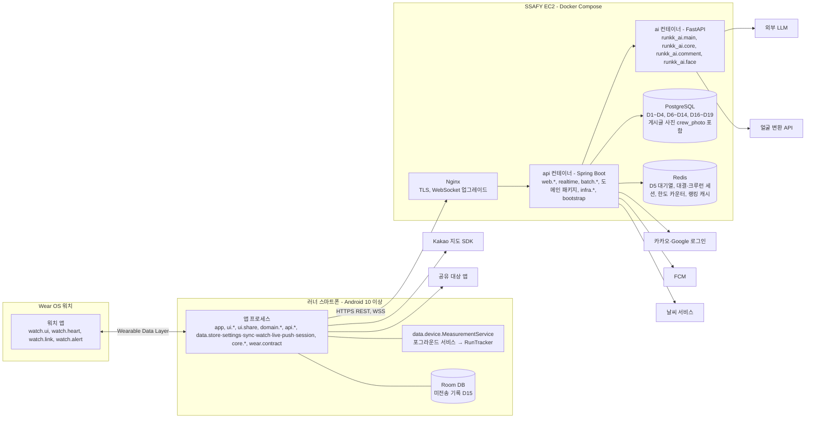

> [런크크 객체지향 분석·설계서](../design-oo.md) 목차 · 이전: [05-01-서브시스템-분할](05-01-서브시스템-분할.md) · 다음: [05-02b-계층-동시성-설계-결정](05-02b-계층-동시성-설계-결정.md)

### 5.2 계층 구조

```
[표현·구동]  web.auth  web.me  web.notification  web.run  web.record  web.battle  web.crew  web.runimal  web.avatar  web.error
             web.chat  web.report
             web.admin(운영자 확인, 랭킹 다시 계산)  web.admin.celebrity  web.admin.setting  web.admin.audit  web.admin.report
             realtime(WebSocket·폴링, BattleMessenger·CrewRunMessenger·CrewChatMessenger·ChatRoomPresence 구현)
             batch.battle  batch.crew  batch.analysis  batch.avatar  batch.running  batch.member  batch.audit  batch.notification  batch.reward
                 │ Command·View DTO      │ ProgressReport·ChatPresence, 메시지 직렬화   │ now
                 ▼                       ▼                                             ▼
[조립]       profile, operator
                 │ 조회 요청
                 ▼
[응용+도메인] member  running  runimal  battle  reward  avatar  crew  crew.chat  report  analysis
                 │ 값 객체·식별자·조회 투영·발행 패키지의 사건
                 ▼
[도메인 공통] policy  notification  audit  common
                 ▲
                 │ 인터페이스 구현 (의존 역전)
[인프라]     infra.<도메인> 13개(+ infra.chat·infra.report), infra.integration.auth·ai·push·weather
[시작]       bootstrap (컴포넌트 탐색 진입점, DomainEventPublisher 구현, 운영 비밀 값 점검)
```

v0.11: crew.chat·report와 하위 패키지 web.chat·web.report·web.admin.report·infra.chat·infra.report, 코드에 먼저 생긴 batch.reward를 더했다(5.1.1, 61개). web.admin의 랭킹 다시 계산(RankingAdminController)은 CR2-U1로 올린 코드 그대로다 (v0.11, CR2-U1, CR34-02, D-101, D-104)

- 하위 계층이 상위 계층을 import하지 않는다. 도메인 패키지는 web.*·realtime·batch.*를 모른다.
- 도메인이 실시간 메시지를 보내야 할 때는 자기 패키지의 포트(battle.BattleMessenger, crew.CrewRunMessenger, crew.chat.CrewChatMessenger)를 부르고, realtime이 그것을 구현한다(의존 역전). 메시지 형식도 만드는 패키지(battle.live, crew.live, crew.chat.live)에 둔다. 그래서 realtime → battle·crew·crew.chat 한 방향만 있다(D-06). 채팅방 입장 여부도 crew.chat의 포트 ChatRoomPresence를 realtime의 ChatPresenceRegistry가 구현한다(D-101). 저장소·외부 서비스도 같은 방식이다. 인터페이스는 쓰는 쪽 패키지에 있고 구현은 infra.* 에 있다 (v0.11, D-101)
- 패키지 사이 의존은 한 방향만 허용한다. 정렬 순서는 common → audit → policy → member → notification → report → running → runimal → battle → reward → avatar → crew → crew.chat → analysis → report.target·profile·operator이고, 각 패키지는 자기보다 앞에 놓인 패키지에만 의존한다(12.3). 거꾸로 알아야 할 때는 (1) 발행 패키지에 둔 도메인 사건(D-31), (2) 받는 쪽이 정의하고 주는 쪽이 구현하는 포트 인터페이스(WithdrawalGuard, IdleGuestWithdrawalGuard, ReservedNicknameChecker, CrewRunParticipationQuery, BattleMessenger, CrewRunMessenger, CrewChatMessenger, ChatRoomPresence, ReportedContentPort) 중 하나를 쓴다. report는 신고 대상을 모르고 조립 패키지 report.target이 crew·crew.chat의 신고용 공개 연산으로 ReportedContentPort를 구현한다(D-104, F.6.3) (v0.11, D-101, D-104) (v0.11 검증, D-135)
- 다른 패키지의 Repository·엔티티를 쓰지 않는다. 다른 패키지 자료는 그 패키지의 조회 서비스가 내준 투영(RunSummary, RunCurve, RunSampleRow, RunComparison, MemberSummary, MemberPreference, GhostOwner, CrewSummary, AuditRecordView)으로 받는다. 받는 쪽이 절반 미만 항목만 쓰면 좁은 조회 연산을 둔다(D-32, D-41).
- 두 패키지의 조회 결과를 붙이는 곳은 두 가지 방식이 섞여 있다. 대결 결과 화면의 적립량(web.battle의 BattleResultAssembler)과 크루원 목록의 Runimal 유형(web.crew의 CrewMembersAssembler)은 표현 계층이 붙인다. battle → reward 화살표를 만들지 않고(D-33), crew가 runimal보다 안정한 상태에서 runimal의 Fan-In을 표현 계층에서 받게 하려는 것이다(D-46). 기록 상세의 적립량·크루 반영 거리는 analysis가 RewardService·WeeklyRaceService를 직접 읽는다. analysis는 정렬 순서상 reward·crew 뒤에 있고 불안정도도 더 커서 방향이 맞다(12.3).
- 엔티티는 Repository를 모른다. 응용 서비스만 Repository를 부른다.

### 5.3 동시성

| 동시 접근 지점 | 처리 |
|---------------|------|
| 매칭 배정 — 한 대기자가 두 대결에 들어가면 안 됨 (FR-082) | MatchQueue.tryAssignPair를 원자적 연산으로 만든다. Redis 구현은 Lua 스크립트 하나로 두 표의 상태가 모두 WAITING일 때만 둘 다 ASSIGNED로 바꾼다. PostgreSQL 대안은 `SELECT … FOR UPDATE SKIP LOCKED`로 두 행을 잠근 뒤 바꾼다. 고스트 매칭도 tryAssign으로 표 하나를 ASSIGNED로 잡고 시작해 그동안 취소·짝 배정과 겹치지 않는다. 대결 저장·고스트 매칭 트랜잭션이 실패하면 표를 지우지 않고 release로 WAITING에 되돌린다(v0.8, D-64). 매칭 취소도 MatchQueue.removeIfWaiting 하나(WAITING일 때만 지우는 Lua·조건부 DELETE)로 해 고스트 시작(tryAssign)과 겹쳐도 한쪽만 이긴다(v0.10, D-83). Matchmaker.tick은 서버 인스턴스 하나에서만 돈다(5.4) |
| 매칭 요청 중복 (FR-080) | MatchQueue.enqueue는 memberId 키로 "없을 때만 넣기"(Redis SETNX, PostgreSQL 기본 키). 실패하면 "이미 대기 중" |
| 크루 주간 거리 동시 합산 (FR-139, NFR-034) | race_contribution 테이블에 (crew_id, week_start, record_id) 고유 제약. 행을 넣는 데 성공했을 때만 `UPDATE weekly_race SET total = total + :d WHERE …` 원자적 증가. 주 행이 없으면 `INSERT … ON CONFLICT DO NOTHING`으로 먼저 만든다. 메모리에서 읽고-더하고-쓰지 않는다 |
| 크루 정원 (FR-111, FR-123) | 가입·승인 때 crew 행을 `SELECT … FOR UPDATE`로 잠근 뒤 Crew.admit이 headcount를 검사한다 |
| 운영진 2명 상한 (FR-204) | 정원·가입 결정과 같은 잠금 경계다. crew 행을 `CrewAccess.checkForUpdate`로 잠근 뒤 `Crew.appointManager`가 MANAGER 수를 세어 `MAX_MANAGERS`(2)를 넘으면 MANAGER_LIMIT. 해제(dismissManager)도 같은 잠금 안에서 한다 (v0.11, D-98) |
| 고정 공지 3개 (FR-205) | 공지 작성(pinned = true)과 PUT /posts/{id}/pin 모두 crew 행 잠금 안에서 고정 공지 수를 센다. 4개째면 PIN_LIMIT (v0.11, D-98, FR-205) |
| 대면 모임 정원 (FR-145) | MeetupPost(게시글 행)의 낙관적 잠금(version)으로 참석 응답을 바꾸고, 충돌하면 다시 읽어 재시도한다(최대 3회, 소진하면 409 CONCURRENT_UPDATE). `MeetupPost.answer`가 GOING 수가 capacity에 닿았으면 SCHEDULE_FULL (v0.11, D-99). 구현은 재시도 안에서 글 행을 `CrewPostRepository.findByIdForUpdate`(PESSIMISTIC_WRITE)로 잠가 읽는다. 일정 응답·투표 응답·삭제·숨김이 같은 글 행을 차례로 쥐고, 고정은 crew 행 → 글 행 순서다(반대 순서 경로 없음). 채팅 메시지의 신고 숨김·해제·삭제도 `CrewChatMessageRepository.findByIdForUpdate`로 같은 방식(잠금 순서 report_case → 메시지 행, 버전 열이 없어 덮어쓰기를 막는다) (v0.11 구현 반영, U5-6, D-171) |
| 투표 응답 (FR-207) | crew_poll_response 기본 키 (post_id, member_id)에 upsert. 같은 회원이 마감 전에 다시 응답하면 선택지만 바뀐다. 마감 판정은 `PollPost.respond(memberId, optionNo, now)`가 한다 (v0.11, FR-207) |
| 채팅 리액션 (FR-210) | crew_chat_reaction 기본 키 (message_id, member_id, kind)에 upsert·삭제. 이미 있으면 그대로(멱등) (v0.11, D-101) |
| 채팅 보내기 재전송 (FR-208) | 고유 색인 uq_crew_chat_client (author_id, client_message_id)로 같은 작성자의 같은 clientMessageId를 한 번만 저장한다. 위반하면 처음 만든 메시지를 200으로 돌려준다(멱등). 받는 사람 전송은 커밋 뒤 사건 + `@TransactionalEventListener(AFTER_COMMIT)` (v0.11, D-101). 방 밖 CREW_CHAT 알림은 비동기 실행기에서 수신자마다 새 트랜잭션으로 보내고 묶음 행 하나는 V23 부분 유일 색인이 지킨다 (v0.11 구현 반영, U5-7, D-172) |
| 신고 자동 숨김 (FR-214, FR-215) | `ReportService.submit` 트랜잭션에서 report_case 행을 잠근다. 없으면 만들고, 고유 제약 (target_kind, target_id) 충돌이면 다시 읽어 잠근다. `ReportCase.addReport()`가 서로 다른 열린 신고자 3명에 닿으면 AUTO_HIDDEN으로 바꾸고 같은 트랜잭션에서 `ReportedContentPort.hide`를 부른다. 같은 회원의 같은 대상 재신고는 고유 색인 uq_content_report_reporter (case_id, reporter_id)로 막는다(ALREADY_REPORTED) (v0.11, D-104). 같은 신고자의 재신고는 앞선 신고가 기각된 뒤에도 거부하고, 이 검사는 사례 잠금 뒤 reopen보다 먼저 한다. 자동 숨김은 마지막 기각 뒤 접수된 신고의 신고자만 센다(D-149) (v0.11, 7.13.5 TF-VC-23) |
| 공동 목표 달성 (FR-217) | 원자적 합산 증가(A-12) 직후 같은 트랜잭션에서 `WeeklyRaceRepository.markAchievedIfReached`(조건부 `UPDATE … WHERE achieved_at IS NULL AND goal_meters IS NOT NULL AND total_meters >= goal_meters`)를 부른다. 한 행을 바꾼 트랜잭션만 커밋 뒤 CREW_GOAL_ACHIEVED를 보내므로 두 기록이 함께 넘겨도 알림은 한 번이다. setGoal·reconcileAll도 같은 연산을 쓴다 (v0.11, D-105) |
| 1인 1크루 (Q-34) | crew_membership에 부분 고유 인덱스 (member_id) WHERE left_at IS NULL. 두 크루에 동시에 가입하면 하나는 제약 위반 → "이미 크루 소속" |
| 같은 크루 대기 중 신청 하나 (FR-121) | join_request에 부분 고유 인덱스 (crew_id, member_id) WHERE status = 'PENDING'. 승인·거절과 3시 만료 배치가 겹치면 PENDING인 행만 바꾸는 조건부 갱신(`… WHERE status = 'PENDING'`)으로 한쪽만 성공한다(v0.8, D-69) |
| 크루장 양도 (FR-115) | 두 멤버십 행의 역할 변경을 한 트랜잭션에서 한다. Crew.version 낙관적 잠금 |
| 리워드 이중 적립·하루 상한 (FR-159) | reward_accrual에 (member_id, reason, source_id) 고유 제약. wallet 행을 `FOR UPDATE`로 잠근 뒤 그날 합계를 정한다. 합계는 지갑의 집계 칼럼 last_accrual_date·last_accrual_date_amount에서 읽고(날짜가 같으면 칼럼 값, 더 새 날이면 0), 보정 배치의 지난 날짜만 `RewardAccrualRepository.sumOn`(member_id, accrued_at 색인)으로 센다. 적립 뒤 날짜가 last 이상이면 같은 잠금 안에서 칼럼을 고친다 (v0.11, D-109) |
| 아이템 구매 (FR-160) | wallet 행 잠금 + owned_item (member_id, item_id) 고유 제약 |
| 러닝 기록 중복 전송 (FR-040) | run_record.record_id(기기 UUID)를 기본 키로 둔다. 동시에 두 번 오면 하나는 기본 키 위반 → "이미 저장됨"으로 응답 |
| 유효 러닝 순번 (D-37) | RunUploadService가 personal_record_book 행을 `SELECT … FOR UPDATE`로 잠근 뒤 회원의 유효 기록 수를 세어 validRunOrdinal을 정한다. 같은 회원의 업로드가 동시에 와도 순번이 겹치지 않는다. 수신자(TierProgress, RunimalProfile)는 이미 반영한 순번을 무시한다 |
| 주간 거리 재합산 (H-06) | WeeklyRaceService.reconcileAll은 같은 원자적 증가 경로(WeeklyRace.add, race_contribution 고유 제약)를 쓴다. 수신자가 이미 더한 기록은 고유 제약으로 건너뛰므로 onRunSaved와 동시에 돌아도 이중 합산이 없다 |
| 대결 도착·판정 (FR-092) | Battle.version 낙관적 잠금. LiveBattleService와 BattleResultService가 같은 대결을 동시에 바꾸면 늦은 쪽이 다시 읽어 재시도(최대 3회) |
| 진행 중 대결 세션 (NFR-004) | LiveBattleSession은 대결마다 Redis 해시 하나. 한 대결의 진행값은 참가자 2명뿐이라 대결 ID 단위 직렬 처리(세션 잠금 키)로 충분하다 |
| 크루런 대기실·참석 응답 (FR-145, FR-147) | CrewRunPost 낙관적 잠금(version). 크루원 10명 이하라 충돌이 드물다. "투표"는 PollPost만 뜻하므로 크루런 응답은 참석 응답(`SchedulePost.answer`)이라 부른다 (v0.11, D-99) |
| 닉네임·크루명·초대 코드 고유 (FR-003, FR-110, FR-112) | 고유 인덱스. 위반하면 숫자·코드를 다시 만들어 재시도(최대 5회) |
| 자동 닉네임·게스트 닉네임 (FR-003, FR-197) | 닉네임 고유 제약. 닉네임 없는 가입과 게스트 시작은 `Nickname.numbered`("러너" + 4자리)로 만들고, 고유 제약에 걸리면 다른 숫자로 최대 20번, 그래도 겹치면 5자리로 다시 만든다 (v0.11, D-90) |
| 배경 해금 (FR-201) | avatar 행의 버전(낙관적 잠금)과 avatar_background 기본 키 (member_id, landmark_key). 리스너·보정 배치·조회 때 채우기가 겹쳐도 한 키는 한 행만 남고 BACKGROUND_UNLOCKED는 새로 넣은 키에만 보낸다 (v0.11, D-107) |
| 아바타 하루 1회 (FR-157) | avatar 행 `FOR UPDATE` 뒤 canCreateSelfie 검사. 얼굴 변환 호출(최대 수 초) 동안 잠그지 않도록 검사 → 변환 → 다시 잠그고 재검사 → 저장 순서로 한다 |
| LLM 하루 호출 한도 (FR-065) | Redis Lua 스크립트 하나로 회원 키·전체 키를 함께 증가·검사·되돌리기(TTL 48시간). ai 서버도 프로세스 하루 절대 상한(240회, 운영 한도에서 파생하지 않는 고정 값)과 동시 호출 4개 제한을 따로 둔다(D-58, D-62) |
| 같은 회원의 셀카 변환 동시 요청 (FR-157) | Redis `SET NX`(키: 회원, 30초)로 진행 중 잠금을 잡고, 잡지 못하면 BusinessRuleException(SELFIE_IN_PROGRESS, "이미 변환 중") → 409. 외부 얼굴 API를 두 번 부르지 않고 횟수도 한 번만 는다(v0.8, TF-VC-13, D-76). 잠금은 잡은 시각 + 30초 정각에 풀려 그때부터 다음 요청을 받는다(v0.10, TF-VC-19) |
| 랭킹 줄 모습 하루 고정 (FR-070, v0.40, 05-30 D-858) | 스냅숏 단위 Redis 해시 `ranking:look:{종류}:{기간}:{집계 시각 ms}`, 만료 25시간, HSET·만료는 Lua 한 번(AR-90). 재집계 사건(`RankingSnapshotRebuilt`, AFTER_COMMIT)으로 상위 줄을 미리 채우고 첫 조회 채움은 안전망. Redis를 못 쓰면 요청마다 DB에서 읽고 랭킹 조회는 실패하지 않는다. 다른 러너 머리 받기가 머리마다 avatar-ai를 부르는 부하는 위험 R-102 |
| 운영 기준값 변경 중 조회 (FR-174) | 읽기 우세. OperationPolicy 캐시를 변경 커밋 뒤 무효화한다. 변경은 OperationSetting.version 낙관적 잠금 |
| 기존 무효 기록 재판정 (FR-047, D-191, D-199) | 기록마다 새 트랜잭션(REQUIRES_NEW)에서 run_record 행 PESSIMISTIC_WRITE 잠금 → (유효가 되면) PersonalRecordBook 행 잠금 순서. 업로드(RunUploadService)와는 PersonalRecordBook 행으로 줄을 선다. 표시는 조건부 UPDATE(rejudge_state = from)로만 바꿔 여러 인스턴스가 겹쳐도 한쪽만 바꾸고, 티어는 tier_applied 조건부 UPDATE(D-169)가 TierReconcileJob과의 이중 반영을 막는다. 기동 스레드 밖에서 상한(1,000개·60초)까지만 돈다(D-199, 구현 대기) (v0.12, U7-2) |

### 5.4 자원·배치



- api 컨테이너는 1개다. 동시 사용자 50명, 대결 10쌍(NFR-002, NFR-004)은 인스턴스 하나로 감당한다. 그래서 스케줄러(batch.*)도 같은 프로세스에서 돌고, 1초 작업이 두 번 실행될 위험이 없다. 2개 이상으로 늘리면 batch.*에 분산 잠금(ShedLock)을 추가하고 WebSocket 세션 라우팅을 Redis Pub/Sub로 바꿔야 한다(부록 E E-05). 채팅방 입장 여부(realtime ChatPresenceRegistry: crewId → memberIds)도 api 메모리에 있어 같은 전제를 따른다(D-101) (v0.11, D-101)
- ai 컨테이너는 api 컨테이너만 부른다(Docker 내부 네트워크). compose에서 ports 없이 expose만 하고, 모든 요청에 X-Internal-Token을 확인하며, GET /health를 healthcheck로 쓴다. 환경 변수는 env_file 없이 compose `environment:`가 컨테이너마다 필요한 값만 넘긴다(api: DB·Redis·Spring 값과 AI_SERVER_URL·RUNKK_INTERNAL_TOKEN, ai: RUNKK_*만. api는 LLM·얼굴 변환 키를 받지 않는다). 공유 값은 RUNKK_INTERNAL_TOKEN 하나이고 두 컨테이너 모두 `${RUNKK_INTERNAL_TOKEN:?}`로 필수다. 바꿀 때는 두 컨테이너를 같이 다시 띄운다(design-review.md H-23). ai 컨테이너는 read_only 루트, cap_drop ALL, no-new-privileges, mem_limit 512m, /tmp tmpfs 16m이고 api의 /tmp는 tmpfs 64m이라 셀카가 디스크에 남을 길을 막는다(D-58, D-59). 앱은 ai 서버를 직접 부르지 않는다. 회원 식별자를 ai 서버로 보내지 않기 위해서다(NFR-024) (v0.11, CR34-10)
- ai 입력 관문(CR34-26): FaceRouter는 디코드하지 않고 이미지 머리만 읽어 머리가 깨졌으면 422 UNSUPPORTED_IMAGE, 가로×세로가 Settings.max_image_pixels(환경 변수 RUNKK_MAX_IMAGE_PIXELS, 기본 4096×4096)를 넘으면 422 TOO_LARGE를 변환기 앞에서 낸다. CommentRouter는 본문 4KiB 상한을 넘으면 413 TOO_LARGE, JSON이 아니거나 정의 밖이면 422 INVALID_REQUEST다 (v0.11, CR34-26)
- 배포 스크립트·프록시(CR34-10): deploy.sh는 api·ai 헬스를 모두 기다리고 하나라도 실패하면 실패로 끝내며, 롤백에 ai 이미지도 넣는다. .env 값은 env_value로 읽고 줄이 없으면 기본값을 쓴다. nginx는 /ws에 Upgrade 헤더와 읽기 제한 2시간을 두고, resolver로 컨테이너 이름을 다시 해석하며, /actuator/ 경로를 밖에서 막는다. Redis는 `--requirepass`(REDIS_PASSWORD)로 내부 망 안의 무단 접근도 막는다. DB_NAME·DB_USER·DB_PASSWORD·REDIS_PASSWORD는 compose `:?` 필수이고 develop 프로필의 DB 기본 비밀번호를 없앴다. postgres·redis 포트는 내부 망 기본값(5432·6379)으로 고정한다 (v0.11, CR34-10)
- 보류(팀 결정 2026-10-22, 설계를 바꾸지 않음): /admin/** permitAll 한 겹에 이중 방어를 더할지(L23, 지금은 OperatorCheckInterceptor 하나, D-50), X-Real-IP 신뢰 프록시 설정화(L25, 지금은 사설망·루프백 어느 호스트든 믿음), 서버 → ai 평문 http(L26, compose 내부 망 가정 유지) (v0.11, CR34-10)
- PostgreSQL·Redis 연결은 infra.<도메인> 패키지만, 외부 서비스 연결은 infra.integration.* 패키지만 가진다. infra.<도메인>은 자기 도메인 패키지가 소유한 테이블·키만 읽고 쓴다(D-32, D-35).
- 게시글 사진(D-100): 앱이 JPEG·긴 변 1600px·1MB 이하로 줄여 multipart 한 요청(POST /crews/{id}/board-posts)으로 보낸다. 서버는 장당 1MB(spring.servlet.multipart max-file-size 그대로), 요청 6MB(max-request-size 2MB → 6MB), JPEG 머리(FF D8 FF)를 확인하고 메모리에서 받는다(D-59 file-size-threshold 그대로). nginx client_max_body_size 10m는 그대로다. 바이트는 PostgreSQL crew_photo.jpeg(BYTEA)에 PostPhotoStore 포트 뒤로 두고(infra.crew JdbcPostPhotoStore) 조회는 GET /crew-photos/{id}(현재 크루 구성원만, `Cache-Control: private, max-age=300`, D-174 (2). v0.12 U6-4로 86400에서 고침)로만 한다. 용량 가정은 크루원 50명 × 주 5장 × 0.5MB ≈ 주 125MB 이하(제안)이고 디스크 사용량을 감시한다 (v0.11, D-100). 위치 메타데이터(EXIF GPS 등)는 앱 PhotoCompressor가 다시 인코딩하며 버리고, 서버 crew JpegMetadataStripper가 저장 전에 APP1·APP13·COM 세그먼트를 한 번 더 지운다(NFR-042, D-142) (v0.11, 7.13.5 TF-SY-25)
- compose 빈 환경 변수(D-175): compose는 `${VAR:-}` 꼴이라 변수가 정의되지 않아도 빈 문자열을 넣는다. 그래서 "값 없음"과 "빈 값"을 구분하는 규칙(D-166)은 compose 배포에서 "빈 값"으로만 온다. RUNKK_BOOTSTRAP_OPERATORS는 화이트리스트가 이미 채워졌으면 빈 값이어도 아무 로그 없이 건너뛰고, 화이트리스트가 비었을 때만 빈 값 WARN(operator_seed_empty)을 낸다(검사 순서: 화이트리스트 → 빈 값). 코드는 BE5-A-13으로 맞춘다 (v0.11 구현 반영, U5-A-9, D-175)
- 배경 해금 채우기 기준 시각(D-176 (5)): `runkk.avatar.backfill-cutoff`(환경 변수 AVATAR_BACKFILL_CUTOFF, ISO 날짜·시각, 서버 시간대). 이 시각 이전에 저장한 유효 기록 거리만 조회 채우기가 알림 없이 해금한다. 운영 값은 V25(배경 해금) 적용 시각이고 배포 체크리스트에서 정한다. 비어 있으면 기동 실패다. 기본값 2026-10-22T00:00:00이 application.yml·infra/docker-compose.yml·infra/.env.example 세 곳에 있다. 미래 시각은 금지한다(기동 때 거부, 코드 반영 대기 BE6-6) (v0.12, U6-3)
- 되돌릴 수 없는 마이그레이션(D-175): 칼럼·표 삭제처럼 되돌릴 수 없는 Flyway 버전(v0.11의 V20 member.tags·crew_membership.crew_tags DROP COLUMN)에 대비해 infra/deploy.sh의 backup_database가 api 기동(Flyway 실행) 전에 매번 `pg_dump` 전체 덤프를 자동으로 뜬다. 덤프가 실패하면(set -euo pipefail, 부분 파일 삭제) 배포를 멈춘다. 보관 위치는 CI 작업 폴더 밖 RUNKK_BACKUP_DIR(환경 변수 > .env > 기본 $HOME/runkk-backups, 절대 경로만 허용)이고 최근 7개만 남긴다. 폴더 700, 파일 600(umask 077)이다. 파일 이름은 `pre-deploy-<YYYYMMDD-HHMMSS>-<커밋>.sql.gz`다. postgres가 멈춰 있어도 데이터 볼륨이 있으면 postgres만 올려 덤프하고, 볼륨이 없을 때(처음 배포)만 건너뛰며, 볼륨 확인 자체가 실패하면 배포를 멈춘다. 매일 덤프(아래 백업)와 별개다 (v0.11 구현 반영, U5-A-9, D-175) (v0.12, U6-1: BE6-1~3 반영)
- 비동기 실행기(D-175): Spring `applicationTaskExecutor`(spring.task.execution) 하나를 쓰는 곳은 넷이다: 리포트 생성·Runimal 판정 수신자(D-03), 배경 해금 수신자 BackgroundUnlockListener(@Async, D-129), 채팅 방 밖 알림 ChatDeliveryListener(수신자마다 새 트랜잭션·FCM 호출, D-172). 크기는 core 4·max 8·queue 500으로 둔다(지금 core 2·max 4는 리포트·Runimal만 셈한 값). 큐가 차서 TaskRejectedException이면 방 밖 알림은 로그만 남기고 버린다(채팅 저장·방 안 전송은 이미 끝났다). 실행기 설정 주석에 쓰는 곳 넷을 적는다(BE5-A-14) (v0.11 구현 반영, U5-A-9, D-175)
- 백업: PostgreSQL 매일 1회 덤프, 7일 보존(NFR-018, NFR-037). 게시글 사진·채팅·신고도 PostgreSQL에 있어 같은 덤프에 들어간다(사진 증가분 주 125MB 안팎, D-100). Redis는 백업하지 않는다(대기열·세션·카운터는 잃어도 복구 가능한 짧은 상태다) (v0.11, D-100)

### 5.5 제어 방식과 경계 조건

| 구분 | 내용 |
|------|------|
| 제어 방식 | 세 가지를 함께 쓴다. (1) 요청-응답: REST 요청 → Controller → 응용 서비스 → 엔티티·Repository → 응답. (2) 이벤트 구동: WebSocket 진행값 메시지, 도메인 사건(커밋 뒤 수신자 실행). (3) 시각 구동: batch.* 작업이 정해진 시각에 응용 서비스를 부른다 |
| 시각 작업 | 구동 패키지는 부르는 응용 패키지마다 하나다(D-39). batch.battle의 BattleTickJob(1초): Matchmaker.tick, BattleClockService.tick, LiveBattleService.detectTimeouts. batch.crew의 CrewRunTickJob(1초): CrewRunService.tick, CrewRunLiveService.detectTimeouts, WeeklyRaceReconcileJob(0시 30분, v0.10 D-88): WeeklyRaceService.reconcileAll(대상 크루와 주는 crew가 고른다, D-47), JoinRequestExpiryJob(3시): MembershipService.expireRequests. batch.analysis의 RankingRebuildJob(0시): RankingService.rebuild, PlanReminderJob(20시): CoachService.remindMissedPlans. batch.avatar의 AppearanceRefreshJob(0시): AppearanceService.refreshAll. batch.running의 DisposalJob(3시): DisposalService.executeDue. batch.member의 WithdrawalPurgeJob(3시): WithdrawalService.purgeWithdrawn. batch.audit의 AuditPurgeJob(3시): AuditService.purgeExpired. batch.notification의 NotificationPurgeJob(0시, srs.md 6.3 7.3, v0.8 TF-VC-12, D-67): NotificationService.purgeExpired. 작업 클래스는 응용 서비스 연산 하나만 부르므로 한 작업의 실패가 다른 작업을 막지 않는다. 같은 1초에 도는 BattleTickJob 안의 세 호출만 호출마다 따로 감싼다. 작업 스케줄러 스레드는 v0.10에서 6개였고(TF-SY-22, D-88) v0.11 정리에서 작업 수와 같게 바꿨다(이 행 끝). 가입 신청 만료 알림(JOIN_EXPIRED)이 3시에 나가므로 새벽 푸시 정책을 확인한다(부록 E E-16). v0.11에 더한 작업: batch.battle의 AbandonedBattleJob(1분, runkk.batch.battle-abandon-interval): BattleStartService.cancelAbandoned(CR34-01). batch.crew의 PollReminderJob(1분): CrewPostService.remindClosingPolls(마감 1시간 전 미응답자 POLL_CLOSING_SOON, D-106), CrewRunLinkReconcileJob(0시 10분, runkk.batch.crew-run-link-reconcile-cron): CrewRunLinkReconcileService.reconcileLinks. batch.reward의 RewardReconcileJob(0시 10분, runkk.batch.reward-reconcile-cron): RewardReconcileService.reconcile. batch.running의 TierReconcileJob(0시 10분, runkk.batch.tier-reconcile-cron 기본 `0 10 0 * * *`): TierReconcileService.reconcile(D-108). batch.avatar의 BackgroundReconcileJob(0시 10분): BackgroundService.reconcile(최근 2일 저장 기록 회원의 배경 해금 보정, D-107). batch.member의 RevocationPurgeJob(3시, runkk.batch.revocation-purge-cron): AuthService.purgeExpiredRevocations(CR34-05), IdleGuestWithdrawalJob(3시): WithdrawalService.withdrawIdleGuests(1년 미접속 게스트, FR-200). 0시 10분 보정 작업 넷은 수신자(커밋 뒤 리스너)가 놓친 것을 최근 2일 범위로 다시 채우는 M4 결정의 같은 꼴이다. batch.analysis의 PlanPurgeJob(3시 30분, runkk.batch.plan-purge-cron): CoachService.purgePastPlans(today)(보존 1년이 지난 날짜별 계획·주간 목표 행 정리. 코드에 먼저 생긴 작업을 v0.11 정리에서 올렸다). 작업은 1초 2·1분 2·0시 3·0시 10분 4·0시 30분 1·3시 6·3시 30분 1·20시 1개(20개)다. 스케줄러 스레드 수는 작업 수와 같게 둔다(spring.task.scheduling.pool.size = SCHEDULER_POOL_SIZE, 기본값 = 작업 수 20. 작업을 더하면 함께 늘린다). 같은 시각 작업끼리, 그리고 1초 시계와 서로 기다리지 않는다(v0.11 정리, 코드 규칙에 맞춤, D-88) (v0.11, CR34-02, D-106, D-107, D-108, FR-200) |
| 시작 | (1) OperationPolicy가 운영 기준값 22항목(기준항목 21 + OPERATOR_WHITELIST, v0.8 CR-U02)을 읽어 캐시에 둔다(policy 안의 초기화). 항목이 비거나 읽을 수 없으면 기본값(srs.md의 예시값)으로 채운다. operator의 OperatorBootstrap(v0.10까지 policy.OperatorWhitelistSeeder)이 OPERATOR_WHITELIST가 비었을 때만 환경 변수 RUNKK_BOOTSTRAP_OPERATORS(runkk.operator.bootstrap-operators)로 첫 운영자를 넣는다(v0.8, CR-U10, D-74; v0.11, CR2-U2. 이름과 조건은 v0.11 정리에서 코드에 맞춤). bootstrap의 ProductionSecretsCheck가 prod 프로필에서 필수 비밀 값이 비거나 짧으면 기동을 멈춘다(CR2-U4). 법정 문서 주소 4개가 비어도 기동을 멈춘다(LegalDocumentCatalog 필수 설정, CR34-27). (2)·(3)은 battle의 BattleStartupListener(ApplicationReadyEvent 수신)가 부른다: (2) VirtualRecordService.ensureGenerated: 가상 기록이 100개가 아니면 만든다(FR-104 "서비스 시작 때 한 번"). (3) BattleClockService.resumeLiveSessions(now): Redis에 남은 LiveBattleSession을 확인해 진행 중 대결의 시계를 이어 간다. (4) 각 batch.<응용>의 스케줄 설정이 켜진다. 시작 작업을 bootstrap에 두지 않아 bootstrap → common 하나만 유지한다(D-55, design-review.md E12) |
| 종료 | 새 요청을 받지 않고 진행 중 트랜잭션을 마친다. WebSocket 클라이언트에 "서버 재시작" 닫기 코드를 보내 앱이 재연결하게 한다. 대결·크루런 상태는 Redis·PostgreSQL에 있어 재시작 뒤 이어진다 |
| 장애: 외부 서비스 | 로그인 제공자 무응답 → "로그인 제공자 연결 실패"(FR-001). 날씨 실패 → 날씨 없이 저장, 재요청 없음(FR-184). LLM 실패·3초 초과 → 규칙 문구(FR-066). 얼굴 변환 실패 → 실패 사유 + 기본 캐릭터, 횟수 그대로(FR-155). FCM 실패 → 운영 로그만, 알림함에는 저장됨(FR-175) |
| 장애: Redis | 매칭·실시간 세션을 쓸 수 없다. MatchingService가 "잠시 후 다시 시도"를 돌려준다. 이미 대기 중이던 러너는 대결을 만들지 못한 채 30초가 지나면 MatchFailed로 같은 안내를 받는다(Redis가 복구된 뒤 Matchmaker가 보낸다, v0.8 D-64). 장기 장애면 설정 `runkk.queue=jdbc`로 JdbcMatchQueue로 바꾼다(D-07). 기록 저장·조회·크루는 영향 없음 |
| 장애: PostgreSQL | 앱은 기록을 기기에 보관하고 재전송한다(FR-039, FR-040). 서버 장애 복구 목표 1시간(NFR-016), 자료 손실 24시간 이내(NFR-019) |
| 장애: 갱신 토큰 폐기 목록 | 폐기 목록(infra.integration.auth의 RefreshTokenRevocations, JwtTokenIssuer가 쓴다. PostgreSQL refresh_token_revocation, V14)을 읽거나 쓸 수 없으면 토큰 갱신·로그아웃을 통과시키지 않고(fail-closed) 503 TEMPORARILY_UNAVAILABLE("잠시 후 다시 시도해 주세요")을 돌려준다. PROVIDER_UNAVAILABLE은 소셜 제공자 무응답에만 쓴다. 장애가 걸린 기능만 멈추고 나머지는 그대로라는 점에서 "Redis 장애는 매칭·실시간만"과 같은 원칙이다. 만료된 폐기 행은 batch.member RevocationPurgeJob(3시)이 지운다 (v0.11, CR34-05, CR34-25) |
| 장애: 실시간 채널 | 앱이 1·2·4초 간격으로 재연결하고 최대 5초 간격으로 대결이 끝날 때까지 계속한다(FR-091). 측정은 계속한다(FR-090). WebSocket 자체가 불안정하면 설정 `runkk.live=polling`으로 PollingMessenger·PollingLiveChannel로 바꾼다(C-004 대체 방안). 채팅 메시지는 메일함에 넣지 않으므로 연결이 없으면 버리고, 앱은 재연결 뒤 `GET …/chat/messages?after=`로 메운다. 폴링 대체 모드에서는 채팅방이 2초마다 `?after=`로 읽는다(D-101) (v0.11, D-101) |
| 실시간 토큰 만료 (4401) | 핸드셰이크에 쓴 접근 토큰의 만료 시각이 되면 서버가 닫기 코드 4401 TOKEN_EXPIRED로 연결을 닫는다: SocketSessionRegistry가 만료 시각 작업을 예약하고 LiveSocketHandler가 받을 때마다 만료를 확인한다(예약이 늦을 때의 방어). 앱은 SessionRefresher.refreshNow() 뒤 곧바로 재연결하고 이 재연결은 재연결 간격·실패 횟수에 넣지 않는다. 갱신이 거부되면 Unauthorized로 닫는다. 재연결 뒤 대결·크루런 메시지는 메일함에서, 채팅은 `?after=`로 받는다. 대결·크루런·채팅 공통이고 접근 토큰 수명(1시간)보다 긴 대결도 재연결 1회로 이어진다(FR-090·FR-091의 측정 계속 규칙 그대로). 폴링 대체 모드는 REST라 AuthFilter 401 → TokenAuthenticator 갱신으로 이미 처리된다 (v0.11, D-110) |

### 5.6 설계 결정 기록

| 번호 | 결정 | 근거 | 대안과 버린 이유 |
|------|------|------|------------------|
| D-01 | 서버 Java 21 + Spring Boot 3, 앱·워치 Kotlin, ai 서버 Python FastAPI | C-001~C-003, plan.md 7.2 | 서버 Kotlin: 팀 경험 미확인(부록 E E-01) |
| D-02 | 패키지를 넘는 엔티티 참조는 식별자로 한다 | 결합도를 자료 결합으로 낮춘다. JPA 연관을 패키지 밖으로 잇지 않는다 | 객체 참조: 패키지 사이 지연 로딩·순환 참조 위험 |
| D-03 | 패키지 사이 후속 처리는 도메인 사건으로 잇는다. 사건 형식은 발행 패키지에 둔다(D-31): running.RunRecordSaved, member.MemberWithdrawn·ConsentWithdrawn, battle.BattleJudged, policy.OperationSettingChanged 5종. Spring `@TransactionalEventListener(AFTER_COMMIT)`. 결과 화면에 바로 필요한 것(주간 거리, 리워드, 티어, 대결 판정, 크루런 연결)은 동기, 나머지(리포트, Runimal)는 비동기. **예외 하나(v0.2): 티어 갱신.** member가 RunRecordSaved를 받으면 member → running 의존이 생겨 running → member(탈퇴·철회 사건 수신)와 순환한다. 그래서 running의 TierUpdateListener(커밋 뒤 동기)가 member.TierLevelService.recordValidRun(memberId, RunScoreInput)을 부른다. running이 아는 후속 처리는 티어 하나뿐이다 | running이 crew·runimal·reward·battle·analysis를 모르게 한다(순환 방지). 저장이 확정된 뒤에만 후속 처리를 한다. 티어 예외는 running이 이미 member에 의존하고 있어 새 화살표가 생기지 않는다(design-review.md 6.3) | 서비스 직접 호출: running이 6개 패키지에 의존. 메시지 브로커: 인스턴스 1개 규모에 과함. member가 사건 수신(v0.1): member ↔ running 순환 |
| D-04 | 기록 공개 범위를 기록마다 저장하지 않고 회원 설정을 읽는다 | FR-010 "기존 기록에도 적용" | 기록마다 저장 + 일괄 갱신: 누락 시 개인정보 노출(SRS 보완 요청 R-01) |
| D-05 | 랜덤 대결은 서버가 진행값을 중계하고, 고스트·나와의 싸움·유명인 대결은 상대 OpponentTrack을 시작 때 앱에 주어 앱이 보간한다. 서버는 기록 상대의 도착 시각만 시계로 처리한다 | 기록 대결은 상대가 고정된 표라 실시간 중계가 필요 없다. 네트워크가 끊겨도 대결 화면이 계속 동작한다. 고스트 표시를 하지 않는 규칙(Q-02)은 화면과 메시지 형식으로 지킨다(MatchFound 형식 동일) | 모든 대결을 서버 중계: 서버 부하·끊김 영향 증가 |
| D-06 | 실시간 송신 포트는 쓰는 패키지가 정의한다: battle.BattleMessenger(`send(long, BattleMessage)`, `sendAll(Collection<Long>, BattleMessage)`), crew.CrewRunMessenger(같은 모양, CrewRunMessage). 메시지 record는 만드는 패키지의 하위 패키지(battle.live, crew.live)에 두고 sealed를 쓰지 않는다. realtime의 WebSocketMessenger·PollingMessenger가 두 포트를 모두 구현하고 메시지의 type()으로 직렬화한다. 앱도 LiveChannel 인터페이스로 같은 구조 v0.11: crew.chat.CrewChatMessenger(채팅 송신)와 crew.chat.ChatRoomPresence(채팅방 입장 여부)도 쓰는 패키지 crew.chat이 정의하고 realtime이 구현한다. 채팅 메시지 record는 crew.chat.live에서 crew.chat.CrewChatSignal(`String type()` 하나)을 구현한다(F.3.2, D-101). | C-004 대체 방안을 설정 하나로 바꾸도록. v0.1처럼 공용 포트·sealed 상위 형식을 common에, 메시지 DTO를 realtime에 두면 common ↔ battle·crew, realtime ↔ battle·crew 순환 4건과 도메인 → 표현 계층 역행 2건이 생긴다(design-review.md 4장) | common의 공용 포트 하나(v0.1): 순환·역행·쓰레기통. 폴링 전환 때 코드 수정: 일정 위험(R-022) (v0.11, D-101) |
| D-07 | 매칭 대기열·실시간 세션·한도 카운터는 Redis에 두되 모두 인터페이스 뒤에 두고 PostgreSQL 구현(JdbcMatchQueue 등)을 대안으로 둔다 | Redis 8.x 라이선스 팀 합의 전(C-019, plan.md 7.2) | Redis만 구현: 합의 실패 시 재작업 |
| D-08 | 동시성 제어는 DB 제약(고유·부분 고유 인덱스)과 원자적 증가를 먼저 쓰고, 행 잠금은 정원·잔액처럼 읽고 판단해야 하는 곳에만 쓴다 | 5.3 | 애플리케이션 수준 잠금만: 다중 인스턴스에서 깨짐 |
| D-09 | 시각 사건은 batch.<응용> 구동 패키지의 작업 클래스가 그 응용 서비스의 tick·purge·reconcile 연산을 부른다(v0.4 분할은 D-39). 도메인 객체는 now를 매개변수로 받는다 | 시각 규칙을 단위 테스트할 수 있다(Clock 주입) | 도메인 안에서 시스템 시계 직접 호출: 테스트 불가 |
| D-10 | 모든 서비스에 `java.time.Clock`을 생성자로 주입한다 | D-09 | |
| D-11 | 러닝 기록 ID는 앱이 만든 UUID다 | 재전송 중복 방지(FR-040)를 서버 기본 키로 해결 | 서버 발급 ID: 전송 전 기기 기록을 가리킬 수 없다 |
| D-12 | 러닝 점수는 Daniels–Gilbert VDOT 식으로 계산한다(6.2). 가상 기록 페이스는 같은 식을 이분 탐색으로 거꾸로 푼다 | srs.md 1.3 "계산식은 설계 단계", 결정 Q-03 VDOT | 표 조회: 거리별 표를 따로 유지해야 함 |
| D-13 | 상대 기록 보간은 직선 보간이다 | FR-098 제안 그대로 | |
| D-14 | 현재 페이스 구간은 최근 30초다 **(제안)** | srs.md 6.3 2.2 "구간 길이는 설계 단계". 1초 포인트 30개면 GPS 흔들림이 줄어든다 | 최근 200m: 느리게 달릴 때 반응이 늦다 |
| D-15 | 재전송은 네트워크가 연결될 때 WorkManager 작업으로, 실패하면 30초·1분·2분·4분… 최대 30분 간격 지수 백오프 **(제안)** | FR-040 "재전송 시점과 간격은 설계 단계" | 고정 간격: 장애 때 서버 부하 |
| D-16 | 대결 재연결은 1·2·4초 뒤, 이후 5초 간격으로 대결이 끝날 때까지 **(제안)** | FR-091 "재연결 간격과 횟수는 설계 단계". 진행도 지연 3초 목표(NFR-005)에 맞춰 첫 재시도를 1초로 | 횟수 제한: 터널 통과 뒤 영영 끊김 |
| D-17 | 매칭 애니메이션은 3초, 출발은 성사 뒤 13초 **(제안)** | srs.md 6.3 4.3 "애니메이션 길이는 설계 단계" + FR-087 10초 | |
| D-18 | 위치 샘플은 1초 간격, 거리는 하버사인 식 | srs.md 5.2 "1초 간격", NFR-007 | |
| D-19 | 앱은 제공자 SDK로 받은 토큰을 서버에 보내고, 서버가 제공자 API로 검증한 뒤 자체 JWT(접근 1시간, 갱신 14일)를 발급한다. 가입 전에는 15분짜리 가입 티켓을 준다 **(제안)** | C-007 "두 제공자와 인증 설계의 호환은 설계 단계" | 제공자 토큰을 계속 쓰기: 제공자마다 만료·검증 방식이 달라 다형성이 서버 전체로 퍼진다 |
| D-20 | 워치–폰은 Wearable Data Layer: 시작 요청·표시 정보는 MessageClient, 심박 묶음은 DataClient(연결이 끊겨도 쌓였다가 동기화) | srs.md 5.4 "설계 단계", FR-043, NFR-032 | 블루투스 소켓 직접: 재연결·대기열을 직접 구현해야 함 |
| D-21 | 코스 지도는 앱이 Kakao 지도 SDK로 그린다. 서버는 경로 좌표만 준다 | C-005 무료 범위, 서버가 지도 이미지를 만들 필요가 없다 | 서버 정적 지도 이미지: 유료 범위 위험 |
| D-22 | 러닝 카드 이미지는 앱이 그린다. 서버는 RunCardData만 준다 | 공유가 기기 기능(C-012)이고, 지도도 앱이 그린다 | 서버 렌더링: 지도 이미지 문제와 같음 |
| D-23 | 셀카는 앱 → api → ai 서버로 흘러가며 어디에도 저장하지 않는다. api는 회원 식별자를 빼고 이미지만 넘긴다 | FR-155, FR-156, NFR-024와 같은 원칙 | 앱 → ai 직접: ai 서버를 외부에 노출해야 함 |
| D-24 | 운영 기준값은 메모리 캐시에 두고 변경 커밋 뒤 무효화한다 | NFR-031 재배포 없이 반영, 읽기 우세 | 매번 DB 조회: 1초 작업마다 읽음 |
| D-25 | 랭킹은 매일 0시 스냅숏을 DB에 저장하고 Redis에 캐시한다 | FR-070 "매일 0시 집계", 핵심 API p95 500ms(NFR-001) | 요청마다 집계: 기록이 늘수록 느려짐 |
| D-26 | 크루런 진행 중계도 랜덤 대결과 같은 메신저 포트·세션 구조를 쓰되 클래스는 따로 둔다(CrewRunMessenger, CrewRunLiveSession) | 참가자 수·순위 규칙이 달라 상속하면 is-a가 깨진다 | 대결 세션 상속: 1.3.7 |
| D-27 | 티어·레벨 평가 누계(유효 횟수, 최근 10회 점수, 누적 유효 거리)를 Member 안 TierProgress에 둔다. v0.2부터 평가 시점은 running이 넘긴 validRunOrdinal로 정하고 validRunCount는 검증용이다(D-37) | member가 running을 조회하지 않게(의존 방향 유지) | member가 RunRecordRepository 조회: running ↔ member 순환 |
| D-28 | 회원 탈퇴는 Member가 식별정보를 즉시 지우고 member.MemberWithdrawn 사건으로 각 패키지(running, analysis, battle, crew, runimal, avatar, reward, notification)가 자기 자료를 지운다(notification은 알림과 기기 토큰). 탈퇴 뒤 7일이 지나면 batch.member의 WithdrawalPurgeJob이 WithdrawalService.purgeWithdrawn(now)로 member 자기 자료(회원 행에 남은 설정·티어 누계)만 정리한다(design-review.md M3) | FR-021 저장소 12개 삭제를 한 패키지에 몰지 않는다 | WithdrawalService가 모든 Repository 호출: member가 모든 패키지에 의존 |
| D-29 | 프로필 조립은 profile 패키지가 한다. profile은 엔티티를 받지 않고 MemberQueryService, RunimalQuery.typesOf, AvatarQuery.faceKey, CrewMembershipReader, RunQueryService.longestDistance만 부른다(v0.3, D-41) | member → crew·runimal·avatar 의존을 피한다. 엔티티 전체 전달(스탬프 검토, design-review.md A22~A25)을 없앤다 | |
| D-30 | 대결 판정의 도착 시각은 "대결 startAt + 기록상 대결 거리 도달 경과 시간"으로 비교한다 | 두 기기 시계 차를 없앤다(SRS 보완 요청 R-04) | 기기 기록 시각 그대로: 시계가 1초만 달라도 무승부 판정이 바뀜 |
| D-31 | 도메인 사건 형식은 발행하는 패키지에 둔다(running.RunRecordSaved, member.MemberWithdrawn·ConsentWithdrawn, battle.BattleJudged, policy.OperationSettingChanged). common에는 DomainEvent 표지와 DomainEventPublisher만 남긴다 | 수신자는 이미 발행 패키지에 의존하고 있어 새 화살표가 생기지 않는다. 사건 항목이 바뀌면 영향이 실제 수신자로 한정된다. common의 Fan-In 전체가 사건 변경에 흔들리던 문제(design-review.md H-12, 4장 쓰레기통)를 없앤다 | 사건을 common에 모음(v0.1): common이 기능 변경마다 바뀌는 쓰레기통 |
| D-32 | 다른 패키지의 테이블을 직접 조인하거나 엔티티 전체를 받지 않는다. 테이블 소유 패키지가 조회 서비스를 공개한다: running.RunQueryService(RunSummary, RunCurve, RunSampleRow, RunComparison, 통계), member.MemberQueryService(MemberSummary, MemberPreference, TagSet, 나이, 닉네임 존재, GhostOwner, PushDecision), runimal.RunimalQuery, avatar.AvatarQuery, crew.CrewMembershipReader(CrewSummary, 크루 이름). Repository는 자기 패키지 밖에서 쓰지 않는다(ArchUnit 규칙, 13.1) | 다른 패키지 테이블을 읽는 쿼리는 원본이 바뀌어도 갱신 책임이 없었다(design-review.md H-01~H-03). 엔티티 전체 전달 9건이 필요한 필드만 담은 투영으로 바뀐다(스탬프 검토 → 허용) | 다른 패키지 테이블 조인(v0.1의 분석용 기록 통계 조회 포트, 고스트 후보 조회 포트): 외부 결합. 투영 없이 엔티티 전달: 스탬프 검토 |
| D-33 | v0.1의 캐릭터 패키지를 runimal(유형 판정), avatar(외형), reward(잔액·아이템)로 나눈다. ItemSlot은 policy.ShopItem과 avatar가 함께 써서 common으로 옮긴다(v0.3 재점검은 D-48). 대결 결과의 적립량은 web.battle이 RewardService.accruedFor로 조합해 battle → reward 의존을 없앤다 | 세 묶음 사이에 호출·공유 자료가 없어 논리적 응집이었다(design-review.md 3.1 P10). 나누면 셋 다 통신적 응집이다. avatar → reward는 보유 확인(owns) 하나다 | 한 패키지 유지: 아바타 변경이 Runimal 판정 재시험을 부른다 |
| D-34 | v0.1의 관리툴 패키지를 해체한다. 유명인 기록 관리는 battle.CelebrityRecordService, 기준값 변경은 policy.OperationSettingService, 감사 조회는 audit.AuditService.query를 표현 계층이 직접 부른다(v0.4부터 web.admin.celebrity·setting·audit, D-50). operator에는 OperatorId·OperatorAuthorizer만 남긴다. 서비스는 확인된 운영자 계정 문자열(actorId)만 받고 operator를 import하지 않는다. 티어 경계값 변경은 OperationSettingChanged 사건으로 battle.VirtualRecordService에 알린다 | "운영자가 쓴다"는 이유로 모인 논리적 응집이었다(design-review.md 3.1 P11). policy가 battle을 부르면 역방향 의존이 생긴다 | 관리툴 패키지 유지: 세 서비스가 서로 부르지 않는데 함께 바뀐다 |
| D-35 | 표현·구동·인프라 계층을 기능별 하위 패키지로 나눈다: web.auth·me·notification·run·record·battle·crew·runimal·avatar·admin·admin.celebrity·admin.setting·admin.audit·error(v0.4 web.admin 분할은 D-50), batch.battle·crew·analysis·avatar·running·member·audit·notification(v0.3·v0.4 분할은 D-39), infra.<도메인> 11개, infra.integration.auth·ai·push·weather. 설정은 설정 대상 패키지로 옮기고 시작 클래스는 bootstrap에 둔다 | v0.1의 계층별 단일 패키지(web, batch, 인프라 3개, 설정 패키지)는 논리적·시간적 응집이고 Fan-Out이 10까지 올랐다(design-review.md 3.1, 1.2). 나누면 각 하위 패키지 Fan-Out 4 이하(realtime 4, v0.4) | 계층별 단일 패키지(v0.1): 한 도메인 매핑 변경이 모든 도메인 재시험으로 번진다 |
| D-36 | 플래그·모드 값으로 처리 갈래를 고르던 연산을 갈래마다 나눈다: member changeSetting / giveConsent / withdrawConsent / withdraw(memberId), analysis personalRanking / crewRanking, LandmarkTable personalProgressOf / crewProgressOf(v0.3), battle selfCandidates / celebrityCandidates / startSelfBattle / startCelebrityBattle, crew approveJoin / rejectJoin / delete(requesterId, crewId) / enterLobby / toggleReady / leaveLobby, 앱 MeasurementService onFinishTapped / onFinishLongPressed / endRun(), RunSession hintFinish / finish / end(v0.3, D-49). 확인 단계("정말 할까요")는 화면이 하고 서버는 확인된 요청만 받는다 | 호출자가 호출받는 쪽의 내부 분기를 고르는 제어 결합이었다(design-review.md A01·A03·A05·A06, B01·B12·B14, v0.2 재검증의 D32·B01'). 나누면 데이터·스탬프 결합이 된다 | boolean·enum 매개변수 유지: 갈래가 늘 때마다 모든 호출자가 함께 바뀐다 |
| D-37 | 유효 러닝 순번(validRunOrdinal)은 running이 저장 때 정해 RunRecordSaved와 recordValidRun 호출에 싣는다. TierProgress·RunimalProfile은 이 순번으로 판정 시점(3, 10의 배수)을 정하고 자기 카운터는 직전 반영 순번으로만 쓴다. 순번을 건너뛰어 받을 때의 규칙은 D-40 | 같은 사실을 member·runimal이 따로 세면 한쪽 수신자만 실패했을 때 티어 갱신과 Runimal 확정이 다른 회차에 일어난다(design-review.md H-05, FR-027·FR-153 "같은 시점") | 각자 세기(v0.1): 판정 회차 어긋남 |
| D-38 | 크루 주간 거리는 수신자(onRunSaved)가 더하고, batch.crew의 WeeklyRaceReconcileJob이 매일 0시 WeeklyRaceService.reconcileAll(now)를 부르면 crew가 이번 주·지난주를 RunQueryService.distancesByMember에서 다시 맞춘다(대상 선택은 D-47) | 커밋 뒤 수신자가 실패하면 합산이 빠지고 다시 맞출 경로가 없었다(design-review.md H-06). 같은 원자적 증가 경로를 써서 이중 합산은 고유 제약이 막는다 | 실패 재시도 큐: 인스턴스 1개 규모에 과함 |
| D-39 | 표현·구동 하위 패키지와 앱 화면·API 모듈을 앱 탭, 클라이언트, 실행 시각이 아니라 부르는 응용 패키지 기준으로 나눈다: web.runimal(RunimalController)·web.avatar(AvatarController, 아바타·상점), web.notification(NotificationController, 기기 토큰 등록), web.me(member·profile만), web.admin.celebrity·setting·audit(D-50), 앱 api.runimal·api.avatar·api.live, ui.runimal·ui.avatar·ui.notification. 구동 패키지(v0.4, 2026-10-20 팀 결정 (가))는 batch.battle(1초 시계 3개), batch.crew(1초 크루런 시계 2개, 0시 reconcileAll, 3시 expireRequests), batch.analysis(0시 rebuild, 20시 remindMissedPlans), batch.avatar(0시 refreshAll), batch.running(3시 executeDue), batch.member(3시 purgeWithdrawn), batch.audit(3시 purgeExpired), batch.notification(3시 purgeExpired)이다. 시각은 각 패키지의 스케줄 설정이 갖는다 | v0.2의 캐릭터 탭 표현 패키지, "나" 탭 표현 패키지의 알림함, 0시·20시 구동 패키지, 앱 캐릭터 API 모듈은 같은 탭·같은 "매일"이라는 이유만으로 모인 논리적 응집이었다(design-review.md 9.3 V2·V7·V12, 9.5, N1~N4). v0.3의 batch.tick·midnight·cleanup도 같은 시각이라는 이유로 서로 무관한 호출(랭킹 재계산과 아바타 외형 재계산, 원자료 파기와 가입 신청 만료)을 묶은 시간적 응집이었고, 이 원칙과도 어긋났다(design-review.md 10.3 V11·V12a·V13, R18~R20). 나누면 모두 통신적 또는 기능적 응집이고 구동 패키지마다 Fan-Out은 대상 패키지 하나와 common을 더해 2다. 아바타와 상점은 보유 아이템·잔액을 함께 다뤄(AvatarService.equip → RewardService.owns) web.avatar 하나에 둔다 | 탭·주기 단위 유지: 탭 구성이나 실행 시각이 바뀌면 패키지 구조가 바뀐다. 탭 구성은 앱 내비게이션 그래프가 맡는다. 시각 단위 유지 + 시간적 응집 예외 문장(design-review.md R18~R20 (나)): 검토로 남아 최종 판정 상한이 조건부 합격이라 팀이 택하지 않았다 |
| D-40 | 판정 지점 건너뜀 규칙: TierProgress·RunimalProfile은 "직전 반영 순번 < 판정 지점 ≤ 새 순번"인 판정 지점(3, 10의 배수)이 있으면 판정한다. 지점이 여럿이면 가장 큰 지점 하나만 판정한다(티어 창 크기·Runimal 판정 종류는 그 지점 기준) | 커밋 뒤 수신자가 한 번 실패하면 그 순번은 다시 오지 않아, 3회째 첫 티어 판정이 실패하면 10회째까지 티어가 없었다(design-review.md H-05', R10). 같은 순번 규칙을 두 클래스가 따로 구현하므로(H-13) 14장 시험 표에 건너뛴 순번 행을 더한다 | 실패 재시도 큐: 인스턴스 1개 규모에 과함. 수신자가 running에 빠진 순번을 다시 묻기: member·runimal → running 조회가 늘고 member는 순환이 생긴다 |
| D-41 | 받는 패키지가 절반 미만 항목만 쓰던 투영·값을 쓰는 항목만 담은 좁은 조회로 바꾼다: MemberQueryService.tagsOf(runimal), RunQueryService.runSamples → RunSampleRow(runimal), comparisonOf → RunComparison(battle), recentStartTimes(avatar), longestDistance(profile), ShopCatalog.slotOf(avatar), 운영 한도 값 객체를 SettingKey별 SelfieLimit·LlmCallLimit·SupplementCap·NotificationRetention으로 분리, LandmarkTable의 범위 매개변수를 없애고 personalProgressOf·crewProgressOf로 분리, AuditService.query는 AuditRecordView 반환 v0.11: MemberQueryService.tagsOf는 러너 성향 태그 제거로 지웠다(D-91). | design-review.md 9.2.1의 스탬프(검토) 7건(D5, D6, D9, D18, D20, D35, D43), 제어 1건(D32), D52 권고. 모두 이미 있는 쌍 위의 연산이라 화살표가 늘지 않는다. RunQueryService 공개 연산은 19개(runSamples 겹쳐 쓰기 포함 20개)다. 20개를 넘기면 소비 목적별 조회 클래스로 나눈다 | 범용 투영 하나 유지: 소비자마다 쓰지 않는 항목 변경에 묶인다 (v0.11, D-91) |
| D-42 | 관리툴 토큰은 operator가 정의한 포트 OperatorTokenIssuer(issue(OperatorId) → String, verify(String) → OperatorId)로 발급·검증하고 infra.integration.auth의 JwtOperatorTokenIssuer가 구현한다. operator → member는 SocialLoginGateway(계정 확인)만 남는다. AuthFilter는 /admin/* 경로를 회원 JWT로 검사하지 않고 web.admin의 OperatorCheckInterceptor가 OperatorAuthorizer.ensureOperator로 확인한다(v0.4, D-50) | member.TokenIssuer에는 운영자 토큰 연산이 없었다(design-review.md M1, R15). 회원 인증 포트에 운영자 책임을 얹거나 회원 토큰을 운영자에게 발급하지 않는다. infra.integration.auth → operator가 하나 늘지만 인프라 → 조립의 인터페이스 구현 방향이다 | member.TokenIssuer에 운영자 연산 추가: member가 운영자 개념을 알게 된다 |
| D-43 | 푸시 기기 토큰은 notification이 소유한다: PushDevice(token, memberId, registeredAt) 엔티티, PushDeviceRepository(infra.notification 구현), NotificationService.registerDevice, PUT /me/push-token(web.notification). NotificationWithdrawalListener가 탈퇴 때 기기 토큰도 지운다. FcmPushGateway는 받은 토큰으로 보내기만 하고 무효 토큰을 PushResult로 돌려준다 | 기기 토큰 표의 소유 패키지·등록 경로·탈퇴 삭제가 없어 FR-021 삭제 대상이 빠질 위험이 있었다(design-review.md H-16, R14). 회원 ID와 기기 토큰의 대응은 개인정보라 도메인 패키지가 수명을 관리한다. design-review.md R14는 PushGateway에 등록·삭제 연산을 두라고 했으나 저장은 PushDeviceRepository가 맡고 PushGateway는 외부 발송 포트 하나로 둔다 | push 인프라가 표 관리(v0.2): 도메인 소유자가 없는 저장소 |
| D-44 | 상점 아이템(SHOP_ITEMS·ITEM_PRICES)은 기존 아이템 ID를 지우거나 부위를 바꾸지 못하고 판매 중지(ShopItem.onSale = false)만 할 수 있다. SettingKey.validateTransition(이전 값, 새 값)이 ShopCatalog.allowsTransitionFrom으로 검사하고 OperationSettingService.change → OperationSetting.change가 부른다 | Avatar.equipped·RewardWallet.ownedItems가 가리키는 아이템 ID가 사라지거나 부위가 바뀌면 착용·보유 자료가 깨진다(design-review.md H-15, R13). 검사는 SettingKey 상수의 다형성이라 OperationSettingService에 key 분기를 두지 않는다 | 운영자 변경 때 착용·보유 자료 일괄 정리: policy가 avatar·reward를 불러 역방향 의존이 생긴다 |
| D-45 | 가상 기록은 TIER_BOUNDARY 또는 VIRTUAL_RECORD_RULE이 바뀌면 다시 만든다. 가상 닉네임을 만들 때 MemberQueryService.isNicknameTaken을 nicknameTaken으로 넘겨 회원 닉네임과 겹치지 않게 한다 | VirtualRecordFactory.generate의 입력이 두 기준값인데 한쪽 변경만 받았고, 회원 닉네임을 물을 연산이 없었다(design-review.md H-14, H-11', M8, R11, R12). 둘 다 이미 있는 battle → member·policy 화살표 위의 연산이다 | |
| D-46 | 크루원 목록의 Runimal 유형은 web.crew의 CrewMembersAssembler가 RunimalQuery.typesOf로 붙인다. crew는 공개 대상 크루원 ID(disclosedMemberIds, 공개 수준은 member가 판정, D-52)만 CrewMembersView에 담고, runimal과의 연결은 CrewRunParticipationQuery 구현 하나만 남는다 | crew는 화면용 조합을 하지 않는다. 두 패키지 조회 결과를 붙이는 일은 표현 계층이 하고, 같은 방식을 대결 결과 적립량에 쓰고 있다(D-33). 부수 효과로 runimal의 Fan-In이 5, 불안정도가 4 ÷ 9 = 0.44가 되어 crew(v0.4 7 ÷ 13 = 0.54) → runimal 방향의 여유가 0.10이다(12.3) | crew 안에서 조합 유지: 안정성 위반 1건. runimal ↔ crew 의존 방향 뒤집기: 핵심 패키지 화살표와 정렬 순서가 바뀐다 |
| D-47 | WeeklyRaceService.reconcileAll(LocalDateTime now)가 이번 주·지난주에 소속 기록이 있는 크루(CrewRepository.crewIdsActiveBetween)를 골라 크루마다 다시 맞춘다. batch.crew의 WeeklyRaceReconcileJob은 now만 넘긴다 | v0.2는 구동 패키지가 크루 목록과 주를 골라 reconcile(crewId, week)를 불러야 했는데 크루 목록 연산이 없었고, 대상 선택은 업무 규칙이라 구동 패키지에 둘 수 없었다(design-review.md M2, 9.6). v0.4부터 구동 패키지는 부르는 응용 패키지 기준이라(D-39) crew의 0시 작업으로 batch.crew에 둔다(부록 E E-14) | 대상 선택을 구동 패키지에 둠: 업무 규칙이 구동 계층으로 샌다 |
| D-48 | common 유지 조건을 다시 점검한다: (1) Timestamps는 불변 record(createdAt, updatedAt)이고 엔티티가 수정 때 touched(now)가 돌려준 새 값으로 바꿔 끼운다. (2) ProgressReport에는 거리·경과·보낸 시각만 두고 채널 구분(BATTLE / CREW_RUN)과 채널 ID는 realtime의 수신 형식(InboundProgress)에 둔다. LiveBattleService·CrewRunLiveService.onProgress가 채널 ID를 따로 받는다. (3) ItemSlot은 common에 남긴다 (4) v0.11: 코드에 있는 AttemptLimiter·ClientAddress·PageCursor(L3)와 AfterCommit·*Transactions 사본(L4)의 위치는 D-132로 정했다: PageCursor는 common(이 조건 안), AttemptLimiter·ClientAddress는 web.attempt, 사본은 패키지 전용 (v0.11 검증, D-132). | design-review.md 9.3 V28의 권고 셋과 9.6의 조건. ItemSlot을 policy로 옮기면 쓰는 패키지 가운데 web.avatar(상점 부위 필터 매개변수)와 infra.avatar(착용 부위 열 매핑)가 policy를 새로 import해 화살표가 2개 늘고 줄어드는 화살표는 없다. D-44로 기존 아이템의 부위가 바뀌지 않으므로 ItemSlot은 "변경이 드문 불변 기본 형식" 조건을 지킨다. 부위를 새로 더하는 일은 앱 아바타 그리기와 함께 배포하는 변경이다 | ItemSlot을 policy로: 새 화살표 2개. 채널 구분을 common에 유지: 실시간 채널이 늘 때마다 common이 바뀐다 (v0.11, CR34-11) |
