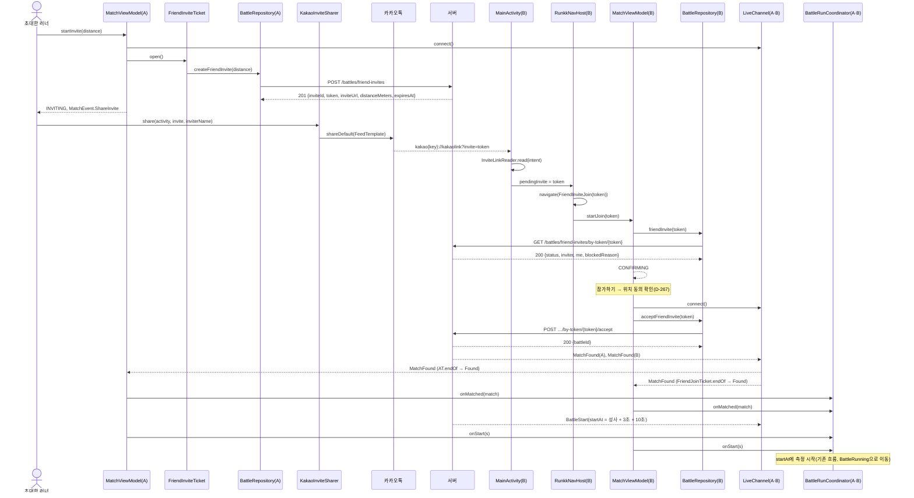
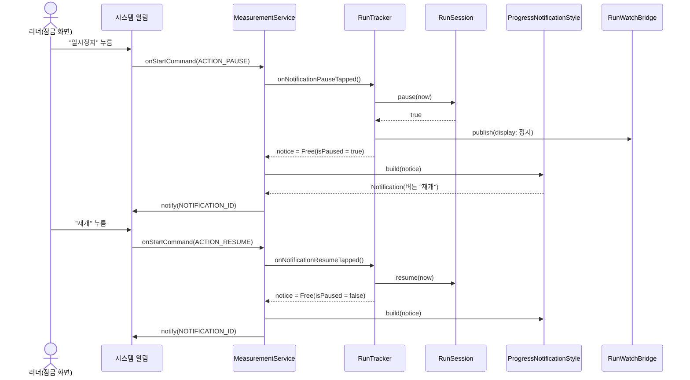

# 5.6 설계 결정 기록 (이어서: v0.14 앱 세부)
> 작성: 2026-10-30 | 버전: v0.15(잠금 목록 크루 표기, 친구 대결 연산, 새 클래스 갱신, [05-10](05-10-설계-결정-v0.15.md) D-310) | 입력: 05-07 앱 조각(D-250~D-289)의 1절·3~8절, 05-08 통합 조각, 서버 조각 05-06

> [런크크 객체지향 분석·설계서](../design-oo.md) 목차 · 이전: [05-08-설계-v0.14-API-외부준비](05-08-설계-v0.14-API-외부준비.md) · 다음: [05-10-설계-결정-v0.15](05-10-설계-결정-v0.15.md)

이 조각은 [05-07-설계-결정-v0.14-앱](05-07-설계-결정-v0.14-앱.md)이 조각 상한(60KB)을 넘어 05-07의 1절(화면과 내비게이션)과 3~8절(1차 배포 잠금 목록, 측정 변경 요약, 친구 대결 앱 구성, 첫 사용 가이드와 잠긴 기능 안내, 앱 쪽 핵심 시퀀스, 클래스 목록)을 그대로 옮겨 온 것이다. 절 번호는 05-07의 번호를 그대로 쓴다. 결정 표(D-250~D-289)는 05-07의 2절에 있고, 이 조각의 "D-xxx"는 모두 그 표의 번호다.

## 1. 화면과 내비게이션

### 1.1 하단 탭

| 순서 | 탭 | RunkkTab | 경로 | 그리는 모듈 | 1차 배포 |
|------|----|----------|------|-------------|----------|
| 1 | 크루 | CREW | Routes.CREW | ui.crew | 잠금 아이콘. 누르면 잠긴 기능 안내만 보이고 이동하지 않는다(D-253) |
| 2 | 기록런 | RECORD_RUN (신규) | Routes.RECORD_RUN = "battle/record" (신규) | ui.battle | 셀프런 \| 셀럽런 분절 |
| 3 | 홈 | HOME | Routes.HOME | ui.home | 가운데 원형 버튼 |
| 4 | 랭킹 | RANKING (신규) | Routes.RANKING = "ranking" (값 변경) | ui.record | 개인 랭킹만 |
| 5 | 마이 | ME | Routes.ME | ui.me | |

RunkkTab의 SELF·CELEB, Routes.SELF·CELEB(탭 경로), Routes.BATTLE_RANDOM, Routes.BATTLE_HISTORY는 지운다. 배틀런 화면(Routes.BATTLE_MODE)은 탭이 아니지만 하단 탭을 보이고 홈을 고른 상태로 둔다(피그마 C-1·C-9).

### 1.2 화면 목록

| 피그마 ID | 화면 클래스 | ViewModel | 모듈 | 경로(NavKey) | FR |
|-----------|-------------|-----------|------|--------------|----|
| A-1 | LoginScreen | LoginViewModel | ui.me | LOGIN | FR-001~FR-004 |
| A-2 | SignUpScreen("전체 동의" 줄 추가) | SignUpViewModel | ui.me | SIGN_UP, GUEST_START | FR-003, FR-197 |
| A-3 | GuestNoticeSheet (신규, GuestNoticeDialog 대체) | SignUpViewModel | ui.me | 가입 화면 안 시트 | FR-199 |
| A-4 | HomeScreen | HomeViewModel | ui.home | HOME | FR-052, FR-109 |
| A-5 | SettingsScreens(FREE_RUN 쪽, "대결" 묶음) | SettingsViewModel | ui.me | FREE_RUN_SETTINGS | FR-048, FR-109, FR-188, FR-189 |
| A-6 | LocationConsentSheet (신규) | 부르는 화면의 ViewModel | core.designsystem | 시트 | FR-031 |
| B-1 | RunScreen의 StartCountdown | RunViewModel | ui.run | RUN | FR-180 |
| B-2, B-4 | RunScreen + RouteCanvas (신규) | RunViewModel | ui.run | RUN | FR-034, FR-194, FR-219 |
| B-3, C-5, D-4, E-4 | 진행 알림(MeasurementService + ProgressNotificationStyle) | 없음 | data.device | 알림 | FR-224 |
| B-6 | RunResultScreen | RunResultViewModel | ui.run | RunResult | FR-078 |
| B-7 | RecordCardScreen(앞면만) | RecordCardViewModel | ui.record | RecordCard | FR-068 |
| C-1, C-9 | BattleModeScreen (신규) | BattleModeViewModel (신규) | ui.battle | BATTLE_MODE (신규) | FR-080, FR-227 |
| C-2 | MatchScreen(WAITING) | MatchViewModel(RandomTicket) | ui.battle | BattleQuickMatch | FR-080~FR-085 |
| C-10 | MatchScreen(INVITING, INVITE_ENDED) | MatchViewModel(FriendInviteTicket) | ui.battle | FriendInviteWait(distanceMeters) (신규) | FR-227, FR-228 |
| C-11 | 카카오톡 메시지(앱 밖). KakaoInviteSharer (신규)가 보낸다 | 없음 | ui.battle | 없음 | FR-227 |
| C-12 | MatchScreen(CONFIRMING, JOINING) | MatchViewModel(FriendJoinTicket) | ui.battle | FriendInviteJoin(token) (신규) | FR-229 |
| C-3 | MatchScreen(MATCHED) | MatchViewModel | ui.battle | 위 세 경로 | FR-086, FR-087, FR-221 |
| C-4, D-3, E-3 | BattleRunningScreen + RouteCanvas | BattleRunningViewModel | ui.battle | BattleRunning | FR-088, FR-098, FR-099, FR-222 |
| C-6, D-5, E-5 | ForfeitDialog(OpponentKind별 문구) | BattleRunningViewModel | ui.battle | 대화상자 | FR-094 |
| C-7·C-8, D-6·D-7, E-6·E-7 | BattleResultScreen(BattleResultPager, 2쪽) | BattleResultViewModel | ui.battle | BattleResult | FR-093, FR-096 |
| D-1, E-1 | RecordRunScreen (신규, 분절 안에 SelfBattleScreen·CelebBattleScreen) | SelfBattleViewModel, CelebBattleViewModel | ui.battle | RECORD_RUN | FR-095, FR-100 |
| D-2, E-2 | RecordBattleCountdown | RecordBattleViewModel | ui.battle | 같은 화면 | FR-096, FR-180 |
| 랭킹 | RankingScreen | RankingViewModel | ui.record | RANKING | FR-070 |
| G-1 | MeScreen | MeViewModel | ui.me | ME | FR-005 |
| G-2 | ProfileEditScreen | ProfileEditViewModel | ui.me | PROFILE_EDIT | FR-006, FR-007, FR-012 |
| G-3 | OtherProfileScreen | OtherProfileViewModel | ui.me | MemberProfile | FR-005, FR-060 |
| G-4 | RunimalScreen | RunimalViewModel | ui.runimal | RUNIMAL | FR-151, FR-166 |
| G-5 | RunimalTypesScreen (신규) | RunimalTypesViewModel (신규) | ui.runimal | RUNIMAL_TYPES (신규) | FR-151, FR-226 |
| G-6 | RunimalTypeScreen (신규) | RunimalTypeViewModel (신규) | ui.runimal | RunimalType(type) (신규) | FR-226 |
| G-7, G-8, G-10 | RecordListScreen(탭 3개) + BattleHistoryTab (신규, 칸 끼움) | RecordListViewModel, BattleHistoryViewModel | ui.record, ui.battle | RECORDS | FR-057, FR-058, FR-101 |
| G-9 | RecordDetailScreen | RecordDetailViewModel | ui.record | RecordDetail | FR-059, FR-225 |
| G-11 | EvaluationScreen (신규) | 없음(경로 인자만 그린다) | ui.runimal | Evaluation(tier, validRuns, runimalType) (신규) | FR-022, FR-027, FR-153 |
| J-0 | RunkkBottomBar(크루 잠금 아이콘) | 없음 | core.designsystem, app | 없음 | FR-223 |
| J-1~J-8 | FirstRunGuideOverlay (신규) | FirstRunGuideViewModel (신규) | ui.home | HomeFeatureEntry.Overlay | FR-231 |
| 없음(디자인 요청) | LockedFeatureDialog (신규) | 없음 | app | 대화상자 | FR-223 |

알림함, 설정 하위 화면, 탈퇴, 성장 분석, 런바디(리포트), 목표·러닝 코치는 이번에 바꾸지 않는다(D19). 런바디는 화면 제목 문자열만 바꾼다(CR-32).

## 3. 1차 배포 잠금 목록

빌드 플래그 LOCK_UNRELEASED(D-251)가 참인 빌드에서 적용한다.

| 대상 | 방식 | 담당 | 1차 배포 화면 |
|------|------|------|---------------|
| 하단 크루 탭 | 잠금(자물쇠 아이콘, 누르면 LockedFeatureDialog) | RunkkNavHost, RunkkBottomBar | J-0 |
| 크루 경로 전부(CREW 하위 문자열 경로, CrewHome~CrewGoalSet 인자 키 11종과 CrewChat, 알림 Screen CREW_\*) | 경로 잠금(BetaLock.isLocked → LockedFeatureDialog) | BetaLock | 우회 진입 방어 |
| 아바타 경로(AVATAR, AVATAR_SETUP, SHOP, AVATAR_BACKGROUND, 알림 BACKGROUND_UNLOCKED) | 경로 잠금 | BetaLock | 우회 진입 방어 |
| 랭킹 크루 분절 | 숨김(CREW) | RankingScreen | 개인만 |
| 결과 화면 크루 반영 줄 | 숨김(CREW) | RunResultScreen, BattleResultScreen 2쪽 | 줄 없음 |
| 다른 러너 프로필 크루명 | 숨김(CREW) | OtherProfileScreen | 칸 없음 |
| 가이드 크루 단계 | 단계 제외(CREW) | GuideStep 거르기 | 6단계 |
| 카드 팝업 "공유", 카드 뒤집기 | 숨김(CARD_SHARE) | RecordCardScreen | 앞면과 "닫기" |
| 기록 상세 "카드 공유" | 숨김(CARD_SHARE) | RecordDetailScreen | 없음 |
| MY Runimal "공유" | 숨김(CARD_SHARE) | RunimalScreen | 없음 |
| 홈 아바타 눌러 꾸미기, 상점·배경 선택 진입 | 숨김(AVATAR_CUSTOMIZE) | HomeScreen, MeScreen | 눌러도 반응 없음 |
| 셀카 얼굴·선택 배경 그리기 | 기본 아바타 2표정·기본 배경으로 대체(AVATAR_CUSTOMIZE) | RunkkAvatar, AvatarBackdrop | 모두 같은 아바타 |
| 가이드 포인트 단계 | 단계 제외(AVATAR_CUSTOMIZE) | GuideStep 거르기 | 6단계 |
| 크루·아바타 푸시 알림 | 서버가 보내지 않는다(SRS 5.3) | 서버 | 해당 없음 |
| 셀럽런(v0.9 베타 잠금) | 잠금 해제 | BetaLock 목록에서 제외 | 기록런 탭 셀럽런 분절 |
| 기록 목록 크루런 태그, 기록 상세 머리 크루런 배지 | 숨김(CREW, v0.15 U8-4) | RecordTag.textsOf(run, isCrewOpen), RecordListScreen, RecordDetailScreen | 크루런 기록도 종류 태그 없이 보인다 |
| 기록 공개 범위 "크루 공개" 선택지와 기록 상세 공개 범위 칩, 알림 설정 크루 묶음, 탈퇴 안내 크루 줄 | 남김(설정값 표시, 위임 결정, v0.15 U8-4) | RecordVisibilityOptions, RecordDetailScreen, NotificationSettings, WithdrawScreen | 그대로 보인다 |

플레이버별 기본값: prod 참, develop 참, local 거짓. `-Prunkk.lockUnreleased=false`로 develop에서도 열 수 있다. 2차 배포 때는 플래그 하나를 거짓으로 두거나, 기능별로 열려면 ReleaseScope 구현을 UnreleasedFeature별 집합으로 바꾼다.

## 4. 측정 변경 요약

| 항목 | 바뀌는 클래스·연산 | 결정 |
|------|--------------------|------|
| 잠금 화면 진행 알림 | RunTracker.notice, ProgressNotice(Free·Battle), FreeRunGoalState, RunStartSpec.opponentName, MeasurementService(notice 구독), ProgressNotificationStyle(LiveUpdateStyle·OngoingProgressStyle) | D-258, D-259 |
| 알림 일시정지·재개 | MeasurementService.onStartCommand(ACTION_PAUSE·ACTION_RESUME) → RunTracker.onNotificationPauseTapped·onNotificationResumeTapped | D-260 |
| 앱 화면 잠금 삭제 | RunSession·RunTracker·BattleRunCoordinator·화면의 잠금 연산과 상태 | D-256 |
| 정지 자동 종료 삭제 | PauseLimit, RunTracker 정지 한도 연산 | D-257 |
| 경로선·마커 | core.model RouteLine, RunTracker.routeLine, MyProgress.route, core.designsystem RouteCanvas·OpponentMarkerPlacer | D-261, D-262 |
| 자유런 폰 현재 페이스 제거 | RunScreen 칸 구성 | D-263 |
| 카운트다운 단순화 | StartCountdown, RunViewModel.onSettingsTapped 삭제, RecordBattleViewModel.onReselect | D-264 |
| 중간 알림 진동 | GapGuidanceRule.check | D-265 |
| 셀프·셀럽 포기 = 기록 버림 | CardKind.isDiscardable, CoordinatedRound.discardMeasuring, BattleRunState.Discarded, OpponentKind 포기 문구 | D-266 |

워치(wear)는 코드 변경이 없다. 폰이 받는 워치 일시정지 요청이 RunSession.pause/resume 하나로 모이고(D-256), 워치 표시의 현재 페이스는 그대로다.

## 5. 친구 대결 앱 구성

| 클래스 | 패키지 | 책임 | 결정 |
|--------|--------|------|------|
| FriendInvite | domain.battle | 내가 만든 초대 하나의 값(초대 ID, 토큰, 링크, 거리, 만료 시각)을 나타낸다 | D-270 |
| FriendInviteView | domain.battle | 받은 초대의 참가 확인 정보를 나타낸다 | D-273 |
| BattleRepository(연산 추가) | domain.battle | createFriendInvite, cancelFriendInvite, friendInvite(token), acceptFriendInvite(token), declineFriendInvite(token) | D-270, D-273 |
| FriendInviteDeclined, FriendInviteExpired | domain.live(ServerMessage) | 초대한 쪽이 받는 실시간 끝 알림 | D-269 |
| BattleRunCoordinator(연산 추가) | domain.battle | createInvite(distance)(applicationScope에서 만들어 만드는 중 떠나도 만든 뒤 취소), abandonInvite(), forgetInvite(), cancelInvite(inviteId)(applicationScope 재시도), isBusy() | D-271, D-273, v0.15 D-310 |
| BattleModeViewModel, BattleModeScreen | ui.battle | 배틀런 분절·거리 고르기를 다룬다 | D-268 |
| MatchTicket(RandomTicket, FriendInviteTicket, FriendJoinTicket) | ui.battle | 대기 시작·끝 판정·떠날 때 정리를 대기 종류별로 정한다 | D-269 |
| InviteSharer, KakaoInviteSharer | ui.battle | 초대를 카카오톡(없으면 웹 공유)으로 보낸다 | D-270 |
| InviteLinkReader, PendingInvite | app | 들어온 링크에서 초대 토큰을 꺼내고(readNew, consumed) 받은 시각과 함께 5분 보류한다 | D-272, v0.15 U9-4 |

초대 상태도는 서버 조각(02-03)의 친구대결초대(대기 → 참가됨 / 거절 / 취소 / 만료)를 따른다. 앱 MatchPhase 전이: INVITING →(MatchFound) MATCHED, INVITING →(Declined·Expired·로컬 만료) INVITE_ENDED, CONFIRMING →(onAccept) JOINING →(MatchFound) MATCHED, CONFIRMING →(onDecline) 끝(홈).

## 6. 첫 사용 가이드와 잠긴 기능 안내

| 단계 | 앵커 | 문구 | 1차 배포 |
|------|------|------|----------|
| 1 FREE_RUN | 홈 자유런 카드 | 혼자 달리고 싶을 때, / 자유런을 시작해 보세요 | 보임(1/6) |
| 2 BATTLE_RUN | 홈 배틀런 카드 | 다른 러너와 같은 거리를 달리며 / 대결해 보세요 | 보임(2/6) |
| 3 WEEKLY_GOAL | 홈 주간 막대 | 이번 주 목표를 얼마나 달성했는지 / 확인해 보세요 | 보임(3/6) |
| 4 CREW | 크루 탭 | 크루를 찾아 가입하고, / 크루원과 함께 달려 보세요 | 뺌 |
| 5 RECORD_RUN | 기록런 탭 | 내 이전 기록이나 셀럽의 기록에 / 도전해 보세요 | 보임(4/6) |
| 6 RANKING | 랭킹 탭 | 다른 러너와 비교해 / 내 순위를 확인해 보세요 | 보임(5/6) |
| 7 ME | 마이 탭 | 내 러닝 기록과 아바타를 / 한곳에서 확인해 보세요 | 보임(6/6, 마지막이라 "시작하기"만) |
| 8 POINT | 리워드 잔액·알림함 | 달리며 모은 포인트로 / 아바타를 꾸며 보세요 | 뺌 |

저장은 D-277(기기 사본 + PUT /me/guide), 잠긴 기능 안내는 D-253이다.

## 7. 앱 쪽 핵심 시퀀스

### 7.1 SQ-35 친구 초대 공유 ~ 참가 (FR-227~FR-229)

### 7.2 SQ-36 진행 알림 일시정지 (FR-224, FR-194)

## 8. 클래스 목록

### 8.1 새 클래스

| 클래스 | 패키지(모듈) | 결정 |
|--------|--------------|------|
| ReleaseScope, UnreleasedFeature, LocalReleaseScope | core.designsystem (v0.14 검증) | D-252, D-297 |
| SlotKey, LocalSlots, FeatureEntry.slots | core.navigation | D-255, D-298 |
| GuideRemote(포트, 구현 api.account) | domain.settings | D-277, D-300 |
| LockedFeatureDialog | app | D-253 |
| InviteLinkReader | app | D-272 |
| AvatarExpression, RunkkAvatar, CelebrityFigure | core.designsystem | D-254 |
| RouteCanvas, RouteMarker, OpponentMarkerPlacer, RouteThumbnail | core.designsystem | D-261, D-262, D-279 |
| LocationConsentSheet | core.designsystem | D-267 |
| GuideStep, LocalGuideAnchors, Modifier.guideAnchor | core.designsystem | D-277 |
| RouteLine, GeoBounds | core.model | D-261 |
| ProgressNotice, FreeRunGoalState | domain.run | D-258 |
| CardKind.isDiscardable(확장 속성) | domain.run | D-266 |
| FriendInvite, FriendInviteView, BattleRunState.Discarded | domain.battle | D-266, D-270, D-273 |
| FriendInviteDeclined, FriendInviteExpired | domain.live | D-269 |
| LocationConsentUseCase | domain.account | D-267 |
| ProfileEdit | domain.account | D-287 |
| FirstRunGuide | domain.settings | D-277 |
| RunimalTypeBoard, RunimalTypeDetail | domain.runimal | D-285 |
| ProgressNotificationStyle, LiveUpdateStyle, OngoingProgressStyle | data.device | D-259 |
| DistanceRequest(재사용), InviteResponse, InviteViewResponse, AcceptResponse, FriendInviteDeclinedJson, FriendInviteExpiredJson, RunimalTypesResponse, RunimalTypeResponse | api.battle, data.live, api.runimal | D-289 |
| RecordRunScreen, BattleModeScreen, BattleModeViewModel, MatchTicket(+3 구현), InviteSharer, KakaoInviteSharer, BattleHistoryTab, ForfeitDialog | ui.battle | D-250, D-266, D-268~D-270, D-281 |
| RecordTag | ui.record | D-279 |
| RunimalTypesScreen·ViewModel, RunimalTypeScreen·ViewModel, EvaluationScreen | ui.runimal | D-284, D-285 |
| FirstRunGuideOverlay, FirstRunGuideViewModel | ui.home | D-277 |
| GuestNoticeSheet | ui.me | D-278 |
| KakaoSdkStartup, PendingInvite | app | D-275, D-272 (v0.15) |
| NotificationPermissionRule(NOTIFICATION_PERMISSION_API, shouldAskNotificationPermission) | core.designsystem | D-259 (v0.15) |
| RunDetailSource, BattleEntryModule, MatchStart, ShareResult, BattleModeEvent, inviteShareTitle | ui.battle | D-269, D-270, D-283 (v0.15) |
| GuideCopy | domain.settings | D-277 (v0.15) |
| RecordBattleType, RecordVerdict, ShapePoint | domain.record | D-279 (v0.15) |
| AxisLean, RecentRun | domain.runimal, domain.account | D-285, D-287 (v0.15) |

새 경로: Routes.RECORD_RUN, BATTLE_MODE, RUNIMAL_TYPES, FriendInviteWait(distanceMeters), FriendInviteJoin(token), RunimalType(type), Evaluation(tier, validRuns, runimalType). v0.15: RunResult·BattleResult에 isJustFinished(기본 거짓, 끝낸 직후만 참, U8-6). 바뀌는 경로: RANKING 값 "ranking".

### 8.2 지울 클래스·연산·문자열

| 대상 | 위치 | 이유 |
|------|------|------|
| PauseLimit | domain.run | FR-195 삭제(D-257) |
| RunSession.State.LOCKED·PAUSED_LOCKED, lock, unlock, tryLock, tryUnlock, hintUnlock, unlockHintIfLocked, isLocked, pauseFromWatch·resumeFromWatch(pause·resume로 합침) | domain.run | FR-182 삭제(D-256) |
| RunProgress.isLocked, MyProgress.isLocked | domain.run, domain.battle | D-256 |
| RunTracker.lockScreen, onUnlockTapped, onUnlockLongPressed, warnPauseLimitOnce, endAfterPauseLimit, endIfStillPaused | domain.run | D-256, D-257 |
| BattleRunCoordinator.lockScreen, onUnlockTapped, onUnlockLongPressed, syncLock | domain.battle | D-256 |
| FinishOutcome.Rejected(남는 사용처가 없을 때) | domain.run | D-256 |
| Guidance.Kind.UNLOCK_HINT, GuidanceMessage.UNLOCK_HINT·PAUSE_AUTO_END_SOON·PAUSE_AUTO_ENDED와 GuidanceTexts 매핑 | domain.run, data.device | D-256, D-257 |
| RunModeDiscardable.kt(RunMode.isDiscardable) | domain.run | CardKind.isDiscardable로 대체(D-266) |
| RunViewModel.onLockTapped·onUnlockTapped·onUnlockLongPressed·onSettingsTapped, RunUiState 잠금 칸 | ui.run | D-256, D-264 |
| BattleRunningViewModel.onLockTapped·onUnlockTapped·onUnlockLongPressed, BattleRunningUiState 잠금 칸 | ui.battle | D-256 |
| MatchPhase.CHOOSING, MatchViewModel.onDistanceSelected·onStartMatching | ui.battle | BattleModeViewModel로 이동(D-268, D-269) |
| Routes.SELF·CELEB(탭 경로), BATTLE_RANDOM, BATTLE_HISTORY, RunkkTab.SELF·CELEB | core.navigation, core.designsystem | D-250, D-281 |
| HomeRunMode, HomeUiState.mode·battleDistance·BATTLE_DISTANCES·DEFAULT_BATTLE_DISTANCE, HomeViewModel.onModeSelected·onBattleDistanceSelected | ui.home | D-276 |
| GuestNoticeDialog | ui.me | GuestNoticeSheet로 대체(D-278) |
| Profile.photoUrl, ProfileEditUiState.isProfilePublic, ProfileEditViewModel.onProfilePublicChange, 사진 칸 | domain.account, ui.me | D-287 |
| RecordListScreen excludedDays·EXCLUDED_DOT_ALPHA, RecordDetailScreen 유효·집계 제외 배지 | ui.record | D-279, D-280 |
| KakaoSdkTokenSource의 KakaoSdk.init 지연 초기화 | ui.me | D-275 |
| 문자열 guidance_unlock_hint, guidance_pause_auto_end_soon, guidance_pause_auto_ended | data | D-256, D-257 |
| 문자열 run_lock_caption, run_running_lock_desc, run_locked_pane_title·pill·summary_spoken·average·current·unlock_tap 등 run_locked_\*, run_unlock_\* | ui.run | D-256 |
| 문자열 battle_running_lock, battle_running_lock_button, battle_running_locked_\*, battle_running_unlock_\* | ui.battle | D-256 |
| 문자열 app_beta_locked_title·app_beta_locked_message | app | D-253에서 app_locked_feature_\*로 대체 |
| 문자열 record_excluded, record_calendar_day_excluded_spoken | ui.record | D-279 |
| 홈 오늘·누적 요약·랜드마크·잔디·횟수 달성률·같은 티어 안내 문자열, 랭킹 다음 순위 거리·집계 시각 문자열, 대결 결과 비교표 4줄·이번 주 전적·함께 달린 기록 링크 문자열, 셀럽 출처·추정 안내(카운트다운·결과), 카운트다운 위치·워치 상태 문자열, measurement_notification_title·text(고정 문구) | ui.home, ui.record, ui.battle, ui.run, data | D-259, D-264, D-276, D-283, D-286, D-288 |
