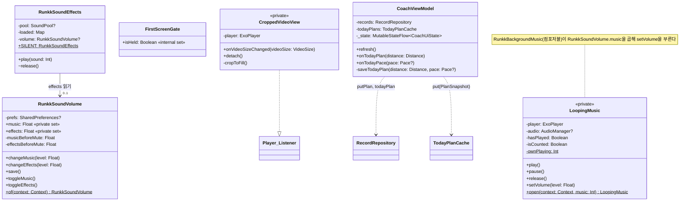

# 5.6 설계 결정 기록 (이어서: D-344~D-357, v0.19 소리·첫 화면·오늘 계획 페이스 반영)
> 작성: 2026-10-31 | 버전: v0.19 | 입력: srs.md v0.17(7.13.13 CR-82~CR-91, 판단 J-1~J-8, 신규 FR-234~FR-239·NFR-045~NFR-047·C-021, 바뀐 FR-007·FR-048·FR-073·FR-162), 사용자 결정 D139~D148(runkk-work/figma-1029/decisions-1029.md), 코드 S15P31A207-fig feature/runkk-figma-v1 242612e9(MR !53, 읽기만 함)

> [런크크 객체지향 분석·설계서](../design-oo.md) 목차 · 이전: [05-13-설계-결정-v0.18](05-13-설계-결정-v0.18.md) · 다음: [05-15-설계-결정-v0.20](05-15-설계-결정-v0.20.md)

이 조각은 srs v0.17(7.13.13)의 변경 요청 CR-82~CR-91을 설계에 옮긴다. 모두 이미 구현되어 있으므로 원칙은 v0.13·v0.15·v0.16과 같다: **설계서를 코드에 맞추고**, 클래스·함수·패키지 이름은 코드와 글자 그대로 같게 적는다. 코드는 바꾸지 않았다. 코드 기준은 242612e9("배경 음악·효과음, 소리 설정, 첫 화면 미리 준비, 오늘 계획 목표 페이스 (D139~D148)", 기준 0ca948f8)다. 서버·REST·실시간 계약은 바뀌지 않았다(오늘 계획 저장 PUT /plans/{date}는 목표 페이스를 이미 받았고 GET /plans/today는 이미 돌려주었다). 바뀐 곳은 앱의 다섯 패키지(core.designsystem, app, ui.me, ui.home, ui.record)다. 시퀀스 SQ-39~SQ-42와 상태도 2.4.23(배경 음악 재생기)·2.4.24(스플래시)는 [02-05](02-05-동적-모델-v0.19.md)에 있다. 06-06이 조각 상한을 넘어 있어 클래스 명세는 이 조각 3절에 쓰고 06-06에는 이 조각을 가리키는 줄만 더했다.

## 1. 결정 표 (D-344~D-357)

| ID | 요구(CR) | 결정 | 근거(코드) | 버린 대안 |
|----|----------|------|-----------|-----------|
| D-344 | FR-234, NFR-045 (CR-82) | **배경 음악은 core.designsystem의 컴포저블 `RunkkBackgroundMusic(music, volume, isPlaying)` 하나로 튼다.** 부르는 자리가 있는 동안만 재생기가 살아 있다(`remember(music)`로 열고 `DisposableEffect`로 놓는다). 재생기는 같은 파일의 private 클래스 `LoopingMusic`이고 ExoPlayer를 `REPEAT_MODE_ONE`으로 열어 다음 반복을 미리 읽으므로 끝과 처음이 이어진다(NFR-045). 틀 조건은 `LifecycleResumeEffect(player, isCovered, isPlaying)`: 재개 상태이고 `LocalCoveredBySplash`가 거짓이고 isPlaying이 참이면 `play()`, 깨지면 `pause()`(그 자리에서 멈춤). 음량은 `SideEffect`에서 `volume × RunkkSoundVolume.music`. 열지 못하거나(`open`이 null) 미리보기(`LocalInspectionMode`)면 아무것도 하지 않는다. 상태도 2.4.23 | RunkkBackgroundMusic.kt | 화면마다 MediaPlayer(isLooping은 되감는 사이 끊긴다), 앱 Service로 재생(포그라운드 알림이 필요 없는 장식 소리에 과하다) |
| D-345 | FR-234 (CR-82, J-7) | **홈 음악은 앱 전역 `RunkkNavHost`(app)에 하나 두고, 멈출 화면은 `isMusicRoute(top: NavKey?)`로 가린다.** `if (loggedIn) RunkkBackgroundMusic(R.raw.home_bgm, isPlaying = isMusicRoute(top))`. `isMusicRoute`는 `Routes.Key`이면 AUTH_ROUTES(LOGIN·SIGN_UP·GUEST_START)와 RUN이 아닐 때 참, `Routes.BattleRunning`·`Routes.CrewRunLobby`면 거짓, 나머지는 참이다. 화면이 바뀌어도 재생기는 같은 것이라 이어 튼다(FR-234 "화면을 옮겨도 끊지 않고"). 측정 화면에서는 isPlaying만 거짓이 되어 멈춘 자리에서 이어 튼다. 크루런은 대기실·진행·결과 전체가 CrewRunLobby 경로라 모두 멈춘다(J-7, 2차 배포 때 다시 확인). 로그인 음악은 로그인 화면 하나에만 있으므로 `LoginScreen`(ui.me)이 `RunkkBackgroundMusic(R.raw.login_bgm)`을 부른다. 음원 위치: home_bgm.m4a는 app 모듈, login_bgm.m4a는 feature/me 모듈 res/raw | RunkkNavHost.kt:158·231-235, LoginScreen.kt:110-111, MusicRouteTest | 화면마다 음악을 부름(화면 전환마다 재생기를 새로 열어 끊기고 처음부터 튼다), FeatureEntry에 "음악 여부"를 더함(기능 모듈 11개를 고치고 측정 화면 판정이 흩어진다) |
| D-346 | FR-235 (CR-82) | **오디오 포커스를 가져가지 않고, 처음 틀 때만 다른 앱 음악을 확인한다.** `setAudioAttributes(MUSIC, false)`(handleAudioFocus = false, 용도 USAGE_GAME·내용 MUSIC). `LoopingMusic.play()`는 `hasPlayed`가 거짓이고 `AudioManager.isMusicActive`가 참이고 `ownPlaying == 0`이면 틀지 않는다. `ownPlaying`은 companion의 private 계수(지금 틀고 있는 우리 재생기 수, 화면 스레드에서만 바꿈)이고 `count(isOn)`이 한 재생기당 한 번만 더하고 뺀다. 화면이 바뀌는 사이 앞 화면의 우리 음악(예: 로그인 음악)이 아직 나오고 있어도 다른 앱 음악으로 보지 않게 하려는 것이다. 한 번 튼 뒤 멈췄다 이어 틀 때는 확인하지 않는다 | RunkkBackgroundMusic.kt:58-103 | 오디오 포커스 요청(다른 앱 음악을 멈추거나 줄인다, FR-235 위반), 틀 때마다 확인(우리 음악이 멈춘 사이 다른 앱이 아닌데도 막힐 수 있다), 전역 객체에 재생 수를 둠(공통 결합, 이 클래스 안 private이면 충분하다) |
| D-347 | C-021, NFR-045 (CR-82, CR-83) | **반복 재생 라이브러리는 media3-exoplayer 1.11.1이고 `:core:ui` 모듈에만 `implementation`으로 둔다.** core.designsystem의 public API(RunkkBackgroundMusic, RunkkLoopingVideo)는 `@RawRes Int`, `Float`, `Boolean`, `Modifier`만 받아 ExoPlayer 형식이 밖으로 나가지 않는다. 그래서 ui.me·app은 media3를 모르고 Gradle 의존도 늘지 않는다. 패키지 사이 화살표는 그대로이고 core.designsystem의 외부 의존만 하나 는다(Kakao 지도 SDK에 이어 둘째, 5절). 앱 크기 약 2MB 증가(RM-17-2) | core/ui/build.gradle.kts:35-36, libs.versions.toml media3 = "1.11.1" | MediaPlayer.setNextMediaPlayer(기기마다 이음매가 다르다), 음악에 SoundPool(긴 음원을 못 담는다), `api(...)`로 노출(모든 기능 모듈이 ExoPlayer에 묶인다) |
| D-348 | NFR-045, NFR-044 (CR-83) | **로그인 배경 영상은 core.designsystem `RunkkLoopingVideo(video, modifier)`로 옮긴다.** ui.me의 `LoopingVideoView`(MediaPlayer + TextureView)는 지웠다. 재생기는 소리 0, `REPEAT_MODE_ONE`, 재개 때만 재생(`LifecycleResumeEffect`가 play·pause). 표면은 같은 파일의 private 클래스 `CroppedVideoView`(TextureView, Player.Listener)가 영상 크기와 화면 크기가 바뀔 때 `cropToFill()`로 가운데 기준 잘라 채운다. `LoginVideoBackground`(ui.me)는 첫 장면 그림을 깔고, 움직임 줄이기나 미리보기가 아니면 그 위에 RunkkLoopingVideo를 그린다(NFR-044 규칙 그대로). 같은 재생 라이브러리를 쓰는 요소를 한 패키지에 모아 D-347의 의존 범위를 지킨다 | RunkkLoopingVideo.kt, LoginVideoBackground.kt | ui.me에 ExoPlayer를 직접 씀(재생 라이브러리 의존이 두 모듈로 번진다), MediaPlayer 유지(반복 지점 멈칫, CR-83) |
| D-349 | FR-237 (CR-85, J-2) | **소리 크기는 서버 설정이 아니라 기기 값이고, core.designsystem `RunkkSoundVolume`이 가진다.** 속성 `music`·`effects`(0..1, Compose 상태라 읽는 쪽이 다시 그려진다)와 private `musicBeforeMute`·`effectsBeforeMute`. 저장은 SharedPreferences 파일 `runkk_sound`의 키 music, effects, music_before_mute, effects_before_mute(기본 1). 앱 하나에 하나(`companion of(context)`, `@Volatile` + `synchronized`)라 설정에서 바꾸면 틀고 있는 배경 음악에 바로 반영된다. 화면은 `rememberSoundVolume()`으로 얻는다(미리보기는 저장하지 않는 `RunkkSoundVolume(null)`). 로그아웃 때 지우는 설정 사본(`SettingsRepository.clear()`, DataStore)과 다른 파일이라 로그아웃해도 남는다. **core.designsystem에 두는 이유**(v0.20: 758de88f부터 하위 패키지 core.designsystem.media, D-358): 값을 읽는 쪽이 같은 패키지의 재생 요소(LoopingMusic, RunkkSoundEffects)이고, domain.settings에 두면 core.designsystem → domain.settings(5.1.2 정렬 순서를 거스르는 계층 역행)가 생기거나 모든 호출자가 크기를 매개변수로 넘겨야 한다. core.ui 모듈에는 Hilt가 없어 앱 하나 보장은 companion으로 한다 | RunkkSoundVolume.kt | SettingsRepository의 설정 키로 둠(서버로 동기화되고 로그아웃 때 지워진다, D144·J-2 위반), data.\*에 새 포트·어댑터(**v0.20 정정, M69**: 처음에는 "domain 포트를 재생 요소가 볼 수 없어 화살표가 거꾸로 선다"로 버렸으나 틀린 이유다. app이 domain.settings 포트에서 읽어 composition local로 내려 주면 화살표 0으로 된다. 버린 실제 이유는 비용(포트·어댑터·바인딩·설정 ViewModel·제공 자리)이고 2차 배포 후보로 둔다, [05-15](05-15-설계-결정-v0.20.md) 2절), 화면마다 SharedPreferences를 따로 읽음(바꾼 값이 틀고 있는 음악에 늦게 들린다) |
| D-350 | FR-237, FR-238 (CR-85) | **막대는 끄는 동안 화면 값만 바꾸고 손을 뗄 때 저장하며, 스피커 아이콘은 누를 때마다 바로 저장한다.** `changeMusic(level)`·`changeEffects(level)`는 `coerceIn(0f, 1f)` 뒤 상태만 바꾸고, `save()`가 네 값을 한 번에 `apply()`한다. `toggleMusic()`·`toggleEffects()`: 0보다 크면 끄기 전 크기를 기억하고 0, 0이면 기억한 크기(0보다 클 때)나 1로 켜고 `save()`. 막대를 0으로 끌어 놓은 것도 꺼짐이다(아이콘은 `level <= 0f`로 VolumeOff). 화면 `SoundSection()`(ui.me, SoundSettings.kt)은 설정 앱 페이지에서 표시 묶음(DisplaySection) 다음에 오고, 두 줄 `VolumeRow(title, level, actions, tag)`의 행동 셋을 private 클래스 `VolumeActions(onChange, onDone, onToggle)`로 묶어 매개변수 4개를 지킨다. 읽기 문구는 "제목, n퍼센트"와 "배경음악 끄기/켜기" | RunkkSoundVolume.kt:24-63, SoundSettings.kt, AppSettings.kt:41 | 끄기를 별도 Boolean으로 둠(막대 0과 꺼짐이 두 상태로 갈린다), 끄는 동안 매번 저장(디스크 쓰기가 프레임마다 난다) |
| D-351 | FR-236, NFR-046, NFR-044 (CR-84, J-4) | **효과음은 core.designsystem `RunkkSoundEffects`(SoundPool)로 미리 읽어 두고 누르는 즉시 낸다.** `rememberSoundEffects(vararg sounds)`가 SoundPool(최대 동시 2, USAGE_GAME·SONIFICATION)을 만들어 소리마다 `load`하고 화면을 떠나면 `release()`한다. `play(sound)`는 기다리지 않고 돌아오며, 아직 못 읽었거나 열지 못했으면(`SILENT`) 소리 없이 넘어간다. 음량은 `RunkkSoundVolume.effects`. 홈 `RoomAvatar`는 `LocalAvatarCharacter`가 FEMALE이면 `home_jump_female`, 아니면 `home_jump_male`을 고르고(J-4, FR-162 내 화면 규칙), 움직임 줄이기이거나 뛰는 중이면 누름을 무시하고, 아니면 `sounds.play(jumpSound)` 뒤 뛴다. 음원 앞 무음 0.56초를 잘라 반응 시간(NFR-046 0.2초 제안)을 맞췄다. 아바타 꾸미기가 열려 있으면(2차 배포) 기존대로 꾸미기로 가고 소리가 없다(J-8) | RunkkSoundEffects.kt, HomeScreen.kt:593-612, feature/home res/raw | 효과음에 ExoPlayer(준비 지연이 있어 누름과 소리가 벌어진다), 누를 때 읽기(첫 누름이 늦다) |
| D-352 | FR-239 (CR-86) | **첫 화면 준비는 composition local 문(`FirstScreenGate`)으로 알린다.** core.designsystem: `@Stable class FirstScreenGate { var isHeld: Boolean (internal set) }`, `LocalFirstScreenGate = staticCompositionLocalOf<FirstScreenGate?> { null }`, `@Composable HoldSplashUntil(isReady: Boolean)`(문이 있으면 `isHeld = !isReady`, 떠나면 false). app `RunkkAppContent`: 시작 경로를 알면 RunkkNavHost를 스플래시 아래에 그리고 `LocalFirstScreenGate provides gate`, `LocalCoveredBySplash provides !isRevealed`를 내려 준다. `canReveal = start != null && isIntroDone && !gate.isHeld`가 참이면 `withFrameNanos {}` 한 프레임 뒤 `isRevealed = true`(처음 그린 프레임의 붙잡기가 돈 뒤에 걷는다). 워드마크가 끝난 뒤 `FIRST_SCREEN_MAX_WAIT_MS = 4_000L`이 지나면 붙잡혀 있어도 걷는다. `RunkkSplash`는 `pointerInput`으로 모든 누름을 소비한다. 홈 `HomeScreen`은 `HoldSplashUntil(isReady = !state.isLoading)`(본인 요약·성별을 포함한 첫 읽기). 로그인 화면은 붙잡지 않는다. **composition local로 둔 이유**: app은 ui.\*를 import하지 않는다(design-review M35, Konsist). 홈의 준비 상태를 app이 알 길은 그림 트리를 따라 내려 준 문뿐이고, 문은 표현 공통 형식이라 core.designsystem에 두면 새 화살표가 없다(app → core.designsystem, ui.home → core.designsystem은 기존 쌍). 문이 없는 곳(미리보기·시험)에서는 HoldSplashUntil이 아무것도 하지 않는다. 상태도 2.4.24, SQ-39 | FirstScreenGate.kt, RunkkAppContent.kt:37-114, HomeScreen.kt:189-190 | Android SplashScreen API keepOnScreenCondition(Activity가 홈 ViewModel 상태를 몰라 같은 문제가 남고 워드마크 애니메이션과 따로 논다), FeatureEntry에 "준비됨" 연산 추가(기능 모듈 11개 변경), domain에 첫 화면 준비 Flow(표현 관심사를 도메인에 둔다) |
| D-353 | FR-162 (CR-86, CR-87) | **성별을 처음 읽기 전에는 아바타 자리를 비우고, 여자 기본 캐릭터 전신은 발 기준 0.9배로 그린다.** 스플래시 없이 홈에 들어오는 경로(로그인 직후)를 위해 `RoomAvatar`가 `state.isHeaderLoading` 동안 `graphicsLayer { alpha = 0f }`로 자리만 둔다. `RunkkAvatar`(core.designsystem)는 아바타 꾸미기가 닫혀 있고 `character == AvatarCharacter.FEMALE`이고 `expression != AvatarExpression.FACE`이면 `graphicsLayer`의 scaleX·scaleY를 `FEMALE_FIGURE_SCALE = 0.9f`(internal), 기준점 `FEET = TransformOrigin(0.5f, 1f)`(private)로 줄인다. 얼굴(프로필 원)은 그대로다 | HomeScreen.kt:636-641, RunkkAvatar.kt:35-61 | 그림 파일을 다시 자름(자산이 두 벌이 된다), 남자 그림을 먼저 보였다가 바꿈(CR-86이 없앤 깜빡임) |
| D-354 | FR-073, FR-048 (CR-89) | **오늘 계획 목표 페이스는 `CoachViewModel.onTodayPace(pace: Pace?)`가 받는다.** 상태 `todayPace`를 먼저 바꾸고, 오늘 계획 거리(`progress.days`의 오늘 `planned`)가 있으면 `saveTodayPlan(planned, pace)`로 바로 저장한다. 없으면 상태에만 두고, 거리를 고를 때 `onTodayPlan(distance) = saveTodayPlan(distance, state.todayPace)`가 함께 저장한다. private `saveTodayPlan(distance, pace)`는 기존 `save(done, shouldReload = true, call)`로 `RecordRepository.putPlan(today, distance, pace)`를 부르고 성공하면 `TodayPlanCache.put(PlanSnapshot(distance, pace))`(워치 시작 화면·자유런 목표). 안내 문구는 페이스가 있으면 record_coach_today_plan_pace_saved. `refresh()`는 이행 현황(`planProgress`)에 페이스가 없어 `RecordRepository.todayPlan()`을 함께(async) 읽고 `todayPace = pace ?: 지난 값`으로 둔다. 화면: `CoachUiState.todayPace: Pace?`, `CoachActions.onTodayPace: (Pace?) -> Unit`, private `TodayPlanCard(planned, pace, onTodayPlan, onTodayPace)`(거리 RunkkSegmentRow 3·5·7·10km + 목표 페이스 RunkkSelectField, 선택지 null(없음) + `PACE_CHOICES = (180..600 step 10)`). 측정 쪽 `FreeRunGoal`·`Pace.isSlowerThanBy`와 서버는 바뀌지 않았다(FR-044·FR-048·FR-049 규칙 그대로). 새 화살표 없음(ui.record → core.model·domain.record·domain.run은 기존 쌍). SQ-41 | CoachViewModel.kt:47-91, CoachUiState.kt, AnalysisScreens.kt:456-475·580-617·657 | 페이스를 숫자 입력(형식 검사가 늘고 1차 배포 화면에 입력 칸이 없다), 페이스만 저장하는 API(서버 변경), 거리 없이 페이스를 고르면 거부(CR-89가 "기억했다가 함께 저장"으로 정함) |
| D-355 | FR-007 (CR-90, J-5) | **프로필 편집 저장이 성공하면 `ProfileEditViewModel.onSave`는 `isSaving`을 풀지 않는다.** 저장 성공 뒤 `ProfileEditEvent.Saved`로 화면이 닫히는 전환 사이 다시 누르면 `onSave`의 `if (s.isSaving) return`이 받지 않는다. 실패면 지금처럼 풀어 다시 시도할 수 있다. 이 화면은 곧 닫히므로 상태를 되돌릴 필요가 없다 | ProfileEditViewModel.kt:103-123 | 화면에서 시간 기준 디바운스(느린 기기에서 전환이 길면 다시 샌다), 저장 단추를 성공 뒤 숨김(전환 중 깜빡임) |
| D-356 | NFR-047 (CR-91) | **글자를 담는 칸은 고정 높이 대신 최소 높이로 둔다.** 디자인 시스템에 `RunkkLimePill(text, modifier, textStyle)`(최소 높이 40, 모서리 20, 라임 채움, 누르지 않는 값 알약)을 더하고 홈 `BalancePill`이 쓴다(높이 40 고정 글자 칸에서 1.3배 글자 아래가 잘렸다). 구현 지침 13.2에 같은 규칙을 더했다. 나머지 1차 배포 화면 13개의 점검은 시험 대상이다(srs 구현 대조) | RunkkButtons.kt:336-356, HomeScreen.kt:358-385 | 글자 크기를 dp로 고정(기기 글자 크기 설정을 무시해 접근성 위반) |
| D-357 | (구조, 검증) | 패키지·한 파일 규칙·자산·검증. (1) 새 패키지 0, **새 화살표 0**(서버 65개·179개, 폰 150개, 워치 5개 그대로). 새 import는 모두 기존 쌍 위에 있다: app → core.designsystem(FirstScreenGate·LocalFirstScreenGate·LocalCoveredBySplash·RunkkBackgroundMusic), ui.home → core.designsystem(HoldSplashUntil·rememberSoundEffects·RunkkLimePill·AvatarCharacter·LocalAvatarCharacter), ui.me → core.designsystem(RunkkBackgroundMusic·RunkkLoopingVideo·rememberSoundVolume·RunkkIcons), ui.record → core.designsystem·core.model(RunkkSelectField·Pace). (2) 한 파일 규칙(D-112): 새 파일 6개(RunkkBackgroundMusic.kt, RunkkLoopingVideo.kt, RunkkSoundEffects.kt, RunkkSoundVolume.kt, FirstScreenGate.kt, SoundSettings.kt)는 최상위 타입이 각각 하나(LoopingMusic, CroppedVideoView, RunkkSoundEffects, RunkkSoundVolume, FirstScreenGate, VolumeActions)이고 나머지는 최상위 함수·값이다. Konsist TC-6583이 표현 계층 전체에 건다. (3) Runimal 그림 8종(runimal_alley_squirrel, strolling_cat, steady_camel, walking_puppy, picnic_rabbit, wheel_hamster, commuter_turtle, pillar_elephant)의 흰 배경 제거는 자산 교체라 설계 변경이 없다(CR-88, J-6). (4) 시험: app `MusicRouteTest`(isMusicRoute 세 경우), Roborazzi 기준 12장 갱신(A4_home_loading, F4_settings_guest, me_settings_app, me_settings_app_light, record_coach, Runimal 7장), 전체 검증 안드로이드 1,465/0, 서버 1,679/0 | ArchitectureTest.kt:105-139, MusicRouteTest.kt | |

## 2. 패키지별 변경 명세 (코드에 맞춤)

서버·DB·REST·실시간 계약: 변경 없음.

### 2.1 앱

| 패키지 · 요소 | 바뀐 것 |
|---------------|---------|
| core.designsystem · RunkkBackgroundMusic(신규 파일) | + `@Composable fun RunkkBackgroundMusic(@RawRes music: Int, volume: Float = 1f, isPlaying: Boolean = true)`, + `val LocalCoveredBySplash = compositionLocalOf { false }`, + private class `LoopingMusic`(D-344, D-346) |
| core.designsystem · RunkkLoopingVideo(신규 파일) | + `@Composable fun RunkkLoopingVideo(@RawRes video: Int, modifier: Modifier = Modifier)`, private `openLoopingVideo`, private class `CroppedVideoView`(D-348) |
| core.designsystem · RunkkSoundEffects(신규) | + `@Stable class RunkkSoundEffects`, + `@Composable fun rememberSoundEffects(@RawRes vararg sounds: Int): RunkkSoundEffects`(D-351) |
| core.designsystem · RunkkSoundVolume(신규) | + `@Stable class RunkkSoundVolume`, + `@Composable fun rememberSoundVolume(): RunkkSoundVolume`(D-349, D-350) |
| core.designsystem · FirstScreenGate(신규) | + `@Stable class FirstScreenGate`, + `val LocalFirstScreenGate`, + `@Composable fun HoldSplashUntil(isReady: Boolean)`(D-352) |
| core.designsystem · RunkkButtons | + `@Composable fun RunkkLimePill(text: String, modifier: Modifier = Modifier, textStyle: TextStyle = RunkkTextStyles.text(13, FontWeight.Black))`(D-356) |
| core.designsystem · RunkkAvatar | + `internal const val FEMALE_FIGURE_SCALE = 0.9f`, private `FEET`. 여자 전신만 줄임(D-353) |
| core.designsystem · RunkkIcons | + `Volume`, `VolumeOff`(스피커, 스피커와 X) |
| core.designsystem (모듈 :core:ui) | + 외부 의존 `implementation(libs.androidx.media3.exoplayer)`(1.11.1, D-347) |
| app · RunkkAppContent | 첫 화면을 스플래시 아래에 미리 그림, 상태 `isRevealed`·`gate`, private `FIRST_SCREEN_MAX_WAIT_MS = 4_000L`, `RunkkSplash`가 누름 소비(D-352) |
| app · RunkkNavHost | + 로그인한 동안 `RunkkBackgroundMusic(R.raw.home_bgm, isPlaying = isMusicRoute(top))`, + `internal fun isMusicRoute(top: NavKey?): Boolean`(D-345). 자원 app/res/raw/home_bgm.m4a |
| ui.me · LoginScreen | + `RunkkBackgroundMusic(R.raw.login_bgm)`(원본 음량). 자원 feature/me res/raw/login_bgm.m4a |
| ui.me · LoginVideoBackground | − private class `LoopingVideoView`(MediaPlayer). 영상은 `RunkkLoopingVideo`(D-348) |
| ui.me · SoundSettings(신규 파일) | + `internal fun SoundSection()`, private `VolumeRow`, private class `VolumeActions`, `MUSIC_VOLUME_TAG = "settings-music-volume"`, `EFFECT_VOLUME_TAG = "settings-effect-volume"`(D-350) |
| ui.me · AppSettings | 표시 묶음 다음에 `SoundSection()` |
| ui.me · ProfileEditViewModel | `onSave` 성공 때 `isSaving`을 풀지 않음(D-355) |
| ui.home · HomeScreen | + `HoldSplashUntil(isReady = !state.isLoading)`(D-352). `RoomAvatar`: 효과음(D-351), `isHeaderLoading` 동안 투명(D-353). `BalancePill` → `RunkkLimePill`(D-356). 자원 feature/home res/raw/home_jump_female.m4a·home_jump_male.m4a |
| ui.record · CoachViewModel | + `fun onTodayPace(pace: Pace?)`, private `saveTodayPlan(distance: Distance, pace: Pace?)`. `onTodayPlan(distance)`이 고른 페이스를 함께 저장. `refresh()`가 `todayPlan()`을 함께 읽음(D-354) |
| ui.record · CoachUiState, CoachActions, TodayPlanCard | + `todayPace: Pace?`, + `onTodayPace: (Pace?) -> Unit`, TodayPlanCard 매개변수 4개(planned, pace, onTodayPlan, onTodayPace), `PACE_CHOICES` |

## 3. 클래스 명세 (설계 수준, v0.19 신규·변경)

모든 속성은 private이다(Compose 상태 속성은 `private set`). public(모듈 공개) 연산만 시그니처를 적고, 컴포저블은 반환이 Unit인 함수로 적는다.

| 클래스 · 함수 | 패키지 | 책임(한 문장) | 속성 | 연산(시그니처 · 전후 조건) |
|---------------|--------|---------------|------|---------------------------|
| RunkkBackgroundMusic (컴포저블) | core.designsystem | 부르는 자리가 있는 동안 음악 하나를 반복해 튼다 | (없음. 재생기는 remember) | `RunkkBackgroundMusic(@RawRes music: Int, volume: Float = 1f, isPlaying: Boolean = true)`. 전: 없음. 후: 재개·덮이지 않음·isPlaying이면 재생 중, 아니면 멈춤. 열지 못하면 아무 일 없음 |
| LocalCoveredBySplash | core.designsystem | 스플래시가 덮고 있는지 알린다 | `compositionLocalOf { false }` | RunkkAppContent만 provides |
| LoopingMusic (private) | core.designsystem | 반복 재생기 하나의 재생·멈춤을 맡는다 | player: ExoPlayer, audio: AudioManager?, hasPlayed: Boolean, isCounted: Boolean, companion ownPlaying: Int | `play()`(이미 재생이면 무시, 처음이면 D-346 확인), `pause()`, `release()`, `setVolume(level: Float)`, companion `open(context: Context, @RawRes music: Int): LoopingMusic?`(예외면 null, 로그만) |
| RunkkLoopingVideo (컴포저블) | core.designsystem | 소리 없는 영상을 반복해 꽉 채워 그린다 | (없음) | `RunkkLoopingVideo(@RawRes video: Int, modifier: Modifier = Modifier)`. 열지 못하면 그리지 않음 |
| CroppedVideoView (private) | core.designsystem | 영상을 가운데 기준으로 잘라 채운다 | player: ExoPlayer | `onVideoSizeChanged(videoSize: VideoSize)`, `onSizeChanged(w, h, oldw, oldh)`(프레임워크 재정의), `detach()` |
| RunkkSoundEffects | core.designsystem | 미리 읽은 짧은 효과음을 낸다 | pool: SoundPool?, loaded: Map<Int, Int>, volume: RunkkSoundVolume? | `play(@RawRes sound: Int)`(기다리지 않음, 못 읽었으면 무음), internal `release()`, companion `SILENT`. 생성자는 internal(매개변수 3) |
| rememberSoundEffects | core.designsystem | 효과음 묶음을 화면 수명에 묶는다 | `MAX_EFFECT_STREAMS = 2` | `rememberSoundEffects(@RawRes vararg sounds: Int): RunkkSoundEffects`. 미리보기·실패면 SILENT |
| RunkkSoundVolume | core.designsystem | 배경 음악과 효과음의 기기 소리 크기를 가진다 | music: Float, effects: Float(0..1, 기본 1), musicBeforeMute, effectsBeforeMute, prefs: SharedPreferences?. 상수 FILE "runkk_sound", 키 4개, FULL 1f | `changeMusic(level: Float)`, `changeEffects(level: Float)`(후: 0..1), `save()`(후: 네 값 저장), `toggleMusic()`, `toggleEffects()`(후: D-350, 저장됨), companion `of(context: Context): RunkkSoundVolume`(앱 하나). 생성자는 internal(prefs null이면 저장 안 함) |
| rememberSoundVolume | core.designsystem | 화면에 앱 소리 크기를 준다 | | `rememberSoundVolume(): RunkkSoundVolume` |
| FirstScreenGate | core.designsystem | 첫 화면이 스플래시를 붙잡고 있는지 나타낸다 | isHeld: Boolean(internal set) | (상태만) |
| LocalFirstScreenGate, HoldSplashUntil | core.designsystem | 첫 화면이 준비될 때까지 스플래시를 붙잡는다 | `staticCompositionLocalOf<FirstScreenGate?> { null }` | `HoldSplashUntil(isReady: Boolean)`. 후: 문이 있으면 isHeld = !isReady, 화면을 떠나면 false |
| RunkkLimePill | core.designsystem | 누르지 않는 값을 라임 알약으로 보인다 | | `RunkkLimePill(text: String, modifier: Modifier = Modifier, textStyle: TextStyle = …)`. 최소 높이 40 |
| RunkkAppContent | app | 시작 경로를 정하고 첫 화면이 준비되면 스플래시를 걷는다 | startRoute, isIntroDone, isRevealed(remember), gate: FirstScreenGate | `RunkkAppContent(featureEntries, loggedIn: Boolean?, onExit, modifier, pendingInvite, onInviteDone)`(시그니처 그대로). 상태도 2.4.24 |
| isMusicRoute | app | 홈 음악을 트는 경로인지 가린다 | AUTH_ROUTES | `internal fun isMusicRoute(top: NavKey?): Boolean` |
| SoundSection, VolumeRow, VolumeActions | ui.me | 소리 크기 막대와 스피커 아이콘을 그린다 | VolumeActions: onChange: (Float) -> Unit, onDone: () -> Unit, onToggle: () -> Unit | `internal fun SoundSection()`, private `VolumeRow(@StringRes title: Int, level: Float, actions: VolumeActions, tag: String)` |
| CoachViewModel | ui.record | 목표·코치 화면 상태를 만든다 | records, todayPlans, today, weekStart, _state | + `onTodayPace(pace: Pace?)`(후: todayPace = pace, 거리가 있으면 저장 요청), `onTodayPlan(distance: Distance)`(후: 고른 페이스와 함께 저장 요청), private `saveTodayPlan(distance: Distance, pace: Pace?)`. 저장 중이면 새 저장을 받지 않음(save) |

## 4. 기능 모델 대응 (3.2 보충)

srs J-1대로 DFD는 바뀌지 않았다. 새 FR의 자료 흐름은 없거나(화면 표현) 기기 안에서 끝난다(J-2). 그래서 3.2 프로세스 ↔ 연산 표에 새 행은 없고, 요구 ↔ 연산 대응은 부록 A가 맡는다.

| DFD 프로세스 | 요구 | 담당 연산 | 비고 |
|--------------|------|-----------|------|
| 3.7.1 목표 설정 | FR-073 | 서버 `CoachService.putPlan`, `RunningGoal.putPlan`(그대로) ← 앱 `CoachViewModel.onTodayPace`·`onTodayPlan` → `RecordRepository.putPlan(today, distance, pace)` | 목표설정요청의 (목표페이스)가 이제 앱에서 채워진다 |
| 2.3 측정 안내 | FR-048, FR-044 | `FreeRunGoalUseCase.current`, `FreeRunGoal.of`, `Pace.isSlowerThanBy`(그대로) | 확인만 |
| 1.4 설정(기기 안) | FR-237, FR-238 | `RunkkSoundVolume.changeMusic·changeEffects·save·toggleMusic·toggleEffects` | 저장소 아님(J-2) |
| 1.1, 3.1 (자료 흐름 없음) | FR-234, FR-235, FR-239 | `RunkkBackgroundMusic`, `LoopingMusic.play`, `isMusicRoute`, `HoldSplashUntil`, `RunkkAppContent` | |
| 6.6 (자료 흐름 없음) | FR-236, FR-162 | `RunkkSoundEffects.play`, `RunkkAvatar`(FEMALE_FIGURE_SCALE) | |

## 5. 패키지 의존과 Fan-Out 변화

| 항목 | v0.18 | v0.19 | 근거 |
|------|-------|-------|------|
| 서버 패키지·화살표 | 65개·179개 | 그대로 | 서버 변경 없음 |
| 앱 폰 화살표 | 150개(Konsist 허용 표) | **그대로 150개** | D-357 (1). 새 import 쌍 0 |
| 워치 화살표 | 5개 | 그대로 | |
| 앱 Fan-Out | 최대 7(ui.home·ui.record·ui.battle), app 6, ui.me 5, core.designsystem 1 | 그대로 | 새 화살표가 없다 |
| core.designsystem 외부 라이브러리 | Compose, Kakao 지도 SDK, lifecycle-runtime-compose | **+ media3-exoplayer 1.11.1** | D-347. 패키지 Fan-Out(내부 패키지)에는 들지 않는다. `implementation`이라 이 모듈을 쓰는 모듈로 새지 않는다 |
| core.designsystem 안의 새 결합 | | RunkkBackgroundMusic·RunkkSoundEffects → RunkkSoundVolume(같은 패키지, 크기 읽기), RunkkBackgroundMusic → LocalCoveredBySplash | 패키지 안 |
| 순환·계층 역행·안정성 역전 | 0·0·0 | 0·0·0 | 화살표가 그대로 |
| 클래스 Fan-Out(생성자 협력 객체) | | CoachViewModel 2(그대로), LoopingMusic 2(ExoPlayer, AudioManager), RunkkSoundEffects 3(SoundPool, Map, RunkkSoundVolume) | 상한 7 이하 |

판정 메모(`/sw-design review` 대상): core.designsystem은 지금까지 화면 요소만 가졌는데 이번에 **기기 저장(SharedPreferences, RunkkSoundVolume)과 미디어 재생(ExoPlayer, SoundPool)** 이 들어왔다. 지금까지 기기 저장은 data.\* 패키지가 기술 하나마다 맡았다(12.4 응집도 행 "data.\*은 기술 하나마다 하나", 5.1.2 data.settings의 DataStoreSettingsRepository). 이번 것은 그 배치의 예외다. D-349가 이유(값을 읽는 쪽이 같은 패키지의 재생 요소, domain.settings로 가면 계층 역행)를 적었지만, 응집도가 "표현 공통"에서 "표현 공통 + 소리"로 넓어졌는지는 검증이 판정한다. 나눌 후보: core.designsystem 안의 하위 패키지(예: core.designsystem.sound)로 묶거나 새 모듈 `:core:sound`로 떼는 것(화살표 app·ui.home·ui.me → core.sound 셋이 늘고 core.sound → core.designsystem 없음). **v0.20 정정(M70)**: `:core:sound`는 ui.home이 이미 Fan-Out 7(상한)이라 8이 되어 불허다. 검증 21장은 하위 패키지 core.designsystem.media(나안)를 권했고 758de88f가 반영했다(05-15 D-358).

## 6. 설계 판정 기준 점검 (바뀐 부분만)

| 기준 | 결과 | 근거 |
|------|------|------|
| 캡슐화(속성 private) | 합격 | RunkkSoundVolume의 music·effects는 `private set`, 끄기 전 크기·prefs는 private. FirstScreenGate.isHeld는 `internal set`(HoldSplashUntil만 바꾼다). LoopingMusic·CroppedVideoView·VolumeActions는 private 클래스. RunkkSoundEffects·RunkkSoundVolume 생성자는 internal이고 밖에서는 remember…·of로만 얻는다. CoachUiState.todayPace는 불변 data class 속성 |
| 한 문장 책임("그리고" 없음) | 합격 | 3절 표 |
| 매개변수 4개 이하(public 연산) | **새 연산 합격, 기존 함수 지적 4건**(v0.20 정정 M72) | 새 연산 최대는 4(TodayPlanCard, VolumeRow. VolumeRow는 VolumeActions로 묶어 4를 지켰다). RunkkBackgroundMusic 3, RunkkLimePill 3, RunkkLoopingVideo 2, RunkkSoundEffects 생성자 3. **지적(이번에 본문이 바뀐 기존 함수, 기본값 포함)**: `RunkkAppContent` 6(featureEntries, loggedIn, onExit, modifier, pendingInvite, onInviteDone), `RunkkNavHost` 8(+ startRoute, lockUnreleased), `RunkkAvatar` 6(faceKey, expression, modifier, faceLayers, colorFilter, character). 새로 쓰기 시작한 기존 요소 `RunkkSelectField` 7(label, options, selected, optionLabel, onSelect, modifier, placeholder). 모두 Compose 기본값 매개변수이고 이번 판에서 늘지 않았다. design-review 19장의 RunkkRunningFigure 8개 권고와 같은 종류라 판정은 `/sw-design review`에 넘긴다(묶을 후보: RunkkNavHost의 pendingInvite·onInviteDone을 초대 하나로, RunkkAvatar의 faceKey·faceLayers를 얼굴 하나로) |
| 중복 | 합격(1건 정리됨) | 반복 영상의 잘라 채우기(cropToFill)는 ui.me LoopingVideoView에서 core.designsystem CroppedVideoView로 **옮겼고** 옛 것을 지웠다(사본 0). 라임 알약 모양은 RunkkLimePillButton과 RunkkLimePill에 같은 값(최소 높이 40, 모서리 20, LimeFill)이 두 번 있다. 하나는 누르는 단추, 하나는 값 표시라 역할이 다르지만 모양 상수를 함께 쓰면 좋다 **(권고)**. ExoPlayer 여는 코드(빌더·RawResource URI·REPEAT_MODE_ONE·prepare)가 LoopingMusic.open과 openLoopingVideo에 비슷하게 두 번 있다(음악은 오디오 속성, 영상은 음량 0이 다르다) **(권고, 같은 파일 묶음으로 옮기면 한 곳)** |
| 다형성(타입 분기 반복) | 합격 | `isMusicRoute`의 경로 분기는 한 곳이다. 성별 분기(FEMALE이면)는 RoomAvatar의 효과음과 RunkkAvatar의 크기 두 곳이고 서로 다른 값이라 3곳 기준에 들지 않는다 |
| 상속 | 합격 | CroppedVideoView extends TextureView, implements Player.Listener(프레임워크 is-a). 깊이 변화 없음 |
| 계층(하위 → 상위 0) | 합격 | core.designsystem은 core.model 밖의 앱 패키지를 모른다. app은 ui.\*를 모르고 문(FirstScreenGate)으로만 받는다. 새 화살표 0 |
| 한 파일 규칙(D-112) | 합격 | D-357 (2) |
| 상태도 | 합격 | 상태가 바뀌는 새 객체 둘(LoopingMusic, RunkkAppContent 스플래시)에 상태도 2.4.23·2.4.24, 시작·종료 상태와 사건 이름 있음. RunkkSoundVolume은 값이 바뀔 뿐 생애주기가 없어 상태도를 두지 않는다 |
| 시퀀스 메시지 = 연산 이름 | 합격 | SQ-39~SQ-42의 메시지는 위 표의 이름 그대로다 |

## 7. 남은 확인 사항

| 항목 | 상태 | 다음 |
|------|------|------|
| core.designsystem의 저장·재생 포함(5절 판정 메모) | 설계 판단(D-349) | `/sw-design review` 판정 |
| 매개변수 5개 이상 기존 함수 4건(6절) | 지적 | `/sw-design review` 판정, 고치면 `/sw-implement` |
| 단위 시험이 없는 새 규칙: RunkkSoundVolume(toggle 기억 크기, 0이면 1로, coerceIn 경계), CoachViewModel.onTodayPace(거리 먼저·페이스 먼저 두 순서, null), RunkkAppContent(4초 상한, 붙잡기 한 프레임), LoopingMusic(처음만 다른 앱 확인, ownPlaying) | 코드에 MusicRouteTest와 스크린샷만 있다 | `/sw-test`에서 케이스(srs 7.13.13 시험 영향 목록)와 시험 대상으로 넣는다. LoopingMusic·RunkkSoundVolume은 SharedPreferences·AudioManager 대역을 넣을 수 있게 생성자가 이미 internal이다 |
| NFR-045(반복 이음매 50ms)·NFR-046(0.2초)·NFR-047(13화면) 측정 | 미측정 | 실기기 시험(`/sw-test` 시스템) |
| 크루런 경로 음악 멈춤 범위(J-7), 2차 배포 아바타 누름과 효과음(J-8) | 1차 배포 밖 | 2차 배포 공개 때 다시 정한다 |
| 음원 이용 권리(RM-17-1), 앱 크기(RM-17-2) | 위험 메모 | `/sw-plan` 위험 목록 |
| 코드 리뷰 | 242612e9 미리뷰 | `/sw-code-review` 11차(0ca948f8과 함께) |
