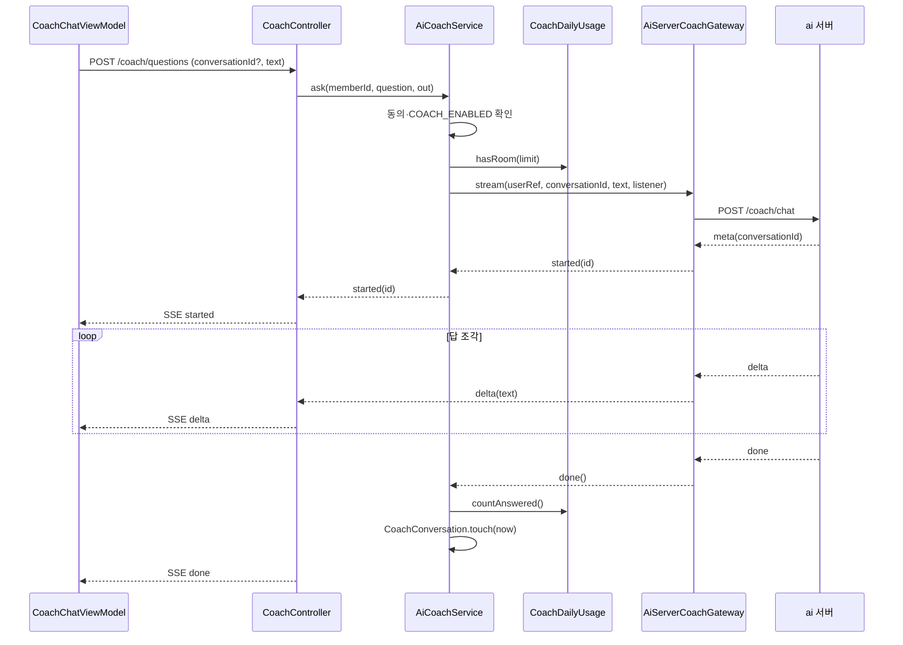
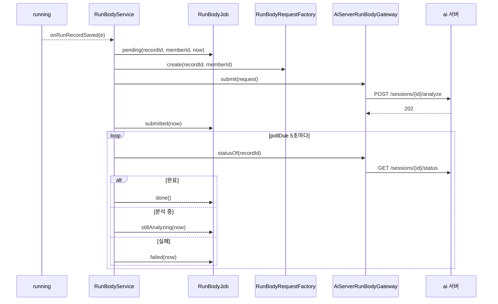
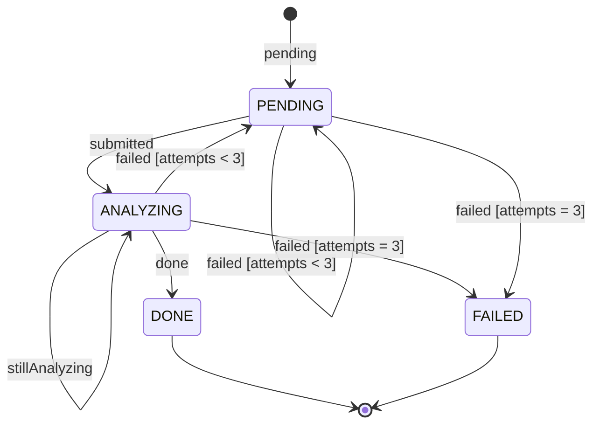
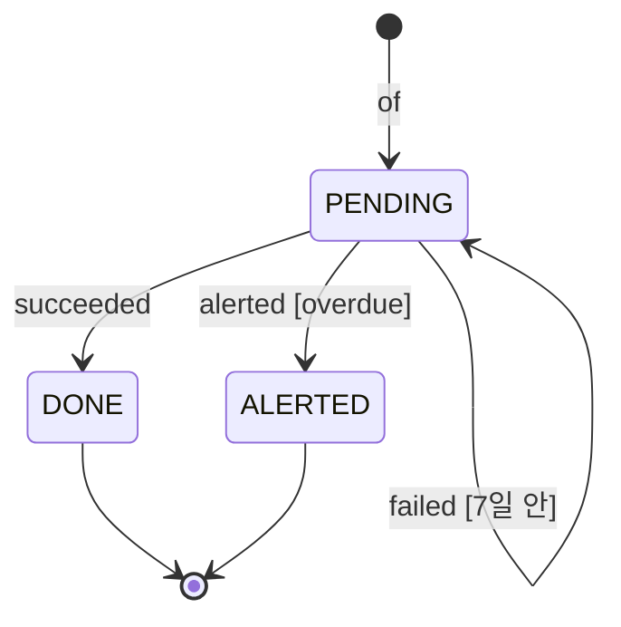
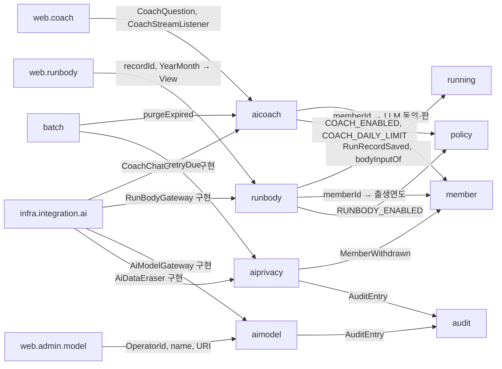

# 5.6 설계 결정 기록 (이어서: D-434~D-455, v0.26 srs v0.20 ai 서버 연결 반영 · D-474 v0.28 코치 하위 패키지)
> 작성: 2026-11-02 | 버전: v0.26 (v0.28 2026-11-03: D-474, 2.6 앱 표, 5절 앱 화살표. 입력 design-review/ai-coach-consent-박.md, 코드 develop 0b16eafe ArchitectureTest.kt; v0.34 2026-11-07: D-447·D-449 보정, 2.4 표, 5절 서버 하위 패키지, 8절 FR-272·FR-021. 입력 design-oo/ai-자료파기-박.md, design-review/ai-자료파기-박.md, 코드 develop 60c3385f) | 입력: srs.md v0.20 7.13.16(CR-110~CR-118, FR-261~FR-272, NFR-052·NFR-053, C-024), runkk-ai OpenAPI 0.1.0(runkk-work/ai-api/runkk-ai-openapi-0.1.0.json), 2026-11-02 사용자 결정 A10(관리툴 모델 관리는 관리 API만)·A11(코치 대화는 런바디 화면 안에서 연다), 코드 S15P31A207-watch feature/runkk-watch-v2(읽기만 함), schedule.md v0.8 12절 A2

> [런크크 객체지향 분석·설계서](../design-oo.md) 목차 · 이전: [05-18-설계-결정-v0.24](05-18-설계-결정-v0.24.md) · 다음: [05-20-설계-결정-v0.27](05-20-설계-결정-v0.27.md)

srs v0.20이 2차 배포 기능으로 ai 서버 연결 네 묶음(AI 코치, 런바디 ai 분석, 모델 관리, 탈퇴 ai 자료 파기)을 더했다. plan.md A9에 따라 11/13 기능 동결 전에 구현하고 1차 배포에서는 운영 기준값과 앱 잠금으로 닫는다. ai 서버(FastAPI)는 이미 있고 고치지 않는다(estimate.md A-18). 이 조각은 서버의 새 패키지 4개, infra.integration.ai의 게이트웨이 4개, 앱의 코치·런바디 화면을 설계한다. 기존 조각(06-*, 12, 13-14)의 문장은 지우지 않고, 이 조각의 표가 덧붙는다.

## 1. 결정 표 (D-434~D-455, D-474)

| ID | 근거 | 결정 |
|----|------|------|
| D-434 | FR-261~FR-264, 패키지 응집 | **서버 새 패키지 aicoach.** AI 코치 질문의 동의·한도·대화 색인을 맡는다. 기존 analysis.CoachService(F-13 러닝 코치, 계획·알림)와 이름이 겹치지 않게 `Ai` 접두를 쓴다 |
| D-435 | ai 명세에 대화 목록 경로가 없음(/coach/chat만) | **대화 색인은 서버가 가진다.** `CoachConversation`(대화ID, 회원ID, 첫 질문 40자, 마지막 질문 시각). 대화 본문은 ai 서버에만 있다. 대화ID는 ai 응답 첫 meta 사건에서 받는다 |
| D-436 | FR-264, 명세에 대화 단건 삭제 없음 | **보관 90일은 서버 색인 기준으로 지킨다.** 하루 한 번 마지막 질문 뒤 90일이 지난 색인을 지우고, 지운 대화ID로 오는 질문은 서버가 막는다(이어 가기 불가). ai 서버 쪽 본문 90일 삭제는 **ai 담당 확인 필요**(R-055와 함께 요청) |
| D-437 | FR-263 | **한도는 `CoachDailyUsage`(회원ID, 날짜, 횟수)로 센다.** done 사건을 받은 뒤에만 1 늘린다. 한도 값은 운영 기준값 COACH_DAILY_LIMIT(기본 20). ai 서버의 429 QUOTA_EXCEEDED도 같은 한도 안내로 바꾼다 |
| D-438 | FR-261, FR-015, A7 | **동의 확인은 member의 기존 동의 값 LLM_TRANSFER를 읽는다.** 다시 동의 규칙(FR-015 제안)은 동의 문구 판(llmConsentVersion, 기본 1)을 Member 동의에 더해, 판이 2 미만이면 코치만 미동의로 본다. 코멘트(FR-065)는 판을 보지 않는다 **(제안, RM-20-3 확정 뒤)** |
| D-439 | FR-261, C-024 | **SSE 중계.** web.coach가 `SseEmitter`(시간 제한 60초)를 열고, 게이트웨이가 ai의 meta·delta·done·error를 받아 앱으로 보낸다. ai의 tool 사건(코치가 어떤 자료를 읽었는지)은 앱에 보내지 않는다. ai 연결은 JDK HttpClient의 줄 단위 응답(`BodyHandlers.ofLines`)으로 읽는다(RestClient는 스트림을 끝까지 모은다) |
| D-440 | 1차 배포 잠금(A9), FR-223 | **운영 기준값 COACH_ENABLED(기본 false)·RUNBODY_ENABLED(기본 false)** 를 FeatureToggles에 더한다. 꺼져 있으면 코치 질문은 403 FEATURE_CLOSED, 런바디 분석 요청은 보내지 않는다. 2차 배포 날 관리툴 운영 기준값으로 켠다 |
| D-441 | FR-265~FR-267 | **서버 새 패키지 runbody.** 러닝 저장 사건(running.RunRecordSaved)을 받아 분석 작업(`RunBodyJob`)을 만들고 ai에 제출·상태 조회한다 |
| D-442 | FR-265, NFR-053 | **분석 결과는 서버에 저장하지 않고 조회 때 ai에서 읽는다.** 서버는 작업 상태만 가진다. 결과 형식이 ai 쪽에서 바뀌어도 서버 테이블이 바뀌지 않고, 탈퇴 파기도 ai 한 곳이다(FR-272). 조회가 느리면 2차 배포 뒤 캐시를 검토한다 |
| D-443 | FR-265 | **상태 조회는 일정 작업.** `RunBodyService.pollDue`를 5초마다 돌려 nextPollAt이 지난 ANALYZING 작업의 상태를 묻는다. 간격은 5초, 10초, 20초로 늘린다. 실패면 재제출(최대 3회, 제안). 기존 일정 작업(running.DisposalService)과 같은 방식 |
| D-444 | FR-265, estimate A-20 | **요청 만들기.** `RunBodyRequestFactory`가 running.RunQueryService의 새 연산 `bodyInputOf(recordId)`(심박 표본, 위치 점, 거리, 활동 시간, 시작기기)와 member의 출생연도로 ai 요청을 만든다. 케이던스·속도는 보내지 않는다(저장하지 않음). userId·sessionId는 회원ID·기록ID 문자열이다 |
| D-445 | FR-225 | **집계 제외 기록 판정.** RunRecordSaved.valid가 false인 기록은 제출하지 않는다 **(구현 확인 필요: 집계 제외가 valid=false와 같은지)**. 저장 뒤 집계 제외로 바뀌면(RunRecordDeleted·RunRecordRejudged) 작업을 지운다 |
| D-446 | FR-268~FR-271, A10 | **서버 새 패키지 aimodel, 관리 API만.** `AiModelService`(목록·등록·활성화·되돌리기, 감사 기록)와 web.admin.model.ModelAdminController. 화면은 만들지 않는다(기존 관리 기능과 같다). estimate.md A-19의 관리툴 화면 2.1 인일이 빠진다 |
| D-447 | FR-272, FR-021, A8 | **서버 새 패키지 aiprivacy.** 탈퇴 사건(member.MemberWithdrawn)을 받아 `AiPurgeRequest`를 만들고 ai DELETE /users/{id}를 부른다. 실패하면 하루 한 번 다시 부르고 7일이 지나면 ALERTED로 바꾸고 감사 기록·ERROR 로그를 남긴다(운영자 알림 채널이 따로 없다). **(v0.34 보정, [ai-자료파기-박](ai-자료파기-박.md))** 요청 등록은 탈퇴 트랜잭션의 BEFORE_COMMIT에서 하고(AiDataWithdrawalListener, MemberWithdrawn·MemberPurged 수신), 첫 호출은 탈퇴 직후 AFTER_COMMIT에 트랜잭션 밖에서 한다(외부 DELETE 중 DB 잠금 없음). 실패하면 nextAt을 다음 한국 날짜 0시로 두고 `AiPurgeRetryJob`(매일 03:05 KST)이 `retryDue`로 다시 부른다. 첫 성공(DONE) 뒤에도 탈퇴 시각 + 7일에 한 번 더 지워 재확인하고(retentionCheckDone), 7일이 지나도 실패면 ALERTED와 감사 `AI_DATA_PURGE_OVERDUE`(V37 CHECK)를 남긴다. 실행 임대는 1분·UUID 토큰으로 늦은 응답을 막는다. MemberPurged 발행 창(7~10일)에 기대지 않고 일일 배치가 `MemberQueryService.withdrawalsBefore`로 기존 탈퇴자 누락을 보정해 등록한다. 요청 행(ai_purge_request)은 회원 FK 없이 ID만 둔다 |
| D-448 | 탈퇴 정합 | **서버 쪽 ai 색인 정리.** aicoach·runbody는 각자 WithdrawalListener로 자기 테이블(CoachConversation, CoachDailyUsage, RunBodyJob)을 지운다. 기존 패키지별 탈퇴 리스너 방식(D-28)과 같다 |
| D-449 | C-024, 기존 D-58 | **infra.integration.ai 확장.** `AiServerClient`에 연결을 넷 더한다: coach(HttpClient, 연결 0.3초, 첫 바이트 5초, 전체 60초), runbody(RestClient, 읽기 10초, 요청 gzip), models(읽기 3초), privacy(읽기 3초, **v0.34 보정: 15초**. ai 쪽 전체 파기 제한 10초보다 길게 잡아 ai가 끝내기 전에 서버가 끊지 않게 한다. 코드 AiServerClient privacy 15초, [ai-자료파기-박](ai-자료파기-박.md)). 모두 X-Internal-Token을 붙이고 재시도는 호출하는 쪽(runbody·aiprivacy 작업)이 한다. 코멘트·얼굴 연결은 그대로 |
| D-450 | 오류 대응 | **ai 오류 코드 → 서버 응답.** 404 CONVERSATION_NOT_FOUND → 410 CONVERSATION_EXPIRED, 413 TOO_LARGE → 400 QUESTION_TOO_LONG(코치)·작업 FAILED(런바디), 429 → 429 COACH_QUOTA_EXCEEDED, 503·시간 초과 → SSE error 사건 RETRY(앱 "다시 물어봐 주세요"). 연결 실패는 횟수에 세지 않는다 |
| D-451 | A11 | **코치 대화는 런바디 화면 안에서 연다.** 런바디(리포트) 화면에 "AI 코치에게 물어보기"를 두고 새 화면 CoachChatScreen으로 간다. 런바디가 UnreleasedFeature.RUNBODY로 숨겨져 있어 코치도 함께 숨는다. **UnreleasedFeature에 새 항목을 더하지 않는다**(estimate.md A-22를 대체) |
| D-452 | 앱 SSE | **앱은 okhttp-sse(okhttp 5.5.0과 같은 판)로 받는다.** :data의 `CoachApi`가 EventSource를 열어 `CoachEvent` 흐름(Flow)으로 바꾼다. 새 라이브러리라 srs 2.4 제약 표(C-019 라이선스)에 Apache-2.0으로 더한다 |
| D-453 | 앱 패키지 | **앱 코치·런바디는 feature/record 안.** 코치 화면 `CoachChatScreen`·`CoachChatViewModel`·`CoachChatUiState`, 런바디 확장 `RunBodySessionCard`·`RunBodyMonthSection`은 feature/record의 ui.record 패키지에 둔다. domain에 coach·runbody 패키지, data에 api.coach·api.runbody를 더한다 (v0.28, D-474: 코치 화면 셋은 하위 패키지 ui.record.coach로 좁힌다) |
| D-454 | NFR-024 | **코치 요청에는 회원ID 문자열과 질문 원문만 보낸다.** 닉네임·위치를 넣지 않는다. ai가 외부 LLM으로 보내는 자료의 검사는 ai 쪽 계약 시험 항목이다(14장) |
| D-455 | 구조 시험 | **허용 표·Konsist 갱신.** 서버 ArchUnit 허용 화살표에 5절 그림의 새 화살표를 더한다. 앱 허용 표에 ui.record → domain.coach·domain.runbody를 더한다. 정확한 화살표 수는 구현 뒤 `/sw-design` review에서 센다 (v0.28, D-474: 앱은 ui.record → domain.coach 대신 ui.record.coach → domain.coach·core.designsystem·core.model, domain.coach → core.model 4개를 더해 폰 155 → 159. ui.record → domain.runbody는 런바디 구현 때 센다) |
| D-474 | design-review/ai-coach-consent-박.md(박재영, #247·#246), 12.4 v0.28 | **앱 코치 화면은 하위 패키지 ui.record.coach.** D-455대로 ui.record에 domain.coach를 더하면 ui.record Fan-Out이 8(상한 7 초과)이라, CoachChatScreen·CoachChatViewModel·CoachChatUiState(+ CoachChatActions·CoachChatTurn)를 같은 feature/record 모듈의 `ui.record.coach`에 둔다. ui.record는 코치 형식을 import하지 않는다. 앱 CoachFailure에 요청 전 거부 CONSENT_REQUIRED·FEATURE_CLOSED를 더한다(2.6). 질문 상한 500 코드 포인트는 FR-261 제안값으로 쓰고 #241 계약 시험에서 서버와 맞춘다. 재동의 판(D-438, RM-20-3)과 실제 어댑터·Hilt 바인딩·런바디 진입(D-451)은 아직 없다 (2026-11-03 추가) |

## 2. 객체 모델 추가 (클래스 명세)

### 2.1 서버 aicoach

| 클래스 | 책임 | 속성 | 연산 (시그니처) |
|--------|------|------|----------------|
| AiCoachService | 러너의 코치 질문 한 건을 동의·한도 확인 뒤 ai로 중계한다 | coachGateway, usageRepository, conversationRepository, memberConsents(member 동의 읽기), policy, clock | `void ask(long memberId, CoachQuestion question, CoachStreamListener out)` 예외 CoachConsentRequiredException, CoachQuotaExceededException, ConversationExpiredException, FeatureClosedException · `List<CoachConversationView> conversationsOf(long memberId)` · `int purgeExpired()` |
| CoachQuestion | 질문 한 건의 값과 길이 규칙을 지킨다 | conversationId: Optional\<String\>, text: String(1~500자) | `static CoachQuestion of(String conversationId, String text)` 예외 IllegalArgumentException · `String preview()`(앞 40자) |
| CoachDailyUsage | 회원의 하루 코치 질문 수를 센다 | memberId: long, day: LocalDate, count: int | `boolean hasRoom(int limit)` · `void countAnswered()` |
| CoachConversation | 대화 하나의 색인과 보관 기한을 가진다 | conversationId: String, memberId: long, firstQuestion: String, lastAskedAt: LocalDateTime | `static CoachConversation start(String id, long memberId, CoachQuestion q, LocalDateTime now)` · `void touch(LocalDateTime now)` · `boolean expiredAt(LocalDateTime now)`(90일) · `boolean ownedBy(long memberId)` |
| CoachStreamListener (인터페이스) | 코치 답 사건을 받는 쪽의 계약이다 | | `void started(String conversationId)` · `void delta(String text)` · `void done()` · `void failed(CoachFailure reason)` |
| CoachFailure (enum) | 실패 사유를 나눈다 | RETRY, QUOTA, EXPIRED, TOO_LONG | |
| CoachChatGateway (포트) | ai 코치에 질문을 보내고 사건을 돌려준다 | | `void stream(String userRef, Optional<String> conversationId, String text, CoachStreamListener l)` |
| CoachDailyUsageRepository, CoachConversationRepository (포트) | 저장소 | | `Optional<CoachDailyUsage> find(long memberId, LocalDate day)`, `save`, `List<CoachConversation> findByMember(long)`, `Optional<CoachConversation> find(String id)`, `int deleteExpired(LocalDateTime cutoff)`, `void deleteByMember(long)` |
| AiCoachWithdrawalListener | 탈퇴 회원의 코치 색인을 지운다 | 저장소 2개 | `void onMemberWithdrawn(MemberWithdrawn e)` |

### 2.2 서버 runbody

| 클래스 | 책임 | 속성 | 연산 |
|--------|------|------|------|
| RunBodyJob | 기록 하나의 분석 작업 상태를 가진다 | recordId: String, memberId: long, status: RunBodyStatus, attempts: int, nextPollAt: LocalDateTime | `static RunBodyJob pending(String recordId, long memberId, LocalDateTime now)` · `void submitted(LocalDateTime now)` · `void stillAnalyzing(LocalDateTime now)`(간격 늘림) · `void done()` · `void failed(LocalDateTime now)`(attempts+1, 3회면 FAILED) · `boolean duePoll(LocalDateTime now)` |
| RunBodyStatus (enum) | 작업 상태 | PENDING, ANALYZING, DONE, FAILED | |
| RunBodyService | 분석 작업을 만들고 진행시키고 결과를 내준다 | jobRepository, gateway, requestFactory, policy, clock | `void onRunRecordSaved(RunRecordSaved e)` · `void onRunRecordRemoved(String recordId)` · `void pollDue()` · `RunBodySessionView sessionOf(long memberId, String recordId)` · `RunBodyMonthView monthOf(long memberId, YearMonth month)` |
| RunBodyRequestFactory | 저장된 러닝으로 ai 분석 요청을 만든다 | runQuery(running.RunQueryService), memberQuery | `RunBodyRequest create(String recordId, long memberId)` |
| RunBodyRequest (값) | ai 분석 요청 본문 | sessionId, userId, source, startedAt, endedAt, activeMs, distanceMeters, birthYear, samples, gps, recoveryHeartRates | |
| RunBodyGateway (포트) | ai 런바디에 제출·조회한다 | | `void submit(RunBodyRequest r)` · `RunBodyStatus statusOf(String recordId)` · `Optional<RunBodySession> sessionOf(String recordId)` · `Optional<RunBodyMonth> monthOf(long memberId, YearMonth m)` |
| RunBodySessionView, RunBodyMonthView (값) | 화면에 줄 결과 또는 상태 | status + (결과) | |
| RunBodyWithdrawalListener | 탈퇴 회원의 작업을 지운다 | jobRepository | `void onMemberWithdrawn(MemberWithdrawn e)` |

running 패키지 추가: `RunQueryService.bodyInputOf(String recordId): RunBodyInput`(심박 표본 목록, 위치 점 목록, 거리, 활동 시간, 시작기기, 시작·종료 시각). 기존 곡선·표본 읽기(curveOf)와 같은 저장소를 쓴다.

### 2.3 서버 aimodel

| 클래스 | 책임 | 속성 | 연산 |
|--------|------|------|------|
| AiModelService | 운영자의 모델 관리 요청을 ai에 전하고 감사 기록을 남긴다 | gateway, audit(AuditService), clock | `List<AiModelView> list()` · `AiModelView register(OperatorId by, String name, URI endpoint)` · `AiModelView activate(OperatorId by, String modelId)` · `AiModelView rollback(OperatorId by)` 예외 ModelRejectedException(사유) |
| AiModelGateway (포트) | ai 모델 경로를 부른다 | | `List<AiModel> list()` · `AiModel register(String name, URI endpoint)` · `AiModel activate(String id)` · `AiModel rollback()` |
| AiModel, AiModelView (값) | 모델 이름·주소·활성 여부 | | |

### 2.4 서버 aiprivacy

| 클래스 | 책임 | 속성 | 연산 |
|--------|------|------|------|
| AiPurgeRequest | 탈퇴 회원 한 명의 ai 자료 파기 진행을 가진다 | memberId: long, status: PurgeStatus, attempts: int, requestedAt, nextAt | `static AiPurgeRequest of(long memberId, LocalDateTime now)` · `void succeeded()` · `void failed(LocalDateTime now)`(다음 날로) · `boolean overdue(LocalDateTime now)`(7일) · `void alerted()` |
| PurgeStatus (enum) | 파기 진행 상태 | PENDING, DONE, ALERTED | |
| AiPurgeService | 탈퇴 뒤 ai 파기를 요청하고 실패분을 다시 부른다 | repository, eraser, audit, clock | `void onMemberWithdrawn(MemberWithdrawn e)` · `void retryDue()`(하루 한 번) |
| AiDataEraser (포트) | ai 서버의 회원 자료를 지운다 | | `void erase(long memberId)` 예외 AiUnavailableException |
| (v0.34) AiDataWithdrawalListener | MemberWithdrawn·MemberPurged를 파기 흐름에 잇는다 | service | 등록은 BEFORE_COMMIT, 첫 호출은 AFTER_COMMIT (D-447 보정) |
| (v0.34) AiPurgeRequestRepository (포트) | ai_purge_request를 읽고 쓴다 | | 구현 infra.aiprivacy.JpaAiPurgeRequestRepository |
| (v0.34) AiPurgeService 보정 | 등록·실행·재시도·누락 보정 | repository, eraser, audit, MemberQueryService, clock | 코드 연산 `register(memberId, withdrawnAt)` · `attempt(memberId, force)` · `retryDue()` · `purgeResidual(memberId, now)`. 위 `onMemberWithdrawn`은 리스너로 옮겼다. AiPurgeRequest는 retentionCheckDone, 임대 토큰·만료를 더 가진다(상태도는 [ai-자료파기-박](ai-자료파기-박.md)) |
| (v0.34) AiPurgeRetryJob (batch.aiprivacy) | 매일 03:05 KST에 재시도를 부른다 | service | AiPurgeService.retryDue 호출 |

### 2.5 서버 infra.integration.ai, web, policy, batch

| 클래스 | 패키지 | 책임 | 주요 연산 |
|--------|--------|------|-----------|
| AiServerCoachGateway | infra.integration.ai | CoachChatGateway를 구현해 SSE 줄을 사건으로 바꾼다 | `stream(...)`: `event:`·`data:` 줄을 모아 meta→started, delta→delta, done→done, error·시간 초과→failed(RETRY). tool은 버린다 |
| AiServerRunBodyGateway | infra.integration.ai | RunBodyGateway를 구현한다 | POST /sessions/{id}/analyze, GET /sessions/{id}/status, GET /sessions/{id}, GET /users/{id}/months/{ym} |
| AiServerModelGateway | infra.integration.ai | AiModelGateway를 구현한다 | /models, /models/{id}/activate, /models/rollback |
| AiServerPrivacyGateway | infra.integration.ai | AiDataEraser를 구현한다 | DELETE /users/{id} |
| CoachController | web.coach | 코치 질문 SSE와 대화 목록을 연다 | `POST /api/v1/coach/questions` → SseEmitter, `GET /api/v1/coach/conversations` |
| RunBodyController | web.runbody | 런바디 결과를 내준다 | `GET /api/v1/runbody/sessions/{recordId}`, `GET /api/v1/runbody/months/{yearMonth}` |
| ModelAdminController | web.admin.model | 운영자 모델 관리 API를 연다 | `GET /admin/models`, `POST /admin/models`, `POST /admin/models/{id}/activate`, `POST /admin/models/rollback` |
| SettingKey 추가 | policy | 새 운영 기준값 셋을 정의한다 | COACH_ENABLED(false), RUNBODY_ENABLED(false), COACH_DAILY_LIMIT(20). FeatureToggles에 두 스위치 |
| CoachConversationExpiryJob, AiPurgeRetryJob | batch | 하루 한 번 만료·재시도를 돌린다 | `purgeExpired`, `retryDue` 호출. RunBodyService.pollDue는 5초 일정 |

### 2.6 앱

| 클래스 | 모듈·패키지 | 책임 | 주요 연산 |
|--------|-------------|------|-----------|
| CoachRepository (인터페이스) | domain.coach | 코치 질문과 대화 목록의 계약이다 | `fun ask(conversationId: String?, text: String): Flow<CoachEvent>` · `suspend fun conversations(): Outcome<List<CoachConversation>>` |
| CoachEvent (sealed) | domain.coach | 코치 답 사건을 나타낸다 | Started(conversationId), Delta(text), Done, Failed(reason: CoachFailure) |
| RunBodyRepository (인터페이스) | domain.runbody | 런바디 결과의 계약이다 | `suspend fun session(recordId: String): Outcome<RunBodySession>` · `suspend fun month(month: YearMonth): Outcome<RunBodyMonth>` |
| CoachApi, CoachRepositoryImpl | data api.coach | okhttp-sse로 받은 SSE를 CoachEvent로 바꾼다 | |
| RunBodyApi, RunBodyRepositoryImpl | data api.runbody | Retrofit으로 런바디 결과를 읽는다 | |
| CoachFailure (enum) | domain.coach | 앱이 화면에 보일 실패 사유다(v0.28, D-474). 서버 CoachFailure 넷에 요청 전 거부 둘을 더한다 | RETRY, QUOTA, EXPIRED, TOO_LONG, CONSENT_REQUIRED, FEATURE_CLOSED. HTTP·SSE → 사유 매핑은 #241 연동 때 정한다 |
| CoachChatViewModel, CoachChatUiState, CoachChatScreen | feature/record ui.record.coach (v0.28, D-474. v0.26은 ui.record) | 대화 화면 상태를 관리한다: 질문 입력(1~500자), 답 이어 붙이기, 실패 시 다시 묻기, 한도·미동의 안내 | `fun send(text: String)`, `fun retry()`, `fun openConversation(id: String)` |
| RunBodySessionCard, RunBodyMonthSection | feature/record ui.record | 런바디 화면의 분석 결과·월간 집계 칸과 "AI 코치에게 물어보기" 진입을 그린다 | ReportViewModel이 session·month를 함께 읽는다 |

## 3. 동적 모델 추가

### 3.1 사건 시나리오 (객체 관점)

- S-30 코치 질문: 러너가 런바디 화면에서 코치로 들어가 질문을 보낸다 → CoachChatViewModel이 CoachRepository.ask를 부른다 → CoachController가 AiCoachService.ask에 보낸다 → AiCoachService가 동의·한도·대화를 확인하고 CoachChatGateway.stream을 부른다 → started·delta 사건이 SseEmitter로 앱에 간다 → done이면 CoachDailyUsage.countAnswered, CoachConversation.touch.
  - 예외: 미동의(403 CONSENT_REQUIRED → 동의 설정 안내), 한도(429 → 한도 안내), 만료 대화(410 → 새 대화 안내), ai 503·시간 초과(error RETRY → 다시 묻기, 횟수 안 셈), 기능 닫힘(403 FEATURE_CLOSED).
- S-31 런바디 분석: RunRecordSaved → RunBodyService.onRunRecordSaved가 RunBodyJob.pending을 저장하고 커밋 뒤 RunBodyGateway.submit → submitted → pollDue가 statusOf로 확인 → done 또는 failed(재제출).
- S-32 모델 활성화: 운영자 → ModelAdminController → AiModelService.activate → AiModelGateway.activate → AuditService.record.
- S-33 탈퇴 ai 파기: MemberWithdrawn → AiPurgeService.onMemberWithdrawn → AiDataEraser.erase → 성공 succeeded / 실패 failed → AiPurgeRetryJob이 retryDue로 다시 → 7일 넘으면 alerted와 감사 기록.

### 3.2 사건 추적도

### 3.3 상태도

상태도의 사건은 모두 RunBodyJob·AiPurgeRequest의 연산이다(2.2, 2.4).

## 4. 기능 모델 대응 (srs 7.13.16.2 DFD)

| DFD 프로세스 | 클래스 연산 |
|--------------|-------------|
| 3.4.4 코치 대화 | AiCoachService.ask, CoachQuestion.of, CoachDailyUsage.hasRoom·countAnswered, CoachConversation.start·touch, AiCoachService.conversationsOf·purgeExpired |
| 3.4.5 런바디 분석 | RunBodyService.onRunRecordSaved·pollDue·sessionOf·monthOf, RunBodyRequestFactory.create, RunBodyJob 연산 |
| 7.8 모델 관리 | AiModelService.list·register·activate·rollback |
| 1.5 회원 탈퇴 (ai 파기 흐름) | AiPurgeService.onMemberWithdrawn·retryDue, AiPurgeRequest 연산, AiCoachWithdrawalListener, RunBodyWithdrawalListener |

## 5. 패키지 의존도 추가 (서버)

(v0.34, #244 구현 60c3385f) aiprivacy는 하위 패키지 둘과 함께 코드에 들어왔다: aiprivacy → member·audit·common, infra.aiprivacy → aiprivacy(저장소 포트 구현), infra.integration.ai → aiprivacy(AiDataEraser 구현), batch.aiprivacy → aiprivacy(retryDue). 위 그림의 `batch`는 batch.aiprivacy다. 서버 패키지 65 → 68(코드 ArchUnit PACKAGES와 같음), 12.2 AP1~AP6. aicoach·runbody·aimodel은 아직 코드에 없다.

새 패키지 4개는 서로 의존하지 않는다. aicoach·runbody·aimodel·aiprivacy → member·running·policy·audit 방향만 있고 반대 방향은 없어 순환이 없다. 하위 계층(도메인)이 web·infra를 모른다. 앱은 ui.record → domain.coach·domain.runbody, data api.coach·api.runbody → domain.coach·domain.runbody(구현)가 더해진다.

(v0.28, D-474) 앱 코치 화면은 ui.record가 아니라 하위 패키지 ui.record.coach에 둔다. 지금 코드에 있는 앱 화살표는 ui.record.coach → domain.coach·core.designsystem·core.model, domain.coach → core.model 4개다. 폰 허용 표는 155 → **159**, 워치 37 그대로, ui.record Fan-Out 7 그대로, ui.record.coach 3, domain.coach 1이다. ui.record.coach가 같은 모듈의 생성 리소스 `ui.record.R`을 읽는 것은 화살표로 세지 않는다(0.1 R 규칙). ui.record → domain.runbody, data api.coach·api.runbody 화살표는 런바디·어댑터 구현 때 다시 센다.

## 6. 구현 지침 추가

- 서버는 Java 21 클래스로 구현한다(절차적 구현 아님). 엔티티 속성은 private, 상태 변경은 2절 연산으로만 한다. CoachQuestion·RunBodyRequest는 record.
- SSE: CoachController는 SseEmitter를 만들어 AiCoachService.ask에 CoachStreamListener 어댑터로 넘긴다. ask는 요청 스레드를 막지 않게 별도 실행기(가상 스레드)에서 돈다. 앱이 연결을 끊으면 게이트웨이 요청도 끊는다.
- 런바디 제출은 커밋 뒤(@TransactionalEventListener AFTER_COMMIT)에 한다. 제출 실패는 RunBodyJob.failed로만 남기고 러닝 저장을 실패시키지 않는다.
- 마이그레이션: coach_conversation, coach_daily_usage, runbody_job, ai_purge_request 4개 테이블과 Member 동의 판 칸. 번호는 구현 때 다음 번호를 쓴다.
- 앱 문구는 srs FR-261~FR-267 문구 그대로 strings.xml에 둔다. 가운뎃점·규칙 설명 줄을 화면 문구에 넣지 않는다.

## 7. 테스트 순서 (sw-test에 넘김)

1. 단위(클래스): CoachQuestion(0·1·500·501자), CoachDailyUsage(19·20회), CoachConversation.expiredAt(89·90·91일), RunBodyJob 상태 전이 전부, AiPurgeRequest(overdue 7일 경계), RunBodyRequestFactory(하프 7,200점), AiServerCoachGateway SSE 줄 해석(meta·tool·delta·done·error, 끊김).
2. 통합(스레드 기반): 코치 질문 스레드(CoachController → AiCoachService → 가짜 ai SSE 서버), 런바디 스레드(RunRecordSaved → submit → pollDue → sessionOf), 모델 스레드(활성화 → 감사 기록), 파기 스레드(탈퇴 → erase 실패 → retryDue → 7일 alerted).
3. 계약 시험(schedule A12): 실제 ai 서버(도커)와 OpenAPI 0.1.0 대조, 하프 표본 413 없음, ai 오류 코드 대응(D-450).
4. 검증·시스템: NFR-052(코치 첫 글자 30건 p95), NFR-053(5km·10km·하프 각 5건 60초), 1차 배포 빌드에서 코치·런바디가 닫혀 있는지(COACH_ENABLED·RUNBODY_ENABLED false, 런바디 메뉴 숨김).

## 8. 추적 (srs 7.1 설계 요소 열)

| 요구 | 설계 요소 |
|------|-----------|
| FR-261 | AiCoachService.ask, CoachController, AiServerCoachGateway, CoachChatViewModel.send |
| FR-262 | AiCoachService.conversationsOf, CoachConversation, CoachChatViewModel.openConversation |
| FR-263 | CoachDailyUsage.hasRoom·countAnswered, SettingKey.COACH_DAILY_LIMIT |
| FR-264 | CoachConversation.expiredAt, AiCoachService.purgeExpired, CoachConversationExpiryJob (ai 쪽 본문은 확인 필요, D-436) |
| FR-265 | RunBodyService.onRunRecordSaved·pollDue, RunBodyJob, RunBodyRequestFactory, AiServerRunBodyGateway |
| FR-266 | RunBodyService.sessionOf, RunBodyController, RunBodySessionCard |
| FR-267 | RunBodyService.monthOf, RunBodyMonthSection |
| FR-268~FR-271 | AiModelService.list·register·activate·rollback, ModelAdminController, AiServerModelGateway |
| FR-272 | AiPurgeService, AiPurgeRequest, AiServerPrivacyGateway, AiPurgeRetryJob. v0.34: AiDataWithdrawalListener, AiPurgeRequestRepository·JpaAiPurgeRequestRepository, MemberQueryService.withdrawalsBefore(누락 보정), 감사 AI_DATA_PURGE_OVERDUE (D-447 보정) |
| FR-015 (CR-112) | Member 동의 판(llmConsentVersion), AiCoachService.ask 동의 확인 (D-438) |
| FR-021 (CR-115) | AiCoachWithdrawalListener, RunBodyWithdrawalListener, AiPurgeService. v0.34: AiDataWithdrawalListener(탈퇴 직후 호출), 7일 재확인 |
| FR-065 (CR-111) | 기존 AI_COMMENT_ENABLED 그대로(1차 배포 false로 운영) |
| FR-067 (CR-113) | ReportViewModel(session·month 함께 읽기) |
| FR-223 (CR-110·CR-117) | UnreleasedFeature.RUNBODY가 코치 진입도 숨김(D-451), COACH_ENABLED·RUNBODY_ENABLED(D-440) |
| NFR-024 | D-454, 계약 시험 |
| NFR-052 | AiServerCoachGateway 시간 제한(D-449), 7절 4 |
| NFR-053 | RunBodyRequest gzip·10초(D-449), 7절 4 |

## 9. 확인 필요

| 항목 | 넘길 곳 |
|------|---------|
| ai 서버 쪽 코치 대화 본문의 90일 삭제(D-436), 대화 목록 경로 부재 | AI 담당 (R-055와 함께) |
| 집계 제외 = RunRecordSaved.valid false인지(D-445) | 구현 확인 |
| 다시 동의 규칙(D-438)은 RM-20-3 확정 뒤 | 처리방침 |
| 런바디·코치 화면 피그마 | 디자인 확인. 없으면 기존 컴포넌트로 최소 화면 |
