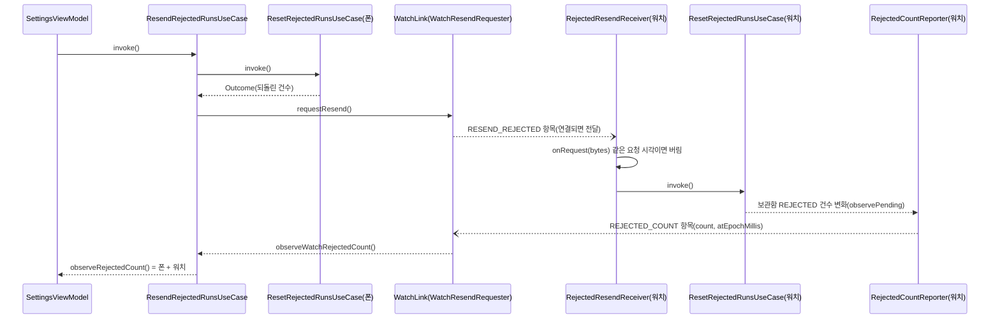
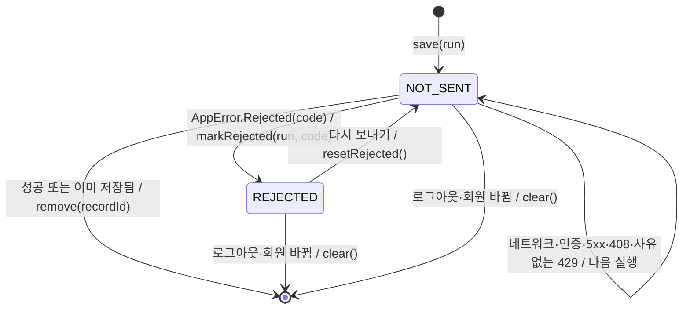
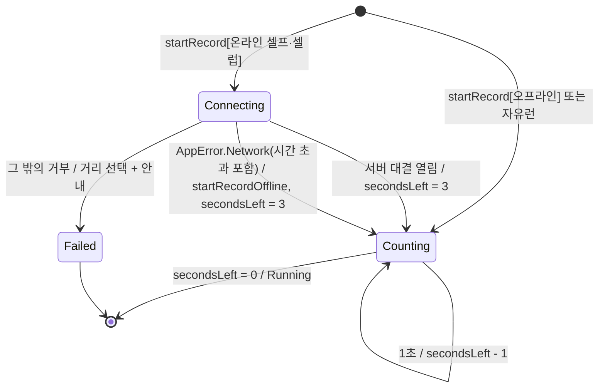

# 5.6 설계 결정 기록 (이어서: D-461~D-473, v0.27 워치 v2 구현 반영 R11~R15)
> 작성: 2026-11-03 | 버전: v0.27 | 입력: implementation/14-v0.22-워치-v2.md 14.4(I14-36~I14-45)·14.5 설계서 갱신 요청(R12·R13·R14·UI3·M1·W42 행), code-review/12-15차-v022-확인.md U15-1·U15-2, code-review/13-16차-v022-확인.md U16-1~U16-7(AN16-1·AN16-2·WR16-1 포함), 사용자 결정 C:\Users\SSAFY\runkk-work\watch-v2\decisions.md W34~W48(W44~W48은 2026-11-03), runkk-work/watch-v2/figma/motion.md, design-review/24-v0.27-검증.md M87·M88, sqa/07-검토-2026-11-03.md DF-050, 코드 S15P31A207-watch feature/runkk-watch-v2 cc8c138b(읽기만 함)

> [런크크 객체지향 분석·설계서](../design-oo.md) 목차 · 이전: [05-19-설계-결정-v0.26](05-19-설계-결정-v0.26.md) · 다음: [06-01-클래스-common-member](06-01-클래스-common-member.md)

워치 v2는 05-18 9절(v0.25 보정 2, R7~R10) 뒤로 R11~R15를 더 구현했다. 바뀐 것은 다섯 묶음이다: 서버가 거부한 기록의 보존과 다시 보내기(R12, R14, R15), 정지 구간 시각 정밀도(R12), 서버 판정의 빈 도달 시간(R13), 폰 동행 표시의 측정 화면 통일(UI3, R11), 화면 세부와 모션(UI1~UI5, M1, W42). 코드가 맞고 문서가 비어 있던 것이므로 설계를 코드에 맞춘다. 기존 조각의 문장은 지우지 않으며, 아래 결정이 해당 문장보다 앞선다.

## 1. 결정 표 (D-461~D-473)

| ID | 근거 | 결정(코드에 맞춤) | 대체 |
|----|------|------------------|------|
| D-461 | R12 D2-b, U16-1, 03-00 앱의 응답 해석 | **보관 기록 거부 상태.** `UploadState`에 REJECTED를 더한다(NOT_SENT·SENDING·REJECTED, SENDING은 값만 있고 전이에 쓰지 않음). `CompletedRun.rejectedReason: String?`(서버 사유 코드)을 더한다. `PendingRunRepository.markRejected(run, reason)`이 REJECTED로 바꾸고 `resetRejected(): Outcome<Int>`가 REJECTED를 NOT_SENT로 되돌리며 되돌린 건수를 준다(Room 구현은 `PendingRunDao.replaceState(from, to)` 한 문장). Room 판 5(`pending_run.rejectedReason` 칼럼, 4→5 자동 이전). `UploadPendingRunsUseCase`는 `AppError.Rejected`(서버 4xx 사유 코드)만 REJECTED로 남기고 다음 실행부터 REJECTED를 보내지 않는다. 네트워크·인증 만료·5xx·408·사유 없는 429는 REJECTED가 아니라 NOT_SENT로 남아 다시 시도한다. `UploadWorker`는 출력 데이터 `rejected`(거부 건수, 사유 코드는 경고 로그)를 내고, 거부만 남았으면 재시도하지 않는다. REJECTED 기록은 보관함에 미전송으로 보인다 | F.2.2 보관함 상태 문장, 02 2.4.8 CompletedRun 상태도의 NOT_SENT 안(SENDING 전이, REJECTED 없음. 3.3이 대체, 2026-11-03 M88로 보충) |
| D-462 | R12 D2, U16-2 | **러닝 시각 정밀도와 정지 구간.** `RunSession`은 시각을 밀리초로 자른다. 종료 때 기록 끝을 한 값(`max(지금, 열린 정지 시작, 마지막 정지 끝)`)으로 정하고, 그 값으로 운동 시간과 정지 합을 계산한다. 길이 0인 정지는 남기지 않는다. `CompletedRun.endedAt = startedAt + elapsed + pausedTotal`. 전송 직전 `CompletedRun.withPausesInRange()`가 정지 구간을 [시작, 끝] 안으로 자르고, 길이 0인 구간을 빼고, 겹치거나 맞닿은 구간을 합친다. 끝은 그대로 두고 잘린 만큼 운동 시간을 늘린다. 고칠 것이 없으면 자기 자신이다. 서버 검증(정지 구간은 기록 안)은 느슨하게 하지 않는다(I14-44) | D-93 (5) 정지 구간 문장 보충 |
| D-463 | W40, R14, U16-3 | **거부 기록 다시 보내기(폰).** `domain.run.ResetRejectedRunsUseCase`(되돌리기 + 되돌린 것이 있으면 `UploadScheduler.requestUpload()`)를 폰과 워치가 같이 쓴다. 폰 설정 "못 올린 기록 n건, 다시 보내기"는 `domain.account.ResendRejectedRunsUseCase`가 맡는다: `observeRejectedCount(): Flow<Int>`, `suspend invoke(): Outcome<Int>`(폰 되돌리기 뒤 폰 결과와 관계없이 워치에 요청). 배치: `ui.me`가 `domain.run`을 모르는 허용 표 제약 때문에 설정 묶음의 UseCase 자리인 domain.account에 둔다. 클래스는 한 가지 일만 해 기능적 응집이고, 패키지 응집 기울기는 다음 리팩터링 후보로 남긴다(16차 3절) | 05-01 domain.account 책임 문장 보충 |
| D-464 | W43, AN16-1, AN16-2, R15 | **워치 거부 기록 건수와 요청 전달.** 포트 `domain.run.WatchResendRequester`(구현 data.watch.WatchLink)는 `suspend requestResend()`와 `observeWatchRejectedCount(): Flow<Int>` 두 연산이다. (1) 요청: 폰은 `WearPaths.RESEND_REJECTED`를 DataClient 항목(`ResendRejectedMessage(requestedAtEpochMillis)`)으로 넣는다. 워치가 닿지 않을 때 누른 요청도 남았다가 연결되면 전달된다. 워치 `watch.link.RejectedResendReceiver.onRequest(bytes)`는 직전 요청 시각과 **같으면** 다시 처리하지 않는다(시계가 거꾸로 가도 새 요청을 놓치지 않게 크기가 아니라 같음으로 본다). 옛 폰의 MessageClient 요청도 받는다. (2) 건수: 워치 `watch.link.RejectedCountReporter.start()`(워치 앱 프로세스 시작 때 한 번)가 보관함 REJECTED 건수를 구독해 바뀔 때마다 `WearPaths.REJECTED_COUNT` 항목(`RejectedCountMessage(count, atEpochMillis)`)으로 넣는다. 시작 때 0도 넣어 옛 값을 바로잡는다. 폰 WatchLink는 마지막 값을 쥐되 센 시각이 더 이른 값은 버리고, 연결이 끊겼거나 워치 연동이 꺼졌으면 0을 준다. 설정의 건수는 폰 건수 + 워치 건수다. (3) Data Layer 경로는 13개, 항목 경로(`DATA_ITEM_PATHS`)는 HEART_RATE_BATCH·SESSION_REVOKED·RESEND_REJECTED·REJECTED_COUNT 넷이다. 경로는 더하기만 한다(D-97). 모르는 경로는 버린다(F.4.4) | F.4.1 경로 표(11개), 14.5 R14 행의 "경로 12개" |
| D-465 | W41, M1, U16-4, WR16-1 | **워치 모션 규칙.** `watch.ui.WatchMotion.kt`에 모은다. `LocalMotionStill`(참이면 모두 바로 바뀜)은 `WatchRoot`가 정하며 저전력 표시(ambient), 시스템 애니메이션 꺼짐(배율 0), 절전 모드 가운데 하나면 참이다. `rememberMotionReduced()`는 화면이 떠 있는 동안 바뀌어도 따라간다(절전은 ACTION_POWER_SAVE_MODE_CHANGED, 배율은 API 33부터 변경 리스너). 화면 사이는 피그마 DISSOLVE EASE_OUT(`ScreenEasing` cubic-bezier(0, 0, 0.58, 1)) `SCREEN_FADE_MS` 220ms, 매칭 중·매칭 완료가 끼면 `MATCH_FADE_MS` 250ms. 쓸어 뒤로 가기는 전환 없이 바로다. `screenKey(flow, companion)`: 상태 종류가 같으면 같은 화면이라 값만 바뀐다. 동행 표시는 측정·일시정지 두 화면 키로 나눈다. 거리 다이얼 −·+는 `DialEasing`(0.3, 1.4, 0.6, 1) `DIAL_MS` 250ms. 그 밖의 값 변화·등장은 320ms `CarouselEasing`(0.2, 0, 0, 1)이고 결과 칸 등장 간격은 `REVEAL_STAGGER_MS` 60ms다. 피그마에 없는 화면 안 모션의 320ms는 추정에서 시작해 사용자가 확정했다(W45, I14-42). 측정 화면처럼 자주 바뀌는 값은 그리기 단계(`graphicsLayer`, `revealLayer`)에서만 읽어 다시 구성·배치하지 않는다. 숫자와 단위가 붙은 줄은 기준선이 흔들리지 않게 숫자만 그리기 층에서 굴린다(f4dd2a68 km 위치) | D-382 저전력 표시 문장 보충, D-375 화면 전환 없음 |
| D-466 | W34, W36, U15-2 | **메인 캐러셀.** 카드 전환은 Smart Animate 320ms `CarouselEasing`이다. 끌다 놓으면 0.3칸 넘게 끌었을 때만 다음 카드로 가고 아니면 제자리로 돌아온다. 움직임 줄이기 조건은 D-465와 같다. 배경은 트랙 그림과 내 기본 캐릭터 아바타이고 RR 로고는 두지 않는다(W36이 W34를 정정, 피그마와 다름) | D-375 메인 배경 문장 |
| D-467 | W35, UI3, R11, U15-1, U16-6 | **폰 동행 표시 = 워치 측정 화면.** 폰에서 시작한 러닝·대결의 워치 표시는 워치 단독 측정 화면을 그대로 쓴다. `watch.ui.CompanionMeasure.kt`의 `WatchUiState.toMeasureFlow(): WatchFlow`가 폰 표시 값을 측정·일시정지 흐름 값으로 바꾼다. 폰이 모드를 보내지 않으므로 `isPausable`로 추정한다(참이면 자유런 측정, 거짓이면 대결 측정, 멈췄고 자유런이면 일시정지 화면). 거리 차는 폰이 보내는 근접 값(100m 안)이 있을 때만 보이고 멀면 비운다. 역전 띠는 `PhoneLink.leadChange: StateFlow<PhoneLeadChange?>`(`PhoneLeadChange(isOvertook, receivedAtMillis)`)로 받은 시각부터 2초(화면 박자 때문에 2~3초) 보이고, 색은 방향(`WatchUiState.leadKind`)을 따른다. 워치 단독 측정에서는 거리 차 부호로 방향을 정한다. 근접 비프·진동은 그대로다. 한계: 이 규칙을 모르는 옛 폰 앱의 자유런이 일시정지 불가로 오면 대결 화면으로 보인다. `WatchRunDisplay`·`WatchBattleScreen`은 지운다 | D-380 "동행 표시 WatchRunDisplay 유지", I14-29 |
| D-468 | R13 D1·D4, U16-5 | **셀프·셀럽 서버 판정의 빈 도달 시간.** `WatchResultHeadline.forSelfVerdict(result, localLeadSeconds: Long? = null)`·`forCelebVerdict(result, celebrityName, localLeadSeconds: Long? = null)`. 서버 판정에 내 도달 시간이 없으면(카운트다운 뒤 도착해 검증되지 않음 등) 워치가 잰 `localLeadSeconds`(상대 완주 시간 − 내 도착 시간, 도착 전에 끝냈으면 null)로 시간 차를 쓴다. 둘 다 없으면 STOP이다. 시간 차가 판정과 어긋나면 문구가 없다. 결과로 들어간 회는 뒤에 오는 대결 단계로 닫히지 않고 "완료"로만 닫힌다(2.4.25). 자유런을 거리 0으로 길게 눌러 끝내면(2026-11-03 W46으로 자유런 한정, 대결은 D-472) 기록을 저장하지 않고 메인으로 가며 `WatchFlow.Notice.NOT_SAVED`("기록할 거리가 없어요", 메인 띠 2초)를 보인다. 평균 심박이 없으면 그 칸을 비운다 | D-457 결과 머리말 세부, 02-06 워치 흐름 상태도의 Result |
| D-469 | W37, W38, W39, UI5, U16-7 | **워치 화면 세부.** 숫자 글꼴은 Barlow Condensed Bold·ExtraBold 정적 ttf 둘(SIL OFL 1.1, `wear/res/font`). 거리 선택 고리는 270도(7시 반에서 4시 반)이고 시작 손잡이를 둔다. 채움은 `dialFraction(state: WatchFlow.Picker): Float` = 고른 거리 / 고를 수 있는 가장 긴 거리(무제한이면 1)다. 셀프 기록 목록 카드 크기와 ▶ 선택 표시는 피그마대로다. 셀프·셀럽 목록 터치 칸 48dp가 카드 사이 빈자리만큼 8dp 겹치는 것은 둔다(W39) | D-375 거리 선택 화면 문장 보충 |
| D-470 | W42, PV-2, U16-7 | **카운트다운 연결 중.** `WatchFlow.Countdown(mode, distance, secondsLeft, isConnecting: Boolean = false)`. 온라인으로 셀프·셀럽런을 시작하면 `isConnecting = true`로 들어가 숫자 대신 "연결 중." "연결 중.." "연결 중..."을 1.2초 주기로 되풀이하고 둘레 원은 가득 찬 채다(읽기 도구에는 "연결 중" 한 번). 서버가 대결을 열어 답하면 `isConnecting = false`, 3부터 센다(시작 시각 = 답 시각 + 3초). 오프라인 시작은 처음부터 3이다. 서버에 닿지 못하면(`AppError.Network`, HTTP 시간 제한 연결 10초·읽기 20초 초과 포함) 오프라인 대결(`startRecordOffline`)로 바꿔 3부터 센다. 그 밖의 실패(서버 거부 등)는 카운트다운을 멈추고 거리 선택 화면으로 돌아가 안내를 보인다(설계 검증 24장 M89로 고침). 움직임 줄이기면 점이 움직이지 않는다 | 02-06 워치 흐름 상태도의 Countdown(하위 상태 없음) |
| D-471 | R11~R15, ArchitectureTest cc8c138b | **구조 수치 그대로.** 새 import는 모두 있던 화살표 위다: watch.link → domain.run(RejectedResendReceiver·RejectedCountReporter), domain.account → domain.run(ResendRejectedRunsUseCase), data.watch → domain.run(WatchResendRequester 구현), watch.ui 안(CompanionMeasure, WatchMotion). 이 목록에서 빠졌던 있던 화살표 다섯도 새 import를 싣는다(2026-11-03 M87 보충): watch.ui → domain.run·core.model(CompanionMeasure: RunProgress, HeartRateSample, Distance, Pace), watch.ui → watch.link(RejectedCountReporter.start, PhoneLink.leadChange: PhoneLeadChange), watch.link → core.model(RejectedResendReceiver: Outcome), domain.account → core.model(Outcome<Int>), ui.me → domain.account(ResendRejectedRunsUseCase: Flow<Int>, Outcome<Int>). CompanionMeasure는 watch.ui 안에서만 끝나지 않는다. 폰 154·워치 37, 순환 0, 역행 0, Fan-Out 상한 7 안. 새 패키지 없음. 새 클래스 협력 객체: RejectedCountReporter 2(PendingRunRepository, WearDataLayer. Clock·CoroutineScope는 세지 않음), RejectedResendReceiver 1, ResendRejectedRunsUseCase 3 | — |
| D-472 | W46, srs CR-131, test TF-V15-03, sqa DF-050 (2026-11-03 추가) | **대결 거리 0 종료.** 배틀런·셀프런·셀럽런은 거리 0이어도 길게 누르면 `WatchFlowViewModel.onEndLongPressed`가 `WatchBattleFlow.forfeit()` → `BattleRunCoordinator.forfeit()`로 끝낸다(FREE만 `RunTracker.onFinishLongPressed`). `forfeit`은 서버 대결이면 `BattleRepository.forfeit`으로 포기·그만두기를 알리고(오프라인 대결은 알리지 않음, `report`가 `isOffline`이면 건너뜀) `finish`로 측정을 끝낸다. `RunSession.complete`는 거리 0이면 `FinishOutcome.NotSaved`를 내므로 러닝 기록은 보관함에 저장되지 않고 전송되지도 않는다. 회는 `BattleRunState.Finished`로 닫혀 결과 화면으로 간다(배틀런은 서버 판정, 셀프·셀럽런은 서버 판정 또는 워치 계산). `Notice.NOT_SAVED`는 쓰지 않는다. 남는 것은 서버 대결의 포기·그만두기(패배) 판정뿐이고, 서버에 닿지 않은 셀프·셀럽런은 남는 것이 없다. 코드 변경 없음(cc8c138b 그대로) | D-468의 "거리 0으로 끝내면 저장하지 않고 NOT_SAVED"(자유런 한정), 3.5 |
| D-473 | W48, srs CR-130, test TF-V15-04, sqa K1·DF-050 (2026-11-03 추가) | **재전송 안내 셈(구현 전).** `PendingRunRepository.needsReminder(now): Outcome<Boolean>`는 `uploadState = NOT_SENT`인 미전송 기록만 세고 REJECTED는 뺀다(REJECTED는 설정 "못 올린 기록 n건"으로만 알린다, D-463). 참 조건은 FR-039 경계를 따른다: NOT_SENT가 20건을 넘었거나(21건째부터) 가장 오래된 NOT_SENT 기록의 저장 시각이 7일을 넘었을 때다(20건째와 7일 정각은 거짓). 부르는 곳은 폰 화면이다: 폰 쪽 화면의 ViewModel이 화면을 열 때 부르고 참이면 재전송 안내를 띄운다. 워치는 부르지 않는다. 20건·7일을 넘어도 보관함에서 지우지 않고 측정을 막지 않는다(W47, 지금 코드 그대로). 지금 코드(cc8c138b)는 `RoomPendingRunRepository.needsReminder`가 `dao.pending()` 전체(REJECTED 포함)를 `>= 20`·`<=`로 세고 부르는 곳이 없다. 구현 전이다(`/sw-implement`, K1). 부를 화면과 안내 문구는 구현 때 정하고, 새 화살표가 생기면 12-의존도에서 다시 센다 | 03 기능 모델 "미전송 20건·7일 넘으면 재전송 안내 (FR-039)" 행 보충, 06-06 PendingRunRepository.needsReminder 문장 보충 |

## 2. 객체 모델 추가 (클래스 명세)

### 2.1 domain.run

| 클래스 | 책임(한 문장) | 속성·연산 |
|--------|---------------|-----------|
| `UploadState` (enum) | 보관 기록의 전송 상태를 나타낸다 | NOT_SENT, SENDING, REJECTED |
| `CompletedRun` (보충) | 확정한 러닝 한 건의 값을 지킨다 | + `rejectedReason: String?`, + `fun withPausesInRange(): CompletedRun`(D-462), `endedAt` = startedAt + elapsed + pausedTotal |
| `PendingRunRepository` (보충) | 이 기기 미전송 기록 보관함을 다룬다 | + `suspend fun markRejected(run: CompletedRun, reason: String): Outcome<Unit>`, + `suspend fun resetRejected(): Outcome<Int>` |
| `ResetRejectedRunsUseCase` | 이 기기 거부 기록을 미전송으로 되돌린다 | 협력: PendingRunRepository, UploadScheduler. `suspend operator fun invoke(): Outcome<Int>`(되돌린 건수, 0이면 전송을 깨우지 않음) |
| `WatchResendRequester` (포트) | 연결된 워치의 거부 기록 일을 폰에 대신한다 | `suspend fun requestResend()`, `fun observeWatchRejectedCount(): Flow<Int>` |

### 2.2 domain.account

| 클래스 | 책임(한 문장) | 속성·연산 |
|--------|---------------|-----------|
| `ResendRejectedRunsUseCase` | 폰과 워치의 거부 기록을 다시 보낸다 | 협력: PendingRunRepository, ResetRejectedRunsUseCase, WatchResendRequester. `fun observeRejectedCount(): Flow<Int>`(폰 + 워치, 같은 값 거름), `suspend operator fun invoke(): Outcome<Int>`(폰 되돌린 건수) |

### 2.3 data(폰·공용)

| 클래스 | 보충 |
|--------|------|
| `PendingRunDao` | + `markState(recordId, state, reason)`, + `replaceState(from: String, to: String): Int` |
| `PendingRunDatabase` | 판 5, AutoMigration(4→5) |
| `UploadWorker` | 출력 `rejected`(거부 건수 Int, 사유 코드는 경고 로그). 실패 중 거부가 아닌 것이 있을 때만 재시도 |
| `data.watch.WatchLink` (보충) | `WatchResendRequester` 구현. `requestResend()` = RESEND_REJECTED 항목 넣기. 워치 건수는 `MutableStateFlow<RejectedCountMessage?>`에 쥐고, 연결될 때 `Transport.readItems(REJECTED_COUNT)`로 남은 항목을 읽는다 |

### 2.4 wear-contract

| 클래스 | 보충 |
|--------|------|
| `WearPaths` | + `RESEND_REJECTED = "/runkk/resend-rejected"`(폰 → 워치, 항목), + `REJECTED_COUNT = "/runkk/rejected-count"`(워치 → 폰, 항목). 경로 13개 |
| `ResendRejectedMessage` | `requestedAtEpochMillis: Long`. encode·decode |
| `RejectedCountMessage` | `count: Int`, `atEpochMillis: Long`. encode·decode. 표본 rejected-count.json(계약 시험) |

### 2.5 워치

| 패키지 · 클래스 | 책임(한 문장) | 속성·연산 |
|-----------------|---------------|-----------|
| watch.link `RejectedResendReceiver` (@Singleton) | 폰의 다시 보내기 요청을 워치 보관함에 적용한다 | private `lastRequestedAt: Long?`. `fun onRequest(bytes: ByteArray)`. PhoneMessageService가 경로로 골라 부른다(메시지·항목 둘 다) |
| watch.link `RejectedCountReporter` (@Singleton) | 워치 거부 기록 건수를 폰에 알린다 | private `started`. `fun start()`(거듭 불러도 한 번). RunkkWatchApp.onCreate가 부른다 |
| watch.link `PhoneLeadChange` | 폰이 보낸 추월·역전 한 건을 담는다 | `isOvertook: Boolean`, `receivedAtMillis: Long` |
| watch.link `PhoneLink` (보충) | | + `val leadChange: StateFlow<PhoneLeadChange?>` |
| watch.ui `WatchUiState` (보충) | | + `leadKind: LeadKind?` |
| watch.ui `CompanionMeasure.kt` | 폰 동행 표시 값을 측정 흐름 값으로 바꾼다 | `internal fun WatchUiState.toMeasureFlow(): WatchFlow` |
| watch.ui `WatchMotion.kt` | 워치 모션 값과 규칙을 한 곳에 둔다 | `LocalMotionStill`, `ScreenEasing`, `SCREEN_FADE_MS`, `MATCH_FADE_MS`, `DialEasing`, `DIAL_MS`, `REVEAL_STAGGER_MS`, `COUNTDOWN_FILL_MS`, `motionSpec(…)`, `rememberReveal(order)`, `Modifier.revealLayer(…)`, `screenKey(flow, companion)`, `screenFadeMillis(from, to)`, `isLapWrap(from, to)`, `rememberMotionReduced()` |
| watch.ui `WatchFlow` (보충) | | `Countdown.isConnecting`, `Running.leadKind`, `Notice.NOT_SAVED` |
| watch.ui `WatchDistancePicker.kt` (보충) | | `internal fun dialFraction(state: WatchFlow.Picker): Float` |
| watch.battle `WatchResultHeadline` (보충) | | `forSelfVerdict(result, localLeadSeconds)`, `forCelebVerdict(result, celebrityName, localLeadSeconds)`. 매개변수 최대 3(상한 4 안). 05-18 D-429의 "최대 2"를 3으로 고친다 |

`WatchRunDisplay`, `WatchBattleScreen`은 지운다(D-467).

## 3. 동적 모델 추가

### 3.1 사건 시나리오 (객체 관점)

- **S-RJ1 서버 거부.** UploadWorker가 UploadPendingRunsUseCase에 실행 메시지를 보낸다. 기록 하나가 `AppError.Rejected(code)`로 돌아오면 유스케이스가 `PendingRunRepository.markRejected(run, code)`를 보낸다. 다음 실행부터 그 기록은 보내지 않는다.
- **S-RJ2 다시 보내기.** SettingsViewModel이 `ResendRejectedRunsUseCase()`를 보낸다. 유스케이스가 `ResetRejectedRunsUseCase()`로 폰 기록을 되돌리고 `WatchResendRequester.requestResend()`를 보낸다. 워치가 연결되면 RejectedResendReceiver가 요청을 받아 워치의 `ResetRejectedRunsUseCase()`를 보낸다. 다시 거부되면 S-RJ1로 돌아간다.
- **S-RJ3 워치 건수.** 워치 보관함 REJECTED 건수가 바뀌면 RejectedCountReporter가 REJECTED_COUNT 항목을 넣는다. 폰 WatchLink가 받아 쥐고, `observeRejectedCount()`가 폰 건수와 더해 설정 줄을 갱신한다.
- **S-CN1 연결 중 카운트다운.** 워치 WatchFlowViewModel.startRecord가 온라인이면 `Countdown(isConnecting = true)`를 내고 WatchBattleFlow.startRecordOnline으로 서버 대결을 연다. 답이 오면 `Countdown(secondsLeft = 3, isConnecting = false)`로 바꾼다.

### 3.2 사건 추적도 (S-RJ2·S-RJ3)

### 3.3 상태도: 보관 기록 전송 상태 (CompletedRun.uploadState)

사건과 연산 대응: 보관 → `PendingRunRepository.save`, 거부 → `markRejected`, 다시 보내기 → `resetRejected`, 성공 → `remove`, 정리 → `clear`. 모두 PendingRunRepository 연산이다. `UploadState.SENDING`은 값으로만 남아 있고 전이에 쓰지 않는다.

(2026-11-03 M88 보충) 이 상태도는 02 2.4.8 CompletedRun 상태도의 전송 부분을 대체한다. uploadState(NOT_SENT·REJECTED)는 2.4.8의 NOT_SENT(보관함에 있고 아직 서버에 없음) 안의 하위 상태이고, 위의 `remove(recordId)`는 2.4.8의 SENT_HEADER(sentAtMillis를 채운 머리 정보, 최근 30건)로 나가는 전이다(observePending은 sentAtMillis IS NULL만 본다, PendingRunDao.kt:14-18). 2.4.8의 `NOT_SENT → SENDING : uploadAll`, `SENDING → SENT_HEADER`는 이 상태도로 읽는다: SENDING은 저장하는 상태가 아니라 UploadPendingRunsUseCase 실행 중(활동)이고, 값 SENDING은 지우기를 권고했다(design-review 24장 R81). 2.4.8에 없는 REJECTED는 이 상태도가 채운다. 재전송 안내 셈(D-473)은 NOT_SENT 하위 상태만 센다.

### 3.4 상태도 보충: 워치 흐름 Countdown (02-06 상태도의 Countdown 안)

Connecting은 `Countdown.isConnecting = true`, Counting은 `false`다. "다시 고르기"는 두 하위 상태 모두에서 기존 전이(목록으로)를 따른다.

### 3.5 상태도 보충: 워치 결과 (D-468)

Result(셀프·셀럽 서버 판정) --대결 단계 변화--> Result(그대로). Result --완료--> Main. Running --길게 누름[거리 0]--> Main + Notice.NOT_SAVED.

(2026-11-03 W46으로 보충, D-472) 위의 거리 0 전이는 자유런만이다: Running --길게 누름[거리 0, 자유런]--> Main + Notice.NOT_SAVED. Running --길게 누름[거리 0, 배틀런·셀프런·셀럽런] / forfeit, 러닝 기록 없음(FinishOutcome.NotSaved)--> Result.

## 4. 기능 모델 대응 (srs DFD)

| DFD 프로세스 | 연산 |
|--------------|------|
| 2.6 러닝 종료·확정 (정지 구간) | `RunSession` 종료 계산, `CompletedRun.withPausesInRange()` |
| 2.7 기록 전송 (거부 보존) | `UploadPendingRunsUseCase` → `PendingRunRepository.markRejected` |
| 2.7 기록 전송 (다시 보내기, 새 FR-273) | `ResendRejectedRunsUseCase.invoke`, `ResetRejectedRunsUseCase.invoke`, `WatchResendRequester.requestResend`, `RejectedResendReceiver.onRequest` |
| 2.7 기록 전송 (건수 표시) | `ResendRejectedRunsUseCase.observeRejectedCount`, `RejectedCountReporter.start`, `WatchResendRequester.observeWatchRejectedCount` |
| 2.4 러닝 표시 (폰 동행) | `WatchUiState.toMeasureFlow`, `PhoneLink.leadChange` |
| 2.2 시작 (카운트다운 연결 중) | `WatchFlowViewModel.startRecord`, `WatchFlow.Countdown.isConnecting` |
| 2.6·4.5 결과 판정 | `WatchResultHeadline.forSelfVerdict`·`forCelebVerdict` |

## 5. 패키지 의존도

바뀌지 않는다(D-471). 12-의존도의 표를 그대로 둔다. 화살표에 넘기는 것만 보충한다.

| 화살표 | 더해진 넘기는 것 |
|--------|------------------|
| watch.link → domain.run | ResetRejectedRunsUseCase 호출(반환 Outcome<Int>), PendingRunRepository.observePending(REJECTED 건수) |
| domain.account → domain.run | ResetRejectedRunsUseCase 호출, WatchResendRequester(포트), PendingRunRepository.observePending |
| data.watch → domain.run | WatchResendRequester 구현 |
| data.watch → wear-contract, watch.link → wear-contract | ResendRejectedMessage, RejectedCountMessage, WearPaths 두 경로 |
| watch.ui → domain.run·core.model (2026-11-03 M87 보충) | CompanionMeasure: RunProgress, HeartRateSample, Distance, Pace |
| watch.ui → watch.link (2026-11-03 M87 보충) | RejectedCountReporter.start, PhoneLink.leadChange: PhoneLeadChange |
| watch.link → core.model (2026-11-03 M87 보충) | RejectedResendReceiver: Outcome |
| domain.account → core.model (2026-11-03 M87 보충) | Outcome<Int> |
| ui.me → domain.account (2026-11-03 M87 보충) | ResendRejectedRunsUseCase: Flow<Int>, Outcome<Int> |

D-472는 코드 그대로라 화살표가 바뀌지 않는다. D-473은 구현 전이며, 폰 화면이 needsReminder를 부르는 길이 있던 화살표 위에 없으면 구현 때 12-의존도에서 다시 센다.

## 6. 구현 지침 추가

- 서버 응답을 보관함 상태로 바꾸는 규칙(D-461)은 UploadPendingRunsUseCase 한 곳에만 둔다. 워커와 화면은 상태를 읽기만 한다.
- Data Layer로 나중에라도 반드시 가야 하는 요청과 마지막 값만 의미 있는 값은 DataClient 항목으로 보낸다(RESEND_REJECTED, REJECTED_COUNT). 받는 쪽은 같은 항목이 다시 와도 결과가 같게 만든다.
- Compose 모션은 `motionSpec`과 `LocalMotionStill`을 거친다. 직접 `tween`을 쓰지 않는다. 자주 바뀌는 값은 그리기 단계에서 읽는다.
- 화면 문구에 가운뎃점·규칙 설명 줄을 넣지 않는다(기존 규칙).

## 7. 테스트 순서 (sw-test에 넘김)

1. 단위(클래스): `CompletedRun.withPausesInRange`(자르기·합치기·길이 0·끝 유지), `RunSession` 정지 중 종료, `UploadPendingRunsUseCase` 응답 분류 표(4xx 사유 → REJECTED, 408·429·5xx·네트워크·인증 → NOT_SENT), `ResetRejectedRunsUseCase`(0건이면 깨우지 않음), `ResendRejectedRunsUseCase`(합산, 폰 실패여도 워치 요청), `RejectedResendReceiver`(같은 시각 무시, 해독 실패 버림), `RejectedCountReporter`(시작 때 0, 건수 변화), `WatchResultHeadline.forSelfVerdict`·`forCelebVerdict`(빈 도달 시간), `dialFraction`, `screenKey`·`screenFadeMillis`, `toMeasureFlow`.
2. 계약: rejected-count.json·resend-rejected 표본, 경로 13개 겹침 없음, DATA_ITEM_PATHS 넷.
3. 통합(스레드 기반): "다시 보내기" 스레드 = SettingsViewModel → ResendRejectedRunsUseCase → ResetRejectedRunsUseCase → PendingRunRepository(Room 판 5 이전 포함) → WatchLink(가짜 Transport) → RejectedResendReceiver → 워치 ResetRejectedRunsUseCase.
4. 화면(Roborazzi·Robolectric): 연결 중 카운트다운, 측정 거리 바뀔 때 km 제자리, 거리 다이얼 F1-10·B1-10 넘침 없음, 움직임 줄이기에서 바로 바뀜.
5. 시스템(실기기): 워치만 거부 기록이 있을 때 폰 설정 줄과 다시 보내기, 워치 끊김 중 누른 요청이 연결 뒤 전달, 폰 대결 동행 역전 띠, BEST 표시.

## 8. 추적 (srs 7.1 설계 요소 열)

| 요구 | 설계 요소 |
|------|-----------|
| FR-039·FR-040·FR-250 (보충) | UploadState.REJECTED, CompletedRun.rejectedReason·withPausesInRange, PendingRunRepository.markRejected·resetRejected, UploadPendingRunsUseCase (D-461, D-462) |
| FR-273 (새, 다시 보내기) | ResendRejectedRunsUseCase, ResetRejectedRunsUseCase, WatchResendRequester(WatchLink), RejectedResendReceiver, RejectedCountReporter, WearPaths.RESEND_REJECTED·REJECTED_COUNT (D-463, D-464) |
| FR-042 (변경) | WatchUiState.toMeasureFlow, PhoneLink.leadChange, WatchUiState.leadKind, WatchRunScreen (D-467) |
| FR-180 (보충) | WatchFlow.Countdown.isConnecting, WatchCountdownScreen (D-470) |
| FR-243 (보충) | WatchModeCarousel (D-466) |
| FR-247 (보충) | RunSession, CompletedRun.withPausesInRange (D-462) |
| FR-248·FR-249 (보충) | WatchResultHeadline.forSelfVerdict·forCelebVerdict, WatchFlow.Notice.NOT_SAVED (D-468) |
| FR-248 (CR-131, 2026-11-03) | WatchFlowViewModel.onEndLongPressed, WatchBattleFlow.forfeit, BattleRunCoordinator.forfeit, RunSession.complete(FinishOutcome.NotSaved) (D-472) |
| FR-039 (CR-130, 2026-11-03, 구현 전) | PendingRunRepository.needsReminder(NOT_SENT만 셈), 폰 화면 호출 (D-473) |
| NFR-044 (보충), NFR-054 (새) | LocalMotionStill, rememberMotionReduced, WatchMotion.kt (D-465) |

## 9. srs 갱신 요청 (→ `/sw-srs` 변경 요청)

| 요청 | 근거 | 내용 |
|------|------|------|
| SR27-1 | W40, W43, R14, R15 | 새 FR-273 "못 올린 기록 다시 보내기": 폰 설정에 서버가 받지 않은 기록 건수(폰 + 연결된 워치)와 다시 보내기. 워치가 연결되지 않았을 때 누른 요청은 연결되면 전달. 서버는 기록ID로 중복 저장을 막음 |
| SR27-2 | R12 D2-b, 03-00 | FR-039·FR-040·FR-250 처리: 서버가 4xx로 받지 않은 기록은 지우지 않고 사유와 함께 보관하며 자동 재전송에서 뺀다. 보관함에는 미전송으로 보인다 |
| SR27-3 | R12 D2 | FR-247 처리: 정지 구간은 기록 시작과 끝 사이에 있어야 하고 길이 0인 정지는 남기지 않는다 |
| SR27-4 | R13 | FR-249 처리: 서버 판정에 내 도달 시간이 없으면 워치가 잰 시간 차로 머리말을 정한다. 결과 화면은 "완료"로만 닫힌다. FR-248 처리: 거리 0으로 끝내면 기록을 저장하지 않고 "기록할 거리가 없어요"를 보인다 |
| SR27-5 | W35 | FR-042 처리: 폰에서 시작한 러닝·대결의 워치 표시는 워치 단독 측정 화면(FR-246)과 같고 **(제안)**을 뗀다. 거리 차는 100m 안 근접 값이 있을 때만 보인다. 역전 띠 2초 |
| SR27-6 | W42 | FR-180 처리: 워치 셀프·셀럽런이 서버 대결을 여는 동안 숫자 대신 "연결 중" 표시, 서버가 답하면 3부터 |
| SR27-7 | W41, M1 | NFR-044 확장: 워치는 저전력 표시·애니메이션 제거·절전 모드에서 모션을 끈다. 새 NFR-054: 워치 화면 사이 전환은 0.25초 이내로 끝나야 한다 |
| SR27-8 | W34, W36, W37, W38, W39 | 요구 변경 없음(표시 변경 기록): 메인 RR 로고 없음·아바타 유지, 숫자 글꼴, 고리 비율, 목록 카드, 터치 칸 겹침 |

## 10. 설계 판정 기준 점검 (바뀐 부분만)

| 항목 | 결과 |
|------|------|
| 클래스 책임 한 문장 | 새 클래스 5개(ResetRejectedRunsUseCase, ResendRejectedRunsUseCase, RejectedResendReceiver, RejectedCountReporter, PhoneLeadChange) 모두 "그리고" 없음. 포트 WatchResendRequester를 더해 6개다(2026-11-03 M87 보충) |
| 캡슐화 | RejectedResendReceiver.lastRequestedAt, RejectedCountReporter.started는 private이고 lock 안에서만 쓴다 |
| 매개변수 | 최대 3(forCelebVerdict) |
| 상태도 | 보관 기록 전송 상태를 새로 그렸고 사건 다섯이 PendingRunRepository 연산에 대응한다. Countdown 하위 상태 보충. 3.3이 02 2.4.8의 전송 부분을 대체함을 적었다(2026-11-03 M88). 결과 상태도 거리 0 전이를 자유런으로 한정했다(D-472) |
| 패키지 | 새 화살표 없음, 154·37. 넘기는 것 표에 빠진 화살표 다섯을 보충했다(2026-11-03 M87) |
| 다형성 | 타입 분기 새로 없음(screenKey는 상태 종류 자체를 키로 쓴다) |

## 11. 남은 확인

- `ResendRejectedRunsUseCase`의 domain.account 배치는 허용 표 제약 때문이다. `ui.me → domain.run`을 허용할지(폰 155) 다음 설계 검증에서 정한다.
- 화면 안 모션 320ms는 W45로 확정했다(2026-11-03). 디자이너가 다른 값을 주면 WatchMotion.kt 상수만 바꾼다.
- 실기기로만 볼 수 있는 것(역전 띠 박자, 연결 중 길이, BEST)은 TC-5381~5396 실기기 시험에서 본다.
- D-473(재전송 안내 셈)은 구현 전이다(sqa K1). `/sw-implement`에서 needsReminder 셈을 NOT_SENT만으로 바꾸고, 7일 정각 경계(`<=` → `<`)와 20건 경계(`>= 20` → `> 20`)를 FR-039에 맞추며, 부를 폰 화면을 정한다(2026-11-03 추가).
- D-472(대결 거리 0)는 코드 그대로라 구현할 것이 없다. 시험 기대 결과는 test TC-5473을 고친다(2026-11-03 추가).
- `UploadState.SENDING` 지우기(R81)와 02 2.4.8 본문 정리는 다음 판에서 한다. 그때까지 3.3이 2.4.8을 대체한다(2026-11-03 추가).
- 다음: `/sw-srs`(9절 SR27-1~SR27-8) → `/sw-design` review(05-20, 구조 수치 변화 없음 확인) → `/sw-test`(7절).
