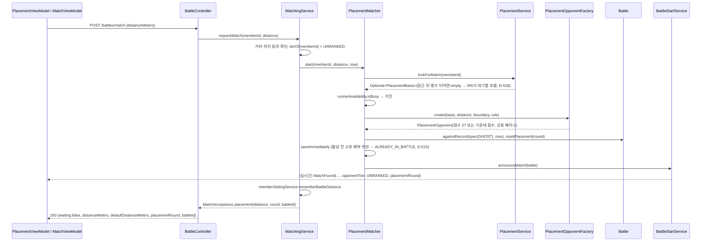
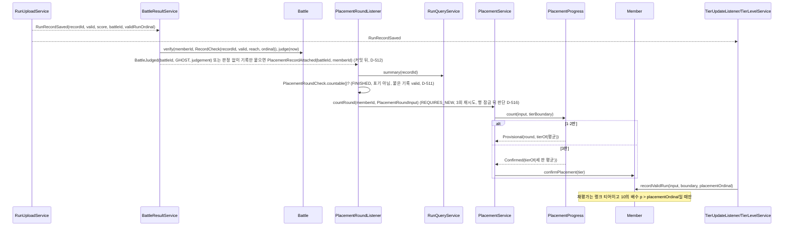
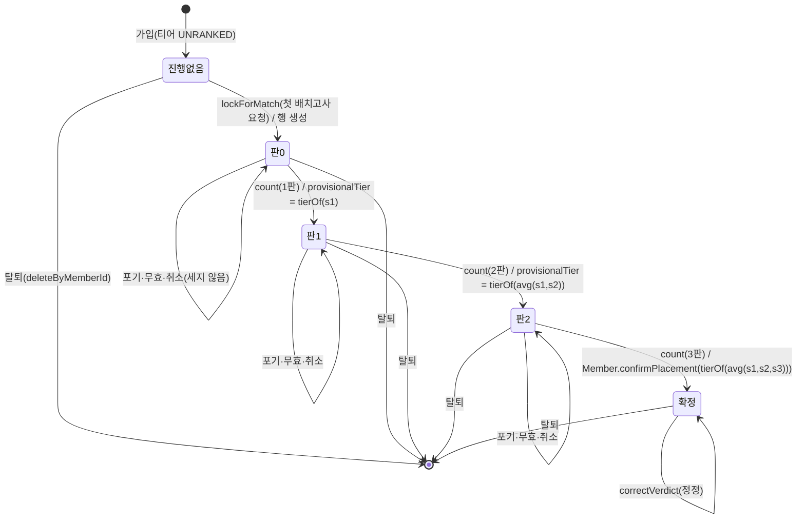
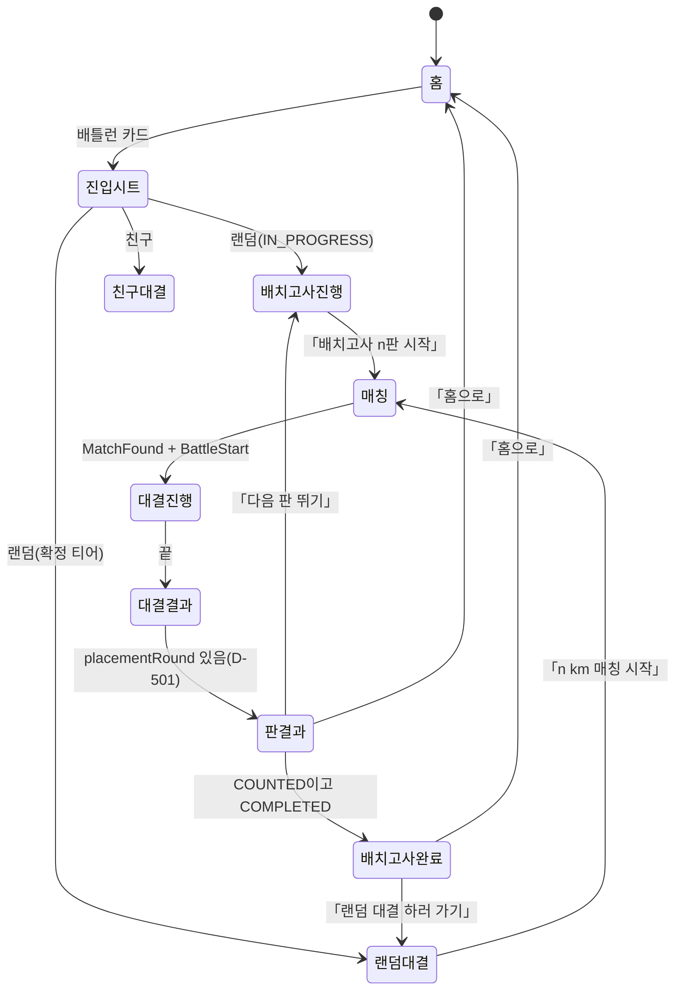

# 5.6 설계 결정 기록 (이어서: D-475~D-520, v0.30~v0.31 배치고사·티어 표시·화면 개편)
> 작성: 2026-11-04 | 버전: v0.31(설계 검토 design-review v0.22 25장 R82~R95 반영, 1.1절 D-511~D-520) | v0.30 | 담당: 이성현(공용 담당 브랜치 `docs/S15P31A207-275-placement`) | 입력: srs v0.24(커밋 515ae482) 03-08 FR-274~FR-290·결정 J24-1~J24-23, 07-16 CR-135~CR-146, 2026-11-04 PM 결정 모음(핫픽스 v0.11.1 확장 브리프, 배치고사 규칙 1~13), 총괄 결정 J24-14R(랭킹 아주 작은 티어 배지), 피그마 NMTtVMWIT22D0CwOU2y0I9 제안 섹션 61272:1112(읽기만 함, 추출 명세 9절 차이 17건), 코드 S15P31A207-hotfix `hotfix/S15P31A207-275-v0111-feedback` df211dc5(main f2f3a13d 기준, 읽기만 함), origin/develop 마이그레이션 V36·V37

> [런크크 객체지향 분석·설계서](../design-oo.md) 목차 · 이전: [05-20-설계-결정-v0.27](05-20-설계-결정-v0.27.md) · 다음: [06-01-클래스-common-member](06-01-클래스-common-member.md)

이 조각은 배치고사(서버·앱), 티어 엠블럼·배지, 홈 「내 기록 요약」, 러닝 결과 상용안, 랜덤·친구 대결 분리와 진입 시트, 랭킹 시상대를 설계한다. 구현은 핫픽스 브랜치(MR !70 → main)에 들어간다. **REST·실시간 계약은 [05-03 5.7.3](05-03-API-실시간-메시지.md)에 글자 그대로 고정했다**(병렬 구현의 전제). 기존 조각의 문장은 지우지 않으며 아래 결정이 해당 문장보다 앞선다. battle·analysis 클래스 명세 조각(06-02·06-03, 박재영 담당)은 고치지 않고 이 조각에 설계를 쓰며, 반영 요청은 병합 대기 파일 `docs/sw/pending/docs-S15P31A207-275-placement.md`에 적었다(14절).

## 1. 결정 표 (D-475~D-510)

PM이 정하지 않아 설계 담당이 정한 것은 근거 열에 "(설계 결정)"으로 표시했고 같은 내용을 총괄 결정 기록(self-decisions)에도 남겼다.

| ID | 근거 | 결정 | 대체 |
|----|------|------|------|
| D-475 | FR-275, J24-8 (설계 결정) | **배치 진행 보관.** member 패키지에 엔티티 `PlacementProgress`(표 `placement_progress`, 회원당 1행, 키 member_id)와 값 `PlacementRound`(표 `placement_round`, 센 판마다 1행, `@ElementCollection`)를 둔다. 회원 행(member)에 칼럼을 더하지 않는다: 판 기록이 여러 행이고, 탈퇴 때 행째 지우기 쉽고, 기존 회원 엔티티의 낙관적 잠금 충돌(티어 갱신과 같은 행)을 줄인다. 행은 언랭 회원이 처음 배치고사 매칭을 요청할 때 만든다(배포 때 일괄 생성 없음, J24-10) | 없음(신규) |
| D-476 | 총괄 지시(main → develop 역병합 충돌 회피), hotfix(main) 최대 V35, origin/develop 최대 V37(V36 async_selfie_jobs, V37 ai_data_purge), 13-14 구현 지침 "out-of-order는 켜지 않는다", design-review v0.22 R85 (설계 결정) | **마이그레이션 번호 V35_1**(`V35_1__placement_progress.sql`, Flyway 버전 35.1, 5절) **(v0.31 변경, R85: v0.30의 "V38 + develop·prod out-of-order"를 대신한다)**. prod는 V35 → 35.1을 순서대로 적용하고 다음 릴리스에서 V36·V37도 번호 순서대로 받는다. 그래서 **prod에는 out-of-order를 켜지 않는다**(운영 DB 적용 순서 = 새 DB 적용 순서, 13-14 규칙 그대로). develop 환경 DB는 이미 V36·V37이 적용돼 있어 main → develop 역병합 뒤 35.1이 "적용 안 된 낮은 번호"가 되므로 **develop 프로필에만** `spring.flyway.out-of-order: true`를 둔다(35.1이 한 번 적용되면 지워도 되고, v0.12 릴리스 MR에서 지운다). 35.1은 member·battle·battle_participant와 새 표 둘만 만지고 V36(avatar 칼럼, selfie_job)·V37(ai_purge_request, audit_record 제약)과 겹치는 표·제약이 없어 develop의 적용 순서(V36 → V37 → 35.1)와 새 DB 순서(35.1 → V36 → V37)의 결과가 같다. 버리는 안 V38은 prod에 out-of-order를 상시 켜야 하고(뒤에 실수로 낮은 번호가 들어와도 조용히 적용됨), main 병합 ~ 역병합 사이에 develop 작업이 V38을 쓰면 번호가 겹친다 | 없음 |
| D-477 | FR-274, J24-22, V6 `ck_battle_type`, 옛 앱 enum 해석 (설계 결정) | **배치고사 대결 = 기존 `BattleType.GHOST` + `Battle.placementRound`(1~3).** 새 BattleType을 만들지 않는다: GHOST는 이미 실시간 상대 없음, 성사 13초 뒤 자동 출발, 승리 리워드, 이력은 RANDOM 묶음이라 배치고사 규칙 7(승패·리워드 평소처럼)과 J24-22(이력은 랜덤)에 맞는다. 새 값을 넣으면 DB CHECK, 계약 enum, 옛 앱·워치의 enum 해석이 모두 바뀐다. 배치고사인지는 `placementRound != null`로만 가린다 | 없음 |
| D-478 | FR-274, CR-139, 브리프 규칙 1 | **MatchingService.requestMatch 잠금 제거.** 순서: 거리(BATTLE_DISTANCE_INVALID) → 위치 동의(LOCATION_CONSENT_REQUIRED) → 티어. 확정 티어는 기존 대기열 흐름 그대로. 언랭은 `PlacementMatcher.start`로 대기열 없이 대결을 만든다. `ReasonCode.RANKED_ONLY` 상수는 남기고(계약 enum·옛 앱 문구) 서버는 더 내지 않는다. 같은 회원의 동시 요청은 `PlacementService.lockForMatch`가 placement_progress 행을 비관 잠금(PESSIMISTIC_WRITE, 없으면 먼저 INSERT … ON CONFLICT DO NOTHING)한 뒤 `RunnerAvailability.isBusy`를 확인해 한 개만 통과시킨다(바쁘면 ALREADY_IN_BATTLE). 잠근 뒤 회원이 이미 랭크 티어면(3판째 셈이 그 사이 커밋) `Optional.empty()`를 받고 확정 티어 흐름(대기열)으로 간다(v0.31 변경, R90, D-518). 배치 진행 잠금을 쓰지 않는 다른 생성 경로(셀프·셀럽 시작, 친구 초대 수락)와의 경합은 활성 칸 고유 제약이 막고 ALREADY_IN_BATTLE로 바꾼다(v0.31 추가, R86, D-515) | 05-11 D-318(랜덤 대결 잠금), 6.3 4.1 규칙 2 RANKED_ONLY 갈래 |
| D-479 | FR-274, 앱 MatchViewModel(채널 먼저 연결 → 요청 → MatchFound, D-274) (설계 결정) | **배치고사 매칭 응답.** POST /battles/match는 대결을 만든 뒤 `MatchAcceptance(waiting=false, distance, defaultDistance, placementRound, battleId)`를 돌려주고 `BattleStartService.announceMatch`가 기존처럼 MatchFound(+placementRound)를 실시간 채널로 보낸다. 앱 매칭 흐름(RandomTicket.open은 응답 본문을 보지 않음)은 그대로 쓰고 MatchFound로 성사 화면에 간다. 대기·15초 고스트 전환·MatchQueue를 쓰지 않으므로 성사까지 서버 처리만 걸린다(NFR-005 3초 안) | 없음 |
| D-480 | FR-276, J24-1·J24-2·J24-3·J24-13, 코드 `TierBoundary.midScoreOf`, `RunningScore.paceFor`, `VirtualRecordFactory.finishTime` | **배치고사 상대 기록.** battle에 `PlacementOpponent implements OpponentRecord`(저장하지 않는 값 객체)와 `PlacementOpponentFactory`를 둔다. 상대 점수: 1판 = `VirtualRecordRule.openLowScore`(기본 27), 2·3판 = `TierBoundary.midScoreOf(임시 티어, rule)`. 페이스 = `new RunningScore(점수).paceFor(거리)`, 완주 시간 = `VirtualRecordFactory.finishTime(페이스, 0, 거리)`(오프셋 0), 표 = `OpponentTrack.uniform`. 경계값·규칙은 대결을 만드는 순간 `OperationPolicy`에서 읽은 값을 쓰고 대결(opponent_track, opponent_arrival_millis)에 남아 이후 바뀌어도 그 판은 그대로다(J24-13). 표시: `displayTier() = UNRANKED`(상대 티어 숨김, 유명인과 같은 방식), `kind() = VIRTUAL`, `recordId() = "PLACEMENT-" + 판`, 닉네임은 같은 거리 가상 기록(`VirtualRecordRepository.findByTierAndDistance(임시 티어 또는 BRONZE, 거리)`) 가운데 하나의 닉네임을 빌린다(FR-104 규칙의 이름이라 회원 닉네임과 겹치지 않음, 새 이름 생성 없음). 상대 캐릭터 성별은 기존 가상 기록과 같이 무작위. 가상 기록이 하나도 없으면 MATCH_FAILED (설계 결정: 이름 빌리기·recordId 형식) | 없음 |
| D-481 | FR-275, J24-4, 브리프 규칙 9·10, design-review v0.22 R82·R83 | **판 셈.** battle에 `PlacementRoundListener`를 두고 `BattleJudged`와 `PlacementRecordAttached`(D-512)를 커밋 뒤(AFTER_COMMIT) 받아 `count(battleId)`를 부른다. 셀 조건은 `PlacementRoundCheck.countable()`(D-511) 하나다: 대결에 placementRound가 있고, 대결이 FINISHED이고, 본인 참가자가 포기하지 않았고(`isForfeited() == false`), 본인 참가자에 기록 ID가 붙었고, **그 기록이 유효 러닝**(`RunQueryService.summary(recordId).valid() == true`)이다. **참가자 검증값(`getVerified()`)은 쓰지 않는다**: Battle.verify는 "유효 && 대결 거리 도달"을 담아, 유령보다 10초 넘게 늦어 카운트다운 종료로 앱이 측정을 끝낸 유효 기록(대부분의 패배)을 거짓으로 남기기 때문이다(v0.31 변경, R82). 조건을 만족하면 같은 요약으로 거리·시간·점수·페이스를 읽어 `PlacementService.countRound`를 새 트랜잭션(REQUIRES_NEW)에서 부른다. 일시 오류(TransientDataAccessException)는 3번까지 다시 한다(TierUpdateListener와 같은 방식). 포기는 Battle.forfeit가 BattleJudged를 내지만 위 조건에서 걸러져 세지 않는다. 출발 전 취소(CANCELLED)는 BattleJudged가 없다. 무효 기록은 요약 valid가 거짓이라 세지 않는다. 기록이 오지 않은 판은 24시간 보류 만료(markMissingRecordInvalid) 때 기록 ID 없이 판정돼 세지 않는다. 결과 보류는 판정이 날 때 BattleJudged가 와서 그때 센다. 정정(corrected) 사건은 이미 센 판의 판정(verdict)만 고치고 셈 여부는 바꾸지 않는다 | 없음 |
| D-482 | J24-6, 코드 `RunRecordSaved.validRunOrdinal`, `BattleResultService.applyRecord` (설계 결정) | **판 기록의 유효 러닝 순번.** `BattleParticipant`에 `validRunOrdinal`(Integer, 칼럼 battle_participant.valid_run_ordinal)을 더하고 `BattleResultService.applyRecord`가 `RunRecordSaved.validRunOrdinal()`을 함께 남긴다. 매개변수가 5개가 되지 않게 `Battle.verify(long memberId, RecordCheck check)`로 바꾸고 `RecordCheck(String recordId, boolean valid, Duration reachElapsed, int validRunOrdinal)` 값을 둔다. 판 셈이 이 순번을 PlacementRound에 남겨 확정 판의 순번을 안다 | 06-03 Battle.verify(memberId, recordId, valid, reachElapsed) 시그니처 |
| D-483 | FR-277, FR-278, 브리프 규칙 4·10 | **임시·확정 티어.** `PlacementProgress.count(input, boundary)`가 센 판의 점수 평균을 `TierBoundary.tierOf`에 넣는다. 1·2판을 세면 결과를 provisionalTier에 넣고 회원 티어는 그대로(UNRANKED). 3판째를 세면 세 판 평균으로 확정 티어를 정해 `Member.confirmPlacement(tier)`를 같은 트랜잭션에서 부르고, provisionalTier를 비우고, completedAt과 confirmedRunOrdinal(3판 기록의 순번)을 남긴다. 거리가 다른 판도 점수로 평균한다(기존 규칙). 승패는 쓰지 않는다. 판 번호는 **셀 때** `countedRounds + 1`로 정한다: 대결을 만들 때의 placementRound와 다르면(앞 판 결과가 보류 중일 때 다음 판을 만든 경우) 셀 때 번호가 이기고, 상대 점수는 만든 때 진행으로 정해진 그대로 둔다(J24-13 취지). 같은 battleId는 두 번 세지 않는다(uq_placement_round_battle) (설계 결정: 번호 규칙). 그래서 대결 이력·결과 응답의 placementRound(만든 때 번호)는 같은 번호가 두 대결에 보일 수 있고, 진행 화면의 「n/3」은 늘 진행(센 판) 기준이다(v0.31 추가, R95) | 없음 |
| D-484 | FR-022, FR-027, J24-6, J24-7, 코드 `TierProgress.evaluationWindowBetween`·`evaluationBetween` | **일반 러닝의 첫 배치 제거와 재평가 조건.** `TierProgress`에서 PLACEMENT(3) 창을 없애고 `reevaluationPointBetween(int lastOrdinal, int newOrdinal): OptionalInt`(lastOrdinal < p ≤ newOrdinal인 10의 배수 가운데 가장 큰 p)만 둔다. `Member.recordValidRun(RunScoreInput input, TierBoundary boundary, int placementOrdinal)`은 점수 창과 누적 거리·레벨을 늘 갱신하고, p가 있고 `tier.isRanked()`이고 `p > placementOrdinal`일 때만 최근 10회 평균으로 재평가한다. placementOrdinal은 `TierLevelService`가 PlacementProgress.confirmedRunOrdinal(없으면 0)을 읽어 넘긴다. **읽는 순서는 Member(@Version) 먼저, 진행 행 그다음**이다(v0.31 추가, R88, D-517): PostgreSQL READ COMMITTED에서는 문장마다 커밋된 값을 새로 보므로, 진행 행을 먼저 읽고(셈 커밋 전, 0) Member를 나중에 읽으면(셈 커밋 뒤, 랭크 티어) 3판째 = 10번째 순번에서 재평가가 일어난다. Member를 먼저 읽으면 셈이 그 사이 커밋돼도 Member 저장이 낙관적 잠금 충돌로 다시 돌아(TierUpdateListener 3회 재시도) 두 값이 같은 시점이 된다. 그래서 배치 중의 10의 배수 순번은 재평가가 없고, 3판째가 10의 배수 순번이면 그 순번에서는 확정만 한다(티어 반영과 판 셈 중 무엇이 먼저 커밋돼도 같다). 기존 티어 회원은 placementOrdinal 0이라 지금과 같다. `EvaluationKind.FIRST_PLACEMENT`는 옛 기록(run_record.evaluation_kind) 표시 때문에 값을 남기되 새로 만들지 않는다 | 06-01 TierProgress 명세의 3회째 창, D-291 첫 배치 |
| D-485 | FR-282, 브리프 규칙 11 | **공개 티어.** 다른 사람에게 가는 모든 응답(프로필 tier, MatchFound.opponentTier, 크루 목록, 랭킹 publicTier)은 회원 티어 그대로다(언랭 = 「배치 중」). 임시 티어는 `GET /me/placement`에만 담는다. 서버에 "보는 사람이 본인인가" 분기를 새로 두지 않는다 | 없음 |
| D-486 | 총괄 결정 J24-14R(브리프 규칙 8), FR-290 | **랭킹 공개 티어.** 랭킹 응답 행에 `publicTier`를 더하고 `RankingService`가 조회 때 `MemberQueryService.summaries(행 회원 ID)`로 지금 티어를 붙인다(표시 성별을 조회 때 붙이는 D-334와 같은 방식). 스냅숏의 `tier`(0시 집계 때 값)는 지우지 않고 뜻도 그대로 둔다. 앱은 시상대·본인 행·목록 행의 닉네임 옆에 아주 작은 배지(`TierBadge(TierDisplay.ofPublic(publicTier), XSMALL)`)를 둔다. 본인 행도 공개 티어다(임시 티어 없음). 조회 때 붙이는 이유: 0시 스냅숏이면 배치고사를 마친 직후에도 하루 동안 「배치 중」으로 남는다 (설계 결정: 붙이는 시점) | 05-12 D-334 문장의 "랭킹에 티어 없음" 전제 |
| D-487 | FR-280, design-review v0.22 R84·R89 (설계 결정) | **판 결과 상태.** 대결 결과 응답에 `placementRound`와 `placementState`를 더한다. 계산은 battle 안의 `PlacementRoundReader.stateOf(memberId, battleId)`(D-513)가 하고 web.battle `BattleResultAssembler`는 그 값을 옮기기만 한다(**web.battle → member 화살표를 만들지 않는다**, D-314, v0.31 변경, R84). 규칙 `PlacementRoundState.of(PlacementRoundCheck check, boolean counted, boolean progressCompleted)`(위에서 처음 맞는 것): placementRound 없음 → 응답 null, 이미 셈 → COUNTED, `check.isVoid()`(대결 CANCELLED, 본인 포기, 붙은 기록이 무효, 기록 없이 24시간 만료 판정) → NOT_COUNTED, 대결 FINISHED인데 배치고사가 이미 끝남(progressCompleted, 앞 판 보류 중 만든 판이 3판째 확정 뒤 판정된 경우) → NOT_COUNTED(v0.31 추가, R89), 그 밖(판정 전, 기록 도착 전, 셈 반영 전) → PENDING. counted는 `PlacementService.isCounted(memberId, battleId)`, progressCompleted는 `PlacementService.isCompleted(memberId)` | 없음 |
| D-488 | FR-279~FR-282 | **본인 배치 진행 조회.** `GET /api/v1/me/placement` → `PlacementService.view(memberId)` → `PlacementView`. 상태 `PlacementStatus`: 회원 티어 UNRANKED → IN_PROGRESS, 티어가 있고 completedAt이 있는 진행 행 → COMPLETED, 그 밖 → EXEMPT. 형식은 05-03 5.7.3.3 | 없음 |
| D-489 | J24-9, FR-021, FR-200 (설계 결정: 가장 보수적) | **탈퇴·파기.** `WithdrawalService`의 두 탈퇴 경로(본인 탈퇴 `member.withdraw(now)`, 미이용 게스트 파기 `guest.withdraw(now)`)가 같은 트랜잭션에서 `PlacementProgressRepository.deleteByMemberId(memberId)`를 부른다(판 행도 함께). 커밋 뒤 수신자로 미루지 않아 탈퇴가 커밋되면 배치 기록이 남지 않는다. FK `ON DELETE CASCADE`도 둔다. 다시 가입하면 새 회원이라 0/3에서 시작한다. 배치고사 판의 러닝·대결 기록은 다른 기록과 같은 기존 탈퇴 규칙을 따른다(새 보관 예외 없음) | 없음 |
| D-490 | D-481의 실패 경로 (설계 결정) | **셈 누락 복구.** 수신자가 세 번 다 실패하면 `placement_count_failed` 운영 로그를 남기고, `batch.battle.PlacementReconcileJob`(매일 0시 20분, TierReconcileJob 다음)이 `PlacementReconcileService.reconcile(now)`로 최근 7일 안에 FINISHED된 배치고사 대결 가운데 셀 조건(`PlacementRoundCheck.countable()`, D-511)을 만족하는데 판 행이 없는 것을 다시 센다. 그동안 결과 화면은 PENDING을 보인다. 판정 뒤에 기록이 붙는 경우는 복구 작업까지 기다리지 않고 D-512 사건이 바로 센다(v0.31 변경, R83) | 없음 |
| D-491 | FR-287, J24-16 (설계 결정) | **홈 「내 기록 요약」 자료.** 오늘(todayMeters·todaySeconds·todayRuns), 이번 달(monthRuns·monthMeters), 잔디(grass: 12주 날짜별 유효 거리)는 기존 대시보드 응답을 쓴다. 최근 러닝 1건은 대시보드에 `latestRun`(기록 목록 맨 위 행, 기존 RunSummaryDto)을 더해 한 번에 받는다. 앱이 기록 목록을 날짜 구간으로 따로 부르면 오래전 마지막 기록을 놓친다 | 없음 |
| D-492 | FR-286, J24-18 (설계 결정) | **최근 함께 달린 친구.** 대결 이력 행에 `opponentMemberId`(친구 대결이고 상대가 탈퇴하지 않았을 때만)를 더한다. 앱은 `history(filter = FRIEND)` 첫 쪽에서 opponentMemberId가 있는 행을 시각 내림차순으로 보고 회원 ID 기준 앞의 3명을 보인다. 새 엔드포인트를 만들지 않는다. 고르기는 초대에 묶지 않는다(J24-18) | 없음 |
| D-493 | 앱 패키지 화살표(폰 159, 05-19 D-474) (설계 결정) | **앱 배치 진행 포트는 `AccountRepository.placement()`.** 서버가 /me 아래 회원 자료로 주고, 쓰는 화면(ui.home·ui.battle·ui.me)이 이미 domain.account를 쓴다. 새 domain 패키지를 만들지 않아 화살표가 늘지 않는다 | 없음 |
| D-494 | FR-282, FR-283 | **앱 티어 표시 모델.** core.model에 `TierDisplay`(Confirmed·Provisional·Placing)와 `ofSelf`·`ofPublic`을 둔다(05-03 5.7.3.5). 본인 화면(홈 헤더, 마이, 랜덤 대결, 배치고사 화면)은 `ofSelf(placement.tier, placement.provisionalTier)`, 다른 사람 자리(랭킹, 다른 러너 프로필, 매칭 상대)는 `ofPublic`. 배치고사 상대(placementRound 있음)는 티어를 그리지 않는다 | 없음 |
| D-495 | FR-283, 피그마 61363:3403, 앱 테마가 Compose 수준(RunkkTheme(darkTheme), MainActivity의 설정값)이라 `drawable-night`가 앱 테마 설정을 따르지 않음 (설계 결정) | **티어 엠블럼 벡터 드로어블 24개.** `:core:ui` `res/drawable`에 라이트 12개 `tier_emblem_{unranked,bronze,silver,gold,platinum,master}_{large,small}.xml`(large 112dp, small 20dp, 피그마 SVG 경로·라이트 색)와 다크 12개 같은 이름 + `_dark`(같은 경로, 0-2 다크 색)를 둔다. `TierEmblem`이 `LocalRunkkColors.current.isDark`로 고른다(v0.31 표기 정정, R95: 코드 이름). 128 캔버스로 내보낸 브론즈·실버·골드 큰 것은 `<group android:translateX="-8" android:translateY="-5">`로 112에 맞춘다. 배치 중 큰 것의 「?」는 경로가 없어 `TierEmblem`이 Text(크기 44/112 비율, unranked shade 색)로 겹친다. 큰 엠블럼의 그림자(drop-shadow)는 벡터로 그릴 수 없어 그리지 않는다. 아주 작은 배지는 small을 14dp로 줄여 쓴다(별도 드로어블 없음) | 없음 |
| D-496 | 피그마 0-2 RunKK · Tier 변수, 차이 14 (설계 결정) | **티어 색 토큰.** `:core:ui` core.designsystem에 `RunkkTierColors`(light·dark 두 벌, `LocalRunkkTierColors`, `RunkkTheme`이 RunkkColors와 함께 내려 줌)를 둔다. 티어마다 `TierPalette(content, container, emblemBase, emblemShade, emblemHighlight)`, 마스터는 `emblemAccent`를 더한다. 값은 7.3절 표. 시상대 받침 3색과 랭킹 기간 칩 바탕도 이 벌에 둔다. 나머지 화면 색은 피그마 runkk 변수 값이 아니라 코드 기존 토큰(RunkkColors)에 대응시킨다(이번 핫픽스에서 앱 전체를 다시 칠하지 않음) | 없음 |
| D-497 | 피그마 차이 15, 코드 글꼴 Noto Sans KR 400·500·700·900 (설계 결정) | **글꼴 굵기.** 피그마 SemiBold(600)는 Medium(500)으로, Bold(700)는 Bold로 옮긴다. 확정 배지 글자는 Bold, 임시·배치 중 배지 글자는 Medium. 러닝 결과·판 결과의 큰 거리 숫자(60)와 카드 숫자(22·24·26)는 피그마대로 Noto Sans KR Bold로 그리고 Barlow(display)를 쓰지 않는다 | 기존 결과 화면 큰 숫자 Barlow Condensed |
| D-498 | FR-279~FR-286, 피그마 하단 내비 규칙 | **경로.** core.navigation `Routes`에 `BATTLE_RANDOM = "battle/random"`, `BATTLE_FRIEND = "battle/friend"`, `PLACEMENT = "battle/placement"`, `PLACEMENT_COMPLETE = "battle/placement/complete"`, `data class PlacementResult(val battleId: Long) : NavKey`를 더한다. `tabOf`: BATTLE_FRIEND → HOME(하단 내비 보임, 뒤로 버튼 없음). BATTLE_RANDOM·PLACEMENT·PLACEMENT_COMPLETE·PlacementResult는 null(하단 내비 숨김, 왼쪽 위 뒤로). `BATTLE_MODE`(배틀런 두 분절 화면)는 AN-2가 BattleModeScreen과 함께 지운다(AN-1은 지우지 않아 AN-2 전에도 컴파일된다) | 05-09 1절 BATTLE_MODE, D-268 |
| D-499 | FR-284 (설계 결정) | **진입 시트는 경로가 아니라 홈 위 시트.** ui.home `BattleEntrySheet`(ModalBottomSheet)가 홈 배틀런 카드에서 열린다. 랜덤 카드: placement.status가 IN_PROGRESS면 `Routes.PLACEMENT`, 아니면 `Routes.BATTLE_RANDOM`. 친구 카드: `Routes.BATTLE_FRIEND`. 시트에 필요한 배치 진행은 홈이 이미 읽은 `AccountRepository.placement()` 값이라 ui.home → ui.battle 의존이 생기지 않는다. 진행을 못 읽었으면 랜덤 카드는 칩 없이 「랜덤 대결」만 보이고 누르면 `Routes.PLACEMENT`(배치고사 화면이 다시 읽어 확정 티어면 BATTLE_RANDOM으로 바꿔 연다) | 없음 |
| D-500 | FR-274, J24-12, FR-257 | **RandomBattleGate.** 폰 잠금(`runsLeft`)을 지운다. 객체 이름은 두고 `isWatchRandomLocked(tier: String?): Boolean`(tier == `UNRANKED`면 참, null이면 거짓)만 남긴다. `PLACEMENT_RUNS = 3`은 "배치고사 판 수"로 뜻을 바꿔 남긴다(진행 「n/3」의 분모, 계약 TierPlacement.txt). 워치 `WatchBattleFlow.randomRunsLeft`는 `isRandomLocked(tier)`로 바꾸고, 잠금 문구는 「폰에서 배치고사를 마치면 열려요」(제안, J24-12) 하나다. 워치가 요청을 보내더라도 서버는 배치고사로 받는다 | 05-11 D-318, 05-18 워치 잠금 문구 |
| D-501 | FR-280, FR-281, design-review v0.22 R91 (설계 결정) | **판 결과 화면 연결.** 대결이 끝나면 기존처럼 `Routes.BattleResult(battleId, isJustFinished = true)`로 가고, `BattleResultViewModel`이 **isJustFinished이고** 결과의 `placementRound`가 있으면 `BattleResultEvent.OpenPlacementResult(battleId)`를 내고 화면은 `navigator.replace(Routes.PlacementResult(battleId))`로 바꿔 연다(대결 진행 흐름을 바꾸지 않음. 뒤 스택에 BattleResult가 남지 않아 뒤로 가기가 다시 판 결과로 튀지 않는다). 대결 이력에서 연 옛 배치고사 판(isJustFinished 거짓)은 기존 대결 결과 화면 그대로다. 판 결과·완료 화면의 왼쪽 위 뒤로 가기는 「홈으로」와 같다(v0.31 변경, R91). PlacementResult는 결과·진행을 읽고 placementState가 PENDING이면 2초 간격으로 최대 15번(30초) 다시 읽는다. 그래도 PENDING이면 진행 카드 자리에 「결과를 정리하고 있어요. 잠시 뒤 다시 확인해 주세요」(제안)를 보인다. COUNTED이고 진행이 COMPLETED이며 마지막 판 battleId가 이 대결이면 `Routes.PLACEMENT_COMPLETE`로 바꿔 연다 | 없음 |
| D-502 | FR-280, FR-289 (설계 결정) | **결과 화면 공용 부품.** 지표 카드·구간 페이스·심박 구간·성과 목록·하단 고정 바를 `:core:ui` core.designsystem `RunResultDetail.kt`(기존 파일)에 두어 러닝 결과(ui.run)와 배치고사 판 결과(ui.battle)가 함께 쓴다. ui.battle → ui.run 화살표를 만들지 않는다 | 없음 |
| D-503 | FR-289, J24-17 | **심박 4단계.** `HeartZoneBands.toFour(zones: Map<String, Duration>): List<ZoneShare>`(core.designsystem)가 Z1·Z2·Z3를 그대로, Z4+Z5를 Z4로 합치고 비율(정수 %, 합 100이 되게 가장 큰 칸에서 보정)을 낸다. 서버 Z1~Z5는 그대로다 | 없음 |
| D-504 | J24-23 정정, 코드 `Tier.searchLadder`(랭크 티어만), `MemberQueryService.ghostEligibleOwners` | **배치 중 기록은 고스트 후보가 아니다(지금과 같음).** srs J24-23은 "후보로 계속 쓰인다"고 적었으나 기존 규칙은 같은·인접·전체 **랭크** 티어 기록 주인만 찾는다. 규칙을 바꾸지 않는다는 J24-23의 근거를 따라 코드 그대로 두고 srs 문장을 고쳤다(03-08 J24-23) | srs J24-23 첫 문장 |
| D-505 | 총괄 지시(피그마와 브리프가 다르면 브리프, 브리프에 없는 피그마 요소는 피그마) | **피그마 차이 17건 처리**는 8절 표 | 없음 |
| D-506 | FR-283, J24-21, NFR-047 | **배지 접근성.** `TierBadge`는 `semantics { contentDescription = … }`로 「○○ 티어」, 「임시 ○○ 티어」, 「배치 중」을 읽히고 엠블럼 그림은 낭독하지 않는다. 높이는 `heightIn(min = …)`으로 글자 크기 설정에 따라 커진다(13.2 지침). 색만으로 구분하지 않고 글자를 늘 함께 그린다 | 없음 |
| D-507 | FR-282, 피그마 차이 13 | **「언랭」 문구를 「배치 중」으로.** `:core:ui` 문자열 `tier_unranked`를 「배치 중」으로 바꾼다. `tierName("UNRANKED")`를 쓰는 모든 자리(다른 러너 프로필, 크루 목록, 매칭 상대)가 함께 바뀐다 | 없음 |
| D-508 | AGENTS.md 병렬 작업(동시 2개, 계약 고정 조각만) | **구현 단위와 순서**는 10절 | 없음 |
| D-509 | 계약 시험(H-44, D-333) (설계 결정) | **계약 파일.** `android/contract/`는 BE만 다시 뽑는다. 새 enum 파일 `PlacementStatus.txt`, `PlacementRoundState.txt`를 sync 스크립트에 더하고, TierPlacement.txt는 값(3)을 그대로 두고 원천 상수만 `PlacementProgress.ROUNDS`로 바꾼다. 앱 `RandomBattleGate.PLACEMENT_RUNS`가 계속 그 값과 대조된다 | 05-12 D-333 원천 상수 |
| D-510 | J24-11, 옛 앱 v0.11.0 이하 | **호환.** 모든 응답 변경은 항목 추가뿐이고 기존 항목의 이름·형식·뜻은 그대로다. 옛 앱은 기기 잠금(`RandomBattleGate.runsLeft`, 언랭이면 늘 1 이상) 때문에 배치고사 요청을 보내지 않는다. 다만 본인 티어를 읽지 못한 때는 잠그지 않으므로 요청이 올 수 있고(워치 포함), 서버는 배치고사로 받으며 옛 앱은 MatchFound를 일반 고스트 대결로 그린다(상대 티어 「언랭」 표시). 판 셈·확정은 서버에서 그대로 일어난다. 배포 뒤 새로 가입한 언랭 회원은 옛 앱에서 「러닝을 1번 더 뛰면…」이 계속 보이고 티어를 얻지 못하므로(서버가 3회째 첫 배치를 하지 않음) 출시 공지에 업데이트 안내를 넣는다(v0.31 보완, R94). 강제 업데이트는 하지 않는다 | 없음 |

### 1.1 설계 검토 반영 (v0.31, design-review v0.22 25장 R82~R95)

| ID | 근거 | 결정 | 대체 |
|----|------|------|------|
| D-511 | R82(치명), FR-275, J24-4, 코드 `BattleResultService.applyRecord`(verify의 valid = 기록 유효 && 거리 도달), `BattleRunCoordinator.finish`(BattleEnded에 측정 종료) (설계 결정) | **판 인정 판단 = `PlacementRoundCheck`.** battle에 값 `PlacementRoundCheck(boolean finished, boolean cancelled, boolean forfeited, boolean hasRecord, Boolean recordValid, boolean expiredWithoutRecord)`와 `static PlacementRoundCheck of(Battle battle, long memberId, Boolean recordValid)`를 둔다(recordValid = 붙은 기록의 `RunSummary.valid()`, 기록이 없거나 지워졌으면 null). `countable()` = finished && !forfeited && hasRecord && recordValid == TRUE. `isVoid()` = cancelled \|\| forfeited \|\| recordValid == FALSE \|\| expiredWithoutRecord(FINISHED이고 기록 ID 없이 검증값 거짓). 셈(D-481)·복구(D-490)·결과 상태(D-487)가 이 한 값을 쓴다. 24시간 만료 뒤 늦게 붙은 유효 기록도 붙는 때 센다(기록이 서버에 온 판이므로) | D-481의 "검증이 참" 조건 |
| D-512 | R83(중), 코드 `Battle.judge`(같은 판정이면 사건 없음), `Battle.mayStillRun`(도착했으면 기록을 기다리지 않음) (설계 결정) | **기록 연결 사건.** 유령이 먼저 도착하고 러너가 10초 카운트다운 안에 도착했지만 기록 업로드가 마감 뒤면, 마감 때 러너 기록 없이 판정되고(BattleJudged에 기록 없음) 뒤에 온 기록은 같은 판정이라 BattleJudged가 다시 나지 않는다. battle에 사건 `PlacementRecordAttached(long battleId, long memberId, LocalDateTime at) implements DomainEvent`를 두고 `BattleResultService.applyRecord`가 **placementRound가 있고 이번 호출에서 판정이 나지 않았으면** 발행한다(기존 eventPublisher, 협력 객체 늘지 않음). `PlacementRoundListener`가 AFTER_COMMIT으로 받아 `count(battleId)`를 부른다. 판정 전이면 countable이 거짓이라 아무것도 하지 않고 뒤의 BattleJudged가 센다. 같은 판을 두 계기가 불러도 D-516으로 한 번만 센다 | 없음 |
| D-513 | R84(중), D-314(web.battle은 member 비참조), ArchUnit 허용 `web.battle → {battle, reward, running}`, 클래스 협력 객체 상한 7(BattleResultService는 이미 7) (설계 결정) | **판 결과 상태 읽기는 battle 안에서.** battle에 `PlacementRoundReader`(@Component, 협력: BattleRepository, RunQueryService, PlacementService)를 두고 `@Transactional(readOnly = true) Optional<PlacementRoundState> stateOf(long memberId, long battleId)`(배치고사 대결이 아니면 empty)를 준다. `BattleResultView`에 `Integer placementRound`를 더하고 web.battle `BattleResultAssembler`가 `PlacementRoundReader.stateOf`를 불러 응답을 채운다(web.battle → battle, 기존 화살표). BattleResultService는 바꾸지 않는다 | v0.30 05-03 P4 "BattleResultAssembler (+ PlacementService.isCounted)" |
| D-514 | R85(중), D-476, R92(경) | **마이그레이션 파일과 매핑.** 파일 `V35_1__placement_progress.sql`(5절 SQL 그대로). `application.yml`은 develop 프로필에만 `spring.flyway.out-of-order: true`, prod 프로필은 바꾸지 않는다. SMALLINT 칼럼(counted_rounds, round_no, battle.placement_round)에 대응하는 Java 필드는 `@JdbcTypeCode(SqlTypes.SMALLINT)`를 붙인다(기존 PollOption·PostPhoto와 같음, `ddl-auto: validate`가 int ↔ int2를 다르게 봄) | D-476의 V38·prod out-of-order |
| D-515 | R86(중), 코드 `RecordBattleService.create`(saveImmediately + UniqueViolations → ALREADY_IN_BATTLE), V15 `uq_battle_participant_active_member` | **배치고사 대결 생성 경합.** `PlacementMatcher.start`는 대결을 `battleRepository.saveImmediately`로 넣고, 활성 칸 고유 제약 위반(`UniqueViolations.isUniqueViolation`)이면 `record_battle_create_conflict`와 같은 형식의 경고 로그를 남기고 BusinessRuleException(ALREADY_IN_BATTLE)로 바꾼다(트랜잭션은 되돌림). 같은 회원 배치고사 요청끼리는 진행 행 잠금이, 배치고사 요청과 셀프·셀럽 시작·친구 초대 수락 사이는 이 고유 제약이 막아 회원당 활성 대결은 늘 하나다 | 없음 |
| D-516 | R87(중), J24-9(탈퇴 자료 남기지 않음) (설계 결정: 가장 보수적) | **판 셈 잠금·멱등·행 생성 금지.** `PlacementService.countRound`는 `PlacementProgressRepository.findByIdForUpdate(memberId)`(PESSIMISTIC_WRITE, **만들지 않음**)로 진행 행을 잠근 뒤 판단한다. 행이 없거나(탈퇴로 지워짐, 복구 작업이 탈퇴 회원 판을 다시 보는 경우), 회원이 ACTIVE가 아니거나, 이미 랭크 티어이거나, 완료됐거나, 같은 battleId를 이미 셌으면 `Ignored`. 행은 `lockForMatch`만 만든다. 잠금 뒤 판단하므로 판정 사건·기록 연결 사건·복구 작업이 같은 판을 함께 불러도 한 번만 센다. 그래도 uq_placement_round_battle 위반이 나면 이미 센 것으로 보고 Ignored(로그만, 재시도하지 않음) | D-483의 "같은 battleId는 두 번 세지 않는다"(방법 보완) |
| D-517 | R88(중) | **티어 반영의 읽기 순서.** `TierLevelService.recordValidRun(memberId, input)`은 `MemberLoader.load`(Member, @Version)를 먼저 하고 그다음 `PlacementProgressRepository.findById(memberId)`로 confirmedRunOrdinal을 읽는다(D-484). 단위 시험은 "셈이 두 읽기 사이에 커밋"을 흉내 내 재평가가 없음을 확인한다 | 없음 |
| D-518 | R90(경) | **잠근 뒤 티어 다시 보기.** `PlacementService.lockForMatch(memberId)`의 반환을 `Optional<PlacementBasis>`로 바꾼다. 행을 잠근 뒤 회원 티어를 다시 읽어 랭크 티어면 empty. `MatchingService.requestMatch`는 empty면 확정 티어 흐름(대기열 등록, 기존)으로 간다(500 대신) | v0.30 2.1 lockForMatch의 IllegalStateException |
| D-519 | R91(경) | **판 결과 화면 연결 보완**은 D-501 문장(isJustFinished일 때만, `navigator.replace`, 뒤로 = 홈) | 없음 |
| D-520 | R93(경), 0.1 결합도 기준(제어 = 검토) (설계 결정) | **모드 인자 대신 함수 둘.** `PlacementProgressCard(progress, mode)`를 `PlacementProgressBeforeRound(progress: PlacementProgress)`와 `PlacementProgressAfterRound(progress: PlacementProgress)` 두 Composable로 나누고 같은 파일의 private 부품을 함께 쓴다. `TierBadge`의 LARGE는 세로 배치라 틀이 달라 `TierBadgeLarge(display: TierDisplay)`(Confirmed·Placing만)로 나누고, `TierBadge(display, size)`의 `TierBadgeSize`는 XSMALL·SMALL 두 값이 치수만 담는 값 enum(`enum class TierBadgeSize(val height: Dp, val emblem: TierEmblemSize, val textSize: TextUnit)`)이다 | v0.30 2.4.1 TierBadgeSize LARGE, PlacementCardMode |

## 2. 객체 모델 추가 (클래스 명세)

속성은 모두 private이고 아래는 public(또는 패키지 공개) 연산만 적었다. 서버는 Java, 앱은 Kotlin이다.

### 2.1 서버 member (이성현 담당, 06-01에 요약)

##### PlacementProgress (엔티티, 표 placement_progress)
책임: 한 회원의 배치고사 진행(센 판, 임시 티어, 확정 시점)을 보관한다.

| 속성 | 형 | 제약 |
|---|---|---|
| memberId | long | 키, member.id |
| countedRounds | int | 0~3 |
| provisionalTier | Tier | null 가능, 랭크 티어만 |
| confirmedRunOrdinal | Integer | 확정 판 기록의 유효 러닝 순번, 확정 전 null |
| completedAt | LocalDateTime | 확정 시각, 확정 전 null |
| rounds | List\<PlacementRound\> | 최대 3, round 오름차순 |
| version | long | 낙관적 잠금 |

| 연산 | 시그니처 | 전·후 조건 |
|---|---|---|
| start | `static PlacementProgress start(long memberId)` | countedRounds 0 |
| ROUNDS | `public static final int ROUNDS = 3` | 계약 TierPlacement.txt 원천 |
| nextRound | `int nextRound()` | 완료면 IllegalStateException, 아니면 countedRounds + 1 |
| basis | `PlacementBasis basis()` | (nextRound, provisionalTier) |
| provisionalTier | `Optional<Tier> provisionalTier()` | |
| isCompleted | `boolean isCompleted()` | completedAt != null |
| hasCounted | `boolean hasCounted(long battleId)` | |
| count | `PlacementCount count(PlacementRoundInput in, TierBoundary boundary)` | 완료이거나 같은 battleId면 `PlacementCount.Ignored`. 아니면 판을 더하고 1·2판이면 `Provisional(round, tier)`, 3판이면 `Confirmed(tier)`(provisionalTier 비움, completedAt = in.countedAt(), confirmedRunOrdinal = in.validRunOrdinal()) (A-37) |
| correctVerdict | `boolean correctVerdict(long battleId, PlacementVerdict verdict)` | 그 판이 있으면 바꾸고 참 |
| confirmedRunOrdinal | `OptionalInt confirmedRunOrdinal()` | |
| rounds | `List<PlacementRound> rounds()` | 불변 사본 |

##### PlacementRound (@Embeddable, 표 placement_round)
책임: 센 판 하나의 기록 값을 보관한다. 속성: round(int 1~3), battleId(long), score(double), battleDistance(StandardDistance), runDistance(Distance), runElapsed(Duration), averagePace(Pace, null 가능), verdict(PlacementVerdict), validRunOrdinal(int), countedAt(LocalDateTime). 연산: getter만, `withVerdict(PlacementVerdict)`(패키지 공개).

##### 값·enum
- `PlacementRoundInput(long battleId, double score, StandardDistance battleDistance, Distance runDistance, Duration runElapsed, Pace averagePace, PlacementVerdict verdict, int validRunOrdinal, LocalDateTime countedAt)` (record, battle → member 입력).
- `PlacementBasis(int nextRound, Tier provisionalTier)` (record, provisionalTier null 가능).
- `sealed interface PlacementCount permits Provisional, Confirmed, Ignored` — `record Provisional(int round, Tier tier)`, `record Confirmed(Tier tier)`, `record Ignored(String reason)`.
- `enum PlacementStatus { IN_PROGRESS, COMPLETED, EXEMPT }`, `enum PlacementVerdict { WIN, LOSE, DRAW }`(member는 battle을 모르므로 battle.Verdict를 쓰지 않는다, 12.2).
- `PlacementView(PlacementStatus status, int countedRounds, Integer nextRound, Tier provisionalTier, Tier tier, List<PlacementRound> rounds)` (record).

##### PlacementProgressRepository (포트, member가 정의, infra.member가 구현)
`Optional<PlacementProgress> findById(long memberId)`, `PlacementProgress lockOrCreate(long memberId)`(INSERT … ON CONFLICT DO NOTHING 뒤 PESSIMISTIC_WRITE 조회, lockForMatch만 씀), `Optional<PlacementProgress> findByIdForUpdate(long memberId)`(PESSIMISTIC_WRITE, 만들지 않음, countRound·correctVerdict가 씀, v0.31 D-516), `PlacementProgress save(PlacementProgress p)`, `void deleteByMemberId(long memberId)`, `boolean existsRound(long memberId, long battleId)`.

##### PlacementService (@Service)
책임: 배치고사 진행의 조회·잠금·셈을 회원 티어와 함께 처리한다.

| 연산 | 시그니처 | 설명 |
|---|---|---|
| view | `@Transactional(readOnly = true) PlacementView view(long memberId)` | D-488 상태 규칙 |
| lockForMatch | `@Transactional(propagation = MANDATORY) Optional<PlacementBasis> lockForMatch(long memberId)` | 행을 잠그고(없으면 만듦) 회원 티어를 다시 읽어 랭크 티어면 empty, 아니면 basis(D-478, v0.31 D-518) |
| countRound | `@Transactional PlacementCount countRound(long memberId, PlacementRoundInput in)` | `findByIdForUpdate`로 잠근 뒤(만들지 않음) 행 없음·회원 비활성(탈퇴)·랭크 티어·완료·같은 battleId면 Ignored. 아니면 `progress.count(in, policy.tierBoundary())`, Confirmed면 `member.confirmPlacement(tier)`(v0.31 D-516) |
| correctVerdict | `@Transactional void correctVerdict(long memberId, long battleId, PlacementVerdict verdict)` | 정정 사건. 행이 없으면 아무것도 하지 않음 |
| isCounted | `@Transactional(readOnly = true) boolean isCounted(long memberId, long battleId)` | 결과 상태용 |
| isCompleted | `@Transactional(readOnly = true) boolean isCompleted(long memberId)` | 결과 상태용(진행 행이 있고 완료), v0.31 D-487 |

##### Member (변경)
- `public void confirmPlacement(Tier tier)`: requireActive, 지금 티어가 UNRANKED가 아니거나 tier가 랭크 티어가 아니면 IllegalStateException. tier만 바꾸고 레벨·누계는 그대로.
- `public TierChange recordValidRun(RunScoreInput input, TierBoundary boundary, int placementOrdinal)`: D-484. 반환 TierChange.evaluated는 재평가가 실제로 반영될 때만 REEVALUATION.

##### TierProgress (변경)
PLACEMENT 상수와 3회 창을 지운다. `static OptionalInt reevaluationPointBetween(int lastOrdinal, int newOrdinal)`, `OptionalDouble addValidRun(RunScoreInput input)`(창 평균은 재평가 지점이 있을 때만, 반영 여부는 Member가 정함), `static Optional<TierEvaluation> evaluationBetween(int lastOrdinal, int newOrdinal)`은 REEVALUATION만 낸다.

##### TierLevelService (변경)
`recordValidRun(memberId, input)`이 Member를 먼저 읽고(`MemberLoader.load`) 그다음 `PlacementProgressRepository.findById(memberId)`의 confirmedRunOrdinal(없으면 0)을 `Member.recordValidRun`에 넘긴다(읽는 순서 고정, v0.31 D-517).

##### WithdrawalService (변경)
두 탈퇴 경로에서 `placementProgressRepository.deleteByMemberId(memberId)`(D-489).

### 2.2 서버 battle (박재영 담당 패키지, 06-03 반영 요청)

##### PlacementMatcher (@Service)
책임: 배치 중 회원의 배치고사 대결을 대기열 없이 만든다.
`@Transactional Optional<Battle> start(long memberId, StandardDistance distance, LocalDateTime now)`: `placementService.lockForMatch`가 empty면 empty(부르는 MatchingService가 대기열 흐름으로, D-518) → `runnerAvailability.isBusy`면 ALREADY_IN_BATTLE → `factory.create(basis, distance, policy.tierBoundary(), policy.virtualRecordRule())` → `RecordBattleSpec.of(GHOST, memberId, distance.distance(), opponent)` → `Battle.againstRecord(spec, now)` → `battle.markPlacement(basis.nextRound())` → `battle.showOpponentAs(OpponentGenders.random(random))` → `battleRepository.saveImmediately`(활성 칸 고유 제약 위반이면 ALREADY_IN_BATTLE, D-515) → `battleStartService.announceMatch(battle)`. 상대를 못 만들면 BusinessRuleException(MATCH_FAILED). 협력 객체: PlacementService, PlacementOpponentFactory, OperationPolicy, BattleRepository, BattleStartService, RunnerAvailability, RandomGenerator(battleRandom) (Clock 없음, now를 받음).

##### PlacementOpponentFactory (@Component)
`PlacementOpponent create(PlacementBasis basis, StandardDistance distance, TierBoundary boundary, VirtualRecordRule rule)`, `static double opponentScore(PlacementBasis basis, TierBoundary boundary, VirtualRecordRule rule)`(A-38). 협력: VirtualRecordRepository, RandomGenerator.

##### PlacementOpponent (OpponentRecord 구현, 저장 안 함)
생성자 `PlacementOpponent(int round, DisplayName name, StandardDistance distance, Duration finishTime)`. `track(d) = OpponentTrack.uniform(distance.distance(), finishTime).cut(d)`, `displayName() = name`, `displayTier() = UNRANKED`, `kind() = VIRTUAL`, `recordId() = "PLACEMENT-" + round`, `comparisonValues(d)` = VirtualRecord와 같은 균등 페이스 값.

##### PlacementRoundListener (@Component)
`@TransactionalEventListener(phase = AFTER_COMMIT) void onBattleJudged(BattleJudged e)`, `@TransactionalEventListener(phase = AFTER_COMMIT) void onRecordAttached(PlacementRecordAttached e)`(v0.31 D-512), `boolean count(long battleId)`(복구 작업도 부름): 대결을 읽어 placementRound가 없으면 거짓, 본인 기록 요약을 읽어 `PlacementRoundCheck.of(battle, memberId, summary.valid())`가 countable이면 `PlacementRoundInput`을 만들어 countRound. D-481·D-511. 협력: BattleRepository, RunQueryService, PlacementService, PlatformTransactionManager(REQUIRES_NEW 템플릿).

##### PlacementRecordAttached (사건, v0.31 D-512)
`record PlacementRecordAttached(long battleId, long memberId, LocalDateTime at) implements DomainEvent`. `BattleResultService.applyRecord`가 배치고사 대결에 기록을 붙였는데 이번에 판정이 나지 않았을 때 발행한다. battle 안에서만 받는다.

##### PlacementRoundCheck (값, v0.31 D-511)
`record PlacementRoundCheck(boolean finished, boolean cancelled, boolean forfeited, boolean hasRecord, Boolean recordValid, boolean expiredWithoutRecord)`, `static PlacementRoundCheck of(Battle battle, long memberId, Boolean recordValid)`, `boolean countable()`, `boolean isVoid()`. 판 인정 규칙은 이 한 곳에만 있다.

##### PlacementRoundReader (@Component, v0.31 D-513)
`@Transactional(readOnly = true) Optional<PlacementRoundState> stateOf(long memberId, long battleId)`: 참가 대결이 아니면 기존 결과 조회와 같은 오류, placementRound가 없으면 empty, 아니면 `PlacementRoundState.of(PlacementRoundCheck.of(…), placementService.isCounted(…), placementService.isCompleted(memberId))`. 협력: BattleRepository, RunQueryService, PlacementService.

##### PlacementReconcileService (@Service)
`int reconcile(LocalDateTime now)`: `BattleRepository.findPlacementFinishedBetween(now.minusDays(7), now)`마다 `PlacementRoundListener.count`. batch.battle `PlacementReconcileJob`이 매일 0시 20분 부른다(D-490).

##### PlacementRoundState (enum)
`COUNTED, NOT_COUNTED, PENDING`, `static PlacementRoundState of(PlacementRoundCheck check, boolean counted, boolean progressCompleted)`(D-487, v0.31 변경. placementRound가 없으면 부르지 않고 응답은 null).

##### 기존 클래스 변경
- `Battle`: 속성 `placementRound`(Integer, 칼럼 placement_round), `void markPlacement(int round)`(GHOST이고 저장 전, 1~3이 아니면 IllegalArgumentException), `OptionalInt placementRound()`, `void verify(long memberId, RecordCheck check)`(D-482).
- `BattleParticipant`: 속성 `validRunOrdinal`(Integer), `OptionalInt getValidRunOrdinal()`.
- `RecordCheck(String recordId, boolean valid, Duration reachElapsed, int validRunOrdinal)` (record, 신규).
- `MatchingService.requestMatch`: D-478. 협력 객체에 PlacementMatcher를 더한다(Clock 빼고 5). 언랭이면 `placementMatcher.start`가 empty일 때만 기존 대기열 흐름으로 간다(D-518).
- `BattleResultView`: 구성요소 `Integer placementRound` 추가(v0.31 D-513).
- `MatchAcceptance`: 구성요소 `Integer placementRound, Long battleId` 추가, `static MatchAcceptance placement(StandardDistance d, int round, long battleId)`.
- `battle.live.MatchFound`: 구성요소 `Integer placementRound` 추가(BattleStartService.matchFoundFor가 battle.placementRound()로 채움).
- `BattleHistoryView.Entry`: `Integer placementRound`, `Long opponentMemberId` 추가.
- `BattleRepository`: `List<Battle> findPlacementFinishedBetween(LocalDateTime from, LocalDateTime to)`.
- `BattleResultService.applyRecord`: `battle.verify(memberId, new RecordCheck(recordId, valid, reach, e.validRunOrdinal()))`. placementRound가 있고 이번에 판정이 나지 않았으면 `PlacementRecordAttached`를 발행한다(v0.31 D-512).

### 2.3 서버 analysis·web (analysis는 박재영 담당 패키지, 06-02 반영 요청)

- `RankingView`: 구성요소 `Map<Long, Tier> publicTiers` 추가, `Tier publicTierOf(RankEntry e)`(크루 행·모르는 회원은 null). `RankingService`가 조회 때 `memberQueryService.summaries(ids)`로 채운다(D-486).
- `DashboardView`: `RecordRow latestRun`, `BattleOutcome latestRunOutcome` 추가(둘 다 null 가능). `DashboardService`가 기록 목록과 같은 조회(RecordQueryService)로 맨 위 1건을 읽는다(D-491).
- web.me `MeController.placement(memberId)` → `PlacementResponse.of(PlacementView)`; web.battle `BattleDtos.MatchAcceptanceResponse`·`BattleResultResponse`·`ActiveBattleResponse`·`Entry`와 web.record `RecordDtos.RankingResponse.Entry`·`DashboardResponse`에 05-03 5.7.3 항목을 더한다. `BattleResultAssembler`가 placementRound(BattleResultView)·placementState(battle `PlacementRoundReader.stateOf`)를 채운다. web.battle은 member를 부르지 않는다(v0.31 D-513).

### 2.4 앱 (Kotlin, 06-06에 요약)

#### 2.4.1 core.model·core.designsystem·core.navigation (AN-1 기반)

| 클래스·함수 | 위치 | 시그니처·책임 |
|---|---|---|
| TierDisplay | core.model | 05-03 5.7.3.5 |
| TierBadgeSize | core.designsystem | `enum class TierBadgeSize(val height: Dp, val emblem: TierEmblemSize, val textSize: TextUnit) { XSMALL(20.dp, XSMALL, 11.sp), SMALL(30.dp, SMALL, 12.sp) }` (치수만 담는 값, 임시 SMALL은 테두리 1.5라 31) (v0.31 변경, D-520: LARGE를 뺌) |
| TierBadge | core.designsystem | `@Composable fun TierBadge(display: TierDisplay, size: TierBadgeSize, modifier: Modifier = Modifier)`. 알약 틀(7.4절 표 XSMALL·SMALL) |
| TierBadgeLarge | core.designsystem | `@Composable fun TierBadgeLarge(display: TierDisplay, modifier: Modifier = Modifier)`. 세로 배치(엠블럼 LARGE + 이름), 7.4절 LARGE 행. Provisional이 오면 Placing과 같은 그림(본인 화면에서 LARGE를 쓰는 곳은 완료 화면뿐이라 실제로 오지 않음) (v0.31 신규, D-520) |
| TierEmblemSize | core.designsystem | `enum class TierEmblemSize(val dp: Dp) { LARGE(112.dp), SMALL(20.dp), XSMALL(14.dp) }` |
| TierEmblem | core.designsystem | `@Composable fun TierEmblem(tier: String?, size: TierEmblemSize, modifier: Modifier = Modifier, alpha: Float = 1f)`. tier null·UNRANKED·모르는 값은 배치 중 그림. 드로어블 선택 `tierEmblemRes(tier: String?, size: TierEmblemSize, isDark: Boolean): Int`(순수 함수, 시험 대상) |
| RunkkTierColors | core.designsystem | `class RunkkTierColors(bronze: TierPalette, silver, gold, platinum, master, unranked: TierPalette, masterAccent: Color, podiumFirst: Color, podiumSecond: Color, podiumThird: Color, onPodium: Color, periodChip: Color)`, `companion { val light; val dark; fun of(tier: String?): TierPalette }`, `LocalRunkkTierColors` |
| TierPalette | core.designsystem | `data class TierPalette(val content: Color, val container: Color, val emblemBase: Color, val emblemShade: Color, val emblemHighlight: Color)` |
| HeartZoneBands | core.designsystem | `object HeartZoneBands { fun toFour(zones: Map<String, Duration>): List<ZoneShare> }`, `data class ZoneShare(val label: String, val percent: Int)` (D-503) |
| 결과 부품 | core.designsystem RunResultDetail.kt | `RunMetricCard(elapsed: Duration?, paused: Duration?, averagePace: Pace?, averageHeartRate: Int?)`, `SplitPaceSection(splits: List<Pace>)`(가장 빠른 구간 = 최소 초, 같으면 앞 구간), `HeartZoneSection(zones: Map<String, Duration>, source: String?, hasBirthYear: Boolean)`, `AchievementCard(rows: List<AchievementRow>)`, `data class AchievementRow(val icon: AchievementIcon, val label: String, val value: String)`, `ResultBottomBar(primary: String, onPrimary: () -> Unit, secondary: String, onSecondary: () -> Unit)` (D-502) |
| Routes | core.navigation | D-498 상수 |
| 문자열 | :core:ui res/values/strings.xml | `tier_unranked` 「배치 중」(D-507), `tier_provisional_format` 「임시 %1$s」, `tier_badge_a11y_confirmed` 「%1$s 티어」, `tier_badge_a11y_provisional` 「임시 %1$s 티어」, `tier_badge_a11y_placing` 「배치 중」 |

#### 2.4.2 domain·data (AN-1 기반: account·record / AN-2: battle·live)
05-03 5.7.3.5 이름 그대로. `AccountRepositoryImpl.placement()`는 `MeApi.placement()`를 부르고 `PlacementResponse.toDomain()`(api.account `AccountMappers.kt`)으로 바꾼다.

#### 2.4.3 화면 (UiState·ViewModel·포트)

| 화면 | 위치(단위) | UiState | ViewModel(협력 포트) | 행동·사건 |
|---|---|---|---|---|
| 홈 헤더 배지·내 기록 요약·진입 시트 | ui.home (AN-1) | `HomeUiState` + `tierDisplay: TierDisplay? = null`, `isSummaryExpanded: Boolean = false`, `summary: HomeSummary? = null`, `placement: PlacementProgress? = null`, `isBattleEntryVisible: Boolean = false`. `data class HomeSummary(val today: TodaySummary?, val month: MonthSummary, val latestRun: RunSummary?, val grass: List<List<GrassCell>>)`, `TodaySummary(distance, elapsed, runs)`(오늘 runs 0이면 today = null), `MonthSummary(distance, runs)`, `GrassCell(date: LocalDate, state: GrassState, isToday: Boolean)`, `enum class GrassState { RAN, EMPTY, FUTURE }` | `HomeViewModel(records, account, locationConsent, todayPlans, pendingRuns, clock)` 그대로. refresh에서 `account.placement()`를 더 부른다. 순수 함수 `HomeSummary.of(dashboard: Dashboard, today: LocalDate)`, `GrassWeeks.of(grass: Map<LocalDate, Distance>, today: LocalDate): List<List<GrassCell>>`(이번 주 포함 5주, 월요일 시작, 오늘 뒤는 FUTURE) | `onSummaryToggle()`, `onResumed()`가 접힘으로 되돌림(J24-16), `onBattleCardTapped()`(시트 열고 진행 다시 읽음), `onBattleEntryDismissed()`, `onRandomChosen()` → `HomeEvent.Navigate(Routes.PLACEMENT 또는 Routes.BATTLE_RANDOM)`(D-499), `onFriendChosen()` → `Navigate(Routes.BATTLE_FRIEND)`, `onLatestRunTapped(recordId)` → `Routes.RecordDetail` |
| 러닝 결과 | ui.run (AN-1) | `RunResultUiState` + `splitPaces`(기존), `heartRateZones`(기존 Map 형태로 바꿈: `Map<String, Duration>`), `hasBirthYear: Boolean = true`, `heartRateSource: String? = null`(「워치」 칩), `achievements: List<AchievementRow> = emptyList()` | `RunResultViewModel` 협력 그대로 | 「홈으로」 → 홈, 「기록 카드 만들기」 → `Routes.RecordCard(recordId)`. 티어 배지 없음 |
| 랭킹 시상대 | ui.record (AN-1) | `RankingUiState` 그대로 + 파생 `podium: RankingPodium?` (`data class RankingPodium(val first: Ranking.Entry?, val second: Ranking.Entry?, val third: Ranking.Entry?, val rest: List<Ranking.Entry>)`, `RankingPodium.of(entries)` = 앞 세 행과 나머지, 받침 숫자 = 행의 rank) | `RankingViewModel` 그대로 | 행 이름 옆 `TierBadge(ofPublic(entry.publicTier), XSMALL)`(publicTier null이면 배지 없음) |
| 마이·다른 러너 프로필 | ui.me (AN-1) | 본인 마이 `MeUiState` + `tierDisplay: TierDisplay?`. 다른 러너는 기존 tier 문자열을 `ofPublic`으로 | 본인: `account.placement()` 추가 호출 | 배지 SMALL |
| 진입 시트 | ui.home `BattleEntrySheet.kt` (AN-1) | `BattleEntrySheetState(val placement: PlacementProgress?)` | 홈 ViewModel | 랜덤 카드: IN_PROGRESS면 칩 「배치고사 n/3」(n = countedRounds)과 「3판을 뛰면 티어가 정해져요」, 아니면 `TierBadge(Confirmed, SMALL)`과 「비슷한 페이스의 러너와 대결해요」(제안, J24-19) |
| 랜덤 대결 | ui.battle `RandomBattleScreen` (AN-2) | `RandomBattleUiState(distance: Distance, bestByDistance: Map<Distance, Duration?>, tierDisplay: TierDisplay?, isConsentSheetVisible: Boolean, message: UiText?)` | `RandomBattleViewModel(battles: BattleRepository, consent: LocationConsentUseCase, account: AccountRepository)` | `onDistanceSelected(d)`, `onStartTapped()` → `RandomBattleEvent.Open(Routes.BattleQuickMatch(d.meters))`. 진행이 IN_PROGRESS면 `Routes.PLACEMENT`로 바꿔 연다 |
| 친구 대결 | ui.battle `FriendBattleScreen` (AN-2) | `FriendBattleUiState(distance: Distance, isDistanceMenuOpen: Boolean, friends: List<RecentFriend>, selectedFriendId: Long?, isConsentSheetVisible: Boolean, message: UiText?)`, `RecentFriend(memberId: Long, name: String, lastRunOn: LocalDate)` | `FriendBattleViewModel(battles, consent, account)`; 순수 함수 `RecentFriends.of(entries: List<BattleHistory.Entry>, limit = 3)` | `onFriendSelected(id)`(선택만, 초대에 안 묶음), `onDistanceMenuToggle()`, `onDistanceSelected(d)`, `onInviteTapped()` → `Routes.FriendInviteWait(d.meters)` |
| 배치고사 진행 | ui.battle `PlacementScreen` (AN-2) | `PlacementUiState(isLoading: Boolean, progress: PlacementProgress?, distance: Distance, isConsentSheetVisible: Boolean, error: UiText?, message: UiText?)` | `PlacementViewModel(account, battles, consent)` | `onStartTapped()` → `PlacementEvent.Open(Routes.BattleQuickMatch(d.meters))`(같은 매칭 흐름, D-479). 진행이 IN_PROGRESS가 아니면 `Routes.BATTLE_RANDOM`으로 바꿔 연다 |
| 판 결과 | ui.battle `PlacementResultScreen` (AN-2) | `PlacementResultUiState(isLoading, battleId: Long, detail: RecordDetail?, verdict: Verdict?, state: PlacementRoundState?, progress: PlacementProgress?, isStillPending: Boolean, error: UiText?)` | `PlacementResultViewModel(battles, records: RecordRepository, account)` | D-501 다시 읽기. 「다음 판 뛰기」 → `Routes.PLACEMENT`(뒤 스택 정리), 「홈으로」. NOT_COUNTED면 「이번 판은 배치고사에 들어가지 않았어요」(J24-20) |
| 배치고사 완료 | ui.battle `PlacementCompleteScreen` (AN-2) | `PlacementCompleteUiState(isLoading, tier: String?, rounds: List<PlacementRound>, wins: Int, losses: Int, draws: Int, error: UiText?)` | `PlacementCompleteViewModel(account)` | 「랜덤 대결 하러 가기」 → `Routes.BATTLE_RANDOM`, 「홈으로」 |
| 매칭·진행·결과·이력 | ui.battle (AN-2) | `MatchUiState` + `placementRound: Int? = null`(있으면 상대 「?」, 티어 숨김). `BattleHistoryUiState` 행 라벨 「배치고사 n판」 | 기존 | `BattleResultViewModel`이 D-501 사건을 낸다 |
| 진행 카드 | ui.battle `PlacementProgressCard.kt` (AN-2) | `@Composable fun PlacementProgressBeforeRound(progress: PlacementProgress)`, `@Composable fun PlacementProgressAfterRound(progress: PlacementProgress)`(같은 파일 private 부품 공유, v0.31 변경 D-520: 모드 enum 인자 없음) | | BeforeRound: 「n」「/3판」, 칸 = 완료 「n판 완료」·이번 판 「n판 이번 판」·남음 「n판」. AfterRound: 「n」「/3판 완료」. 임시 티어가 있으면 `TierBadge(Provisional, SMALL)` |
| 워치 배틀런 | wear watch.battle·watch.ui (AN-2) | `WatchFlow` 상태의 `runsLeft: Int?` → `isRandomLocked: Boolean` | `WatchBattleFlow.isRandomLocked(tier: String?): Boolean = RandomBattleGate.isWatchRandomLocked(tier)` | 잠금 문구 「폰에서 배치고사를 마치면 열려요」(D-500) |

## 3. 동적 모델 추가

### 3.1 사건 시나리오 (객체 관점)

- S-PL1 배치고사 판 요청: PlacementScreen이 BattleRunCoordinator를 거쳐 BattleRepository.requestMatch 메시지를 보낸다 → BattleController → MatchingService.requestMatch가 언랭이면 PlacementMatcher.start → PlacementService.lockForMatch → PlacementOpponentFactory.create → Battle.againstRecord·markPlacement → BattleStartService.announceMatch(MatchFound + placementRound) → 13초 뒤 자동 출발.
- S-PL2 판 셈과 확정: RunUploadService가 RunRecordSaved를 낸다 → BattleResultService.onRunSaved가 Battle.verify(RecordCheck)·judge → BattleJudged → PlacementRoundListener.onBattleJudged → PlacementService.countRound → PlacementProgress.count → (3판) Member.confirmPlacement. 같은 RunRecordSaved로 TierUpdateListener → TierLevelService.recordValidRun(placementOrdinal).
- S-PL3 판 결과 보기: BattleResultViewModel이 결과의 placementRound를 보고 PlacementResult를 연다 → PlacementResultViewModel이 BattleRepository.result·RecordRepository.run·AccountRepository.placement를 읽고 PENDING이면 다시 읽는다 → COMPLETED면 PlacementComplete.

### 3.2 사건 추적도

SQ-49 배치고사 판 요청과 성사 (S-PL1)



SQ-50 판 셈·임시 티어·확정 (S-PL2)



### 3.3 상태도 2.4.27 PlacementProgress (회원 배치 진행)



배포 전 티어가 있는 회원은 진행 행이 없고 `view`는 EXEMPT를 준다(상태도 밖). 상태도의 사건은 모두 PlacementService·PlacementProgress·Member의 연산(lockForMatch, count, confirmPlacement, correctVerdict, deleteByMemberId)에 대응한다. Battle 상태도(2.4.2)는 바뀌지 않는다(배치고사 대결도 GHOST 전이 그대로).

### 3.4 앱 화면 흐름



## 4. 기능 모델 대응 (srs DFD)

| DFD 프로세스·흐름 (srs 7.13.19.2) | 연산 |
|---|---|
| 4.1 매칭 요청 → 4.6 `배치고사매칭요청` | MatchingService.requestMatch → PlacementMatcher.start |
| 4.6 배치고사 상대 생성 → 4.4 `대결상대기록` | PlacementOpponentFactory.create, PlacementOpponentFactory.opponentScore, RunningScore.paceFor, VirtualRecordFactory.finishTime |
| 4.5 판정 → 1.6 `배치판결과` | PlacementRoundListener.onBattleJudged → PlacementService.countRound |
| 1.6 배치고사 판 셈·임시 티어·확정 → D1 `회원레코드(배치진행)` | PlacementProgress.count, Member.confirmPlacement, PlacementProgressRepository.save |
| 1.6 재평가 조건 | TierProgress.reevaluationPointBetween, Member.recordValidRun(…, placementOrdinal) |
| 1.3 → 러너 `프로필(티어표시)` | PlacementService.view(본인), 기존 ProfileQueryService(타인 tier), RankingService(publicTier) |
| 3.1 대시보드(오늘·이번 달·최근 러닝·5주 잔디) | DashboardService(latestRun), 앱 HomeSummary.of, GrassWeeks.of |
| 3.2 기록 상세(러닝 결과) | 기존 RecordQueryService.detail, 앱 HeartZoneBands.toFour, SplitPaceSection |
| 3.6 랭킹 | RankingService(publicTiers), 앱 RankingPodium.of |

제약 검사 위치: 거리·동의·바쁨(MatchingService·PlacementMatcher), 판 인정 조건(PlacementRoundCheck 한 곳, v0.31 D-511), 같은 대결 두 번 셈 금지(PlacementProgress.count + uq), 확정은 언랭만(Member.confirmPlacement), 임시 티어 공개 범위(PlacementService.view만 담음).

## 5. DB (Flyway `V35_1__placement_progress.sql`, D-476·D-514, v0.31 변경: v0.30의 V38)

```sql
CREATE TABLE placement_progress (
    member_id BIGINT PRIMARY KEY REFERENCES member(id) ON DELETE CASCADE,
    counted_rounds SMALLINT NOT NULL DEFAULT 0,
    provisional_tier VARCHAR(10),
    confirmed_run_ordinal INTEGER,
    completed_at TIMESTAMP,
    version BIGINT NOT NULL DEFAULT 0,
    CONSTRAINT ck_placement_progress_rounds CHECK (counted_rounds BETWEEN 0 AND 3),
    CONSTRAINT ck_placement_progress_tier CHECK (provisional_tier IS NULL
        OR provisional_tier IN ('BRONZE', 'SILVER', 'GOLD', 'PLATINUM', 'MASTER'))
);

CREATE TABLE placement_round (
    member_id BIGINT NOT NULL REFERENCES placement_progress(member_id) ON DELETE CASCADE,
    round_no SMALLINT NOT NULL,
    battle_id BIGINT NOT NULL,
    score DOUBLE PRECISION NOT NULL,
    battle_distance VARCHAR(10) NOT NULL,
    run_distance_meters BIGINT NOT NULL,
    run_elapsed_millis BIGINT NOT NULL,
    average_pace_seconds INTEGER,
    verdict VARCHAR(5) NOT NULL,
    valid_run_ordinal INTEGER NOT NULL,
    counted_at TIMESTAMP NOT NULL,
    PRIMARY KEY (member_id, round_no),
    CONSTRAINT uq_placement_round_battle UNIQUE (battle_id),
    CONSTRAINT ck_placement_round_no CHECK (round_no BETWEEN 1 AND 3),
    CONSTRAINT ck_placement_round_verdict CHECK (verdict IN ('WIN', 'LOSE', 'DRAW'))
);

ALTER TABLE battle ADD COLUMN placement_round SMALLINT;
ALTER TABLE battle ADD CONSTRAINT ck_battle_placement_round
    CHECK (placement_round IS NULL OR (placement_round BETWEEN 1 AND 3 AND type = 'GHOST'));
ALTER TABLE battle_participant ADD COLUMN valid_run_ordinal INTEGER;
CREATE INDEX ix_battle_placement ON battle(judged_at) WHERE placement_round IS NOT NULL;
```

- battle_id에 FK를 두지 않는다: 대결 행의 보관·탈퇴 처리(BattleWithdrawalListener)와 수명을 엮지 않고, 판 값은 셀 때 복사해 둔다(D-475). 판 기록의 러닝 기록은 유효 기록이라 사용자가 지울 수 없다(RECORD_VALID_NOT_DELETABLE).
- 엔티티 매핑은 develop·prod `ddl-auto: validate`와 맞아야 한다. local·test(H2 create-drop)는 엔티티에서 만든다.
- `application.yml` **develop 프로필에만** `spring.flyway.out-of-order: true`(D-476·D-514). prod 프로필은 바꾸지 않는다(prod는 V35 → 35.1 → 다음 릴리스 V36·V37 순서대로). local·test는 Flyway가 꺼져 있어 영향이 없고, Testcontainers 통합 시험(ContainersIntegrationTest)은 새 DB에 번호 순서대로 올려 엔티티와 대조한다.
- SMALLINT 칼럼(counted_rounds, round_no, battle.placement_round)의 Java 필드는 `@JdbcTypeCode(SqlTypes.SMALLINT)`(D-514, 기존 PollOption과 같음).
- 배포 때 자료 이전은 없다: 기존 티어 회원은 행이 없어 EXEMPT, 언랭은 첫 요청 때 0/3(J24-10).

## 6. 알고리즘 추가 (6.2 이어서)

A-37 `PlacementProgress.count(in, boundary)`:
1. completedAt != null 이면 Ignored("completed"). rounds에 in.battleId가 있으면 Ignored("duplicate").
2. round = countedRounds + 1. rounds에 `PlacementRound(round, in…)`을 더하고 countedRounds = round.
3. avg = rounds 점수의 산술 평균. tier = boundary.tierOf(avg).
4. round < ROUNDS면 provisionalTier = tier, `Provisional(round, tier)`.
5. round == ROUNDS면 provisionalTier = null, completedAt = in.countedAt(), confirmedRunOrdinal = in.validRunOrdinal(), `Confirmed(tier)`.

A-38 `PlacementOpponentFactory.opponentScore(basis, boundary, rule)`: nextRound == 1 이면 rule.openLowScore(), 아니면 boundary.midScoreOf(basis.provisionalTier(), rule)(provisionalTier가 null이면 IllegalStateException). 기본값 결과: 1판 27(1km 약 5'58"/km, 3km 6'32", 5km 6'42", 10km 6'58"), 2·3판 브론즈 28.5, 실버 32.5, 골드 37.5, 플래티넘 42.5, 마스터 46.5(5km 약 6'24", 5'44", 5'05", 4'35", 4'15"/km) — srs J24-1·J24-2 표와 같은 값이어야 한다(시험 기대값).

## 7. 앱 시각 명세 (피그마 61272:1112 기준, 수치는 dp·sp)

### 7.1 화면 구성 요약

| 화면 | 피그마 | 하단 내비 | 뒤로 | 핵심 구성 |
|---|---|---|---|---|
| 홈 접힘 | 61338:2049 | 보임 | 없음 | 기존 홈 + 카드 아래 12 오른쪽 정렬 알약 「내 기록 요약」 + 아래 꺾쇠(Surface, r999, pl16 pr10 py8, 13 Medium) |
| 홈 펼침 | 61342:2228, 61342:2496, 61343:2758 | 보임 | 없음 | 알약 자리에 패널(가로 여백 16, Surface, 1 Border, r24, p16, 세로 12): 머리 「내 기록 요약」 17 Bold + 「접기」 위 꺾쇠 / 오늘·이번 달 두 칸(Background, r16) / 「최근 러닝」 행(종류 칩, 날짜, 거리·시간·페이스, 꺾쇠) / 「러닝 잔디」 「최근 5주」 + 요일 줄 + 5×7 칸(높이 14, r4, 사이 4: RAN = LimeFill, EMPTY = Background, 오늘 = 2 TextPrimary 테두리, FUTURE = 채움 없음 1 Border) |
| 홈 헤더 | 61342:2228 | | | 닉네임 아래 `TierBadge(XSMALL)` + 6 + 「Lv.n」 12 |
| 러닝 결과 | 61326:1878, 61326:2101, 61325:2008 | 숨김(기존) | 없음 | 상단 「러닝 결과」 19 Bold 가운데 / 종류 칩 + 날짜 / 거리 60 Bold + km 20 / 아바타 84 / 지표 카드(세 칸, 심박 없으면 두 칸) / 구간 페이스(트랙 높이 8, 가장 빠른 구간 Violet, 범례 「가장 빠른 구간 n km」) / 심박 구간(누적 막대 높이 10, Z1 Border·Z2 LimeFill·Z3 Lavender·Z4 Violet, 범례 「Zn nn%」, 칩 「워치」) / 성과 카드 / 하단 고정 바(「홈으로」 LimeFill 52, 「기록 카드 만들기」 글자 40) |
| 진입 시트 | 61355:3402 | 가림 | | 덮개 45%, Surface 위 r28, 손잡이 36×4, 「어떤 대결을 할까요?」 18 Bold, 랜덤 카드(Violet, r20, 칩 「배치고사 n/3」, 「랜덤 대결」 19 Bold 흰색, 점선 원 64 「?」), 친구 카드(LimeFill, 두 아바타) |
| 랜덤 대결 | 61355:2909 | 숨김 | 있음 | 상단 「랜덤 대결」 + 오른쪽 `TierBadge(SMALL)` / Violet 히어로(내 아바타 VS 점선 원 100 「?」, 「비슷한 페이스의 러너를 찾아 드려요」) / 「거리 선택」 칩 4개(고름 = Violet 바탕 흰 글자) / 「내 n km 최고 기록」 카드(없으면 「아직 기록이 없어요」) / 하단 Violet 「n km 매칭 시작」 |
| 친구 대결 | 61312:14822, 61312:14940 | 보임 | 없음 | 「친구 대결」 / LimeFill 히어로(「누가 더 빠를지」「친구와 대결해 볼까요?」「초대를 받은 친구가 들어오면 시작」, 두 아바타) / 「누구랑 달릴까요?」「최근 함께 달린 친구」 / 목록(라디오, 「n월 n일 함께 달림」, 비면 「아직 함께 달린 친구가 없어요」) / 거리 상자(펼침 목록 1·3·5·10km) / 「카카오톡으로 초대하기」 |
| 랭킹 | 61296:3779 | 보임 | 없음 | 탭(개인·크루) / 기간 칩 + 「누적 유효 거리」 / 시상대 350×230(2위 왼쪽 받침 56·1위 가운데 76·3위 오른쪽 40, 서 있는 아바타, 닉네임 12 + 아주 작은 배지 + 거리 13 Bold, 받침 숫자 22·26 Bold OnPodium) / 본인 행(2 RunimalTileBorder 테두리, r24, 순위·아바타·「나」·배지·거리) / 목록 4위부터(순위·아바타 36·닉네임 15 + 배지·거리) |
| 배치고사 진행 | 61355:3061, 61355:3230 | 숨김 | 있음 | 「랜덤 대결」 / 진행 카드(PlacementProgressBeforeRound, 안내 줄 숨김) / 매칭 히어로 / 거리 칩 / 하단 Violet 「배치고사 n판 시작」. 최고 기록 카드 없음 |
| 판 결과 | 61357:3020 | 숨김 | 있음 | 「배치고사 결과」 / 러닝 결과와 같은 부품(종류 칩 없음) / 성과 첫 줄 「승리」·「패배」·「무승부」 / 진행 카드(PlacementProgressAfterRound) / 하단 「다음 판 뛰기」 LimeFill + 「홈으로」 글자 |
| 배치고사 완료 | 61357:3270, 축하 61361:3142·3349·3556·3765·3974 | 숨김 | 있음(8절 10) | 「배치고사 완료」 / 축하 히어로 350×212(흰 원 188 75%, 승리 아바타, `TierBadgeLarge(Confirmed)`, 조각 10개 위치·색은 피그마 명세 7-5) / 「○○ 티어가 됐어요」 24 Bold / 「배치고사 3판」 표(판·거리·페이스·승패 알약) + 머리 「n승 n패(n무)」 + 산정 안내 줄 / 하단 「랜덤 대결 하러 가기」 + 「홈으로」 |

### 7.2 색 대응 (피그마 runkk 변수 → 코드 토큰, D-496)

background → `RunkkColors.Background`, surface → `Surface`, divider → `Border`, textPrimary → `TextPrimary`, textSecondary → `TextSecondary`, primary → `LimeFill`, onPrimary → `OnLimeFill`, secondary → `Violet`, onSecondary → `Color.White`, surfaceHigh·#E9EEDC → `RunimalTile`, #D3D9C6 → `RunimalTileBorder`, #9D94F0 → `Lavender`. 시트 덮개 `Color(0x73171A12)`(45%)와 카드 그림자는 화면 안 상수로 둔다.

### 7.3 티어 색 토큰 `RunkkTierColors` (라이트 / 다크)

| 티어 | content | container | emblemBase | emblemShade | emblemHighlight |
|---|---|---|---|---|---|
| 배치 중(unranked) | TextSecondary 사용 | Surface 사용 | #E4E7EC / #C9CDD3 | #9AA0A8 / #7D838C | #FFFFFF / #F2F4F6 |
| 브론즈 | #8A4B1F / #E8A26F | #F0C9A6 / #5A3418 | #E9A774 / #E39C66 | #B5693A / #A65E31 | #FFE3CC / #FFE3CC |
| 실버 | #535B66 / #D3D9E2 | #DCE1E8 / #3A4049 | #D3DAE3 / #C6CED9 | #8A95A3 / #7F8A98 | #FFFFFF / #FFFFFF |
| 골드 | #8A6400 / #EBC66A | #EBC66A / #5C4610 | #F5C84B / #F0BE3A | #C9932A / #B98522 | #FFF2C2 / #FFF2C2 |
| 플래티넘 | #0D6B68 / #7FDCD3 | #B4E8E3 / #12403F | #6FD6CB / #5ECDC1 | #2E9E95 / #27918A | #DDFBF7 / #DDFBF7 |
| 마스터 | #6328C9 / #C9AEFF | #DCCBFF / #3B2370 | #8B7BF0 / #9A8BF5 | #5C4BDB / #6B5AE6 | #E5E0FF / #E5E0FF |

masterAccent #CAEB2E(두 벌 같음). 시상대 받침: podiumFirst #EBC66A, podiumSecond #DCDFE5, podiumThird #EBC3A0(두 벌 같음, 다크 시안 없음), onPodium #171B12(두 벌 같음, 받침 숫자 대비). periodChip #EBE7FC / 다크 #3B2370(안 고른 기간 칩, 고른 칩은 기존 SelectedFill). 드로어블 색은 이 표의 emblem 값이고 `_dark` 파일은 다크 열이다(D-495).

### 7.4 배지 틀 (`TierBadge`, 피그마 61354:2910)

| 크기 | 틀 | 엠블럼 | 글자 |
|---|---|---|---|
| XSMALL(높이 20) | 알약 r999, pl3 pr8 py2, 사이 4, 테두리 1 | TierEmblem XSMALL(14) | 11sp, 줄 높이 14 |
| SMALL(높이 30, 임시 31) | 알약 r999, pl5 pr12 py4, 사이 6, 테두리 1(임시 1.5) | SMALL(20) | 12sp |
| LARGE(136×145, `TierBadgeLarge`, D-520) | 세로, 사이 6, 가운데, 바탕·테두리 없음 | LARGE(112) | 18sp Bold, 티어 content 색(배치 중은 TextSecondary) |

| 상태 | 바탕 | 테두리 | 엠블럼 | 글자 | 문구 |
|---|---|---|---|---|---|
| Confirmed | 티어 container | 실선, 티어 content | 불투명 100% | Bold, 티어 content | 「브론즈」~「마스터」 |
| Provisional(XSMALL·SMALL만) | Surface | 점선(대시 4·4), 티어 content | 불투명 45% | Medium, 티어 content | 「임시 ○○」 |
| Placing | Surface | 실선 1, Border | 회색 원 100% | Medium, TextSecondary | 「배치 중」 |

## 8. 피그마 차이 17건 처리 (D-505)

규칙: 피그마와 브리프가 다르면 브리프, 브리프에 없는 피그마 요소는 피그마를 따른다. 둘 다 없거나 시안이 비어 있으면 설계 담당이 정하고 "(설계 결정)"으로 적었다.

| # | 차이(피그마 추출 명세 9절) | 처리 | 근거 |
|---|---|---|---|
| 1 | 홈 헤더: 접힘 시안은 글자, 펼침·다크는 배지 | 접힘·펼침 모두 아주 작은 배지 + 「Lv.n」 | 브리프("홈 헤더 티어 = 티어 배지 아주 작게") |
| 2 | 요약 패널 위치·폭: 브리프 "버튼 아래 화면 폭", 피그마는 버튼 자리에 패널(버튼 사라짐), 폭 화면 − 32 | 펼치면 버튼이 있던 줄부터 패널이 내려오고 버튼은 숨긴다. 폭은 화면 가로 여백 16 안쪽 전체 | 브리프의 "화면 폭"은 여백 안 전체 폭으로 읽음, "버튼 아래"는 버튼 줄 아래로 펼침과 같다. 「접기」가 패널 머리에 있으니 버튼을 함께 두면 같은 기능이 둘 (설계 결정) |
| 3 | 오늘 기록 문구 형식 | 「n분 n초, n회」, 「러닝 n회」, 기록 없음은 「오늘은 아직 달리지 않았어요」(폭에 따라 두 줄) | 브리프 문구와 같고 형식은 피그마 |
| 4 | 랜덤 대결의 「내 5km 최고 기록」 카드(브리프에 없음), 상단 배지 작게 | 카드 둔다(고른 거리, 없으면 「아직 기록이 없어요」 제안). 상단 배지 SMALL. 배치고사 화면에는 카드 없음 | 브리프에 없는 피그마 요소는 피그마 |
| 5 | 친구 대결: 하단 내비 보임·뒤로 없음, 옵션 목록 글꼴 Roboto | 하단 내비 보임, 뒤로 없음(D-498). 옵션 글자는 앱 글꼴(Noto Sans KR 14 Medium) | 브리프는 배치고사만 내비 숨김을 정함 → 피그마. 글꼴은 M3 메뉴 기본값이 남은 것이라 코드 규칙 (설계 결정) |
| 6 | 진입 시트 친구 카드 문구, 확정 티어 회원 변형 없음 | 「카톡으로 친구를 불러 함께」. 확정 티어 변형은 확정 배지 + 「비슷한 페이스의 러너와 대결해요」(제안) | 피그마 / J24-19 |
| 7 | 랭킹에 티어 자리 없음, 주간·월간 칩 선택 구분 없음, 다크 없음 | 이름 옆 아주 작은 공개 티어 배지(시상대·본인 행·목록). 고른 기간 칩은 기존 SelectedFill·OnSelectedFill, 안 고른 칩은 periodChip. 다크는 토큰 다크 값 | 브리프 규칙 8(J24-14R) / 선택 상태가 보이지 않으면 접근성 결함 (설계 결정) |
| 8 | 진행 컴포넌트 "3판 전" 변형 없음, 화면 인스턴스는 안내 줄 숨김 | 같은 규칙으로 「3」「/3판」(1·2판 완료, 3판 이번 판)을 만든다. 화면에서는 안내 줄을 숨기고, 세지 않은 판 안내(J24-20)는 판 결과 화면 진행 카드 아래 따로 보인다 | 피그마 규칙 연장 (설계 결정) |
| 9 | 판 결과 성과 카드 빈 넷째 행, 확정 요약 「산정 안내」 빈 행 | 빈 넷째 행은 그리지 않는다. 산정 안내 행은 「세 판 기록의 평균으로 티어를 정했어요」(제안)로 채운다 | 빈 틀은 그릴 내용이 없음. 산정 규칙(브리프 10)을 사용자에게 알리는 자리로 읽음 (설계 결정) |
| 10 | 티어 확정 61357:3270(뒤로 있음, 이름 없는 엠블럼) ↔ 축하 5장(뒤로 없음, 배지 크게) | 뒤로 버튼을 둔다(뒤로 = 홈). 히어로는 축하 5장의 `TierBadgeLarge(Confirmed)`(이름 포함)와 조각 배치 | 브리프 "배치고사 화면 왼쪽 위 뒤로 가기" / 티어별 시안은 브리프에 없는 요소라 피그마(최신 5장) |
| 11 | 엠블럼 컴포넌트 설명 문구가 옛 것 | 그림(경로) 기준으로 그린다 | 브리프 형태 설명과 그림이 같음 |
| 12 | 마스터 별 4개(라임 3 + 가운데 흰 1) | 그림대로 4개 | 피그마 그림 |
| 13 | 코드 「언랭」 ↔ 피그마 「배치 중」 | 「배치 중」(D-507) | 브리프 규칙 8·11 |
| 14 | 피그마 runkk 색 값 ≠ 코드 RunkkColors | 코드 토큰 유지(7.2), 티어 색만 새 토큰(7.3) | 핫픽스 범위에서 앱 전체 색을 바꾸지 않음 (설계 결정, D-496) |
| 15 | 글꼴 IBM Plex Sans KR SemiBold ↔ 코드 Noto Sans KR(600 없음), 결과 큰 숫자 Barlow | SemiBold → Medium, 큰 숫자 Noto Sans KR Bold | (설계 결정, D-497) |
| 16 | 러닝 결과 다크에서 가장 빠른 구간 색이 더 밝게 보임 | 막대는 Violet 두 벌 같음, 숫자는 라이트 Violet·다크 Lavender(다크 Surface 위 글자 대비 4.5:1) | 다크 대비 (설계 결정) |
| 17 | 다크 시안은 홈 패널·결과·배지 견본만 | 나머지 화면은 같은 토큰의 다크 값. 시상대 받침은 고정 색 + 숫자 onPodium | (설계 결정) |

## 9. 패키지 의존도

서버: 새 클래스는 기존 패키지(member, battle, analysis, web.me, web.battle, web.record, batch.battle, infra.member) 안에 있고 새 화살표가 없다. battle → member(PlacementService, PlacementBasis, PlacementRoundInput, PlacementVerdict: 기존 battle → member 화살표에 넘기는 것 추가), battle → running(RunQueryService.summary, 기존), analysis → member(summaries, 기존), batch.battle → battle(기존), member → policy(TierBoundary, 기존). member는 battle·running을 모른다(PlacementVerdict를 member에 따로 둔 이유). web.battle은 판 결과 상태를 battle `PlacementRoundReader`에서 받아 member를 부르지 않는다(web.battle → battle, 기존. v0.31 D-513로 v0.30 계약 P4의 숨은 web.battle → member를 없앰).

앱: 새 패키지 없음(D-493). ui.home → domain.account(placement, 기존 화살표), ui.battle → domain.account·domain.record(기존), ui.record → core.designsystem(기존), ui.me → domain.account(기존), core.designsystem → core.model(기존), wear watch.battle → domain.battle(기존). 폰 159·워치 37 그대로다. ui.home이 ui.battle 화면을 경로 상수(core.navigation)로만 연다(D-499).

## 10. 구현 순서와 병렬 단위 (D-508, 다음 `/sw-implement`가 쓴다)

동시에 둘까지(AGENTS.md). 계약(05-03 5.7.3)이 고정돼 있어 BE와 AN은 서로 기다리지 않는다. 모든 단위는 핫픽스 작업 트리(S15P31A207-hotfix)에서 따로 worktree를 따고, 통합은 `hotfix/S15P31A207-275-v0111-feedback`에 한다.

| 순서 | 단위 | 고칠 폴더(이 밖은 고치지 않음) | 끝 조건 |
|---|---|---|---|
| 1 | **BE-0 계약 커밋**(작음, 먼저 통합) | `backend/src/main/java/com/a207/runkk/web/{me,battle,record}`의 DTO record 항목, `member/PlacementStatus.java`, `member/PlacementVerdict.java`, `battle/PlacementRoundState.java`(enum만), `backend/src/test/java/com/a207/runkk/AppContractSnapshotTest.java`(새 enum 2개 내보내기. TierPlacement 원천 상수 교체는 2a에서 TierProgress.PLACEMENT를 지울 때 함께), `android/contract/`(sync_from_server.py와 다시 뽑은 dto-records.json·enums·policy) | 계약 파일이 05-03 5.7.3과 같음, `./gradlew build` 통과 |
| 2a | **BE 서버 전체** (2b와 동시) | `backend/src/main/java/com/a207/runkk/{member,battle,analysis,web/me,web/battle,web/record,infra/member,infra/battle,batch/battle}`, `backend/src/main/resources/db/migration/V35_1__placement_progress.sql`, `backend/src/main/resources/application.yml`(develop 프로필만 flyway out-of-order), `backend/src/test/**` | 11절 서버 시험, `./gradlew build` |
| 2b | **AN-1** (2a와 동시). 먼저 **AN-1 기반**을 커밋해 통합 브랜치에 넣는다: core.model TierDisplay, core.designsystem(TierBadge, TierEmblem, RunkkTierColors, HeartZoneBands, RunResultDetail 결과 부품), 드로어블 24개, 문자열, core.navigation Routes 상수, domain.account Placement*·AccountRepository.placement, data api.account PlacementResponse·MeApi·매퍼·구현. 그다음 화면: 홈(요약·헤더 배지·진입 시트), 러닝 결과, 랭킹 시상대, 마이 배지 | `android/core/model`, `android/core/ui`(designsystem, navigation, res), `android/domain/src/main/kotlin/com/a207/runkk/app/domain/{account,record}`, `android/data/src/main/kotlin/com/a207/runkk/app/api/{account,record}`, `android/feature/{home,run,record,me}`, `android/app`(RunkkNavHost.tabOf와 그 시험), 각 모듈 `src/test` | 11절 앱 시험, `./gradlew ktlintCheck lintLocalDebug testLocalDebugUnitTest` |
| 3 | **AN-2** (AN-1 기반이 통합된 뒤. BE가 아직 돌면 BE와 동시, 아니면 단독) | `android/domain/src/main/kotlin/com/a207/runkk/app/domain/{battle,live}`, `android/data/src/main/kotlin/com/a207/runkk/app/{api/battle,data/live}`, `android/feature/battle`, `android/wear/src/main/kotlin/com/a207/runkk/watch/{battle,ui}`와 wear 문자열, `android/app/src/test`(BATTLE_MODE 참조 시험), `android/feature/notification/src/test`(경로 상수 목록), 각 모듈 `src/test` | 11절 앱 시험, 같은 Gradle 검증 + 에뮬레이터에서 배치고사 3판 흐름 |
| 4 | 통합 확인 | 통합 브랜치 | 서버·앱 계약 시험 함께 통과, 05-03 5.7.3 대조 |

단위 사이 겹침: AN-1과 AN-2는 같은 모듈(domain, data, core)을 쓰지만 파일이 겹치지 않는다(AN-1 = account·record, AN-2 = battle·live). AN-2가 BATTLE_MODE·BattleModeScreen을 지우므로 AN-1은 그 둘을 건드리지 않는다. 핫픽스에 이미 들어간 것(설정 톱니바퀴, 코치 계획 취소, 얼굴 조각, 종료 캡션, versionName 0.11.1)은 건드리지 않는다.

## 11. 테스트 순서 (sw-test에 넘김)

단위(클래스) → 통합(스레드 기반) → 검증(계약) → 시스템(에뮬레이터) 순이다.

1. 서버 단위: `PlacementProgressTest`(A-37: 1·2·3판 임시·확정, 거리 다른 판 평균, 같은 battleId 무시, 완료 뒤 무시, 정정), `PlacementOpponentFactoryTest`(A-38 기대값: 1판 27과 거리별 완주 시간, 가운데 점수 5개), `TierProgressTest`(3회 창 없음, 10의 배수만), `MemberTest`(confirmPlacement 전·후조건, recordValidRun의 ranked·placementOrdinal 조건: 3판 = 10번째 순번 두 순서), `PlacementRoundCheckTest`·`PlacementRoundStateTest`(셈·포기·무효·취소·보류, **대결 거리 미도착 유효 기록 = countable**, 기록 없이 만료, 완료 뒤 판 = NOT_COUNTED, v0.31 D-511·D-487), `PlacementServiceTest`(행 없음·탈퇴·랭크면 Ignored·행을 만들지 않음, 같은 판 두 번 = 한 번, D-516; lockForMatch 잠근 뒤 랭크 = empty, D-518), `TierLevelServiceTest`(셈이 Member와 진행 읽기 사이에 커밋돼도 재평가 없음, D-517).
2. 서버 통합(스레드): 배치고사 요청 → 성사(SQ-49, 언랭 RANKED_ONLY 없음, 대기열 미사용, 동시 요청 하나만), 판 셈(SQ-50: 정상, 진행 중 포기, 무효 기록, 24시간 보류 만료, 카운트다운 미도착 유효, 결과 보류 뒤 판정, 정정), 확정 뒤 티어·재평가, 탈퇴 때 행 삭제, `GET /me/placement` 세 상태, 랭킹 publicTier(본인 행 임시 티어 없음), 다른 러너 프로필에 임시 티어 없음, 대시보드 latestRun, 이력 opponentMemberId, Flyway: 새 DB에 V35 → 35.1 순서로 올려 `ddl-auto: validate` 통과(SMALLINT 매핑, D-514), develop 흉내로 V37까지 올린 DB에 out-of-order로 35.1 적용 확인(Testcontainers). 판 셈 경합(v0.31): 유령 먼저 도착 + 러너 카운트다운 안 도착 + 기록이 마감 뒤 업로드 → PlacementRecordAttached로 바로 셈(D-512), 배치고사 요청과 셀프런 시작 동시 → 하나만 성공·나머지 ALREADY_IN_BATTLE(D-515), 결과 응답 placementState가 web.battle에서 member 없이 채워짐(ArchUnit 그대로, D-513).
3. 앱 단위: `TierDisplay.ofSelf/ofPublic`, `tierEmblemRes`, `HeartZoneBands.toFour`, `GrassWeeks.of`(월요일 시작, 미래 칸), `HomeSummary.of`, `RankingPodium.of`(세 명 미만, 동순위), `RecentFriends.of`, `RandomBattleGate.isWatchRandomLocked`, ViewModel들(홈 접힘 초기화·시트 갈래, 배치고사 진행 → 매칭, 판 결과 PENDING 다시 읽기·완료 전환, 완료 화면 승무패 수).
4. 검증: 계약 시험(ServerDtoContractTest, ContractEnumsTest, TierPlacementContractTest)과 05-03 5.7.3 대조.
5. 시스템: 에뮬레이터 `runkk_api36`에서 신규 회원 배치고사 3판(승·패·포기 섞어 4번 이상 뛰기) → 완료 화면 → 홈 헤더·랭킹 배지, 기존 티어 회원 진입 시트 → 랜덤 대결, 친구 대결 초대, 홈 패널 라이트·다크, 러닝 결과 심박 있음·없음, 워치 잠금 문구.

## 12. 추적 (srs 7.1 설계 요소 열, A-추적표 v0.30 행과 같음)

| 요구 | 설계 요소 |
|---|---|
| FR-274 | MatchingService.requestMatch, PlacementMatcher.start, PlacementService.lockForMatch, MatchAcceptance.placement, MatchFound.placementRound; 앱 PlacementViewModel, RandomTicket |
| FR-275 | PlacementRoundListener.onBattleJudged·onRecordAttached·count, PlacementRoundCheck.countable(v0.31), PlacementRecordAttached(v0.31), PlacementService.countRound, Battle.verify(RecordCheck), BattleParticipant.validRunOrdinal, PlacementReconcileService |
| FR-276 | PlacementOpponentFactory.create·opponentScore(A-38), PlacementOpponent, RunningScore.paceFor, TierBoundary.midScoreOf |
| FR-277 | PlacementProgress.count(A-37), TierBoundary.tierOf |
| FR-278 | PlacementProgress.count, Member.confirmPlacement, TierProgress.reevaluationPointBetween, Member.recordValidRun(placementOrdinal) |
| FR-279 | 앱 PlacementScreen·PlacementViewModel·PlacementProgressCard, AccountRepository.placement |
| FR-280 | 앱 PlacementResultScreen·PlacementResultViewModel, BattleResultViewModel(D-501); 서버 BattleResultAssembler, PlacementRoundReader.stateOf(v0.31), PlacementRoundState.of |
| FR-281 | 앱 PlacementCompleteScreen·PlacementCompleteViewModel, TierBadgeLarge; 서버 PlacementService.view |
| FR-282 | PlacementService.view(본인만 임시 티어), RankingService publicTiers, 앱 TierDisplay.ofSelf·ofPublic, tier_unranked 「배치 중」 |
| FR-283 | 앱 TierBadge, TierEmblem, tierEmblemRes, RunkkTierColors, 드로어블 24개 |
| FR-284 | 앱 BattleEntrySheet, HomeViewModel.onBattleCardTapped·onRandomChosen·onFriendChosen |
| FR-285 | 앱 RandomBattleScreen·RandomBattleViewModel |
| FR-286 | 앱 FriendBattleScreen·FriendBattleViewModel·RecentFriends.of; 서버 BattleHistoryView.Entry.opponentMemberId |
| FR-287 | 서버 DashboardView.latestRun; 앱 HomeSummary.of, GrassWeeks.of, HomeViewModel.onSummaryToggle |
| FR-288 | 앱 HomeUiState.tierDisplay, TierBadge(XSMALL) |
| FR-289 | 앱 RunResultScreen, RunMetricCard, SplitPaceSection, HeartZoneSection, HeartZoneBands.toFour, AchievementCard, ResultBottomBar |
| FR-290 | 서버 RankingView.publicTiers; 앱 RankingPodium.of, RankingScreen, TierBadge(XSMALL) |
| FR-022·FR-027 (바뀜) | TierProgress(PLACEMENT 창 제거), Member.recordValidRun, TierLevelService |
| FR-080·FR-257 (바뀜, 박재영 조각 요청) | MatchingService, RandomBattleGate.isWatchRandomLocked, WatchBattleFlow.isRandomLocked |

## 13. 설계 판정 기준 점검 (바뀐 부분만)

| 항목 | 판정 | 근거 |
|---|---|---|
| 클래스 책임 한 문장 | 합격 | 2절 새 클래스마다 한 문장, "그리고" 없음 |
| 연산 소속 | 합격 | count·correctVerdict는 PlacementProgress 속성, confirmPlacement는 Member.tier, markPlacement는 Battle.placementRound |
| 캡슐화 | 합격 | 새 속성 모두 private, 바깥은 연산으로만 |
| 매개변수 4개 이하 | 합격 | Battle.verify를 RecordCheck로 묶음(D-482). record 구성요소는 값이라 셈에서 뺀다(기존 규칙) |
| 다형성 | 합격 | 배치고사 상대는 OpponentRecord 구현을 더해 매칭 통지·보간·비교표 분기를 늘리지 않음. 새 BattleType 분기 없음(D-477) |
| 상태도 | 합격 | PlacementProgress 상태도(3.3) 사건 = 연산 |
| 계층 | 합격 | member → battle·running 없음, web.battle → member 없음(v0.31 D-513), 앱 새 화살표 없음(9절) |
| 제어 결합 | 합격 | 모드 enum 인자 없음: PlacementProgressBeforeRound·AfterRound, TierBadgeLarge 분리(v0.31 D-520) |
| 동시성·멱등 | 합격 | 같은 회원 배치고사 요청 = 진행 행 비관 잠금, 다른 생성 경로 = 활성 칸 고유 제약(D-515), 판 셈 = 행 잠금 뒤 판단·uq(D-516), 티어 반영 = Member 먼저 읽기(D-517) |
| 추적 | 합격 | FR-274~FR-290 17건 모두 설계 요소 있음(12절) |
| 계약 고정 | 합격 | 05-03 5.7.3에 경로·메소드·항목·형식·null·enum·오류·상태 코드와 앱 이름 |

## 14. 다른 담당에게 요청·남은 확인

- 박재영(06-03 battle): 2.2의 PlacementMatcher, PlacementOpponentFactory, PlacementOpponent, PlacementRoundListener, PlacementReconcileService, PlacementRoundState, RecordCheck와 Battle·BattleParticipant·MatchingService·MatchAcceptance·MatchFound·BattleHistoryView·BattleRepository·BattleResultService 변경을 클래스 명세에 옮긴다. 2.4.2 Battle 상태도는 그대로다.
- 박재영(06-03 battle, v0.31 추가): 1.1절 D-511~D-515·D-518의 PlacementRoundCheck, PlacementRecordAttached, PlacementRoundReader, PlacementRoundListener.onRecordAttached, PlacementRoundState.of(check, counted, progressCompleted), PlacementMatcher.start의 Optional 반환·saveImmediately·고유 제약 → ALREADY_IN_BATTLE, BattleResultView.placementRound, BattleResultService.applyRecord의 사건 발행.
- 박재영(06-02 analysis): RankingView.publicTiers·publicTierOf, DashboardView.latestRun·latestRunOutcome.
- 박재영(srs 03-04 FR-095): J24-23 정정(D-504)에 맞춰 병합 대기 파일의 FR-095 요청 문장을 "배치 중 러너의 기록은 고스트 후보가 아니다(지금과 같음)"로 읽는다.
- 남은 확인(구현 단계): (1) main → develop 역병합 MR에서 develop 환경 기동 로그에 `Migrating schema ... to version "35.1"`(out-of-order)가 한 번 찍히는지 본다. prod는 out-of-order 없이 V35 → 35.1이다(v0.31 변경, D-514). (2) 배치고사 상대 닉네임을 빌릴 가상 기록이 운영 기준 변경 직후 다시 만들어지는 동안 비어 있으면 MATCH_FAILED가 날 수 있다(가상 기록 재생성 순서 확인). (3) 제안 문구 6개(J24-12·J24-19·J24-20, 8절 4·9, D-501)는 PM 확인 전까지 (제안)이다.
