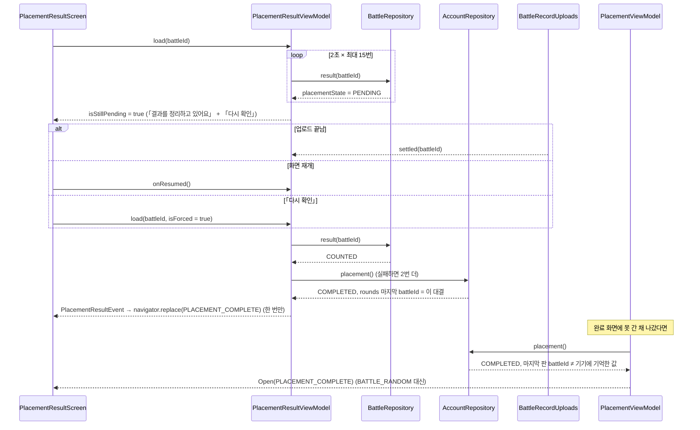
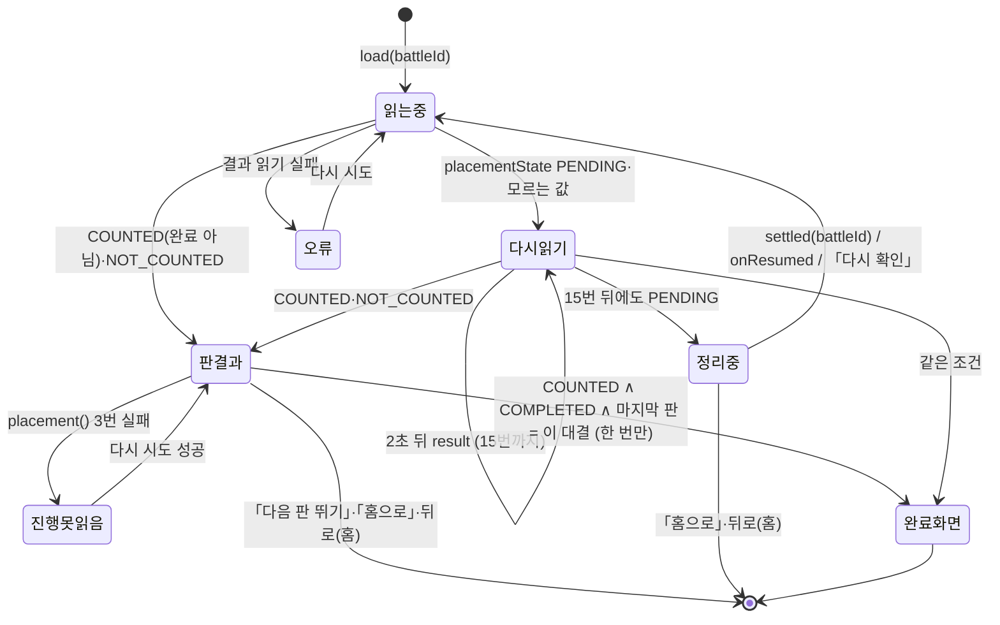
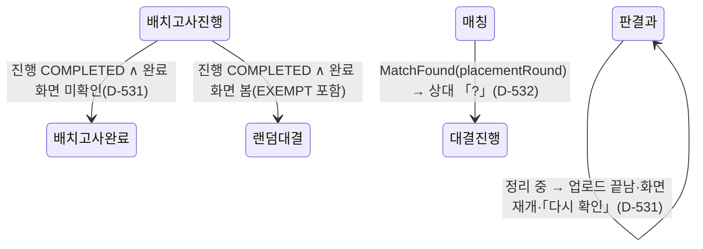

# 5.6 설계 결정 기록 (이어서: D-521~D-546, v0.32 배치고사 코드 리뷰·구현 반영)
> 작성: 2026-11-05 | 버전: v0.32 | 담당: 이성현(공용 담당 브랜치 `docs/S15P31A207-275-placement`) | 입력: code-review v0.22 [17-배치고사-1차](../code-review/17-배치고사-1차.md) 8절 U-1~U-11(U-10 철회)·[18-배치고사-2차](../code-review/18-배치고사-2차.md) 8절 U2-1~U2-8, 구현 작업자가 설계와 다르게 한 것(총괄 결정 기록 self-decisions의 implementation(BE)·(AN-1)·(AN-2)·(BE 수정 1차)·(AN 수정 2차) 행), 코드 S15P31A207-hotfix `hotfix/S15P31A207-275-v0111-feedback` c2685561과 b4798db8(impl/S15P31A207-275-an2, FR-276 진행 화면 「?」)(읽기만 함)

> [런크크 객체지향 분석·설계서](../design-oo.md) 목차 · 이전: [05-21-설계-배치고사-화면개편-성](05-21-설계-배치고사-화면개편-성.md) · 다음: [06-01-클래스-common-member](06-01-클래스-common-member.md)

이 조각은 [05-21](05-21-설계-배치고사-화면개편-성.md)(D-475~D-520, v0.30~v0.31)의 이어지는 조각이다. 05-21이 100KB에 가까워 v0.32 결정과 고친 명세는 여기에 쓰고, 05-21의 해당 문장에는 "(v0.32 D-5xx)" 표시와 이 조각 링크만 남겼다. **아래 결정이 05-21의 같은 자리 문장보다 앞선다.** 계약(05-03 5.7.3)은 항목·enum 값을 바꾸지 않고 뜻 문장만 고쳤다(D-522·D-525·D-540).

설계서를 코드에 맞춘 것(코드가 옳거나 총괄 결정에 근거가 있는 차이)과, 2차 리뷰 결함을 고치는 방향을 설계로 정한 것(D-531 PL2-A2, D-537 PL2-A7) 두 종류가 있다. PM이 정하지 않아 설계 담당이 정한 것은 근거 열에 "(설계 결정)"으로 표시하고 총괄 결정 기록(self-decisions)에 같은 내용을 남겼다.

## 1. 결정 표

### 1.1 갱신 요청과 결정 대응

| 요청 | 출처 | 결정 | 바꾼 자리 |
|---|---|---|---|
| U-1 | 17 8절 | D-521 | 05-21 D-511, 2.2 PlacementRoundCheck |
| U-2 | 17 8절 | D-522 | 05-21 D-513, 2.2 PlacementRoundReader |
| U-3 | 17 8절 | D-523 | 05-21 D-491, 2.3 DashboardView, 05-03 P8 |
| U-4 | 17 8절 | D-525 | 05-21 D-487, 05-03 5.7.3.1·5.7.3.3 placementState |
| U-5 | 17 8절 | D-526 | 05-21 2.4.1 결과 부품 |
| U-6 | 17 8절 | D-527 | 05-21 D-496 문장(`emblemAccent` → `masterAccent`) |
| U-7 | 17 8절 | D-527 | 05-21 7.3 표 |
| U-8 | 17 8절 | D-528 | 05-21 7.1 러닝 결과 행 |
| U-9 | 17 8절 | D-529 | 05-21 2.1·2.2·2.3 |
| U-10 | 17 8절 | **철회**(18 2절: PL1-B4가 `MemberRepository.refresh`로 해소되어 D-518 문장이 실제 동작이 됨). D-536이 D-518 문장을 보완 | 05-21 D-518 |
| U-11 | 17 8절 | D-530 | 05-21 11절 4, 05-03 5.7.3.6 |
| U2-1 | 18 8절 | D-531 | 05-21 D-501, 3.4 화면 흐름 |
| U2-2 | 18 8절 | D-532 | 05-21 2.4.3 "매칭·진행·결과·이력" 행 |
| U2-3 | 18 8절 | D-533 | 05-21 2.4.3 랜덤·친구·배치고사 진행·판 결과 행 |
| U2-4 | 18 8절 | D-534 | 05-21 2.4.3 이력, srs 03-08 J24-22 문장 보완(이성현 조각) |
| U2-5 | 18 8절 | D-535 | 05-21 8절(차이 18~23 추가) |
| U2-6 | 18 8절 | D-536 | 05-21 D-516·D-518, 2.1 PlacementService·WithdrawalService, MemberRepository |
| U2-7 | 18 8절 | D-522·D-524·D-523 | 05-21 D-487, 2.2 PlacementRoundReader, 05-03 5.7.3.1 |
| U2-8 | 18 8절 | D-537 | 05-21 7.1·7.2 |
| 작업자 보고 | self-decisions | D-538~D-546 | 05-21 2절 해당 클래스 |

### 1.2 코드 리뷰 반영 (D-521~D-537)

| ID | 근거 | 결정 | 대체 |
|----|------|------|------|
| D-521 | U-1, 총괄 결정 TF-V18-01(test v0.18), 코드 PlacementRoundCheck.java | **판 인정 값의 7번째 구성요소.** `record PlacementRoundCheck(boolean finished, boolean cancelled, boolean forfeited, boolean hasRecord, Boolean recordValid, boolean expiredWithoutRecord, boolean summaryMissingExpired)`. `summaryMissingExpired` = FINISHED이고 기록 ID는 붙었는데 요약을 읽지 못했고(recordValid == null) 판정 뒤 `SUMMARY_GRACE`(= `Battle.PENDING_LIMIT`, 24시간)가 지났다. 만드는 연산은 둘: `static of(Battle battle, long memberId, Boolean recordValid)`(셈·복구가 씀, 유예를 보지 않아 summaryMissingExpired는 늘 거짓)와 `static of(Battle battle, long memberId, Boolean recordValid, LocalDateTime now)`(결과 상태 읽기가 씀). `countable()`은 그대로, `isVoid()` = cancelled ∨ forfeited ∨ recordValid == FALSE ∨ expiredWithoutRecord ∨ summaryMissingExpired. 그래서 요약이 끝내 없는 판은 24시간 뒤 결과가 NOT_COUNTED로 닫힌다(영원히 PENDING이면 배치고사가 멈추고, 세지 않는 쪽이 보수적이며 다음 판으로 회복된다). 참가자가 아니면 IllegalArgumentException | 05-21 D-511의 6구성요소·of 3인자만 |
| D-522 | U-2, U2-7, 코드 리뷰 PL1-B1·PL1-B8, 코드 PlacementRoundReader.java | **판 결과 상태 읽기 보완.** `PlacementRoundReader` 협력: BattleRepository, RunQueryService, PlacementService, Clock(0.1 셈 기준상 Clock은 협력 수에서 빼므로 셈 3). `stateOf(memberId, battleId)` 순서: (1) 대결이 없거나 **취소됐으면 BusinessRuleException(BATTLE_NOT_FOUND)**(기존 결과 조회와 같음, D-525), 참가자가 아니면 PermissionDeniedException. (2) placementRound가 없으면 empty. (3) 본인 기록의 요약은 `RunQueryService.findSummary(recordId)`(예외 없는 조회, D-524)로 읽어 valid(없으면 null). (4) `PlacementRoundState.of(PlacementRoundCheck.of(battle, memberId, valid, now), isCounted, isCompleted)`. (5) 결과가 PENDING이고 `check.countable()`인데 판정 뒤 `PlacementReconcileService.LOOKBACK`(7일, 복구 창)이 지났으면 `placement_round_unrecovered` 경고 로그를 남기고 **NOT_COUNTED**(세 계기가 모두 실패한 채 복구 창이 지나 더 셀 계기가 없다). 늦은 기록 연결로 그 사이 세지면 COUNTED가 앞선다. `PlacementRoundState.of`의 서명과 PlacementRoundCheck 구성요소는 이 규칙 때문에 바뀌지 않는다(복구 창은 Reader만 본다) | 05-21 D-513 협력 3, D-487의 "그 밖 → PENDING"(복구 창 뒤 포함) |
| D-523 | U-3, 코드 리뷰 PL1-B5, ArchUnit 허용 `analysis ↛ battle`, `web.record → {analysis, battle, running}`, D-33 | **홈 최근 러닝.** `DashboardView`는 `RecordRow latestRun`(null 가능)만 더한다(`latestRunOutcome`은 두지 않는다: battle 형식이라 analysis → battle 화살표가 생긴다). 대결 결과는 web.record `DashboardController`가 `BattleHistoryService.outcomesOf(memberId, List.of(latestRun.battleId()))`로 붙여 `RecordDtos.DashboardResponse.of(view, outcome)`을 만든다(표현 계층이 붙이는 D-33 방식, 화살표 기존). `DashboardService`는 `RunQueryService.latestListRow(memberId): Optional<RunListRow>`(running 포트 `RunRecordRepository.latestListRow`, `order by started_at desc, record_id desc limit 1`, 유효·무효 모두, 기간 상한 없음, 인덱스 idx_run_record_member_started)로 1건만 읽는다. 기록 목록의 "내일 0시 미만" 상한을 두지 않아 기기 시계가 앞서 시작 시각이 미래인 기록이 있으면 그 기록이 최근 러닝으로 보일 수 있다(드묾, 총괄 결정 BE 수정 PL1-B5) | 05-21 D-491·2.3의 latestRunOutcome, "기록 목록과 같은 조회(RecordQueryService)" |
| D-524 | U2-7, 코드 리뷰 PL1-B1, 코드 RunQueryService(클래스 단위 `@Transactional(readOnly = true)`) | **없을 수 있는 기록은 예외 없는 조회로.** RunQueryService에 `Optional<RunSummary> findSummary(String recordId)`, `Optional<RunComparison> findComparison(String recordId)`, `Optional<RunListRow> latestListRow(long memberId)`를 둔다(기존 `summary`·`comparisonOf`는 "있어야 하는" 호출부용으로 남김). 규칙: 같은 트랜잭션에 참여하는 호출자가 "없음"을 정상 갈래로 다룰 때는 **BusinessRuleException을 잡지 말고 Optional 연산을 쓴다**(참여 트랜잭션에 rollback-only가 찍혀 커밋 때 UnexpectedRollbackException → 500). 이 규칙으로 PlacementRoundReader·PlacementRoundListener(요약), BattleResultService.comparison·theirs(비교표, findComparison)·recordGaps(기존 `curveOf`)가 바뀌었다. 요약을 못 읽은 수신자는 `placement_record_summary_missing` 경고 로그만 남긴다 | 05-21 2.2 Listener·Reader의 `summary(recordId)` |
| D-525 | U-4, 코드 BattleResultService.participantBattle·PlacementRoundReader | **취소 대결의 결과 상태.** 출발 전 취소된 대결은 결과 조회(P4) 자체가 기존처럼 409 `BATTLE_NOT_FOUND`다. 그래서 placementState의 "취소 → NOT_COUNTED" 갈래는 응답으로 나가지 않고, `PlacementRoundCheck.cancelled`는 셈·복구가 세지 않을 판을 가르는 데에만 쓴다. 계약 05-03 5.7.3.1·5.7.3.3 문장을 이 뜻으로 고쳤다(항목·값 그대로) | 05-03 placementState 문장의 "대결이 취소됐으면 NOT_COUNTED" |
| D-526 | U-5, 총괄 결정 AN-1 성과 줄 이름 형식·결과 공용 부품 추가, 코드 RunResultDetail.kt·AchievementRow.kt | **결과 공용 부품 시그니처.** `data class AchievementRow(val icon: AchievementIcon, val label: UiText, val value: String)`(ViewModel이 「리워드」·「승리」 같은 앱 문구를 리소스로 넘기고, 서버 신기록 문구는 UiText.Plain). `RunMetricCard(elapsed: Duration?, paused: Duration?, averagePace: Pace?, averageHeartRate: Int?, modifier: Modifier = Modifier, sections: @Composable ColumnScope.() -> Unit = {})`(피그마 지표 카드 안에 구간 페이스·심박 구간이 들어 있어 슬롯으로 받음). `ResultBottomBar(primary: String, onPrimary: () -> Unit, secondary: String, onSecondary: () -> Unit, modifier: Modifier = Modifier, isSecondaryEnabled: Boolean = true)`(기록 카드는 업로드 뒤에만 열림). 더한 공개 함수: `ResultDistanceHero(distance: Distance, dateLine: String, kindLabel: String?, modifier: Modifier = Modifier)`(러닝 결과·판 결과가 함께 쓰는 거리 히어로), `fun fastestSplitIndex(splits: List<Pace>): Int?`(최소 초, 같으면 앞 구간, 순수 함수, TC-5826) | 05-21 2.4.1 결과 부품 행 |
| D-527 | U-6·U-7, NFR-041, TC-5818, 총괄 결정 AN-1 티어 색 대비 | **티어 색 표기와 대비.** (1) 마스터 강조색 이름은 `masterAccent`(`RunkkTierColors` 생성자 인자, 7.3)다. D-496 문장의 `emblemAccent`는 오기다. (2) 라이트 확정 배지 글자색(content)을 피그마보다 조금 어둡게: 브론즈 #8A4B1F → **#85481E**, 골드 #8A6400 → **#6E4F00**(컨테이너·다크 값은 그대로). 피그마 값은 글자 대 바탕 대비 4.38·3.28로 4.5:1(NFR-041)에 못 미쳤고, 고친 값은 4.62·4.61이다(색상은 두고 명도만 낮춤). 1차 리뷰 4.2가 확정 배지 다섯 티어 라이트 4.61~5.24, 다크 5.07~7.36을 확인했다 | 05-21 D-496 문장, 7.3 표 브론즈·골드 라이트 content |
| D-528 | U-8, WCAG 2.2 1.4.11(비텍스트 대비), 코드 fourZoneColors (설계 결정) | **심박 4단계 막대 색.** Z1 = `Border`, Z2 = `LimeFill`, Z3 = **두 벌 모두 다크 벌 `Lavender`(#9C92F0)**, Z4 = `Violet`. Z3를 고정하는 이유: 라이트 Lavender가 Violet(#5B4FD9)과 같은 색이라 Z3·Z4가 구분되지 않고, #9C92F0이 피그마 #9D94F0에 가장 가깝다. Z1은 비텍스트 대비가 약 1.3:1(라이트)·1.2:1(다크)로 막대가 거의 보이지 않지만 **바꾸지 않는다**: 막대 아래 범례 「Zn nn%」가 네 칸 값을 모두 글자로 전달하고(색만으로 구분하지 않음), 막대는 비율을 보조로 보이는 장식이다. Z1을 BorderStrong으로 바꾸면 라이트는 3:1을 넘지만 다크 BorderStrong(#3F3F46)도 다크 Surface 대비 약 1.6:1이라 두 벌 모두를 풀지 못하고, 기준 이미지 B4 5장을 다시 기록해야 한다. 다음 화면 정리 때 Z1 전용 토큰을 검토한다(5절 남은 확인) | 05-21 7.1 러닝 결과 행의 "Z3 Lavender" |
| D-529 | U-9 (설계 결정: 줄이지 않고 명세에 올림) | **설계 밖 공개 멤버를 명세에 올린다.** 모두 쓰는 곳이 있어 패키지 전용으로 줄이지 않는다. member `PlacementProgress`: `public static final String DUPLICATE = "duplicate"`(Ignored 사유, 수신자가 "이미 셈"을 가름), `Optional<LocalDateTime> completedAt()`, `int countedRounds()`(로그·view), `long getMemberId()`(JPA 키). battle `MatchAcceptance`: 기존 3인자 생성자 `MatchAcceptance(boolean waiting, StandardDistance distance, StandardDistance defaultDistance)`(새 두 항목 null, `waitingFor`·`released`가 씀). battle.live `MatchFound`: 기존 8인자 보조 생성자(placementRound null). web.me `MeController` 안쪽 record `PlacementResponse(String status, int countedRounds, Integer nextRound, String provisionalTier, String tier, List<Round> rounds)`와 `PlacementResponse.Round(int round, long battleId, long battleDistanceMeters, long distanceMeters, long elapsedSeconds, Integer averagePaceSecondsPerKm, String verdict)`(기존 ProfileResponse와 같은 방식, 계약 키 `MeController.PlacementResponse`) | 없음(명세 보충) |
| D-530 | U-11, test v0.18 TF-V18-02·J-T18-3 | **계약 시험 이름.** 설계가 적은 `ServerDtoContractTest`·`ContractEnumsTest`는 코드에 없고 같은 대조를 하는 기존 시험이 있다. 앱: `android/data` api.contract `ServerContractTest`(DTO 항목·enum 대조, 메소드를 고침)와 `TierPlacementContractTest`(판 수 3). 서버: `AppContractSnapshotTest`(계약 파일 내보내기, 새 enum 2개)와 `web.PlacementContractTest`(P1~P8 응답 표본). 05-21 11절 4와 05-03 5.7.3.6의 이름을 이것으로 읽는다 | 05-21 11절 4, 05-03 5.7.3.6 시험 이름 |
| D-531 | U2-1, 코드 리뷰 PL2-A2(중, FR-281 완료 화면 유실), FR-280·FR-281 (설계 결정: 회복 경로) | **판 결과 화면의 회복과 미확인 완료 화면.** D-501의 다시 읽기(2초 × 15번, 30초) 뒤에도 placementState가 PENDING(또는 모르는 값)이면 진행 카드 자리에 「결과를 정리하고 있어요. 잠시 뒤 다시 확인해 주세요」(제안)를 보이고, 화면이 다음 세 길로 다시 읽는다. (1) **업로드 완료 감시**: 이 대결 기록의 업로드가 끝나면(`BattleRecordUploads.settled(battleId)`, 대결 결과 화면과 같은 포트) 결과·진행을 다시 읽는다. (2) **화면 복귀 다시 읽기**: 화면에 돌아올 때(재개) 정리 중이거나 진행을 못 읽은 상태면 한 번 더 읽는다. (3) **「다시 확인」**: 안내 옆 글자 단추가 강제 다시 읽기를 한다(같은 대결 다시 읽기 가드가 결과를 가리지 않음). 진행 읽기는 실패하면 두 번 더 읽고(총 3번) 그래도 실패하면 진행 없이 「진행을 불러오지 못했어요」와 다시 시도를 보인다(앞서 읽은 진행을 남겨 카드가 한 판 적게 보이지 않게). 다시 읽은 결과가 COUNTED이고 진행이 COMPLETED이며 진행 rounds의 가장 큰 판의 battleId가 이 대결이면 `Routes.PLACEMENT_COMPLETE`로 바꿔 연다(한 번만). 덧붙여 **배치고사 진행 화면**(`PlacementViewModel`)이 진행 COMPLETED를 받았을 때 **이 기기에서 그 배치고사 완료 화면을 아직 보지 않았으면**(완료 화면을 열 때 마지막 판 battleId를 기기에 기억) `Routes.BATTLE_RANDOM` 대신 `Routes.PLACEMENT_COMPLETE`로 바꿔 연다. 서버에 완료 알림이 없어도 「다음 판 뛰기」·홈 → 랜덤 카드 어느 길로든 확정 티어 첫 화면(FR-281)에 닿는다. 기억 값이 없거나 지워졌으면(재설치) 한 번 더 보여도 되는 쪽을 택한다 | 05-21 D-501의 "그래도 PENDING이면 안내만" |
| D-532 | U2-2, FR-276 처리 "대결 진행 화면에서 상대 자리는 점선 원 「?」", 코드 b4798db8, 총괄 결정 FR-276 행 | **대결 진행 화면의 배치고사 상대.** `Routes.BattleRunning`에 `val placementRound: Int? = null`(기본값 null이라 저장된 백스택 키와 호환)을 더하고 `MatchViewModel.started`가 `match.placementRound`를 넘긴다. `BattleRunningUiState.placementRound: Int? = null`과 파생 `isOpponentHidden: Boolean get() = placementRound != null`(MatchUiState와 같은 이름·식)을 두고, `BattleRunningScreen`은 숨김이면 지도 위 상대 그림을 성사 화면과 같은 점선 원 「?」(`OpponentFigure(Figure.UNKNOWN)`, 마커 칸 72 안)로 그린다. **이름표는 서버 표시명(가상 닉네임) 그대로**다(FR-276 "상대 표시명은 가상닉네임, 티어는 보이지 않는다", 진행 화면에는 원래 상대 티어 표시가 없음). 「상대 연결됨」 같은 연결 상태 문구는 조정자가 주는 대로 둔다(Q-02: 가상 기록 표시를 하지 않음). 판 번호가 경로 키에 있어 프로세스 복원 뒤에도 유지된다. 진행 중 대결 안내 화면(ActiveBattle)은 대결 진행 화면을 다시 열지 않고(취소만) `ActiveBattle.placementRound`를 쓰는 진입은 없다. 워치 매칭 성사 화면에는 적용하지 않는다(배치 중이면 워치 랜덤 대결이 잠김, D-500. 워치가 티어를 못 읽어 잠그지 않고 요청한 드문 경우는 5절 남은 확인) | 05-21 2.4.3 "매칭·진행·결과·이력" 행의 MatchUiState만 |
| D-533 | U2-3, 총괄 결정 AN-2 ViewModel 협력, D-271(남은 친구 초대 정리), D-283(대결 결과의 기록 상세 길) | **배치고사·대결 화면 ViewModel 협력.** `RandomBattleViewModel(battles: BattleRepository, coordinator: BattleRunCoordinator, consent: LocationConsentUseCase, account: AccountRepository)`, `FriendBattleViewModel(battles, coordinator, consent)`(쓰지 않는 account를 뺌), `PlacementViewModel(account, battles, coordinator, consent)`: 세 화면이 매칭·초대 전에 `BattleRunCoordinator`로 남은 친구 초대를 정리한다(옛 배틀런 화면이 하던 일, 빠뜨리면 ALREADY_IN_BATTLE로 5분 막힘). `PlacementResultViewModel(battles, runDetails: RunDetailSource, account, uploads: BattleRecordUploads)`(RecordRepository 대신 대결 결과 화면과 같은 RunDetailSource, 업로드 감시는 D-531). `PlacementResultUiState(isLoading, battleId, result: BattleResult?, detail: RecordDetail?, state: PlacementRoundState?, progress: PlacementProgress?, isStillPending: Boolean, error: UiText?)`, 파생 `verdict: Verdict? get() = Verdict.of(result?.verdict)`, `isPending: Boolean`(result가 있고 state가 COUNTED·NOT_COUNTED가 아님). 협력 수는 모두 7 이하(0.1 셈 기준) | 05-21 2.4.3 해당 4행의 ViewModel 인자, UiState의 `verdict` 속성 |
| D-534 | U2-4, 코드 리뷰 PL2-A3(경), J24-22, D-483, 총괄 결정 AN-2 이력 라벨 (설계 결정: 번호 뜻) | **대결 이력의 배치고사 라벨.** 배치고사 판 행은 기존 RANDOM·GHOST 라벨 「배틀런」 뒤에 덧붙여 「배틀런 · 배치고사 n판」(`historyTypeText`, 문자열 `battle_history_type_placement`)이다. 라벨 앞 단어를 「랜덤 대결」로 바꾸지 않는다(기존 이력 라벨과 목록 밖 기준 이미지 G10 등이 바뀜, J24-22는 "랜덤 대결로 남기고 덧붙인다"). **n은 대결을 만든 때의 판 번호**(이력 응답 placementRound, 05-03 P6 그대로)다. 그래서 판정 보류 중에 다음 판을 만들었거나(D-483) 포기 판 뒤 다시 뛴 판은 두 행이 같은 번호로 보일 수 있다. 센 번호로 바꾸려면 이력 응답에 센 번호 항목을 더하거나 앱이 본인 진행 rounds의 battleId로 찾아야 해 핫픽스 범위(계약 고정)를 넘는다. PL2-A3은 후속(경)으로 남긴다 | 05-21 2.4.3 「배치고사 n판」, test TC-5908 기대 「랜덤 대결 · 배치고사 2판」 |
| D-535 | U2-5, 총괄 결정 AN-2(상단 바·판 결과·친구 거리 목록·완료 다크) | **피그마 차이 18~23 추가**(4절 표) | 없음 |
| D-536 | U2-6, 코드 리뷰 PL1-B3·PL1-B4, J24-9(탈퇴 자료 남기지 않음), 총괄 결정 BE 수정 PL1-B3 (설계 결정: 가장 보수적) | **탈퇴 ∥ 첫 배치고사 요청 직렬화와 회원 다시 읽기.** (1) member 포트 `MemberRepository.refresh(Member member)`(JPA는 `em.refresh`, InMemory 구현은 아무것도 하지 않음)를 더한다. (2) `PlacementService.lockForMatch(memberId)`: `lockOrCreate`로 진행 행을 잠근 뒤 회원을 읽고 **`refresh`로 DB 값을 다시 읽는다**(같은 트랜잭션에서 hasConsent가 1차 캐시에 올린 회원은 잠금 대기 중 커밋된 탈퇴·확정을 보지 못함). 회원이 ACTIVE가 아니면 `BusinessRuleException(MATCH_FAILED)`(새 사유 코드를 만들지 않음, 탈퇴 회원은 다음 요청부터 인증 필터가 401). 랭크 티어이거나 진행이 완료면 empty(D-518 문장이 refresh로 실제 동작이 됨). (3) 두 탈퇴 경로(`WithdrawalService` 본인 탈퇴·미이용 게스트 파기)는 **탈퇴 가드(ActiveBattleGuard)보다 먼저** `placementProgressRepository.lockOrCreate(memberId)`(INSERT … ON CONFLICT DO NOTHING 뒤 잠금)로 커밋 전 매칭의 INSERT와 직렬화하고 같은 트랜잭션에서 `deleteByMemberId`로 지운다. 가드가 막으면 BusinessRuleException으로 트랜잭션째 되돌려 그 INSERT도 남지 않는다. 게스트 파기를 건너뛰는 갈래는 `status.setRollbackOnly()`로 빈 행을 되돌린다(REQUIRES_NEW 최외곽이라 false만 돌아옴). **D-516 "행은 lockForMatch만 만든다"의 유일한 예외**가 이 탈퇴의 일시 행이다(같은 트랜잭션에서 지워 커밋되지 않음). 잠금 순서는 모든 경로에서 진행 행 → 회원이고 Member 비관 잠금이 없어 교착이 없다. (4) 진행 행이 이미 있는 회원(2판째 이후)의 매칭이 탈퇴 커밋을 기다리면 follow-on 잠금이 0행이 되어 낙관적 잠금 예외 → 기존 ApiExceptionHandler의 409 `CONCURRENT_UPDATE`("다시 시도해 주세요")다. 트랜잭션이 되돌려져 자료는 남지 않는다(MATCH_FAILED로 바꾸지 않음). 1차 U-10(D-518 문장을 "진행 행 완료면 empty"로 고치기)은 철회한다 | 05-21 D-516 "행은 lockForMatch만", D-518 "회원 티어를 다시 읽어"의 방법, 2.1 WithdrawalService |
| D-537 | U2-8, 코드 리뷰 PL2-A7(경), WCAG 1.4.11·1.4.1, RunkkColors 주석(컨트롤 경계 = BorderStrong) (설계 결정) | **컨트롤 경계와 선택 표시.** 친구 대결 거리 상자(닫힘) 테두리, 안 고른 거리 칩 테두리(랜덤 대결·배치고사 진행·친구 대결 공용 `BattleEntryParts`), 진행 카드 「남은 판」 막대는 `RunkkColors.BorderStrong`이다(Border는 1.2~1.3:1로 3:1 미달). 친구 대결 거리 목록에서 고른 행은 라임 바탕에 더해 **앞에 체크 아이콘과 Bold 글자**로 표시한다(바탕색만으로 선택을 구분하지 않음, 라이트 대비 1.37:1). 「이번 판」 막대는 Violet 35% 그대로(칸 글자 「n판 이번 판」이 함께 있음). 코드 반영은 2차 결과서 PL2-A7(경)로 추적한다 | 05-21 7.2 divider → Border 대응을 컨트롤 경계에 쓰던 것 |

### 1.3 구현 중 설계와 다르게 하거나 더 정한 것 (작업자 보고, D-538~D-546)

구현 작업자(BE·AN-1·AN-2와 1·2차 수정)가 설계와 다르게 했거나 설계가 비워 둔 곳을 정한 것을 코드 기준으로 설계에 올린다. 1.2에 이미 있는 것(TF-V18-01, latestRunOutcome, 결과 부품, 티어 색, Z3, 협력, 이력 라벨, FR-276, 탈퇴 잠금)은 빼고 묶었다.

| ID | 근거(총괄 결정 기록 행) | 결정 | 대체 |
|----|------|------|------|
| D-538 | implementation(BE) uq 위반 처리 위치·M1·M3·M4, BE 수정 PL1-B6·PL1-B7 | **판 셈 수신자 세부.** (1) `uq_placement_round_battle` 위반은 `PlacementService`가 아니라 `PlacementRoundListener.count`가 잡아 "이미 셈"(참)으로 끝내고 다시 하지 않는다(서비스 안에서 잡으면 같은 트랜잭션이 rollback-only가 됨). (2) `count(battleId)` 반환: 셌거나 이미 셌으면(Ignored 사유 `PlacementProgress.DUPLICATE`) 참, 그 밖의 Ignored(진행 없음·탈퇴·랭크·완료)는 거짓. (3) 판정 정정도 일시 오류 3번 재시도. (4) `onBattleJudged`가 정정 사건이면 **count 먼저, correctVerdict 그다음**(다른 계기가 옛 판정으로 센 판도 뒤의 정정이 고침, PL1-B7. 잠금 뒤 판정을 다시 읽으면 member → battle 화살표가 필요해 순서로 풂). (5) 운영 로그 `placement_round_counted … result=<결과 종류 이름> round=<센 판 수>`(임시·확정 티어를 남기지 않음, PL1-B6). (6) `PlacementProgress.rounds`는 값 요소 bag이라 잠금 뒤에만 바꾼다는 전제를 Javadoc에 적는다 | 05-21 D-516 마지막 문장(uq 위반 위치), 2.2 PlacementRoundListener |
| D-539 | BE 수정 PL1-B2, code-review 18 2절·PL2-B1(경) | **판 셈 동시성의 근거.** 같은 회원을 두 계기가 동시에 셀 때 Hibernate 6.6(PostgreSQL)은 진행 행과 판 목록을 잠금 없이 읽은 뒤 `select … where member_id=? and version=? for update`(follow-on 잠금)로 따로 잠근다. 기다리는 사이 다른 셈이 커밋하면 version이 달라 낙관적 잠금 충돌(TransientDataAccessException)이 나고 수신자가 새로 읽어 다시 센다(D-481 3회 재시도). 그래서 "잠근 뒤 옛 판 목록으로 셈"은 일어나지 않는다(TC-5923 두 시험, 시험 출력의 StaleObjectStateException·placement_count_retry로 확인). 이 보호가 Hibernate 내부 잠금 전략에 기대므로 **Hibernate를 올릴 때 TC-5923을 회귀 기준**으로 삼는다. `PlacementProgress.count` 첫 줄 불변식(rounds 수 = countedRounds) 단언은 PL2-B1(경) 후속 | 05-21 D-516의 "잠금 뒤 판단" 근거 보충 |
| D-540 | implementation(BE) 복구 작업 등록·MatchFound null·대기열 장애·계약 enum 파일, 배포 설정(총괄) | **서버 배선·계약 표본.** (1) `PlacementReconcileJob`은 `batch.battle.BattleSchedulingConfig`에 등록하고 cron은 `runkk.batch.placement-reconcile-cron`(기본 `"0 20 0 * * *"`). 스케줄러 풀 기본값을 20 → **21**(`SCHEDULER_POOL_SIZE`, application.yml·infra docker-compose.yml·.env.example 같은 값, 작업이 늘면 풀도 늘린다는 기존 규칙). 운영 `.env`에 20이 직접 있으면 21로 올린다(배포 확인). (2) `PlacementMatcher`는 isBusy의 대기열(Redis) `DataAccessException`을 `QUEUE_UNAVAILABLE`로 바꾼다(MatchingService와 같은 처리, 05-03 P2 오류 목록 그대로). (3) 배치고사가 아닌 MatchFound JSON에도 `"placementRound": null`이 실린다(battle.live는 Jackson 비의존이라 @JsonInclude 불가, ArchUnit 규칙 7). 계약은 "null 가능"이고 앱은 모르는 항목을 버린다. 서버 표본 `MatchFound.json`에 항목을 더하고 `MatchFound-placement.json`을 새로 둔다. (4) 계약 enum 파일은 `PlacementStatus.txt`·`PlacementRoundState.txt` 둘만 내보낸다(`PlacementVerdict`는 Verdict.txt와 같은 값, D-509) | 05-21 D-490(등록 위치 없음), 05-03 5.7.3.4(null 직렬화 언급 없음) |
| D-541 | implementation(AN-1) placement 기본 구현·모르는 배치 상태·모르는 확정 티어·큰 「?」·한 파일 규칙·탭 판정, AN-2 PL1-A8 | **앱 기반 세부.** (1) `AccountRepository.placement()`에 기본 구현 `Outcome.Failure(Server(0))`을 두고 `AccountRepositoryImpl`이 덮어쓴다(가짜 저장소를 고치지 않고 기반 커밋이 컴파일되게). (2) 모르는 배치 status 이름은 해독 실패(SerializationException) → `Server(0)` 실패(IN_PROGRESS·EXEMPT 가운데 하나로 짐작하지 않음, 진입 시트는 실패를 배치고사로 보냄 D-499). (3) `TierDisplay`: 모르는 확정 티어(예 DIAMOND)는 이름은 받은 그대로, 색·그림은 배치 중 것. **모르는 임시 티어(BRONZE~MASTER 밖)는 Placing으로 접는다**(「임시 DIAMOND」 영문 노출 방지, PL1-A8). (4) 배치 중 큰 엠블럼의 「?」 글자 크기는 dp 기준(그림 일부, 글자 크기 설정 무시, 낭독 안 함). (5) 한 파일 규칙(D-112)으로 `TierPalette`·`TierEmblemSize`·`TierBadgeSize`·`TierBadgeLook`(internal)·`ZoneShare`·`AchievementIcon`·`AchievementRow`·domain `PlacementStatus`·`PlacementRound`·홈 요약 형식을 파일마다 나누고 아이콘 `ChevronDown`·`ChevronUp`을 더한다. (6) app `tabOf(NavKey)`에 인자 키(PlacementResult)는 탭 없음(null) | 05-21 2.4.1·2.4.2 해당 행 보충 |
| D-542 | implementation(AN-1) 홈 패널·진입 시트·홈 헤더·마이·랭킹·시상대·자가 리뷰, PL1-A1·PL1-A5 | **홈·마이·랭킹 화면 세부.** (1) **홈 날짜는 한국 시간**: 홈의 오늘·잔디·대시보드 기준일·최근 러닝 날짜를 `HOME_ZONE = Asia/Seoul`(feature/home)로 센다. 앱 전역 Clock(systemUTC)은 바꾸지 않는다(서버가 날짜를 KST로 셈, 다른 화면은 후속 이슈, PL1-A1). (2) 펼친 패널은 아바타 위에 겹쳐(블러 없음) 방 안쪽 여백 12를 넘어 화면 여백 16 안 전체 폭, 알약은 오른쪽 위(8절 2). (3) 홈 헤더: 진행을 못 읽으면 배지 없이 「Lv.n」만, 다시 읽기 실패는 지난 값 유지, 배치 진행 읽기는 차례 번호로 마지막 결과만 반영. (4) 진입 시트: ModalBottomSheet 덮개 #171A12 45%, 진행을 못 읽으면 랜덤 카드 「랜덤 대결」만, 확정 회원은 `TierBadge(ofSelf)` + 「비슷한 페이스의 러너와 대결해요」, 친구 카드 그림은 내 캐릭터와 반대 성별 기본 캐릭터(피그마에 친구 아바타 기준 없음). (5) 마이: 닉네임을 한 줄로 두고 아래 줄에 레벨·티어 배지(「임시 플래티넘」 SMALL 폭 때문), 배치 진행을 못 읽으면 프로필 tier로 `ofPublic` 표시. (6) 랭킹: 기간 칩은 높이 32·r8 칩(고름 SelectedFill, 안 고름 periodChip, RadioButton 역할)이고 칩 Row는 `selectableGroup()`(PL1-A5), 목록 행 아래선 RunimalTileBorder, 줄 낭독 끝에 티어(「골드 티어」·「배치 중」). 시상대 최소 높이 230, 2명 이하일 때 빈 자리는 숫자 없는 받침만. (7) 「내 기록 요약」·「접기」·기간 칩의 터치 영역 48dp(보이는 크기 그대로) | 05-21 2.4.3 홈·마이·랭킹 행, 7.1 보충 |
| D-543 | implementation(AN-1) 심박 출처·출생연도·성과 크루 줄·결과 기존 시험, PL1-A2 | **러닝 결과 세부.** (1) `heartRateSource`는 결과를 읽으면 늘 `"WATCH"`(앱 심박 출처는 워치뿐, 심박 없는 변형도 칩 유지). (2) `hasBirthYear` = 평균 심박이 없거나 심박 구간이 있으면 참(서버가 출생연도 있을 때만 구간을 줌, ViewModel 협력을 늘리지 않음). (3) 성과 `AchievementIcon.CREW` 행은 CREW 기능이 열렸을 때만 그리고 러닝 결과는 크루 줄을 만들지 않는다(1차 배포 CREW 닫힘). (4) 하단 바 글자 단추는 `clickable` 뒤 `minimumInteractiveComponentSize()`로 클릭 노드 48dp(보이는 차이는 바 높이 +8, PL1-A2). 문구 「기록 카드 만들기」 | 05-21 2.4.3 러닝 결과 행 보충 |
| D-544 | implementation(AN-2) 화면 이동·다음 판·완료 이동·결과 → 판 결과·진행 못 읽음·자가 리뷰 | **배치고사 화면 이동.** (1) `RandomBattleEvent`·`PlacementEvent`는 `Open(key)` 하나: 랜덤 대결 ↔ 배치고사 진행처럼 `Routes.Key`면 `navigator.replace`, 매칭·초대 대기는 위치 권한 확인 뒤 `navigate`. (2) 판 결과 「다음 판 뛰기」 = `restart(HOME)` 뒤 `navigate(PLACEMENT)`(홈 위 배치고사 진행 하나), 완료 화면 「랜덤 대결 하러 가기」 = `restart(HOME)` 뒤 `navigate(BATTLE_RANDOM)`, 판 결과·완료의 시스템 뒤로도 홈(BackHandler). (3) 막 끝난 대결 결과에 placementRound가 있으면 **판정 보류여도 바로** 판 결과로 replace하고 평가 화면 사건은 내지 않으며 대결 결과 화면의 다시 읽기는 플래그로 멈춘다(판 결과 화면이 따로 PENDING을 다시 읽음). (4) 배치고사 진행 화면은 돌아올 때마다 진행을 다시 읽고, 진행을 못 읽으면 카드 자리에 오류+다시 시도와 하단 단추 비활성(라벨 「배치고사 1판 시작」). 랜덤 대결 화면은 진행을 못 읽으면 배지 없이 그대로 둔다(서버가 언랭 요청을 배치고사로 받으므로 막지 않음). (5) 판 결과의 완료 화면 전환은 한 번만 | 05-21 D-499·D-501 보충, 3.4 |
| D-545 | implementation(AN-2) 판 결과 성과·진행 카드 낭독·친구 목록·완료 히어로·친구 히어로 | **배치고사 화면 세부.** (1) 판 결과 성과 첫 줄은 승패, 둘째 줄 값은 도착 시간 차 「+mm:ss」(상대 − 나, 둘 다 있을 때만)이고 리워드 줄은 `totalRewardPoints`(없으면 rewardPoints)가 0보다 클 때만(4절 18). (2) 진행 카드 머리는 「배치고사 n/3판」(AfterRound는 「…판 완료」) 한 줄로 읽고 칸 이름은 그대로 읽는다(「/3판」을 「슬래시」로 읽지 않게). 「3분의 2」·날짜로 읽힐 위험과 칸 이름 겹침은 2차 결과서 PL2-A5(경, 실기기 확인)로 추적한다. (3) 친구 목록 행: 프로필 원은 RunimalTile 빈 원(이력 응답에 친구 아바타 정보 없음), 라디오는 직접 그림(테두리 2 + 점 10), 행 전체가 `selectable`. (4) 완료 축하 히어로 350×212에 피그마 7-5 조각 위치·각도 그대로, 조각 금색 `podiumFirst`, 아바타 JOY(작은 폭·글자 확대 배치는 PL2-A6 경 후속). (5) 친구 대결 히어로의 두 아바타 = 내 캐릭터 + 반대 성별 친구(진입 시트와 같은 규칙) | 05-21 2.4.3·7.1 판 결과·완료·친구 대결 행 보충 |
| D-546 | implementation(AN-2) 워치, (AN 수정 2차) FR-276 워치 | **워치.** 잠금 문구는 「폰에서 배치고사를\n마치면 열려요」(원형 화면에서 낱말이 끊기지 않게 줄바꿈), 워치 문자열 `tier_unranked`도 「배치 중」(폰 D-507과 같게), 옛 서버의 RANKED_ONLY 거부는 잠금으로 보인다. 배치고사 상대 「?」(D-532)는 워치 성사 화면에 적용하지 않는다 | 05-21 D-500 문구 줄바꿈 |

## 2. 객체 모델 고친 명세 (05-21 2절 해당 행 대신)

### 2.1 서버 member

- `MemberRepository`(포트, 변경): `void refresh(Member member)` 추가(D-536).
- `PlacementProgress`(변경): 연산 표에 `DUPLICATE`, `completedAt()`, `countedRounds()`, `getMemberId()`(D-529).
- `PlacementService.lockForMatch`: `lockOrCreate` → `MemberLoader.load` → `memberRepository.refresh(member)` → ACTIVE 아님이면 `BusinessRuleException(MATCH_FAILED)` → 랭크 티어이거나 `progress.isCompleted()`면 empty → `Optional.of(progress.basis())`(D-536).
- `WithdrawalService`(변경): 두 탈퇴 경로가 가드 앞에서 `placementProgressRepository.lockOrCreate(memberId)`, 끝에서 `deleteByMemberId(memberId)`. 게스트 파기를 건너뛰면 `status.setRollbackOnly()`(D-536).

### 2.2 서버 battle (박재영 담당 패키지, 06-03 반영 요청)

- `PlacementRoundCheck`: 구성요소 7개와 `of` 두 겹침, `SUMMARY_GRACE`(D-521).
- `PlacementRoundReader`: 협력 BattleRepository·RunQueryService·PlacementService·Clock, `stateOf` 순서(D-522·D-525).
- `PlacementRoundListener`: 요약은 `findSummary`, 못 읽으면 경고 로그, uq 위반은 count가 "이미 셈", 반환 뜻, 정정은 count 뒤(D-524·D-538).
- `BattleResultService`: comparison·theirs는 `RunQueryService.findComparison`, recordGaps는 `curveOf`(예외를 잡지 않음, D-524).
- `PlacementMatcher`: 대기열 장애 → QUEUE_UNAVAILABLE(D-540).
- `MatchAcceptance`·`battle.live.MatchFound`: 보조 생성자(D-529).

### 2.3 서버 running·analysis·web (running·analysis는 박재영 담당 패키지, 06-02 반영 요청)

- `RunQueryService`: `findSummary(String): Optional<RunSummary>`, `findComparison(String): Optional<RunComparison>`, `latestListRow(long): Optional<RunListRow>`. 포트 `RunRecordRepository.latestListRow(long)`(D-523·D-524).
- `DashboardView`: `RecordRow latestRun`만 추가(null 가능). `DashboardService`가 `latestListRow`로 채움(D-523).
- web.record `DashboardController`: `BattleHistoryService.outcomesOf`로 최근 러닝의 대결 결과를 붙여 `DashboardResponse.of(view, outcome)`(D-523).
- web.me `MeController.PlacementResponse`·`Round`(D-529).
- batch.battle `BattleSchedulingConfig`: placementReconcileCron 등록(D-540).

### 2.4 앱

| 클래스·함수 | 위치 | 고친 시그니처·책임 |
|---|---|---|
| 결과 부품 | core.designsystem RunResultDetail.kt, AchievementRow.kt | D-526 시그니처. `RunMetricCard(…, modifier, sections)`, `ResultBottomBar(…, modifier, isSecondaryEnabled)`, `ResultDistanceHero(distance, dateLine, kindLabel, modifier)`, `fastestSplitIndex(splits): Int?`, `AchievementRow.label: UiText` |
| Routes.BattleRunning | core.navigation | `data class BattleRunning(…, val celebrityFigure: String? = null, val placementRound: Int? = null) : NavKey`(D-532) |
| BattleRunningUiState | ui.battle | `placementRound: Int? = null`, `isOpponentHidden: Boolean get() = placementRound != null`(D-532) |
| BattleRunningViewModel·MatchViewModel | ui.battle | 키의 placementRound를 상태로, `started`가 `match.placementRound`를 키에(D-532) |
| RandomBattleViewModel·FriendBattleViewModel·PlacementViewModel | ui.battle | D-533 협력. PlacementViewModel은 COMPLETED이고 완료 화면을 안 봤으면 `PLACEMENT_COMPLETE`로 바꿔 연다(D-531) |
| PlacementResultUiState·PlacementResultViewModel | ui.battle | D-533 형식·협력, D-531 회복(업로드 감시·화면 복귀 다시 읽기·「다시 확인」·진행 읽기 실패 안내) |
| historyTypeText | ui.battle BattleHistoryViewModel.kt | `internal fun historyTypeText(entry: BattleHistory.Entry): UiText` = placementRound가 있으면 「<기존 라벨> · 배치고사 n판」(D-534) |
| TierDisplay | core.model | 모르는 임시 티어 → Placing(D-541) |
| HomeViewModel | ui.home | 날짜는 `HOME_ZONE`(Asia/Seoul) 기준(D-542) |
| AccountRepository.placement | domain.account | 기본 구현 `Failure(Server(0))`(D-541) |

## 3. 동적 모델 보완

### 3.1 사건 시나리오 고침

- S-PL3 판 결과 보기(v0.32): BattleResultViewModel이 isJustFinished이고 결과의 placementRound가 있으면 판정 보류여도 PlacementResult로 바꿔 연다(D-544) → PlacementResultViewModel이 BattleRepository.result·RunDetailSource·AccountRepository.placement를 읽고 PENDING이면 2초 × 15번 다시 읽는다 → 그래도 PENDING이면 안내를 보이고 BattleRecordUploads.settled·화면 재개·「다시 확인」 사건에 다시 읽는다(D-531) → COUNTED·COMPLETED·마지막 판이 이 대결이면 PlacementComplete.
- S-PL4 미확인 완료 화면(v0.32 신규): 판 결과에서 완료 화면에 가지 못한 채 홈으로 나간 러너가 진입 시트 랜덤 카드 또는 「다음 판 뛰기」로 배치고사 진행 화면에 오면, PlacementViewModel이 진행 COMPLETED와 "완료 화면을 본 마지막 판 battleId"가 다름을 보고 PlacementComplete로 바꿔 연다(D-531).
- S-PL5 배치고사 대결 진행(v0.32 신규): MatchViewModel.started가 Routes.BattleRunning(placementRound)을 낸다 → BattleRunningViewModel이 키의 placementRound를 상태에 담는다 → BattleRunningScreen이 isOpponentHidden이면 지도 위 상대를 「?」 원으로 그린다(D-532).

### 3.2 사건 추적도 SQ-51 판 결과 회복 (S-PL3·S-PL4, D-531)

### 3.3 상태도 2.4.28 판 결과 화면 (PlacementResultViewModel 상태, D-531·D-544)

판 결과 화면은 다시 읽기·정리 중·완료 전환이 시간에 따라 바뀌어 상태도를 둔다. 사건은 모두 ViewModel 연산(load, onResumed, onRetry, 업로드 감시 수신)에 대응한다.

### 3.4 앱 화면 흐름 보완 (05-21 3.4에 더함)

## 4. 피그마 차이 추가 18~23 (05-21 8절 이어서, D-535)

규칙은 05-21 8절과 같다. 모두 AN-2 구현에서 정한 것이다(총괄 결정 AN-2 행).

| # | 차이 | 처리 | 근거 |
|---|---|---|---|
| 18 | 판 결과 성과 첫 줄 값 「+42m」(거리 차) | 「+mm:ss」 도착 시간 차(상대 − 나, 둘 다 있을 때만). 없으면 그 값 칸을 그리지 않음 | 결과 응답(05-03 P4)에 거리 차 항목이 없음. 계약을 늘리지 않음 (설계 결정) |
| 19 | 판 결과에 기록 상세가 없을 때 모습 없음 | 본인 기록 상세가 아직 없으면(업로드 전) 거리 히어로·지표 카드를 빼고 성과·진행만 보인다 | 결과 응답에 거리·시간이 없음, 빈 틀을 그리지 않음(8절 9와 같은 규칙) (설계 결정) |
| 20 | 판 셈 정리 중 모습 없음 | 다시 읽는 30초 동안 진행 카드 자리에 「결과를 확인하고 있어요」 + 작은 진행 표시, 30초 뒤에는 카드 없이 「결과를 정리하고 있어요…」 + 「다시 확인」(D-531). 「결과를 확인하고 있어요」 줄은 Notice와 같이 Surface 바탕과 낭독 알림(liveRegion)을 둔다(풍경 그림 위 대비 4.5:1, 2차 결과서 PL2-A4 경 추적) | 센 판 수가 아직 바뀌지 않은 카드를 보이면 틀린 n이 보임 (설계 결정) |
| 21 | 상단 바 h57·pl12·18 Bold | 랜덤 대결·배치고사·판 결과·완료 상단 바는 앱 공용 `RunkkTopBar`(높이 64, 여백 16, 뒤로 40, TopBarTitle) | 몇 dp 차이, 앱 공용 부품을 따름 (설계 결정) |
| 22 | 친구 대결 거리 선택이 팝업 목록 | 목록을 상자 바로 아래에 펼쳐 내용을 밀어낸다. 행 높이 48(피그마 44), 고른 행 라임 바탕 + 체크·Bold(D-537), 상자는 DropdownList 역할과 펼침·접힘 상태 낭독 | 스크롤 화면에서 겹침 없음, 터치 48dp (설계 결정) |
| 23 | 완료 화면 다크 시안 없음(축하 히어로 흰 원) | 빛 원은 라이트 흰색 75%, 다크는 표면색(Surface) 75% | 다크 티어 글자색(밝은 금 등)이 흰 원 위에서 대비가 낮음, 8절 17 규칙 연장 (설계 결정) |

## 5. 남은 확인 (v0.32)

- 심박 Z1 전용 토큰(D-528): 라이트·다크 모두 비텍스트 3:1을 넘는 회색을 다음 화면 정리 때 정한다(지금은 범례 글자로 값 전달).
- 이력 「배치고사 n판」의 번호(D-534, PL2-A3): 센 번호를 쓰려면 이력 응답 항목 추가가 필요하다(다음 계약 변경 때 srs J24-22와 함께).
- 워치가 티어를 못 읽어(null) 잠그지 않은 채 언랭 랜덤 요청을 보내면 서버가 배치고사로 받아 워치 성사 화면에 상대 얼굴·이름이 보일 수 있다(D-532·D-546, 드묾).
- 경 결함으로 남은 코드 반영: PL2-A4(정리 중 줄, 4절 20), PL2-A5(진행 카드 낭독, D-545), PL2-A6(완료 화면 고정 크기), PL2-A7(경계·선택, D-537), PL2-B1(불변식 단언, D-539), 1차 이월 PL1-A3·A4·A6·A7·A9.
- 배포 확인(D-540, implementation v0.11): prod flyway 최대 V35, 운영 `.env` SCHEDULER_POOL_SIZE 21, v0.12 릴리스 MR에서 develop out-of-order 지우기.

## 6. 추적 보충 (A-추적표 v0.32 행과 같음)

| 요구 | v0.32에 더한 설계 요소 |
|---|---|
| FR-275 | PlacementRoundCheck.summaryMissingExpired(D-521), RunQueryService.findSummary(D-524), PlacementRoundListener 세부(D-538), 동시성 근거(D-539) |
| FR-276 | 앱 Routes.BattleRunning.placementRound, BattleRunningUiState.isOpponentHidden, BattleRunningScreen 「?」(D-532) |
| FR-280 | PlacementRoundReader(Clock, 복구 창 뒤 NOT_COUNTED, D-522), 취소 = BATTLE_NOT_FOUND(D-525), PlacementResultViewModel 회복(D-531), 상태도 2.4.28 |
| FR-281 | PlacementViewModel 미확인 완료 화면 열기(D-531), SQ-51 |
| FR-282 | TierDisplay 모르는 임시 티어 → Placing(D-541) |
| FR-283 | RunkkTierColors 라이트 브론즈·골드 content(D-527) |
| FR-285·FR-286·FR-279 | RandomBattle·FriendBattle·Placement ViewModel 협력 BattleRunCoordinator(D-533), 경계·선택 표시(D-537) |
| FR-287 | DashboardView.latestRun + DashboardController 결과 붙임, RunQueryService.latestListRow(D-523), 홈 날짜 Asia/Seoul(D-542) |
| FR-289 | 결과 부품 시그니처(D-526), 심박 색(D-528), 러닝 결과 세부(D-543) |
| FR-021·J24-9 (탈퇴) | WithdrawalService lockOrCreate 선행 잠금, MemberRepository.refresh, lockForMatch MATCH_FAILED(D-536) |
| J24-22 (이력) | historyTypeText 「배틀런 · 배치고사 n판」, n = 만든 때 번호(D-534) |

## 7. 설계 판정 기준 점검 (v0.32 바뀐 부분만)

| 항목 | 판정 | 근거 |
|---|---|---|
| 매개변수 4개 이하 | 합격 | 새 연산 `of(battle, memberId, recordValid, now)` 4, `refresh(member)` 1, `latestListRow(memberId)` 1. Composable의 modifier·기본값 슬롯은 기존 셈 기준대로 뺀다 |
| 협력 객체 7 이하 | 합격 | PlacementRoundReader 3(+Clock), PlacementResultViewModel 4, RandomBattleViewModel 4, PlacementViewModel 4 |
| 계층·화살표 | 합격 | 새 화살표 0: web.record → battle(기존 허용, D-523), analysis ↛ battle 유지, 앱 ui.battle 안 RunDetailSource·BattleRecordUploads(기존 domain.battle). 서버 ArchUnit·앱 Konsist 허용 표 그대로(폰 159·워치 37) |
| 상태도 | 합격 | 판 결과 화면 2.4.28 추가, 사건 = 연산 |
| 동시성·개인정보 | 합격 | 탈퇴 ∥ 매칭 직렬화(D-536), 판 셈 follow-on 잠금 근거와 회귀 기준(D-539) |
| 제어 결합 | 합격 | 새 모드 인자 없음. `of` 두 겹침은 now 유무로 유예 검사만 다름(같은 규칙 한 곳) |
| 추적 | 합격 | 6절 |
