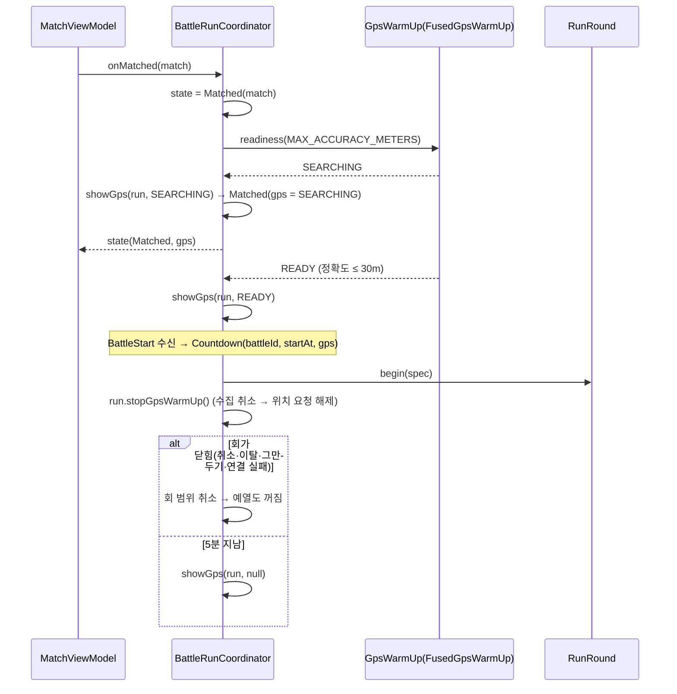
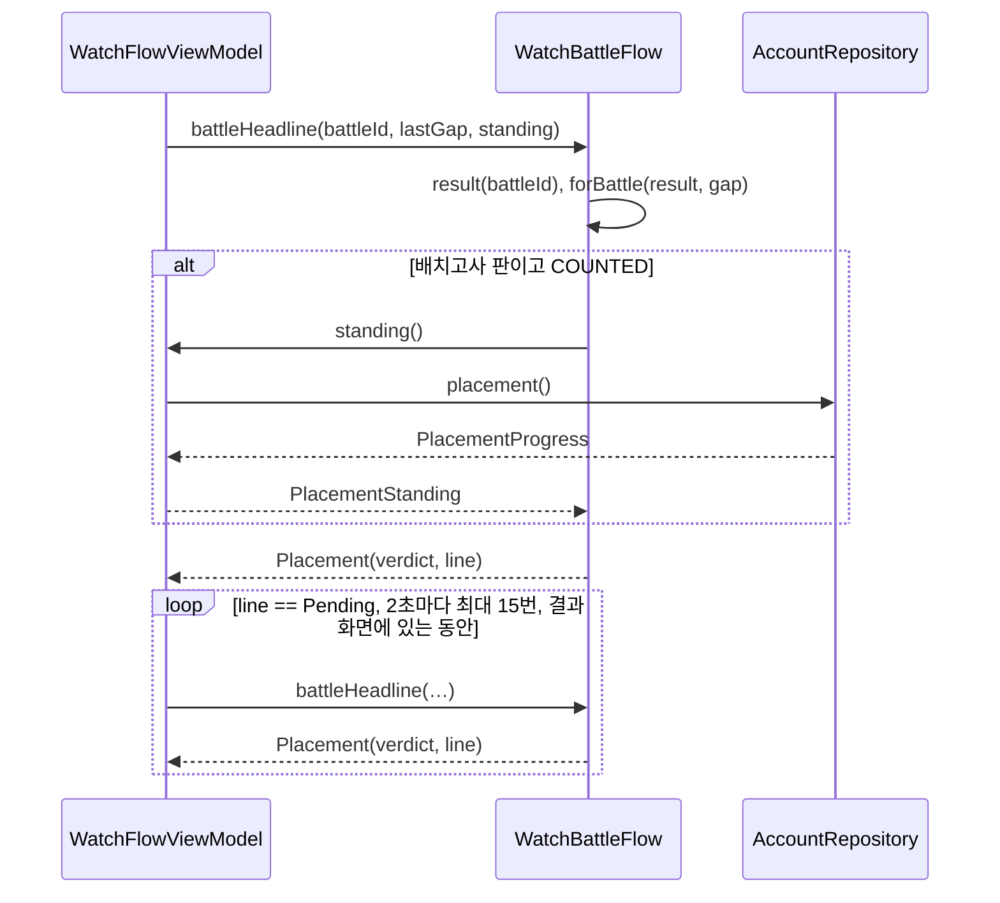
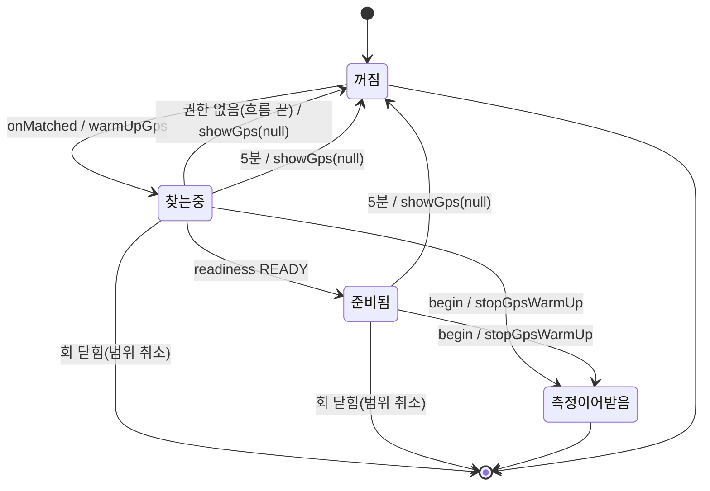

# 5.6 설계 결정 기록 (이어서: D-547~D-563, v0.33 핫픽스 수동 확인 뒤 추가 변경)
> 작성: 2026-11-05 | 버전: v0.33 | 담당: 이성현(공용 담당 브랜치 `docs/S15P31A207-275-placement`) | 입력: srs.md v0.25(7.13.20 CR-147~CR-153, 03-08 3.8.7 FR-291·FR-292, 3.8.8 J25-1~J25-8), 코드 S15P31A207-hotfix `hotfix/S15P31A207-275-v0111-feedback` 4a2722fd·303e6c5f·4569791a·6fc758cf·fa877a49·1f04f1df·0905c26d·ef3290f1·80592a08(읽기만 함), PM 확정 피그마 「랭킹 (v3 2026-11-05) 메인 탭, TOP3 시상대」·「⑦ 제안 · 워치 배치고사」

> [런크크 객체지향 분석·설계서](../design-oo.md) 목차 · 이전: [05-22-설계-배치고사-리뷰반영-성](05-22-설계-배치고사-리뷰반영-성.md) · 다음: [05-24-설계-이벤트-성](05-24-설계-이벤트-성.md)

이 조각은 [05-21](05-21-설계-배치고사-화면개편-성.md)·[05-22](05-22-설계-배치고사-리뷰반영-성.md)에 이어지는 조각이다. 2026-11-05 수동 확인과 실기기 대결 시험 뒤 핫픽스에 들어간 9커밋을 설계로 올린다. 코드가 먼저 들어갔으므로 이 조각은 **코드에 맞춘 설계 기록**이고, 설계 담당이 정한 것은 근거 열에 "(설계 결정)"으로 표시했다. **아래 결정이 05-21·05-22의 같은 자리 문장보다 앞선다.** 특히 D-553은 D-500의 워치 잠금과 D-546의 워치 잠금·「?」 미적용을 철회한다.

계약(05-03 5.7.3)과 서버 API 항목은 바꾸지 않았다. 랭킹 v3가 쓰는 `gapToNextMeters`와 워치가 쓰는 `GET /me/placement`·`MatchFound.placementRound`·`BattleResult.placementState`는 이미 있는 항목이다. 서버 변경은 `running.RunTrack.timeToReach` 허용 오차 하나다(D-559).

## 1. 결정 표

### 1.1 요구와 결정 대응

| srs | 커밋 | 결정 | 고친 명세 |
|-----|------|------|-----------|
| FR-287(CR-147) | 4a2722fd | D-547 | 2.1 홈 |
| 5.1 화면 방향(CR-148), J25-8 | 4569791a, 6fc758cf | D-548 | 2.1 홈, 2.5 앱 진입점 |
| FR-290 v3·FR-223(CR-149), J25-1 | fa877a49 | D-549~D-552 | 2.2 랭킹 |
| FR-291(CR-150), J25-2~J25-5, J24-12 철회 | 1f04f1df | D-553~D-557 | 2.3 워치 |
| CR-151, J25-7 | 0905c26d, ef3290f1 | D-558, D-559 | 2.4 도착 판정 |
| FR-292(CR-152), J25-6 | 80592a08 | D-560~D-562 | 2.4 GPS 예열 |
| CR-153 | 303e6c5f | D-563 | 2.3 워치 |

### 1.2 결정 (D-547~D-563)

| ID | 근거 | 결정 | 대체 |
|----|------|------|------|
| D-547 | FR-287 CR-147 | **홈 요약 칸 이동.** `SummaryPanel(summary, onCollapse, onLatestRun, onRecords, modifier)`에 `onRecords: () -> Unit`을 더한다. 오늘·이번 달 칸(`SummaryCell`)과 러닝 잔디(`Grass`)는 `clickable(role = Button, onClickLabel = 「러닝 기록 보기」)`이고 낭독 내용은 그대로(clearAndSetSemantics에 role만 더함). `HomeScreen.Room`이 `onRecords = { actions.onNavigate(Routes.RECORDS) }`를 넘긴다. 최근 러닝 한 줄은 그대로 `onLatestRun(recordId)` | 05-21 7.x 홈 패널 |
| D-548 | 5.1 CR-148, J25-8 (설계 결정) | **화면 방향과 넓은 화면.** `MainActivity`에 `android:screenOrientation="portrait"`. targetSdk 36(Android 16)은 짧은 변 600dp 이상 화면에서 이 고정을 무시하므로 넓은 화면은 그리기로 대응한다. 홈만 `AvatarBackdrop(…, alignment = Alignment.BottomCenter)`로 바닥 기준 자르기(사진 1:2보다 긴 폰 화면은 가로만 잘려 결과가 같다). lint `LockedOrientationActivity`·`DiscouragedApi` 경고는 의도한 고정이라 남긴다. 회귀 기준: `ScreenOrientationTest`(매니페스트 값), 스냅샷 `A4_home_fold_light`(673×841dp) | 없음(새 결정) |
| D-549 | FR-290 v3 | **집계 기간 값 객체 `RankingWindow`.** 위치 ui.record(화면 전용 계산). `data class RankingWindow(start: LocalDate, end: LocalDate, remaining: Duration)`, `companion fun of(period: AggregationPeriod, now: Instant): RankingWindow`. 한국 시각(`Asia/Seoul`) 기준 주간 = 이번 주 월요일~일요일, 월간 = 1일~말일, 마감 = `end` 다음 날 0시, `remaining`은 0 미만이면 0. 서버 집계 규칙(FR-070, N-20)과 같은 기간이다. `RankingUiState.window: RankingWindow?`, `RankingViewModel(records, clock: Clock)`이 `refresh()`마다 고른 기간으로 다시 센다(초 단위로 흐르지 않는다: 화면에 들어오거나 범위·기간을 바꿀 때 갱신). 마감 글자: 하루 이상 「n일 n시간 뒤 마감」, 한 시간 이상 「n시간 뒤 마감」, 그 밖 「곧 마감」 | 05-21 D-485 랭킹 문장 |
| D-550 | FR-290 v3, FR-223 | **랭킹 화면 부품.** `RankingScreen(state, onScope, onPeriod, onRetry)`은 Box 안에 상단 바(`RunkkTopBar` actions = `RankingScopeToggle(scope, isCrewOpen, onScope)`), 스크롤 열(`RankingPeriodRow(periods, selected, window, onPeriod)`, `RankingTop3Card(podium, mine, period)`, `RankingListCard(rest, mine)`), 하단 고정 `RankingMineCard(mine, gapToNext, modifier)`와 그 뒤 흐림을 둔다. 크루가 닫힌 배포면 크루 칸은 `clearAndSetSemantics { contentDescription = 「크루, 잠김」; disabled() }`이고 클릭이 없다(FR-223 v0.25). 고정 카드에 가리지 않게 스크롤 열 아래 여백 `MINE_CARD_SPACE = 120.dp`. 고정 카드는 `liveRegion = Polite`(범위·기간을 바꿔 순위가 바뀌면 읽는다). 남은 거리 줄은 `mine.rank > 1`이고 `gapToNext != null`일 때만, 막대 비율 = 내 거리 / (내 거리 + 남은 거리). 이전 `AnalysisScaffold`·`RankingTabs`·`RankingMineRow`·`RankingPodiumView`는 지웠다 | 05-21 D-485·7.x 시상대 |
| D-551 | J25-1 (PM 결정) | **순위 변동 없음.** 서버 `RankingView`에 지난 주기 순위가 없어 ▲▼를 그리지 않는다. 서버·계약 변경 없음 | 없음 |
| D-552 | FR-290 v3 | **아이콘.** `RunkkIcons.Clock`(원 + 바늘, 피그마 schedule)을 core.ui 디자인 시스템에 더한다. 마감 글자 앞에 쓴다 | 없음 |
| D-553 | FR-291 CR-150, J24-12 철회 | **워치 배치 중 잠금 삭제.** `RandomBattleGate.isWatchRandomLocked`와 `WatchBattleFlow.isRandomLocked`를 지운다. `RandomBattleGate`는 상수 묶음(`PLACEMENT_RUNS = 3`, `UNRANKED`)만 남는다(계약 시험 TierPlacement.txt 대조 D-509 그대로). `WatchFlowViewModel.isRandomLocked`는 옛 서버의 RANKED_ONLY 거부를 받았을 때만 참이 되고(WR12-1), 본인 요약을 다시 읽으면 거짓으로 돌아간다. 문구는 D-546의 「폰에서 배치고사를\n마치면 열려요」 그대로(J25-5) | **D-500의 워치 부분, D-546의 "잠금"과 "「?」 워치 미적용" 부분을 철회** |
| D-554 | FR-291, 5.1.2 의존 표 (설계 결정) | **`PlacementStanding`(watch.battle).** `data class PlacementStanding(isCompleted: Boolean, countedRounds: Int, provisionalTier: String?, tier: String)`. watch.battle은 domain.account를 보지 않으므로(12-의존도 5.1.2 표) 본인 배치진행은 watch.ui(`WatchFlowViewModel`)가 `AccountRepository.placement()`로 읽어 이 값으로 옮겨 넘긴다. `WatchBattleFlow.battleHeadline(battleId: Long, gapMeters: Int?, standing: suspend () -> PlacementStanding? = { null }): WatchResultHeadline` — 결과가 배치고사 판이 아니거나 판정 보류면 기존 머리말, `placementState == COUNTED`일 때만 `standing()`을 부른다 | 05-21 D-500 워치 문장 |
| D-555 | FR-291, FR-280 | **워치 결과 머리말.** `WatchResultHeadline.Placement(verdict: WatchResultHeadline, line: PlacementLine)`(제목 = 판정 제목, 부제 = 판 셈 한 줄, `isCounting = line == Pending`). `sealed interface PlacementLine { Confirmed(tier), InProgress(countedRounds, provisionalTier?), NotCounted, Pending }`. `forPlacement(verdict, result, progress)` 결정표: 판 번호 없음 또는 판정 보류 → verdict 그대로 / COUNTED·진행 없음 → InProgress(이 판 번호, null) / COUNTED·완료 → Confirmed(tier) / COUNTED·배치 중 → InProgress(센 판, 임시 티어) / NOT_COUNTED → NotCounted / PENDING·null → Pending. 티어 이름표 `tierNameRes(tier)`는 워치 화면과 함께 쓴다. `PLACEMENT_RUNS`는 watch.battle의 최상위 상수로 다시 내보낸다(watch.ui가 domain.battle을 보지 않게) | 없음(새 결정) |
| D-556 | FR-291, J25-4 | **`WatchFlowViewModel` 배치고사 흐름.** (1) 본인 요약을 읽은 뒤 `refreshPlacement()`가 `accounts.placement()`로 `nextPlacementRound`(배치 중이면 `nextRound ?: countedRounds + 1`, 아니면·실패면 null)를 정하고 열린 `BattleDistance`에 바로 반영한다. 로그아웃·회원 바뀜 때 지운다. (2) `WatchFlow.BattleDistance.placementRound`, `WatchFlow.Matched.placementRound`(+ `isOpponentHidden`). 매칭 완료의 판 번호는 `MatchFound.placementRound`, 없으면 매칭 접수 응답 `MatchAcceptance.placementRound`. (3) 결과: `awaitVerdict`로 판정을 받은 뒤 머리말이 `Placement`이고 `isCounting`이면 `awaitPlacement(battleId, summary)`가 `PLACEMENT_RETRY_MILLIS = 2_000`마다 `PLACEMENT_ATTEMPTS = 15`번까지 다시 읽는다(폰 D-501과 같은 30초). 다시 읽다가 결과 화면을 떠났으면 그만두고, 읽기 실패로 Placement가 아니면 앞 화면을 그대로 둔다 | 없음 |
| D-557 | FR-291, J25-2·J25-3 (확인 필요) | **워치 화면.** `WatchDistancePicker` 모드 칩 「배치고사 n/3」, `WatchMatchedScreen`은 `isOpponentHidden`이면 `HiddenRunner`(점선 원 「?」, 이름 「배치고사 상대」)와 「배치고사를 시작해요!」. 피그마 차이 2건을 남긴다: 반영 안 됨 문구 축약(피그마 「이번 판은 배치고사에 반영되지 않았어요」 → 「배치고사에 반영되지 않았어요」, 원형 화면에서 「완료」가 밀림), 숨긴 상대 점선 원 색(피그마 흰색 → 기존 상대 주황). PM 확인 뒤 문자열·색 하나만 바꾸면 된다 | D-546 「?」 워치 미적용 |
| D-558 | CR-151, J25-7 | **앱 도착 판정 = 반올림 전 거리.** `RunProgress.exactDistanceMeters: Double = distance.meters.toDouble()`(기본값은 사본·미리보기용), `RunSession.progress`가 측정·정지 두 갈래 모두 정확한 누적 거리를 싣는다. `BattleRunCoordinator.OpponentFeed.hasArrived(run, mineMeters: Double)`, 실시간 상대 `mineMeters >= run.distance.meters`, 기록 상대 `GapTracker.hasArrived(mineMeters: Double)`. 표시(`distance`, 진행 전송)는 반올림 값 그대로다. `CrewRunCoordinator`(2차 배포)와 워치 오프라인 기록 대결 판정(`WatchBattleFlow` 로컬 결과)은 이번에 바꾸지 않는다: 크루런은 서버 허용(D-559)이 반올림 차이를 덮고, 오프라인 기록 대결은 서버 검증이 없다 (설계 결정) | 06-06 BattleRunCoordinator 도착 문장 |
| D-559 | CR-151, J25-7 | **서버 도달 허용 0.5m.** `RunTrack.timeToReach(d, pauses)`: 구간 안에서 목표를 넘는 보간(1mm `FLOAT_TOLERANCE`)은 그대로. 경로 끝까지 못 닿았을 때 `acc + ROUNDING_TOLERANCE(0.5) >= target`이고 거리가 늘어난 마지막 포인트가 있으면 그 포인트 시각을 도달 시각으로 보고 정지 시간을 뺀 운동 시간을 돌려준다(`exerciseTime(at, pauses)`로 두 갈래가 같은 계산을 쓴다). 파기 기록·포인트 없음은 비어 있음 그대로. 옛 앱(반올림 도착)의 기록도 구제한다. running은 박재영 패키지라 06-02 반영과 MR 승인을 요청한다 | 06-02 RunTrack 도달 문장 |
| D-560 | FR-292, J25-6 | **`GpsWarmUp` 포트(domain.run).** `interface GpsWarmUp { fun readiness(maxAccuracyMeters: Double): Flow<GpsReadiness>; companion val NONE }`, `enum GpsReadiness { SEARCHING, READY }`(core.model). 모으는 동안만 위치를 받고 멈추면 끈다. 시작 때 SEARCHING, 위치마다 정확도 ≤ 기준이면 READY 아니면 SEARCHING, 권한이 없거나 켤 수 없으면 아무것도 내지 않고 끝난다. 구현 `data.device.FusedGpsWarmUp`(FusedLocationProvider 1초 고정밀, `callbackFlow` + `awaitClose`에서 해제, `distinctUntilChanged`, 위치는 정확도만 보고 버림, 위치·시각 로그 없음, 권한 확인 뒤 거두어진 경우 `SecurityException`을 잡고 끝냄). 묶기: 폰 `DeviceBindings.gpsWarmUp(FusedGpsWarmUp)`, 워치 `WatchRunBindings`는 `GpsWarmUp.NONE`(워치는 화면 예열 `watch.ui.GpsWarmUp`, W53). 같은 단순 이름의 포트가 둘(domain.run, watch.ui)이지만 패키지와 수명(대결 한 회 / 워치 메인 화면)이 다르다 | 없음(새 결정) |
| D-561 | FR-292, J25-6 | **조정자 예열 수명.** `BattleRunCoordinator`에 `gpsWarmUp: GpsWarmUp` 협력을 더한다. `onMatched`가 회 범위(`run.round.scope`)에서 `warmUpGps(run)`을 띄운다: `withTimeoutOrNull(GPS_WARM_UP_LIMIT = 5분) { readiness(LocationFilter.MAX_ACCURACY_METERS).collect { if (run.gps != READY) showGps(run, it) } }` 뒤 `showGps(run, null)`. READY는 한 번 받으면 바꾸지 않는다. `showGps`는 같은 대결의 `Matched`·`Countdown` 상태에만 `gps`를 싣는다. `begin`이 측정을 시작한 뒤 `run.stopGpsWarmUp()`(작업 취소), 회가 닫히면 범위와 함께 꺼진다. `BattleRun.warmUpJob`·`gps`는 회의 직렬 디스패처에서만 읽고 쓴다. `BattleRunState.Matched(match, gps: GpsReadiness? = null)`, `Countdown(battleId, startAt, gps: GpsReadiness? = null)`. `LocationFilter.MAX_ACCURACY_METERS`를 공개 상수로 올린다(`UNSTABLE_AFTER`는 비공개 유지). 기록 대결(`onRecordBattleStart`·`onOfflineRecordBattle`)은 예열하지 않는다 | 06-06 BattleRunCoordinator 협력 목록 |
| D-562 | FR-292 | **성사 화면 표시.** `MatchUiState.gps: GpsReadiness?`. `MatchViewModel`은 조정자 `Matched`·`Countdown`의 gps를 옮기고, gps만 바뀐 `Countdown`(같은 `startAt`)이면 카운트다운을 다시 세지 않는다. `MatchScreen.GpsStatus(gps)`: 점(찾는 중 라벤더, 준비됨 라임, 워치 W53 알약과 같은 색) + 「GPS 찾는 중」/「GPS 준비됨」 + 안내 한 줄, `liveRegion = Polite`. null이면 그리지 않는다. 스냅샷 `D2_match_found_gps_searching`·`D2_match_found_gps_ready` | 없음 |
| D-563 | CR-153, sqa v0.9 DF-055 | **main 반영(303e6c5f).** `origin/main`(219940e1: W51 R8, W52 위치 꺼짐, W53 워치 GPS 예열, 운동 세션 끝 알림 수정)을 핫픽스에 합쳤다. 충돌 3파일(`wear/build.gradle.kts`, `WatchFlowParts.kt`, `WatchFlowViewModel.kt`)은 두 쪽을 함께 살렸다(그때는 J24-12 잠금 문구 유지, 뒤 커밋 1f04f1df가 D-553으로 잠금을 지움). 워치 화면 예열(`watch.ui.GpsWarmUp`, `HealthServicesGpsWarmUp`)과 위치 설정 상태(`LocationSettingState`)는 main 설계 그대로 들어왔다. 이 클래스들의 설계 문장(06-06 워치)은 워치 담당(박재영)에게 요청한다 | 없음 |

### 1.3 코드 리뷰 반영 (v0.33 보정, code-review 21장 U5-1·U5-2, 수정 45f7d383)

| 결정 | 보정 |
|------|------|
| D-549 | `RankingViewModel.refresh()`는 앞 읽기(`loadJob`)를 취소하고 새로 읽는다. 늦게 온 응답이 고른 범위·기간을 덮지 않는다(PL5-A1) |
| D-550 | `RankingMineCard(mine, gapToNext, rankAbove: Int, modifier)`. `rankAbove(entries, mine)`: 목록이 내 순위까지 이어지면 목록에서 나보다 앞선 가장 큰 순위, 아니면 `mine.rank - 1`(PL5-A2, design-review R96 범위 안 해소) |
| D-559 | 허용은 도착에만. 서버 `RunTrack.timeToReach(d, pauses)`는 엄격(신기록·구간 페이스·곡선), 새 `RunTrack.timeToArrive(d, pauses)`가 0.5m(+1mm 부동소수 여유) 허용, 둘은 private `reach(d, pauses, shortfall)` 하나를 쓴다. `RunRecord.timeToArrive(d)`, `RunQueryService.timeToReach(recordId, d)`(대결 검증·크루런 도착 전용)는 도착용(PL5-B1) |

## 2. 고친 명세

### 2.1 홈 (ui.home)

| 클래스·함수 | 고친 시그니처·책임 |
|---|---|
| SummaryPanel | `SummaryPanel(summary: HomeSummary?, onCollapse: () -> Unit, onLatestRun: (String) -> Unit, onRecords: () -> Unit, modifier)`(D-547) |
| SummaryCell·Grass | 누르면 `onRecords`, 역할 Button, 클릭 라벨 「러닝 기록 보기」(D-547) |
| HomeScreen | `AvatarBackdrop(key, modifier, alignment = Alignment.BottomCenter)`(D-548) |

### 2.2 랭킹 (ui.record, core.ui)

| 클래스·함수 | 고친 시그니처·책임 |
|---|---|
| RankingWindow | 새 값 객체. `of(period, now)`(D-549) |
| RankingUiState | `window: RankingWindow? = null` 추가(D-549) |
| RankingViewModel | `@Inject constructor(records: RecordRepository, clock: Clock)`, `refresh()`에서 window 계산(D-549) |
| RankingScreen | 상단 바 분절, 스크롤 열, 하단 고정 내 순위 카드(D-550) |
| RankingScopeToggle·RankingPeriodRow·RankingTop3Card·RankingListCard·RankingMineCard | D-550 시그니처. 이전 RankingTabs·RankingMineRow·RankingPodiumView 삭제 |
| RunkkIcons.Clock | 새 아이콘(D-552) |

### 2.3 워치 (wear watch.battle·watch.ui, domain.battle)

| 클래스·함수 | 고친 시그니처·책임 |
|---|---|
| RandomBattleGate | 상수만(`PLACEMENT_RUNS`, `UNRANKED`). `isWatchRandomLocked` 삭제(D-553) |
| WatchBattleFlow | `isRandomLocked` 삭제, `battleHeadline(battleId, gapMeters, standing)`(D-554), 성사 단계에 `placementRound` 전달 |
| BattleStep.Matched | `placementRound: Int? = null` 추가 |
| PlacementStanding | 새 값 객체(D-554) |
| WatchResultHeadline | `Placement`, `PlacementLine`, `forPlacement`, 최상위 `PLACEMENT_RUNS`, `tierNameRes`(D-555) |
| WatchFlow.BattleDistance·Matched | `placementRound: Int? = null`, `Matched.isOpponentHidden`(D-556) |
| WatchFlowViewModel | `refreshPlacement`, `nextPlacementRound`, `battleHeadline`(진행 옮김), `awaitPlacement`, `PLACEMENT_ATTEMPTS`·`PLACEMENT_RETRY_MILLIS`(D-556) |
| WatchMatchedScreen·WatchDistancePicker | 숨긴 상대·판 칩(D-557) |

### 2.4 대결 진행 (domain.run·domain.battle·data.device·ui.battle, 서버 running)

| 클래스·함수 | 고친 시그니처·책임 |
|---|---|
| RunProgress | `exactDistanceMeters: Double` 추가(D-558) |
| RunSession | 진행값에 정확한 누적 거리(D-558) |
| GapTracker | `hasArrived(mineMeters: Double): Boolean`(D-558) |
| BattleRunCoordinator | 생성자 끝에 `gpsWarmUp: GpsWarmUp`, `warmUpGps`·`showGps`, `OpponentFeed.hasArrived(run, mineMeters: Double)`, `BattleRun.warmUpJob`·`gps`·`stopGpsWarmUp()`(D-558·D-561) |
| BattleRunState.Matched·Countdown | `gps: GpsReadiness? = null`(D-561) |
| LocationFilter | `MAX_ACCURACY_METERS` 공개(D-561) |
| GpsWarmUp·GpsReadiness·FusedGpsWarmUp | 새 포트·열거·구현(D-560) |
| MatchUiState·MatchViewModel·MatchScreen | `gps`, 상태 옮김, `GpsStatus`(D-562) |
| RunTrack (서버) | `ROUNDING_TOLERANCE = 0.5`, `exerciseTime(at, pauses)`, 엄격 `timeToReach`·도착 `timeToArrive`·private `reach`(D-559, v0.33 보정) |
| RunRecord·RunQueryService (서버) | `RunRecord.timeToArrive(d)`, `RunQueryService.timeToReach(recordId, d)` → 도착용(D-559 보정) |

### 2.5 앱 진입점

| 클래스 | 고친 내용 |
|---|---|
| AndroidManifest `MainActivity` | `screenOrientation="portrait"`(D-548) |

## 3. 동적 모델 보완

### 3.1 사건 추적도 SQ-52 대결 성사 뒤 GPS 예열 (FR-292, D-561)

### 3.2 사건 추적도 SQ-53 워치 배치고사 결과 (FR-291, D-554~D-556)

### 3.3 상태도 2.4.29 대결 회의 GPS 예열 (BattleRun.gps, D-561)

## 4. 피그마 차이 추가 24~26 (05-22 4절 이어서)

| 번호 | 화면 | 피그마 | 앱 | 처리 |
|------|------|--------|-----|------|
| 24 | 워치 결과(반영 안 됨) | 「이번 판은 배치고사에 반영되지 않았어요」 | 「배치고사에 반영되지 않았어요」 | J25-2 확인 필요(D-557) |
| 25 | 워치 매칭 완료(숨긴 상대) | 흰 점선 원 | 주황 점선 원(기존 상대 색) | J25-3 확인 필요(D-557) |
| 26 | 랭킹 v3 순위 변동 | ▲▼ 표시 | 없음 | J25-1 PM 결정(D-551) |

## 5. 남은 확인 (v0.33)

- PM: J25-2(워치 반영 안 됨 문구), J25-3(점선 원 색).
- 실기기: 워치 배치고사 한 판(성사 화면 숨김, 결과 반영 줄, 집계 중 다시 읽기), 폰 GPS 예열(실외 「GPS 준비됨」까지 시간, 측정 첫 위치가 바로 쓰이는지, 실내에서 5분 뒤 표시가 사라지는지), 폴드 펼침 홈·랭킹 화면.
- 박재영 패키지 반영 요청: 06-02 RunTrack(D-559), 06-03·06-06 대결 조정자(D-558·D-561), 워치 06-06(D-553~D-557, D-563).
- 랭킹 하단 고정 카드 여백 120dp는 글자 크기 최대에서 마지막 목록 행을 가릴 수 있다(코드 리뷰에서 확인).

## 6. 추적 보충 (A-추적표 v0.33 행과 같음)

| 요구 | v0.33에 더한 설계 요소 |
|---|---|
| FR-223 | ui.record RankingScopeToggle 잠긴 크루 칸(D-550) |
| FR-287 | ui.home SummaryPanel.onRecords, SummaryCell·Grass 클릭(D-547) |
| FR-290 | ui.record RankingWindow.of, RankingViewModel(clock), RankingScopeToggle, RankingPeriodRow, RankingTop3Card, RankingListCard, RankingMineCard(D-549·D-550), RunkkIcons.Clock(D-552) |
| FR-291 (신규) | domain.battle RandomBattleGate(상수만); watch.battle PlacementStanding, WatchBattleFlow.battleHeadline(standing), WatchResultHeadline.Placement·PlacementLine·forPlacement; watch.ui WatchFlowViewModel.refreshPlacement·awaitPlacement, WatchFlow.BattleDistance·Matched.placementRound, WatchMatchedScreen(D-553~D-557) |
| FR-292 (신규) | domain.run GpsWarmUp, core.model GpsReadiness, data.device FusedGpsWarmUp, domain.battle BattleRunCoordinator.warmUpGps·showGps, BattleRunState.Matched·Countdown.gps, ui.battle MatchUiState.gps·MatchScreen.GpsStatus(D-560~D-562) |
| FR-092·FR-107 (CR-151) | domain.run RunProgress.exactDistanceMeters, RunSession; domain.battle GapTracker.hasArrived(Double), BattleRunCoordinator.OpponentFeed.hasArrived; 서버 running RunTrack.timeToReach ROUNDING_TOLERANCE(D-558·D-559) |
| 5.1 화면 방향 (CR-148) | MainActivity screenOrientation, HomeScreen AvatarBackdrop BottomCenter(D-548) |

## 7. 설계 판정 기준 점검 (v0.33 바뀐 부분만)

| 항목 | 판정 | 근거 |
|---|---|---|
| 매개변수 4개 이하 | 합격 | `battleHeadline(battleId, gapMeters, standing)` 3, `forPlacement(verdict, result, progress)` 3, `RankingWindow.of(period, now)` 2, `RankingMineCard(mine, gapToNext, modifier)` 3, `readiness(maxAccuracyMeters)` 1, `timeToReach(d, pauses)` 2. `SummaryPanel`은 콜백 3 + 값 1 + modifier(기존 셈 기준대로 modifier 뺌) |
| 협력 객체 7 이하 | 합격 | `BattleRunCoordinator` 협력에 `GpsWarmUp`이 더해져 Clock·CoroutineScope를 빼고 5다(v0.33 보정, design-review 27장 C1). WatchFlowViewModel 7 그대로 |
| 계층·화살표 | 합격 | 새 패키지 화살표 0: watch.ui → domain.account(기존 AccountRepository), watch.battle → domain.battle(기존), domain.run → core.model(기존), data.device → domain.run(기존), wear watch.run → domain.run(기존). watch.battle ↛ domain.account를 지키려고 PlacementStanding을 둔다(D-554). 앱 Konsist 허용 표 변경 없음 |
| 상태도 | 합격 | 2.4.29 추가, 사건 = 연산(onMatched, begin, readiness) |
| 동시성 | 합격 | 예열 상태는 회의 직렬 디스패처에서만 바뀌고, 회 범위 취소로 누수 없이 꺼진다(D-561). 워치 다시 읽기는 결과 화면을 떠나면 멈춘다(D-556) |
| 개인정보 | 합격 | 예열 위치는 버리고 로그에 남기지 않는다(D-560) |
| 제어 결합 | 합격 | 새 모드 인자 없음. `standing`은 람다라 결과가 COUNTED일 때만 읽는다 |
| 추적 | 합격 | 6절 |
