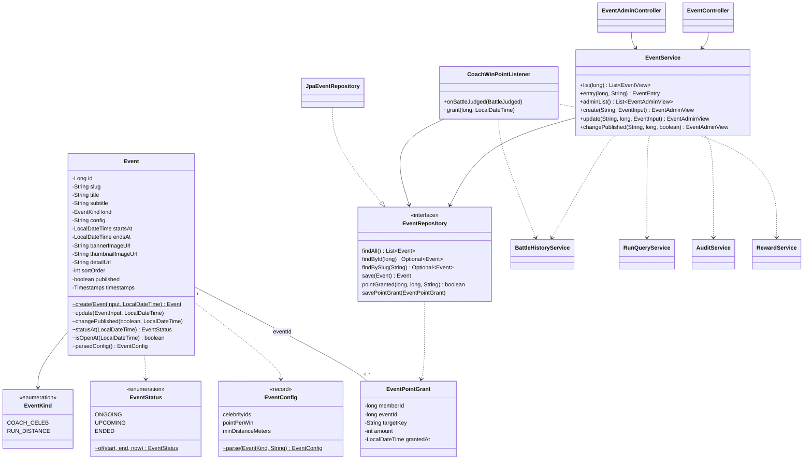
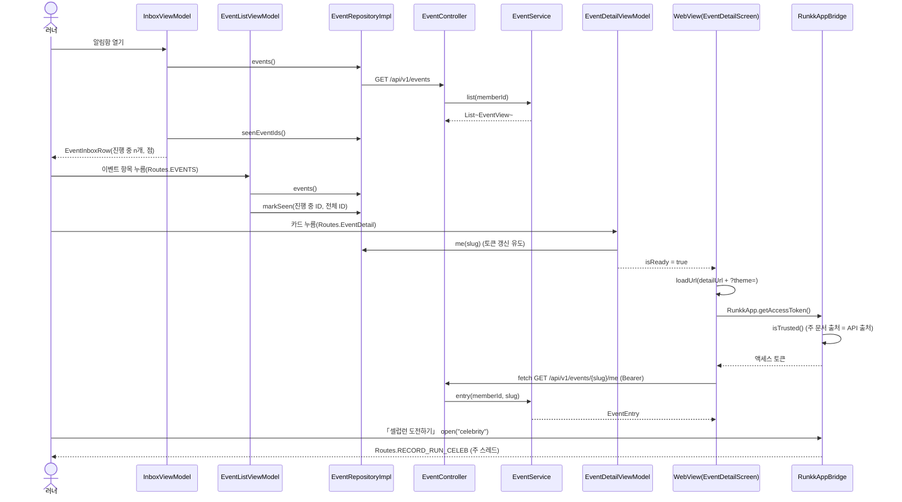
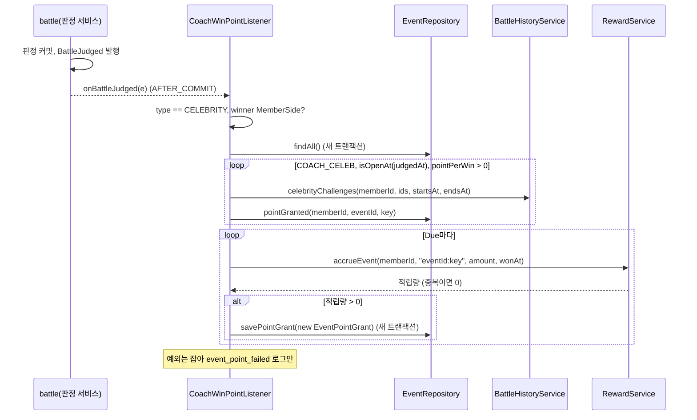

# 5.6 설계 결정 기록 (이어서: 이벤트 기능, 다음 판 변경)
> 작성: 2026-11-08 | 버전: 다음 판 변경 | 담당: 이성현(공용, 운영 도메인), 브랜치 `docs/S15P31A207-275-event-docs` | 입력: srs 다음 판 변경 7.13.22([임시:CR-성-1]~[임시:CR-성-5], 03-07 3.7.2 [임시:FR-성-1]~[임시:FR-성-13], [임시:NFR-성-1]~[임시:NFR-성-3], [임시:C-성-1]), 이벤트 계약(2026-11-08), 코드 `hotfix/S15P31A207-275-v0114-coach-celeb` 7558f6f4..d824b2a2(읽기만 함, MR !90)

> [런크크 객체지향 분석·설계서](../design-oo.md) 목차 · 이전: [05-23-설계-핫픽스-추가변경-성](05-23-설계-핫픽스-추가변경-성.md) · 다음: [06-01-클래스-common-member](06-01-클래스-common-member.md)

이 조각은 이벤트 기능의 객체지향 분석과 설계다. 코드가 핫픽스 0.11.4(MR !90)에 먼저 들어갔으므로 **코드에 맞춘 사후 설계 기록**이다. 클래스 이름, 시그니처, SQL은 코드를 읽어 옮겼고, 설계 담당이 고른 이유와 기각한 대안을 결정 표에 남겼다. 새 번호는 임시 번호이고 병합 때 정식 번호를 매긴다: 설계 결정 [임시:D-성-1]~[임시:D-성-17](v0.33까지의 마지막 D-563 다음), 시퀀스 [임시:SQ-성-1]~[임시:SQ-성-2](마지막 SQ-53 다음).

## 1. 결정 표

### 1.1 요구와 결정 대응

| srs | 결정 | 명세 |
|-----|------|------|
| [임시:FR-성-1], [임시:FR-성-4], [임시:NFR-성-3], [임시:C-성-1] | [임시:D-성-1], [임시:D-성-2] | 2.3, 5, 7 |
| [임시:FR-성-10]~[임시:FR-성-12] | [임시:D-성-3], [임시:D-성-9], [임시:D-성-10] | 2.3, 5 |
| [임시:FR-성-1], [임시:FR-성-5]~[임시:FR-성-7] | [임시:D-성-4]~[임시:D-성-6] | 2.3, 2.4, 3 |
| [임시:FR-성-8], [임시:CR-성-5] | [임시:D-성-7], [임시:D-성-8] | 2.3, 2.4, 3 |
| 3.7.3, 배포 | [임시:D-성-11] | 6 |
| [임시:FR-성-13], [임시:NFR-성-1], [임시:NFR-성-2] | [임시:D-성-12], [임시:D-성-13] | 2.5, 7 |
| [임시:FR-성-1], [임시:FR-성-2], [임시:FR-성-3] | [임시:D-성-14], [임시:D-성-15] | 2.5 |
| 패키지 | [임시:D-성-16] | 8 |
| 3.7.1 보충, FR-171 | [임시:D-성-17] | 2.5 |

### 1.2 결정 ([임시:D-성-1]~[임시:D-성-17])

| ID | 근거 | 결정 | 기각한 대안 |
|----|------|------|-------------|
| [임시:D-성-1] | [임시:CR-성-1], [임시:NFR-성-3] | **목록은 앱 화면, 상세는 서버 정적 웹 페이지를 앱 웹 화면으로.** 목록(카드, 배너, 탭, 상태 칩)은 모든 이벤트에 같은 모양이라 앱 Compose 화면이 서버 API(`GET /events`)로 그린다. 상세는 이벤트마다 모양이 달라 서버가 주는 정적 HTML을 앱 WebView로 연다. 이벤트 항목은 관리 API로, 상세 내용은 정적 파일 배포로 바꾸므로 앱 업데이트가 필요 없다 | (가) 상세도 앱 화면: 이벤트마다 앱 업데이트가 필요해 사용자 결정에 어긋난다. (나) 서버가 상세를 렌더링(템플릿): 서버 코드 배포가 필요하고 api 서버가 HTML을 갖게 된다. (다) 원격 설정 JSON으로 앱이 상세를 조립: 표현력이 피그마 상세(겹친 그림, 지도)를 못 따라간다 |
| [임시:D-성-2] | [임시:FR-성-4], [임시:NFR-성-3], [임시:C-성-1] | **상세 페이지 호스팅은 nginx 정적 경로.** `infra/nginx/common/app-locations.conf`에 `location ^~ /events/ { root /usr/share/nginx/runkk; charset utf-8; add_header Cache-Control "public, max-age=60"; try_files $uri $uri/index.html =404; }`. 파일은 `infra/nginx/static/events/{slug}/index.html`과 같은 폴더의 그림이고 `docker-compose.edge.yml`이 `./nginx/static`을 읽기 전용으로 붙인다. 이 경로는 api로 넘기지 않는다(`/legal/`과 같은 방식). 앱 API(`/api/v1/events`)와 경로가 겹치지 않는다. 캐시 60초가 [임시:NFR-성-3]의 반영 시간이다 | api 서버의 정적 자원(Spring static): api 재배포가 필요하다 |
| [임시:D-성-3] | [임시:FR-성-10] | **이벤트 종류와 종류별 설정.** `enum EventKind { COACH_CELEB, RUN_DISTANCE }`와 `event.config` TEXT 열의 JSON 문자열. `record EventConfig(List<Long> celebrityIds, Integer pointPerWin, Long minDistanceMeters)`, `static EventConfig parse(EventKind, String json)`이 종류별 필수 값을 검사하고 어긋나면 `BusinessRuleException(VALUE_INVALID)`(409). COACH_CELEB `{"celebrityIds":[11,12],"pointPerWin":500}`(1개 이상, 양수, 겹침 없음, pointPerWin ≥ 0), RUN_DISTANCE `{"minDistanceMeters":1000}`(양수). 같은 종류의 새 이벤트(다른 셀럽, 다른 거리)는 관리 API만으로 만들고, 새 종류만 코드 배포가 필요하다 | 종류마다 표 하나: 두 종류에 비해 과하다. 다형성 클래스 계층(EventRule 하위형): 분기가 `EventService.entry`의 switch 한 곳뿐이라 3곳 기준(6단계 판정)에 닿지 않는다. 종류가 셋 이상 되면 다시 본다 |
| [임시:D-성-4] | [임시:FR-성-1], [임시:FR-성-5] | **응모는 저장하지 않고 조회 때 센다. 기간과 상태는 서버 계산.** `EventService.entry(Event, memberId)`가 종류별로 항목을 만든다. 시각은 서버 `Clock`(서버 시간대 Asia/Seoul)의 `LocalDateTime`이고 기간은 양 끝 포함(`EventStatus.of`: now < startsAt → UPCOMING, now > endsAt → ENDED, 그 밖 ONGOING). 목록 정렬은 `EventStatus` 선언 순(ONGOING, UPCOMING, ENDED) → `sortOrder` → `id`. 판정 정정과 기록 재판정을 따로 반영할 필요가 없고 중복 응모 행이 생기지 않는다. 대가: 목록 호출마다 계산하고, 추첨 명단은 따로 조회해야 하며, 관리 수정이 응모를 소급해 바꾼다(srs 메모 E1, E6) | 응모 표(event_entry)를 판정 사건에서 채우기: 재판정, 정정 동기화와 백필이 필요하다. 기간 이벤트 두 개에는 과하다 |
| [임시:D-성-5] | [임시:FR-성-6] | **셀럽 첫 승리 조회는 battle이 제공한다.** `BattleRepository.findFirstCelebrityWins(long memberId, Collection<Long> celebrityIds, LocalDateTime from, LocalDateTime to): Map<Long, LocalDateTime>`(JPQL: status FINISHED, type CELEBRITY, opponentKind CELEBRITY, winnerMemberId = 회원, opponentRecordId in ids(문자열로 바꿔 비교), judgedAt ∈ [from, to], `group by opponentRecordId`, `min(judgedAt)`). `BattleHistoryService.celebrityChallenges(memberId, celebrityIds, from, to): List<CelebrityChallenge>`가 celebrityIds 순서로 `CelebrityChallenge(celebrityId, name, firstWonAt)`을 만든다(name = `CelebrityRecord.getAnonymousName()`, 기록이 없으면 null). event는 battle의 엔티티를 읽지 않는다. battle 경계 계약 추가이므로 battle 담당(박재영)이 06-03에 올리고 MR에서 승인한다(OWNERS 3절 5) | event가 Battle을 직접 질의: 패키지 경계(battle의 저장소는 battle 밖에서 쓰지 않음)를 깬다 |
| [임시:D-성-6] | [임시:FR-성-7] | **기록 거리 응모는 running의 기존 조회를 쓴다.** `RunQueryService.summariesBetween(memberId, DateRange(startsAt.toLocalDate(), endsAt.toLocalDate()))`로 기간이 걸친 날짜의 `RunSummary`를 받아 `valid`, `distance().meters() >= min`, `statusAt(startedAt) == ONGOING`(시작 시각이 기간 안)으로 거르고 `startedAt`이 가장 이른 하나를 고른다. running에 새 연산을 더하지 않는다. 표시이름은 `BigDecimal`로 km 글자(1000 → 「1km」)를 만든다 | running에 이벤트 전용 질의: 이벤트 두 개, 9일 범위라 기존 조회로 충분하다 |
| [임시:D-성-7] | [임시:FR-성-8] | **코치 승리 포인트는 판정 커밋 뒤 리스너.** `CoachWinPointListener`(@Component)가 `@TransactionalEventListener(AFTER_COMMIT)`로 `BattleJudged`를 받아 `type == CELEBRITY`이고 승자가 `Side.MemberSide`일 때만 `grant(memberId, judgedAt)`. `REQUIRES_NEW` TransactionTemplate으로 (1) 공개 중이고 judgedAt이 기간 안인 COACH_CELEB 이벤트마다 기간 안 첫 승리가 있고 `pointGranted`가 거짓인 셀럽을 `Due(eventId, key, amount, wonAt)`로 모으고, (2) 하나씩 `RewardService.accrueEvent`, (3) 적립량 > 0이면 새 트랜잭션에서 `savePointGrant`. 어떤 예외도 잡아 `event_point_failed` 로그만 남긴다(대결 확정은 이미 커밋됨). 이번 판의 상대가 아니어도 미지급 셀럽을 모두 보므로 앞선 실패를 다음 셀럽런 승리 때 채운다 | 판정 트랜잭션 안에서 적립: 적립 실패가 대결 확정을 되돌린다. 매일 보정 배치: 이벤트 9일에 비해 과하고 지급이 늦다 |
| [임시:D-성-8] | [임시:CR-성-5] | **이벤트 포인트는 하루 상한 밖.** `AccrualReason`에 `EVENT`를 더한다. `RewardService.accrueEvent(long memberId, String sourceId, int amount, LocalDateTime at): int`가 `accrueWithRetry(new AccrualSource(memberId, EVENT, sourceId, at), rule -> amount)`를 부른다(근거 sourceId = 「이벤트ID:항목키」, 예 「1:celebrity-11」). `RewardWallet.accrue`는 `reason == EVENT`면 base ≤ 0일 때 비어 있음, 아니면 잔액만 늘리고 집계 칼럼(lastAccrualDate, lastAccrualDateAmount)을 건드리지 않은 채 적립 행을 돌려준다. `JpaRewardAccrualRepository.sumOn`은 `reason <> EVENT`만 더한다(지난 날짜 보정의 그날 합계). 중복은 reward_accrual 고유 색인(회원, 사유, 근거)과 지갑 행 잠금이 막고, event_point_grant 고유(회원, 이벤트, 대상)가 지급 이력을 하나로 둔다 | 하루 한도를 일시적으로 올리기(운영 기준값): 모든 적립의 한도가 바뀐다. 별도 지갑: 상점이 두 잔액을 알아야 한다 |
| [임시:D-성-9] | [임시:FR-성-9]~[임시:FR-성-12], FR-173 | **관리 API는 web.admin.event.** `EventAdminController`(`/api/v1/admin/events`)는 web.admin의 `AdminWebConfig`가 `/api/v1/admin/**`에 거는 `OperatorCheckInterceptor`를 그대로 받고 요청 속성 `actorId`만 읽는다(web.admin, operator를 import하지 않음, D-50). 형식 검사는 요청 record `EventRequest`의 Bean Validation(slug `^[a-z0-9-]+$` ≤ 40, title ≤ 60, subtitle ≤ 100, URL 셋 `^/(?!/)[^\s\\]*$` ≤ 300(서버 상대 경로만. 다음 판 변경, 코드 리뷰 [임시:EV-성-1]로 https를 뺐다), config는 JSON 객체 또는 JSON 문자열을 받아 문자열로), 규칙 검사(config, 기간, slug 중복)는 `EventService.validate`. 없는 id는 404 EVENT_NOT_FOUND | web.admin.setting에 섞기: 기준값과 이벤트는 다른 자료라 응집도가 떨어진다 |
| [임시:D-성-10] | FR-176 | **관리 감사는 SETTING_CHANGE를 재사용.** `AuditService.record(new AuditEntry(actorId, OPERATOR, SETTING_CHANGE, "EVENT:" + slug, before?.toString(), after.toString()))`. 전후 값은 `EventAdminView`(record)의 `toString`. 이유: develop의 V37이 `audit_record`의 행위 CHECK 제약을 다시 만든다. 핫픽스 V35_2가 새 행위 값을 더하면 develop에 합칠 때 V37이 그 값을 빠뜨린 제약으로 덮어 저장이 실패한다. 대상 ID 접두어로 기준값 변경과 가른다 | 새 행위 EVENT_CHANGE: V37과 충돌. 다음 릴리스에서 V37 뒤 마이그레이션으로 새 행위를 더하는 것은 후속 후보다 |
| [임시:D-성-11] | 배포, 3.7.3 | **마이그레이션 V35_2(out-of-order)와 시드.** 버전 35.2로 prod는 V35_1 → V35_2 → (다음 릴리스) V36, V37 순서로 받는다. develop DB는 V36, V37이 이미 있어 develop 프로필의 `spring.flyway.out-of-order: true`(V35_1 때 둔 설정, D-476)로 받는다. V36(avatar, selfie_job), V37(ai_purge_request, audit_record 제약)과 겹치지 않게 새 표 둘(event, event_point_grant)과 `reward_accrual.ck_reward_accrual_reason` 제약만 만진다. 같은 파일이 두 이벤트(coach-challenge, beta-1km)를 넣는다. prod는 out-of-order를 켜지 않는다 | V38: prod가 V36, V37 없이 V38을 받으면 다음 릴리스에서 V36, V37이 순서 밖이 된다 |
| [임시:D-성-12] | [임시:NFR-성-1], [임시:NFR-성-2] | **웹 화면 보안: 같은 출처 브리지, 다른 출처 차단.** (1) WebSettings: `javaScriptEnabled = true`, `allowFileAccess = false`, `allowContentAccess = false`, `mixedContentMode = MIXED_CONTENT_NEVER_ALLOW`, `setGeolocationEnabled(false)`, `javaScriptCanOpenWindowsAutomatically = false`, `setSupportMultipleWindows(false)`. (2) `shouldOverrideUrlLoading`: 같은 출처면 웹 화면 안에서 옮기고, 아니면 막고 주 문서 이동이면서 http, https일 때만 바깥 브라우저로 넘긴다(intent: 등 다른 스킴은 열지 않음). (3) `shouldInterceptRequest`: http, https이면서 다른 출처인 자원은 빈 403 응답. (4) `RunkkAppBridge`의 네 메서드는 호출마다 `isTrusted()` = `isSameOrigin(currentUrl(), allowedOrigin)`. currentUrl은 JavaBridge 스레드가 읽으므로 `onPageStarted`, `doUpdateVisitedHistory`에서 `AtomicReference`에 남긴다(WebView.getUrl은 주 스레드 전용). (5) 출처 = scheme://host[:port](기본 포트 생략, http, https만). (6) 화면을 닫을 때 `removeJavascriptInterface`, `destroy`. 페이지는 같은 서버 파일만 쓰고 외부 글꼴을 뺐다(d824b2a2) | addJavascriptInterface를 상세 화면 전체에 무조건: 다른 출처 iframe, 이동한 문서가 토큰을 얻는다. WebMessage(postMessage)와 출처 지정: 구현량이 늘고 이 규모에서는 출처 검사로 같은 효과 |
| [임시:D-성-13] | [임시:FR-성-13], [임시:FR-성-5] | **로그인 정보 전달과 화면 열기.** 페이지는 `RunkkApp.getAccessToken()`으로 받은 액세스 토큰을 `Authorization: Bearer`로 붙여 같은 출처 `fetch('/api/v1/events/{slug}/me')`를 부른다. 만료 토큰을 피하려고 `EventDetailViewModel.start(slug)`가 페이지를 열기 전 `EventRepository.me(slug)`를 한 번 불러 앱 HTTP 클라이언트의 갱신을 일으키고 결과와 상관없이 `isReady = true`. `open(target)`은 `EventPageTarget.of`(celebrity, run, events)만 받고 주 스레드로 넘긴다: CELEBRITY → 새 경로 `Routes.RECORD_RUN_CELEB`(「battle/record/celeb」, `RecordRunRoute(initialSegment = CELEB_SEGMENT)`, 하단 탭은 기록런), RUN → 위치 권한(FINE 또는 COARSE)이 있으면 `Routes.RUN`, 없으면 권한 요청 뒤 답과 상관없이 `Routes.RUN`, EVENTS → `Routes.EVENTS`. `share(text)`는 trim, 2,000자 자르기, 빈 글 무시 뒤 `ACTION_SEND` 선택 창 | 주소 질의 문자열에 토큰: 서버, 프록시 로그와 기록에 남는다. 쿠키: api는 쿠키 인증을 쓰지 않는다 |
| [임시:D-성-14] | [임시:FR-성-1], [임시:NFR-성-2] | **이벤트 주소는 상대 경로만, 그림은 앱이 직접 받는다.** `resolveEventPath(origin, path)`: 「/」로 시작하고 「//」로 시작하지 않으며 역슬래시가 없을 때만 API origin에 붙이고, 결과 출처가 API 출처와 같을 때만 돌려준다(아니면 null → 그림 없음, 카드 안 열림). `EventRepositoryImpl.image(url)`: API 출처 주소만 받고(아니면 `Rejected(NOT_EVENT_IMAGE)`), 3MiB 넘으면 `Rejected(TOO_LARGE)`, 받은 바이트는 접근 순서 LinkedHashMap 16장 메모리 캐시. 관리 API가 받는 https 주소와 어긋난다(10절 R1) | 그림 라이브러리(Coil 등) 도입: 핫픽스에 새 의존을 넣지 않는다 |
| [임시:D-성-15] | [임시:FR-성-2], [임시:FR-성-3], [임시:CR-성-2] | **진입점과 새 이벤트 점.** 이벤트 화면은 ui.notification 모듈 안에 둔다(알림함과 같은 진입점, 새 모듈 없음). 알림함 맨 위 `EventInboxRow`는 `InboxViewModel.refreshEvents()`가 만든 `InboxEventSummary(ongoingCount, hasUnseen)`로 그리고, 목록이 비면 null(숨김), 읽기 실패면 앞 값 유지. 돌아올 때 다시 세려고 `LifecycleResumeEffect` → `onResumed()`(처음 한 번은 init이 읽어 건너뜀). 본 이벤트 ID는 `SettingsRepository.seenEventIds()`/`saveSeenEventIds(ids)`(DataStore 문자열 집합 키 `seen_event_ids`)에 두고, 서버 설정 사본 갱신(`write`)이 덮지 않고 `clear()`가 지운다(배치고사 완료 사본과 같은 방식). `EventRepository.markSeen(ids, current)` = (기존 ∩ current) ∪ ids, 바뀌지 않으면 쓰지 않는다. `EventListViewModel.refresh()`가 성공하면 진행 중 ID를 본 것으로. 홈 점은 ui.home이 ui.notification을 모르므로 칸 `SlotKey.HOME_INBOX_DOT`에 `NotificationFeatureEntry.slots`가 `HomeInboxDot()`(EventDotViewModel, 화면 재개마다 refresh)을 넣는다(D-255 칸 방식) | 서버에 본 이벤트 저장: 기기마다 다르게 보여도 되는 표시라 서버 표와 API가 과하다. 홈 상단 단추: 사용자 결정으로 기각 |
| [임시:D-성-16] | 패키지 | **패키지 배치.** 서버: 응용+도메인 `event`(Event, EventConfig, EventKind, EventStatus, EventInput, EventView, EventAdminView, EventEntry, EventPointGrant, EventRepository, EventService, CoachWinPointListener), 인프라 `infra.event`(JpaEventRepository), 표현 `web.event`(EventController), `web.admin.event`(EventAdminController). 새 화살표 event → battle(BattleHistoryService, BattleJudged, BattleType, Side, CelebrityChallenge), event → running(RunQueryService, RunSummary), event → reward(RewardService), event → audit(AuditService 등), event → common, web.event → event, web.admin.event → event, infra.event → event. 앱: api.notification → domain.settings 하나(본 이벤트 사본). 8절 | event를 battle 안에: 기록 거리 이벤트가 running을 읽어 battle의 책임이 넓어진다 |
| [임시:D-성-17] | FR-171, 3.7.1 보충 | **코치 셀럽 전용 캐릭터.** core.designsystem `CelebrityCharacter`에 `JOO`, `KIM`(서 있는 그림 1장 + 달리기 4장, `celebrity_joo_*`, `celebrity_kim_*` webp)을 더한다. 서버 셀럽캐릭터키는 「joo」, 「kim」(운영 DB 유명인 기록 11, 12). 상세 페이지는 같은 그림을 webp로 따로 둔다(joo-run, kim-run, joo-face, kim-face) | 없음 |
| [임시:D-성-18] | [임시:FR-성-14], 2026-11-08 사용자 결정 | **응모자 명단은 관리 API, 계산은 조회 때 한 번에(다음 판 변경).** `GET /api/v1/admin/events/{id}/entrants?celebrityId=&cursor=&size=`(`EventAdminController.entrants`, 기본 30, 1~100) → 새 `EventEntrantService.entrants(long eventId, Long celebrityId, PageCursor page): EventEntrants`(readOnly). 의존은 EventRepository, BattleHistoryService, RunQueryService, MemberQueryService 넷이다(EventService 생성자 인자를 늘리지 않으려고 따로 둠). COACH_CELEB은 `BattleHistoryService.celebrityWinners(ids, from, to): List<CelebrityWin(memberId, celebrityId, firstWonAt)>`(새 `BattleRepository.findCelebrityWinners`, (회원, 기록)별 min(judgedAt) 한 번의 질의)와 `celebrityNames(ids)`, RUN_DISTANCE는 `RunQueryService.earliestValidRunsAtLeast(minMeters, from, to): Map<Long, RunSummary>`(새 `RunRecordRepository.validSummariesAtLeast`, 시작 시각 양 끝 포함, 오래된 순에서 회원별 첫 기록), 닉네임은 `MemberQueryService.activeNicknames(ids)`(ACTIVE만, 새 `MemberRepository.activeNicknames`). 탈퇴 회원은 닉네임 맵에 없어 빠진다. 응답 `EventEntrants(eventId, slug, kind, celebrityId, total, entrants[Entrant(memberId, nickname, entryCount, items)], nextCursor)`, items는 내 참여와 같은 `EventEntry.Item`. 회원 ID 내림차순, `PageCursor.slice`. 거를 수 없는 celebrityId는 400. 조회 감사는 남기지 않는다(다른 관리 조회와 같다). 새 화살표 event → member(쓰는 쪽 event, 제공 member) | (가) 응모 표를 판정 사건에서 채우기: D-성-4에서 기각한 이유 그대로. (나) 회원마다 내 참여 계산 반복: 회원 수만큼 질의(N+1). (다) 운영 DB 직접 조회 절차: 사용자 결정으로 기각 |

## 2. 객체 모델

### 2.1 명사, 동사 추출과 클래스 후보

srs 3.7.2의 FR 설명문, 자료사전(06-08 이벤트 자료)에서 뽑았다.

| 명사 | 분류 | 결과 |
|------|------|------|
| 이벤트 | 클래스 | Event(엔티티) |
| 이벤트종류, 진행상태 | 클래스(열거) | EventKind, EventStatus |
| 이벤트설정(셀럽기록ID목록, 승리포인트, 응모기준거리) | 클래스(값) | EventConfig |
| 응모, 응모항목, 내응모 | 클래스(값, 저장 안 함) | EventEntry, EventEntry.Item |
| 이벤트포인트지급기록 | 클래스 | EventPointGrant(엔티티) |
| 이벤트요약, 이벤트관리결과 | 클래스(조회 값) | EventView, EventAdminView |
| 이벤트항목(변경 입력) | 클래스(값) | EventInput |
| 셀럽 첫 승리 | 클래스(값, battle) | CelebrityChallenge |
| 주소이름, 제목, 부제, 시작일시, 종료일시, 그림주소, 상세주소, 정렬순서, 이벤트공개여부 | 속성 | Event의 속성 |
| 본이벤트목록 | 앱 속성 | SettingsRepository 사본 |
| 상세 페이지, 지도 | 구현 세부 | 정적 파일(클래스 아님) |
| 운영자, 러너 | 역할 | 액터 |
| 경품, 추첨 | 시스템 밖 | 제외(운영 업무) |

| 동사 | 연산 |
|------|------|
| 목록을 본다 | EventService.list |
| 내 참여를 본다 | EventService.entry |
| 진행상태를 센다 | Event.statusAt, EventStatus.of |
| 응모를 센다 | EventService.coachItems, runItem |
| 첫 승리를 찾는다 | BattleHistoryService.celebrityChallenges, BattleRepository.findFirstCelebrityWins |
| 포인트를 준다 | CoachWinPointListener.onBattleJudged, grant, RewardService.accrueEvent |
| 등록, 수정, 공개 전환한다 | EventService.create, update, changePublished, Event.create, update, changePublished |
| 설정을 검사한다 | EventConfig.parse, EventService.validate |
| 감사를 남긴다 | EventService.audit(private) → AuditService.record |

### 2.2 클래스도 (서버)

관계: Event 1 : 0..* EventPointGrant(eventId, 고유 (member_id, event_id, target_key)). Event와 CelebrityRecord는 config의 ID 목록으로만 이어지고(참조만, 0..* : 0..*), 응모는 관계로 저장하지 않는다(D-성-4).

### 2.3 클래스 명세 (서버, event, infra.event, web.event, web.admin.event)

##### Event (엔티티, event)
| 항목 | 내용 |
|------|------|
| 책임 | 이벤트 하나의 항목과 기간을 보관한다 |
| 표 | event (6절) |

속성(모두 private): id(Long, IDENTITY), slug(String ≤ 40, 고유), title(≤ 60), subtitle(≤ 100), kind(EventKind, 문자열 저장), config(String, TEXT), startsAt, endsAt(LocalDateTime, 한국 시간, 양 끝 포함), bannerImageUrl, thumbnailImageUrl, detailUrl(≤ 300), sortOrder(int), published(boolean), timestamps(Timestamps, created_at, updated_at). getter만 public이고 setter는 없다.

| 시그니처 | 설명 |
|---------|------|
| `static Event create(EventInput in, LocalDateTime now)` (패키지) | 새 이벤트. 입력 검사는 EventService가 먼저 한다 |
| `void update(EventInput in, LocalDateTime now)` (패키지) | 모든 항목을 입력 값으로, updated_at 갱신 |
| `void changePublished(boolean value, LocalDateTime now)` (패키지) | 공개 여부만 |
| `EventStatus statusAt(LocalDateTime now)` (패키지) | EventStatus.of(startsAt, endsAt, now) |
| `boolean isOpenAt(LocalDateTime at)` (패키지) | published && statusAt(at) == ONGOING. 포인트 지급 판정이 쓴다 |
| `EventConfig parsedConfig()` (패키지) | EventConfig.parse(kind, config) |

##### EventKind, EventStatus (열거, event)
EventKind: COACH_CELEB(지정 셀럽 기록을 셀럽런에서 이기면 셀럽마다 응모 1회, 처음 이기면 포인트), RUN_DISTANCE(기간 안 유효 기록 거리 ≥ 기준이면 응모 1회). EventStatus: ONGOING, UPCOMING, ENDED(이 선언 순서가 목록 정렬 순서). `static EventStatus of(LocalDateTime startsAt, LocalDateTime endsAt, LocalDateTime now)`: now.isBefore(startsAt) → UPCOMING, now.isAfter(endsAt) → ENDED, 그 밖 ONGOING.

##### EventConfig (값, record, 패키지 전용)
속성: celebrityIds(List<Long>), pointPerWin(Integer), minDistanceMeters(Long). `static EventConfig parse(EventKind kind, String json)`: Jackson으로 읽고 실패하면 VALUE_INVALID. COACH_CELEB는 celebrityIds가 비지 않고 모두 양수, 겹침 없음, pointPerWin ≠ null, ≥ 0. RUN_DISTANCE는 minDistanceMeters ≠ null, > 0. 어긋나면 `BusinessRuleException(ReasonCode.VALUE_INVALID)`(409).

##### EventInput, EventView, EventAdminView, EventEntry (값, record, event)
- `EventInput(slug, title, subtitle, kind, config, startsAt, endsAt, bannerImageUrl, thumbnailImageUrl, detailUrl, int sortOrder, boolean published)`: 관리 생성, 수정 입력. 인자가 12개인 생성자는 record 정규 생성자이고 메서드 매개변수 기준(4개 이하)의 예외로 둔다(값 묶음 하나로 넘기려는 것이 목적이다).
- `EventView(long id, slug, title, subtitle, EventStatus status, startsAt, endsAt, bannerImageUrl, thumbnailImageUrl, detailUrl, int entryCount, int maxEntryCount, int sortOrder)`: GET /events 한 줄.
- `EventAdminView(…, EventKind kind, String config, …, boolean published, EventStatus status)`, `static EventAdminView of(Event e, LocalDateTime now)`: 관리 API 한 건이자 감사 전후 값.
- `EventEntry(String slug, int entryCount, int maxEntryCount, List<Item> items)`(items는 `List.copyOf`), `Item(String key, String label, boolean done, LocalDateTime doneAt, Long distanceMeters)`.

##### EventPointGrant (엔티티, event)
| 항목 | 내용 |
|------|------|
| 책임 | 이벤트 포인트를 준 사실 한 건을 남긴다 |
| 표 | event_point_grant, 고유 uq_event_point_grant(member_id, event_id, target_key) |

속성: id, memberId, eventId, targetKey(≤ 40, 「celebrity-11」), amount(> 0), grantedAt. 모두 updatable = false. 생성자 `EventPointGrant(long memberId, long eventId, String targetKey, int amount, LocalDateTime grantedAt)`(패키지). 적립 자체는 reward_accrual(사유 EVENT, 근거 「이벤트ID:대상」)에 있다.

##### EventRepository (포트, event) / JpaEventRepository (infra.event)
`List<Event> findAll()`(공개 여부 무관, id 순. 이벤트가 몇 개뿐이라 전부 읽는다), `Optional<Event> findById(long id)`, `Optional<Event> findBySlug(String slug)`, `Event save(Event event)`(id 없으면 persist, 있으면 contains면 그대로, 아니면 merge), `boolean pointGranted(long memberId, long eventId, String targetKey)`(setMaxResults(1)), `void savePointGrant(EventPointGrant grant)`. event 밖에서 쓰지 않는다(13.1 규칙 4).

##### EventService (event)
| 항목 | 내용 |
|------|------|
| 책임 | 이벤트 조회와 관리 유스케이스를 조정한다 |
| 의존 | EventRepository, battle.BattleHistoryService, running.RunQueryService, audit.AuditService, Clock |

| 시그니처 | 설명 |
|---------|------|
| `List<EventView> list(long memberId)` | readOnly. published만, 이벤트마다 entry를 세어 EventView로, status → sortOrder → id 정렬 ([임시:FR-성-1]) |
| `EventEntry entry(long memberId, String slug)` | readOnly. findBySlug + published, 아니면 `NotFoundRuleException(EVENT_NOT_FOUND)`(404) ([임시:FR-성-5]) |
| `private EventEntry entry(Event, long)` | kind별 switch: COACH_CELEB → coachItems, RUN_DISTANCE → List.of(runItem). entryCount = done 수, max = 항목 수 |
| `private List<Item> coachItems(Event, EventConfig, long)` | celebrityChallenges(memberId, ids, startsAt, endsAt)를 Item(「celebrity-ID」, name ?: 「셀럽 ID」, firstWonAt != null, firstWonAt, null)로 ([임시:FR-성-6]) |
| `private Item runItem(Event, EventConfig, long)` | D-성-6 ([임시:FR-성-7]) |
| `static String celebrityKey(long celebrityId)` (패키지) | 「celebrity-」 + ID. 리스너가 같은 키를 쓴다 |
| `List<EventAdminView> adminList()` | readOnly. 전부, sortOrder → id ([임시:FR-성-9]) |
| `EventAdminView create(String actorId, EventInput in)` | validate(in, null) → save(Event.create) → audit(null, after) ([임시:FR-성-10]) |
| `EventAdminView update(String actorId, long eventId, EventInput in)` | find(없으면 404) → validate(in, eventId) → before → update → save → audit(before, after) ([임시:FR-성-11]) |
| `EventAdminView changePublished(String actorId, long eventId, boolean published)` | find → before → changePublished → save → audit ([임시:FR-성-12]) |
| `private void validate(EventInput in, Long eventId)` | EventConfig.parse, 다른 이벤트의 같은 slug, `!endsAt.isAfter(startsAt)` → VALUE_INVALID |
| `private void audit(String actorId, String slug, EventAdminView before, EventAdminView after)` | D-성-10 |

##### CoachWinPointListener (event)
| 항목 | 내용 |
|------|------|
| 책임 | 셀럽 대결 승리에 따른 이벤트 포인트를 지급한다 |
| 의존 | EventRepository, BattleHistoryService, RewardService, Clock, PlatformTransactionManager(REQUIRES_NEW TransactionTemplate) |

| 시그니처 | 설명 |
|---------|------|
| `@TransactionalEventListener(AFTER_COMMIT) void onBattleJudged(BattleJudged e)` | CELEBRITY가 아니면 끝. winnerSide가 MemberSide일 때만 grantSafely(memberId, battleId, judgedAt) |
| `void grant(long memberId, LocalDateTime judgedAt)` (패키지) | 새 트랜잭션에서 duePoints → Due마다 accrueEvent(memberId, eventId + ":" + key, amount, wonAt). 0 이하면 `event_point_not_accrued` 경고 뒤 다음, 아니면 새 트랜잭션에서 savePointGrant, `event_point_granted` 정보 로그 |
| `private List<Due> duePoints(long, LocalDateTime)` | COACH_CELEB이고 isOpenAt(judgedAt)이며 pointPerWin > 0인 이벤트마다 celebrityChallenges를 보고 firstWonAt이 있고 pointGranted가 거짓인 것 |
| `private void grantSafely(…)` | RuntimeException을 잡아 `event_point_failed` 오류 로그만 |

`private record Due(long eventId, String key, int amount, LocalDateTime wonAt)`.

##### EventController (web.event), EventAdminController (web.admin.event)
5절 표. EventController는 요청 속성 `memberId`(AuthFilter), EventAdminController는 `actorId`(OperatorCheckInterceptor)를 읽는다. 응답 `record EventListResponse(List<EventView> events)`, 요청 `record EventRequest(…)`와 `toInput()`, `record PublishedRequest(@NotNull Boolean published)`.

### 2.4 고친 클래스 (서버, 다른 패키지)

| 패키지 | 클래스 | 고친 것 | 담당 |
|--------|--------|---------|------|
| reward | AccrualReason | `EVENT` 추가(하루 상한 밖, 그날 합계 제외) | 이성현(06-05에 반영) |
| reward | RewardService | `int accrueEvent(long memberId, String sourceId, int amount, LocalDateTime at)` 추가 (D-성-8) | 이성현(06-05에 반영) |
| reward | RewardWallet | `accrue`에 EVENT 분기(상한, 집계 칼럼 없음) | 이성현(06-05에 반영) |
| reward, infra.reward | RewardAccrualRepository.sumOn, JpaRewardAccrualRepository | `reason <> EVENT`만 더함 | 이성현(06-05에 반영) |
| battle | BattleHistoryService | `List<CelebrityChallenge> celebrityChallenges(long memberId, List<Long> celebrityIds, LocalDateTime from, LocalDateTime to)` 추가(readOnly) | 박재영(06-03, 요청) |
| battle | BattleRepository, JpaBattleRepository(infra.battle) | `Map<Long, LocalDateTime> findFirstCelebrityWins(long, Collection<Long>, LocalDateTime, LocalDateTime)` 추가(빈 ids면 빈 맵) | 박재영(06-03, 요청) |
| battle | CelebrityChallenge(새 record) | `(long celebrityId, String name, LocalDateTime firstWonAt)` | 박재영(06-03, 요청) |
| common | ReasonCode | `EVENT_NOT_FOUND("이벤트 없음")`(404) 추가. 계약 파일 `contract/app/enums/ReasonCode.txt` 1줄 | 공용 |

### 2.5 클래스 명세 (앱)

| 모듈(패키지) | 클래스 | 시그니처, 책임 |
|--------------|--------|---------------|
| domain.notification | Event (data) | `Event(id, slug, title, subtitle?, status: Status, startsAt: Instant, endsAt: Instant, bannerImageUrl?, thumbnailImageUrl?, detailUrl?, entryCount, maxEntryCount, sortOrder)`, `enum Status { UPCOMING, ONGOING, ENDED }`, `val isEntered = entryCount > 0`. 최상위 `fun List<Event>.hasUnseenOngoing(seenIds: Set<Long>): Boolean` |
| domain.notification | EventEntry (data) | `EventEntry(slug, entryCount, maxEntryCount, items: List<Item>)`, `Item(key, label, isDone, doneAt: Instant?, distanceMeters: Long? = null)` |
| domain.notification | EventRepository (포트) | `suspend fun events(): Outcome<List<Event>>`, `suspend fun me(slug): Outcome<EventEntry>`, `suspend fun image(url): Outcome<ByteArray>`, `fun webOrigin(): String`, `fun accessToken(): String?`, `suspend fun seenEventIds(): Set<Long>`, `suspend fun markSeen(ids: Set<Long>, current: Set<Long>): Outcome<Unit>` |
| domain.settings | SettingsRepository | 기본 구현이 있는 `suspend fun seenEventIds(): Set<Long> = emptySet()`, `suspend fun saveSeenEventIds(ids): Outcome<Unit>` 추가 |
| api.notification | EventApi (Retrofit) | `@GET("events") events()`, `@GET("events/{slug}/me") me(slug)`, `@Streaming @GET image(@Url url): ResponseBody` |
| api.notification | EventsResponse, EventEntryResponse, EventMappers | `toDomain(origin)`(모르는 status는 뺌, 시각은 ServerTime.parse), `resolveEventPath(origin, path)`, `originOf(url)` (D-성-14) |
| api.notification | EventRepositoryImpl (@Singleton) | D-성-14, D-성-15. `origin` = API 기준 주소의 경로, 질의, 조각을 지운 값 |
| data.settings | DataStoreSettingsRepository | 키 `SEEN_EVENTS = stringSetPreferencesKey("seen_event_ids")`, `write`가 보존, `clear`가 지움, 읽기 실패면 빈 집합 |
| ui.notification | EventListViewModel | `state: StateFlow<EventListUiState>`, `refresh()`(앞 읽기 취소, 성공하면 today = 서울 날짜, markSeen(진행 중 ID, 전체 ID)), `onTab(tab)`, `suspend image(url)`. 최상위 `eventDetailKey(event): Routes.EventDetail?`, `EVENT_ZONE = Asia/Seoul` |
| ui.notification | EventListUiState | `isLoading, events, tab: EventTab = ONGOING, today: LocalDate?, error: UiText?`, `visible`(탭 필터: ENDED ⇔ PAST), `banners`(진행 중 탭에서 배너가 있는 진행 중) |
| ui.notification | EventTab, EventChip | `EventTab { ONGOING, PAST }`(라벨, 머리, 빈 문구 문자열 자원), `EventChip { NEW, ENTERED, UPCOMING, ENDED }.of(event)` |
| ui.notification | EventDates | `eventPeriod(res, event)`, `eventDaysLeft(event, today): Long?`(0 미만은 0), `eventDdayLabel(res, daysLeft)` |
| ui.notification | EventListScreen, EventImage | `EventListRoute()`, `EventListScreen(…)`: 탭, `BannerPager`(HorizontalPager, 「n / m」), `EventCard`, `EntryProgress`, `StatusChip`. `EventImage`, `decodeEventImage(bytes, maxPx)` |
| ui.notification | InboxViewModel | 생성자에 `EventRepository` 추가, `refreshEvents()`, `onResumed()`, InboxUiState에 `eventSummary: InboxEventSummary?` |
| ui.notification | EventInboxRow, NewEventDot, HomeInboxDot, EventDotViewModel | D-성-15. EventInboxRow의 낭독 상태 「새 이벤트」 |
| ui.notification | EventDetailViewModel | `isReady: StateFlow<Boolean>`, `webOrigin`, `start(slug)`(같은 slug면 무시), `accessToken()` |
| ui.notification | EventDetailRoute, EventDetailScreen, createEventWebView(private) | D-성-12, D-성-13. 상단 바 + AndroidView(WebView), 뒤로 = canGoBack이면 goBack 아니면 닫기, 오류면 RunkkErrorState(다시 시도 = reload), 로딩이면 RunkkLoading |
| ui.notification | RunkkAppBridge (internal) | `@JavascriptInterface getAccessToken(): String?`, `open(target: String?)`, `close()`, `share(text: String?)`, `isTrusted()`, `NAME = "RunkkApp"`, `MAX_SHARE_CHARS = 2_000` |
| ui.notification | EventPageTarget | `enum { CELEBRITY("celebrity"), RUN("run"), EVENTS("events") }`, `of(value): EventPageTarget?` |
| ui.notification | EventWeb (최상위 함수) | `webOriginOf(url): String?`, `isSameOrigin(url, origin)`, `withTheme(url, isDark)`(조각 앞에 ?theme= 또는 &theme=), `isExternalWebLink(url)`(http, https만) |
| ui.notification | NotificationFeatureEntry | `Routes.EVENTS`, `Routes.EventDetail` 등록, `slots = mapOf(SlotKey.HOME_INBOX_DOT to { HomeInboxDot() })` |
| core.navigation (core.ui) | Routes, SlotKey | `EVENTS = "events"`, `RECORD_RUN_CELEB = "battle/record/celeb"`, `@Serializable data class EventDetail(slug, title, url): NavKey`, `SlotKey.HOME_INBOX_DOT` |
| ui.home | HomeScreen.Header | 알림함 단추를 Box로 감싸 오른쪽 위에 `LocalSlots.current[SlotKey.HOME_INBOX_DOT]`를 그린다 |
| ui.battle | RecordRunRoute, BattleFeatureEntry | `RecordRunRoute(initialSegment: Int = SELF_SEGMENT)`, `SELF_SEGMENT = 0`, `CELEB_SEGMENT = 1`, `Routes.RECORD_RUN_CELEB` 등록. app `tabOf`가 RECORD_RUN_CELEB을 기록런 탭으로 |
| core.designsystem | RunkkIcons.Gift, CelebrityCharacter.JOO, KIM | D-성-17 |

## 3. 동적 모델

### [임시:SQ-성-1] 이벤트 목록에서 상세 열기와 내 참여 읽기

### [임시:SQ-성-2] 셀럽런 승리 뒤 코치 승리 포인트

### 상태도

이벤트 진행상태와 공개 여부는 srs 6.4.10과 같다(상태: UPCOMING, ONGOING, ENDED는 저장하지 않는 계산 값, published는 저장 값). 사건 ↔ 연산: 등록 = `Event.create`, 수정 = `Event.update`, 공개 전환 = `Event.changePublished`, 시각 흐름 = `Event.statusAt(now)`. 응모 항목(미달성 → 달성)은 저장하지 않으므로 상태도를 두지 않는다. 포인트 지급은 (회원, 이벤트, 대상)마다 없음 → 지급(EventPointGrant 행) 한 번의 전이뿐이라 상태도 대신 고유 제약으로 지킨다.

## 4. 기능 모델 (srs DFD 대응)

| DFD | 프로세스 | 연산 |
|-----|----------|------|
| 7.9 | 이벤트 관리 | EventAdminController.list, create, update, changePublished → EventService.adminList, create, update, changePublished, validate, EventConfig.parse, AuditService.record |
| 7.10 | 이벤트 조회 | EventController.list, me → EventService.list, entry, coachItems, runItem, BattleHistoryService.celebrityChallenges, RunQueryService.summariesBetween. 앱 EventListViewModel.refresh, InboxViewModel.refreshEvents, EventDotViewModel.refresh, EventDetailScreen, RunkkAppBridge |
| 7.11 | 이벤트 포인트 지급 | CoachWinPointListener.onBattleJudged, grant, duePoints, EventRepository.pointGranted, savePointGrant |
| 6.4 (추가) | 리워드 적립 | RewardService.accrueEvent → accrueWithRetry → RewardWallet.accrue(EVENT) |

검사 위치: 운영자 권한 = OperatorCheckInterceptor(web.admin), 형식 = EventRequest(web.admin.event), 설정, 기간, slug = EventService.validate, 공개 여부와 기간 = Event.isOpenAt, Event.statusAt, 출처 = RunkkAppBridge.isTrusted, createEventWebView.

## 5. API 계약 (05-03 5.7.1에 행 추가)

기준 경로 `/api/v1`. 시각은 오프셋 없는 한국 시간 문자열(`2026-11-08T00:00:00`).

| 메소드, 경로 | Controller → 서비스 | 응답 | 오류 | 권한 |
|--------------|--------------------|------|------|------|
| GET /events | EventController.list → EventService.list | 200 `{ "events": [EventView] }` | | 회원 |
| GET /events/{slug}/me | EventController.me → EventService.entry | 200 EventEntry | 404 EVENT_NOT_FOUND(없음, 비공개) | 회원 |
| GET /admin/events | EventAdminController.list → adminList | 200 `[EventAdminView]` | | 운영자 |
| POST /admin/events | EventAdminController.create → create | 201 EventAdminView | 400 형식, 409 VALUE_INVALID | 운영자 |
| PUT /admin/events/{id} | EventAdminController.update → update | 200 EventAdminView | 400, 404 EVENT_NOT_FOUND, 409 VALUE_INVALID | 운영자 |
| PUT /admin/events/{id}/published | EventAdminController.changePublished → changePublished | 200 EventAdminView | 400, 404 EVENT_NOT_FOUND | 운영자 |
| GET /events/{slug}/ (api 아님) | nginx 정적 파일 | 200 HTML, Cache-Control public, max-age=60 | 404 | 공개 |

EventView 필드: id, slug, title, subtitle, status(UPCOMING | ONGOING | ENDED), startsAt, endsAt, bannerImageUrl, thumbnailImageUrl, detailUrl, entryCount, maxEntryCount, sortOrder. EventEntry: slug, entryCount, maxEntryCount, items[key, label, done, doneAt, distanceMeters]. 계약 시험 파일 `contract/app/dto-records.json`에 레코드가 더해졌고 `enums/ReasonCode.txt`에 EVENT_NOT_FOUND 한 줄이 더해졌다.

브리지 계약(window.RunkkApp, 같은 출처일 때만): `getAccessToken(): string|null`, `open("celebrity"|"run"|"events")`, `close()`, `share(text)`. 상세 주소에 `?theme=light|dark`를 붙인다.

## 6. DB 표 (V35_2__event.sql)

| 표 | 열 | 제약 |
|----|----|------|
| event | id BIGINT IDENTITY PK, slug VARCHAR(40), title VARCHAR(60), subtitle VARCHAR(100), kind VARCHAR(20), config TEXT, starts_at, ends_at TIMESTAMP(6), banner_image_url, thumbnail_image_url, detail_url VARCHAR(300), sort_order INTEGER, published BOOLEAN, created_at, updated_at TIMESTAMP(6), 모두 NOT NULL | uq_event_slug UNIQUE(slug), ck_event_kind CHECK(kind IN ('COACH_CELEB', 'RUN_DISTANCE')), ck_event_period CHECK(ends_at > starts_at) |
| event_point_grant | id BIGINT IDENTITY PK, member_id BIGINT → member(id) ON DELETE CASCADE, event_id BIGINT → event(id) ON DELETE CASCADE, target_key VARCHAR(40), amount INTEGER, granted_at TIMESTAMP(6) | uq_event_point_grant UNIQUE(member_id, event_id, target_key), ck_event_point_grant_amount CHECK(amount > 0) |
| reward_accrual (변경) | 없음 | ck_reward_accrual_reason을 지우고 CHECK(reason IN ('VALID_RUN', 'BATTLE_WIN', 'EVENT'))로 다시 만듦 |

시드: coach-challenge(COACH_CELEB, `{"celebrityIds":[11,12],"pointPerWin":500}`, sort 1), beta-1km(RUN_DISTANCE, `{"minDistanceMeters":1000}`, sort 2), 둘 다 2026-11-08 00:00:00 ~ 2026-11-16 23:59:59, published TRUE, 그림과 상세는 `/events/{slug}/…` 상대 경로. 셀럽 기록 11, 12는 마이그레이션이 아니라 운영 DB에 따로 넣었다(srs 3.7.1 보충). 적용 순서는 D-성-11. 시험: EventMigrationIntegrationTest(2), PlacementMigrationIntegrationTest(마이그레이션 수 갱신).

## 7. 정적 페이지와 웹 화면

| 항목 | 명세 |
|------|------|
| 파일 | `infra/nginx/static/events/coach-challenge/`(index.html, banner.png, thumb.png, joo-run.webp, kim-run.webp, joo-face.webp, kim-face.webp), `infra/nginx/static/events/beta-1km/`(index.html, banner.png, thumb.png, hero.webp). 지도는 index.html 안 SVG |
| 외부 자원 | 없음. 외부 글꼴은 d824b2a2에서 뺐다. 그림, 스크립트, 스타일 모두 같은 폴더나 문서 안 |
| 테마 | `?theme=dark|light`가 있으면 `data-theme`로, 없으면 `prefers-color-scheme`를 따른다 |
| 브리지 사용 | `app()`이 `window.RunkkApp`가 객체일 때만 쓰고, 없으면 앱으로 가는 단추(`#cta`)는 disabled 그대로, 내 응모 영역 숨김. 토큰이 없거나 응답이 실패하면 내 응모 영역만 숨긴다 |
| 문구 | 가운뎃점 없음, 보조 설명 줄 없음(srs [임시:FR-성-4]) |
| 지도 표기 | beta-1km 「지도 자료 © OpenStreetMap 기여자」 |
| 바꾸는 법 | 파일을 고쳐 엣지 서버에 배포. 캐시 60초 뒤 반영. 코치 이름, 기록, 경품, 날짜 글자는 파일에 적혀 있어 관리 API로 설정을 바꾸면 파일도 같이 고친다 |

## 8. 패키지 의존 (12장에 반영)

서버: 새 패키지 4개(event, infra.event, web.event, web.admin.event). 서버 패키지 수는 핫픽스(main 기준) 65 → 69, develop(68, aiprivacy 셋 포함)에 합치면 72다. ArchitectureTest의 PACKAGES와 `designPackageList_has…NamesAndEachHasAnAllowList`의 수는 develop 병합 때 72로 맞춰야 한다(10절 R4). 새 허용 쌍: event → {battle, running, reward, audit}(+ common은 모든 패키지 공통), web.event → event, web.admin.event → event, infra.event → event. event는 CORE(조립, 응용+도메인) 목록에 든다. battle → event 화살표는 없다(event가 battle의 BattleJudged를 듣는다). 순환 없음: battle, running, reward, audit 어느 것도 event를 import하지 않는다.

앱: api.notification → domain.settings 하나가 늘어 폰 허용 쌍 159 → 160(핫픽스, develop도 159에서 같다). ui.notification은 외부 라이브러리 androidx.activity.compose(권한 요청)와 timber를 더했다(모듈 Fan-Out에 들지 않음). ui.home은 ui.notification을 모르고 SlotKey 칸만 읽는다. core.navigation 값(Routes, SlotKey)은 기존 쌍 위다.

## 9. 구현 지침과 테스트 순서

구현 지침: 위 클래스는 모두 Java(서버)와 Kotlin(앱) 객체지향 언어로 구현되어 있다. 엔티티 속성은 private이고 setter가 없으며 바꾸는 연산은 패키지 전용이다. 이벤트 종류가 셋 이상이 되면 `EventService.entry`의 switch를 종류별 규칙 객체(다형성)로 옮긴다.

코드에 있는 시험(hotfix 브랜치): 서버 EventServiceTest 8(정렬, 상태 양 끝, 코치 응모, 기록 거리 가장 이른 기록과 미달성, 없는/비공개 404, 관리 입력 거부, 감사), CoachWinPointListenerTest 5(코치마다 한 번, 근거 고유, 다른 판정 무시, 비공개 무시, 실패 삼킴), EventControllerTest 3(관리 API 운영자 전용, 공개 전환이 앱에 보임, 셀럽 승리 응모와 포인트 한 번), EventMigrationIntegrationTest 2, ArchitectureTest(69개와 허용 표). 앱 EventTest 10, EventRepositoryImplTest 5, DataStoreSettingsRepositoryTest(본 이벤트 사본), InboxTest(이벤트 항목), EventScreenshotTest 4(목록 밝게, 어둡게, 지난, 알림함 이벤트), 앱 ArchitectureTest(160개).

테스트 순서(`/sw-test`에 넘김): 단위(클래스) EventStatus, EventConfig, Event → EventService(가짜 저장소), CoachWinPointListener, RewardWallet.accrue(EVENT) → 통합(스레드 기반) T-EV-1 「목록과 내 참여」 EventController → EventService → BattleHistoryService, RunQueryService → JpaEventRepository, T-EV-2 「셀럽런 승리 포인트」 battle 판정 → CoachWinPointListener → RewardService → reward_accrual, event_point_grant, T-EV-3 「관리 수정」 EventAdminController → EventService → AuditService → 검증(srs 3.7.2 시나리오 S-EV-1~S-EV-3) → 시스템(실기기: [임시:NFR-성-1] 다른 출처 시험 페이지, [임시:NFR-성-2] 네트워크 기록, [임시:NFR-성-3] 60초 반영).

## 10. 코드와 문서가 어긋나 보이는 점 (코드 리뷰에서 볼 것)

| ID | 내용 | 제안 |
|----|------|------|
| R1 | `EventAdminController`의 URL 정규식은 `https://` 절대 주소를 받지만 앱 `resolveEventPath`는 「/」 상대 경로만 받는다. 운영자가 https로 넣으면 앱에서 그림이 비고 카드가 열리지 않는다(이벤트 계약 2절은 상대 경로) | 관리 API를 상대 경로만으로 좁히거나, 앱이 받을 수 있는 출처를 정해 둘 중 하나로 맞춘다 |
| R2 | 포인트 지급 이력 저장 실패(동시 판정 두 건이 같은 Due를 잡아 uq_event_point_grant 위반 등)가 나면 `grantSafely`가 잡아 남은 Due를 건너뛴다. 적립은 reward_accrual 고유가 막아 돈은 맞지만, 다음 판정에서 accrueEvent가 0을 돌려주면 `continue`해 event_point_grant 행이 끝내 안 생길 수 있다(지급 이력과 적립 내역 불일치) | accrueEvent가 0이어도 `RewardService.accruedFor(EVENT, sourceId, memberId) > 0`이면 지급 이력을 남기거나, 지급 이력 저장을 Due마다 따로 잡는다 |
| R3 | `EventService.list`가 이벤트마다 응모를 다시 센다(코치 이벤트는 셀럽마다 `celebrityRecordRepository.findById` + 승리 집계 1회). 홈 점과 알림함 항목이 화면 재개마다 `GET /events`를 부른다 | 지금 이벤트 두 개라 수용. 이벤트가 늘면 목록에서는 응모 수를 빼거나 셀럽 이름을 한 번에 읽는다 |
| R4 | 서버 ArchitectureTest의 패키지 수 69는 main 기준이다. develop(68)에 합치면 72가 되어야 하고 PACKAGES 목록이 두 쪽 변경을 모두 가져야 한다 | develop 역병합 MR에서 확인 |
| R5 | 감사 행위를 SETTING_CHANGE로 재사용해 감사 조회(FR-177)를 행위 종류로 거르면 기준값 변경과 이벤트 변경이 섞인다 | 다음 릴리스에서 V37 뒤 마이그레이션으로 EVENT_CHANGE를 더하는 것을 검토(D-성-10 후속) |
| R6 | 응모 명단(추첨 대상)을 뽑는 관리 API가 없다(srs 메모 E1) | 기간 종료 뒤 운영 DB 조회 절차를 문서로 남기거나 관리 API를 더한다 |
| R7 | nginx `/events/` 응답에 콘텐츠 보안 정책 헤더가 없다. 페이지가 로그인 정보를 받으므로 방어선을 하나 더 둘 만하다(srs 메모 E7) | `Content-Security-Policy: default-src 'self'; img-src 'self' data:; style-src 'self' 'unsafe-inline'; script-src 'self' 'unsafe-inline'` 같은 헤더를 location에 더하는 것을 검토 |
| R8 | 상세 페이지의 코치 이름, 기록, 경품, 기간 글자가 HTML에 고정되어 있어 관리 API 설정(celebrityIds, 기간)과 어긋날 수 있다 | 운영 절차로 함께 배포(srs 메모 E6) |
| R9 | 코치 응모 항목 label은 `CelebrityRecord.getAnonymousName()`(가림 이름 열)이다. 코치 실명을 이 열에 넣었는지에 따라 「주세빈 코치님」이 보이는지가 정해진다(이벤트 계약 예시의 「코치님」 접미어 포함 여부 확인) | 운영 DB 11, 12의 값 확인(srs 메모 E4) |

코드 리뷰 판정(다음 판 변경, [code-review/이벤트-1차-성](../code-review/이벤트-1차-성.md)): R1 결함 [임시:EV-성-1] 수정(관리 API 상대 경로 전용), R2 결함 [임시:EV-성-2] 수정(Due마다 따로 처리, 적립된 근거는 이력만 보충), R3 제안으로 남김, R4 develop 역병합 확인 항목으로 남김(event → member 허용 쌍 하나가 늘었다), R5 제안으로 남김, R6 사용자 결정으로 [임시:FR-성-14], [임시:D-성-18] 구현, R7 결함 [임시:EV-성-6] 수정(콘텐츠 보안 정책), R8 운영 절차로 남김, R9 운영 DB 확인 필요로 남김(리뷰는 운영 DB를 보지 않았다).

## 11. 다른 산출물 갱신 요청

- 박재영(battle 담당): 06-03-클래스-battle.md의 BattleHistoryService, BattleRepository 명세에 `celebrityChallenges`, `findFirstCelebrityWins`, 새 값 `CelebrityChallenge`를 올리고(2.4 표), MR !90에서 이 경계 계약을 승인한다(OWNERS 3절 5). 소비자는 event.EventService, event.CoachWinPointListener다.
- 공용 정리(병합 때): 06-06 계열 앱 요약(ui.notification 이벤트 화면, api.notification 이벤트 포트, core.navigation 경로 둘과 칸 하나), 07-11 UML 상태 표에 이벤트 진행상태 행, B-E 변경 이력과 D 색인, design-oo.md 목차 행과 상태.
