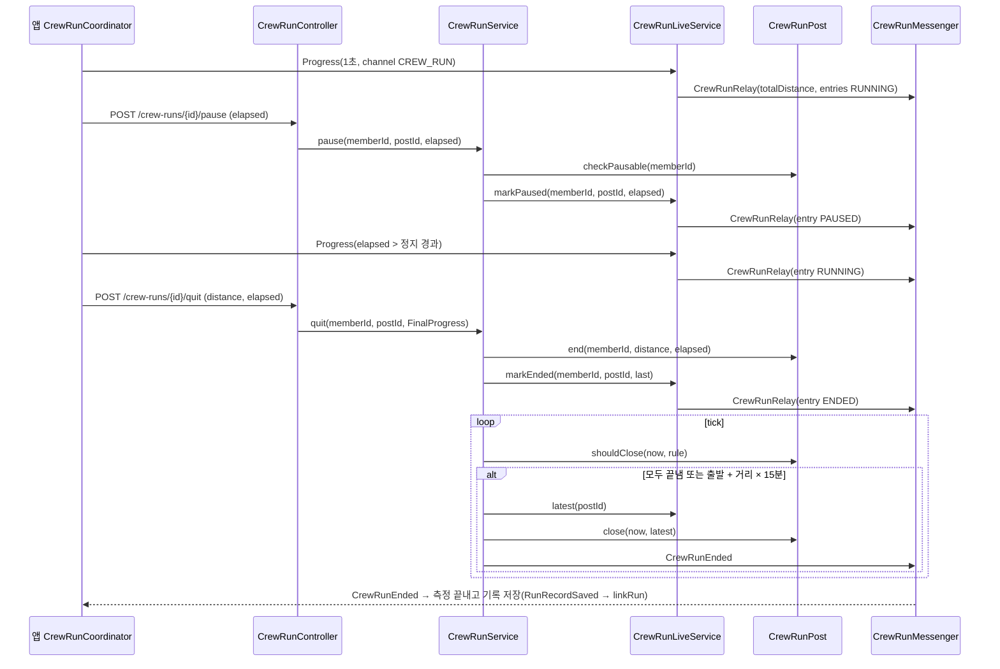
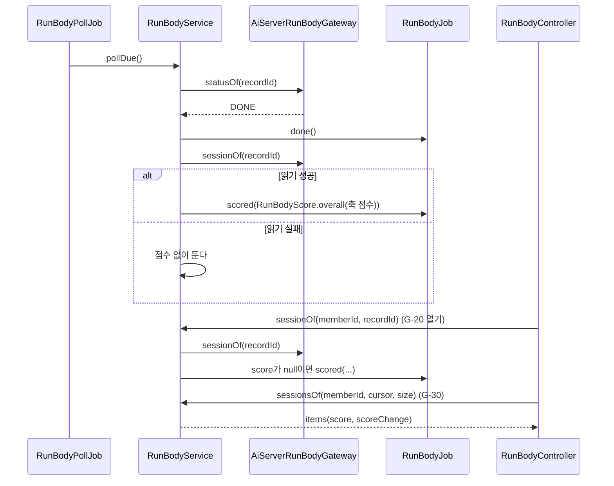
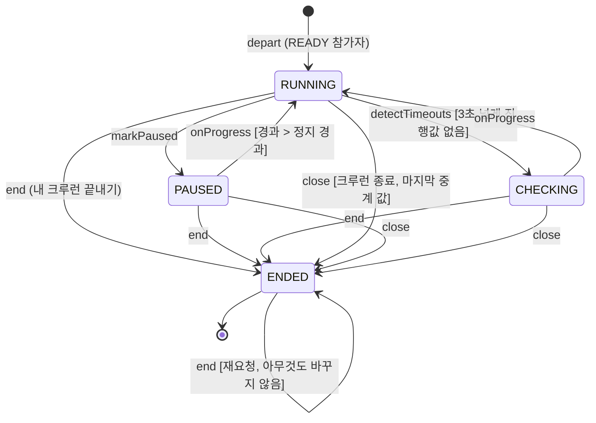

# 5.6 설계 결정 기록 (이어서: D-568~D-602, v0.37 2차 배포 통합)
> 작성: 2026-11-08 | 버전: v0.37 | 담당: 이성현(공용 담당 브랜치 `docs/S15P31A207-222-2nd-release`) | 입력: (같은 판 보정 2026-11-09: srs 7.13.23.6 CR-169~CR-171, MR !91 병합 69e16ff5의 9c7f967f..cbca2c38 → D-595~D-602) (같은 판 보정: code-review 23장 U2-1~U2-3·CR2-A1·CR2-B1·CR2-B2·CR2-T1, 코드 1ae0b108..c5ee333a) (같은 판 보정) MR !91 수정 19커밋 e9baef18..1ae0b108, runkk-work/runbody/contract.md v1.3, runkk-work/crewrun-sum/contract.md v1.1, runkk-work/2nd-release/e2e 기록; srs.md v0.29(7.13.23 CR-159~CR-168, FR-299~FR-305), 코드 MR !91 `feature/S15P31A207-222-2nd-release` e9baef18(읽기만 함), runkk-work/crewrun-sum/contract.md v1.0, runkk-work/runbody/contract.md v1.2, runkk-work/2nd-release/mr-body.md(2026-11-07~08 사용자 결정)

> [런크크 객체지향 분석·설계서](../design-oo.md) 목차 · 이전: [05-24-설계-병합-272-278-성](05-24-설계-병합-272-278-성.md) · 다음: [05-26-설계-이벤트-성](05-26-설계-이벤트-성.md)

2차 배포 통합 MR !91은 브랜치 6개(상점 -237, 서버 런바디 -242, 앱 런바디 -229, 크루 피그마 -236, 크루런 합산 -236, 속도·케이던스 -242)와 후속 정리를 합쳤다. 코드가 먼저 들어갔으므로 이 조각은 **코드에 맞춘 설계 기록**이다. 기존 조각의 문장은 지우지 않고, 바뀐 결정에는 원래 자리(05-19 D-442·D-444·D-449, 06-04 CrewRunPost 등)에 "(v0.37 변경, D-xxx)"를 붙이고 이 조각을 가리킨다.

서버 패키지는 68 → 72개(runbody, web.runbody, infra.runbody, batch.runbody)다. 앱 허용 표는 폰 159 → 168, 워치 37 그대로다(4절). 마이그레이션은 V38~V42 다섯 개다(5절).

## 1. 결정 표

### 1.1 요구와 결정 대응

| 요구 (srs v0.29) | 결정 |
|------------------|------|
| FR-299, FR-129~FR-131·FR-205~FR-207·FR-211·FR-212(앱 진입 없음), FR-132·FR-145(대면 모임) | D-568 |
| FR-110, FR-113, FR-117, 3.5.1 | D-569 |
| FR-112, 3.0.3 | D-570 |
| FR-117, FR-140 | D-571 |
| FR-147~FR-149, FR-191, FR-192, FR-300, FR-190 삭제 | D-572~D-576 |
| FR-148 | D-575 |
| FR-160 | D-577 |
| FR-301 | D-578, D-579, D-588 |
| FR-302 | D-579, D-591 |
| FR-265(CR-167) | D-580, D-589, D-590 |
| FR-303~FR-305, FR-026, NFR-036 | D-581~D-584, D-587, D-594 |
| 전체 | D-585(마이그레이션), D-586(패키지·허용 표) |
| FR-223, FR-231, FR-008, FR-078(CR-169) | D-595~D-598 |
| FR-068, FR-069, FR-168(CR-170) | D-599~D-601 |
| FR-155, FR-016(CR-171) | D-602 |

### 1.2 결정 (D-568~D-586)

| ID | 근거 | 결정 |
|----|------|------|
| D-568 | FR-299, CR-159, 피그마 F-05·F-11·F-17·F-24 | **크루 홈은 탭 셋과 ⋯ 메뉴.** 앱 `CrewTab`(레이스·크루런·채팅)과 `CrewHomePage`(탭 쪽, 크루 정보 쪽, 크루원 쪽)로 나눈다(한 파일 한 최상위 선언, D-112). 크루 정보 쪽은 `CrewInfoPage`, 크루원 쪽은 `CrewMembersTab`이다. 앱의 게시판·앨범·사진·고정 공지·공지 쓰기·투표·대면 모임 화면과 그 ViewModel을 지우고, 쓰이지 않게 된 `CrewRepository` 연산 10개(writeCheer, writeNotice, pin, writePoll, respondPoll, pollResult, writeBoard, photo, album, writeMeetup)와 DTO·매퍼·`PhotoCompressor`를 지운다. 게시글 목록 해독(BoardPost·Notice·Poll·Meetup)은 남긴다(옛 글이 목록에 섞여 와도 깨지지 않게). **서버 API와 crew 클래스는 지우지 않는다**(다시 열 때 그대로 쓴다). 공지·투표 알림의 앱 이동 대상은 레이스 탭이다 |
| D-569 | FR-110·FR-113·FR-117, CR-160 | **서버 `common.CrewTag`(8개)를 새로 두고 `TagSet`이 CrewTag를 1~3개 받는다.** 같은 요일 묶음의 여러 시간대를 허용한다. 위반은 TAG_INVALID. 크루 생성·수정·검색 요청의 tags가 CrewTag다. `PersonalityTag`는 Runimal 축 이름에만 쓰이므로 남긴다. 저장 문자열의 모르는 이름은 읽을 때 건너뛴다(`CrewTags`). 기존 크루 태그는 V39에서 비운다. 검색은 그대로 AND(`TagSet.containsAll`). 계약 기준 enums/CrewTag를 더한다. 앱 `RunkkTags`는 두 줄 8개, 크루 찾기는 「조건 설정하기」 팝업 |
| D-570 | FR-112, CR-161 | **초대 코드는 구성원 모두에게 담는다.** `CrewQueryService`가 `CrewDetailView.inviteCode`를 열람자의 크루 역할이 있으면(크루장·운영진·크루원) 채우고 크루 밖이면 null로 둔다. `GET /crews/{id}`·`GET /crews/me`가 같다. 재발급(`CrewService.reissueInviteCode`)의 권한 검사는 그대로 크루장만. 앱은 크루 정보 쪽 머리글 「초대 코드」 단추로 팝업(복사)을 연다 |
| D-571 | FR-117·FR-140, CR-163 | **크루 상세에 지난 주 거리.** `CrewDetailView.lastWeekDistance`(지난 주 weekly_race 합계)를 더하고 응답 `CrewDetailResponse.lastWeekDistanceMeters`로 낸다. 앱은 크루 찾기에서 상세를 열 때 크루 정보를 읽어 통계 칸에 넣고 이번 주 크루 거리·크루장 줄을 뺀다. 레이스 카드는 공동 목표가 없으면 제목 「이번 주 달린 거리」, 마감 문구 없음(앱 표시만) |
| D-572 | FR-191·FR-192·FR-300, CR-164, 합산 계약 2절 | **크루런 합산 도메인.** `CrewRunPost`에서 `recordArrival`·`quit`·도착 순 순위 매기기를 지우고 `checkPausable(memberId)`(RUNNING이고 끝내지 않은 진행 참가자, 아니면 NOT_PARTICIPANT), `boolean end(memberId, Distance, Duration)`(RUNNING·FINISHED에서 진행 참가자만, 이미 끝냈으면 false = 재시도 안전), `shouldClose(now, rule)`(진행 참가자 모두 끝냄 또는 now ≥ departedAt + 거리 × km당 분), `close(now, Map<Long, LiveProgress> latest)`(끝내지 않은 사람을 마지막 중계 값으로 마감)를 둔다. `CrewRunParticipation`은 arrivedAt·rank를 지우고 quit을 ended로 바꾸고 finalDistance·finalElapsed를 더한다(`FinalProgress`). `PostSummary.CrewRunInfo.finisherCount`는 형식을 두고 뜻을 진행 참가자 수로 바꾼다 |
| D-573 | FR-149·FR-300, 합산 계약 3절 | **중계는 합산과 상태.** `CrewRunLiveSession`이 참가자마다 정지 경과(paused)를 두고, 정지 경과보다 큰 경과의 진행값이 오면 정지를 푼다(재개 요청 없음). `RelayEntry`는 rank·connection을 지우고 `State`(RUNNING, PAUSED, CHECKING, ENDED)를 둔다. `CrewRunRelay`는 totalDistance(진행 참가자 전원 최신 거리 합, 끝낸 사람 포함)와 입장 순 entries다. `CrewRunLiveService`에 `markPaused(memberId, postId, elapsedAt)`, `markEnded(memberId, postId, last)`, `latest(postId)`를 둔다. 정지 상태는 DB에 쓰지 않는다 |
| D-574 | FR-191·FR-192·FR-300, 합산 계약 4·5절 | **크루런 API.** `CrewRunController`에 `POST /crew-runs/{id}/pause`(본문 elapsedSeconds 선택, 204)를 더하고, `POST /crew-runs/{id}/quit`은 본문 distanceMeters·elapsedSeconds(선택)를 받아 `CrewRunService.quit(memberId, postId, FinalProgress)`로 간다(거리 0~100km·경과 0~24시간 밖이면 CREW_RUN_INVALID). 결과 `CrewRunResultView`는 status, title(본문 첫 줄), distanceMeters, startedAt, totalDistanceMeters, participants(입장 순: distance·elapsed·평균 페이스·ended·me), myRecordId, firstCrewRun, raceContributionMeters다. finisherCount·finishers·rank·quit은 지운다. 참가자 값은 연결 기록 요약 → 끝낼 때 남긴 값 → 거리 0 순 |
| D-575 | FR-148, CR-162 | **취소 사유는 서버가 만든다.** `CrewRunAnnouncer.cancelledReason(minReady)`가 「준비 완료한 참가자가 {n}명보다 적어 시작하지 않았어요」를 만들고 n은 `CrewRunRule.minReady`(운영 기준값)다. 앱은 접두 문구 없이 그대로 보이고 단추는 「일정으로 돌아가기」 |
| D-576 | FR-147·FR-149·FR-191·FR-192·FR-300, 피그마 F-14~F-16b | **앱 크루런.** domain.crew `CrewRunCoordinator`에서 목표 거리 자동 종료와 순위 안내를 지우고, 일시정지 전이를 서버에 알리며(`CrewRepository.pause(postId, elapsed)`), 끝낼 때 마지막 거리·경과를 보낸다(`CrewRunQuitRequest`). 내 측정값은 `CrewRunProgress`로 낸다. `RunModePausable`이 크루런 모드 일시정지를 허용하고(**v0.37 보정 완료, [code-review 22장](../code-review/22-2차배포-통합-1차.md) BR-1·U-2, 4a10fae7: 서버 `POST /runs`가 자유런·크루런 기록의 정지 구간을 받고 대결만 거부한다(RunUpload.requireAllowed, V43). 업로드 성공은 200 STORED. F.2.2 규칙도 같다**), 진행 알림(`ProgressNotice`)에 크루런 종류(제목 「크루런 · mm:ss 경과」, 거리, 일시정지·재개)를 더한다. ui.crew는 domain.live·domain.record를 보지 않게 크루원 상태 `MateState`·지도 표지 `MateMarker`를 두고, 결과 상세는 ui.share `RecordResultDetailReader`로 읽는다. `RankGuidanceRule`·`CrewRank`·순위 문구를 지운다. 결과는 아직 달리는 사람이 있거나 내 기록 업로드 전이면 다시 읽는다(**v0.37 보정 완료, [code-review 22장](../code-review/22-2차배포-통합-1차.md) AN-3·U-6, 878c5e21**: 달리는 크루원이 있으면 크루런이 닫힐 때까지 다시 읽는다. 처음 10번 3초, 그 뒤 6·12·24·48초, 이후 60초 간격, 최대 3시간. 내 기록만 아직 올라가지 않았으면 3초 × 10번. 읽기 실패는 이미 받은 결과가 있으면 같은 규칙으로 이어 간다. (v0.37 보정, [code-review 23장](../code-review/23-2차배포-통합-확인.md) CR2-A1·U2-2, b23837ca) 다시 읽기는 화면이 보일 때만 한다: `CrewRunResultRoute`가 `LifecycleStartEffect`로 onStart·onStop을 불러 다른 화면을 위에 쌓거나 백그라운드면 멈추고, 돌아오면 바로 한 번 읽은 뒤 간격 규칙을 잇는다. 3시간 상한은 처음 읽은 때부터의 실제 경과(TimeSource)로 센다. 서버 결과는 진행 중(RUNNING)이고 끝내지 않은 참가자의 거리·경과를 세션의 마지막 중계 값으로 준다(CrewRunService.result, 계약 crewrun-sum v1.1 5절)) |
| D-577 | FR-160, CR-165 | **상점 잔액 즉시 안내.** `ShopViewModel`이 잔액을 알고 있고 가격이 잔액보다 크면 확인 창을 띄우지 않고 메시지 `avatar_error_insufficient_reward`를 낸다. 잔액을 모르면 기존대로 확인 뒤 서버 판정 |
| D-578 | FR-301, CR-166, **D-442 일부 변경** | **러닝 점수 하나만 작업에 남긴다.** `runbody_job.overall_score`(0~100, V42). `RunBodyScore.overall(축 점수들)`은 null 아닌 축 평균을 반올림(0.5 올림), 없으면 null. `RunBodyScore.change(score, previous)`. `RunBodyJob.scored(score)`. 남기는 때: `pollDue`에서 DONE이 될 때 ai 결과를 한 번 읽어 남기고, 그때 실패했거나 V42 전에 DONE이 된 작업은 `sessionOf`가 결과를 처음 읽을 때 채운다. 일괄 채우기는 하지 않는다(사용자 결정). 결과 본문은 여전히 ai에만 있다 |
| D-579 | FR-301·FR-302, runbody contract v1.2 7·8절 | **런바디 목록·변화 API.** `RunBodyController`에 `GET /api/v1/runbody/sessions?size&cursor`(`RunBodyService.sessionsOf` → `RunBodySessionPage`(items: `RunBodySessionItem` recordId·status·score·scoreChange, nextCursor), 색인 (member_id, created_at DESC, record_id DESC))와 `GET /api/v1/runbody/trend`(`RunBodyTrendService.trendOf` → `RunBodyTrend`)를 더한다. 변화는 ai를 부르지 않고 running의 새 연산 `RunQueryService.validRunCount(memberId)`·`validRunStats(memberId, fromOrdinal, toOrdinal)`(`ValidRunStat`: ordinal·startedAt·distance·averagePace·averageHeartRate, 위치·심박 원자료 열은 읽지 않음. v0.37 보정, [code-review 22장](../code-review/22-2차배포-통합-1차.md) U-3)로 셈한다. 나의 러닝 유형은 web.runbody가 `RunimalQuery`로 읽는다(web.crew와 같은 방식). 모두 RUNBODY_ENABLED false면 403 FEATURE_CLOSED |
| D-580 | FR-265, CR-167, **D-450 보완** | **ai 제출 거부는 바로 실패.** `AiServerRunBodyGateway`가 POST analyze의 409(SESSION_CONFLICT)·413(TOO_LARGE)·422(INVALID_REQUEST)를 `RunBodyRejectedException`으로 던지고 `RunBodyJob.rejected()`가 재제출 없이 FAILED로 만든다. 결과 조회에서 ai 결과의 userId가 본인이 아니면 FAILED로 내린다(남의 결과 방지) |
| D-581 | FR-304, CR-168, **D-444 변경** | **속도·케이던스를 저장하고 보낸다.** `POST /runs`에 선택 항목 motions(measuredAt, speedMps, cadenceSpm)를 더한다(`RunUpload.motions`). web.run `RunController.MotionRequest.toSample`이 값 없는·음수 표본을 버리고(running `MotionSample` 생성자는 그런 값을 예외로 막는다, v0.37 보정, [code-review 22장](../code-review/22-2차배포-통합-1차.md) U-4) running `MotionSamples`가 `run_record.motion_data`(BYTEA, 압축, V41)에 둔다. 경로 파기(FR-026)와 탈퇴 파기 때 위치 경로와 함께 지운다. `RunQueryService.bodyInputOf`가 표본을 `RunBodyInput`에 싣고, `RunBodyRequestFactory`는 기기 속도·케이던스를 그대로 보내며 앞뒤 5초 안에 기기 속도가 없는 위치 쌍만 위치로 속도를 셈한다. 케이던스는 셈하지 않는다(ai no_cadence). 게이트웨이 표본에 cadence를 싣는다. D-444의 "케이던스·속도는 보내지 않는다(저장하지 않음)"를 대신한다 |
| D-582 | FR-303·FR-304 | **앱 측정 표본.** domain.run `MotionSample`(속도 m/s, 케이던스 spm)과 `CadenceMeter`(누적 걸음 수 → 최근 10초 분당 걸음 수, 같은 측정 시각은 버림). `RunTracker.onMotionSample` → `RunSession.onMotion(sample, isFromWatch)`: 측정 중(정지 제외)에만 남기고 쓸 수 없는 값은 버린다. `CompletedRun.motions`(기본 빈 목록), 경로 파기 때 함께 지운다. 폰 `MeasurementService`는 위치에 속도가 있고 정확도 30m 이하이면 속도 표본을, `StepCadenceSensor`(걸음 센서 누적값)는 케이던스 표본을 낸다. 미전송 기록 `PendingRunEntity.motions`(BLOB, Room 판 5→6 자동 이전), `RunUploadRequest.motions`(재지 못한 값은 보내지 않음), 위치 동의 철회 파기(`replaceRoutes`)가 표본도 지운다 |
| D-583 | FR-303, 2026-11-08 결정(워치 동행 손목 걸음 우선) | **워치 표본.** 워치 단독: `WatchExerciseSource`가 신체 활동 권한·기기 지원(capabilities)이 있으면 운동 세션에 SPEED와 STEPS_PER_MINUTE(없으면 STEPS를 셈)를 넣어 표본을 내고, `WatchMeasurementService`가 `RunTracker.onMotionSample`로 넘긴다. 워치 동행: wear-contract `HeartRateBatchMessage`에 선택 항목 steps(measuredAtEpochMillis, perMinute?, total?)를 더한다(옛 폰은 버리고 옛 워치 묶음은 빈 목록). 동행 세션은 심박과 같은 허용 규칙으로 걸음을 넣고 `PhoneLink`가 심박 묶음에 싣는다. 폰 `WatchLink.motions` → `RunWatchBridge` → `RunSession.onMotion(isFromWatch = true)`. 손목 케이던스가 있으면 폰 걸음 센서 케이던스를 빼고 폰 속도는 남긴다 |
| D-584 | FR-305 | **측정 권한 요청은 core 하나.** core designsystem `RunPermissionEffect(shouldAsk)`와 `RunPermissionRule.runPermissionsToAsk`가 진행 알림·신체 활동 권한 가운데 허용하지 않은 것만 한 번 묻는다(core/ui에 activity-compose). 자유런 카운트다운, 대결 진행 화면(배틀런·친구 대결·배치고사·셀프런·셀럽런), 크루런 화면(출발 카운트다운, 진행 중 재진입)이 부른다. 결과와 관계없이 측정은 이어 간다. 워치는 `StartPermissions`가 시작 조작 때 위치와 함께 묻는다. 두 매니페스트에 ACTIVITY_RECOGNITION |
| D-585 | 5절 | **마이그레이션 V38~V42.** 번호는 develop의 V37 다음이다. V39·V40은 되돌릴 수 없지만 크루가 1차 배포에서 잠겨 운영 자료 영향이 없다. (v0.37 보정, [code-review 23장](../code-review/23-2차배포-통합-확인.md) U2-3) 되돌림 범위: V45를 적용한 뒤에는 MR !91 수정 전 판(e9baef18)으로만 되돌리면 그 코드가 run_started_at 없이 runbody_job에 넣어 러닝 업로드 트랜잭션이 실패하므로, 되돌릴 때는 1차 배포 판까지 되돌린다. V43은 옛 제약보다 느슨해 기존 행이 모두 맞고, 큰 표가 되면 `ADD CONSTRAINT … NOT VALID` 뒤 `VALIDATE CONSTRAINT`로 나누기를 권한다. (v0.37 보정, 수정 19커밋 e9baef18..1ae0b108) V43(ck_run_record_pause를 FREE·CREW_RUN 정지 허용으로 완화), V44(runbody_job.failure_reason), V45(runbody_job.run_started_at, 기존 행은 run_record에서 채움, 색인 교체)를 더했다 |
| D-586 | 4절, D-455 | **허용 표 갱신.** 서버 ArchUnit: runbody → member·running·policy, web.runbody → runbody·runimal, infra.runbody → runbody, batch.runbody → runbody, infra.integration.ai → runbody. 서버 패키지 72개. 앱: domain.runbody → core.model, api.runbody → api.core·domain.runbody·core.model, ui.record.runbody → core.designsystem·core.navigation·core.model·domain.record·domain.runbody로 폰 168개, 워치 37개 |
| D-587 | [code-review 22장](../code-review/22-2차배포-통합-1차.md) AN-5, 사용자 결정 2026-11-08 | **움직임 표본 상한(D-581 보정).** 앱 `RunSession.recordedMotions`는 86,400개를 넘으면 시간 칸(1초부터 두 배씩)끼리 합쳐(`thinnedTo`) 상한 안으로 줄인다. 서버 `RunUpload`는 `MAX_MOTIONS` 86,400을 넘는 표본을 솎고(`MotionSamples.capped`), `RunController`는 그 4배를 넘는 요청(남용)만 400이다. 표본이 많다고 기록 전체를 거부하지 않는다. (v0.37 보정, [code-review 23장](../code-review/23-2차배포-통합-확인.md) CR2-B1·CR2-B2·U2-1, 1e93c919·c5ee333a) 서버 솎기는 `normalize`로 같은 일시 표본을 먼저 합친 뒤에도 넘치면, 시간 칸 길이를 (전체 길이 ÷ 상한)에서 시작해 10%씩 늘려 상한 안에 들 때까지 묶고 칸마다 속도·케이던스를 따로 평균한다(속도만·케이던스만 든 표본이 번갈아 와도 두 값이 남고, 86,401개는 86,400개 안에서 90% 넘게 남는다). 본문 크기: nginx는 `POST /api/v1/runs`(location =)만 `client_max_body_size 32m`, 다른 경로는 10m 그대로다. 앱 `RunMappers.toFittedRequest`는 업로드 본문 추정 크기가 24MB를 넘으면 움직임 표본을 시간 칸으로 더 솎는다(위치·심박·정지 구간은 그대로). 12시간 러닝과 표본 상한 본문(약 12MB)이 413 없이 들어간다 |
| D-588 | MR !91 e2e 3, 사용자 결정 2026-11-08 | **런바디 목록·점수 변화는 러닝 시작 순서(D-579 보정).** `runbody_job.run_started_at`(V45)으로 `latestOf`·`previousScore`·커서를 정렬한다. 늦게 올린 예전 러닝이 맨 위에 오거나 엉뚱한 러닝과 비교되지 않는다. 최근 10회 변화(`validRunStats`)의 회차는 티어·Runimal 순번(D-108, 저장 일시 순)과 같아야 해 저장 순서를 유지한다 |
| D-589 | MR !91 e2e 1 | **출생연도 없음.** 요청을 만들 수 없으면 `RunBodyJob`을 사유 `BIRTH_YEAR_MISSING`으로 바로 실패로 닫고 `failureReason`(V44, REJECTED_413 등 ai 거부도)을 남긴다. 세션 응답에 `failureReason`을 싣는다(FAILED일 때). member는 프로필 편집에서 출생연도를 넣으면 사건 `member.BirthYearSet(memberId, at)`을 내고, `RunBodyService.onBirthYearSet`이 그 회원의 BIRTH_YEAR_MISSING 작업을 PENDING으로 되돌려 다음 pollDue가 제출한다. 앱은 `NeedsBirthYear` 상태(「출생연도를 입력하면 분석할 수 있어요」 + 프로필 편집 단추 Routes.PROFILE_EDIT)를 보이고 돌아오면 다시 읽는다. 새 의존 runbody → member(사건 수신)는 RB1 안이다 |
| D-590 | MR !91 e2e 4·5, 사용자 결정 2026-11-08, NFR-053 | **런바디 화면 다시 읽기와 일시 장애.** 대기·분석 중이면 처음 12번 5초 간격(60초, NFR-053), 그 뒤 10·20·40초 간격으로 모두 3분까지 다시 읽고 멈추며, 칸에 「다시 확인」 단추를 둔다. 세션 읽기가 503(RUNBODY_UNAVAILABLE)이거나 연결 실패면 분석 실패(G-19)와 구분해 `Unavailable` 상태 「잠시 후 다시 시도해 주세요」 + 「다시 시도」를 보인다 |
| D-591 | MR !91 e2e 2·6, 1ae0b108 | **앱 사용자 표시 날짜는 기기 시간대.** 앱 `Clock`은 UTC라 오늘·달·주 묶음이 한국 0~9시에 하루 어긋났다. RunBodyViewModel·RecordListViewModel·CoachViewModel·CrewGoalSetViewModel·CrewRunWriteViewModel·InboxViewModel이 `ZoneId.systemDefault()`를 @Inject 보조 생성자로 받아 쓴다. 크루런 모집 일시도 고른 날짜·시각을 기기 시간대로 해석한다. 월간 부하 카드의 지난 날 수는 응답 `asOf`(지난달이면 월말) 기준이다. 홈(HOME_ZONE Asia/Seoul)과 서버 시각 변환(ServerTime)은 그대로다 |
| D-592 | [code-review 22장](../code-review/22-2차배포-통합-1차.md) BR-4 | **스케줄러 풀 25.** 런바디 5초 작업이 더해져 주기 작업이 25개다. application.yml 기본값·주석, infra/docker-compose.yml, .env.example 두 개를 25로 올리고 BootstrapConfigTest가 등록 수와 비교한다. 운영 .env에 값이 적혀 있으면 배포 때 25로 올린다 |
| D-593 | MR !91 e2e 7 (ai 서버) | **마지막 부분 랩 평균 심박.** ai metrics.laps가 부분 랩에도 평균 심박을 넣는다(`_lap_hr`). 앱 랩 표 마지막 줄 심박이 빈칸이 되지 않는다. 서버·앱 계약 변화 없음 |
| D-594 | [code-review 22장](../code-review/22-2차배포-통합-1차.md) BR-2·BR-3·BR-5·AN-4 | **그 밖의 수정.** `CrewRunAnnouncer.ensureSession`이 끝낸 참가자를 DB 마감 값으로 `markEnded`(Redis 재시작 뒤 CHECKING 방지). `RunBodyTrendService.trendOf`는 REPEATABLE READ 한 스냅숏에서 읽고 `RunBodyTrend`는 빈 회차·거리 0이면 그 회차를 null로 둔다. `RunBodyRequestFactory.of`를 `addHeartRates`·`addMeasuredMotions`·`addGpsSteps`로 나눴다(동작 같음). `MeasurementService` 1초 시계가 `StepCadenceSensor.ensureStarted`로 권한이 생기면 걸음 센서를 연다. (v0.37 보정, [code-review 23장](../code-review/23-2차배포-통합-확인.md)) CR2-T1(17fd942e): MeasurementService 1초 시계 본문을 `measurementTick`으로 떼어 권한 허용 뒤 걸음 센서를 한 번만 구독하는지 시험하고, POST /runs motions 345,600개 200·345,601개 400 경계를 시험으로 고정했다. CR2-A1은 D-576, CR2-B1·CR2-B2는 D-587 |
| D-595 | srs 7.13.23.6 CR-169, Jira -248, 사용자 결정 2026-11-09 | **배포 범위 ReleaseScope.** core.designsystem `ReleaseScope`(FIRST_RELEASE, SECOND_RELEASE)와 `ReleaseScope.of(isLockingUnreleased)`: 잠그는 빌드(prod·develop)는 SECOND_RELEASE, 그 밖은 모두 엶. `UnreleasedFeature`는 CREW·AVATAR_CUSTOMIZE·RUNBODY만 남고(CARD_BACK·RUNIMAL_SHARE 삭제) SECOND_RELEASE가 셋을 모두 연다. 화면은 `LocalReleaseScope`의 `isOpen`으로 진입점을 가린다. `RunkkNavHost`는 lockUnreleased 대신 releaseScope를 받고, `BetaLock`은 경로마다 딸린 기능을 정해 지금 범위에서 닫혀 있을 때만 막는다. 크루 탭 자물쇠도 범위로 정한다. FR-223 1차 배포 잠금(D-252)은 FIRST_RELEASE로 그대로 남는다 |
| D-596 | srs 7.13.23.6 CR-169, FR-008 | **알림 열림은 기능별.** 앱 data `BuildConfigReleaseLock`(ReleaseLock)을 `isOpen(GatedFeature)`로 바꿔 운영 빌드도 크루·아바타 알림을 띄운다. 서버 `notification.GatedFeature`가 운영 기준값 CREW_RELEASED·AVATAR_RELEASED로 먼저 거른다(D138). 배포 날 관리툴에서 CREW_RELEASED·AVATAR_RELEASED·RUNBODY_ENABLED를 켠다 |
| D-597 | srs 7.13.23.6 CR-169, FR-231, Jira -249·-250 | **첫 사용 가이드 8단계.** `GuideStep.visibleIn(scope)`가 크루를 넷째 단계로 넣고(크루 탭 앵커는 하단 탭) 포인트 단계(`GuideStep.POINT`)를 마지막에 둔다. 포인트 앵커는 홈 상단의 잔액과 알림함 버튼을 한 줄로 묶은 영역이다(피그마 J-8) |
| D-598 | srs 7.13.23.6 CR-169, FR-078, Jira -251 | **결과 화면 크루 반영 줄(B-6 v2).** 서버 기록 상세 응답에 `contributedCrewName`을 더한다(`WeeklyRaceRepository.contributedCrewOf`, `WeeklyRaceService.contributedCrewNameOf`). 반영 거리 `crewContributionMeters`는 원래 있었다. 앱 `RecordDetail.contributedCrewName`, 성과 줄은 신기록 → 크루 반영 → 리워드 순이고 크루가 닫힌 범위면 `AchievementCard`가 그리지 않는다. 계약 기준 dto-records.json 갱신 |
| D-599 | srs 7.13.23.6 CR-170, FR-068, Jira -238, 피그마 제안 K-1 | **기록 카드 뒷면.** `RecordCardBack`은 앞면과 같은 334x383 틀에 연한 격자, 보라 경로선, 출발 흰 점·도착 라임 점, 거리·운동 시간·평균 페이스 세 칸이고 경로가 없으면 「코스 기록 없음」이다. 팝업은 카드를 눌러 뒤집고 면 점(지금 면은 길쭉한 진한 점, 다크에서는 밝은 테두리)을 보인다. 잠긴 코스 지도 표시는 덮개로 누름을 받아 기존 안내 스낵바를 보인다 |
| D-600 | srs 7.13.23.6 CR-170, FR-069, 피그마 제안 K-2 | **카드 공유.** ui.share `CardCapture`(화면 카드를 그대로 찍기), `ShareImageFramer`(테마 바탕 위 카드 아래 「런크크」 워드마크, 공유 이미지에만), `ShareTargetBar`(기기에 저장, 인스타그램 스토리, 더 보기). 공유 단계는 보이는 면을 찍고 코스 지도 표시로 면을 바꾼다. 공유 단계 동작 묶음 클래스는 없애 한 파일 규칙(D-112)을 지킨다 |
| D-601 | srs 7.13.23.6 CR-170, FR-168, Jira -239, 피그마 제안 K-3 | **Runimal 공유.** 진입은 MY Runimal 오른쪽 위 「공유」(유형이 있을 때만, 하단 공유 막대는 없앰). 공유 카드는 MY Runimal·임시 유형 꼬리표, 유형 그림, 이름, 설명, 진한 채움 축 막대 넷이고 축 막대는 `LeanBarStyle`로 MY Runimal 화면과 같은 코드를 쓴다. 공유 대상·워드마크는 D-600과 같다 |
| D-602 | srs 7.13.23.6 CR-171, FR-155·FR-016, Jira -248 | **셀카 열기와 배포 설정.** 운영 환경 INFRA_ENV_PROD에 SELFIE_ENABLED=true(서버 `runkk.features.selfie-enabled`), infra/deploy.sh의 prod 셀카 경고를 지운다. 개인정보 처리방침(infra/nginx/static/legal/privacy.html)에 셀카 위탁·국외 이전·원본 즉시 삭제와 런바디 AI 분석 목적을 더하고 시행일은 2026-11-13이다. GitLab CI 변수 SCHEDULER_POOL_SIZE를 develop·prod 모두 25로 둔다(D-592) |

### 1.3 다른 결정의 보정

| 기존 | 보정 (v0.37) |
|------|--------------|
| D-442(05-19) | 러닝 점수 하나는 서버에 남긴다(D-578). 결과 본문은 그대로 ai에만 |
| D-443(05-19) | 상태 조회 일정은 batch.runbody `RunBodyPollJob`(5초, 설정 runkk.batch.runbody-poll-*)이다. 작업은 러닝 저장 트랜잭션 안에서 만들고 제출은 커밋 뒤 비동기다 |
| D-444(05-19) | D-581이 대신한다 |
| D-449(05-19) 런바디 연결 | "요청 gzip"은 하지 않는다. ai(FastAPI)가 압축 본문을 422로 거부한다(`AiServerRunBodyGateway` 주석). 읽기 10초는 그대로 |
| D-450(05-19) 런바디 부분 | D-580이 409를 더한다 |
| D-453(05-19) 앱 패키지 | 런바디 화면은 하위 패키지 `ui.record.runbody`(RunBodyScreen·RunBodyViewModel 등, 코치의 ui.record.coach와 같은 방식). 옛 ReportRoute·ReportScreen·ReportViewModel은 지우고 Routes.REPORT 등록을 `RunBodyFeatureEntry`로 옮겼다. 1차 배포 잠금(UnreleasedFeature.RUNBODY)은 그대로 |
| 06-04 CrewRunPost·CrewRunParticipation·CrewRunLiveSession·RelayEntry | D-572·D-573로 바뀐다(06-04에 표시) |
| 07-11 상태도 2.4.6(크루런 참여) | 2.4.30이 참가자 진행 상태를 더한다. 도착(arrive)·순위 전이는 지운다 |

## 2. 고친 명세

### 2.1 서버 crew (06-04 보충)

| 클래스 | 바뀐 것 |
|--------|---------|
| CrewRunPost | 지움: recordArrival, quit, 도착 순 rank 매기기. 더함: `void checkPausable(long memberId)`, `boolean end(long memberId, Distance distance, Duration elapsed)`. 바뀜: `boolean shouldClose(LocalDateTime now, CrewRunRule rule)`(모두 끝냄 또는 상한), `void close(LocalDateTime now, Map<Long, LiveProgress> latest)`, `summary`의 finisherCount = 진행 참가자 수 |
| CrewRunParticipation | 속성 memberId, votedAt, answer, readiness, ended(boolean), finalDistance(Distance?), finalElapsed(Duration?), linkedRecordId. 연산 `boolean end(Distance, Duration)`(처음만 true), `boolean hasEnded()`, `Optional<Distance> finalDistance()`, `Optional<Duration> finalElapsed()` (v0.37 보정, [code-review 22장](../code-review/22-2차배포-통합-1차.md) U-1: 코드는 finalProgress() 하나가 아니라 둘이다) |
| FinalProgress (값, 새) | 끝내기 요청 본문의 거리·경과(`validate`로 0~100km·0~24시간 검사). 참여에는 finalDistance·finalElapsed 두 값으로 남는다 |
| CrewRunLiveSession | 속성에 paused(Map<Long, Duration>), ended. ranking() 대신 입장 순 `entries()`와 `totalDistance()`. `markPaused(memberId, elapsedAt)`, `markEnded(memberId, last)`. 상태 판정: ended → ENDED, paused → PAUSED, 3초 넘게 진행값 없음 → CHECKING, 아니면 RUNNING |
| RelayEntry | name, distance, state(State), memberId, mine. State = RUNNING, PAUSED, CHECKING, ENDED |
| CrewRunRelay (live) | postId, totalDistance, entries |
| CrewRunLiveService | `onProgress`, `detectTimeouts`, `markPaused(long memberId, long postId, Duration elapsedAt)`, `markEnded(long memberId, long postId, LiveProgress last)`, `Map<Long, LiveProgress> latest(long postId)` |
| CrewRunService | `void pause(long memberId, long postId, Duration elapsedAt)`(checkPausable → markPaused), `void quit(long memberId, long postId, FinalProgress reported)`(CrewRunPost.end → markEnded, 새로 끝냈으면 중계), tick의 종료는 `close(now, liveService.latest(postId))` 뒤 CrewRunEnded |
| CrewRunResultView | 1.2 D-574의 항목 |
| CrewRunAnnouncer | `static String cancelledReason(int minReady)`, `cancelled(post, recipients, minReady)` |
| CrewDetailView | `lastWeekDistance`, `inviteCode`(구성원이면 채움) |
| common.CrewTag (새), TagSet, CrewTags | D-569 |

### 2.2 서버 runbody·running (05-19 2.2 보충)

| 클래스 | 바뀐 것 |
|--------|---------|
| RunBodyJob | 속성 polls, createdAt, score(Integer). 연산 `void scored(Integer score)`, `void rejected()`(바로 FAILED), `void unreachable(LocalDateTime now)`(연결 실패, 횟수 안 셈), `Integer score()` |
| RunBodyScore (새, 유틸) | `static Integer overall(Collection<Integer> axisScores)`, `static Integer change(Integer score, Integer previous)` |
| RunBodySession | ai 결과 본문, userId, `Integer score()`(축 점수로 셈) |
| RunBodySessionItem, RunBodySessionPage (값, 새) | 목록 한 줄과 쪽 |
| RunBodyTrend (값, 새), RunBodyTrendService (새) | `RunBodyTrend trendOf(long memberId)`: validRunCount, round, needs, recent, previous(각 fromOrdinal, toOrdinal, paceSecondsPerKm, runsPerWeek, runsPerMonth, averageHeartRate), sameHeartRatePaceChange. 러닝 유형은 web.runbody가 붙인다 |
| RunBodyService | `RunBodySessionPage sessionsOf(long memberId, String cursor, int size)`(1~100), `sessionOf`가 점수 채움 |
| RunBodyController (web.runbody) | 엔드포인트 넷: `GET /sessions`, `GET /sessions/{recordId}`, `GET /trend`, `GET /months/{yearMonth}` |
| running.RunQueryService | `Optional<RunBodyInput> bodyInputOf(String recordId)`(심박·위치·정지·거리·운동 시간·시작 기기·움직임 표본), `int validRunCount(long memberId)`, `List<ValidRunStat> validRunStats(long memberId, int fromOrdinal, int toOrdinal)` |
| running.MotionSample, MotionSamples (새) | 표본과 압축 직렬화(V41 motion_data) |
| running.RunRecord | motionData, 경로 파기 때 비움 |
| member.MemberQueryService | `OptionalInt birthYearOf(long memberId)` |
| policy | SettingKey RUNBODY_ENABLED(기본 false), FeatureToggles.runBodyEnabled. ReasonCode RUNBODY_NOT_FOUND(404)·FEATURE_CLOSED(403)·RUNBODY_UNAVAILABLE(503)·INVALID_YEAR_MONTH(400) |

### 2.3 앱

| 모듈·패키지 | 바뀐 것 |
|-------------|---------|
| domain.crew | `CrewRepository`: 지움 10개(D-568), 더함 `pause(postId, elapsed)`, 바뀜 `quit(postId, distanceMeters?, elapsed?)`. `CrewRunCoordinator`(D-576), `CrewRunProgress`(새), `CrewRunResult`(합산 형식), `CrewRunState`, `Lobby`(참가자 3열 상태), `CrewDetail.lastWeekDistance·inviteCode` |
| domain.live | `ServerMessage.CrewRunRelay`(totalDistance, entries의 state) |
| domain.run | `MotionSample`, `CadenceMeter`(새), `RunSession.onMotion`, `RunTracker.onMotionSample`, `CompletedRun.motions`, `RunModePausable`(크루런 허용), `ProgressNotice`(크루런 종류), 순위 안내 문구 지움 |
| domain.runbody (새) | `RunBodyRepository`(session, month, scores, trend), `RunBodySession`·`RunBodyResult`·`RunBodyMonth`·`RunBodyRunScore`·`RunBodyTrend`·`RunBodyStatus`·`RunBodyAxis` |
| data api.runbody (새) | `RunBodyApi`(GET 넷), DTO 넷, `RunBodyMappers`(모르는 상태 줄은 버림, 범위 밖 점수는 없음), `RunBodyRepositoryImpl` |
| data api.crew, api.run, data.store, data.device, data.watch | `CrewRunPauseRequest`·`CrewRunQuitRequest`(새), `CrewRunResultResponse`, `LobbyResponse`, `CrewDetailResponse`, `PostWriteRequest`(앱이 보내지 않는 항목 삭제), `RunUploadRequest.motions`, `PendingRunEntity.motions`(Room 6), `StepCadenceSensor`(새), `MeasurementService` 속도, `WatchLink.motions` |
| core designsystem | `RunPermissionEffect`·`RunPermissionRule`(새), `RunkkTags`(8개) |
| ui.crew | `CrewTab`, `CrewHomePage`, `CrewInfoPage`, `CrewMembersTab`, `CrewRaceTab`, `CrewScheduleTab`(크루런만), `CrewRunScreens`(대기실 F-14, 진행 F-15, 일시정지 F-15c, 그만두기 F-15d), `CrewRunResultScreen`(F-16·F-16b), `MateState`·`MateMarker`, 크루 찾기 「조건 설정하기」. 지움: 게시판·공지·투표·대면 모임 화면 |
| ui.record.runbody (새) | `RunBodyViewModel`(탭별 첫 읽기, 대기·분석 중 5초 간격 최대 12번), `RunBodyScreen`(요약·러닝별·월간), `RunBodyPickPage`(점수와 변화), `RunBodySummaryTab`(최근 10회 변화, 주간/월간 토글), `RunBodyRadar`(미산출 축 생략) |
| ui.share | `RecordResultDetailReader`(크루런 결과 상세가 domain.record를 직접 보지 않게) |
| ui.avatar | `ShopViewModel`(D-577) |
| wear, wear-contract | `WatchExerciseSource`, `WatchSteps`, `ExerciseSession`·`HealthServicesExerciseSession`(걸음 데이터형), `PhoneLink`, `StartPermissions`, `HeartRateBatchMessage.steps` |

## 3. 동적 모델 보완

### 3.1 사건 추적도 SQ-54 크루런 합산 진행·정지·종료 (FR-149·FR-191·FR-192·FR-300)

### 3.2 사건 추적도 SQ-55 러닝 점수 남기기 (FR-301, D-578)

### 3.3 상태도 2.4.30 크루런 참가자 진행 (CrewRunLiveSession·CrewRunParticipation, D-572·D-573)

크루런(CrewRunPost) 상태도는 그대로다(VOTING → LOBBY_OPEN → RUNNING → FINISHED, LOBBY_OPEN → CANCELLED). RUNNING → FINISHED의 사건이 "모두 도착·그만둠"에서 "모두 끝냄"으로 바뀐다.

## 4. 패키지 의존 (서버·앱 허용 표, D-586)

| 쪽 | 화살표 (새) | 수 |
|----|-------------|----|
| 서버 | runbody → member·running·policy, web.runbody → runbody·runimal, infra.runbody → runbody, batch.runbody → runbody, infra.integration.ai → runbody | 패키지 68 → 72 |
| 앱 폰 | domain.runbody → core.model, api.runbody → api.core·domain.runbody·core.model (159 → 163), ui.record.runbody → core.designsystem·core.navigation·core.model·domain.record·domain.runbody (163 → 168) | 168 |
| 앱 워치 | 없음 | 37 |

ui.crew는 domain.live·domain.record를 보지 않는다(MateState, ui.share RecordResultDetailReader로 대신, 화살표 수 변화 없음). ui.record Fan-Out은 7 그대로이고 ui.record.runbody의 ui.record.R 읽기는 코치와 같이 화살표로 세지 않는다. 순환은 없다: runbody는 web·infra·batch를 모르고, running·member·policy는 runbody를 모른다.

## 5. 마이그레이션 (D-585)

| 번호 | 내용 | 되돌림 |
|------|------|--------|
| V38 runbody_job | runbody_job(record_id PK, member_id, status CHECK 넷, attempts, polls, created_at, submitted_at, next_poll_at, version), 색인 (status, next_poll_at)·(member_id) | 가능(테이블 삭제) |
| V39 crew_time_tags | `UPDATE crew SET tags = ''`(성향 태그 → 요일·시간대 태그, 대응 없음) | 불가. 크루는 1차 배포에서 잠겨 운영 영향 없음 |
| V40 crew_run_sum | crew_run_participation: arrived_at·finish_rank 삭제, quit → ended, final_distance_m·final_elapsed_ms 추가 | 불가. 같은 이유 |
| V41 run_record_motion | run_record.motion_data BYTEA | 가능(열 삭제) |
| V42 runbody_job_score | runbody_job.overall_score INTEGER CHECK 0~100, 색인 (member_id) → (member_id, created_at DESC, record_id DESC) | 가능 |
| V43 run_record_crew_run_pause (v0.37 보정, BR-1) | ck_run_record_pause: `paused_millis >= 0 AND (mode IN ('FREE', 'CREW_RUN') OR paused_millis = 0)`. 대결 정지·음수는 그대로 거부 | 가능(옛 제약으로 되돌리기 전에 크루런 정지 기록을 확인) |
| V44 runbody_job_failure_reason (v0.37 보정, e2e 1) | runbody_job.failure_reason VARCHAR(40) | 가능 |
| V45 runbody_job_run_started_at (v0.37 보정, e2e 3) | runbody_job.run_started_at TIMESTAMP NOT NULL(기존 행은 run_record.started_at, 없으면 created_at), 색인 (member_id, created_at DESC, record_id DESC) → (member_id, run_started_at DESC, record_id DESC) | 가능 |

## 6. 추적 보충 (A-추적표 v0.37 행과 같음)

| 요구 | 설계 요소 |
|------|-----------|
| FR-299 | CrewTab, CrewHomePage, CrewInfoPage, CrewMembersTab (D-568) |
| FR-300 | CrewRunPost.checkPausable, CrewRunLiveService.markPaused, CrewRunController pause, CrewRunCoordinator, RunModePausable (D-572~D-574, D-576) |
| FR-301 | RunBodyScore, RunBodyJob.scored, RunBodyService.sessionsOf, RunBodyPickPage (D-578, D-579) |
| FR-302 | RunBodyTrendService.trendOf, RunQueryService.validRunStats, RunBodySummaryTab (D-579) |
| FR-303 | MotionSample, CadenceMeter, StepCadenceSensor, MeasurementService, WatchExerciseSource, HeartRateBatchMessage.steps (D-582, D-583) |
| FR-304 | RunUpload.motions, MotionSamples, run_record.motion_data, RunBodyRequestFactory, PendingRunEntity.motions (D-581, D-582) |
| FR-305 | RunPermissionEffect, RunPermissionRule, StartPermissions (D-584) |
| FR-110·FR-113·FR-117 | CrewTag, TagSet, CrewTags, RunkkTags (D-569), CrewDetailView.lastWeekDistance (D-571) |
| FR-112 | CrewQueryService(inviteCode 구성원), CrewInfoPage 초대 코드 팝업 (D-570) |
| FR-148 | CrewRunAnnouncer.cancelledReason (D-575) |
| FR-149·FR-191·FR-192 | D-572~D-574, D-576 (옛 recordArrival·ranking·RankGuidanceRule 지움) |
| FR-160 | ShopViewModel (D-577) |
| FR-265 (CR-167·CR-168) | AiServerRunBodyGateway REJECTED, RunBodyJob.rejected (D-580), RunBodyRequestFactory (D-581) |
| FR-026·NFR-036 | RunRecord 경로 파기의 motion_data, PendingRun replaceRoutes (D-581, D-582) |

## 7. 남은 확인 (v0.37)

| 항목 | 넘길 곳 |
|------|---------|
| 속도·케이던스 수집의 처리방침·앱 장터 데이터 보안 양식, 신체 활동 권한 신고 | PM(배포 전 할 일) |
| 크루런 부하 시험(B2) 시나리오: 중계 totalDistance·state, quit 본문, pause 요청, 목표 거리 자동 종료 없음 | 운영(이성현) |
| 박재영 조각 06-02(running·analysis)에 RunQueryService 새 연산 셋과 MotionSample·RunRecord.motionData를 옮길지 | 박재영(병합 대기 요청) |
| 코치 중계(-241) 브랜치와 SettingKey·FeatureToggles·ReasonCode FEATURE_CLOSED 병합 충돌 | 박재영·이성현 병합 때 |
| 크루 내 랭킹(FR-137)이 레이스 탭에 그대로 있는지 화면 확인 | `/sw-test` 화면 시험 |

## 8. 설계 판정 기준 점검 (바뀐 부분만)

| 기준 | 판정 | 근거 |
|------|------|------|
| 응집 | 합격 | 런바디 점수·변화는 runbody, 표본 저장은 running, 합산 중계는 crew 안에 있다. 새 패키지 없음(runbody 하위 셋은 05-19에 있던 설계) |
| 결합 | 합격 | 새 화살표 5개(서버)는 모두 05-19 5절 방향이고 web.runbody → runimal 하나만 새로 생겼다(web.crew와 같은 읽기 전용 RunimalQuery) |
| 순환 | 합격 | 4절 |
| 추적 | 합격 | 6절. FR-299~FR-305와 바뀐 FR 모두 설계 요소가 있다 |
