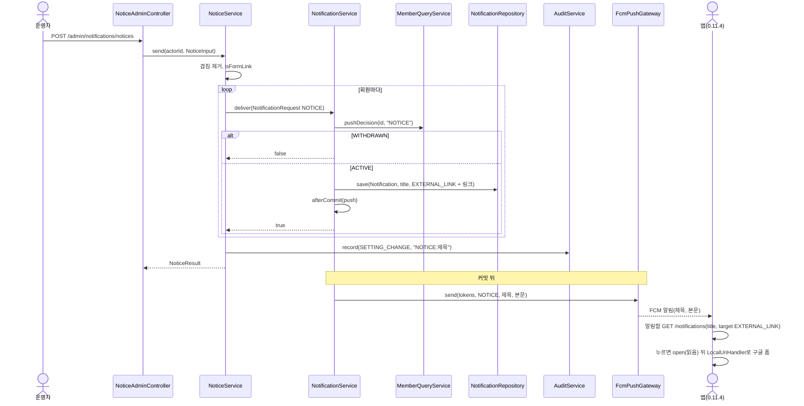

# 5.6 설계 결정 기록 (이어서: 운영자 공지 알림, 다음 판 변경)
> 작성: 2026-11-08 | 버전: 다음 판 변경 | 담당: 이성현(공용, 운영 도메인), 브랜치 `docs/S15P31A207-275-event-docs` | 입력: srs 다음 판 변경 7.13.23([임시:CR-성-6], 03-07 3.7.4 [임시:FR-성-15], [임시:FR-성-16], FR-025, FR-175, FR-176, FR-178), 2026-11-08 사용자 결정, 코드 `hotfix/S15P31A207-275-v0114-coach-celeb`(알림 코드 읽기, 구현 커밋 b26b3317)

> [런크크 객체지향 분석·설계서](../design-oo.md) 목차 · 이전: [05-24-설계-이벤트-성](05-24-설계-이벤트-성.md) · 다음: [06-01-클래스-common-member](06-01-클래스-common-member.md)

이 조각은 운영자 공지 알림(이벤트 당첨 안내)의 객체지향 설계다. 요구사항(srs 7.13.23)을 먼저 쓰고 이 설계를 거쳐 같은 핫픽스 브랜치에 구현했다. 기존 알림 경로(notification 패키지의 저장, 푸시)를 그대로 쓰고 새 클래스는 서비스 하나와 값 둘, 관리 컨트롤러 하나만 더했다. 새 번호는 임시 번호다: 설계 결정 [임시:D-성-19]~[임시:D-성-26], 시퀀스 [임시:SQ-성-3].

## 1. 결정 표

### 1.1 요구와 결정 대응

| srs | 결정 | 명세 |
|-----|------|------|
| [임시:FR-성-15], FR-175 | [임시:D-성-19], [임시:D-성-20], [임시:D-성-21] | 2, 3 |
| [임시:FR-성-15], [임시:FR-성-16] | [임시:D-성-22] | 2, 4 |
| FR-176 | [임시:D-성-23] | 2 |
| 배포 | [임시:D-성-24], [임시:D-성-25] | 5, 6 |
| [임시:FR-성-16], FR-178 | [임시:D-성-26] | 4 |

### 1.2 결정 ([임시:D-성-19]~[임시:D-성-26])

| ID | 근거 | 결정 | 기각한 대안 |
|----|------|------|-------------|
| [임시:D-성-19] | [임시:FR-성-15], FR-175 | **새 알림 종류 NOTICE, 이동 화면 EXTERNAL_LINK, 제목 열.** `NotificationType.NOTICE(Screen.EXTERNAL_LINK)`(닫힌 기능 없음, GatedFeature null). 링크는 기존 `NavigationTarget(screen, targetId)`의 targetId에 담는다(`Screen.EXTERNAL_LINK`, 링크가 없으면 targetId null). 공지 제목은 `notification.title`(VARCHAR(60), NULL 허용) 새 열에 둔다. `NotificationRequest`에 다섯째 구성요소 `title`(null 허용, 빈 글 거부)을 더하고 기존 네 인자 생성자를 남겨 다른 발생 서비스는 고치지 않는다. `InboxView.Item`에 `title`(공지만, 그 밖은 null)이 붙는다 | (가) 링크 전용 열: 이동 대상 구조가 이미 있다. (나) 본문에 링크를 섞기: 앱이 링크를 골라낼 수 없고 본문 길이를 먹는다. (다) 제목 없이 앱 고정 제목: 사용자 결정의 「제목」을 담지 못하고 기기 알림 제목이 늘 「런크크」다 |
| [임시:D-성-20] | [임시:FR-성-15] | **발송은 기존 알림 경로 재사용, 새 서비스 하나.** `NotificationService.notify`의 본문을 패키지 전용 `boolean deliver(NotificationRequest)`로 옮기고 notify는 deliver를 부른다(동작 같음). deliver는 탈퇴, 없는 회원이면 거짓을 돌려준다. 새 `NoticeService.send(String actorId, NoticeInput): NoticeResult`(@Transactional)가 겹친 ID를 빼고(`LinkedHashSet`, 순서 유지) 회원마다 `deliver(new NotificationRequest(id, NOTICE, body, target, title))`, 거짓이면 건너뜀 목록에 넣는다. 저장은 한 트랜잭션이고 푸시는 기존 `afterCommit`으로 커밋 뒤 회원마다 보낸다. 받는 회원 1~100명(`MAX_RECIPIENTS`). 결과 `NoticeResult(requested, stored, skippedMemberIds)`에는 푸시 수를 넣지 않는다(커밋 뒤라 모른다) | (가) NotificationService에 send를 더하기: 생성자에 AuditService가 늘어 시험 고정물이 바뀐다. (나) 컨트롤러가 notify를 돌리기: 감사와 저장이 한 트랜잭션이 아니다. (다) 회원마다 pushDecision을 먼저 묻기: 회원 조회가 두 번이다 |
| [임시:D-성-21] | [임시:FR-성-15], FR-008, FR-025 | **수신 동의와 야간 규칙.** NOTICE는 `MemberSettings.NOTIFICATION_TYPES`(회원이 끄는 종류 21개)에 넣지 않는다. 그래서 `allowsPush("NOTICE")`는 늘 참이고(끌 수 없음) 회원 설정 API(`ALERT.NOTICE`)는 SETTING_INVALID로 거부한다. 마케팅 수신 동의(FR-025)는 보지 않는다: 공지는 응모자 개인에게 응모 결과를 알리는 운영 안내이고(srs 7.13.23.1), 마케팅 동의는 기본 미동의라 따르면 당첨자 대부분이 푸시를 못 받으며 홈 알림함 점은 안 읽은 알림을 표시하지 않는다. 광고로 쓰지 못하게 받는 사람을 ID로 고르고 100명으로 묶는다. 야간 규칙은 요구와 코드에 없어 시스템으로 막지 않고 운영 절차(08:00~21:00)로 둔다. PM 확인 대상(srs 메모 N1) | (가) 마케팅 동의를 따름: 당첨 안내가 대부분 푸시되지 않아 사용자 결정의 목적을 못 이룬다. (나) 설정 화면에 공지 스위치: 끄면 당첨 안내를 놓치고 앱 화면이 늘어난다. (다) 21~8시 발송 거부: 없는 규칙을 새로 만든다. 광고가 아니면 법 제한 대상이 아니다 |
| [임시:D-성-22] | [임시:FR-성-15], [임시:FR-성-16] | **링크는 구글 폼 https만, 앱은 https만 바깥 브라우저로.** 서버 `NoticeService.isFormLink(url)`: 300자 이하, 공백 없음, `java.net.URI`로 읽어 scheme https, 사용자 정보 없음, 포트 없음, 호스트(소문자로) `forms.gle`이고 경로가 「/」보다 길거나 `docs.google.com`이고 경로가 「/forms/」로 시작. 아니면 `BusinessRuleException(VALUE_INVALID)` 409이고 아무에게도 보내지 않는다(검사가 발송 앞). 앱 `inboxLink(screen, targetId)`: 화면이 `EXTERNAL_LINK`이고 targetId가 「https://」로 시작하며 공백이 없을 때만 주소, 아니면 null(알림함에 머문다). 여는 것은 Compose `LocalUriHandler.openUri`(ACTION_VIEW, 설정 화면의 약관 열기와 같은 방식, `runCatching`) | (가) 아무 https 주소: 운영자 계정이 새면 피싱 주소로 회원을 보낼 수 있다. (나) 앱 웹 화면으로 열기: 구글 폼은 로그인과 파일 첨부가 필요할 수 있고 웹 화면 보안 규칙([임시:D-성-12])을 넓혀야 한다. (다) 앱도 호스트 검사: 서버가 막고, 앱 업데이트 없이 허용 주소를 바꿀 여지를 남긴다 |
| [임시:D-성-23] | FR-176 | **감사는 SETTING_CHANGE 재사용.** 발송 한 번에 `AuditService.record(new AuditEntry(actorId, OPERATOR, SETTING_CHANGE, "NOTICE:" + title(100자까지), null, input + " " + result))`. 변경후값에 받는 회원ID 목록, 제목, 본문, 링크, 결과가 들어간다. 이유는 [임시:D-성-10]과 같다: develop의 V37이 `ck_audit_record_action`을 고정 목록으로 다시 만들므로 핫픽스가 새 행위(NOTICE_SEND)를 더하면 prod에서 그 행위의 행이 생긴 뒤 V37의 제약 추가가 실패한다. 이 판단을 코드(develop V37 SQL)로 다시 확인했다 | 새 행위 NOTICE_SEND: V37과 충돌. 다음 릴리스에서 V37 뒤 마이그레이션으로 행위를 더하는 것은 후속 후보 |
| [임시:D-성-24] | 배포 | **마이그레이션 V35_3(out-of-order).** `V35_3__notice_notification.sql`: `ck_notification_type`을 지우고 22개(기존 21 + NOTICE)로 다시 만들기, `ADD COLUMN title VARCHAR(60)`, `ALTER COLUMN target_id TYPE VARCHAR(300)`(구글 폼 긴 주소, PostgreSQL은 길이만 늘리면 표를 다시 쓰지 않음). prod는 V35_2 → V35_3 → (다음 릴리스) V36, V37. develop은 기존 `out-of-order: true`(develop 프로필)로 받는다. develop의 V36(avatar, selfie_job)과 V37(ai_purge_request, audit_record)은 notification 표를 만지지 않아 충돌이 없다(origin/develop SQL로 확인). application.yml 주석에 35.3을 더했다(지울 조건: 35.1~35.3이 develop DB에 모두 적용된 뒤) | V38: prod가 V36, V37 없이 V38을 받으면 다음 릴리스에서 V36, V37이 순서 밖이 된다 |
| [임시:D-성-25] | 패키지 | **관리 API는 새 패키지 web.admin.notification.** `NoticeAdminController`(`POST /api/v1/admin/notifications/notices`)는 `/api/v1/admin/**`의 `OperatorCheckInterceptor`를 그대로 받고 요청 속성 `actorId`만 읽는다(D-50). 형식 검사는 요청 record `NoticeRequest`의 Bean Validation(`memberIds` @NotEmpty @Size(max = 100), 원소 @NotNull @Positive, title @NotBlank ≤ 60, body @NotBlank ≤ 500, linkUrl ≤ 300). 제목, 본문, 링크는 앞뒤 공백을 지우고 빈 링크는 없음으로 본다. 새 화살표 web.admin.notification → notification, notification → audit. 서버 패키지 69 → 70(develop 병합 때 73) | web.admin.event에 두기: 공지는 이벤트 밖에도 쓰는 알림 기능이라 응집도가 떨어진다. notification 안의 이벤트 의존: 공지는 이벤트를 몰라도 된다(운영자가 명단에서 ID를 옮긴다) |
| [임시:D-성-26] | [임시:FR-성-16], FR-178 | **앱: 서버 제목 우선, 라벨 없이 제목, 링크 열기, 설정 스위치 없음.** `InboxResponse.Item.title: String? = null`, `toDomain`이 `title`이 비지 않으면 그것을, 아니면 `TITLES[type]`(NOTICE → `inbox_title_notice` 「안내」, 모르는 종류 「알림」). `InboxLabels`에 NOTICE를 넣지 않아 줄 위 글이 제목이다. `InboxViewModel.onItemTapped`는 읽음 처리 뒤 `inboxLink`가 있으면 `InboxEvent.OpenLink(url)`, 아니면 기존 `inboxDestination`. `InboxRoute`가 OpenLink를 `LocalUriHandler`로 연다. 알림 설정 `NotificationTypes.alwaysOn = listOf("NOTICE")`(계약 시험이 21개 + alwaysOn = 서버 22개를 맞춘다). 기기 알림은 바꾸지 않는다: FCM notification 메시지의 제목이 공지제목이라 `RunkkMessagingService`(앞에 있을 때)와 OS(뒤에 있을 때)가 그대로 띄운다. 기기 알림을 누르면 앱이 열린다(링크로 바로 가지 않음) | 기기 알림을 누르면 바로 링크: data에 링크를 싣고 앱 시작 경로를 고쳐야 한다. 뒤에 있을 때 OS가 띄우는 알림은 앱이 바꾸지 못한다. 핫픽스 범위를 넘는다 |

## 2. 클래스 명세 (서버)

##### NotificationType, Screen (열거, notification, 고침)
`NOTICE(Screen.EXTERNAL_LINK)`를 더해 22개. `Screen.EXTERNAL_LINK`를 더해 12개. 계약 파일 `NotificationType.txt`, `Screen.txt`, `GatedNotification.txt`(「NOTICE -」)가 따라 바뀐다.

##### NotificationRequest (값, record, notification, 고침)
`(long recipientId, NotificationType type, String content, NavigationTarget target, String title)`. 불변식: type, content는 비지 않음, title은 null이거나 비지 않음. 보조 생성자 `(recipientId, type, content, target)`은 title null.

##### Notification (엔티티, notification, 고침)
`title`(length 60, updatable false, 넘으면 앞 60자), `targetId` length 100 → 300. 묶음 알림(`collapse`)은 제목을 바꾸지 않는다(CREW_CHAT은 제목이 없다).

##### InboxView.Item (값, notification, 고침)
`(id, type, title, content, occurredAt, read, target)`. JSON 항목 `title`이 늘고 옛 앱은 무시한다.

##### PushGateway (포트, notification, 고침) / FcmPushGateway (infra.integration.push)
기본 메서드 `send(tokens, type, title, content)`를 더했다(기본 구현은 제목을 버리고 세 인자 send). `FcmPushGateway`는 이것을 고쳐 써 `notification.title = title ?: "런크크"`로 보낸다. `data.type`은 그대로 종류 이름이다.

##### NotificationService (notification, 고침)
`notify(req)` → `deliver(req)`(패키지 전용, @Transactional, 저장했으면 참). 푸시는 `pushGateway.send(tokens, type, req.title(), content)`.

##### NoticeService (notification, 새로)
```java
@Service public class NoticeService {
    public static final int MAX_RECIPIENTS = 100;
    public static final int LINK_MAX = 300;
    public NoticeService(NotificationService notificationService, AuditService auditService)
    @Transactional public NoticeResult send(String actorId, NoticeInput in)
    static boolean isFormLink(String url)
}
```
순서: 회원 수 검사(1~100, 아니면 IllegalArgumentException, 웹 형식 검사가 먼저 막음) → 링크 검사(VALUE_INVALID) → 회원마다 deliver → 감사 한 건 → 결과.

##### NoticeInput, NoticeResult (값, record, notification, 새로)
`NoticeInput(List<Long> memberIds, String title, String body, String linkUrl)`(목록 사본), `NoticeResult(int requested, int stored, List<Long> skippedMemberIds)`.

##### NoticeAdminController (web.admin.notification, 새로)
`POST /api/v1/admin/notifications/notices` → `NoticeService.send(actorId, request.toInput())`, 200 NoticeResult.

## 3. 동적 모델

### [임시:SQ-성-3] 운영자 공지 발송과 받기



상태도: 알림 상태(2.4.14 UNREAD → READ)는 바뀌지 않는다. 공지도 열면 읽음이다.

## 4. 앱 (클래스 명세)

| 모듈, 클래스 | 바뀐 것 |
|--------------|---------|
| data `InboxResponse.Item` | `title: String? = null` |
| data `NotificationRemotes` | `toDomain`이 서버 제목 우선, `TITLES`에 NOTICE(「안내」) |
| ui.notification `InboxDestination.kt` | `LINK_SCREEN = "EXTERNAL_LINK"`, `inboxLink(screen, targetId): String?` |
| ui.notification `InboxEvent` | `OpenLink(url)` |
| ui.notification `InboxViewModel` | onItemTapped: 링크면 OpenLink, 아니면 Navigate |
| ui.notification `Inbox.kt`(InboxRoute) | `LocalUriHandler.openUri`, 실패면 머묾 |
| ui.notification `InboxLabels` | NOTICE 없음(줄 위 글은 서버 제목) |
| ui.me `NotificationTypes` | `alwaysOn = listOf("NOTICE")` |
| data.push `RunkkMessagingService` | 바꾸지 않음 |

화면 문구는 「안내」(서버 제목이 없을 때만) 하나가 늘었다. 가운뎃점과 보조 설명 줄이 없다. 새 화면, 새 경로, 새 모듈은 없다.

## 5. API 계약 (05-03 5.7.1에 행 추가)

| 메소드, 경로 | Controller → 서비스 | 응답 | 오류 | 권한 |
|--------------|--------------------|------|------|------|
| POST /admin/notifications/notices | NoticeAdminController.send → NoticeService.send | 200 NoticeResult | 400 형식, 403, 409 VALUE_INVALID(링크) | 운영자 |
| GET /notifications (고침) | NotificationController.inbox | 200 InboxView, 항목에 `title`(공지만) | | 회원 |

요청 예:

```json
POST /api/v1/admin/notifications/notices
Authorization: Bearer <관리툴 토큰>
{
  "memberIds": [101, 205, 318],
  "title": "코치님 이벤트 당첨을 축하해요",
  "body": "아래 구글 폼에 받을 연락처를 11월 20일까지 남겨 주세요. https://forms.gle/AbCdEf123",
  "linkUrl": "https://forms.gle/AbCdEf123"
}
```

응답 예: `{"requested": 3, "stored": 3, "skippedMemberIds": []}`. 받은 회원의 `GET /notifications` 항목: `{"id": 9, "type": "NOTICE", "title": "코치님 이벤트 당첨을 축하해요", "content": "…", "occurredAt": "2026-11-17T10:00:00", "read": false, "target": {"screen": "EXTERNAL_LINK", "targetId": "https://forms.gle/AbCdEf123"}}`. 계약 시험 파일(`backend/src/test/resources/contract/app`, `android/contract`)이 바뀌었다: NotificationType, Screen, GatedNotification, dto-records(InboxView.Item.title, NoticeRequest). android/contract는 이번에 동기화하면서 이벤트 때 빠졌던 EVENT_NOT_FOUND와 이벤트 레코드도 함께 들어갔다.

## 6. DB 표와 패키지 의존

| 표 | 변경 |
|----|------|
| notification | ck_notification_type에 'NOTICE', 새 열 title VARCHAR(60) NULL, target_id VARCHAR(100) → VARCHAR(300) |

패키지: 서버 새 패키지 web.admin.notification(70개), 새 허용 쌍 web.admin.notification → notification, notification → audit. 순환 없음(audit은 notification을 모른다). ArchitectureTest PACKAGES와 수(70)를 고쳤다. develop 역병합 때 73(develop 68 + 이벤트 4 + 공지 1). 앱 모듈 의존은 늘지 않았다.

## 7. 구현 지침과 테스트 순서

구현 지침: 새 알림 종류를 더할 때 바꿀 곳은 서버 NotificationType, (끌 수 있으면) MemberSettings.NOTIFICATION_TYPES, 마이그레이션 CHECK, 앱 TITLES, NotificationTypes(allTypes 또는 alwaysOn), 계약 파일(`RUNKK_CONTRACT_UPDATE=true ./gradlew test --tests com.a207.runkk.AppContractSnapshotTest`, `python android/contract/sync_from_server.py`)이다.

코드에 있는 시험: 서버 NoticeServiceTest 6(저장과 제목 푸시와 링크 대상, 링크 없음과 다른 종류 제목 null, 탈퇴와 없는 회원 건너뜀, 감사 한 건, 링크 거부 10가지, 회원 수), NoticeAdminControllerTest 3(운영자 전용, 알림함과 열기, 형식 400과 링크 409), NoticeMigrationIntegrationTest 1(PostgreSQL: NOTICE, 제목, 300자 대상, 모르는 종류 거부), FcmPushGatewayTest +1(공지 제목, 없으면 런크크), NotificationServiceTest 2개 고침(종류 목록, 닫힌 기능 분류), ArchitectureTest(70개, 허용 표), AppContractSnapshotTest(기준 파일). 앱 InboxTest +3(링크 규칙, 누르면 OpenLink와 링크 없음, 공지 줄 제목과 본문)과 1개 고침(Screen 11 + EXTERNAL_LINK), AvatarAndRunimalAndNotificationTest +1(서버 제목과 링크 해석, 제목 없으면 「안내」), 설정 ServerContractTest 1개 고침(21 + alwaysOn).

검증(2026-11-08): 서버 `./gradlew build` 시험 1,970건 통과(Docker PostgreSQL 마이그레이션 시험 포함, PlacementMigrationIntegrationTest의 develop 순서 모의에서 35.1, 35.2, 35.3이 V36, V37 뒤 순서 밖으로 한 번씩 적용됨을 확인), 앱 ktlintCheck, lintLocalDebug, testLocalDebugUnitTest(모듈 합계 2,078건), assembleLocalDebug 통과.

테스트 순서(`/sw-test`에 넘김): 단위 NoticeService.isFormLink → NoticeService(가짜 저장소) → 통합 T-NT-1 「공지 발송과 알림함」 NoticeAdminController → NoticeService → NotificationService → JpaNotificationRepository, AuditService → 검증(srs S-NT-1과 예외 6개) → 시스템(실기기: 0.11.4 기기 알림 제목, 알림함 제목, 링크가 바깥 브라우저로 열림, 0.11.3 기기에서 「알림」과 본문, 앞에 있을 때와 뒤에 있을 때 기기 알림).

## 8. 리뷰에서 볼 점

| ID | 내용 |
|----|------|
| R10 | 공지가 마케팅 동의와 수신 설정을 보지 않는 판단([임시:D-성-21])은 PM 확인 대상이다(srs 메모 N1). 확인 결과 동의를 따르기로 하면 `Member.allowsPush`에서 NOTICE를 마케팅 동의로 묶는 한 곳만 고친다 |
| R11 | 구글 폼 호스트 고정([임시:D-성-22])은 다른 링크(카카오 오픈채팅 등)를 보내려면 서버 배포가 필요하다 |
| R12 | `NoticeService.send`는 100명 저장을 한 트랜잭션에서 하고 푸시를 회원마다 커밋 뒤 동기로 보낸다(FCM 호출이 회원 수만큼 관리 요청 스레드에서 돈다). 100명이면 FCM 시간 상한(연결 2초, 읽기 5초) 기준 최악 수 분이다. 당첨자 12명 규모에서는 수용 |
| R13 | 감사 변경후값이 `NoticeInput.toString()`이라 본문 전체(500자)와 회원ID 목록이 감사 로그에 남는다(6개월 보관) |
| R14 | 옛 앱(0.11.3 이하) 사용자는 링크를 못 연다. 본문에 짧은 주소를 적는 운영 절차(srs 메모 N2) |
