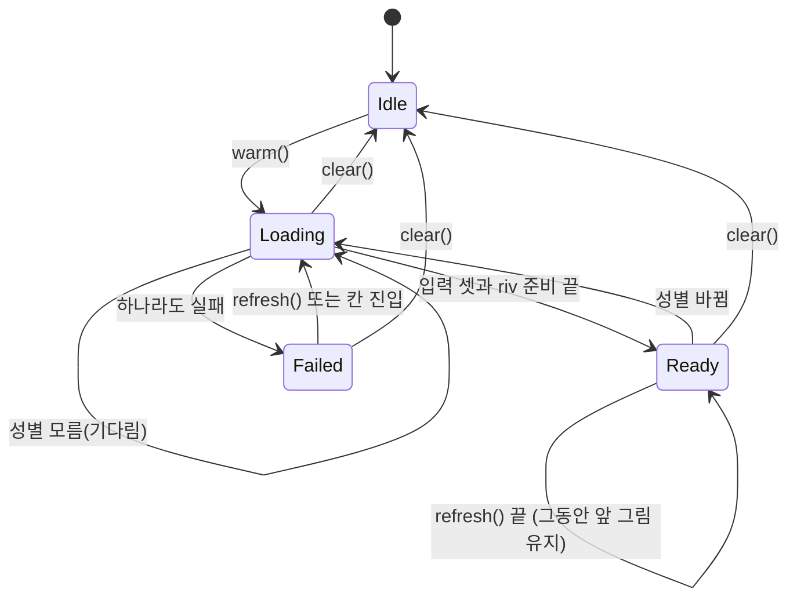
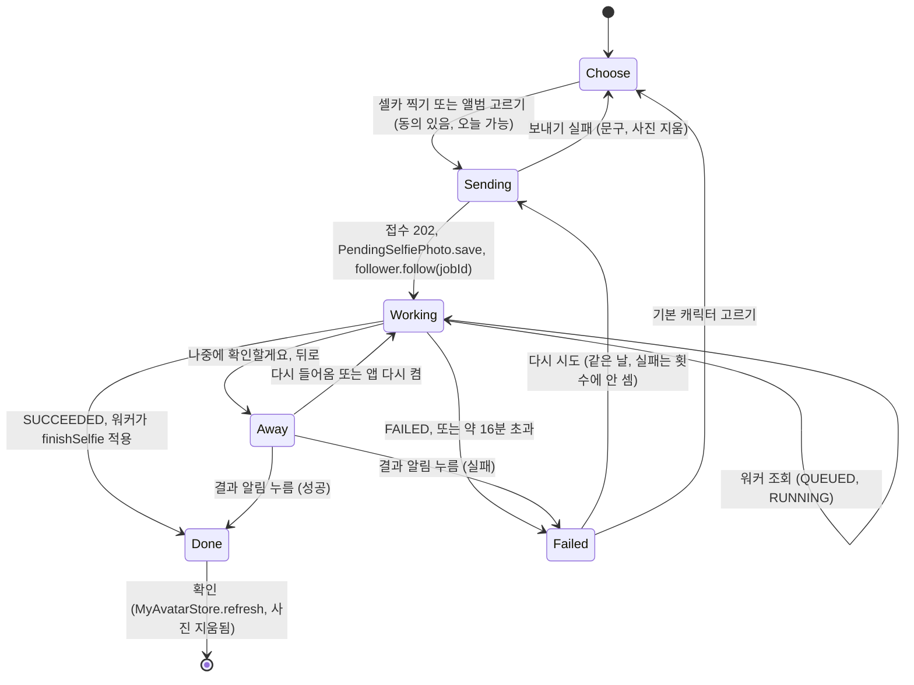
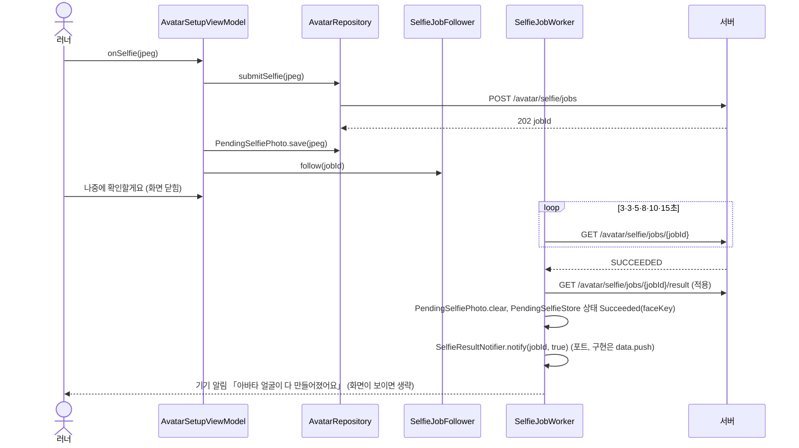

# 5.6 설계 결정 기록 (이어서: 아바타 추가 요구, 다음 판 변경)
> 작성: 2026-11-10 | 버전: v0.39 (다음 판 변경) | 담당: 이성현(캐릭터 도메인, 공용), 브랜치 `docs/S15P31A207-300-avatar-docs` | 입력: srs 7.13.29([임시:CR-성-10]~[임시:CR-성-18], [임시:FR-성-17]~[임시:FR-성-23], [임시:NFR-성-4]~[임시:NFR-성-6]), srs 03-06 3.6.0b, 유지보수 기록 [maintenance/2026-11-10_아바타요구-성](../maintenance/2026-11-10_아바타요구-성.md), 앞 조각 [05-29](05-29-설계-피그마맞춤-성.md) 5.5·5.6·6절, 코드 develop fbeda71f(읽기만: android `build-logic` ModuleRules, app `ArchitectureTest`, `AppStartup`, `RunkkNavHost`, core/ui `SlotKey`·`LocalSlots`·`FeatureEntry`·`AvatarBackdrop`·`RunkkRunningFigure`·`KakaoRunMap`, core/avatar 전부와 `res/raw/*.riv`, feature/home·run·crew·battle·avatar, data `WorkManagerUploadScheduler`, backend `SettingKey`·`BackgroundService`·V25), 멈춘 구현 worktree av1·av5·av10(커밋 안 된 변경 없음 확인). (다음 판 보완 2026-11-10) 뒤 사용자 결정 U-6~U-9(유지보수 기록 1.1), 통합 브랜치 중립색 b66c292d([임시:D-성-93]), 설계 검증 [design-review/28-아바타요구-성](../design-review/28-아바타요구-성.md) 결함 [임시:DR-성-1]~[임시:DR-성-16] 반영

> [런크크 객체지향 분석·설계서](../design-oo.md) 목차, 이전: [05-29-설계-피그마맞춤-성](05-29-설계-피그마맞춤-성.md), 다음: [06-01-클래스-common-member](06-01-클래스-common-member.md)

이 조각은 아바타 추가 요구 AV-1~AV-10의 **확정 설계**다. 구현 작업자(home-run, landmark-kr, outfit-assets, selfie-flow)는 이 문서만 보고 따라간다. 후보 비교는 결정의 근거로만 남기고, 고른 것 하나만 구현한다. 이 조각과 코드가 다르면 구현 전에 조정자에게 묻는다.

## 1. 결정 표

### 1.1 요구와 결정 대응

| srs | AV | 절 | 결정 |
|-----|----|----|------|
| [임시:FR-성-17], FR-162 | AV-1 | 2 | [임시:D-성-100]~[임시:D-성-102] |
| [임시:FR-성-19], [임시:NFR-성-4] | AV-4 | 3 | [임시:D-성-103]~[임시:D-성-106] |
| [임시:FR-성-22], [임시:NFR-성-5] | AV-8 | 4 | [임시:D-성-107]~[임시:D-성-109] |
| [임시:FR-성-23], FR-161, [임시:FR-성-15], [임시:NFR-성-6] | AV-9, AV-10 | 5 | [임시:D-성-110]~[임시:D-성-116] |
| [임시:FR-성-20], [임시:FR-성-21], FR-155, FR-156 | AV-7 | 6 | [임시:D-성-117]~[임시:D-성-120] |
| [임시:FR-성-18] | AV-3 | 7 | [임시:D-성-121]~[임시:D-성-122], [임시:D-성-130] |
| FR-201, FR-202 | AV-5 | 8 | ~~[임시:D-성-123]~~ → [임시:D-성-129], [임시:D-성-124]~[임시:D-성-125] |
| [임시:NFR-성-2] 정정, FR-163, FR-164, [임시:FR-성-13] | 중립색, AV-6 | 9 | [임시:D-성-126](= [임시:D-성-93]), ~~[임시:D-성-127]~~ → [임시:D-성-128] |

### 1.2 결정 ([임시:D-성-100]~[임시:D-성-130])

[임시:D-성-93]~[임시:D-성-99]는 다른 브랜치 몫으로 비워 둔다([임시:D-성-93]은 통합 브랜치의 중립색 결정이다). [임시:D-성-128]~[임시:D-성-130]은 같은 날 뒤에 받은 사용자 결정(U-6, U-7, U-9)이다. 설계 검증 결함([임시:DR-성-n])으로 고친 행은 「(검증 정정, [임시:DR-성-n])」을 붙였다.

| 번호 | 결정 | 근거 |
|------|------|------|
| [임시:D-성-100] | 홈과 러닝 중 화면의 Rive 아바타는 **칸 장치**로 넣는다. core/navigation `SlotKey`에 `HOME_AVATAR`, `RUN_AVATAR`를 더하고 `:feature:avatar`의 `AvatarFeatureEntry.slots`가 내용을 넣는다. 홈·측정 화면은 `LocalSlots.current[SlotKey.X]`만 그리고 `:core:avatar`·`domain.avatar`를 import하지 않는다. ModuleRules와 `ArchitectureTest`의 허용 표(폰 178개)는 바꾸지 않는다 | 1.3 비교표. ui.home·ui.battle·ui.crew 패키지 Fan-Out이 이미 상한 7이고 ModuleRules는 `:core:avatar`를 `:feature:avatar`에만 연다. 칸은 기존 장치(RECORD_BATTLES, HOME_INBOX_DOT, CREW_CHAT_TAB) 그대로라 새 개념이 없다. D-276·[임시:D-성-63]의 제약을 지키면서 [임시:D-성-63]의 「홈은 지금 그림 그대로」를 닫는다 |
| [임시:D-성-101] | 칸 인자는 CompositionLocal로 넘긴다. core/navigation에 `enum class AvatarSlotPose { STAND, RUN }`과 `val LocalSlotAvatarPose = compositionLocalOf { AvatarSlotPose.STAND }`를 둔다. 칸 내용은 부모 크기를 채운다(`Modifier.fillMaxSize()`). 크기·자리는 칸을 가진 화면이 정한다 | 칸 람다가 매개변수 없는 `() -> Unit`이다(`LocalSlotCrewId` 선례). core:ui에 `:core:avatar` 타입(`AvatarMotion`)을 넣을 수 없으므로 core:ui 쪽 enum을 둔다 |
| [임시:D-성-102] | 칸이 비어 있으면(미리보기, 화면 시험) 칸을 가진 화면은 지금 그림을 그린다: 홈 `RoomAvatar`(정적 `RunkkAvatar`), 측정 화면 `RunkkRunningFigure`. 홈 아바타 누름(내 러너로 이동)은 홈이 칸 바깥 상자에서 그대로 받는다 | 칸 기여자가 없을 때도 화면이 깨지지 않게 하고 기존 스냅샷 시험을 살린다 |
| [임시:D-성-103] | 내 아바타 입력은 `:feature:avatar`의 새 프로세스 단위 저장소 `MyAvatarStore`(@Singleton)가 한 번 모아 둔다. 상태 `StateFlow<MyAvatarState>` = `Idle | Loading | Ready(look: MyAvatarLook) | Failed`. `MyAvatarLook(gender, outfit, bodyShape, runningAmount, headLayers, backgroundKey)`. 모으는 곳은 `AvatarRepository.avatar()`·`runner()`·`SelfieHeads`(얼굴 키)이고, ~~성별은 `warm(gender)`을 부르는 Overlay가 `LocalAvatarCharacter.current`에서 읽어 넘긴다~~ → 성별은 저장소가 `AccountRepository.myGender`(`StateFlow<Gender?>`, MainActivity가 `LocalAvatarCharacter`를 만드는 같은 출처)를 직접 구독해 얻는다(ui.avatar → domain.account는 허용 표에 있다). 성별이 null(아직 모름)이면 `Loading`에 머물고 그림을 고르지 않는다(FR-162 CR-86: 다른 성별 그림 금지). 성별이 바뀌면(프로필 수정) 그 성별로 다시 준비한다. `refresh()` 동안은 앞 `Ready`를 그대로 두고(로딩 표시 없음) 새 입력이 오면 바꾼다. 경합 규칙: 저장소는 자기 `SupervisorJob` 범위에서 한 번에 하나의 준비 작업만 돌린다(새 `warm`·`refresh`는 앞 작업을 취소하고 잇는다, 최신 요청이 이긴다). 작업마다 세대 번호를 붙이고 결과를 쓸 때 세대가 같을 때만 `Ready`·`Failed`로 바꾼다. `clear()`는 세대를 올리고 작업을 취소한 뒤 `Idle`로 둔다. 그래서 로그아웃 직후 늦게 온 앞 회원의 결과가 다음 회원 화면에 보이지 않는다 (검증 정정, [임시:DR-성-8], [임시:DR-성-9]) | 홈·측정·내 러너·꾸미기가 같은 입력을 네 번 읽지 않게 한다. 리포지토리에 캐시가 없고 머리 JSON은 no-store라 프로세스 안 한 곳에 둔다 |
| [임시:D-성-104] | 미리 준비 시점: `AvatarFeatureEntry.Overlay(top)`가 처음 그려질 때(`LaunchedEffect(Unit)`) ~~`MyAvatarStore.warm(gender)`~~ `MyAvatarStore.warm()`을 부른다. Overlay는 로그인한 동안 RunkkNavHost가 늘 그리므로 (a) 로그인된 앱 시작(스플래시가 첫 화면을 미리 그리는 동안)과 (b) 로그인·가입 완료 뒤 홈 진입에 한 번씩 걸린다. (검증 정정, [임시:DR-성-8]) 부르는 모양은 `warm()`(인자 없음)이고 성별은 저장소가 [임시:D-성-103]대로 구독한다. `warm()`은 성별을 안 뒤 `:core:avatar`의 새 공개 함수 `preloadRiveAvatar(context, gender)`로 그 성별의 서기·달리기 riv와 내장 머리 PNG를 IO에서 읽고, 아바타 정보 세 호출을 병렬로 한다. 세 입력이 모이면 `prepareRiveAvatarLook(context, look)`(아래 [임시:D-성-105])으로 서기 동작의 합성 텍스처까지 미리 만든다 (검증 정정, [임시:DR-성-10]). 다시 준비(`refresh()`)는 착용 저장, 배경 바꿈, 셀카 결과 적용, 체형·러닝량이 바뀌는 러닝 저장 뒤 내 러너 진입 때 한다. 셀카 결과는 화면이 없어도 저장소가 `warm`과 `clear` 사이에 `AvatarRepository.selfieProgress()`를 스스로 구독해 `Succeeded`를 받으면 `refresh()`한다 (검증 정정, [임시:DR-성-13]). Overlay가 컴포지션에서 빠질 때(로그아웃, `DisposableEffect`의 onDispose) `clear()` | `:app`(AppStartup)에서 부르면 app 패키지가 ui.avatar를 import해야 한다. Overlay는 기존 FeatureEntry 계약이라 새 의존이 없다. 스플래시 대기(HoldSplashUntil, 최대 4초)는 늘리지 않는다 |
| [임시:D-성-105] | `:core:avatar` 공개 API에 ~~셋~~ 다섯을 더한다: `suspend fun preloadRiveAvatar(context: Context, gender: AvatarGender)`(지금 internal인 `RiveAvatarAssets.shared` 읽기를 감싼다), `suspend fun prepareRiveAvatarLook(context, gender, outfit, bodyShape, runningAmount, headLayers, motion: AvatarMotion = AvatarMotion.STAND)`(구현 뒤 정정: 동작 매개변수가 있고 기본은 서기, [임시:D-성-139])(그 모습의 서기 합성 텍스처를 프로세스 공용 캐시에 넣는다, 검증 정정 [임시:DR-성-10]: 지금 합성 캐시 `AvatarToneCache`와 합성 스레드는 `RiveAvatarView` 하나마다 따로라 riv 바이트만 미리 읽으면 칸이 새로 그려질 때마다 합성을 다시 한다. 공용 캐시는 남녀 × 동작마다 마지막 모습 하나씩, 키는 `AvatarToneRequest`의 성별·의상·체형·러닝량·머리 동일성이고 뷰는 합성 전에 이 캐시를 먼저 본다), `RunkkRiveAvatar(…, mirrored: Boolean = false)`([임시:D-성-130]), `RunkkRiveAvatar(…, onReady: () -> Unit = {})`(그 동작의 첫 텍스처가 들어가 뷰가 보이게 된 때 한 번, 지금 INVISIBLE → VISIBLE 전환 자리), 아트보드 기하 상수 `object RiveAvatarGeometry { const val ASPECT = 0.8f; const val FOOT_LINE = 0.804f }`(가로/세로, 아트보드 위에서 발끝 줄까지 비율). 네이티브 초기화는 [임시:D-성-84]대로 첫 render에서 한다 | 로딩 표시를 거둘 시점을 렌더러만 안다. 기본값이 있어 기존 호출(`MyRiveAvatar`)은 그대로 컴파일된다. 발끝 좌표는 riv 네 파일 공통(5.1) |
| [임시:D-성-106] | 로딩 표시 규칙: 칸 크기는 처음부터 고정. `MyAvatarState`가 `Ready`가 아니거나 `onReady` 전이면 배경 자리(배경 그림 또는 `surface`)를 먼저 깔고 가운데에 `CircularProgressIndicator`(지름 32dp, 선 3dp, 색 `textSecondary`)를 보인다. `onReady`가 오면 표시를 200ms 페이드로 거둔다. 100ms 안에 준비되면 표시를 아예 그리지 않는다(깜박임 방지, 그 100ms 동안에도 배경 자리는 그려 있어 [임시:NFR-성-4]의 빈 칸이 아니다). `Failed`면 표시를 거두고 성별 기본 그림(지금 `RunkkAvatar` 서기)을 보이고 오류 문구는 없다. 홈·내 러너·꾸미기에 적용하고, 러닝 중 칸은 표시 없이 비워 둔다 | [임시:FR-성-19], [임시:NFR-성-4]. 빈 칸 0프레임은 「배경 + 진행 표시」를 첫 프레임부터 그리는 것으로 지킨다 |
| [임시:D-성-107] | 바닥 규격: 배경 그림의 바닥선은 그려진 그림 높이의 아래에서 18%다. Rive 뷰는 아트보드 비율(0.8:1) 그대로 크기를 잡고 아트보드 발끝 줄(위에서 80.4%)이 바닥선에 오게 놓는다. 아트보드 높이는 칸 높이의 0.9배이되 아트보드 위 여백이 칸 높이의 6%보다 작아지면 줄이고, 아트보드 너비(높이 × 0.8)가 칸 너비를 넘지 않게 한다(검증 정정, [임시:DR-성-6]). 그림자는 앱이 그린다(타원, 폭 = ~~아트보드 높이 × 0.30~~ → 아트보드 높이 × 0.24(= 아트보드 너비 × 0.30, 정면 몸 폭 238/800, 검증 정정 [임시:DR-성-5]), 높이 = 폭 × 0.2, 중심이 바닥선, 검정 불투명도 18%, 흐림 4dp). riv 안의 Ground shadow(불투명도 약 8%)는 검수 바탕처럼 읽을 때 알파를 0으로 바꿔 숨긴다 | 4절. 그림자가 두 겹이 되지 않게 하고, 그림자 모양을 배경·칸 크기와 같은 규칙으로 맞춘다 |
| [임시:D-성-108] | 배경 그림은 아래 가운데 정렬로 잘라 채우고(`ContentScale.Crop`, `Alignment.BottomCenter`, 지금은 가운데 정렬), 바닥선 화면 좌표 = 칸 아래 − 0.18 × (그려진 그림 높이)로 계산한다. 칸 비율이 그림과 달라도 바닥선은 그림의 바닥 위에 있다 | 칸 크기가 홈·내 러너(350x390)·꾸미기(152x200)·해금 팝업(280x500)·배경 고르기(95:126)로 다르다. 비율만 칸 기준으로 주면 잘린 그림의 바닥과 어긋난다 |
| [임시:D-성-109] | 「떠 있음」은 렌더러가 아니라 배치(`AvatarStage`)에서 고친다: 지금은 아트보드(800x1000)를 비율이 다른 상자(내 러너 165x330dp, 꾸미기 152x200dp)에 `Fit.CONTAIN`·가운데로 넣어 위아래 여백이 생기고, 아트보드 아래 20%(발 아래 빈 자리)가 그 위에 더해져 발이 카드 바닥에서 약 102dp(내 러너)·42dp(꾸미기) 떠 있다. `AvatarStage`가 뷰를 아트보드 비율로 잡고 [임시:D-성-107]의 위치에 놓는다. riv 파일은 고치지 않는다(승인본 SHA256 고정, `ApprovedAvatarAssetsTest`) | riv 조사 5.1, 코드 `AvatarRunnerScreen.kt`·`AvatarScreens.kt` 배치 |
| [임시:D-성-110] | 의상(상의·하의·신발)은 벡터 코드(`TopTypes`·`BottomTypes`·`FootwearTypes`·`OutfitStyles`·`MaleOutfitStyles`)가 아니라 **슬롯 좌표에 맞춘 PNG 레이어 묶음 + 목록 파일**로 그린다. 묶음은 `android/core/avatar/src/main/assets/outfits/<assetKey>/`, 목록은 `assets/outfits/index.json`이다. 렌더러는 슬롯 텍스처마다 「맨몸 바탕(피부톤 적용) → 신발 → 하의 → 상의」 순서로 PNG를 겹쳐 riv 이미지 슬롯에 넣는다(5.4) | AV-10 「규격에 맞춘 옷은 아바타에 적용 가능」. 코드 변경 없이 옷을 더한다([임시:NFR-성-6]). riv의 이미지 슬롯이 이미 텍스처 교체 방식이라 Rive 파일을 고치지 않는다 |
| [임시:D-성-111] | 규격 축은 남녀 2 × 동작(서기·달리기) 2 × 체형 3이다. 그림 파일은 남녀 × 동작 × 슬롯마다 한 장(체형 0 기준)이 필수이고, 체형은 Rive 몸 메시 변형(body_shape 0·50·100)이 같은 텍스처를 늘려 맞추므로 체형 1·2용 파일(`_b1`, `_b2`)은 늘어난 모양이 기준 그림을 벗어날 때만 둔다(선택). 12조합 모두 검수(5.6) 대상이다. 파일 이름·크기는 5.2 | riv 조사: 체형은 메시 변형 애니메이션이고 텍스처는 하나다. 체형마다 세 장을 강제하면 같은 그림을 세 번 그린다 |
| [임시:D-성-112] | 피부톤 필터(러닝량 밝기, `SkinToneFilter` 곱셈 행렬)는 맨몸 바탕 레이어에만 적용하고 의상 PNG에는 적용하지 않는다. 맨몸 바탕은 슬롯마다 피부와 속옷 선만 있는 그림을 새로 두고(5.3), 색·좌표로 피부를 가려내던 `BodySkinLayers`·`MaleSelectedBody` 판정은 이전이 끝나면 지운다 | [임시:FR-성-23] 「피부톤 변화는 의상에 적용하지 않는다」. 지금은 옷과 피부가 한 텍스처라 색·영역 판정으로 나눴고 판정 경계에서 밝은 띠 결함([임시:DV-성-11])이 났다. 레이어를 나누면 판정이 필요 없다 |
| [임시:D-성-113] | 상점 그림은 같은 원본에서 만든다: 파이프라인이 그 의상의 `female_stand` 레이어(서기, 체형 0) 불투명 영역을 잘라 투명 바탕 512x512 가운데에 긴 변 440px로 맞춰 `shop.png`를 만든다. 성별 구분 없이 한 장이다. 상점 칸(66x66)·구매 확인(112x112)은 이 그림을 줄여 쓰고, 지금 부위 실루엣(`ItemArt`)은 묶음이 없는 아이템(모자)에만 남는다 | AV-9 「같은 원본」, [임시:FR-성-15]. 입은 모습과 상점 그림이 어긋나지 않는다 |
| [임시:D-성-114] | 파이프라인은 저장소 도구 `android/core/avatar/tools/outfit-pipeline/`(Python 3.12, uv, Pillow)이다: (1) 원본(피그마 또는 그림 도구에서 슬롯 템플릿 위에 그린 PNG 내보내기 폴더)을 읽어 (2) 규격 검사(5.5) (3) 파일 이름·폴더 정리 (4) `shop.png` 생성 (5) `index.json` 갱신. 같은 검사를 앱 단위 시험 `OutfitAssetSpecTest`가 빌드 때 다시 한다. 슬롯 템플릿(맨몸 바탕 + 슬롯 경계 + 금지 영역)은 파이프라인이 `templates/`로 내보낸다 | 사람이 넣어도, 도구가 넣어도 같은 규칙으로 막는다 |
| [임시:D-성-115] | 기존 7종은 부위마다 번호 0~6(0 = 기본 흰 반팔티·검은 반바지·흰 신발) 일곱 가지, 모두 21가지다. 상점 키가 있는 12가지는 그 키(`top_lime_singlet` 등, V62)를 묶음 폴더 이름으로 쓰고, 상점 키가 없는 9가지(기본 셋, 하의 4~6, 신발 2·4·5)는 `base_top`, `base_bottom`, `base_shoes`, `bottom_wide_pants`, `bottom_cargo_shorts`, `bottom_line_shorts`, `shoes_high_top`, `shoes_slip_on`, `shoes_ankle_boots`로 둔다. 앱 대응표 `assetKey → 번호 0~6`([임시:D-성-76])은 `assetKey → 묶음 폴더`로 바뀌고, 묶음이 없는 키는 그 부위 `base_*`다. 21가지가 모두 옮겨진 뒤 벡터 의상 코드 다섯 파일, 여자 6번의 standing_body 잘라 붙이기~~, 남자 서기 riv 입력 `selected_top`·`selected_bottom`·`selected_shoes` 사용~~을 지운다. (검증 정정, [임시:DR-성-1]) 남자 서기 riv 입력 셋은 지우지 않는다: 남자 의상도 여자와 같은 `standing_body` 512x768 아틀라스 좌표에 그리고(지금 `MaleOutfitStyles` 「Male cuts in the same atlas registration」), riv는 이 입력으로 그 아틀라스를 쓰는 메시 표면을 고른다(0 = riv 내장 기본 옷 몸 `male_selected_body`, 1 = 반팔·민소매 표면, 2 = 긴소매 표면, 팔·몸통 UV가 따로). 이전 뒤 남자는 모든 묶음(기본 셋 포함)에서 상의 = 묶음의 `maleTopSurface`(1 또는 2), 하의 = 1, 신발 = 1을 넣어 내장 기본 옷 몸(표면 0)을 더 쓰지 않는다. 21가지(U-8)는 그대로다 | 서버·상점 데이터는 그대로(그림 키 유지), 앱만 바뀐다. 상점에 없는 번호도 지금 그릴 수 있으므로 함께 옮겨 벡터 코드를 한 번에 지운다 |
| [임시:D-성-116] | 품질 기준 그림은 코랄 집업 후드(상의 6번 `top_cherry_vest`, 여자 정면은 지금 riv 내장 standing_body의 다듬은 그림)다. 의상 그림은 이 그림과 같은 수준을 지킨다: 외곽선 2px(1024 기준 슬롯은 4px), 색은 옷 기본색의 명도 −35%; 음영 3단(기본·그림자 면·하이라이트), 주름은 관절(팔꿈치, 허리, 무릎)과 지퍼·밑단에; 광택·질감 무늬 없음; 가장자리 안티에일리어싱 1px. 이전은 코랄 집업 후드를 먼저 규격 묶음으로 만들어 기준으로 삼고(남녀 서기·달리기), 그다음 나머지 20가지 | U-3, AV-10 |
| [임시:D-성-117] | 셀카 작업 조회를 화면 ViewModel에서 꺼내 **WorkManager**로 옮긴다. domain.avatar에 포트 `SelfieJobFollower { fun follow(jobId: String); fun cancel() }`, data에 `WorkManagerSelfieJobFollower`와 `SelfieJobWorker`(고유 작업 이름 `selfie-job`, `ExistingWorkPolicy.REPLACE`, 네트워크 조건)를 둔다. (검증 정정, [임시:DR-성-2], [임시:DR-성-12]) 둘 다 `:data` 모듈의 기존 패키지 `api.avatar`(AvatarRepositoryImpl 옆, 허용 표 api.avatar → domain.avatar 기존)에 두고, 워커는 `UploadWorker`처럼 `@HiltWorker`가 아니라 Hilt EntryPoint로 의존을 꺼낸다(D-61: HiltWorkerFactory는 Application의 WorkManager 설정 변경이 필요). `REPLACE`는 새 작업을 접수한 `follow(jobId)`에서만 쓴다. 워커가 상한 전에 자기 뒤를 이을 때는 `APPEND_OR_REPLACE`로 다음 작업을 붙인다(실행 중인 자기 자신을 `REPLACE`로 걸면 자기가 취소된다). 시스템이 워커를 멈추면(제약 상실, 시간 제한) WorkManager가 다시 걸고, 접수 시각은 `PendingSelfieStore`에 있으므로 다시 시작해도 총 상한은 접수 시각 기준이다. 워커는 지금 간격(`POLL_DELAYS` 3·3·5·8·10·15초)으로 최대 8분 조회하고 끝나지 않았으면 같은 작업을 다시 걸어 이어 간다(총 상한은 지금처럼 약 16분, 접수 시각 기준). 상태는 `AvatarRepository.selfieProgress(): Flow<SelfieProgress>`(`None | Working(jobId) | Succeeded(faceKey) | Failed(jobId, code)`)로 화면에 낸다. 상태의 원본은 기존 `PendingSelfieStore`(SharedPreferences: 작업 ID, 접수 시각, 마지막 상태·실패 코드)이고 워커가 이것만 쓴다. 저장소 구현은 이 값을 프로세스 안 `MutableStateFlow`로도 들고 있어 같은 프로세스의 화면이 바로 받는다 (검증 정정, [임시:DR-성-13]) | 화면을 나가면 ViewModel 조회가 멈췄다(지금 동작). 업로드 워커(`UploadScheduler`·`UploadWorker`) 선례와 같은 포트·구현 나눔. CoroutineWorker 한 번의 실행 시간 제한 때문에 나눠 건다 |
| [임시:D-성-118] | 작업이 성공하면 워커가 `finishSelfie(jobId)`로 결과를 적용한다(러너가 화면에 없어도). 적용 뒤 `MyAvatarStore.refresh()`를 부를 수 있게 `SelfieProgress.Succeeded`를 낸다(ui.avatar가 듣는다) | 지금 `AvatarViewModel.finishPendingSelfie`가 진입 때 적용하는 규칙을 앞당긴다. 하루 1회 차감 규칙(서버 결과 조회 한 번)은 그대로 |
| [임시:D-성-119] | 보낸 사진은 domain.avatar 포트 `PendingSelfiePhoto`의 data 구현 `FilePendingSelfiePhoto`가 앱 전용 파일 `files/selfie/pending.jpg` 한 장으로 둔다(이미 줄인 JPEG, 새로 줄이지 않음). 백업 규칙에서 뺀다. 작업이 성공·실패로 끝나면, 서버에 진행 중 작업이 없다고 확인되면, 로그아웃·탈퇴하면 지운다 | FR-156 예외(07-25 7.13.29.1). 프로세스가 죽어도 작업 중 화면에 사진을 다시 보인다 |
| [임시:D-성-120] | 결과 알림은 워커가 기기 알림으로 낸다(서버 푸시 아님, 서버 변경 없음). 채널은 기존 푸시 채널과 같은 채널, 알림 ID는 작업마다 하나. 얼굴 만들기 화면이 보이는 동안(`SelfieScreenPresence.isVisible`~~, 채팅방 `OpenChatRooms` 선례~~)이나 알림 권한이 없으면 내지 않는다. 누르면 앱을 열고 `Routes.AVATAR_SETUP`으로 간다. (검증 정정, [임시:DR-성-2]) 푸시 채널(`runkk-push`)과 알림 만들기는 `:data:phone`(data.push)에 있고 `:data:phone`이 `:data`를 의존하므로 `:data`의 워커가 알림 구현을 직접 부를 수 없다. 그래서 domain.avatar에 포트 둘을 둔다: `SelfieScreenPresence { fun opened(); fun closed(); val isVisible: Boolean }`(ui.avatar의 얼굴 만들기 화면이 열고 닫는다), `SelfieResultNotifier { fun notify(jobId: String, succeeded: Boolean) }`. 구현은 data.push의 `SelfieNoticeTracker` 하나다(선례: domain.chat `OpenChatRoomRegistry` ← data.push `OpenChatRoomTracker`, D-130). 워커는 포트만 부른다. 알림 누름은 기존 푸시 알림 누름 경로(인텐트 → MainActivity → 경로)를 그대로 쓴다. 이 때문에 패키지 화살표 data.push → domain.avatar가 하나 생긴다(10.1) | [임시:FR-성-21]. 서버에 셀카 알림 종류가 없다(NotificationType에 없음). 앱이 끝을 먼저 알므로 로컬이 맞다 |
| [임시:D-성-121] | 러닝 중 아바타 자리: 세 측정 화면(자유런 `RunScreen`, 크루런 `CrewRunScreen`, 대결 `BattleRunningScreen`)의 **내 위치 표시(지도 마커 `KakaoRunMap(figure)`와 경로 대체 `RouteMarker`)를 `RUN_AVATAR` 칸으로 바꾼다.** 크기 88x88dp(지금 72dp), 기준점은 칸 아래 가운데가 내 위치 점(지금 `KakaoRunMap`의 `atScreenPoint`가 마커 상자 아래 끝을 그 점에 놓는다. 발끝은 그보다 칸 높이의 6% 위, 4.2 러닝 중 칸, 검증 정정 [임시:DR-성-7]). 배경은 깔지 않고 그림자만. 경로가 없을 때 가운데 놓던 72dp 그림도 88dp 칸이다. 크루원·대결 상대는 지금 `RunkkRunningFigure` 그대로 | 「러닝 중 아바타 뛰는 모습」을 지금 아바타가 있던 자리에서 보인다. 숫자(거리·시간·페이스)는 지도 상자 밖이라 가리지 않는다. 남의 아바타 Rive는 범위 밖(유지보수 기록 4절) |
| [임시:D-성-122] | 동작 규칙: 자유런 `RunPhase.RUNNING && !isPaused` → RUN, 그 밖(준비, 카운트다운, 일시정지) → STAND. 크루런 `CrewRunPhase.RUNNING && !mine.isPaused` → RUN, 그 밖 STAND. 대결은 일시정지가 없으므로 `BattlePhase.RUNNING` → RUN, 그 밖(`COUNTDOWN`, `CLOSING` 등) STAND. 움직임 줄이기면 그 동작의 첫 장면에 멈춘다. 측정 화면은 `LocalSlotAvatarPose`(와 RUN일 때 [임시:D-성-130]의 `LocalSlotAvatarFacingLeft`)만 바꾸고 아바타 준비를 기다리지 않는다 | [임시:FR-성-18] |
| ~~[임시:D-성-123]~~ | (정정됨 → [임시:D-성-129], 사용자 결정 U-7) ~~랜드마크: `SettingKey.Defaults.LANDMARKS`에서 `domestic("KAESONG", "개성", 120)`을 지우고 `CHUNCHEON`(춘천, 100km)과 `GANGNEUNG`(강릉, 170km)을 인천 다음에 **편도**(`roundTrip = false`, 단계 DOMESTIC)로 넣는다. 순서 인천 60 → 춘천 100 → 강릉 170 → 대전 280(엄격 오름차순 검사 통과)~~ | ~~U-2~~ |
| [임시:D-성-124] | Flyway `V65__landmark_remove_kaesong.sql`(대역 V65~V67): (1) 운영 기준값 표에 LANDMARKS 행이 있으면 그 JSON에서 KAESONG 원소를 빼고 ~~CHUNCHEON·GANGNEUNG 원소를~~ → CHUNCHEON 원소 하나(춘천, 150km, 국내 단계, 왕복. 필드 이름과 모양은 그 행의 다른 국내 원소와 같게, [임시:D-성-129])를 거리 순 자리(인천 다음)에 넣는다(행이 없으면 코드 기본값이 쓰이므로 아무것도 안 함). (2) `avatar_background`에서 `landmark_key = 'KAESONG'` 행을 지우고 (3) `avatar.selected_background = 'KAESONG'`이면 NULL(기본 배경)로 되돌린다. (2)·(3)은 0건이 예상되며 지운 건수를 마이그레이션 로그로 남긴다(`RAISE NOTICE`) | FR-201 예외(지운 북한 도시 키는 해금도 유지하지 않음). 행 단위로 남겨 두면 `BackgroundService`가 표에 없는 키를 목록 끝에 계속 보인다 |
| [임시:D-성-125] | 배경 그림 대체: ~~춘천·강릉은~~ → 춘천은 국내 단계 그림(`avatar_backdrop_domestic`)을 쓴다. 앱 `AvatarBackdrop.STAGE_OF_KEY`에서 KAESONG을 지우고 ~~CHUNCHEON·GANGNEUNG~~ → CHUNCHEON → DOMESTIC을 넣는다([임시:D-성-129]). 도시별 그림은 범위 밖이고, 그리게 되면 4절 바닥 규격을 따른다 | 지금 배경 그림은 키별이 아니라 단계별 3장이다 |
| [임시:D-성-126] | (검증 정정, [임시:DR-성-11]) 따로 정하지 않고 통합 브랜치의 [임시:D-성-93](b66c292d, 사용자 결정 2026-11-10)을 따른다. 9.1 대응표는 b66c292d의 `RunkkColors` 값을 그대로 옮긴 것이다. ~~새 중립 토큰은 9절 값. `ColorContrastTest`에 「중립 토큰 HSL 채도 5% 이하」를 더한다~~ → 시험은 b66c292d가 더한 「중립 토큰에 녹색 기운 없음(G ≤ max(R, B))」과 값 고정 시험이다. HSL 채도 5% 기준은 zinc 값(#E4E4E7 5.9%, #09090B 10.0%)도 떨어뜨리므로 쓰지 않는다. chatMine 계열은 브랜드가 아니라 중립(무채색) 쪽이다 | U-4, [임시:NFR-성-2] 정정, [임시:D-성-93] |
| ~~[임시:D-성-127]~~ | (정정됨 → [임시:D-성-128], 사용자 결정 U-6) ~~AV-6 문구 제거 범위: 꾸미기(`AvatarScreens.kt`)의 `avatar_trait_body`·`avatar_trait_skin` 줄, 내 러너(`AvatarRunnerScreen.kt`)의 칩 `avatar_runner_body_chip`·`avatar_runner_skin_chip`, 체형 게이지 양 끝 라벨 `avatar_body_low`·`avatar_body_high`. 체형 변화·피부톤 카드의 제목과 근거 문장은 남긴다. 접근성 설명(`avatar_figure_description`)의 체형 이름도 뺀다(「아바타, 남성」처럼). 쓰지 않게 된 문자열은 지운다. 화면 배치는 피그마 「제안」 페이지가 확정되면 그 시안이 이 결정을 덮는다~~ | ~~07-25 7.13.29.1~~ |
| [임시:D-성-128] | AV-6 제거 범위(근거 문장 포함): 꾸미기(`AvatarScreens.kt`)의 `avatar_trait_body`·`avatar_trait_skin` 줄, 내 러너(`AvatarRunnerScreen.kt`)의 칩 `avatar_runner_body_chip`·`avatar_runner_skin_chip`, **체형 변화 카드 전체**(`avatar_runner_body_title`·`avatar_runner_body_guide`·게이지와 그 접근성 문구 `avatar_runner_body_gauge`, 게이지 양 끝 `avatar_body_low`·`avatar_body_high`), **피부톤 카드 전체**(`avatar_runner_skin_title`·`avatar_runner_skin_reason`·`avatar_runner_skin_reason_none`, 시각 문자열 `avatar_hour_am`·`avatar_hour_pm`, 톤 이름 `avatar_tone_*`)를 지운다. 접근성 설명 `avatar_figure_description`에서 체형 이름을 뺀다(「아바타, 남성」처럼). 내 러너에는 상단 바(제목, 잔액 알약), 아바타 카드(`AvatarStage`), 「꾸미기」·「상점 가기」 단추만 남고, 꾸미기는 미리보기·부위 탭·아이템 칸(가격 숫자)·저장 단추만 남는다. 쓰지 않게 된 문자열·`BODY_VARIANT_LABELS`·`skinLabel`·`bodyLabelRes`는 다른 화면이 쓰지 않으면 지운다. `AvatarRunnerUiState`의 `recentRunCount`·`restDaysBeforeDecline`·대표 시각은 화면에서 쓰지 않으므로 상태에서 빼고, 내 러너 조회 `runner()`는 체형 세 칸·러닝량(아바타 그림 입력) 때문에 그대로 부른다(서버 계약 변경 없음). 피그마 「제안」 시안은 배치만 정하고 이 제거 범위를 되돌리지 못한다 | 사용자 결정 U-6(「아바타와 숫자·버튼만」), FR-163·FR-164·[임시:FR-성-13] 다음 판 변경 |
| [임시:D-성-129] | 랜드마크: `SettingKey.Defaults.LANDMARKS`에서 `domestic("KAESONG", "개성", 120)`을 지우고 `domestic("CHUNCHEON", "춘천", 150)`을 인천 다음에 넣는다. 기존 생성 함수 `domestic`(왕복, 단계 DOMESTIC) 그대로이고 편도 생성 함수·표기 분기는 만들지 않는다. 강릉은 넣지 않는다. 순서 인천 60 → 춘천 150 → 대전 280(엄격 오름차순 검사 통과). 값 150은 Q-77 규칙(서울 기준 직선 대권 거리 × 2, 10km 단위 근사)으로 셈했다: 서울시청(37.5665, 126.9780)–춘천시청(37.8813, 127.7298) 74.8km × 2 = 149.6 → 150. 같은 계산이 기존 값(인천 54 → 60, 개성 116.7 → 120, 대전 279.9 → 280)과 맞는다. 표기는 국내 그대로 「서울에서 춘천까지 달렸어요! (왕복 n회)」, n = ⌊누적 ÷ 150⌋ | 사용자 결정 U-7, srs 03-03 3.3.1 표기 규칙, 07-25 7.13.29.1 |
| [임시:D-성-130] | 러닝 중 좌우 뒤집기: 측정 세 화면은 진행 방향을 지금의 `rememberHeadingLeft(route)`(core:ui `RunkkRunningFigure.kt`)로 정하고 칸 인자 `LocalSlotAvatarFacingLeft = compositionLocalOf { false }`(core/navigation, [임시:D-성-101] 옆)로 넘긴다. 판정: (1) 방향 = 경로 끝에서 20m(`RouteLine.DIRECTION_METERS`) 앞 지점 → 끝점의 경도 차 부호(지도·격자 모두 북쪽이 위이고 지도를 돌리지 않으므로 경도가 화면 가로다). 경도가 줄면 왼쪽. (2) 흔들림 방지 1: 경도 차 절댓값이 0.00003°(북위 37.5도에서 약 2.6m, 20m 구간의 13%) 미만이거나 경로가 20m 미만이면 앞 방향 유지, 처음은 오른쪽(지금 규칙 그대로). (3) 흔들림 방지 2: 한 번 뒤집은 뒤 1초 동안은 다시 뒤집지 않는다(위치 갱신 1초 간격에서 앞뒤로 깜박이지 않게). 칸을 가진 화면이 `rememberHeadingLeft` 값을 1초 유지해 넘긴다. (4) RUN 동작에만 적용하고 STAND(정면)는 뒤집지 않는다. 움직임 줄이기에서도 뒤집는다(움직임이 아니라 방향). 그리기: 칸 내용이 `RunkkRiveAvatar(mirrored = true)`를 넘기고 렌더러가 RUN 플레이어 뷰(`RiveAnimationView`, TextureView)의 `scaleX = -1`로 뒤집는다(Compose `graphicsLayer`가 아니라 뷰 변환이라 네이티브 텍스처 뷰에 그대로 걸린다). 축은 뷰 가운데 = 아트보드 가운데 x 400이고 캐릭터가 가로 가운데에 있으므로 칸 기준점(아래 가운데)·발끝 줄·그림자(앱이 그리는 좌우 대칭 타원, 뒤집지 않음)는 그대로다. 뒤집기 전후 몸 가로 위치 차이는 칸 너비의 3% 이하여야 한다(스냅샷 시험). 크루원·상대 `RunkkRunningFigure`는 지금처럼 `isFacingLeft`를 쓴다 | 사용자 결정 U-9, 05-30 7절 |

### 1.3 홈 의존 구조 비교 ([임시:D-성-100]의 근거)

판정 기준: (1) ModuleRules 위반 없음 (2) `ArchitectureTest` 패키지 Fan-Out 7 이하, 허용 표 합계 변경 최소 (3) 홈·측정 세 화면에 같은 방식 (4) 미리보기·시험에서 칸 없이도 그려짐 (5) 새 개념 수.

| 후보 | 내용 | (1) | (2) | (3) | (4) | (5) | 판정 |
|------|------|-----|-----|-----|-----|-----|------|
| A 직접 의존 | `:feature:home`(과 run·crew·battle)이 `:core:avatar`·`domain.avatar`를 의존 | 위반(ModuleRules가 `:feature:avatar`만 허용) | ui.home 7 → 9, ui.battle·ui.crew 7 → 8 | 같음 | 됨 | 0 | 불합격 |
| B 홈 요약 넓히기 | `domain.account.MyAvatar`에 착용·체형·러닝량을 더하고 홈만 `:core:avatar` 의존 | 위반 | ui.home 7 → 8 | 측정 화면은 따로 | 됨 | 0 | 불합격 |
| C core 포트 | core:ui에 `interface MyAvatarRenderer { @Composable fun Render(pose, modifier) }`, `:feature:avatar`가 Hilt로 구현, app이 CompositionLocal로 공급 | 통과 | 변경 없음 | 같음 | 기본 구현 필요 | 2(포트, 공급 경로) | 합격 |
| D 칸 장치 | `SlotKey.HOME_AVATAR`·`RUN_AVATAR`, 인자는 `LocalSlotAvatarPose` | 통과 | 변경 없음 | 같음 | 칸 비면 기존 그림 | 0(기존 장치) | **합격, 채택** |

C와 D는 둘 다 기준을 지킨다. C는 매개변수를 함수로 바로 넘길 수 있는 장점이 있지만 RunkkNavHost 밖에 공급 경로를 하나 더 만들고(지금 칸은 RunkkNavHost가 이미 모아 내린다), Hilt 바인딩이 없을 때의 기본 구현을 따로 둬야 한다. D는 세 선례와 같은 모양이라 구조 시험·리뷰 비용이 없다. 매개변수가 동작 하나뿐이라 CompositionLocal 하나로 충분하다.

## 2. 홈 아바타 (AV-1)

- 홈 `HomeScreen`의 아바타 방(`RoomAvatar` 자리, 지금 크기 그대로)을 `Box(Modifier.size(..).clickable { onAvatar() })`로 감싸고 안에 `LocalSlots.current[SlotKey.HOME_AVATAR]`를 그린다. 칸이 비면 지금 `RoomAvatar`([임시:D-성-102]). 누르면 `Routes.AVATAR_RUNNER`([임시:D-성-36] 그대로). 뛰어오르기·효과음은 내지 않는다(FR-236 2차 배포 뒤 규칙).
- 홈 배경 그림(`backgroundKey`로 그리던 `AvatarBackdrop`)은 칸 내용이 그린다(칸 하나가 배경 + 아바타 + 그림자 + 로딩 표시). 홈 `HomeUiState.backgroundKey`·`faceLayers`는 칸이 빈 경우의 기존 그림에만 쓴다.
- 칸 내용 `HomeAvatarSlotContent()`(ui.avatar): `MyAvatarSlotViewModel`(hiltViewModel, `MyAvatarStore`를 읽기만)로 상태를 받아 `AvatarStage(look, pose = STAND, showBackdrop = true, showLoading = true)`를 그린다.
- `AvatarStage`(ui.avatar, 새 공용 Composable)는 내 러너 카드·꾸미기 미리보기·홈 칸·해금 팝업 미리보기가 함께 쓰는 「배경 + 바닥선 + 그림자 + Rive + 로딩」 상자다. 지금 화면마다 나뉜 배치를 이것 하나로 모은다(바닥 규격이 한 곳에서 지켜진다).

```kotlin
// ui.avatar (feature/avatar)
@Composable
internal fun AvatarStage(
    state: MyAvatarState,
    pose: AvatarSlotPose,
    showBackdrop: Boolean,
    showLoading: Boolean,
    facingLeft: Boolean = false,      // [임시:D-성-130], RUN일 때만 쓴다
    modifier: Modifier = Modifier
)
```

## 3. 미리 준비와 로딩 표시 (AV-4)

| 단계 | 시점 | 하는 일 | 클래스 |
|------|------|---------|--------|
| 1 | 로그인된 앱 시작: RunkkNavHost가 Overlay를 처음 그림(스플래시 아래) | `MyAvatarStore.warm()`(검증 정정 [임시:DR-성-8]: 성별은 저장소가 `AccountRepository.myGender`에서 구독) | `AvatarFeatureEntry.Overlay` |
| 2 | warm | 성별을 알 때까지 기다림(null이면 Loading 유지) → `preloadRiveAvatar(context, gender)`(IO, 서기·달리기 riv와 내장 머리) ‖ `avatar()`·`runner()` ‖ 얼굴 키가 셀카면 `SelfieHeads.load(faceKey)` → 셋이 모이면 `prepareRiveAvatarLook(…)`(서기 합성 텍스처를 공용 캐시에, 검증 정정 [임시:DR-성-10]) | `MyAvatarStore` |
| 3 | 셋 다 끝 | `Ready(look)`. 하나라도 실패하면 `Failed`(다음 `refresh()`나 칸 진입 때 한 번 다시 시도) | `MyAvatarStore` |
| 4 | 칸이 처음 그려짐 | `Ready`면 Rive 그림, 첫 장면에서 `onReady` → 로딩 표시 페이드 | `AvatarStage` |
| 5 | 로그인·가입 완료 | 홈으로 restart 되며 Overlay가 그려져 1과 같다 | |
| 6 | 바뀜 | 착용 저장, 배경 바꿈, 셀카 결과 적용([임시:D-성-118]), 내 러너 진입 → `refresh()`(입력만 다시 읽음, riv는 프로세스에 남아 있음) | 각 ViewModel |
| 7 | 로그아웃 | `clear()`(세대 올림, 진행 중 작업 취소, Idle. 늦게 온 앞 회원 결과는 버림, 검증 정정 [임시:DR-성-9]) | Overlay `DisposableEffect` onDispose |
| 8 | 성별 바뀜(프로필 수정) | 새 성별로 준비 다시(앞 성별 `Ready`는 버리고 Loading) | `MyAvatarStore`(myGender 구독) |
| 9 | 셀카 성공(화면 없음) | `selfieProgress()`의 `Succeeded` → `refresh()` | `MyAvatarStore`(warm과 clear 사이 구독, [임시:DR-성-13]) |

상태도 (`MyAvatarState`):



로딩 표시 규칙은 [임시:D-성-106]. 측정 근거([임시:NFR-성-4]): `AvatarStage`가 칸 첫 표시 시각과 `onReady` 시각을 Timber 디버그 로그 `AvatarStage shown=<ms> ready=<ms>`로 남긴다(배포 빌드에서는 안 남김).

## 4. 바닥 규격 (AV-8)

### 4.1 원인 (역공학)

riv 네 파일의 아트보드는 모두 800x1000(내부 400x500 좌표 ×2)이고 캐릭터는 가로 가운데(x≈400)에 서며 발끝은 y≈800(여 정면 몸 아래 끝 800, 남 801, 바닥 그림자 중심 (400, 804))이다. 발 아래 약 20%가 비어 있다. 앱은 이 아트보드를 비율이 다른 상자(내 러너 165x330dp, 꾸미기 152x200dp)에 `Fit.CONTAIN`·가운데로 넣는다. 그래서 상자 위아래 여백과 아트보드 아래 20%가 더해져 발이 카드 바닥에서 약 102dp(내 러너)·42dp(꾸미기) 떠 있다. 배경(`AvatarBackdrop`)은 가운데 정렬로 잘라 채워 그림의 땅 높이도 칸마다 다르다. 둘을 맞추는 규칙이 코드에 없다.

### 4.2 수치

| 항목 | 값 | 근거 |
|------|----|------|
| 바닥선 | 그려진 배경 그림 높이의 아래에서 18% | 내 러너 카드 350x390(피그마 H-2)에서 70px. 이보다 낮으면 카드 모서리(반지름 28) 근처라 발이 잘려 보이고, 높으면 다시 떠 보인다. 새 배경 그림(4.3)이 이 높이에 땅과 길의 경계를 둔다 |
| 아트보드 크기 | 높이 A = 칸 높이 × 0.9, 너비 = A × 0.8. 단 아트보드 위 여백(바닥선 − 0.804A)이 칸 높이의 6%보다 작으면 A = (바닥선 − 0.06 × 칸 높이) / 0.804. 그리고 A ≤ 칸 너비 / 0.8(아트보드가 칸 옆으로 넘치지 않게, 검증 정정 [임시:DR-성-6]) | 350x390에서 A = 351, 아트보드 위 끝이 칸 위에서 약 38px(10%). 해금 팝업 280x500은 0.9 × 500 = 450이 너비 360으로 칸보다 넓어 A = 350(위 끝 칸 위에서 129px) |
| 세로 위치 | 아트보드 위 끝 = 바닥선 − 0.804A(발끝 줄이 바닥선) | 4.1 발끝 줄 |
| 가로 위치 | 칸 가운데 | 캐릭터가 아트보드 가운데 |
| 그림자 | 앱이 그림. 타원 폭 = ~~A × 0.30~~ → A × 0.24, 높이 = 폭 × 0.2(= A × 0.048), 중심 = (칸 가운데, 바닥선), #000000 불투명도 18%, 흐림 4dp. riv 내장 Ground shadow(타원 105x8 × 2 = 210x16, 중심 (400, 804), #3D2D25 알파 20/255)는 숨김 | 정면 몸 폭(아트보드 x 281..519 = 238px, 아트보드 너비 800의 0.30 = A의 0.24)과 같은 폭(검증 정정 [임시:DR-성-5]: 앞 판은 너비 비율 0.30을 높이 A에 곱했다) |
| 발끝 허용 차이 | 칸 높이의 1% 이하([임시:NFR-성-5]) | 350x390에서 약 4px |
| 러닝 중 칸 | 배경 없음, 칸 88x88dp, 바닥선 = 칸 아래에서 6%, A = 칸 높이 × 1.17(= 103dp, 너비 82dp ≤ 88. 아트보드 위 끝 = 칸 위 끝, 발 아래 빈 여백은 칸 밖으로 넘쳐 잘림), 그림자 같은 비율(폭 25dp, 높이 5dp, 아래 끝이 칸 아래에서 2.7dp 위라 잘리지 않음). 칸 기준점(아래 가운데)이 지도 위 내 위치이고 발끝은 그보다 5dp 위다 | 지도 마커라 여백을 줄인다. 6%는 그림자가 칸 밖으로 잘리지 않게 둔 몫이다(검증 정정 [임시:DR-성-7]) |

달리기 동작은 다리가 움직여 발 위치가 바뀐다. 기준은 아트보드 발끝 줄(0.804)이고, 디딤발이 이 줄에 닿는 장면에서 [임시:NFR-성-5]를 확인한다(실기기 녹화).

### 4.3 배경 그림 규격 (피그마 제안 작업자와 공통)

- (검증 정정, [임시:DR-성-15]) 이 절과 4.2·4.4의 수치는 피그마 「제안」 페이지 작업(진행 중)보다 앞선다. 제안 시안은 이 수치를 따라 그리고, 시안이 다른 값을 쓰면 시안을 고친다(설계를 시안에 맞추지 않는다). 제안 시안이 정하는 것은 카드 크기·배치·글자·단추이고, 바닥선 18%, 아트보드 0.9 × 칸 높이와 너비 제약, 발끝 줄 0.804, 그림자 규격, AV-6 제거 범위([임시:D-성-128])는 바꾸지 않는다. 시안 때문에 칸 크기가 바뀌면 같은 계산(4.4)에 새 칸 크기를 넣는다.
- 새 배경 그림 캔버스 1080x1200(9:10, 350x390 카드의 약 3배). 바닥선은 아래에서 216px(18%). 바닥선 아래는 바닥면(길, 잔디, 바닥 타일), 위는 원경. 바닥선 위아래 8px 안에 강한 가로선이나 물체를 두지 않는다(그림자와 겹침).
- 가운데 폭 40%(432px) 안 바닥면에는 물체를 두지 않는다(아바타 자리).
- 세로로 긴 칸(해금 팝업 280x500)과 가로로 긴 칸은 아래 가운데 정렬로 잘라 채우므로 위·양옆이 잘린다. 위 20%와 양옆 15%에 중요한 랜드마크를 두지 않는다.
- 지금 그림(기본 `avatar_backdrop_default`·`_night` webp 720x1440, 단계별 벡터 3장 뷰포트 160x100)은 바닥선이 이 규격이 아니다. 새 그림이 들어올 때까지 앱은 같은 계산(아래에서 18%)을 쓰고, 그림 교체는 피그마 제안 페이지의 배경 시안으로 한다(유지보수 기록 RD-10).
- 피그마 작업자는 프레임마다 바닥선 가이드(아래 18%), 아트보드 상자(높이 0.9 × 칸, 비율 0.8), 발끝 줄(아트보드 위에서 80.4%)을 그려 시안을 맞춘다.

### 4.4 계산 (구현, `AvatarStage`)

```
drawnImageH = max(slotH, slotW × imageH / imageW)          // Crop, BottomCenter
floorY      = slotH − 0.18 × drawnImageH                    // 칸 위에서 바닥선까지
A           = 0.9 × slotH
if (floorY − 0.804 × A < 0.06 × slotH) A = (floorY − 0.06 × slotH) / 0.804
A           = min(A, slotW / RiveAvatarGeometry.ASPECT)    // 너비 제약 [임시:DR-성-6]
riveTop     = floorY − RiveAvatarGeometry.FOOT_LINE × A
riveSize    = (A × RiveAvatarGeometry.ASPECT, A)            // Fit.CONTAIN 이 여백 없이 맞음
riveLeft    = (slotW − A × RiveAvatarGeometry.ASPECT) / 2
shadow      = Oval(center = (slotW / 2, floorY), w = 0.24 × A, h = 0.048 × A)   // [임시:DR-성-5]
```

배경이 없으면(러닝 중) `floorY = 0.94 × slotH`, `A = min(1.17 × slotH, slotW / 0.8)`.

검산(그림 1080x1200, 4.3 규격):

| 칸 | drawnImageH | floorY | A | riveTop | 너비 | 판정 |
|----|-------------|--------|---|---------|------|------|
| 내 러너 350x390 | 390 | 319.8 | 351 | 37.6 | 280.8 | 위 여백 9.6% ≥ 6% |
| 꾸미기 152x200 | 200 | 164 | 180 | 19.3 | 144 | 9.7% |
| 배경 고르기 95x126 | 126 | 103.3 | 113.4 | 12.1 | 90.7 | 9.6% |
| 해금 팝업 280x500 | 500 | 410 | 350(너비 제약) | 128.6 | 280 | 25.7% |
| 러닝 중 88x88(배경 없음) | - | 82.7 | 103 | −0.1(≈0) | 82.4 | 아래 15dp 넘침(발 아래 빈 자리) |

지금 그림(720x1440, 1:2)을 350x390에 깔면 drawnImageH = 700, floorY = 264, A = (264 − 23.4) / 0.804 = 299.3이다. 새 그림이 들어오기 전에도 발끝은 바닥선 위에 있다.

## 5. 의상 자산 규격과 파이프라인 (AV-9, AV-10)

이 절이 `android/core/avatar/OUTFIT_SPEC.md`의 원본이다. outfit-assets 작업자는 이 절을 그 파일로 옮기고(수치 그대로) 두 곳이 다르면 이 절이 맞다.

### 5.1 riv 이미지 슬롯 (역공학, develop fbeda71f)

riv는 RIVE 7.3 형식이고 이미지 자산은 파일 안에 내장되어 있다(설계 검증에서 네 파일의 내장 PNG 머리 IHDR 크기와 아트보드 너비·높이 속성 800·1000을 다시 읽어 표와 같음을 확인했다, [design-review/28](../design-review/28-아바타요구-성.md) 28.0.3). 앱은 같은 이름의 슬롯 이미지를 합성한 PNG로 바꿔 넣는다(`FrontAvatarAssetLoader`, `RunAvatarAssetLoader`). 크기는 내장 PNG 크기이고 `BodySkinLayers`·`MaleSelectedBody`의 크기 검사와 같다.

| riv | 아트보드 / 상태 머신 / 입력 | 의상이 들어가는 슬롯(px) | 머리 슬롯(px) |
|-----|------------------------------|---------------------------|---------------|
| `avatar_idle_layered`(여 서기) | `Idle` 800x1000 / `Idle` / `body_shape` | `standing_body` 512x768(정면 몸 아틀라스: 피부 + 상의 + 하의 + 신발) | `face_layer`, `hair_layer`, `eyes_open`·`eyes_half`·`eyes_closed`, `fullness_overlay` 각 1024x1024 |
| `avatar_male_idle`(남 서기) | `Idle` 800x1000 / `Idle` / `body_shape`, `selected_top`·`selected_bottom`·`selected_shoes` | ~~`male_selected_body` 1122x1402(선택 몸 아틀라스), 손은 `standing_body` 512x768의 승인본 손 영역~~ → `standing_body` 512x768(여자와 같은 아틀라스 좌표, 손은 승인본 손 영역 y 296 아래 그대로). `selected_*` 입력이 이 아틀라스를 쓰는 메시 표면을 고른다: 상의 0 기본·1 반팔·민소매·2 긴소매(팔·몸통 UV 따로), 하의·신발 0 기본·1 선택. `male_selected_body` 1122x1402는 표면 0일 때 보이는 riv 내장 기본 옷 몸이고 의상 묶음은 이것에 그리지 않는다(검증 정정 [임시:DR-성-1], 코드 `BodySkinLayers.render`「남자 선택 몸의 옷은 Rive 메시가 직접 보여 준다. 그 밖의 옷은 512×768 아틀라스 메시에 그린다」, `MaleOutfitStyles`, `RiveAvatarScene.topSurface`) | 같음 |
| `avatar_run_approved`(여 달리기) | `Runner` 800x1000 / `Avatar` / `isRunning`, `outfit_id`, `body_shape` | `side_body_coral` 256x384(몸통 = 상의), `continuous_arm` 256x1024(팔과 소매 = 상의), `side_leg_skin` 256x768(엉덩이·다리 = 하의), `side_shoe` 256x160(신발, 가까운·먼 발 공통). `side_body_cream`·`side_body_blue`는 `outfit_id` 늘 0이라 보이지 않지만 렌더러는 지금처럼 세 몸통 슬롯에 같은 합성 텍스처를 넣는다(검증 정정 [임시:DR-성-4]) | `side_head` 1024x1024(앱이 측면 얼굴·눈·헤어 합성), `fullness_overlay_side` 1024x1024 |
| `avatar_male_run`(남 달리기) | 여자 달리기와 같음 | 여자 달리기와 같은 이름·크기 | 같음 |

레이어 순서(riv 객체 순서, 위 → 아래):

| 화면 | 순서 |
|------|------|
| 정면(서기) | 몸·의상 아틀라스 → 볼(fullness) → 헤어 → 눈 → 얼굴 → 바닥 그림자 → 검수 바탕 |
| 측면(달리기) | 가까운 팔 → 몸통 의상 → 엉덩이 연결(다리 텍스처) → 먼 팔 → 볼 → 머리 → 가까운 신발 → 가까운 다리 → 먼 신발 → 먼 다리 → 바닥 그림자 → 검수 바탕 |

체형은 Rive 애니메이션(`Body shape base/medium/fuller`, `body_shape` 0·50·100)이 몸 메시를 변형하고, 볼만 체형 1·2용 PNG(`front_fullness_{1,2}`, `side_fullness_{1,2}`)로 바꾼다. 의상 텍스처는 체형과 상관없이 한 장이 늘어나 맞는다.

### 5.2 묶음 구성과 파일 이름

폴더 `assets/outfits/<assetKey>/`. `{g}` = `female` | `male`, `{b}` = 생략(체형 0 기준) | `_b1` | `_b2`(선택, [임시:D-성-111]).

| 부위 | 필수 파일 | 크기(px) | 대응 슬롯 |
|------|-----------|----------|-----------|
| 상의 | `{g}_stand{b}.png` | 512x768(남녀 같음, ~~남 1122x1402~~ [임시:DR-성-1]) | `standing_body`(남자는 `maleTopSurface` 표면의 템플릿 위에 그림) |
| 상의 | `{g}_run_body{b}.png` | 256x384 | `side_body_coral` |
| 상의 | `{g}_run_arm{b}.png` | 256x1024 | `continuous_arm` |
| 하의 | `{g}_stand{b}.png` | 512x768 | 위와 같음 |
| 하의 | `{g}_run_leg{b}.png` | 256x768 | `side_leg_skin` |
| 신발 | `{g}_stand{b}.png` | 512x768 | 위와 같음 |
| 신발 | `{g}_run_shoe{b}.png` | 256x160 | `side_shoe` |
| 모두 | `shop.png` | 512x512 | 상점 그림([임시:D-성-113]) |

상의 묶음은 7장(남녀 × 3 + 상점), 하의·신발 묶음은 5장(남녀 × 2 + 상점)이 필수다. 체형 선택 파일은 같은 이름에 `_b1`·`_b2`를 붙인다. `shop.png`는 파이프라인이 만든다(디자이너가 그리지 않음, [임시:D-성-113]). 상점 키가 없는 9가지(`base_*` 등)에도 같은 규칙으로 만들어 둔다(검사를 한 가지로 두기 위해).

`index.json` 필드: `assetKey`(폴더 이름), `part`(`TOP`|`BOTTOM`|`SHOES`), `maleTopSurface`(TOP만 필수: 1 = 반팔·민소매, 2 = 긴소매. 남자 서기 riv 입력 `selected_top`에 넣는다, [임시:DR-성-1]), `bodyOverrides`(있는 체형 선택 파일 이름 목록, 확장자 없이). 지금 7종의 표면: 상의 0·1·2 → 1, 3~6 → 2(`RiveAvatarScene.topSurface`와 같다).

`index.json`:

```json
{
  "version": 1,
  "outfits": [
    {"assetKey": "top_cherry_vest", "part": "TOP", "maleTopSurface": 2, "bodyOverrides": []},
    {"assetKey": "base_top", "part": "TOP", "maleTopSurface": 1, "bodyOverrides": []},
    {"assetKey": "bottom_wide_pants", "part": "BOTTOM", "bodyOverrides": ["female_stand_b2"]}
  ]
}
```

### 5.3 그림 규칙

| 항목 | 규칙 |
|------|------|
| 좌표 | 각 PNG는 대응 슬롯 텍스처와 **같은 크기·같은 좌표**다(아틀라스 좌표 그대로). 파이프라인이 내보내는 슬롯 템플릿(맨몸 바탕 위에 슬롯 경계)을 밑그림으로 그린다 |
| 템플릿과 허용 영역 (검증 정정, [임시:DR-성-3]) | 템플릿은 슬롯 × 성별 × (남자 서기 상의면 표면 1·2) 마다 한 장, 모두 11장이다: 서기 `female_stand`, `male_stand_s1`, `male_stand_s2`, 달리기 남녀 × `run_body`·`run_arm`·`run_leg`·`run_shoe`. 각 템플릿은 세 층이다: (1) 맨몸 바탕, (2) **허용 영역** = 그 텍스처를 쓰는 riv 메시의 UV 삼각형을 그 텍스처 좌표에 칠한 덮임 마스크(그 표면에서 화면에 보이는 픽셀만), (3) 부위 경계(상의·하의·신발 영역. 위 부위가 아래 부위를 덮어도 되는 겹침 띠 8px(512 기준, 상의 밑단 ↔ 하의 허리, 하의 밑단 ↔ 신발 목)는 양쪽 모두의 허용 영역이다)와 금지 영역(빨간 빗금). 파이프라인 명령 `uv-mask`가 riv의 Mesh·MeshVertex(u, v)와 이미지 참조를 읽어 (2)를 만든다(riv 파일은 읽기만, 승인본 그대로). 실기기 확인은 검사 무늬 텍스처를 넣어 화면에 빈틈·늘어짐이 없는지 본다(RD-8) |
| 메시 밖 그리기 금지 | 텍스처는 몸 메시 위에만 보인다. 그래서 옷의 실루엣은 몸 메시 UV 범위(허용 영역) 안에서만 표현된다. 와이드 팬츠·후드처럼 몸보다 넓은 옷도 허용 영역 안에서 주름·음영으로 부피를 표현하고, 영역 밖 픽셀은 화면에 나오지 않으므로 검사가 막는다(5.5 4번). 몸 밖으로 넓어지는 실루엣이 꼭 필요하면 riv 메시를 고쳐야 하며 이는 이번 범위 밖이다(승인본 SHA, [임시:D-성-109]) |
| 바탕 | RGBA, 옷이 아닌 곳은 알파 0. 반투명은 가장자리 안티에일리어싱 1px(1024 기준 2px)만 |
| 그 부위만 | 상의 파일에 하의·신발 픽셀 없음. 금지 영역(그 부위가 아닌 아틀라스 영역)은 템플릿에 빨간 빗금으로 표시하고 검사가 알파 0을 확인한다 |
| 맨몸 바탕 | 슬롯마다 `assets/outfits/_body/{g}_{slot}.png`(피부 + 속옷 선, 의상 없음. 남자 서기는 표면 1·2가 같은 512x768 아틀라스라 한 장, 신발 슬롯은 피부가 없어 바탕 없음, 그래서 남녀 × 서기 1 + 달리기 3 = 8장). 피부톤 필터는 이 레이어에만 적용([임시:D-성-112]). 기존 승인 텍스처(`avatar_legacy_standing_body`, riv 내장 몸 텍스처)에서 옷을 지우고 가려졌던 피부를 그려 넣어 한 번 만든다 |
| 겹침 순서 | 맨몸 바탕 → 신발 → 하의 → 상의(지금 여자 의상 순서와 같다). 상의 밑단이 하의 허리를 덮는다 |
| 기준점 | 정면 발 칸은 지금 신발 기준점(왼발 (105,600), 오른발 (266,600), 발 칸 (96,627)-(257,768)·(260,627)-(421,768), 512x768 기준)을 그대로 쓴다. 신발은 발 칸 안에 그리고 칸 아래 끝(y 768)을 넘지 않는다. 측면 신발은 256x160 전체가 발 하나 |
| 피부톤 | 의상 PNG에 피부를 그리지 않는다(민소매 어깨·반바지 다리의 피부는 맨몸 바탕이 보이게 알파 0). 그래서 러닝량이 바뀌어도 옷 색이 그대로다 |
| 품질 | [임시:D-성-116](코랄 집업 후드 기준) |

### 5.4 렌더러 (core:avatar)

| 클래스 | 바뀜 |
|--------|------|
| `OutfitCatalog`(새) | `index.json`을 읽어 `assetKey → OutfitBundle(part, files)`. 없는 키는 그 부위 `base_*` |
| `OutfitLayerComposer`(새, `AvatarTextureComposer`에서 의상 부분을 옮김) | 슬롯 하나에 맨몸 바탕(톤 적용) → 신발 → 하의 → 상의 PNG를 겹친다. 체형 선택 파일이 있으면 그 체형에서 그것을 쓴다 |
| `AvatarOutfit` | `top·bottom·shoes: Int(0..6)` → `top·bottom·shoes: String(assetKey)`. 공개 API 변경이므로 `:feature:avatar`의 `RIVE_OUTFITS` 대응표가 함께 바뀐다(`outfitOf`가 착용 아이템 키를 그대로 넘김) |
| `RiveAvatarScene` | ~~남자 서기 `selected_top`·`selected_bottom`·`selected_shoes` 입력을 넣지 않는다~~ → 남자 서기 입력은 그대로 쓴다. 이전 뒤 값은 묶음 목록에서: `selected_top` = `maleTopSurface`, `selected_bottom` = 1, `selected_shoes` = 1(기본 셋도 묶음이라 표면 0 = 내장 기본 옷 몸을 쓰지 않음). `topSurface(gender, top: Int)`는 `topSurface(bundle)`로 바뀐다. 이전이 끝날 때까지는 지금대로([임시:DR-성-1]) |
| `RivReviewBackground` | 검수 바탕에 더해 Ground shadow 칠의 알파도 0으로 바꾼다([임시:D-성-107]) |
| 지울 것(이전 뒤) | `TopTypes`, `BottomTypes`, `FootwearTypes`, `OutfitStyles`, `MaleOutfitStyles`, `BodySkinLayers`의 피부 판정과 여자 6번 잘라 붙이기, `SkinRenderKey`의 부위 다시 그리기 |
| `AvatarToneCache` | 캐시 키에 의상 assetKey 셋과 체형을 넣는다(지금은 번호) |
| `SharedToneCache`(새, `RiveAvatarAssets` 옆) | 프로세스 공용 합성 결과 캐시: 성별 × 동작마다 마지막 `PreparedAvatarTone` 하나(구현 뒤 정정: 키는 성별 × 동작 + 생성 머리 참조 + 모습(의상·체형·러닝량)이고, 모습이 달라도 같은 머리면 몸 분리 결과를 다시 쓴다, [임시:D-성-139]). `RiveAvatarView`는 뷰별 캐시보다 이것을 먼저 보고, 합성하면 여기에도 넣는다. `prepareRiveAvatarLook`이 채운다(검증 정정 [임시:DR-성-10]). 메모리 상한은 성별 × 동작 = 4묶음 |
| `RiveAvatarView` | `mirrored`면 RUN 플레이어 뷰 `scaleX = -1`, 아니면 1. STAND 플레이어는 늘 1([임시:D-성-130]) |
| 달리기 몸통 세 슬롯 | `side_body_coral`·`side_body_cream`·`side_body_blue`에 같은 합성 결과를 넣는다(지금 `MaleOutfitStyles`·`OutfitStyles`가 셋 모두에 그리는 것과 같음, [임시:DR-성-4]) |

### 5.5 규격 검사 (파이프라인 = `OutfitAssetSpecTest`)

1. `index.json`의 모든 키에 폴더가 있고, 폴더마다 부위별 필수 파일(5.2)이 모두 있다. 목록에 없는 폴더가 없다.
2. 파일 크기(px)가 5.2 표와 같다(서기는 남녀 모두 512x768). 색 형식 RGBA 8비트.
3. 금지 영역(그 부위가 아닌 아틀라스 영역, 템플릿의 마스크)에서 알파가 모두 0이다.
4. 알파가 0이 아닌 픽셀이 슬롯의 허용 영역 안에만 있고, 1% 이상이다(빈 그림 거부).
5. `shop.png`가 512x512이고 불투명 영역의 긴 변이 420~460px, 가운데에서 ±8px.
6. 파일 이름이 규칙(`{g}_{stand|run_body|run_arm|run_leg|run_shoe}{|_b1|_b2}.png`, `shop.png`) 밖이면 실패.
7. 묶음 하나의 합계 크기 1.5MB 이하(APK 크기, [05-29](05-29-설계-피그마맞춤-성.md) 7절 10번).
8. `TOP` 묶음마다 `maleTopSurface`가 1 또는 2이고, 남자 서기 그림의 허용 영역 검사(3·4번)는 그 표면의 템플릿(`male_stand_s1`·`_s2`)으로 한다. `bodyOverrides`에 적은 파일이 폴더에 있다([임시:DR-성-1], [임시:DR-성-3]).

### 5.6 검수 조합

묶음마다 남녀 × 서기·달리기 × 체형 3 = 12조합을 렌더해 확인한다. 자동: core:avatar 합성 결과(텍스처 PNG)의 스냅샷(`OutfitCompositeSnapshotTest`, 12장 × 묶음). 사람: 실기기 Rive에서 같은 12조합(RD-8). 늘어난 모양이 기준 그림을 벗어나면 그 체형 선택 파일을 더한다.

### 5.7 기존 의상 이전 (21가지)

| 부위 | 번호 → 묶음 폴더 |
|------|------------------|
| 상의 | 0 `base_top`(흰 반팔티), 1 `top_lime_singlet`, 2 `top_crew_tee`, 3 `top_finisher_tee`, 4 `top_winter_hoodie`, 5 `top_dawn_windbreaker`, 6 `top_cherry_vest`(코랄 집업 후드, 기준) |
| 하의 | 0 `base_bottom`(검은 반바지), 1 `bottom_running_shorts`, 2 `bottom_leggings`, 3 `bottom_jogger_pants`, 4 `bottom_wide_pants`, 5 `bottom_cargo_shorts`, 6 `bottom_line_shorts` |
| 신발 | 0 `base_shoes`(흰 신발), 1 `shoes_basic_runner`, 2 `shoes_high_top`, 3 `shoes_carbon_racer`, 4 `shoes_slip_on`, 5 `shoes_ankle_boots`, 6 `shoes_lime_runner` |

순서: (1) 맨몸 바탕 8장(남녀 × 서기 1 + 달리기 3 슬롯) (2) 코랄 집업 후드(기준) (3) 기본 셋 (4) 상점 키가 있는 나머지 11가지 (5) 상점 키가 없는 6가지 (6) 벡터 코드 삭제. 이름이 그림과 어긋나는 키(`top_cherry_vest` = 코랄 집업 후드, `shoes_lime_runner` = 코랄 러닝화)는 키를 바꾸지 않는다(서버 데이터, [임시:D-성-76]).

## 6. 셀카 작업 흐름 (AV-7)

### 6.1 클래스

| 계층 | 클래스 | 책임 | 결정 |
|------|--------|------|------|
| domain.avatar | `SelfieJobFollower`(포트) | 접수된 작업을 화면 밖에서 끝까지 따라가게 맡긴다 | [임시:D-성-117] |
| domain.avatar | `SelfieProgress`(sealed) | `None`, `Working(jobId, submittedAt)`, `Succeeded(faceKey)`, `Failed(jobId, code)` | [임시:D-성-117] |
| domain.avatar | `AvatarRepository.selfieProgress(): Flow<SelfieProgress>` 더함 | 기기에 남은 작업 ID·실패 기록과 워커가 쓴 최근 상태를 합쳐 낸다 | |
| domain.avatar | `PendingSelfiePhoto`(포트): `save(jpeg)`, `load(): ByteArray?`, `clear()` | 보낸 사진 한 장 | [임시:D-성-119] |
| data(`api.avatar`) | `WorkManagerSelfieJobFollower`, `SelfieJobWorker`(~~HiltWorker~~ → EntryPoint, `UploadWorker` 선례) | 조회, 성공이면 `finishSelfie`, 끝나면 사진 지움, 알림은 포트 `SelfieResultNotifier`로 | [임시:D-성-117], [임시:D-성-118], [임시:D-성-120], [임시:DR-성-2] |
| data(`api.avatar`) | `FilePendingSelfiePhoto` | `files/selfie/pending.jpg`, 백업 제외(`data_extraction_rules`·`backup_rules`에 `selfie/`) | [임시:D-성-119] |
| domain.avatar | `SelfieScreenPresence`(포트): `opened()`, `closed()`, `isVisible` | 얼굴 만들기 화면이 보이는가 | [임시:D-성-120], [임시:DR-성-2] |
| domain.avatar | `SelfieResultNotifier`(포트): `notify(jobId, succeeded)` | 결과 기기 알림 한 건 | [임시:D-성-120], [임시:DR-성-2] |
| data(phone, `data.push`) | `SelfieNoticeTracker`(두 포트 구현, `OpenChatRoomTracker` 선례) | 기기 알림(`runkk-push` 채널). 화면이 보이면 또는 권한이 없으면 안 낸다. 같은 작업 ID로 두 번 부르면 한 번만 낸다 | [임시:D-성-120], [임시:DR-성-2] |
| ui.avatar | `AvatarSetupViewModel` 고침 | 폴링 루프(`follow`, `MAX_POLLS`, `POLL_DELAYS`)를 지우고 `selfieProgress()`를 모아 화면 상태로 바꾼다. 보낸 뒤 `follower.follow(jobId)`. 화면이 보일 때(`ON_START`) `presence.opened()`, 안 보일 때(`ON_STOP`) `closed()` | |
| ui.avatar | `AvatarSetupUiState` 고침 | `isMakingFace` 대신 `phase: SetupPhase`(`Choose | Sending | Working | Done | Failed`), `sentPhoto: ImageBitmap?` | |
| ui.avatar | 꾸미기·내 러너의 얼굴 바꾸기 진입점 | `Working`이면 「작업 중」 꼬리표 | |

조회 간격·상한·실패 허용(`POLL_DELAYS` 3·3·5·8·10·15초, `MAX_POLLS` 68번 = 974초 약 16분, 연속 실패 3번)은 지금 값을 워커 상수로 옮긴다. 실패 경로: 업무 거부(`AppError.Rejected`)는 바로 `Failed`, 연결·서버 실패는 연속 3번에서 `Failed`(사유 코드 그대로), 상한 초과는 `Failed`(사유 「시간 초과」), 회수: 서버에 진행 중 작업이 없다고 확인되면(`pendingSelfieJobId()` null) 기기 작업 ID·사진을 지우고 `None`. 실패는 하루 횟수에 세지 않는다(FR-155). 화면을 다시 열면 워커가 낸 상태를 그대로 보이므로 화면이 따로 조회하지 않는다.

### 6.2 상태도 (얼굴 만들기 화면)



`Away`는 화면이 없는 상태다(워커만 돈다). 작업 중 화면 배치(보낸 사진 160x160 둥근 사각, 진행 표시, 문구 두 줄, 단추 「나중에 확인할게요」)와 완료·실패 화면은 피그마 「제안」 페이지 시안이 정한다. 문구는 [임시:FR-성-20]·[임시:FR-성-21] 그대로다.

### 6.3 시퀀스 (나중에 확인)



## 7. 러닝 중 아바타 (AV-3)

| 화면 | 칸 자리 | 크기 | 동작 | 칸이 비면 |
|------|---------|------|------|-----------|
| 자유런 `RunScreen`(`RunningRoute`) | 지도 `KakaoRunMap(figure = { 칸 })`의 내 위치 마커, 지도가 없으면 `RouteCanvas`의 `RouteMarker`, 경로가 없으면 지도 상자 가운데 | 88x88dp, 기준점 아래 가운데 | `RunPhase.RUNNING && !isPaused` → RUN, 그 밖 STAND. RUN이면 진행 방향 뒤집기([임시:D-성-130]) | `RunkkRunningFigure` |
| 크루런 `CrewRunScreen`(`RunningContent`·`CrewRunMap`) | 내 마커 자리(지금 678·683·691행의 `RunkkRunningFigure`). 크루원 마커는 그대로 | 88x88dp | `CrewRunPhase.RUNNING && !mine.isPaused` → RUN(진행 방향 뒤집기) | `RunkkRunningFigure` |
| 대결 `BattleRunningScreen`(`Running`·`BattleRoute`) | 내 마커 자리(지금 477·482·511행). 상대 그림은 그대로 | 88x88dp | `BattlePhase.RUNNING` → RUN(진행 방향 뒤집기), 그 밖 STAND(일시정지 없음) | `RunkkRunningFigure` |

- `KakaoRunMap`의 `markerSize` 기본값 72dp는 그대로 두고, 내 마커를 그리는 호출에서만 88dp를 넘긴다(크루원·상대 72dp 유지). ~~마커의 화면 위치 계산이 아래 가운데 기준인지 구현에서 확인~~ → 확인함: `atScreenPoint`가 마커 상자(`markerSize`)의 아래 끝을 그 점에 놓으므로 기준점 인자를 더하지 않는다. 다만 지금은 내 마커 크기를 따로 줄 수 없으므로 `KakaoRunMap`에 `myMarkerSize: Dp = markerSize` 인자 하나를 더한다(검증 정정 [임시:DR-성-7]).
- 칸 내용 `RunAvatarSlotContent()`(ui.avatar)는 `MyAvatarState.Ready`일 때만 ~~`AvatarStage(pose = LocalSlotAvatarPose.current, showBackdrop = false, showLoading = false, facingLeft = LocalSlotAvatarFacingLeft.current)`~~ → `AvatarStage(state, pose = LocalSlotAvatarPose.current, backdrop = null, mirrored = rememberRunFacingLeft(LocalSlotAvatarFacingLeft.current), showLoading = false)`(구현 시그니처, [임시:D-성-138], [임시:D-성-133])를 그리고 그 밖에는 아무것도 그리지 않는다. 측정 화면은 아바타 준비를 기다리지 않는다.
- 달리기 방향: ~~이번에 넣지 않는다, 뒤집기는 후속~~ → (사용자 결정 U-9) 이번에 넣는다. 규칙(방향 판정 20m 구간, 동서 차이 문턱 0.00003°, 뒤집은 뒤 1초 유지, RUN만, 뷰 `scaleX = -1`, 기준점·그림자 그대로)은 [임시:D-성-130]. 측정 화면은 이미 계산하는 `isLeft`(`rememberHeadingLeft(route)`)를 1초 유지해 `LocalSlotAvatarFacingLeft`로 내린다. 칸이 비면(미리보기) 지금처럼 `RunkkRunningFigure(isFacingLeft = isLeft)`다.
- 호출 자리: 같은 측정 화면 안에서 칸을 그리는 호출 자리가 바뀌면(자유런 경로 첫 점이 생겨 가운데 상자 → `RouteCanvas` 마커, 지도 오류로 지도 → 격자) Compose가 칸 내용을 새로 만들어 Rive 뷰도 새로 만든다. riv 바이트와 합성 결과는 프로세스 캐시에 있어 다시 읽지 않지만 네이티브 파일 해석은 다시 한다. 한 러닝에서 이 전환은 각각 한 번이라 허용한다. 위치 갱신마다 다시 만들어지면 결함이다(시험 11절 5번, 검증 정정 [임시:DR-성-14]).
- 수명주기: 화면이 멈추면(ON_PAUSE, 화면 꺼짐) Rive 재생이 멈춘다([05-29](05-29-설계-피그마맞춤-성.md) 5.6). 측정 서비스(포그라운드 서비스)는 아바타와 무관하다.

## 8. 랜드마크 (AV-5)

| 항목 | 값 |
|------|----|
| 서버 기본값 | `SettingKey.Defaults.LANDMARKS`: 인천 `domestic` 60 → 춘천 `domestic("CHUNCHEON", "춘천", 150)` → 대전 280 …(모두 왕복). 개성 `KAESONG` 삭제. ~~강릉, 편도 생성 함수~~ 없음([임시:D-성-129]) |
| 표기 | 국내 그대로 「서울에서 춘천까지 달렸어요! (왕복 n회)」, n = ⌊누적 ÷ 150⌋(150~299km 1회). 표기 함수는 고치지 않는다 |
| 첫 랜드마크 전 문구 | 「서울–인천 왕복까지 n%」 그대로(첫 랜드마크 인천 그대로) |
| Flyway | `V65__landmark_remove_kaesong.sql`([임시:D-성-124]). V66·V67은 예비 |
| V25 이름→키 표 | 고치지 않는다(지난 마이그레이션) |
| 앱 | `AvatarBackdrop.STAGE_OF_KEY`: KAESONG 줄 삭제, `"CHUNCHEON" to DOMESTIC`([임시:D-성-125], [임시:D-성-129]) |
| 기기 확인한 배경 목록 | 지운 키(KAESONG)가 남아 있어도 서버 목록에 없으면 무시한다(지금 `findNewUnlocks`가 서버 목록 기준이라 고칠 것 없음, 시험으로 확인) |
| 시험 | 서버: `SettingKeyTest`, `LandmarkTableTest`, `BackgroundServiceTest`, `AvatarBackgroundTest`, `ProfileTest`의 개성 예시를 춘천으로(거리 120 → 150, 경계값 119·120·121 → 149·150·151). 새 시험: 기본 목록에 북한 도시 키가 없음(금지 목록 `KAESONG` 등), 강릉 키 없음, 인천 → 춘천 → 대전 순서, 춘천 150km에서 「(왕복 1회)」, V65 적용 뒤 KAESONG 해금 행·선택 0과 운영 행의 CHUNCHEON 원소. 앱: `AvatarW8Test`, `AvatarBackgroundViewModelTest`의 KAESONG 예시 |

## 9. 중립색 대응표와 AV-6

### 9.1 중립 토큰 (라이트 / 다크)

(검증 정정, [임시:DR-성-11]) 이 표는 통합 브랜치 `feature/S15P31A207-289-figma-align`의 b66c292d(`RunkkColors.kt`, [임시:D-성-93])에 들어간 값을 그대로 옮긴 것이다. 앞 판 표는 「W1 이전 무채색 단계 중 명도가 가장 가까운 값」으로 따로 정해 b66c292d와 여섯 토큰이 달랐다(라이트 surfaceHigh·runimalTile·inputHigh #F4F4F5, 다크 inputHigh #27272A, 다크 menuDivider·radioStroke #27272A, 다크 toggleOff #3F3F46, 다크 outline #52525B, scrim rgba(9,9,11,0.45)). 코드가 기준이고 이 표는 확인용이다. 두 곳이 다르면 코드([임시:D-성-93])가 맞다.

| 토큰 | 피그마(녹색 기운) 라이트 / 다크 | 라이트 | 다크 |
|------|-------------------------------|--------|------|
| background | #F7F8F2 / #171B12 | #FAFAFA | #09090B |
| backgroundLocked | #F7F8F2 / - | #E4E4E7 | #000000 |
| backgroundDecor | #E9EDE0 / #292F25 | #EFEFF1 | #141416 |
| surface | #FFFFFF / #292F25 | #FFFFFF | #18181B |
| surfacePressed | - / #343D2D | #F0F0F2 | #1F1F23 |
| surfaceHigh, runimalTile | #E9EDE0 / #343D2D | #E4E4E7 | #27272A |
| runimalTileBorder | #D3D9C6 / #444B3E | #D4D4D8 | #3F3F46 |
| border | #E9EDE0 / #444B3E | #E4E4E7 | #27272A |
| borderStrong | #737A6B / #737A6B | #8A8A93 | #3F3F46 |
| inputBorder | #67705B / #737A6B | #71717A | #71717A |
| borderHover | #C7CCBF / #616959 | #A1A1AA | #52525B |
| outline | #C7CCBF / #737A6B | #D4D4D8 | #71717A |
| textPrimary | #171B12 / #FFFFFF | #18181B | #FAFAFA |
| textSecondary | #67705B / #A8AEA0 | #52525B | #A1A1AA |
| barCrew | #BFC6B3 / #949C87 | #D4D4D8 | #A1A1AA |
| segmentSelected | #FFFFFF / #616959 | #FFFFFF | #52525B |
| chipSelected / onChipSelected | #67705B·#FFFFFF / #DBE0D4·#171B12 | #52525B / #FFFFFF | #E4E4E7 / #18181B |
| chatMine / chatMineStroke | #FFFFFF·투명 / 투명·#737A6B | #FFFFFF / 투명 #3F3F46 | 투명 #52525B / #71717A |
| radioStroke | #E9EDE0 / #737A6B | #E4E4E7 | #71717A |
| radioSelectedOuter | #E9EDE0 / (브랜드) | #E4E4E7 | #5C4ADB(브랜드 그대로) |
| radioDot | #171B12 / #FFFFFF | #18181B | #FFFFFF |
| todayMark | #E9EDE0 / #404A38 | #E4E4E7 | #3F3F46 |
| inputHigh | #E9EDE0 / #40453B | #E4E4E7 | #3F3F46 |
| menuDivider | #E9EDE0 / #737A6B | #E4E4E7 | #71717A |
| toggleOff | #E9EDE0 / #525C4A | #E4E4E7 | #52525B |
| scrim | rgba(23,27,18,0.45) | 검정 0.45 | 검정 0.45 |
| imageScrim | 투명 / #171B12 0.58 | 투명 | 검정 0.58 |

브랜드 색(lime #CAEB2E, limeFill, selected*, tab*, onLime·onLimeFill·ink #171B12, secondary·violet #5C4BDB, lavender·accent, tagPurple·tagLime 계열, lockShortcutIcon)은 피그마 값 그대로다. onLime·ink #171B12는 라임 위 글자(브랜드 쌍)라 그대로 둔다. 시험은 b66c292d의 `ColorContrastTest` 셋이다: 두 벌 값 고정, 「중립 토큰은 녹색 기운이 없다(G ≤ max(R, B))」, 대비 4.5:1(textSecondary/surfaceHigh 짝 포함). HSL 채도 5% 기준은 쓰지 않는다(zinc #E4E4E7 5.9%, #09090B 10.0%가 떨어진다). 스크린샷 기준 이미지는 통합 브랜치 97ad5867이 다시 기록했다. 통합 브랜치 작업자가 표에 없는 중립 토큰을 만나면 같은 규칙(피그마 값과 밝기 단계가 같은 zinc 값)으로 정하고 조정자에게 알린다.

### 9.2 AV-6 문구 제거

~~[임시:D-성-127] 범위~~ → [임시:D-성-128] 범위(사용자 결정 U-6). 꾸미기 아바타 아래 「체형 ○○」「피부색 ○○형」 줄, 내 러너 칩 두 개, **체형 변화 카드 전체(제목, 게이지, 양 끝 라벨, 「최근 7일 n번 달렸어요. n일 넘게 쉬면 …」)와 피부톤 카드 전체(제목 「피부톤은 달리는 시간을 따라가요」, 「주로 오전 7시에 달려서 …」, 「달리는 시간대에 따라 …」)**를 지운다. 두 화면에는 아바타, 숫자(잔액, 가격), 단추만 남는다. `AvatarSupport.kt`의 `BODY_VARIANT_LABELS`·`skinLabel`은 다른 곳(접근성 설명 포함)에서 안 쓰면 함께 지운다. 시험: 두 화면 스냅샷 다시 기록, 지운 문자열 리소스 없음(정적 검사: `avatar_trait_*`, `avatar_runner_body_*`, `avatar_runner_skin_*`, `avatar_body_low`·`_high`, `avatar_hour_*`), 내 러너 화면 시험에 「번 달렸어요」·「톤이에요」 문자열이 없음.

## 10. 패키지 의존과 구현 순서

### 10.1 패키지 의존 (바뀐 부분)

| 쪽 | 의존 | 넘기는 것 | 근거 |
|----|------|-----------|------|
| 앱 | ui.home → core.navigation(기존) | `SlotKey.HOME_AVATAR` 이름, `LocalSlots` | [임시:D-성-100] |
| 앱 | ui.run·ui.crew·ui.battle → core.navigation(기존) | `SlotKey.RUN_AVATAR`, `LocalSlotAvatarPose`, `LocalSlotAvatarFacingLeft`(Boolean) | [임시:D-성-100], [임시:D-성-101], [임시:D-성-130] |
| 앱 | ui.run·ui.crew·ui.battle → core.ui(기존) | `rememberHeadingLeft(route)`(이미 쓰는 것), `KakaoRunMap(myMarkerSize)` | [임시:D-성-130], [임시:DR-성-7] |
| 앱 | ui.avatar → core.avatar(기존) | `preloadRiveAvatar`, `prepareRiveAvatarLook`, `RunkkRiveAvatar(onReady, mirrored)`, `RiveAvatarGeometry`, `AvatarOutfit`(assetKey) | [임시:D-성-105], [임시:D-성-109], [임시:D-성-130] |
| 앱 | ui.avatar → domain.avatar(기존) | `selfieProgress()`, `SelfieJobFollower`, `PendingSelfiePhoto`, `SelfieScreenPresence` | [임시:D-성-117], [임시:D-성-120] |
| 앱 | ui.avatar → domain.account(기존) | `AccountRepository.myGender`(`StateFlow<Gender?>`) | [임시:D-성-103], [임시:DR-성-8] |
| 앱 | api.avatar → domain.avatar(기존) | 포트 구현(`AvatarRepository`, `SelfieJobFollower`, `PendingSelfiePhoto`), 워커가 `SelfieResultNotifier` 포트를 부름 | [임시:D-성-117], [임시:DR-성-2] |
| 앱 | **data.push → domain.avatar(새)** | `SelfieScreenPresence`·`SelfieResultNotifier` 구현(`SelfieNoticeTracker`) | [임시:D-성-120], [임시:DR-성-2] |
| 앱 | **ui.avatar → domain.record(새)** | `RecordRepository.dashboard`(내 러너 숫자 타일: 이번 주 횟수·거리, 연속 러닝 일수) | [임시:D-성-145] |
| 앱 | **data.push → core.model(새)** | `SelfieNoticeIntent.ACTION_OPEN_RESULT`(알림 실행 인텐트 약속, app도 같은 곳을 본다) | [임시:D-성-162] |
| 서버 | 변경 없음 | Flyway V65만 | [임시:D-성-124] |

~~`ArchitectureTest`의 허용 표 합계(폰 178)와 각 패키지 Fan-Out은 바뀌지 않는다.~~ → (검증 정정, [임시:DR-성-2]) `ArchitectureTest` 허용 표에 data.push → domain.avatar 한 줄이 더해져 폰 178 → 179다(주석: 「셀카 결과 알림·얼굴 화면 표시 포트 구현, 05-30 [임시:D-성-120]」). data.push Fan-Out 2 → 3(상한 7 안), 다른 패키지 Fan-Out은 그대로다. 모듈 의존은 `:data:phone` → `:domain`이 이미 있어 ModuleRules는 그대로다. `core.avatar`가 새로 쓰는 외부 의존은 없다(Android `Context`, `assets`). 순환은 없다: domain.avatar는 data·ui를 모르고, 화살표는 모두 구현(data) → 포트(domain), 화면(ui) → 포트(domain) 방향이다. (구현 뒤 정정) 내 러너 숫자 타일의 ui.avatar → domain.record([임시:D-성-145], ui.avatar Fan-Out 7)와 알림 실행 인텐트 약속의 data.push → core.model([임시:D-성-162], data.push Fan-Out 4)이 더해져 `ArchitectureTest` 허용 표는 폰 181이다.

### 10.2 구현 순서와 겹치는 파일

| 순서 | 브랜치 | 내용 | 겹치는 파일 |
|------|--------|------|-------------|
| 1 | `feature/S15P31A207-289-figma-align`(통합) | 중립색 복구([임시:D-성-126] = [임시:D-성-93]). **끝남**: b66c292d(코드·시험), 97ad5867(스크린샷), 559deeb1(문서) | core/ui `RunkkColors.kt`, 스크린샷 기준 이미지 전체 |
| 2 | `feature/S15P31A207-300-landmark-kr` | 8절(서버 + 앱 `AvatarBackdrop`), 춘천 150 왕복 하나([임시:D-성-129]) | core/ui `AvatarBackdrop.kt`(4와 겹침: 4는 이 파일의 바닥선 계산만 손댄다) |
| 3 | `feature/S15P31A207-300-outfit-assets` | 5절 규격·템플릿(`uv-mask`)·파이프라인·21가지 이전, 4절 렌더러 쪽(`RiveAvatarGeometry`, riv 그림자 숨김), 공용 합성 캐시와 `prepareRiveAvatarLook`, `mirrored` | core/avatar 전부 |
| 4 | `feature/S15P31A207-300-home-run` | 2·3·7절, ~~[임시:D-성-127]~~ [임시:D-성-128] 문구·카드 제거, `AvatarStage`, [임시:D-성-130] 뒤집기 | core/ui `SlotKey`·`LocalSlots`·`KakaoRunMap`, feature/home·run·crew·battle·avatar. core/avatar는 3의 공개 API(`preloadRiveAvatar`, `prepareRiveAvatarLook`, `onReady`, `mirrored`, `RiveAvatarGeometry`)를 쓴다. 3보다 먼저 시작하면 3의 API 시그니처(이 조각 [임시:D-성-105])로 작업하고 병합은 3 뒤 |
| 5 | `feature/S15P31A207-300-selfie-flow`(새로) | 6절 | feature/avatar `AvatarSetup*`(4와 같은 모듈, 다른 파일), data `api.avatar`, data:phone `data.push`, domain.avatar, app `ArchitectureTest`(178 → 179) |

동시 2개 규칙(AGENTS.md)에 따라 2·3을 먼저 함께, 그다음 4·5를 함께 돌린다. 1은 끝났다.

## 11. 테스트 순서

`/sw-test`가 [임시:TC-성-n]으로 매긴다. 수정 전 실패를 먼저 확인한다. (다음 판 보완) 사용자 결정 U-6·U-7·U-9와 설계 검증 정정([임시:DR-성-16])으로 실패 경로 시험을 더했다.

1. 단위(서버): 기본 랜드마크에 북한 도시 키 없음, 강릉 키 없음, 인천 60 → 춘천 150 → 대전 280 순서와 엄격 오름차순, 춘천 149.9km 비해금·150km 해금, 춘천 표기 「(왕복 1회)」(150~299km), V65 적용 뒤 KAESONG 해금 행·선택 배경 0과 운영 행 JSON의 CHUNCHEON 원소 자리(Testcontainers), 운영 행이 없을 때 V65가 아무것도 안 함. 앱 `AvatarBackdrop` 시험이 서버 기본 랜드마크 키 목록 사본과 `STAGE_OF_KEY`를 대조(빠진 키·남은 KAESONG 없음, [임시:H-성-2]).
2. 단위(core:avatar): 의상 규격 검사 `OutfitAssetSpecTest`(5.5 여덟 항목, 남자 서기 512x768), 합성 스냅샷 `OutfitCompositeSnapshotTest`(묶음 × 12조합), `AvatarStage` 바닥선 계산(4.4 검산 표 다섯 칸 × 배경 비율 2종, 너비 제약 걸리는 해금 팝업 포함, 그림자 폭 0.24A), 피부 필터가 의상 픽셀을 바꾸지 않음(합성 결과 의상 영역 바이트 같음), `preloadRiveAvatar`가 남녀마다 한 번만 읽음, 공용 합성 캐시가 같은 모습이면 두 번째 뷰에서 합성하지 않음, `mirrored`가 RUN 뷰 `scaleX`만 −1로 하고 STAND는 1, 묶음이 없는 키는 그 부위 `base_*`로 그림(자산 없음 경로), 묶음 파일을 못 읽으면 `onError`이고 앞 그림 유지, 남자 서기 표면 입력이 `maleTopSurface`·1·1.
3. 단위(ui.avatar): `MyAvatarStore` 상태 전이(Idle → Loading → Ready/Failed, refresh, clear), 성별 null이면 Loading 유지, 성별 바뀌면 다시 준비, `clear()` 뒤 늦게 끝난 앞 작업 결과를 버림(세대), 겹친 `refresh()`는 마지막 것이 이김, `Failed` 뒤 칸 진입에서 한 번 다시 시도, `selfieProgress` `Succeeded`에서 화면 없이 `refresh`. `AvatarSetupViewModel`이 `selfieProgress` 각 상태를 화면 단계로 바꿈, 화면 ON_START·ON_STOP에서 `SelfieScreenPresence` 열고 닫음. 내 러너·꾸미기에 상태 이름·근거 문장·체형 변화·피부톤 카드 없음([임시:D-성-128]). 측정 화면 방향 1초 유지(왼쪽 → 0.5초 뒤 오른쪽이면 그대로 왼쪽, 1초 뒤 오른쪽).
4. 단위(data): `SelfieJobWorker` 간격·상한(68번, 974초)·연속 실패 3번·업무 거부 즉시 실패, 성공 시 `finishSelfie` 한 번과 사진 지움, 서버에 작업 없음 확인 시 회수(`None`, 사진 지움), 상한 전 이어 걸기는 `APPEND_OR_REPLACE`이고 새 접수는 `REPLACE`, 워커가 멈췄다 다시 시작해도 총 상한이 접수 시각 기준. data:phone `SelfieNoticeTracker`: 화면이 보이면 알림 없음, 권한 없으면 없음, 같은 작업 두 번 불러도 한 건.
5. 화면 시험(스크린샷): 홈 칸 있음·없음, 내 러너·꾸미기(문구·카드 제거), 측정 세 화면의 칸(RUN 오른쪽·왼쪽, STAND), 로딩 표시와 `Failed`의 성별 기본 그림, `AvatarStage` 바닥선(배경 4종 × 칸 3종, 발끝 행 검사), 뒤집기 전후 발끝 행·그림자·기준점 같음. 자유런 경로 갱신 10번 동안 칸 Rive 뷰가 한 번만 만들어짐(위치 갱신마다 다시 만들지 않음, [임시:DR-성-14]).
6. 구조: `ArchitectureTest`(허용 표 ~~178 그대로~~ → 179, data.push → domain.avatar 한 줄), ModuleRules 빌드, `:data`가 `:data:phone`을 import하지 않음.
7. 실기기: 유지보수 기록 5.1 RD-1~RD-13(RD-3b 뒤집기 포함), [임시:NFR-성-4] 측정(기준 측정: develop의 내 러너 진입 → 첫 그림을 같은 기기에서 먼저 기록), 홈 → 내 러너 → 꾸미기 왕복 10번 뒤 앱 메모리(Rive 뷰가 쌓이지 않음).

## 12. 구현 단계 결정 (2026-11-10, `/sw-implement` 5a-A)

설계 검증 조건부 합격(28장) 뒤 구현 단계에서 정한 것이다. 조정자 결정([임시:D-성-131]~[임시:D-성-137])은 앞 절보다 우선하고, 구현 결정([임시:D-성-138]~[임시:D-성-140])은 앞 절의 이름·위치를 코드에 맞춘 것이다. 고친 앞 결정은 그 행을 지우지 않고 여기서 덮는다. 사용자 지시 원문: 「내 러너는 B안으로 가고 나머지는 전부 너가 알아서 진행해 디자인 선택이랑 스킬 호출 프로세스도」.

| 번호 | 결정 | 근거 |
|------|------|------|
| [임시:D-성-131] | 피그마 「제안」 시안 선택: 내 러너 **B**(62323:1642, 사용자 선택), 꾸미기 A(62337:1814), 상점 A(62333:1796), 셀카 올리기 흐름 1안(62329:1710), 바닥 규격은 설계값(62326:1710, 4절 그대로), 홈·러닝 아바타 위치(62341:1878). 시안은 배치·글자·단추만 정하고 4절 수치와 [임시:D-성-128] 제거 범위는 바꾸지 않는다(4.3 첫 항목) | 사용자 지시, 조정자 선택 |
| [임시:D-성-132] | 그림자: 타원 폭 0.24A × 높이 0.048A(4.2, [임시:DR-성-5] 그대로), 중심 = 칸 가운데 바닥선, 검정 불투명도 **라이트 18% / 다크 24%**, 흐림 4dp. 흐림은 `Modifier.blur`(API 31부터)를 쓰지 않고 방사 그라데이션(가운데 진함 → 가장자리 4dp 투명)으로 그린다(minSdk 26). riv 내장 Ground shadow는 읽은 바이트에서 칠 알파를 0으로 바꿔 숨긴다(`RivGroundShadow`, 검수 바탕 `RivReviewBackground`와 같은 방법, 승인본 SHA 그대로) | 다크 배경에서 18%가 거의 보이지 않음(조정자). minSdk 26 |
| [임시:D-성-133] | 좌우 뒤집기: RUN 동작만. ~~[임시:D-성-130] (3) 「뒤집은 뒤 1초 유지」~~ → **같은 방향이 2초 이상 이어질 때만 뒤집는다**(그 전에 돌아오면 처음부터 다시 센다). 유지 판정은 측정 화면이 아니라 칸 내용(ui.avatar)이 `:core:avatar`의 `rememberRunFacingLeft(raw)`로 한다. 측정 화면은 `rememberHeadingLeft(route)` 값을 그대로 `LocalSlotAvatarFacingLeft`로 넘긴다(측정 화면은 `:core:avatar`를 import할 수 없다). 뒤집기 전후 몸 가로 위치 차이가 칸 너비 3%를 넘으면 뒤집힌 뷰를 `(2c − 1) × 아트보드 너비`만큼 옮긴다(c = `RiveAvatarGeometry.RUN_BODY_CENTER_X`). c = 0.49는 PoC 실기기 달리기 화면(applied-running.png)의 몸 픽셀 무게중심(아트보드 가운데보다 아트보드 너비의 0.9% 왼쪽)에서 쟀다. 러닝 칸 88dp에서 차이 1.9%라 지금은 옮기지 않는다. 실기기 RUN 스냅샷(28.7 조건 3)으로 다시 재면 상수만 고친다 | 위치 갱신 1초 간격에서 1초 유지는 한 번 튄 점에도 뒤집혔다(조정자) |
| [임시:D-성-134] | 홈 아바타 칸 390×420dp. 4.4 계산: drawnImageH 433.3, floorY 342, A 378, 위 여백 38.1(9.1%), 너비 302.4 | 피그마 62341:1878 |
| [임시:D-성-135] | 표시 시간 목표 [임시:NFR-성-4](0.3 / 1.5 / 3.0초)는 그대로 둔다. `RiveAvatarStage`의 디버그 로그 `AvatarStage shown=<ms> ready=<ms>`(SystemClock.uptimeMillis)로 실기기에서 재고, 넘으면 값을 다시 정한다(28.7 조건 1) | 조정자 |
| [임시:D-성-136] | 배경 4장(기본 + 단계 3)은 4.3 규격(1080×1200, 바닥선 아래 216px)으로 다시 만든다(의상 작업자 담당). 앱은 배경 로딩, `Crop`·`BottomCenter`, 바닥선 계산만 한다(`AvatarStageFrame`이 그림 고유 크기로 계산하므로 새 그림이 들어와도 코드 변경 없음) | 조정자 |
| [임시:D-성-137] | 내 러너·꾸미기에서 체형 게이지까지 뺀다([임시:D-성-128] 그대로) | 조정자 |
| [임시:D-성-138] | 무대 부품 위치: 4.4 계산과 그리기는 `:core:avatar`에 둔다. `AvatarStageLayout`(계산, 단위 무관), `AvatarStageFrame`(배경 → 그림자 → 아트보드 상자 → 덧그림, 아트보드 상자 안에 무엇이든 그림), `RiveAvatarStage`(틀 + `RunkkRiveAvatar` + 로딩 표시), `AvatarLoadingPlaceholder`([임시:D-성-106] 수치), `RiveAvatarLook`(모습 값). 2절의 ui.avatar `AvatarStage(state: MyAvatarState, …)`는 상태(`Loading`·`Ready`·`Failed`)를 풀어 `RiveAvatarStage`(Ready·Loading)나 `AvatarStageFrame` + 성별 기본 그림(Failed)을 부르는 얇은 감싸개다. 칸 크기는 부르는 쪽이 고정하고 배경 없는 칸(러닝 중)은 `backdrop = null`이다. `:core:avatar`에 compose material3·timber 외부 의존을 더한다(모듈 의존은 그대로, ModuleRules 변경 없음) | 바닥 규격을 한 곳에서 시험한다(4.4 검산 표 단위 시험). ui.avatar는 상태만 안다 |
| [임시:D-성-139] | 미리 준비 구현: `prepareRiveAvatarLook`은 Rive 뷰 없이 riv 바이트에서 내장 이미지(ImageAsset 이름 + FileAssetContents PNG)를 직접 읽어(`RivEmbeddedImages`, 네이티브 불필요) 뷰와 같은 합성 요청(`AvatarToneRequests`)을 만들고 `Dispatchers.Default`에서 합성해 `SharedToneCache`에 넣는다. 공용 캐시 키 = 성별 × 동작(4자리) + 생성 머리 참조(내장 머리는 null) + 모습(의상·체형·러닝량 0..100). 뷰는 합성 전에 캐시를 보고, 모습이 맞으면 합성 스레드를 거치지 않고 그 자리에서 텍스처를 넣는다(첫 render 주 스레드 일은 네이티브 파일 해석과 텍스처 넣기뿐). 모습이 달라도 같은 머리면 몸 분리(피부 판정) 결과를 다시 쓴다. 뷰가 합성한 지금 모습의 결과도 캐시에 넣는다. 서기만 기본이고 `motion = RUN`도 받는다. 로그아웃 때 캐시를 비우지 않는다(머리 참조가 회원마다 달라 앞 회원 그림이 맞지 않고, 내장 머리면 같은 그림이다) | [임시:DR-성-10] 근거. riv 네 파일의 내장 이미지 이름·크기를 시험으로 고정(5.1 표와 같음) |
| [임시:D-성-140] | `onReady`: 지금 동작의 플레이어가 보이지 않다가 첫 텍스처를 받아 보이게 된 때마다 주 스레드 다음 메시지로 부른다(처음, 남녀·머리가 바뀐 뒤, 동작이 바뀐 뒤). `RunkkRiveAvatar`의 새 매개변수는 기존 시그니처 끝에 `mirrored: Boolean = false, onReady: () -> Unit = {}` 순서로 더해 기존 호출이 그대로 컴파일된다(뒤붙은 람다는 `onReady`로 묶인다) | [임시:D-성-105] |
| [임시:D-성-141] | 홈 아바타 칸은 배경 그림을 그리지 않는다(2절 「칸 = 배경 + 아바타 + 그림자 + 로딩」에서 배경만 뺀다). 홈은 이미 화면 전체에 배경 사진과 막을 깔고 있어 칸이 또 그리면 두 겹이 된다. 칸에는 크기만 가진 투명 `StageFloorPainter`(1080×1200 규격)를 넘겨 4.4 규칙으로 바닥선만 잡는다(바닥선 = 칸 위 342dp, A = 378, [임시:D-성-134]와 같음). 칸 바닥선(칸 아래 78dp, `HOME_AVATAR_FLOOR_FROM_BOTTOM`)을 홈 그림의 지금 발 자리(남은 자리 아래 + 8dp)에 맞추려고 칸을 86dp 내린다. 남은 자리가 좁으면 높이만 240~420dp에서 줄이고 바닥선은 칸 아래 78dp를 지킨다. 새 배경(1080×1200, [임시:D-성-136])이 들어오면 실기기에서 다시 맞춘다 | 홈 화면 배경 겹침(구현자 D) |
| [임시:D-성-142] | 러닝 칸(RUN 88dp)은 Ready 전·실패·첫 그림 전에 지금 그림(`RunkkRunningFigure`)을 보인다(7절 「Ready가 아니면 아무것도 그리지 않음」을 덮는다). 로딩 표시는 그대로 없다. 칸이 비었을 때는 기존 `isMoving` 규칙을 쓴다 | 아무것도 그리지 않으면 지도에서 내 위치 마커가 사라진다(구현자 D) |
| [임시:D-성-143] | `MyAvatarStore` 실패 범위: 아바타·내 러너를 못 읽으면 Failed, 상점 목록을 못 읽으면 기본 의상으로, 머리를 못 읽으면 기본 머리로 Ready. riv 미리 읽기·미리 합성 실패는 무시한다(뷰가 다시 하고, 안 되면 `onError`로 기본 그림). 공개 함수와 작업은 `Dispatchers.Main.immediate`에 묶어 세대 번호 비교에 경합이 없게 한다. 비공개 성별은 남자 몸체 | 구현자 D |
| [임시:D-성-144] | 미리 준비 시작점: 스플래시가 덮인 동안(`LocalCoveredBySplash`) Overlay가 그려지지 않으므로 홈 칸이 Overlay보다 먼저 `warm()`을 부른다. 홈 재진입은 `revalidate()`(Ready·Failed일 때만 다시 읽기), 러닝 칸 진입은 `retryIfFailed()`. 착용 저장·배경 변경·셀카 결과 적용 뒤에는 화면이 `refresh()`를 부른다 | [임시:D-성-104] 보완(구현자 D) |
| [임시:D-성-145] | 내 러너 B안(62323:1642) 숫자 타일: 「3회」「12.4km」는 **이번 주** 유효 러닝 횟수·거리(대시보드 ~~`weekly.actualRuns`·`actualDistance`~~ → `weekRuns`·`weekMeters`, (다음 판 정정) [임시:D-성-176]. `weekly`는 주간 목표가 있을 때만 있어 목표 없는 러너는 「-」가 됐다), 불꽃 「4일」은 **연속 러닝 일수**(`Dashboard.streakDays`)다. `AvatarRunner.recentRunCount`·`restDaysBeforeDecline`은 화면에 쓰지 않는다([임시:D-성-128] 「n일 넘게 쉬면」 설명 제거와 같다). 대시보드 기준 날짜는 홈과 같은 Asia/Seoul. 못 읽으면 타일마다 「-」. 이 때문에 허용 표에 ui.avatar → domain.record가 더해져 폰 179 → 180, ui.avatar Fan-Out 6 → 7(상한 안) | 조정자 2차 지시, 피그마 B안 |
| [임시:D-성-146] | 셀카 결과 알림: 워커가 부르는 `SelfieResultNotifier`의 구현 `SelfieNoticeTracker`는 (1) 얼굴 만들기 화면이 보일 때(`SelfieScreenPresence`) (2) **앱이 앞에 있을 때**(화면·홈 배지가 바로 바뀌므로, [임시:D-성-120]보다 넓힘) (3) 알림 권한이 없을 때 내지 않고, 같은 작업은 프로세스 안에서 한 번만 낸다. 누르면 실행 인텐트의 작업 ID(`SelfieResultNotifier.EXTRA_JOB_ID`, app `SelfieNoticeReader`가 같은 값을 둔다: app은 domain.avatar를 import하지 않는다)를 MainActivity가 onCreate·onNewIntent에서 읽고 비운 뒤, RunkkNavHost가 로그인한 동안 맨 위가 로그인·가입 화면이 아니면 `Routes.AVATAR_SETUP`을 연다(로그인 전이면 로그인 뒤). 화면은 진행(`selfieProgress`)대로 결과 단계(새 얼굴·실패)를 보인다. 프로세스가 죽은 뒤면 성공은 기기 사본에 없어 고르기 단계에 바뀐 얼굴로 보인다 | 사용자 지시 「앱 안이면 화면 갱신, 밖이면 알림」 |
| [임시:D-성-147] | 홈 진행 배지: 피그마 AV-7 4의 「작업 카드」 대신 홈 아바타 칸(`HomeAvatarSlotContent`) 위 가운데에 「얼굴 만드는 중」 배지(돌아가는 고리, % 없음)를 `Working`일 때만 띄우고, 누르면 `Routes.AVATAR_SETUP`. 칸이 없는 홈(미리보기)에는 없다. 내 러너는 목록 「얼굴」 줄에 같은 표시를 단다 | 조정자 2차 지시. 홈 화면 배치는 작업자 D 몫이라 칸 안에 둔다 |
| [임시:D-성-148] | 셀카 흐름 보완: (1) 기본 캐릭터를 고르면(FR-158) 기기의 진행 작업 ID와 보낸 사진을 지우고 따라가기를 멈춘다(서버가 진행 중 요청을 지운다). (2) 포트 보강: `SelfieJobFollower.resume(jobId)`(KEEP, 앱 다시 켬·서버 /current로 찾은 작업), `AvatarRepository.dismissSelfieResult()`(성공·실패를 본 뒤 실패 기록을 지우고 진행을 None). (3) 보낸 사진은 `files/selfie/pending-{회원ID}.jpg` 한 장이고 다른 회원이 남기면 지운다(로그아웃 갈음). 앱 매니페스트가 `allowBackup=false`라 백업 규칙은 두지 않는다([임시:D-성-119] 정정). (4) 상한 초과 사유 코드 `SelfieProgress.TIMEOUT = "SELFIE_TIMEOUT"`과 문구 | 6절 구현 |
| [임시:D-성-149] | 피그마 제안과 다르게 구현한 것: 얼굴 결과 화면에 「적용하기」·「다시 만들기」 없음([임시:D-성-118] 워커 자동 적용, 「확인」만), 사진 확인의 점검 칩(얼굴 1명·정면·밝기) 없음(기기 얼굴 검사 없음), 만드는 중의 %·남은 시간 없음(「보통 1~6분 걸려요」), 상점 NEW·할인 칩 없음(서버 데이터 없음), 잠김 칩의 짧은 숫자(21.1km·100km·10회)는 서버가 문장만 주므로 앱이 V62 세 키에 둔다(서버가 기준값을 주면 지운다), 꾸미기 탭 「모자」→「악세서리」(사용자 결정 A2), 만드는 중 상단 바는 닫기(X) 대신 뒤로 화살표. 상점 그림은 drawable `shop_{assetKey}`(512² 무손실 WebP) 규칙으로 찾는다 | 구현(S15P31A207-300 5b-E) |
| [임시:D-성-159] | 셀카 조회 정책(`SelfieJobPoller`·`SelfieJobWorker`, 리뷰 R2-2·R2-10): 간격 3·3·5·8·10·15초(마지막 되풀이), 워커 한 번의 실행 8분(넘으면 `APPEND_OR_REPLACE`로 이어 걸기), 총 상한 접수 시각 기준 974초(넘으면 `SELFIE_TIMEOUT` 실패). 실패 셈: 업무 거부(Rejected)는 바로 실패, 서버 실패(`AppError.Server`, 5xx·408·429)만 연속 3번에서 실패, 연결 실패(Network)·인증·저장소 오류는 세지 않고 총 상한까지 기다린다(오프라인이 길어도 결과를 놓치지 않음). 워커 실행이 예외로 끝나면 바로 다시 걸지 않고 `Result.retry()`(지수 백오프 30초부터)로 미루고 세 번째 예외에서 멈춘다. 멈춘 작업은 기기 사본에 남아 다음 `resume`이 다시 건다 | 리뷰 2/2 |
| [임시:D-성-160] | 알림 인텐트 규칙(리뷰 R2-4·R2-5): 알림은 앱 실행 화면을 앱 안 전용 동작 `com.a207.runkk.action.OPEN_SELFIE_RESULT`(패키지 고정)로 연다. 작업 ID 같은 엑스트라는 싣지도 믿지도 않는다. MainActivity는 동작만 보고(onCreate·onNewIntent) 보류 값을 Boolean으로 두고 인텐트의 동작을 MAIN으로 바꿔 두 번 열지 않는다. RunkkNavHost는 초대와 같이 로그인 상태이고 **홈이 맨 위일 때만** 얼굴 만들기를 연다(측정·크루런·대결·로그인 중이면 보류, [임시:D-성-146]의 「로그인·가입 화면이 아니면」을 덮는다). Android 13 이상에서 알림 권한이 없으면 얼굴 만들기 「만들기 시작」 직전에 그 화면에서 한 번 묻고 거부해도 보낸다. 알림을 내지 않은 경우(화면이 보임·앱이 앞·권한 없음)는 낸 것으로 세지 않고, 낸 작업은 최근 16개만 기억한다 | 리뷰 2/2 |
| [임시:D-성-161] | 셀카 진행 사본과 내 아바타 저장소의 수명(리뷰 R2-1·R2-7·R2-8·R2-11): `SelfieProgressHub`(@Singleton)는 값을 만든 회원 ID와 함께 두고, 듣기 시작·다시 읽기 때 회원이 다르면(로그아웃·계정 전환) 앞 회원의 성공(얼굴 키 포함)·실패·만드는 중을 버리고 지금 회원 원본에서 다시 채운다(로그아웃이면 None). `MyAvatarStore`는 Overlay가 빠질 때(회전·구성 변경) 비우지 않고, `SessionRepository.loggedIn`이 참 → 거짓이 될 때만 비우며 그때 보낸 사진을 지운다. 로그아웃 상태의 `warm()`은 아무것도 하지 않는다(clear 뒤 늦은 warm 경쟁). 저장소 작업 범위에 `CoroutineExceptionHandler`를 두고 입력 읽기 예외는 Failed, 구독 흐름 예외는 잡아 앱을 멈추지 않는다 | 리뷰 2/2. [임시:D-성-104]의 「Overlay onDispose에서 clear」를 덮는다 |
| [임시:D-성-162] | 알림 실행 인텐트 약속의 자리(리뷰 R2-14): `SelfieResultNotifier.EXTRA_JOB_ID`를 domain에서 빼고 core.model `SelfieNoticeIntent.ACTION_OPEN_RESULT`에 둔다. 알림을 만드는 data.push와 읽는 app이 둘 다 볼 수 있는 곳이 core.model뿐이라(app은 domain.avatar, data.push는 core.navigation을 허용 표에서 모른다) data.push → core.model 한 줄을 더한다(폰 181). 대결 진행 알림의 `RunNoticeExtras`(data.device ↔ app)와 같은 자리다 | 리뷰 2/2 |
| [임시:D-성-163] | `SelfieJobFollower.resume(jobId)` 계약(리뷰 R2-3·R2-13): 이미 따라가는 중이면 그대로 두고(돌고 있는 조회를 끊지 않음), 아니면 건다(WorkManager KEEP). 기본 구현 없이 추상이다(구현마다 `follow`와 달라야 한다). 거는 곳: `MyAvatarStore.warm()`(로그인된 앱 시작·로그인 뒤 홈, 기기 작업이 없으면 서버 /current로 찾은 작업)과 얼굴 만들기 진입. 접수 뒤 사진 남기기와 `follow`는 화면이 바로 닫혀도 끝나게 `NonCancellable`로 한다 | 리뷰 2/2 |
| [임시:D-성-164] | data.push 응집도: data.push는 FCM 토큰·푸시 표시(채팅방 열림 판정)와 셀카 결과 기기 알림(`SelfieNoticeTracker`)을 함께 둔다. 둘 다 「기기 알림을 낼지·어떻게 낼지」이고 같은 채널(`runkk-push`)·권한 판정을 쓰므로 한 패키지가 맞다. 셀카 알림만의 새 패키지(data.selfie 등)는 허용 표·Fan-Out을 늘릴 뿐 얻는 것이 없어 만들지 않는다(OpenChatRoomTracker 선례, D-130). Fan-Out 4(domain.notification, domain.chat, domain.avatar, core.model) | 리뷰 2/2 |
| [임시:D-성-165] | 착용·배경 변경 뒤 `MyAvatarStore.refresh()`는 서버가 받아들인 때만 부른다(착용이 부위 거부 `rejected`로 끝나면 바뀐 것이 없어 부르지 않음, 리뷰 R2-6), 상태 갱신 람다 밖에서 부른다. 꾸미기를 상점에서 돌아와 다시 읽을 때는 로딩 표시로 바꾸지 않는다(리뷰 R2-15). V65는 `setting_key = 'LANDMARKS'` 행만 먼저 고르고(MATERIALIZED CTE) JSON 객체인지 본 뒤 캐스트해 다른 키 행에 `::jsonb`가 돌지 않게 하고, JSON이 아니면 건드리지 않는다(리뷰 R2-16) | 리뷰 2/2 |
| [임시:D-성-172] | 배경 그림 두 갈래: 화면 전체에 까는 곳(홈, 대결·배치·자유런·크루런 결과, 기록 카드, 공유 카드, 랭킹)은 원래 세로 그림 `avatar_backdrop_default(_night)`을 그대로 쓰고, 아바타 무대(내 러너·꾸미기·상점 `AvatarLookStage`)만 4.3 규격 그림 `avatar_stage_default(_night)`를 `avatarStageBackdropRes(key, stage, isDark)`로 쓴다. 단계 그림(국내·동아시아·대륙 너머)은 둘이 같다. [임시:D-성-136]의 「기본 배경 다시 만들기」는 무대용 그림에만 적용한다. 홈 칸 바닥선([임시:D-성-141])은 원래 홈 그림 기준이다 | 통합 게이트에서 기본 배경 교체가 화면 전체 장면 61건(트랙이 사라지고 구도 바뀜)을 바꿨다. 사용자가 바꾸라고 한 것은 아바타 무대 배경뿐이다(조정자) |
| [임시:D-성-173] | 홈 Rive 칸 바닥선은 방 아래 끝보다 10dp 위(`HOME_AVATAR_FLOOR_ABOVE_ROOM`)다. [임시:D-성-141]의 「지금 발 자리(방 아래 + 8dp)」를 덮는다. 칸의 누르기는 Rive 플레이어가 소비하지 않게 `RiveAvatarView`가 부모에 넘긴다 | 실기기 3차(2026-11-11): 방 아래 + 8dp면 신발 대부분이 솟은 홈 탭 원(방 아래에서 약 18dp 위까지)에 가렸다. 사용자 요청(2026-10-30)은 「조금 겹친다」. Rive 플레이어가 누르기를 가져가 홈 아바타 → 내 러너가 열리지 않았다 |

| [임시:D-성-176] | 대시보드 응답(`DashboardView`·`RecordDtos.DashboardResponse`, 기록 분석 도메인)에 `weekRuns`(이번 주 유효 러닝 횟수)·`weekMeters`(같은 기간 거리)를 더한다. 이번 주 = 기준일이 속한 주의 월요일 ~ 기준일(Asia/Seoul), 유효 기록(FR-047)이며 주간 목표와 상관없이 센다(잔디 범위 12주 일별 통계에서 고른다, `DashboardService.thisWeekOf`). 계약은 뒤에 붙이기만 하고 기존 `weekly`(목표 대비 달성률)는 그대로다(양쪽 `dto-records.json`, `PlacementContractTest`). 앱 `Dashboard.weekRuns`·`weekDistance`는 nullable이고 옛 서버라 null이면 `weekly.actualRuns`·`actualDistance`(목표 실적), 그것도 없으면 홈은 0·내 러너는 「-」다. 쓰는 곳: 내 러너 숫자 타일([임시:D-성-145] 정정)과 홈 「이번 주」 막대의 거리 숫자. 홈 막대의 목표 칸(목표 없으면 「-km」), 진행 막대(목표 없으면 0), 누르면 주간 목표 정하기로 가는 동작, 낭독 「목표 없음」은 바꾸지 않는다(FR-056 「목표가 없으면 목표 설정을 안내한다」 그대로). 경계 계약이라 제공 쪽 담당(박재영)이 MR에서 승인한다 | 실기기 3차 DV3-4(2026-11-11, 93b44ae3): 주간 목표가 없는 계정에서 홈 「이번 주 0」, 내 러너 「- 회 / - km」(실제 2회 10km). sqa/아바타요구-성 [임시:DF-성-6] |
| [임시:D-성-177] | 카메라 셀카(실기기 DV3-3): `TakePicturePreview`(작은 미리보기 비트맵, 방향·화질 손실)를 `TakePicture` + `SelfieFileProvider`(authority `${applicationId}.runkk.selfie`, `cache-path` `selfie_capture/`, `exported=false`, `grantUriPermissions`)로 바꾼다. 카메라는 원본을 앱 전용 캐시 임시 파일 `selfie_capture/capture.jpg`에 쓰고, 앱은 앨범과 같은 `SelfieImage.decode` 길로 EXIF 방향을 픽셀에 적용하며 긴 변이 1024~2048px이 되게 2의 거듭제곱으로 줄여 읽는다(그 뒤 `SelfieEncoder`가 1024px·JPEG·1MB). 원본(EXIF·위치 정보)은 `SelfieCapture.readThenDelete`로 읽은 뒤·읽지 못했을 때·화면을 떠나 취소됐을 때 모두 지우고(`finally`), 앞 촬영에서 남은 것은 다음 촬영 직전(`prepare`, 폴더도 이때 만든다)·앨범 고르기 직전(`clear`)에 지운다. 화면 진입 때 지우지 않는 것은 프로세스가 다시 만들어진 뒤 늦게 오는 카메라 결과의 파일을 지우지 않기 위해서다. 사용자가 촬영을 취소하면(`isTaken == false`) 원본을 지우고 문구 없이 고르기 단계에 남는다. `decode`는 `CancellationException`만 다시 던지고 나머지 예외·`OutOfMemoryError`는 null(「사진을 받지 못했어요」)이다(화면 범위 launch에서 앱이 멈추지 않게). 서버로 보내는 것은 줄인 JPEG뿐이고 원본은 기기 밖으로 나가지 않아 FR-156(셀카 원본을 지운다)과 맞는다 | 실기기 3차 DV3-3(카메라 사진이 옆으로 누움·흐림), 리뷰 RC-1~RC-4(2026-11-11) |
| [임시:D-성-178] | 홈 머리 알약 배치(실기기 DV3-9): 위 줄은 닉네임 + 6dp + 「Lv.n」(Lv는 고유 폭·한 줄, 닉네임 바로 뒤, 가운뎃점 없음), 아래 줄은 티어 칩만 두고 칩 글자(「배치 중」·티어 이름)는 늘 다 보인다. 알약은 남는 폭(잔액·알림 단추를 뺀 칸) 안에서 내용 폭(위 줄과 칩 줄 중 큰 쪽)만큼만 넓어지고, 남는 폭이 모자랄 때만 닉네임이 말줄임한다. 잔액·알림은 늘 오른쪽 끝이다. 384dp·글꼴 1.3배에서 4자 닉네임이 들어가도록 머리 줄 간격 12→8dp(알림 단추 터치 여백으로 보이는 간격은 12dp), 알약 안 얼굴-글자 12→8dp, 끝 여백 16→12dp, 잔액 알약 좌우 16→12dp로 줄인다. 이를 위해 디자인 시스템 `RunkkLimePill`에 `horizontalPadding` 인자를 더한다(기본값은 `RunkkButtonSize.Small` 16dp 그대로라 하위 호환). 보조 기술은 「닉네임 Lv.n」(제목) 다음 티어 배지를 따로 읽는다(닉네임 → 레벨 → 티어) | 실기기 3차 DV3-9 r3c(칩 「배...」 말줄임)·r3d(「한강...」 말줄임, Lv가 알약 끝), 조정자 결정(2026-11-11) |
| [임시:D-성-179] | 체형 방향(U-10, [임시:CR-성-19]): `AppearanceCalculator.bodyShape`는 쉰 날 &gt; `restDaysBeforeDecline`이면 `previous.lowerOneStep()`, 아니면 `STAGE4`(기본 몸)를 돌려준다. 최근 7일 횟수 구간을 쓰지 않으므로 `BodyShapeRule.stageFor`와 `BodyShape.ofStage`를 지운다. `BodyShapeRule.bands`는 저장된 운영 기준값을 그대로 읽으려고 필드만 남긴다(검증 규칙 그대로, 계산에 쓰지 않음). `Avatar.create`의 첫 체형은 `STAGE4`. 화면·렌더러 세 단계 `BodyShape.variant()`는 `STAGE4 → 0`(Rive `body_shape` 0 base), `STAGE2·STAGE3 → 1`(50 medium), `STAGE1 → 2`(100 fuller)로 [임시:D-성-58]의 대응을 뒤집는다. 응답 필드(`bodyShape`, `bodyVariant`)와 앱 코드·DB는 바뀌지 않는다. 배포 직후에는 저장된 단계 그대로 그려지고(가입 뒤 한 번도 안 달린 회원은 `STAGE1`이라 가장 통통하다), 다음 0시 재계산부터 새 규칙을 따른다 | 실기기(2026-11-11): `STAGE4`·`bodyVariant` 2 회원이 가장 통통하게 그려짐. Rive 애니메이션 이름 `Body shape base/medium/fuller`(5.6), 사용자 결정 U-10 |
| [임시:D-성-180] | 프로필 얼굴 = 아바타 머리([임시:CR-성-20]): `RunkkAvatar(FACE)`·`RunkkAvatarPortrait`가 그리는 프로필 원은 셀카 머리면 지금처럼 부위 층을 겹치고, 얼굴 키가 없거나 `default:*`이면 동물 그림 대신 표시 성별(`character`)의 기본 머리 그림을 그린다. 기본 머리 그림은 `:core:ui` drawable `avatar_default_head_{male,female}.webp`(Rive 기본 머리 정면 합성 face+eyes_open+hair를 얼굴 중심 정사각으로 자른 것, 512×512)로 두어 `:core:ui`가 `:core:avatar` 자산에 기대지 않는다. 셀카 그림을 받기 전·실패 자리 그림도 이 기본 머리다. 1차 배포 닫힌 범위(AVATAR_CUSTOMIZE 닫힘)의 장면별 기본 그림은 그대로 | U-11 「프로필 사진이 아바타 사진으로」 |
| [임시:D-성-181] | 러닝 칸 첫 그림([임시:CR-성-21]): `RunAvatarSlotContent`는 준비 전·첫 그림 전에 `AvatarLoadingPlaceholder`(칸 가운데 작은 원형 표시)를 보이고, `RunkkRunningFigure`는 준비 실패(`MyAvatarState.Failed`, `onError`)일 때만 보인다(7절의 「로딩 표시는 없다」를 대체). `MyAvatarStore.warm()`이 서기와 함께 달리기 동작도 `prepareRiveAvatarLook(…, motion = RUN)`으로 미리 준비해 측정 화면 진입 때 Rive 파일 읽기·텍스처 합성을 기다리지 않는다. 준비가 8초(`RUN_AVATAR_READY_TIMEOUT_MS`) 넘게 끝나지 않으면(내 성별을 끝내 모름 등) 로딩 표시 대신 `RunkkRunningFigure`를 보인다. Rive 실패 표시는 새 모습(`look`)이 오면 풀린다(코드 리뷰 U-11) | U-11 「기존 아바타가 보였다가」, 실기기 |
| [임시:D-성-182] | 누름 표시 없음([임시:CR-성-22]): 아바타 그림을 누르는 곳(홈 아바타 칸, 그 밖 아바타 무대를 누르는 곳)은 `clickable(interactionSource = remember { MutableInteractionSource() }, indication = null, role = Role.Button, onClickLabel = …)`로 물결을 그리지 않는다. 보조 기술 안내·누름 영역은 그대로 | U-11 |
| [임시:D-성-183] | 악세서리 숨김([임시:CR-성-23]): 꾸미기 탭과 상점 칩의 부위 목록에서 `HAT`을 뺀다(한 곳의 보이는 부위 목록 상수). 착용 저장·상점 API·서버는 그대로이고 Rive에는 모자 층이 없어 그림 변화 없음 | U-11 |
| [임시:D-성-184] | 민소매 팔 선([임시:CR-성-24]): 원인(앱 합성 규칙 그대로 파이썬으로 아틀라스를 만들고 Rive CLI로 승인 riv 원본을 숨쉬기 360프레임·체형 0/100으로 그려 재현): (1) 서기 맨몸 바탕 팔의 소매 높이(y 약 150~190)에 승인 기본 반팔의 소매 밑단 선·소매 그림자 띠와 소매 모서리 외곽선 조각(팔 바깥으로 뻗은 1~2px 털)이 남아, 반팔이 덮던 자리가 민소매에서 팔꿈치 위 가로 줄과 뻗은 선으로 보였다. (2) 옷 레이어 가장자리에 그림 도구 외곽선 실오라기(민소매 팔 구멍의 갈색 털, 밑단 아래 실)가, 맨몸 바탕에는 실루엣에서 떨어진 점·먼지(서기 4,700여·달리기 다리 6,600여 픽셀)가 있어 숨쉬기 동작에서 메시가 팔과 몸통 사이를 늘리면 선·점선으로 커졌다. (3) 상의 자르기(`TopBodyCut`)의 띠 판정이 가까운 픽셀 근사 탓에 겨드랑이에서 한 줄 걸러 지워 빗살(배경 틈과 1px 맨몸 줄이 번갈아)을 남겼다. 팔 띠 알파 200/160 경계는 원인이 아니었다(민소매·반팔은 팔 띠를 자르지 않는다). 고침: 파이프라인 `outfit_pipeline/body.py`(`clean-body`, `build`·`body`에도 적용)로 서기 맨몸 팔 안쪽 밝은 피부의 소매 밑단 줄을 승인 소매 밑단 행 기준 보간으로 펴고, 맨몸·옷 레이어의 고립 점(검수 3차: 처음엔 3x3 열기로 외곽선에 붙은 털까지 지워 실기기에서 팔 외곽선이 끊겼다. 맨몸 외곽선은 승인 원본 그대로 두고 검사 17번으로 지킨다)과 반팔·민소매 상의(base_top 제외)의 서기·달리기 몸통 레이어에서 5x5 밖 갈색 실오라기를 지우고, 맨몸 안 작은 구멍(8px 이하)을 채웠다. 검수 2차: 팔꿈치 높이에서 팔 실루엣 밖으로 뻗은 꼬리 조각을 지우고(검수 3차: 처음엔 외곽선을 다시 그렸으나 실기기에서 울퉁불퉁해 되돌렸다), 팔과 몸통 사이 틈에 따로 떨어진 작은 짙은 조각을 지웠다. 상의 자르기 칸에 어깨 띠(알파 220·180)를 두어 민소매처럼 어깨를 60% 이하로 덮는 상의는 어깨를 자르지 않는다(끈 옆 맨어깨를 띠로 보고 점점이 지워 머리카락 쪽에 짙은 조각·구멍이 남았다). `TopBodyCut`·`cut.py`는 띠 판정 뒤 빗살을 고른다(`closeSlits`: 지운 줄 사이에 낀 1px 맨몸 줄은 지우고, 맨몸 사이에 낀 1px 틈 가운데 8방향 이웃에 지운 픽셀이 2개 이하인 것은 되살린다). 검사 10번(부스러기)을 더하고 앱 시험(OutfitAssetSpecTest 10, 민소매 맨팔 가로 줄 없음, closeSlits)을 둔다. 고친 뒤 남녀 서기·달리기 × 체형 세 단계에서 선이 없어야 한다 | U-11, 실기기 판정 round1 뒤: 손 외곽선 바깥에 1~3px 틈을 두고 나란히 뜬 가는 획(털처럼 삐친 선)만 지웠다(외곽선 자체는 그대로). 체형 100 팔 바깥 외곽선이 여러 겹으로 보이는 것은 아틀라스 외곽선이 한 겹이라 메시 변형 쪽이다 |
| [임시:D-성-185] | 허리 검은 띠·반바지 가장자리([임시:CR-성-25]): 원인(같은 재현): 서기 맨몸 바탕의 허리·엉덩이(x 100~411, y 296~411)에 승인 기본 반바지(짙은 회색 허리 밴드 y 약 308~321, 회색 바지, 밑단 선)가 「속옷」으로 남아 있었다([임시:D-성-152]·[임시:D-성-175]). 기본 하의 말고 다른 하의는 허리가 y 315~322에서 시작해(겹침 띠 [임시:D-성-158]를 쓰지 않음) 상의 밑단(y 306~327)과 그 사이로 맨몸의 허리 밴드가 띠로 보였고, 맨몸이라 피부톤까지 걸려 러닝량이 높으면 검게 보였다. 옛 반바지 실루엣이 좁은 하의 옆·밑단 아래로 비쳐 가장자리가 들쭉날쭉했고, 하의 레이어의 허리 겹침 띠에 본체와 떨어진 추출 찌꺼기가 얼룩으로 남았다. 남자 서기는 y 319 위가 상의 표면 메시라 통통한 체형에서 그 띠가 하의 옆으로 더 튀어나왔다. 고침: 맨몸 허리·엉덩이의 무채색·짙은 선을 그 열의 다리 피부색으로 바꾸고(가장자리는 몸 외곽선 갈색) 짙은 허리 밴드는 기본 하의(`base_bottom`) 레이어로 옮겨 기본 모습은 그대로 두었다. 다른 하의 6벌은 허리를 y 296까지 허리 천 색으로 늘려 상의 밑단 밑으로 넣고(맨몸 실루엣 안만), 허리 겹침 띠의 떨어진 조각을 지웠다. 허리 가운데 끈 사이로 트인 틈(10px 이하)도 메운다. 상의 자르기 칸에 엉덩이 옆(x 100~149·362~411, y 322~411, 알파 230)을 더해 옷의 가로 범위 밖이면서 칸 바로 아래 행 다리의 가로 범위 밖인 맨몸(옛 반바지 실루엣 테두리)만 지운다(검수 2차: 띠 판정은 밑단 옆 트임 아래 다리까지 지워 반바지 밑단 양옆에 배경이 비쳤다). 하의의 엉덩이 옆·허리 트임(7px로 닫으면 메워지는 맨몸 실루엣 안 빈 곳)은 이웃 천 색으로 메웠다. 하의 레이어의 세로 4px 이하 틈(밑단 안감 사이, 예전엔 맨몸 회색 속바지가 메움)은 위·아래 천 색으로 메웠다. 검수 3차: 옷 레이어의 실루엣 안 구멍(폴로 플라켓 단추 자리가 맨살 지우기로 투명해져 맨몸이 갈색 점으로 비침, 밑단 옆 V 트임, 주머니 옆 틈)을 메우고 플라켓 위 둥근 자리에는 단추를 그렸다(검사 16번). 구멍은 알파 128 미만 씨앗과 그 둘레 2px 반투명 테두리만 본다(처음에 알파 250 미만을 모두 구멍으로 보자 신발·하의 외곽선 안티앨리어싱까지 불투명해졌고, 흰 티 밑단의 길쭉한 구멍에도 단추가 그려졌다). 검사 11~15번(맨몸 허리·엉덩이 속옷 없음, 하의 허리 조각 없음, 하의 허리가 y 296까지 덮음, 하의 세로 틈 없음, 하의 엉덩이 옆·허리 트임 없음)과 앱 시험(OutfitAssetSpecTest 11~14, 상의 7 × 하의 7 × 남녀 합성에 맨몸 회색·짙은 허리 띠 없음, 하의 7 × 남녀 × 서기·달리기 다리에서 맨몸 실루엣 안 빈 픽셀 0)을 둔다. 고친 뒤 체형 세 단계 모두 띠·들쭉날쭉 없음 | U-11, 실기기 확대 사진 판정 round1(독립 검수) 뒤: 허리 높이 몸통 옆 외곽선이 서기 팔 띠에 들어와 민소매 밑단 옆에 짙은 세로 선으로 매달려 상의 옆 가장자리를 그 외곽선까지 메워 상의 외곽선으로 삼았고(몸통 규칙으로 자르면 기본 티 옆선이 끊겼다, round2), 기본 하의 허리 옆 3~8px 계단(홈)은 원래 허리 옆 가장자리를 위로 이어 없앴다. 긴 하의 달리기 다리는 맨몸 다리 피부를 하의 색으로 덮고 배경 쪽 가장자리에 짙은 외곽선을 칠했다. 신발은 떨어진 작은 조각을 지우고 생성 그림자 잔상(high_top, lime_runner)을 지웠다. 달리기 엉덩이 사각 블록은 riv hip connection 메시가 하의 텍스처 가운데 조각(x 88~168, y 160~208)을 쓰는 구조 문제라, 앱이 읽은 riv 바이트에서 그 꼭짓점 v만 다리 메시가 쓰지 않는 칸(y 24~72)으로 옮기고(RivHipConnection, 파일은 승인본 그대로) 하의마다 그 칸에 엉덩이 조각과 등 쪽 외곽선을 그렸다. 긴소매 4벌의 목 피부 사각형은 얼굴 목이 아니라 생성 단계가 지운 칼라·후드 안 직사각형 사이로 비친 맨몸 가슴 피부(아틀라스가 얼굴 위에 그려진다)라, 상의 레이어의 그 칸을 안감 색으로 메웠다(목 기둥만 비움) |
| [임시:D-성-186] | 도시별 배경([임시:CR-성-26]): `:core:ui` drawable `avatar_backdrop_<키 소문자>.webp` 22장(무대 규격 1080×1200, 바닥선 아래 18%, 가운데 바닥 비움). `avatarBackdropRes(key, stage)`는 키별 그림을 먼저 찾고, 없으면 지금처럼 단계 그림(국내·동아시아·대륙 간), 단계도 모르면 기본 배경. 단계 그림은 `stage` 인자가 있을 때만 쓴다(키만으로 단계를 찾던 `STAGE_OF_KEY`는 지웠다, [임시:D-성-129]의 「기본 키 22개 → 단계」 문장 대체). 그림은 Codex로 만들고 조정자가 검수한다. 낮 그림 하나만 두고 밤 그림은 없다 | U-11 「도시별 배경」 |
| [임시:D-성-187] | 기본 얼굴([임시:CR-성-27]): `:core:avatar` 내장 머리 자산 `assets/avatars/{male,female}/` 12장을 피그마 시안 얼굴(남 짙은 갈색 짧은 머리, 여 긴 갈색 웨이브)로 바꾼다. 얼굴·귀·목 위치는 지금 자산과 같게 둬 `SideNeckRegistration` 값과 몸 연결이 그대로다. 얼굴 만들기의 「기본 캐릭터 얼굴 고르기」 줄은 「기본 얼굴」 칸 하나(누르면 서버에 기본 캐릭터 RABBIT을 저장, 앱은 어느 기본 캐릭터 값이든 기본 얼굴로 그림)로 바꾼다. 앱 `DefaultCharacter`는 문구 없는 서버 계약 값(`DEFAULT = RABBIT`)만 남고, 동물 이름 문자열(`avatar_character_*`)과 `Avatar.character`는 `Avatar.isDefaultFace`로 대체한다. 셀카가 만들어지면 「기본 얼굴」 칸 고름을 푼다(코드 리뷰 U-11). 서버 API·자료 그대로 | U-11, 피그마 제안 페이지 B안 시안의 얼굴(원안 H 화면 그림) |
| [임시:D-성-188] | 셀카 진행 앞 화면 확인: 워커(`WorkManagerSelfieJobFollower`, 네트워크 CONNECTED 제약)는 인터넷 확인이 안 되는 Wi-Fi(PC 핫스팟 등)에서 돌지 않는다. 그래서 홈 아바타 칸·얼굴 만들기 화면이 보일 때(ON_START, 앱이 다시 앞으로 온 때 포함) `SelfieJobFollower.checkNow()`로 기기에 남은 작업을 한 번 조회한다(SUCCEEDED면 결과 받기·완료, FAILED·거부면 실패, 만드는 중·연결 실패·서버 실패는 그대로, 남은 작업이 없으면 묻지 않음). 조회 한 번은 싱글턴 `SelfieJobPoller`의 잠금 안에서 `store.load() == jobId`를 다시 보고 하므로 워커와 겹쳐도 결과를 한 번만 받는다. 또 `AvatarRepository.avatar()`가 얼굴 키 `head:*:<남긴 작업 ID>`를 받으면 그 작업은 적용된 것으로 보고 기기 작업·실패·보낸 사진을 지우고 진행을 성공으로 둔다(알림 없음) | U-11 실기기(Galaxy S22) 「만드는 중이 안 꺼짐」 |
| [임시:D-성-189] | 프로필 원 구도(상용 게임 프로필처럼 머리를 크게, 짧은 목이 원 아래 가장자리에서 잘림): 목표 구도 `PortraitHeadFrame.TARGET`은 남녀 같이 정수리(헤어 알파 128 이상 위 끝) −5%(원 위 끝에서 살짝 잘림), 턱 86%, 목 가운데 50%(상자 한 변 대비)이고, 이때 머리 너비가 원 지름의 약 90%다. 셀카 머리(`head:`) 세 층은 얼굴 층 알파에서 찾은 턱·목과 헤어 정수리를 이 자리에 맞추고, 목 끝이 상자 바닥에 닿지 않으면 턱과 목 끝 사이 가운데 줄을 바닥까지 목 폭 그대로 늘리며 그 줄 아래(목 끝 외곽선)는 그리지 않는다. 목을 찾지 못하면 캔버스를 그대로 맞춘다. 기본 머리 그림(`avatar_default_head_*`)도 같은 구도·같은 목 처리로 다시 만든다(`android/core/ui/tools/default-head/make_default_heads.py`, [임시:D-성-180]의 「얼굴 중심 정사각 자르기」 대체). 얼굴 칸은 원을 꽉 채운다(홈 상단 48, 마이 72, 손님 안내 36: 원보다 작던 칸을 원 크기로). 내 프로필·다른 러너 얼굴 원·프로필 편집이 같은 규칙 | U-11 실기기 「목이 떠 보임」, 2차 실기기 「셀카 머리가 작고 목이 막대처럼 길며 가로 줄」 |
| [임시:D-성-190] | 프로필 원 받는 중 자리: `RunkkAvatarPortrait`·`RunkkAvatar(isFaceLoading)`가 참이고 기본 캐릭터 키가 아니면(셀카 키 또는 아직 모르는 키) 층이 오기 전에는 기본 머리 대신 빈 중립 자리(부르는 쪽 원 바탕)를 둔다. 받기 실패·깨짐일 때만 기본 머리다([임시:D-성-180]의 「셀카 그림을 받기 전 자리 그림도 기본 머리」를 대체). 프로필 편집은 프로필·얼굴 층을 받는 동안(`ProfileEditUiState.isFacePending`) 이 자리를 쓴다 | U-11 실기기 「프로필 편집에서 얼굴이 바뀌며 보임」 |
| [임시:D-성-191] | 상점·꾸미기 무대 체형: 앱 `bodyVariantOf`(서버 체형 4단계 → 렌더러 3단계)를 서버 `BodyShape.variant`([임시:D-성-179]: 4단계 0, 2·3단계 1, 1단계 2)와 같게 고친다. 앞 판은 4단계를 2로 뒤집어 옮겨 상점·꾸미기·새 얼굴 무대(아바타 `bodyShape`)가 홈·내 러너(`runner.bodyVariant`)와 다른 체형으로 그렸고, 기본 몸인 회원도 가장 통통한 볼 레이어가 얹혀 셀카 눈이 가려졌다 | U-11 실기기 「상점에서 얼굴이 깨짐」 |
| [임시:D-성-192] | 생성 머리 볼 레이어: `GeneratedAvatarLayers`의 정면 체형 1·2단계 볼 레이어(턱 위 145px 띠)는 눈 아래 끝(배치한 눈 상자 아래)보다 위로 가지 않는다. 볼 레이어는 눈 위에 그려져, 눈이 턱 가까이 있는 셀카에서 눈 없는 얼굴 층(쌍꺼풀 선만)이 눈을 덮어 감긴 선처럼 보였다. 내장 머리 볼 레이어도 눈 아래 끝에서 시작한다 | U-11 실기기 「상점에서 얼굴이 깨짐」 |
| [임시:D-성-193] | 원 밖 머리 그림: 얼굴 원이 아닌 곳(서기·달리기·대결·결과 장면 등 `AvatarExpression.FACE`가 아닌 `RunkkAvatar`, Rive 실패 대체 그림 `LegacyStandingAvatar`, 지도 마커 기본 그림)은 `isInCircle = false`로 그린다. 기본 머리는 같은 구도에 목이 제 길이로 둥글게 끝나는 `avatar_default_head_{male,female}_free.webp`(같은 생성 스크립트), 셀카 머리는 목을 늘리지 않고 얼굴 층 그대로다. `RunkkAvatar`의 기본값은 `expression == FACE`이고, 원이 아닌 곳에 FACE를 그리는 지도 마커만 `false`를 넘긴다. `RunkkAvatarPortrait`를 바로 부르는 곳(얼굴 만들기)은 모두 원이라 기본값 `true` | U-11 2차 실기기 검수 「원 밖에서 목이 잘린 기둥」 |
| [임시:D-성-194] | AI 코치 이번 주 횟수([임시:CR-성-28]): `getBaseline`에 `thisWeek {weekStart, runs, distanceKm}`(한국 시각 월요일 시작 달력 주, 28일 창 결과에서 셈)를 더하고, 월간 `weeks[]`에 `runs`(`WeekOut.sessionCount`)를 더한다. 지시문은 「이번 주 몇 번·몇 km」를 `thisWeek`로만 답하고 최근 러닝 목록을 세지 않으며, 부하는 최근 7일로 따로 말한다 | U-12, 실기기 코치 답변 |
| [임시:D-성-195] | 남자 서기 상의 이음매(`RivSleeveSeam`): 앱이 읽은 남자 서기 riv 바이트에서 (1) 긴소매 메시(「Long sleeve wardrobe top」) 겨드랑이 아래 몸통 쪽 이음매 꼭짓점 값(float32 100개)을 짝인 팔 쪽 값으로 바꿔 소매·몸통 사이 배경 줄을 없애고, (2) 반팔·민소매 메시(「Existing wardrobe top」) 체형 애니메이션 x 키 가운데 바탕 자세보다 겹침이 줄어든 24개를 「팔 쪽 키 + 바탕 겹침」으로 바꿔 체형 100 겨드랑이 틈을 없앤다. 파일은 승인본 그대로다. 승인본 길이(5,341,144B)와 고칠 자리 바이트의 SHA-256이 상수와 같을 때만 고치고, 다르면(riv 재내보내기) 고치지 않고 한 번 경고한다. 표는 파이프라인 `outfit_pipeline/seam.py`가 만들고 판정 렌더도 같은 변환을 쓴다 | 상용급 판정 round3·round4(독립 검수), 코드 리뷰(지문 확인) |
| [임시:D-성-196] | 달리기 엉덩이 잇기 칸 남녀 분리([임시:D-성-185]의 「한 칸(y 24~72)」 대체): `RivHipConnection`은 여자 달리기 riv의 엉덩이 잇기 꼭짓점 v를 −160/768(칸 x 88~167, y 0~47), 남자 riv는 −112/768(y 48~95)만큼 옮긴다. 하의·맨몸 달리기 다리 레이어는 여자 칸에 원래 조각을 옮겨 등 쪽만 깎고(외곽선 없음, 여자 리그에서는 이 경계가 옷 안쪽이라 호로 떠 보였다), 남자 칸은 등 아래를 반지름 0.9에서 메시 끝까지 이어지게 깎고 남긴 가장자리 안 3텍셀에 130~290도 외곽선을 칠한다(남자 리그에서는 이 칸이 뒤 실루엣이다). 평균 색으로 칠하지 않는다(엉덩이가 평평한 밝은 덩어리가 됐다, round5 회귀). 길이와 꼭짓점 둘레 SHA-256(v 4바이트는 0으로)이 맞을 때만 고치고 다시 불러도 같다 | 상용급 판정 round5~round7, 코드 리뷰 |
| [임시:D-성-197] | 서기 맨발 비우기: 신발 칸은 늘 묶음(없으면 `base_shoes`)으로 채워져 맨발이 화면에 나오지 않으므로, 서기 맨몸 아틀라스의 발 칸(x 96~420, y 640 아래)을 투명하게 한다. 신발마다 자기 외곽선이 실루엣이다(맨발 실루엣이 신발보다 넓어 살구색 테두리·큰 외곽선·쐐기가 보였다). 맨발을 신발 천으로 덮던 단계는 없애고, 생성 그림의 반투명 회색 그림자 띠만 지운다(`feet.drop_halo`). 검사 17번 서기 외곽선 기준에서 이 칸을 뺀다 | 상용급 판정 round3~round5 |
| [임시:D-성-198] | 상의 자르기 보강(`TopBodyCut`·`cut.py`): (1) 칼라 옆 칸(알파 221·181, 목 기둥 밖 양옆): 짝 어깨 띠를 상의가 60% 넘게 덮을 때만 상의 밖을 지운다(칼라 옆 맨몸 어깨선 획). (2) `restoreEnclosed`: 띠 판정(`isRim`)으로 지운 맨몸 가운데 배경에 8방향으로 닿지 않는 덩어리는 되살린다(맨몸 안 구멍). 모두 지우는 칸(240, 230, 칼라 옆)이 지운 픽셀은 되살리지 않는다. (3) 세트별 자르기 표지: 상의 서기 레이어의 알파가 정확히 1인 픽셀은 「이 상의를 입으면 이 자리 맨몸을 지운다」는 표지다(옷 픽셀 알파는 8 이상). 합성은 표지를 상의에서 떼고(`takeMarks`) 그 칸 맨몸을 지운 뒤(`cutMarks`) 합성 결과의 표지 칸을 0으로 둔다. 지금은 lime_singlet만 쓴다(밑단 양옆 맨몸 외곽선 띠). 표지가 살아 있게 상의 레이어는 줄이지 않고(inSampleSize 금지) 무손실 WebP로 둔다. 파이프라인과 앱은 같은 입력·기대값 시험으로 맞춘다 | 상용급 판정 round3·round6·round7, 코드 리뷰 |
| [임시:D-성-199] | 의상 마무리 단계: 서기는 `outfit-pipeline stand-fix`(자르기 칸, 칼라·후드 안감 `line_collar`, 반팔 옆 외곽선, 민소매 옆 맨살 덮기, 밑단 옆 조각, 반바지 옆트임, 싱글렛 옆선 잇기, 표지 찍기, 회색 띠 지우기, 맨발 비우기)를 이미 만든 묶음에 다시 걸어도 파일이 바뀌지 않는다(표지는 디스크에서 떼지 않고 메모리에서만 떼며, 정해진 횟수 안에 수렴하지 않으면 멈춘다). 달리기는 `finish_run_layer`(떨어진 조각 지우기, hoodie 소매 가장자리 외곽선, jogger 끈 끝, 모든 하의의 맨몸 다리 외곽선, 엉덩이 잇기 칸)와 손 마스크 `templates/fixes/<assetKey>__<템플릿>.png`(흰색 = 지움: high_top·slip_on 신발, hoodie 후드 날개)다. 체형 100 서기 렌더 검사 `render-check`(Rive CLI 필요)는 몸에서 떨어진 조각·실루엣 안 2px 이하 틈을 찾는다 | 상용급 판정 round3~round8 |
| [임시:D-성-200] | 셀카 머리 읽기(`SelfieHeadArt`): 프로필 원·원 밖 머리가 쓰는 셀카 층 읽기 결과를 프로세스 안 LRU(4개, `SelfieHeadArtCache`)에 두고, 키는 부위 순으로 정렬한 `FaceLayer` 목록(내용 비교)이다. 같은 내용이면 목록 인스턴스가 달라도 동기로 돌려줘 첫 프레임이 비지 않는다. 읽지 못한 결과(null)는 담지 않는다. 얼굴 만들기 화면이 보일 때의 직접 확인([임시:D-성-188])은 예외를 삼키고(취소는 넘김) 화면 상태를 바꾸지 않는다 | 코드 리뷰(메인 스레드 반복 디코드, 처리되지 않은 예외로 앱 종료 가능) |
| [임시:D-성-201] | 상용급 판정 기준(의상 자산): 앱 합성 규칙과 Rive CLI로 상의 7·하의 6·신발 6 × 남녀 × 서기(체형 0·100)·달리기를 내 러너 무대 배율로 그려(하늘색·진한 배경) 독립 검수자가 criteria Q1~Q8로 본다. 「눈에 띔」 0건이고 「자세히 보면 보임」이 114칸의 5% 이하면 조건부 합격이다. 러닝량 0(밝은 피부)과 100(그을린 피부) 둘 다 본다(러닝량 0만 보면 피부색이 입혀지지 않는 밝은 픽셀이 묻힌다, 실기기 확인) | 사용자 「디테일 부분이 상용급 판정인지 다시 확인하고 판정이 날 때까지 반복」 |
| [임시:D-성-202] | 서기 riv 바이트 패치(`RivBytePatch`, RKP1): 승인 riv는 그대로 두고 앱이 읽은 바이트에 res/raw `avatar_male_idle_patch.bin`·`avatar_female_idle_patch.bin`을 덮는다(서기만, 달리기 없음). 형식은 빅엔디언 `RKP1`, riv 길이, 고칠 자리 바꾸기 전·뒤 바이트 SHA-256, 개수, (자리, 길이, 바이트). 길이와 바꾸기 전 지문이 맞을 때만 덮고, 바꾼 뒤 지문이면 그대로(두 번 불러도 같음), 다르거나 파일이 잘못되면(음수·넘침 자리, 잘림, 뒤에 남는 바이트) 고치지 않고 경고. [PreparedRiveAssets.hideBuiltInShapes] 뒤에 덮는다. 패치는 파이프라인 `outfit-pipeline riv-patch --gender … --target <목표 riv>`가 목표 riv와의 차이로 만들고, 인자 없이 부르면 승인 riv에 덮이는지 검사한다. 바꿀 자리가 수천 개(남자 6,486항목, 여자 652항목)라 [임시:D-성-195]의 표 대신 파일로 둔다 | 2026-11-12 PM 「움직일 때 뒤에 뾰족한 게 보이는데 네모나게」, 「체형 변화는 상용급 디자인으로 … 만든 이미지와 똑같이 될 때까지 반복」. 승인 riv SHA 시험 유지 |
| [임시:D-성-203] | 허리 네모: (1) 남자 상의 메시 몸통 띠 옆 꼭짓점(v 288~320, 팔·척추 섞인 무게)을 팔 이음매에 붙이지 않고 몸통 직사각 변환 위치에 두고, v 280→296에서 바지 허리(v 328) 폭으로 당긴다. 바지 맨 윗줄(v 320)은 상의 맨 아랫줄과 같은 자리, v 352 옆선은 336·384 줄 사이 직선. (2) 남녀 허리 옆 섞인 무게(남자 상의 v 288~312·바지 v 320~345, 여자 v 288~345)의 팔 뼈 무게를 척추 뼈로 옮긴다(팔을 흔들 때 허리 모서리가 끌려 나가 뾰족해졌다). varuint 길이가 바뀌지 않게 슬롯 순서만 바꾼다. (3) 승인 riv에서 오른팔 뼈에 100% 묶인 오른쪽 엉덩이 꼭짓점(남자 바지 v 352·384, 여자 326·337번)을 왼쪽 짝처럼 척추 뼈에 묶는다 | 실기기·색칠 렌더로 원인 확인(312행 꼭짓점이 팔로 분류돼 제자리, 304행은 팔 위치로 끌려 위아래 뒤집힘, 오른쪽만 팔 뼈 묶음) |
| [임시:D-성-204] | 체형 3단계 기준: 피그마 제안 「아바타 체형 3단계 · 상용급 제안과 앱 반영 (2026-11-12)」(제안 페이지 62410:1918)의 Codex 시안이 2·3단계 기준이다(머리·발·세로 위치 그대로, 배·허리·엉덩이·허벅지·팔 폭만, 남자 배 1.12·1.25배, 여자 1.1·1.2배 정도). riv 체형 키(medium·fuller x)는 부위별로 맞춘다: 몸통은 행마다 좌우 끝 비율(가운데 기준), 팔은 바깥 끝·몸통 끝 사이 선형(손목 쪽은 손과 같은 통째 이동), 손은 손 덩어리 가운데 이동만(모양 그대로), 다리는 다리마다 바깥·안쪽 끝 선형, 신발은 발목 다리 변환. 여자는 머리카락이 가리는 행(1176행 위)은 그 행 변환을 어깨까지 줄여 쓰고, 허리 옆 섞인 무게(0.75 미만)는 몸통이다. 렌더 → 시안과의 차이로 목표를 고치는 고정점 반복(이득 0.8, 3회)에서 가장 좋은 회차를 쓴다. 합격 기준: 행별 끝 오차 중앙값 1.5px 이하, 상위 10% 10px 이하(1600×2000 렌더). 배꼽·주름 같은 음영은 텍스처 영역이라 메시로 하지 않는다 | 2026-11-12 PM 「체형 변화는 상용급 디자인으로 피그마에 제안해 주고 만든 이미지와 똑같이 될 때까지 반복」. 결과 남자 2단계 p90 8px·3단계 5px, 여자 3px·5px(중앙값 모두 1px) |
| [임시:D-성-205] | 피부 그을림 상한: 러닝량 100이어도 가장 어두운 톤의 60%까지만(`SkinToneFilter.MAX_TAN` 0.60, 100에서 RGB 0.82·0.70·0.592배) | 2026-11-12 PM 「피부 까매지는 건 최대 60%까지만」 |
| [임시:D-성-206] | 전신 정지 그림 틀(`AvatarStillFrame.window`): 몸 둘레가 아니라 아트보드 크기와 칸 비율로 정한 같은 틀(높이 = 아트보드 × 0.64, 너비 하한 = 높이 × 0.66)을 발에 붙여 아트보드 가운데에서 자른다. 남녀가 같은 배율로 줄어 Rive 몸의 키 차이가 그대로 보인다 | 2026-11-12 PM 「남자랑 여자랑 키 차이 맞춰 줘」(몸 둘레로 자르면 머리가 넓은 여자가 더 작아졌다) |
| [임시:D-성-207] | 배경 확대: 홈 배경 사진과 무대(내 러너·꾸미기·상점) 배경을 아래 가운데 기준 1.35배로 키워 발이 그림 바닥(트랙) 위에 오게 한다(발 자리는 그대로). 꾸미기 배경 탭의 잠긴 배경은 흐리게 하지 않고 불투명하게, 자물쇠 표지만 얹는다 | 2026-11-12 PM 「캐릭터가 바닥이랑 안 맞아 사진을 더 확대」, 「1.35배로 해 주고 내 러너랑 꾸미기 아바타 상점 쪽도」, 「배경 잠금된 것도 불투명으로」 |
| [임시:D-성-208] | 전신 정지 그림 칸: 기록런 셀프런(나 vs 흐린 과거의 나), 홈 「어떤 대결을 할까요」 시트(랜덤 = 나 + 물음표, 친구 = 남녀 한 쌍), 랜덤·친구 대결 화면의 아바타 자리는 얼굴이 아니라 몸 전체 정지 그림이다. 시트·대결 화면의 기본 그림은 흰 피부(러닝량 0) | 2026-11-12 PM 「기록런에 얼굴이 아니라 아바타 몸체」, 「어떤 대결을 할까요에서 바꿔 줘」, 「둘 다 흰 피부로」 |
| [임시:D-성-209] | 글꼴은 prod와 같게 Noto Sans KR(본문, Material 타이포그래피 포함)과 Barlow Condensed 기울임(큰 숫자)으로 되돌린다. IBM Plex Sans KR 파일과 라이선스는 뺀다(로딩 워드마크는 그대로) | 2026-11-12 PM 「베이스 디자인이 prod랑 다른 것 같은데 prod에 맞춰 줘」 → 확인 질문 답 「글꼴만 맞춰 줘」 |
| [임시:D-성-210] | 러닝 설정의 거리 선택과 배틀 기본 대결 거리 선택을 지운다(설정 화면에서 두 항목 삭제, 저장 값은 서버에 그대로) | 2026-11-12 PM 「러닝 설정에 거리 선택하는 게 의미가 없으니까 지워」, 「배틀런 기본 대결 거리도 지워」 |
| [임시:D-성-211] | 민소매(`top_lime_singlet`)를 앱에서 뺀다(`RETIRED_ASSET_KEYS`): 상점·옷장 목록에 보이지 않고, 착용 중이면 그 아이템이 목록에 없어 기본 상의로 그린다. 서버 아이템 ID는 지우지 않는다(D-44) | 2026-11-12 PM 「민소매는 빼 주고」 |
| [임시:D-성-212] | 서버 체형: 유효 러닝이 한 번도 없는 계정은 이전 체형과 상관없이 기본 몸 STAGE4다(셀카 아바타와 기본 아바타 몸이 가입 직후부터 같다). 러닝이 있으면 [임시:D-성-179] 그대로 | 2026-11-12 PM 「셀카 찍어서 만들었는데 기본 아바타 몸체랑 똑같이」 |
| [임시:D-성-213] | AI 코치: 피그마 G-25·G-37·G-28 화면으로 바꾸고, 이전 대화를 누르면 그 대화의 지난 문답을 보인다(ai 내부 조회 → 서버 `GET` 조회 → 앱 목록). 시작 화면 워드마크 「런크크」는 릴리스처럼 글자마다 차례로 뛴다 | 2026-11-12 PM 「AI 코치는 피그마 UI로」, 「이전 대화 누르면 이전 대화가 보였으면」, 「처음 로딩할 때 런크크 ㅋ이 릴리즈처럼」(8b633c26·c096acea·fff99614·87b52f0c) |
| [임시:D-성-214] | 프로필 원: 목을 늘리지 않고 머리를 원에 맞춰 내린다. 내 얼굴은 첫 그림부터 그리고(기본 얼굴이 먼저 보였다가 바뀌지 않게), 랭킹처럼 사진이 많은 목록은 표시 크기로 줄여 읽는다. 랭킹 TOP3는 얼굴이 아니라 몸 전체 정지 그림 | 2026-11-12 PM 프로필 목·마이 깜빡임·랭킹 최적화 요구(8195b1db) |
| [임시:D-성-215] | 가입: 약관 동의 뒤 남·여 성별 고르기 단계를 둔다(피그마 제안 「가입 · 성별 고르기 단계」) | 2026-11-12 PM 「동의하고 남자 여자만 선택하게 해서 넘어가자」, 「성별 선택도 넣으라니까」(c073d0c6) |
| [임시:D-성-216] | 여자 서기 맨몸 텍스처(`outfits/body/female_stand.webp`, 남녀 공용 몸)의 전완 다시 그리기(피그마 「아바타 전완 다시 그리기 · 제안」)는 **이번 MR에 넣지 않는다**. 의상 21가지의 서기 레이어(특히 긴소매·민소매)가 승인 팔 실루엣에 맞춰 그려져 있어, 몸 팔 윤곽만 바꾸면 소매 가장자리에 맨살 테두리·옷 밖 맨몸·떠도는 외곽선이 생긴다(규격 시험 `OutfitAssetSpecTest` 10·17번, `OutfitCompositeTest` 4건 실패). 의상 서기 레이어 팔 칸을 같이 다시 자를 때 함께 넣는다([임시:R-성-21]) | 2026-11-12 PM 「전완근이 울퉁불퉁한데 전완근 만들어서 피그마 페이지에 올려 줘」, 게이트 결과 |
| [임시:D-성-217] | 전신 정지 그림 칸(`AvatarStillSlot`, core.navigation)은 앱 패키지를 import하지 않는다(5.1.2 표): 다른 러너 성별은 `AvatarStillSubject.isFemale: Boolean?`(모르면 null = 남자 기본 모습)로 받고, 꾸미기 공개 여부는 칸을 채운 기능(ui.avatar `AvatarStillSlotContent`)이 보며, 닫혀 있으면 부른 쪽 대체 그림(`LocalSlotAvatarStillFallback`)을 그린다. 한 파일 한 선언(D-112)에 맞춰 `AvatarStillKey`·`AvatarStillCache`·`SizedSelfieHead`·`SignUpStep`을 제 파일로 옮긴다 | `ArchitectureTest`(5.1.2 표 밖 import, TC-6583) 게이트 실패 |
| [임시:D-성-218] | 체형 변화(FR-163)는 **2차 배포에서 뺀다**. 서버 운영 기준값 `BODY_SHAPE_RELEASED`(기본 false)가 꺼져 있으면 0시 외형 재계산(`AppearanceService`)이 모든 회원을 기본 몸 STAGE4로 두고(이미 통통한 몸도 알림 없이 되돌린다) `BODY_SHAPE_CHANGED` 알림을 만들지 않는다. 피부색 계산은 그대로다. 앱은 서버 bodyVariant대로 그리므로 고치지 않고, 알림 설정 아바타 묶음 설명만 「랜드마크 배경 해금」으로 줄인다. 다음 배포에서 열 때는 관리툴에서 켜고 앱 문구를 되돌린다 | 2026-11-13 PM 「체형 바뀌는건 2차배포에서 제외해줘」 |
