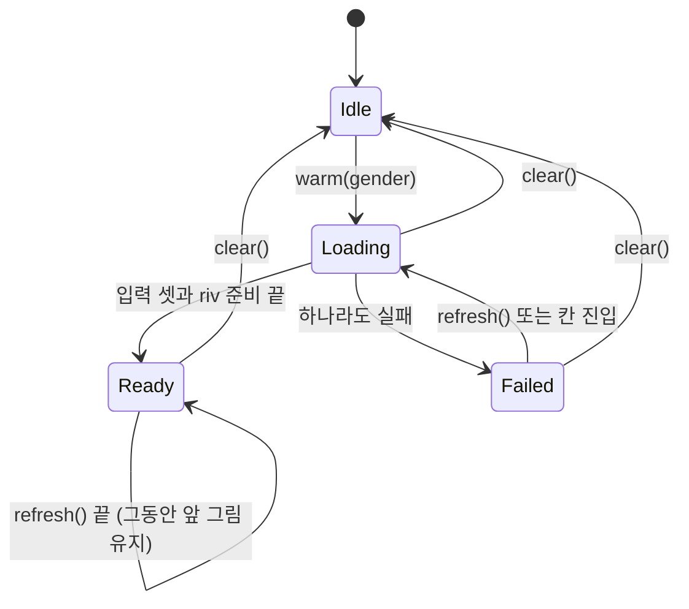
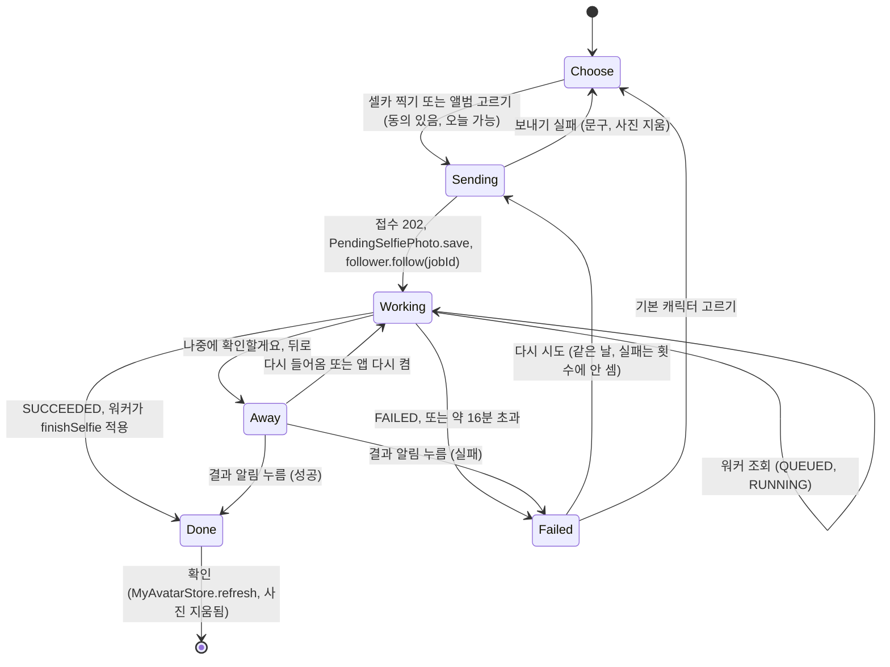
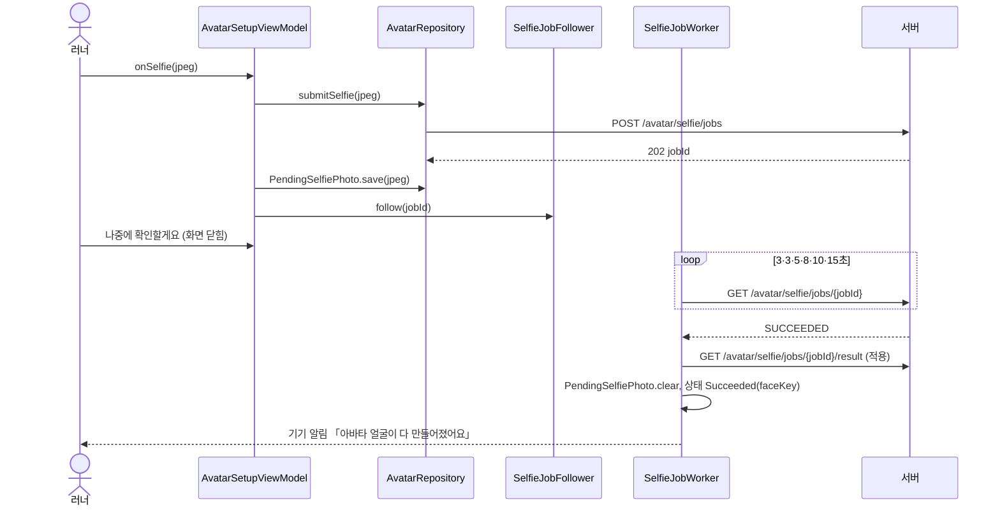

# 5.6 설계 결정 기록 (이어서: 아바타 추가 요구, 다음 판 변경)
> 작성: 2026-11-10 | 버전: v0.39 (다음 판 변경) | 담당: 이성현(캐릭터 도메인, 공용), 브랜치 `docs/S15P31A207-300-avatar-docs` | 입력: srs 7.13.29([임시:CR-성-10]~[임시:CR-성-18], [임시:FR-성-17]~[임시:FR-성-23], [임시:NFR-성-4]~[임시:NFR-성-6]), srs 03-06 3.6.0b, 유지보수 기록 [maintenance/2026-11-10_아바타요구-성](../maintenance/2026-11-10_아바타요구-성.md), 앞 조각 [05-29](05-29-설계-피그마맞춤-성.md) 5.5·5.6·6절, 코드 develop fbeda71f(읽기만: android `build-logic` ModuleRules, app `ArchitectureTest`, `AppStartup`, `RunkkNavHost`, core/ui `SlotKey`·`LocalSlots`·`FeatureEntry`·`AvatarBackdrop`·`RunkkRunningFigure`·`KakaoRunMap`, core/avatar 전부와 `res/raw/*.riv`, feature/home·run·crew·battle·avatar, data `WorkManagerUploadScheduler`, backend `SettingKey`·`BackgroundService`·V25), 멈춘 구현 worktree av1·av5·av10(커밋 안 된 변경 없음 확인)

> [런크크 객체지향 분석·설계서](../design-oo.md) 목차, 이전: [05-29-설계-피그마맞춤-성](05-29-설계-피그마맞춤-성.md), 다음: [06-01-클래스-common-member](06-01-클래스-common-member.md)

이 조각은 아바타 추가 요구 AV-1~AV-10의 **확정 설계**다. 구현 작업자(home-run, landmark-kr, outfit-assets, selfie-flow)는 이 문서만 보고 따라간다. 후보 비교는 결정의 근거로만 남기고, 고른 것 하나만 구현한다. 이 조각과 코드가 다르면 구현 전에 조정자에게 묻는다.

## 1. 결정 표

### 1.1 요구와 결정 대응

| srs | AV | 절 | 결정 |
|-----|----|----|------|
| [임시:FR-성-17], FR-162 | AV-1 | 2 | [임시:D-성-100]~[임시:D-성-102] |
| [임시:FR-성-19], [임시:NFR-성-4] | AV-4 | 3 | [임시:D-성-103]~[임시:D-성-106] |
| [임시:FR-성-22], [임시:NFR-성-5] | AV-8 | 4 | [임시:D-성-107]~[임시:D-성-109] |
| [임시:FR-성-23], FR-161, [임시:FR-성-15], [임시:NFR-성-6] | AV-9, AV-10 | 5 | [임시:D-성-110]~[임시:D-성-116] |
| [임시:FR-성-20], [임시:FR-성-21], FR-155, FR-156 | AV-7 | 6 | [임시:D-성-117]~[임시:D-성-120] |
| [임시:FR-성-18] | AV-3 | 7 | [임시:D-성-121]~[임시:D-성-122] |
| FR-201, FR-202 | AV-5 | 8 | [임시:D-성-123]~[임시:D-성-125] |
| [임시:NFR-성-2] 정정, FR-163, FR-164, [임시:FR-성-13] | 중립색, AV-6 | 9 | [임시:D-성-126]~[임시:D-성-127] |

### 1.2 결정 ([임시:D-성-100]~[임시:D-성-127])

[임시:D-성-93]~[임시:D-성-99]는 다른 브랜치 몫으로 비워 둔다.

| 번호 | 결정 | 근거 |
|------|------|------|
| [임시:D-성-100] | 홈과 러닝 중 화면의 Rive 아바타는 **칸 장치**로 넣는다. core/navigation `SlotKey`에 `HOME_AVATAR`, `RUN_AVATAR`를 더하고 `:feature:avatar`의 `AvatarFeatureEntry.slots`가 내용을 넣는다. 홈·측정 화면은 `LocalSlots.current[SlotKey.X]`만 그리고 `:core:avatar`·`domain.avatar`를 import하지 않는다. ModuleRules와 `ArchitectureTest`의 허용 표(폰 178개)는 바꾸지 않는다 | 1.3 비교표. ui.home·ui.battle·ui.crew 패키지 Fan-Out이 이미 상한 7이고 ModuleRules는 `:core:avatar`를 `:feature:avatar`에만 연다. 칸은 기존 장치(RECORD_BATTLES, HOME_INBOX_DOT, CREW_CHAT_TAB) 그대로라 새 개념이 없다. D-276·[임시:D-성-63]의 제약을 지키면서 [임시:D-성-63]의 「홈은 지금 그림 그대로」를 닫는다 |
| [임시:D-성-101] | 칸 인자는 CompositionLocal로 넘긴다. core/navigation에 `enum class AvatarSlotPose { STAND, RUN }`과 `val LocalSlotAvatarPose = compositionLocalOf { AvatarSlotPose.STAND }`를 둔다. 칸 내용은 부모 크기를 채운다(`Modifier.fillMaxSize()`). 크기·자리는 칸을 가진 화면이 정한다 | 칸 람다가 매개변수 없는 `() -> Unit`이다(`LocalSlotCrewId` 선례). core:ui에 `:core:avatar` 타입(`AvatarMotion`)을 넣을 수 없으므로 core:ui 쪽 enum을 둔다 |
| [임시:D-성-102] | 칸이 비어 있으면(미리보기, 화면 시험) 칸을 가진 화면은 지금 그림을 그린다: 홈 `RoomAvatar`(정적 `RunkkAvatar`), 측정 화면 `RunkkRunningFigure`. 홈 아바타 누름(내 러너로 이동)은 홈이 칸 바깥 상자에서 그대로 받는다 | 칸 기여자가 없을 때도 화면이 깨지지 않게 하고 기존 스냅샷 시험을 살린다 |
| [임시:D-성-103] | 내 아바타 입력은 `:feature:avatar`의 새 프로세스 단위 저장소 `MyAvatarStore`(@Singleton)가 한 번 모아 둔다. 상태 `StateFlow<MyAvatarState>` = `Idle | Loading | Ready(look: MyAvatarLook) | Failed`. `MyAvatarLook(gender, outfit, bodyShape, runningAmount, headLayers, backgroundKey)`. 모으는 곳은 `AvatarRepository.avatar()`·`runner()`·`SelfieHeads`(얼굴 키)이고, 성별은 `warm(gender)`을 부르는 Overlay가 `LocalAvatarCharacter.current`(MainActivity가 내림, 남의 성별 규칙 FR-162와 같은 출처)에서 읽어 넘긴다. `refresh()` 동안은 앞 `Ready`를 그대로 두고(로딩 표시 없음) 새 입력이 오면 바꾼다 | 홈·측정·내 러너·꾸미기가 같은 입력을 네 번 읽지 않게 한다. 리포지토리에 캐시가 없고 머리 JSON은 no-store라 프로세스 안 한 곳에 둔다 |
| [임시:D-성-104] | 미리 준비 시점: `AvatarFeatureEntry.Overlay(top)`가 처음 그려질 때(`LaunchedEffect(Unit)`) `MyAvatarStore.warm(gender)`을 부른다. Overlay는 로그인한 동안 RunkkNavHost가 늘 그리므로 (a) 로그인된 앱 시작(스플래시가 첫 화면을 미리 그리는 동안)과 (b) 로그인·가입 완료 뒤 홈 진입에 한 번씩 걸린다. `warm()`은 성별을 안 뒤 `:core:avatar`의 새 공개 함수 `preloadRiveAvatar(context, gender)`로 그 성별의 서기·달리기 riv와 내장 머리 PNG를 IO에서 읽고, 아바타 정보 세 호출을 병렬로 한다. 다시 준비(`refresh()`)는 착용 저장, 배경 바꿈, 셀카 결과 적용, 체형·러닝량이 바뀌는 러닝 저장 뒤 내 러너 진입 때 한다. Overlay가 컴포지션에서 빠질 때(로그아웃, `DisposableEffect`의 onDispose) `clear()` | `:app`(AppStartup)에서 부르면 app 패키지가 ui.avatar를 import해야 한다. Overlay는 기존 FeatureEntry 계약이라 새 의존이 없다. 스플래시 대기(HoldSplashUntil, 최대 4초)는 늘리지 않는다 |
| [임시:D-성-105] | `:core:avatar` 공개 API에 셋을 더한다: `suspend fun preloadRiveAvatar(context: Context, gender: AvatarGender)`(지금 internal인 `RiveAvatarAssets.shared` 읽기를 감싼다), `RunkkRiveAvatar(…, onReady: () -> Unit = {})`(그 동작의 첫 텍스처가 들어가 뷰가 보이게 된 때 한 번, 지금 INVISIBLE → VISIBLE 전환 자리), 아트보드 기하 상수 `object RiveAvatarGeometry { const val ASPECT = 0.8f; const val FOOT_LINE = 0.804f }`(가로/세로, 아트보드 위에서 발끝 줄까지 비율). 네이티브 초기화는 [임시:D-성-84]대로 첫 render에서 한다 | 로딩 표시를 거둘 시점을 렌더러만 안다. 기본값이 있어 기존 호출(`MyRiveAvatar`)은 그대로 컴파일된다. 발끝 좌표는 riv 네 파일 공통(5.1) |
| [임시:D-성-106] | 로딩 표시 규칙: 칸 크기는 처음부터 고정. `MyAvatarState`가 `Ready`가 아니거나 `onReady` 전이면 배경 자리(배경 그림 또는 `surface`)를 먼저 깔고 가운데에 `CircularProgressIndicator`(지름 32dp, 선 3dp, 색 `textSecondary`)를 보인다. `onReady`가 오면 표시를 200ms 페이드로 거둔다. 100ms 안에 준비되면 표시를 아예 그리지 않는다(깜박임 방지). `Failed`면 표시를 거두고 성별 기본 그림(지금 `RunkkAvatar` 서기)을 보이고 오류 문구는 없다. 홈·내 러너·꾸미기에 적용하고, 러닝 중 칸은 표시 없이 비워 둔다 | [임시:FR-성-19], [임시:NFR-성-4]. 빈 칸 0프레임은 「배경 + 진행 표시」를 첫 프레임부터 그리는 것으로 지킨다 |
| [임시:D-성-107] | 바닥 규격: 배경 그림의 바닥선은 그려진 그림 높이의 아래에서 18%다. Rive 뷰는 아트보드 비율(0.8:1) 그대로 크기를 잡고 아트보드 발끝 줄(위에서 80.4%)이 바닥선에 오게 놓는다. 아트보드 높이는 칸 높이의 0.9배이되 머리 위 여백이 칸 높이의 6%보다 작아지면 줄인다. 그림자는 앱이 그린다(타원, 폭 = 아트보드 높이 × 0.30, 높이 = 폭 × 0.2, 중심이 바닥선, 검정 불투명도 18%, 흐림 4dp). riv 안의 Ground shadow(불투명도 약 8%)는 검수 바탕처럼 읽을 때 알파를 0으로 바꿔 숨긴다 | 4절. 그림자가 두 겹이 되지 않게 하고, 그림자 모양을 배경·칸 크기와 같은 규칙으로 맞춘다 |
| [임시:D-성-108] | 배경 그림은 아래 가운데 정렬로 잘라 채우고(`ContentScale.Crop`, `Alignment.BottomCenter`, 지금은 가운데 정렬), 바닥선 화면 좌표 = 칸 아래 − 0.18 × (그려진 그림 높이)로 계산한다. 칸 비율이 그림과 달라도 바닥선은 그림의 바닥 위에 있다 | 칸 크기가 홈·내 러너(350x390)·꾸미기(152x200)·해금 팝업(280x500)·배경 고르기(95:126)로 다르다. 비율만 칸 기준으로 주면 잘린 그림의 바닥과 어긋난다 |
| [임시:D-성-109] | 「떠 있음」은 렌더러가 아니라 배치(`AvatarStage`)에서 고친다: 지금은 아트보드(800x1000)를 비율이 다른 상자(내 러너 165x330dp, 꾸미기 152x200dp)에 `Fit.CONTAIN`·가운데로 넣어 위아래 여백이 생기고, 아트보드 아래 20%(발 아래 빈 자리)가 그 위에 더해져 발이 카드 바닥에서 약 102dp(내 러너)·42dp(꾸미기) 떠 있다. `AvatarStage`가 뷰를 아트보드 비율로 잡고 [임시:D-성-107]의 위치에 놓는다. riv 파일은 고치지 않는다(승인본 SHA256 고정, `ApprovedAvatarAssetsTest`) | riv 조사 5.1, 코드 `AvatarRunnerScreen.kt`·`AvatarScreens.kt` 배치 |
| [임시:D-성-110] | 의상(상의·하의·신발)은 벡터 코드(`TopTypes`·`BottomTypes`·`FootwearTypes`·`OutfitStyles`·`MaleOutfitStyles`)가 아니라 **슬롯 좌표에 맞춘 PNG 레이어 묶음 + 목록 파일**로 그린다. 묶음은 `android/core/avatar/src/main/assets/outfits/<assetKey>/`, 목록은 `assets/outfits/index.json`이다. 렌더러는 슬롯 텍스처마다 「맨몸 바탕(피부톤 적용) → 신발 → 하의 → 상의」 순서로 PNG를 겹쳐 riv 이미지 슬롯에 넣는다(5.4) | AV-10 「규격에 맞춘 옷은 아바타에 적용 가능」. 코드 변경 없이 옷을 더한다([임시:NFR-성-6]). riv의 이미지 슬롯이 이미 텍스처 교체 방식이라 Rive 파일을 고치지 않는다 |
| [임시:D-성-111] | 규격 축은 남녀 2 × 동작(서기·달리기) 2 × 체형 3이다. 그림 파일은 남녀 × 동작 × 슬롯마다 한 장(체형 0 기준)이 필수이고, 체형은 Rive 몸 메시 변형(body_shape 0·50·100)이 같은 텍스처를 늘려 맞추므로 체형 1·2용 파일(`_b1`, `_b2`)은 늘어난 모양이 기준 그림을 벗어날 때만 둔다(선택). 12조합 모두 검수(5.6) 대상이다. 파일 이름·크기는 5.2 | riv 조사: 체형은 메시 변형 애니메이션이고 텍스처는 하나다. 체형마다 세 장을 강제하면 같은 그림을 세 번 그린다 |
| [임시:D-성-112] | 피부톤 필터(러닝량 밝기, `SkinToneFilter` 곱셈 행렬)는 맨몸 바탕 레이어에만 적용하고 의상 PNG에는 적용하지 않는다. 맨몸 바탕은 슬롯마다 피부와 속옷 선만 있는 그림을 새로 두고(5.3), 색·좌표로 피부를 가려내던 `BodySkinLayers`·`MaleSelectedBody` 판정은 이전이 끝나면 지운다 | [임시:FR-성-23] 「피부톤 변화는 의상에 적용하지 않는다」. 지금은 옷과 피부가 한 텍스처라 색·영역 판정으로 나눴고 판정 경계에서 밝은 띠 결함([임시:DV-성-11])이 났다. 레이어를 나누면 판정이 필요 없다 |
| [임시:D-성-113] | 상점 그림은 같은 원본에서 만든다: 파이프라인이 그 의상의 `female_stand` 레이어(서기, 체형 0) 불투명 영역을 잘라 투명 바탕 512x512 가운데에 긴 변 440px로 맞춰 `shop.png`를 만든다. 성별 구분 없이 한 장이다. 상점 칸(66x66)·구매 확인(112x112)은 이 그림을 줄여 쓰고, 지금 부위 실루엣(`ItemArt`)은 묶음이 없는 아이템(모자)에만 남는다 | AV-9 「같은 원본」, [임시:FR-성-15]. 입은 모습과 상점 그림이 어긋나지 않는다 |
| [임시:D-성-114] | 파이프라인은 저장소 도구 `android/core/avatar/tools/outfit-pipeline/`(Python 3.12, uv, Pillow)이다: (1) 원본(피그마 또는 그림 도구에서 슬롯 템플릿 위에 그린 PNG 내보내기 폴더)을 읽어 (2) 규격 검사(5.5) (3) 파일 이름·폴더 정리 (4) `shop.png` 생성 (5) `index.json` 갱신. 같은 검사를 앱 단위 시험 `OutfitAssetSpecTest`가 빌드 때 다시 한다. 슬롯 템플릿(맨몸 바탕 + 슬롯 경계 + 금지 영역)은 파이프라인이 `templates/`로 내보낸다 | 사람이 넣어도, 도구가 넣어도 같은 규칙으로 막는다 |
| [임시:D-성-115] | 기존 7종은 부위마다 번호 0~6(0 = 기본 흰 반팔티·검은 반바지·흰 신발) 일곱 가지, 모두 21가지다. 상점 키가 있는 12가지는 그 키(`top_lime_singlet` 등, V62)를 묶음 폴더 이름으로 쓰고, 상점 키가 없는 9가지(기본 셋, 하의 4~6, 신발 2·4·5)는 `base_top`, `base_bottom`, `base_shoes`, `bottom_wide_pants`, `bottom_cargo_shorts`, `bottom_line_shorts`, `shoes_high_top`, `shoes_slip_on`, `shoes_ankle_boots`로 둔다. 앱 대응표 `assetKey → 번호 0~6`([임시:D-성-76])은 `assetKey → 묶음 폴더`로 바뀌고, 묶음이 없는 키는 그 부위 `base_*`다. 21가지가 모두 옮겨진 뒤 벡터 의상 코드 다섯 파일, 여자 6번의 standing_body 잘라 붙이기, 남자 서기 riv 입력 `selected_top`·`selected_bottom`·`selected_shoes` 사용을 지운다 | 서버·상점 데이터는 그대로(그림 키 유지), 앱만 바뀐다. 상점에 없는 번호도 지금 그릴 수 있으므로 함께 옮겨 벡터 코드를 한 번에 지운다 |
| [임시:D-성-116] | 품질 기준 그림은 코랄 집업 후드(상의 6번 `top_cherry_vest`, 여자 정면은 지금 riv 내장 standing_body의 다듬은 그림)다. 의상 그림은 이 그림과 같은 수준을 지킨다: 외곽선 2px(1024 기준 슬롯은 4px), 색은 옷 기본색의 명도 −35%; 음영 3단(기본·그림자 면·하이라이트), 주름은 관절(팔꿈치, 허리, 무릎)과 지퍼·밑단에; 광택·질감 무늬 없음; 가장자리 안티에일리어싱 1px. 이전은 코랄 집업 후드를 먼저 규격 묶음으로 만들어 기준으로 삼고(남녀 서기·달리기), 그다음 나머지 20가지 | U-3, AV-10 |
| [임시:D-성-117] | 셀카 작업 조회를 화면 ViewModel에서 꺼내 **WorkManager**로 옮긴다. domain.avatar에 포트 `SelfieJobFollower { fun follow(jobId: String); fun cancel() }`, data에 `WorkManagerSelfieJobFollower`와 `SelfieJobWorker`(고유 작업 이름 `selfie-job`, `ExistingWorkPolicy.REPLACE`, 네트워크 조건)를 둔다. 워커는 지금 간격(`POLL_DELAYS` 3·3·5·8·10·15초)으로 최대 8분 조회하고 끝나지 않았으면 같은 작업을 다시 걸어 이어 간다(총 상한은 지금처럼 약 16분, 접수 시각 기준). 상태는 `AvatarRepository.selfieProgress(): Flow<SelfieProgress>`(`None | Working(jobId) | Succeeded(faceKey) | Failed(jobId, code)`)로 화면에 낸다 | 화면을 나가면 ViewModel 조회가 멈췄다(지금 동작). 업로드 워커(`UploadScheduler`·`UploadWorker`) 선례와 같은 포트·구현 나눔. CoroutineWorker 한 번의 실행 시간 제한 때문에 나눠 건다 |
| [임시:D-성-118] | 작업이 성공하면 워커가 `finishSelfie(jobId)`로 결과를 적용한다(러너가 화면에 없어도). 적용 뒤 `MyAvatarStore.refresh()`를 부를 수 있게 `SelfieProgress.Succeeded`를 낸다(ui.avatar가 듣는다) | 지금 `AvatarViewModel.finishPendingSelfie`가 진입 때 적용하는 규칙을 앞당긴다. 하루 1회 차감 규칙(서버 결과 조회 한 번)은 그대로 |
| [임시:D-성-119] | 보낸 사진은 domain.avatar 포트 `PendingSelfiePhoto`의 data 구현 `FilePendingSelfiePhoto`가 앱 전용 파일 `files/selfie/pending.jpg` 한 장으로 둔다(이미 줄인 JPEG, 새로 줄이지 않음). 백업 규칙에서 뺀다. 작업이 성공·실패로 끝나면, 서버에 진행 중 작업이 없다고 확인되면, 로그아웃·탈퇴하면 지운다 | FR-156 예외(07-25 7.13.29.1). 프로세스가 죽어도 작업 중 화면에 사진을 다시 보인다 |
| [임시:D-성-120] | 결과 알림은 워커가 기기 알림으로 낸다(서버 푸시 아님, 서버 변경 없음). 채널은 기존 푸시 채널과 같은 채널, 알림 ID는 작업마다 하나. 얼굴 만들기 화면이 보이는 동안(`SelfieScreenPresence.isVisible`, 채팅방 `OpenChatRooms` 선례)이나 알림 권한이 없으면 내지 않는다. 누르면 앱을 열고 `Routes.AVATAR_SETUP`으로 간다 | [임시:FR-성-21]. 서버에 셀카 알림 종류가 없다(NotificationType에 없음). 앱이 끝을 먼저 알므로 로컬이 맞다 |
| [임시:D-성-121] | 러닝 중 아바타 자리: 세 측정 화면(자유런 `RunScreen`, 크루런 `CrewRunScreen`, 대결 `BattleRunningScreen`)의 **내 위치 표시(지도 마커 `KakaoRunMap(figure)`와 경로 대체 `RouteMarker`)를 `RUN_AVATAR` 칸으로 바꾼다.** 크기 88x88dp(지금 72dp), 기준점은 칸 아래 가운데(발끝)가 내 위치 점. 배경은 깔지 않고 그림자만. 경로가 없을 때 가운데 놓던 72dp 그림도 88dp 칸이다. 크루원·대결 상대는 지금 `RunkkRunningFigure` 그대로 | 「러닝 중 아바타 뛰는 모습」을 지금 아바타가 있던 자리에서 보인다. 숫자(거리·시간·페이스)는 지도 상자 밖이라 가리지 않는다. 남의 아바타 Rive는 범위 밖(유지보수 기록 4절) |
| [임시:D-성-122] | 동작 규칙: 자유런 `RunPhase.RUNNING && !isPaused` → RUN, 그 밖(준비, 카운트다운, 일시정지) → STAND. 크루런 `CrewRunPhase.RUNNING && !mine.isPaused` → RUN, 그 밖 STAND. 대결은 일시정지가 없으므로 `BattlePhase.RUNNING` → RUN, 그 밖(`COUNTDOWN`, `CLOSING` 등) STAND. 움직임 줄이기면 그 동작의 첫 장면에 멈춘다. 측정 화면은 `LocalSlotAvatarPose`만 바꾸고 아바타 준비를 기다리지 않는다 | [임시:FR-성-18] |
| [임시:D-성-123] | 랜드마크: `SettingKey.Defaults.LANDMARKS`에서 `domestic("KAESONG", "개성", 120)`을 지우고 `CHUNCHEON`(춘천, 100km)과 `GANGNEUNG`(강릉, 170km)을 인천 다음에 **편도**(`roundTrip = false`, 단계 DOMESTIC)로 넣는다. 순서 인천 60 → 춘천 100 → 강릉 170 → 대전 280(엄격 오름차순 검사 통과) | U-2. 07-25 7.13.29.1(사용자 값과 Q-77 왕복 기준의 차이) |
| [임시:D-성-124] | Flyway `V65__landmark_remove_kaesong.sql`(대역 V65~V67): (1) 운영 기준값 표에 LANDMARKS 행이 있으면 그 JSON에서 KAESONG 원소를 빼고 CHUNCHEON·GANGNEUNG 원소를 거리 순 자리에 넣는다(행이 없으면 코드 기본값이 쓰이므로 아무것도 안 함). (2) `avatar_background`에서 `landmark_key = 'KAESONG'` 행을 지우고 (3) `avatar.selected_background = 'KAESONG'`이면 NULL(기본 배경)로 되돌린다. (2)·(3)은 0건이 예상되며 지운 건수를 마이그레이션 로그로 남긴다(`RAISE NOTICE`) | FR-201 예외(지운 북한 도시 키는 해금도 유지하지 않음). 행 단위로 남겨 두면 `BackgroundService`가 표에 없는 키를 목록 끝에 계속 보인다 |
| [임시:D-성-125] | 배경 그림 대체: 춘천·강릉은 국내 단계 그림(`avatar_backdrop_domestic`)을 쓴다. 앱 `AvatarBackdrop.STAGE_OF_KEY`에서 KAESONG을 지우고 CHUNCHEON·GANGNEUNG → DOMESTIC을 넣는다. 도시별 그림은 범위 밖이고, 그리게 되면 4절 바닥 규격을 따른다 | 지금 배경 그림은 키별이 아니라 단계별 3장이다 |
| [임시:D-성-126] | 중립색 복구 대응표(9절)대로 `RunkkColors.light`·`dark`의 중립 토큰을 W1 이전 무채색 값으로 되돌린다. 브랜드 토큰(lime, limeFill, selected*, tab*, secondary 보라, tag*, chatMine 계열)은 그대로. 새 중립 토큰(W1에 생긴 surfaceHigh, outline, menuDivider, toggleOff, inputHigh, radioStroke, runimalTile)은 9절 값. `ColorContrastTest`에 「중립 토큰 HSL 채도 5% 이하」를 더한다 | U-4, [임시:NFR-성-2] 정정 |
| [임시:D-성-127] | AV-6 문구 제거 범위: 꾸미기(`AvatarScreens.kt`)의 `avatar_trait_body`·`avatar_trait_skin` 줄, 내 러너(`AvatarRunnerScreen.kt`)의 칩 `avatar_runner_body_chip`·`avatar_runner_skin_chip`, 체형 게이지 양 끝 라벨 `avatar_body_low`·`avatar_body_high`. 체형 변화·피부톤 카드의 제목과 근거 문장은 남긴다. 접근성 설명(`avatar_figure_description`)의 체형 이름도 뺀다(「아바타, 남성」처럼). 쓰지 않게 된 문자열은 지운다. 화면 배치는 피그마 「제안」 페이지가 확정되면 그 시안이 이 결정을 덮는다 | 07-25 7.13.29.1 |

### 1.3 홈 의존 구조 비교 ([임시:D-성-100]의 근거)

판정 기준: (1) ModuleRules 위반 없음 (2) `ArchitectureTest` 패키지 Fan-Out 7 이하, 허용 표 합계 변경 최소 (3) 홈·측정 세 화면에 같은 방식 (4) 미리보기·시험에서 칸 없이도 그려짐 (5) 새 개념 수.

| 후보 | 내용 | (1) | (2) | (3) | (4) | (5) | 판정 |
|------|------|-----|-----|-----|-----|-----|------|
| A 직접 의존 | `:feature:home`(과 run·crew·battle)이 `:core:avatar`·`domain.avatar`를 의존 | 위반(ModuleRules가 `:feature:avatar`만 허용) | ui.home 7 → 9, ui.battle·ui.crew 7 → 8 | 같음 | 됨 | 0 | 불합격 |
| B 홈 요약 넓히기 | `domain.account.MyAvatar`에 착용·체형·러닝량을 더하고 홈만 `:core:avatar` 의존 | 위반 | ui.home 7 → 8 | 측정 화면은 따로 | 됨 | 0 | 불합격 |
| C core 포트 | core:ui에 `interface MyAvatarRenderer { @Composable fun Render(pose, modifier) }`, `:feature:avatar`가 Hilt로 구현, app이 CompositionLocal로 공급 | 통과 | 변경 없음 | 같음 | 기본 구현 필요 | 2(포트, 공급 경로) | 합격 |
| D 칸 장치 | `SlotKey.HOME_AVATAR`·`RUN_AVATAR`, 인자는 `LocalSlotAvatarPose` | 통과 | 변경 없음 | 같음 | 칸 비면 기존 그림 | 0(기존 장치) | **합격, 채택** |

C와 D는 둘 다 기준을 지킨다. C는 매개변수를 함수로 바로 넘길 수 있는 장점이 있지만 RunkkNavHost 밖에 공급 경로를 하나 더 만들고(지금 칸은 RunkkNavHost가 이미 모아 내린다), Hilt 바인딩이 없을 때의 기본 구현을 따로 둬야 한다. D는 세 선례와 같은 모양이라 구조 시험·리뷰 비용이 없다. 매개변수가 동작 하나뿐이라 CompositionLocal 하나로 충분하다.

## 2. 홈 아바타 (AV-1)

- 홈 `HomeScreen`의 아바타 방(`RoomAvatar` 자리, 지금 크기 그대로)을 `Box(Modifier.size(..).clickable { onAvatar() })`로 감싸고 안에 `LocalSlots.current[SlotKey.HOME_AVATAR]`를 그린다. 칸이 비면 지금 `RoomAvatar`([임시:D-성-102]). 누르면 `Routes.AVATAR_RUNNER`([임시:D-성-36] 그대로). 뛰어오르기·효과음은 내지 않는다(FR-236 2차 배포 뒤 규칙).
- 홈 배경 그림(`backgroundKey`로 그리던 `AvatarBackdrop`)은 칸 내용이 그린다(칸 하나가 배경 + 아바타 + 그림자 + 로딩 표시). 홈 `HomeUiState.backgroundKey`·`faceLayers`는 칸이 빈 경우의 기존 그림에만 쓴다.
- 칸 내용 `HomeAvatarSlotContent()`(ui.avatar): `MyAvatarSlotViewModel`(hiltViewModel, `MyAvatarStore`를 읽기만)로 상태를 받아 `AvatarStage(look, pose = STAND, showBackdrop = true, showLoading = true)`를 그린다.
- `AvatarStage`(ui.avatar, 새 공용 Composable)는 내 러너 카드·꾸미기 미리보기·홈 칸·해금 팝업 미리보기가 함께 쓰는 「배경 + 바닥선 + 그림자 + Rive + 로딩」 상자다. 지금 화면마다 나뉜 배치를 이것 하나로 모은다(바닥 규격이 한 곳에서 지켜진다).

```kotlin
// ui.avatar (feature/avatar)
@Composable
internal fun AvatarStage(
    state: MyAvatarState,
    pose: AvatarSlotPose,
    showBackdrop: Boolean,
    showLoading: Boolean,
    modifier: Modifier = Modifier
)
```

## 3. 미리 준비와 로딩 표시 (AV-4)

| 단계 | 시점 | 하는 일 | 클래스 |
|------|------|---------|--------|
| 1 | 로그인된 앱 시작: RunkkNavHost가 Overlay를 처음 그림(스플래시 아래) | `MyAvatarStore.warm(gender)` | `AvatarFeatureEntry.Overlay` |
| 2 | warm | 성별 확인 → `preloadRiveAvatar(context, gender)`(IO, 서기·달리기 riv와 내장 머리) ‖ `avatar()`·`runner()` ‖ 얼굴 키가 셀카면 `SelfieHeads.load(faceKey)` | `MyAvatarStore` |
| 3 | 셋 다 끝 | `Ready(look)`. 하나라도 실패하면 `Failed`(다음 `refresh()`나 칸 진입 때 한 번 다시 시도) | `MyAvatarStore` |
| 4 | 칸이 처음 그려짐 | `Ready`면 Rive 그림, 첫 장면에서 `onReady` → 로딩 표시 페이드 | `AvatarStage` |
| 5 | 로그인·가입 완료 | 홈으로 restart 되며 Overlay가 그려져 1과 같다 | |
| 6 | 바뀜 | 착용 저장, 배경 바꿈, 셀카 결과 적용([임시:D-성-118]), 내 러너 진입 → `refresh()`(입력만 다시 읽음, riv는 프로세스에 남아 있음) | 각 ViewModel |
| 7 | 로그아웃 | `clear()`(Idle) | Overlay `DisposableEffect` onDispose |

상태도 (`MyAvatarState`):



로딩 표시 규칙은 [임시:D-성-106]. 측정 근거([임시:NFR-성-4]): `AvatarStage`가 칸 첫 표시 시각과 `onReady` 시각을 Timber 디버그 로그 `AvatarStage shown=<ms> ready=<ms>`로 남긴다(배포 빌드에서는 안 남김).

## 4. 바닥 규격 (AV-8)

### 4.1 원인 (역공학)

riv 네 파일의 아트보드는 모두 800x1000(내부 400x500 좌표 ×2)이고 캐릭터는 가로 가운데(x≈400)에 서며 발끝은 y≈800(여 정면 몸 아래 끝 800, 남 801, 바닥 그림자 중심 (400, 804))이다. 발 아래 약 20%가 비어 있다. 앱은 이 아트보드를 비율이 다른 상자(내 러너 165x330dp, 꾸미기 152x200dp)에 `Fit.CONTAIN`·가운데로 넣는다. 그래서 상자 위아래 여백과 아트보드 아래 20%가 더해져 발이 카드 바닥에서 약 102dp(내 러너)·42dp(꾸미기) 떠 있다. 배경(`AvatarBackdrop`)은 가운데 정렬로 잘라 채워 그림의 땅 높이도 칸마다 다르다. 둘을 맞추는 규칙이 코드에 없다.

### 4.2 수치

| 항목 | 값 | 근거 |
|------|----|------|
| 바닥선 | 그려진 배경 그림 높이의 아래에서 18% | 내 러너 카드 350x390(피그마 H-2)에서 70px. 이보다 낮으면 카드 모서리(반지름 28) 근처라 발이 잘려 보이고, 높으면 다시 떠 보인다. 새 배경 그림(4.3)이 이 높이에 땅과 길의 경계를 둔다 |
| 아트보드 크기 | 높이 A = 칸 높이 × 0.9, 너비 = A × 0.8. 단 머리 위 여백(바닥선 − 0.804A)이 칸 높이의 6%보다 작으면 A = (바닥선 − 0.06 × 칸 높이) / 0.804 | 350x390에서 A = 351, 아트보드 위 끝이 칸 위에서 약 38px(10%) |
| 세로 위치 | 아트보드 위 끝 = 바닥선 − 0.804A(발끝 줄이 바닥선) | 4.1 발끝 줄 |
| 가로 위치 | 칸 가운데 | 캐릭터가 아트보드 가운데 |
| 그림자 | 앱이 그림. 타원 폭 = A × 0.30, 높이 = 폭 × 0.2, 중심 = (칸 가운데, 바닥선), #000000 불투명도 18%, 흐림 4dp. riv 내장 Ground shadow는 숨김 | 정면 몸 폭(아트보드 x 281..519, 약 0.30A)과 같은 폭 |
| 발끝 허용 차이 | 칸 높이의 1% 이하([임시:NFR-성-5]) | 350x390에서 약 4px |
| 러닝 중 칸 | 배경 없음, 칸 88x88dp, 바닥선 = 칸 아래에서 6%, A = 칸 높이 × 1.17(아트보드 위 끝 = 칸 위 끝, 발 아래 빈 여백은 칸 밖으로 넘쳐 잘림), 그림자 같은 비율. 칸 기준점(아래 가운데)이 지도 위 내 위치 | 지도 마커라 여백을 줄인다 |

달리기 동작은 다리가 움직여 발 위치가 바뀐다. 기준은 아트보드 발끝 줄(0.804)이고, 디딤발이 이 줄에 닿는 장면에서 [임시:NFR-성-5]를 확인한다(실기기 녹화).

### 4.3 배경 그림 규격 (피그마 제안 작업자와 공통)

- 새 배경 그림 캔버스 1080x1200(9:10, 350x390 카드의 약 3배). 바닥선은 아래에서 216px(18%). 바닥선 아래는 바닥면(길, 잔디, 바닥 타일), 위는 원경. 바닥선 위아래 8px 안에 강한 가로선이나 물체를 두지 않는다(그림자와 겹침).
- 가운데 폭 40%(432px) 안 바닥면에는 물체를 두지 않는다(아바타 자리).
- 세로로 긴 칸(해금 팝업 280x500)과 가로로 긴 칸은 아래 가운데 정렬로 잘라 채우므로 위·양옆이 잘린다. 위 20%와 양옆 15%에 중요한 랜드마크를 두지 않는다.
- 지금 그림(기본 `avatar_backdrop_default`·`_night` webp 720x1440, 단계별 벡터 3장 뷰포트 160x100)은 바닥선이 이 규격이 아니다. 새 그림이 들어올 때까지 앱은 같은 계산(아래에서 18%)을 쓰고, 그림 교체는 피그마 제안 페이지의 배경 시안으로 한다(유지보수 기록 RD-10).
- 피그마 작업자는 프레임마다 바닥선 가이드(아래 18%), 아트보드 상자(높이 0.9 × 칸, 비율 0.8), 발끝 줄(아트보드 위에서 80.4%)을 그려 시안을 맞춘다.

### 4.4 계산 (구현, `AvatarStage`)

```
drawnImageH = max(slotH, slotW × imageH / imageW)          // Crop, BottomCenter
floorY      = slotH − 0.18 × drawnImageH                    // 칸 위에서 바닥선까지
A           = 0.9 × slotH
if (floorY − 0.804 × A < 0.06 × slotH) A = (floorY − 0.06 × slotH) / 0.804
riveTop     = floorY − RiveAvatarGeometry.FOOT_LINE × A
riveSize    = (A × RiveAvatarGeometry.ASPECT, A)            // Fit.CONTAIN 이 여백 없이 맞음
shadow      = Oval(center = (slotW / 2, floorY), w = 0.30 × A, h = 0.06 × A)
```

배경이 없으면(러닝 중) `floorY = 0.94 × slotH`, `A = 1.17 × slotH`.

## 5. 의상 자산 규격과 파이프라인 (AV-9, AV-10)

이 절이 `android/core/avatar/OUTFIT_SPEC.md`의 원본이다. outfit-assets 작업자는 이 절을 그 파일로 옮기고(수치 그대로) 두 곳이 다르면 이 절이 맞다.

### 5.1 riv 이미지 슬롯 (역공학, develop fbeda71f)

riv는 RIVE 7.3 형식이고 이미지 자산은 파일 안에 내장되어 있다. 앱은 같은 이름의 슬롯 이미지를 합성한 PNG로 바꿔 넣는다(`FrontAvatarAssetLoader`, `RunAvatarAssetLoader`). 크기는 내장 PNG 크기이고 `BodySkinLayers`·`MaleSelectedBody`의 크기 검사와 같다.

| riv | 아트보드 / 상태 머신 / 입력 | 의상이 들어가는 슬롯(px) | 머리 슬롯(px) |
|-----|------------------------------|---------------------------|---------------|
| `avatar_idle_layered`(여 서기) | `Idle` 800x1000 / `Idle` / `body_shape` | `standing_body` 512x768(정면 몸 아틀라스: 피부 + 상의 + 하의 + 신발) | `face_layer`, `hair_layer`, `eyes_open`·`eyes_half`·`eyes_closed`, `fullness_overlay` 각 1024x1024 |
| `avatar_male_idle`(남 서기) | `Idle` 800x1000 / `Idle` / `body_shape`, `selected_top`·`selected_bottom`·`selected_shoes` | `male_selected_body` 1122x1402(선택 몸 아틀라스), 손은 `standing_body` 512x768의 승인본 손 영역 | 같음 |
| `avatar_run_approved`(여 달리기) | `Runner` 800x1000 / `Avatar` / `isRunning`, `outfit_id`, `body_shape` | `side_body_coral` 256x384(몸통 = 상의), `continuous_arm` 256x1024(팔과 소매 = 상의), `side_leg_skin` 256x768(엉덩이·다리 = 하의), `side_shoe` 256x160(신발, 가까운·먼 발 공통). `side_body_cream`·`side_body_blue`는 쓰지 않음(`outfit_id` 늘 0) | `side_head` 1024x1024(앱이 측면 얼굴·눈·헤어 합성), `fullness_overlay_side` 1024x1024 |
| `avatar_male_run`(남 달리기) | 여자 달리기와 같음 | 여자 달리기와 같은 이름·크기 | 같음 |

레이어 순서(riv 객체 순서, 위 → 아래):

| 화면 | 순서 |
|------|------|
| 정면(서기) | 몸·의상 아틀라스 → 볼(fullness) → 헤어 → 눈 → 얼굴 → 바닥 그림자 → 검수 바탕 |
| 측면(달리기) | 가까운 팔 → 몸통 의상 → 엉덩이 연결(다리 텍스처) → 먼 팔 → 볼 → 머리 → 가까운 신발 → 가까운 다리 → 먼 신발 → 먼 다리 → 바닥 그림자 → 검수 바탕 |

체형은 Rive 애니메이션(`Body shape base/medium/fuller`, `body_shape` 0·50·100)이 몸 메시를 변형하고, 볼만 체형 1·2용 PNG(`front_fullness_{1,2}`, `side_fullness_{1,2}`)로 바꾼다. 의상 텍스처는 체형과 상관없이 한 장이 늘어나 맞는다.

### 5.2 묶음 구성과 파일 이름

폴더 `assets/outfits/<assetKey>/`. `{g}` = `female` | `male`, `{b}` = 생략(체형 0 기준) | `_b1` | `_b2`(선택, [임시:D-성-111]).

| 부위 | 필수 파일 | 크기(px) | 대응 슬롯 |
|------|-----------|----------|-----------|
| 상의 | `{g}_stand{b}.png` | 여 512x768, 남 1122x1402 | 여 `standing_body`, 남 `male_selected_body` |
| 상의 | `{g}_run_body{b}.png` | 256x384 | `side_body_coral` |
| 상의 | `{g}_run_arm{b}.png` | 256x1024 | `continuous_arm` |
| 하의 | `{g}_stand{b}.png` | 여 512x768, 남 1122x1402 | 위와 같음 |
| 하의 | `{g}_run_leg{b}.png` | 256x768 | `side_leg_skin` |
| 신발 | `{g}_stand{b}.png` | 여 512x768, 남 1122x1402 | 위와 같음 |
| 신발 | `{g}_run_shoe{b}.png` | 256x160 | `side_shoe` |
| 모두 | `shop.png` | 512x512 | 상점 그림([임시:D-성-113]) |

상의 묶음은 7장(남녀 × 3 + 상점), 하의·신발 묶음은 5장(남녀 × 2 + 상점)이 필수다. 체형 선택 파일은 같은 이름에 `_b1`·`_b2`를 붙인다.

`index.json`:

```json
{
  "version": 1,
  "outfits": [
    {"assetKey": "top_cherry_vest", "part": "TOP", "bodyOverrides": []},
    {"assetKey": "base_top", "part": "TOP", "bodyOverrides": []}
  ]
}
```

### 5.3 그림 규칙

| 항목 | 규칙 |
|------|------|
| 좌표 | 각 PNG는 대응 슬롯 텍스처와 **같은 크기·같은 좌표**다(아틀라스 좌표 그대로). 파이프라인이 내보내는 슬롯 템플릿(맨몸 바탕 위에 슬롯 경계)을 밑그림으로 그린다 |
| 바탕 | RGBA, 옷이 아닌 곳은 알파 0. 반투명은 가장자리 안티에일리어싱 1px(1024 기준 2px)만 |
| 그 부위만 | 상의 파일에 하의·신발 픽셀 없음. 금지 영역(그 부위가 아닌 아틀라스 영역)은 템플릿에 빨간 빗금으로 표시하고 검사가 알파 0을 확인한다 |
| 맨몸 바탕 | 슬롯마다 `assets/outfits/_body/{g}_{slot}.png`(피부 + 속옷 선, 의상 없음). 피부톤 필터는 이 레이어에만 적용([임시:D-성-112]). 기존 승인 텍스처(`avatar_legacy_standing_body`, riv 내장 몸 텍스처)에서 옷을 지우고 가려졌던 피부를 그려 넣어 한 번 만든다 |
| 겹침 순서 | 맨몸 바탕 → 신발 → 하의 → 상의(지금 여자 의상 순서와 같다). 상의 밑단이 하의 허리를 덮는다 |
| 기준점 | 정면 발 칸은 지금 신발 기준점(왼발 (105,600), 오른발 (266,600), 발 칸 (96,627)-(257,768)·(260,627)-(421,768), 512x768 기준)을 그대로 쓴다. 신발은 발 칸 안에 그리고 칸 아래 끝(y 768)을 넘지 않는다. 측면 신발은 256x160 전체가 발 하나 |
| 피부톤 | 의상 PNG에 피부를 그리지 않는다(민소매 어깨·반바지 다리의 피부는 맨몸 바탕이 보이게 알파 0). 그래서 러닝량이 바뀌어도 옷 색이 그대로다 |
| 품질 | [임시:D-성-116](코랄 집업 후드 기준) |

### 5.4 렌더러 (core:avatar)

| 클래스 | 바뀜 |
|--------|------|
| `OutfitCatalog`(새) | `index.json`을 읽어 `assetKey → OutfitBundle(part, files)`. 없는 키는 그 부위 `base_*` |
| `OutfitLayerComposer`(새, `AvatarTextureComposer`에서 의상 부분을 옮김) | 슬롯 하나에 맨몸 바탕(톤 적용) → 신발 → 하의 → 상의 PNG를 겹친다. 체형 선택 파일이 있으면 그 체형에서 그것을 쓴다 |
| `AvatarOutfit` | `top·bottom·shoes: Int(0..6)` → `top·bottom·shoes: String(assetKey)`. 공개 API 변경이므로 `:feature:avatar`의 `RIVE_OUTFITS` 대응표가 함께 바뀐다(`outfitOf`가 착용 아이템 키를 그대로 넘김) |
| `RiveAvatarScene` | 남자 서기 `selected_top`·`selected_bottom`·`selected_shoes` 입력을 넣지 않는다(선택 몸 아틀라스를 합성해 넣으므로 표면 전환이 필요 없다). 이전이 끝날 때까지는 지금대로 |
| `RivReviewBackground` | 검수 바탕에 더해 Ground shadow 칠의 알파도 0으로 바꾼다([임시:D-성-107]) |
| 지울 것(이전 뒤) | `TopTypes`, `BottomTypes`, `FootwearTypes`, `OutfitStyles`, `MaleOutfitStyles`, `BodySkinLayers`의 피부 판정과 여자 6번 잘라 붙이기, `SkinRenderKey`의 부위 다시 그리기 |
| `AvatarToneCache` | 캐시 키에 의상 assetKey 셋과 체형을 넣는다(지금은 번호) |

### 5.5 규격 검사 (파이프라인 = `OutfitAssetSpecTest`)

1. `index.json`의 모든 키에 폴더가 있고, 폴더마다 부위별 필수 파일(5.2)이 모두 있다. 목록에 없는 폴더가 없다.
2. 파일 크기(px)가 5.2 표와 같다. 색 형식 RGBA 8비트.
3. 금지 영역(그 부위가 아닌 아틀라스 영역, 템플릿의 마스크)에서 알파가 모두 0이다.
4. 알파가 0이 아닌 픽셀이 슬롯의 허용 영역 안에만 있고, 1% 이상이다(빈 그림 거부).
5. `shop.png`가 512x512이고 불투명 영역의 긴 변이 420~460px, 가운데에서 ±8px.
6. 파일 이름이 규칙(`{g}_{stand|run_body|run_arm|run_leg|run_shoe}{|_b1|_b2}.png`, `shop.png`) 밖이면 실패.
7. 묶음 하나의 합계 크기 1.5MB 이하(APK 크기, [05-29](05-29-설계-피그마맞춤-성.md) 7절 10번).

### 5.6 검수 조합

묶음마다 남녀 × 서기·달리기 × 체형 3 = 12조합을 렌더해 확인한다. 자동: core:avatar 합성 결과(텍스처 PNG)의 스냅샷(`OutfitCompositeSnapshotTest`, 12장 × 묶음). 사람: 실기기 Rive에서 같은 12조합(RD-8). 늘어난 모양이 기준 그림을 벗어나면 그 체형 선택 파일을 더한다.

### 5.7 기존 의상 이전 (21가지)

| 부위 | 번호 → 묶음 폴더 |
|------|------------------|
| 상의 | 0 `base_top`(흰 반팔티), 1 `top_lime_singlet`, 2 `top_crew_tee`, 3 `top_finisher_tee`, 4 `top_winter_hoodie`, 5 `top_dawn_windbreaker`, 6 `top_cherry_vest`(코랄 집업 후드, 기준) |
| 하의 | 0 `base_bottom`(검은 반바지), 1 `bottom_running_shorts`, 2 `bottom_leggings`, 3 `bottom_jogger_pants`, 4 `bottom_wide_pants`, 5 `bottom_cargo_shorts`, 6 `bottom_line_shorts` |
| 신발 | 0 `base_shoes`(흰 신발), 1 `shoes_basic_runner`, 2 `shoes_high_top`, 3 `shoes_carbon_racer`, 4 `shoes_slip_on`, 5 `shoes_ankle_boots`, 6 `shoes_lime_runner` |

순서: (1) 맨몸 바탕 8장(남녀 × 서기 1 + 달리기 3 슬롯) (2) 코랄 집업 후드(기준) (3) 기본 셋 (4) 상점 키가 있는 나머지 11가지 (5) 상점 키가 없는 6가지 (6) 벡터 코드 삭제. 이름이 그림과 어긋나는 키(`top_cherry_vest` = 코랄 집업 후드, `shoes_lime_runner` = 코랄 러닝화)는 키를 바꾸지 않는다(서버 데이터, [임시:D-성-76]).

## 6. 셀카 작업 흐름 (AV-7)

### 6.1 클래스

| 계층 | 클래스 | 책임 | 결정 |
|------|--------|------|------|
| domain.avatar | `SelfieJobFollower`(포트) | 접수된 작업을 화면 밖에서 끝까지 따라가게 맡긴다 | [임시:D-성-117] |
| domain.avatar | `SelfieProgress`(sealed) | `None`, `Working(jobId, submittedAt)`, `Succeeded(faceKey)`, `Failed(jobId, code)` | [임시:D-성-117] |
| domain.avatar | `AvatarRepository.selfieProgress(): Flow<SelfieProgress>` 더함 | 기기에 남은 작업 ID·실패 기록과 워커가 쓴 최근 상태를 합쳐 낸다 | |
| domain.avatar | `PendingSelfiePhoto`(포트): `save(jpeg)`, `load(): ByteArray?`, `clear()` | 보낸 사진 한 장 | [임시:D-성-119] |
| data | `WorkManagerSelfieJobFollower`, `SelfieJobWorker`(HiltWorker) | 조회, 성공이면 `finishSelfie`, 끝나면 사진 지움·알림 | [임시:D-성-117], [임시:D-성-118], [임시:D-성-120] |
| data | `FilePendingSelfiePhoto` | `files/selfie/pending.jpg`, 백업 제외(`data_extraction_rules`·`backup_rules`에 `selfie/`) | [임시:D-성-119] |
| data(phone) | `SelfieResultNotifier` | 기기 알림. 화면이 보이면(`SelfieScreenPresence`) 또는 권한이 없으면 안 낸다 | [임시:D-성-120] |
| ui.avatar | `AvatarSetupViewModel` 고침 | 폴링 루프(`follow`, `MAX_POLLS`, `POLL_DELAYS`)를 지우고 `selfieProgress()`를 모아 화면 상태로 바꾼다. 보낸 뒤 `follower.follow(jobId)` | |
| ui.avatar | `AvatarSetupUiState` 고침 | `isMakingFace` 대신 `phase: SetupPhase`(`Choose | Sending | Working | Done | Failed`), `sentPhoto: ImageBitmap?` | |
| ui.avatar | 꾸미기·내 러너의 얼굴 바꾸기 진입점 | `Working`이면 「작업 중」 꼬리표 | |

조회 간격·상한·실패 허용(`POLL_DELAYS`, 약 16분, 연속 실패 3번)은 지금 값을 워커 상수로 옮긴다. 화면을 다시 열면 워커가 낸 상태를 그대로 보이므로 화면이 따로 조회하지 않는다.

### 6.2 상태도 (얼굴 만들기 화면)



`Away`는 화면이 없는 상태다(워커만 돈다). 작업 중 화면 배치(보낸 사진 160x160 둥근 사각, 진행 표시, 문구 두 줄, 단추 「나중에 확인할게요」)와 완료·실패 화면은 피그마 「제안」 페이지 시안이 정한다. 문구는 [임시:FR-성-20]·[임시:FR-성-21] 그대로다.

### 6.3 시퀀스 (나중에 확인)



## 7. 러닝 중 아바타 (AV-3)

| 화면 | 칸 자리 | 크기 | 동작 | 칸이 비면 |
|------|---------|------|------|-----------|
| 자유런 `RunScreen`(`RunningContent`) | 지도 `KakaoRunMap(figure = { 칸 })`의 내 위치 마커, 지도가 없으면 `RouteCanvas`의 `RouteMarker`, 경로가 없으면 지도 상자 가운데 | 88x88dp, 기준점 아래 가운데 | `RunPhase.RUNNING && !isPaused` → RUN, 그 밖 STAND | `RunkkRunningFigure` |
| 크루런 `CrewRunScreen`(`RunningContent`·`CrewRunMap`) | 내 마커 자리(지금 678·683·691행의 `RunkkRunningFigure`). 크루원 마커는 그대로 | 88x88dp | `CrewRunPhase.RUNNING && !mine.isPaused` → RUN | `RunkkRunningFigure` |
| 대결 `BattleRunningScreen`(`Running`·`BattleRoute`) | 내 마커 자리(지금 477·482·511행). 상대 그림은 그대로 | 88x88dp | `BattlePhase.RUNNING` → RUN, 그 밖 STAND(일시정지 없음) | `RunkkRunningFigure` |

- `KakaoRunMap`의 `markerSize` 기본값 72dp는 그대로 두고, 내 마커를 그리는 호출에서만 88dp를 넘긴다(크루원·상대 72dp 유지). 마커의 화면 위치 계산이 아래 가운데 기준인지 구현에서 확인하고, 아니면 `KakaoRunMap`에 기준점 인자(`anchor = BottomCenter`)를 더한다.
- 칸 내용 `RunAvatarSlotContent()`(ui.avatar)는 `MyAvatarState.Ready`일 때만 `AvatarStage(pose = LocalSlotAvatarPose.current, showBackdrop = false, showLoading = false)`를 그리고 그 밖에는 아무것도 그리지 않는다. 측정 화면은 아바타 준비를 기다리지 않는다.
- 달리기 방향: 지금 `RunkkRunningFigure(isFacingLeft)`처럼 경로 진행 방향으로 좌우를 뒤집는 기능은 이번에 넣지 않는다(Rive 옆모습은 오른쪽 보기 하나). 지도에서 왼쪽으로 달려도 오른쪽을 본다. 뒤집기는 후속([임시:D-성-122] 범위 밖).
- 수명주기: 화면이 멈추면(ON_PAUSE, 화면 꺼짐) Rive 재생이 멈춘다([05-29](05-29-설계-피그마맞춤-성.md) 5.6). 측정 서비스(포그라운드 서비스)는 아바타와 무관하다.

## 8. 랜드마크 (AV-5)

| 항목 | 값 |
|------|----|
| 서버 기본값 | `SettingKey.Defaults.LANDMARKS`: 인천 `domestic` 60(왕복) → 춘천 `CHUNCHEON` 100(편도) → 강릉 `GANGNEUNG` 170(편도) → 대전 280(왕복) …. 개성 `KAESONG` 삭제. 편도 국내 랜드마크를 만드는 생성 함수(`domesticOneWay(key, name, km)`)를 더한다 |
| 표기 | 편도라 「서울에서 춘천까지 달렸어요!」(LandmarkStage DOMESTIC의 표기 함수가 `roundTrip`을 보고 「(왕복 n회)」를 붙이는지 구현에서 확인. 붙이면 `roundTrip = false`일 때 빼도록 고친다) |
| 첫 랜드마크 전 문구 | 「서울–인천 왕복까지 n%」 그대로(첫 랜드마크 인천 그대로) |
| Flyway | `V65__landmark_remove_kaesong.sql`([임시:D-성-124]). V66·V67은 예비 |
| V25 이름→키 표 | 고치지 않는다(지난 마이그레이션) |
| 앱 | `AvatarBackdrop.STAGE_OF_KEY`: KAESONG 줄 삭제, `"CHUNCHEON" to DOMESTIC`, `"GANGNEUNG" to DOMESTIC`([임시:D-성-125]) |
| 기기 확인한 배경 목록 | 지운 키(KAESONG)가 남아 있어도 서버 목록에 없으면 무시한다(지금 `findNewUnlocks`가 서버 목록 기준이라 고칠 것 없음, 시험으로 확인) |
| 시험 | 서버: `SettingKeyTest`, `LandmarkTableTest`, `BackgroundServiceTest`, `AvatarBackgroundTest`, `ProfileTest`의 개성 예시를 춘천·강릉으로. 새 시험: 기본 목록에 북한 도시 키가 없음(금지 목록 `KAESONG` 등), 춘천·강릉 편도 표기, V65 적용 뒤 KAESONG 해금 행·선택 0. 앱: `AvatarW8Test`, `AvatarBackgroundViewModelTest`의 KAESONG 예시 |

## 9. 중립색 대응표와 AV-6

### 9.1 중립 토큰 (라이트 / 다크)

W1 이전 값이 있는 토큰은 그 값으로 되돌린다. W1에 생긴 중립 토큰은 W1 이전 무채색 단계 중 명도가 가장 가까운 값이다.

| 토큰 | 지금(피그마 녹색 기운) | 되돌릴 값 라이트 | 되돌릴 값 다크 |
|------|------------------------|------------------|----------------|
| background | #F7F8F2 / #171B12 | #FAFAFA | #09090B |
| backgroundDecor | (W1 값) / #292F25 | #EFEFF1 | #141416 |
| surface | #FFFFFF / #292F25 | #FFFFFF | #18181B |
| surfacePressed | (W1 값) / #343D2D | #F0F0F2 | #1F1F23 |
| surfaceHigh, runimalTile, inputHigh | #E9EDE0 / #343D2D(inputHigh #40453B) | #F4F4F5 | #27272A |
| border, menuDivider, radioStroke, toggleOff | #E9EDE0 / #444B3E·#737A6B·#525C4A | #E4E4E7 | #27272A(toggleOff #3F3F46) |
| borderStrong, outline, inputBorder | #C7CCBF / #737A6B | #8A8A93(inputBorder #71717A, outline #D4D4D8) | #3F3F46(inputBorder #71717A, outline #52525B) |
| borderHover | (W1 값) / #616959 | #A1A1AA | #52525B |
| textPrimary | #171B12 / #FFFFFF | #18181B | #FAFAFA |
| textSecondary | #67705B / #A8AEA0 | #52525B | #A1A1AA |
| scrim | rgba(23,27,18,0.45) | rgba(9,9,11,0.45) | 같음 |

브랜드 색(lime #CAEB2E, onLime·onLimeFill #171B12, secondary #5C4BDB, tagLime 등)은 그대로다. onLime #171B12는 라임 위 글자(브랜드 쌍)라 그대로 둔다. 바꾼 뒤 `ColorContrastTest`(대비 4.5:1)와 새 채도 검사가 통과해야 하고, 스크린샷 기준 이미지는 다시 기록한다. 통합 브랜치 작업자가 표에 없는 중립 토큰을 만나면 같은 규칙(가장 가까운 명도의 zinc 단계)으로 정하고 조정자에게 알린다.

### 9.2 AV-6 문구 제거

[임시:D-성-127] 범위. 꾸미기 아바타 아래 「체형 ○○」「피부색 ○○형」 줄과 내 러너 칩 두 개, 게이지 양 끝 라벨을 지운다. `AvatarSupport.kt`의 `BODY_VARIANT_LABELS`·`skinLabel`은 접근성 설명에서도 안 쓰면 함께 지운다. 시험: 두 화면 스냅샷 다시 기록, 해당 문자열 리소스 없음(정적 검사).

## 10. 패키지 의존과 구현 순서

### 10.1 패키지 의존 (바뀐 부분)

| 쪽 | 의존 | 넘기는 것 | 근거 |
|----|------|-----------|------|
| 앱 | ui.home → core.navigation(기존) | `SlotKey.HOME_AVATAR` 이름, `LocalSlots` | [임시:D-성-100] |
| 앱 | ui.run·ui.crew·ui.battle → core.navigation(기존) | `SlotKey.RUN_AVATAR`, `LocalSlotAvatarPose` | [임시:D-성-100], [임시:D-성-101] |
| 앱 | ui.avatar → core.avatar(기존) | `preloadRiveAvatar`, `RunkkRiveAvatar(onReady)`, `RiveAvatarGeometry`, `AvatarOutfit`(assetKey) | [임시:D-성-105], [임시:D-성-109] |
| 앱 | ui.avatar → domain.avatar(기존) | `selfieProgress()`, `SelfieJobFollower`, `PendingSelfiePhoto` | [임시:D-성-117] |
| 앱 | data → domain.avatar(기존) | 포트 구현 | |
| 서버 | 변경 없음 | Flyway V65만 | [임시:D-성-124] |

`ArchitectureTest`의 허용 표 합계(폰 178)와 각 패키지 Fan-Out은 바뀌지 않는다. ModuleRules도 그대로다. `core.avatar`가 새로 쓰는 외부 의존은 없다(Android `Context`, `assets`).

### 10.2 구현 순서와 겹치는 파일

| 순서 | 브랜치 | 내용 | 겹치는 파일 |
|------|--------|------|-------------|
| 1 | `feature/S15P31A207-289-figma-align`(통합) | 중립색 복구([임시:D-성-126]) | core/ui `RunkkColors.kt`, 스크린샷 기준 이미지 전체 |
| 2 | `feature/S15P31A207-300-landmark-kr` | 8절(서버 + 앱 `AvatarBackdrop`) | core/ui `AvatarBackdrop.kt`(4와 겹침: 4는 이 파일의 바닥선 계산만 손댄다) |
| 3 | `feature/S15P31A207-300-outfit-assets` | 5절 규격·파이프라인·7종 이전, 4절 렌더러 쪽(`RiveAvatarGeometry`, riv 그림자 숨김) | core/avatar 전부 |
| 4 | `feature/S15P31A207-300-home-run` | 2·3·7절, [임시:D-성-127] 문구 제거, `AvatarStage` | core/ui `SlotKey`·`LocalSlots`, feature/home·run·crew·battle·avatar. core/avatar는 3의 공개 API(`preloadRiveAvatar`, `onReady`, `RiveAvatarGeometry`)를 쓴다. 3보다 먼저 시작하면 3의 API 시그니처(이 조각 [임시:D-성-105])로 작업하고 병합은 3 뒤 |
| 5 | `feature/S15P31A207-300-selfie-flow`(새로) | 6절 | feature/avatar `AvatarSetup*`(4와 같은 모듈, 다른 파일), data, domain.avatar |

동시 2개 규칙(AGENTS.md)에 따라 2·3을 먼저 함께, 그다음 4·5를 함께 돌린다. 1은 통합 브랜치에서 따로 한다.

## 11. 테스트 순서

`/sw-test`가 [임시:TC-성-n]으로 매긴다. 수정 전 실패를 먼저 확인한다.

1. 단위(서버): 기본 랜드마크에 북한 도시 키 없음, 인천 → 춘천 → 강릉 → 대전 순서와 엄격 오름차순, 춘천·강릉 편도 표기, V65 적용 뒤 KAESONG 해금 행·선택 배경 0(Testcontainers).
2. 단위(core:avatar): 의상 규격 검사 `OutfitAssetSpecTest`(5.5 일곱 항목), 합성 스냅샷 `OutfitCompositeSnapshotTest`(묶음 × 12조합), `AvatarStage` 바닥선 계산(칸 4종 × 배경 비율 2종, 4.4), 피부 필터가 의상 픽셀을 바꾸지 않음(합성 결과 의상 영역 바이트 같음), `preloadRiveAvatar`가 남녀마다 한 번만 읽음.
3. 단위(ui.avatar): `MyAvatarStore` 상태 전이(Idle → Loading → Ready/Failed, refresh, clear), `AvatarSetupViewModel`이 `selfieProgress` 각 상태를 화면 단계로 바꿈, 상태 이름 문구 없음.
4. 단위(data): `SelfieJobWorker` 간격·상한·연속 실패 3번, 성공 시 `finishSelfie` 한 번과 사진 지움, 화면이 보이면 알림 없음, 다시 걸기(8분).
5. 화면 시험(스크린샷): 홈 칸 있음·없음, 내 러너·꾸미기(문구 제거), 측정 세 화면의 칸(RUN·STAND), 로딩 표시, `AvatarStage` 바닥선(배경 4종 × 칸 3종, 발끝 행 검사), 중립색 전체.
6. 구조: `ArchitectureTest`(허용 표 178 그대로), ModuleRules 빌드.
7. 실기기: 유지보수 기록 5.1 RD-1~RD-12, [임시:NFR-성-4] 측정.
