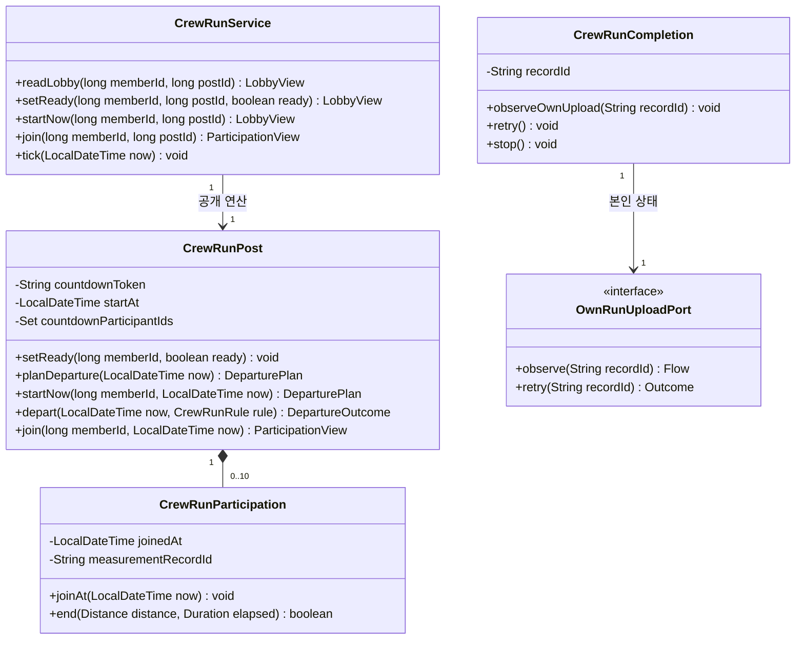
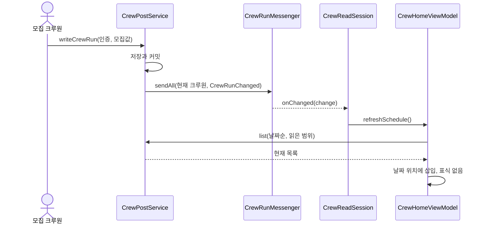
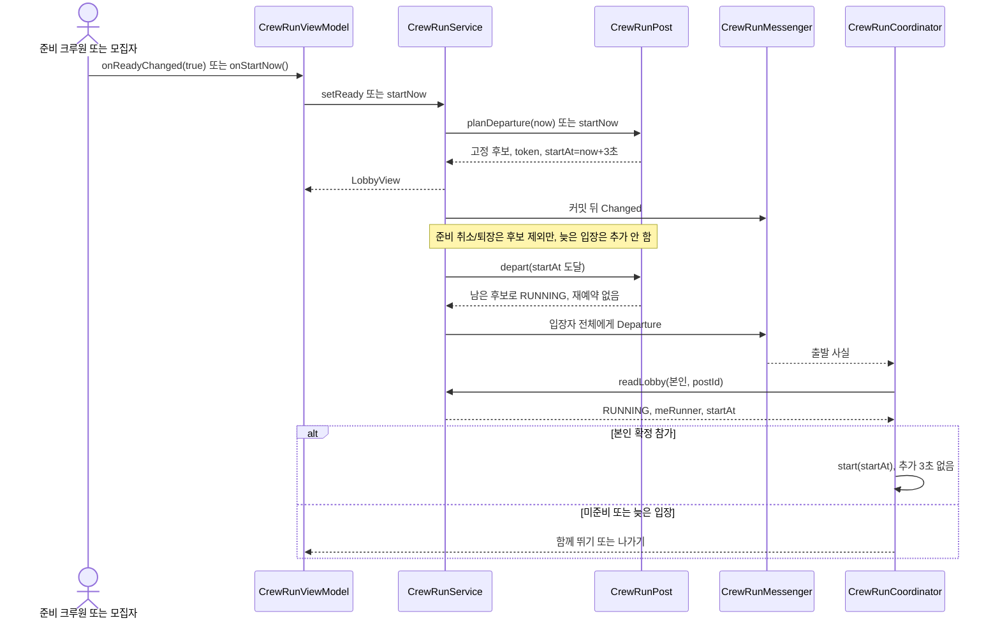
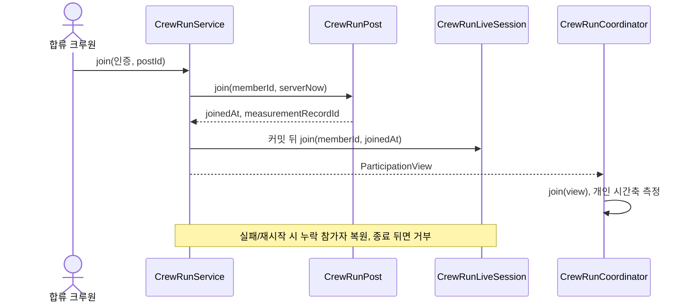
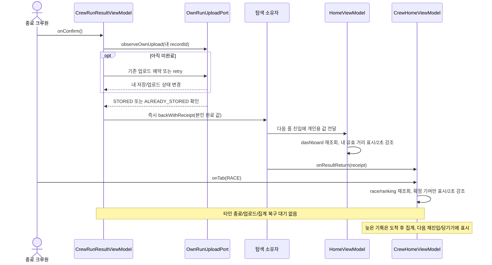
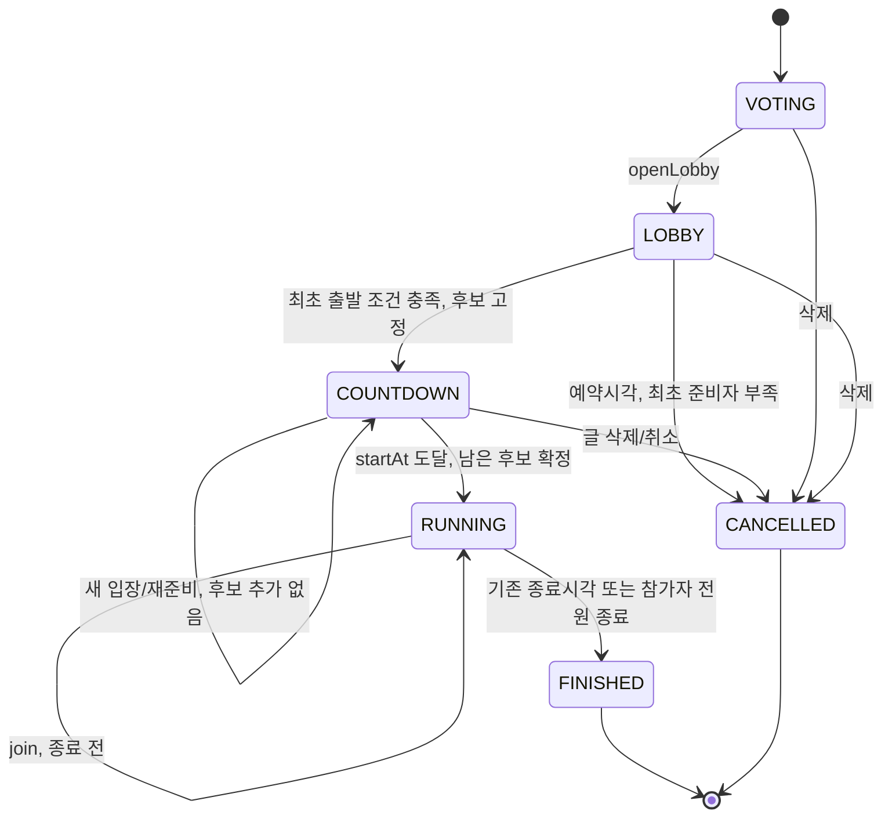
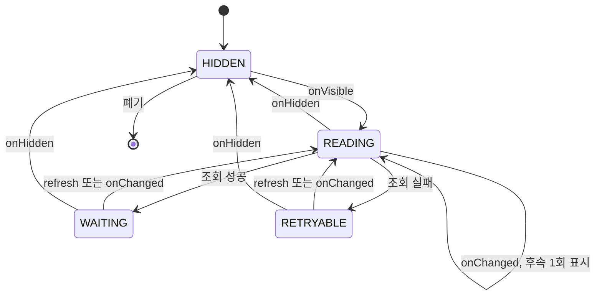
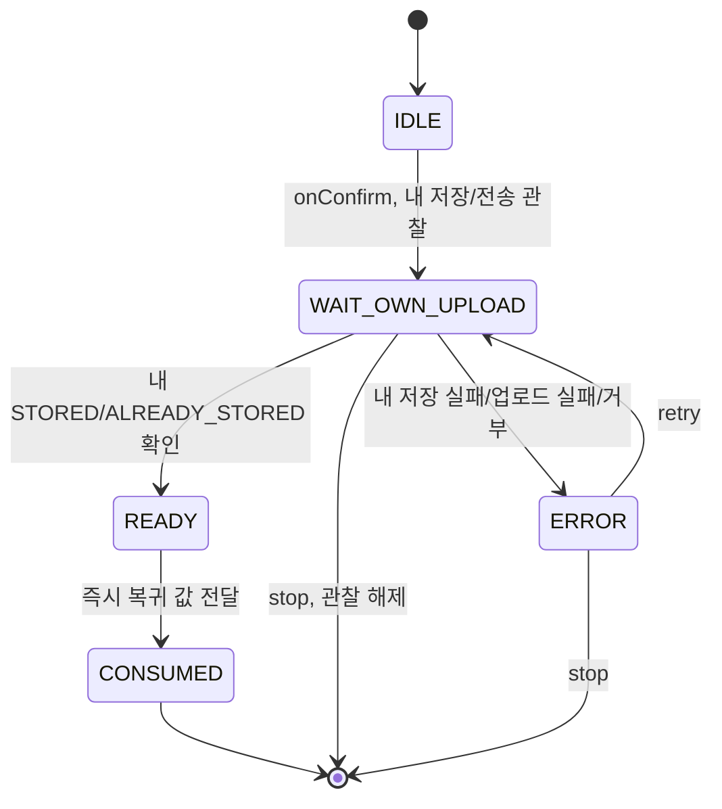
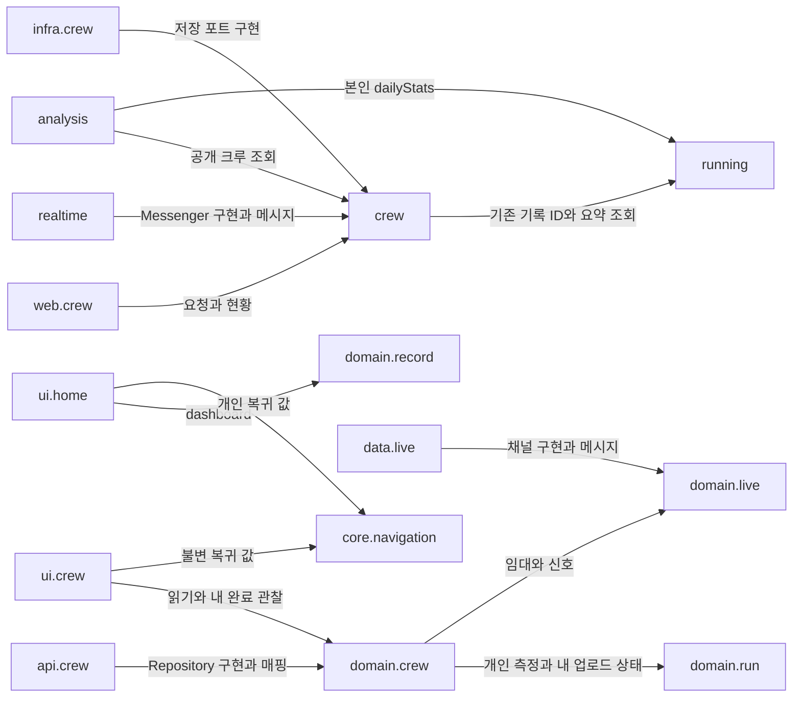

> [런크크 객체지향 분석 설계서](../design-oo.md) 목차, 이전: [05-31-설계-실기기수정-성](05-31-설계-실기기수정-성.md)

# 5.32 설계: 크루런 실시간 반영 (v0.43 변경)

> 작성: 2026-11-16 | 버전: v0.43 변경 | 담당: 이성현(성), 브랜치 `impl/S15P31A207-306-realtime` | 입력: [SRS 03-11](../srs/03-11-크루런실시간-성.md), [개선 보수 CR](../maintenance/2026-11-16_크루런실시간-성.md), U-24~U-36, Jira S15P31A207-306, MR !170 작업 묶음, 코드 879f6e98 읽기

문서 설계이며 코드는 수정하지 않았다. PM 이성현의 2026-11-16 답변 U-31~U-36을 반영한다. 코드 근거 E1~E5와 파일/줄은 유지보수 3절에 보존한다. 제공자/소비자의 세부 계약 검토와 구현/시험/인수는 별도다. 객체 모델 → 동적 모델 → 기능 모델 순서로 분석하며 Java 21/Kotlin의 기존 객체와 포트를 활용한다.

## 0. 결정과 변경 이력

기존 D-877~892는 번호를 보존한다. 바뀐 결정은 v0.43 변경이며 폐기한 항목은 삭제 이력이다. SRS A1~A6은 U-31~U-36으로 모두 해소했다. 신호 지연 p95 1초는 PM이 승인한 SLA가 아닌 별도 시험 계획 가정이다.

| 결정 | 최종 내용 | 근거/상태 |
|------|-----------|-----------|
| D-877 | (v0.43 변경) 기존 /ws JSON WebSocket, LiveChannelProvider 임대와 연결 실패 시 기존 폴링 대체 경로 재사용. STOMP 도입 없음 | U-31, A1 해소 |
| D-878 | 커밋 뒤 현재 크루원에게 CrewRunChanged 발행. 목록/대기실/진행/결과의 변경 사실만 전달하고 대상 원본을 읽음. RESULT는 열린 결과 화면만 소비 | U-24/27/32. 운영 푸시와 분리 |
| D-879 | GET 대기실은 readOnly, 상태 변경 0회. enter 재호출 금지. 준비는 멱등 PUT 신설, 기존 토글 POST 호환 유지 | U-24, READY 초기화 원인 |
| D-880 | (v0.43 변경) 신호/당기기/재진입 읽기를 같은 대상별로 합침. 동시 요청 1개, 진행 중 신호는 후속 1회로 합침. **삭제됨(사유: U-32): 신규 3초 조회 타이머** | 기존 결과 화면의 최대 60초 폴링과 종료 후 내 기록 미연결 시 최대 10회 추가 읽기는 그대로 유지 |
| D-881 | 전원 준비/모집자/예약 출발 판정을 같은 잠금으로 직렬화. startAt은 계획 시각+3초인 측정 시작 절대시각, 앱은 다시 +3초하지 않음 | U-25/33, 세 경로 중복 예약 금지 |
| D-882 | (v0.43 변경) 시작 순간 준비자를 출발 후보로 고정. 준비 취소/퇴장은 후보에서 제거하고 새 입장/재준비로 추가하지 않음. 0명/1명이어도 같은 시각에 출발. **삭제됨(사유: U-33): 조건 상실 시 취소/재판정** | A3 폐기. 글 삭제/취소 자체는 별도 기존 규칙 유지 |
| D-883 | 출발 통지는 입장자 전체, 자동 측정은 확정 후보만. 미준비/늦은 입장자는 함께 뛰기/나가기 선택 | U-26/33 |
| D-884 | post 잠금 안에서 현재 크루원의 종료 전 join 등록. 개인 joinedAt 보존, 별도 분 단위 마감 없음 | U-26 |
| D-885 | DB 참여/Redis 중계에 함께 반영. 개인 시간축은 joinedAt, 거리 순위 보정 없음, 전체 종료시각 연장 없음 | U-26 |
| D-886 | (v0.43 변경) 예정일시/postId 오름차순, 이미 읽은 페이지 범위 갱신. **삭제됨(사유: U-35): 새로 표식/newIds/수명 상태** | U-27/35, A5 폐기 |
| D-887 | **삭제됨(사유: U-34)**: 전체 정산 장벽, settlement 서비스/API/DTO/READY 영수증 | A4 폐기, 번호 재사용 금지 |
| D-888 | (v0.43 변경) 내 저장/업로드 완료 즉시 복귀 값 전달. 홈은 본인 기록, 레이스는 조회 시점 확정 기여만 새로 읽음. 나머지는 기록 도착 후 기존 집계에 추가 | U-28/34. 열린 타인 레이스는 재진입/당기기 때 표시. ui.crew→ui.home 직접 접근/공유 dirty 싱글턴 금지 |
| D-889 | (v0.43 변경) 홈은 내 유효 거리, 레이스는 직전/최신 성공 조회 사이의 확정 거리 증가를 첫 렌더부터 2초 강조. 같은 기록/스냅숏 중복 강조 금지 | U-28/34. 레이스 변화 전부를 내 크루런 기여로 단정하지 않음 |
| D-890 | (v0.43 변경) 내 recordId의 로컬 저장/서버 STORED 또는 ALREADY_STORED 성공만 관찰. 내 실패는 재시도, 타인 미전송/크루 기여 실패는 복귀 차단 안 함 | U-34. 기존 업로드 재시도/0시 보정 유지 |
| D-891 | (v0.43 변경) 매 조회/신호 발송의 소속 검증. 기존 모집 알림 유지. **삭제됨(사유: U-36): 이번 CREW_RELEASED 값 점검/변경과 푸시 인수** | 운영 푸시 설정은 다음 이슈, A6 폐기 |
| D-892 | 계약/시간/오류를 먼저 맞추고 원인 TC의 수정 전 실패/수정 후 통과를 기록. 문서 검증과 제품 검증 구별 | 작업 사이클/OWNERS |

## 1. 객체 모델

### 1.1 명사, 책임과 공개 연산

모든 가변 필드는 private이며 읽기 DTO/복귀 값은 불변이다. 모집자/PM/크루원은 액터와 권한이며 별도 회원 상속을 만들지 않는다. 예정일시/거리/경과/주는 값이다. 화면/단추/강조는 표현 속성이다.

| 객체/소속 | 책임 한 문장 | 속성과 공개 연산(제안 포함) |
|-----------|-------------|-----------------------------|
| CrewRunPost / crew | 크루런의 참가와 출발 규칙을 지킨다 | status, countdownToken/startAt/startReason/countdownParticipantIds, departedAt, endedAt. setReady, planDeparture, startNow, depart, join, end |
| CrewRunParticipation / crew | 개인 참여의 시간과 기록 식별을 보존한다 | readiness, runner, joinedAt, ended, linkedRecordId, measurementRecordId. enter, ready, joinAt, end, link |
| CrewRunService / crew | 크루런 요청을 한 잠금 경계에서 처리한다 | readLobby, setReady, startNow, join, tick. settlement 삭제됨(사유: U-34) |
| CrewRunAnnouncer / crew | 확정한 변경을 현재 수신자에게 알린다 | changed, started, participantJoined, ensureSession |
| CrewRunLiveSession / crew | 개인 진행값을 중계 현황으로 바꾼다 | starts/latest. open, join, onProgress, relay |
| CrewRunChanged / crew.live | 변경 사실을 담는다 | crewId/postId/resource/revision/eventId/occurredAt |
| CrewRunMessenger / crew | 지정 회원에게 메시지를 전달한다 | send/sendAll. 기존 WebSocketMessenger/PollingMessenger 구현 |
| CrewReadSession / domain.crew | 보이는 한 대상의 읽기를 조정한다 | key/requestJob/dirty/generation/lastRevision/lease. onVisible/onHidden/onChanged/refresh. timerJob 삭제됨(사유: U-32) |
| CrewRunCompletion / domain.crew | 내 저장과 업로드 완료를 관찰한다 | ownUploadPort/recordId/state. observeOwnUpload/retry/stop. 전체 정산 check 삭제됨(사유: U-34) |
| OwnRunUploadPort / domain.run, 공개 경계 제안 | 내 recordId의 저장과 업로드 상태를 제공한다 | observe(recordId), retry(recordId). 기존 Archive/UploadScheduler/업로더가 상태를 제공 |
| CrewRunCoordinator / domain.crew | 내 측정 한 회의 시작과 종료를 잇는다 | onLobbyEntered/start/join/quit/acknowledgeFinished |
| CrewHomeViewModel / ui.crew | 현재 크루 탭의 값을 표시한다 | race/ranking/crewRuns/previousSnapshot/generation. onTab/onResumed/refresh/onResultReturn. newIds 삭제됨(사유: U-35) |
| CrewRunViewModel / ui.crew | 대기실과 출발 선택을 표시한다 | lobby/readSession/phase. refreshLobby/onReadyChanged/onStartNow/onJoin |
| CrewRunResultViewModel / ui.crew | 내 결과와 확인 상태를 표시한다 | result/completion/readSession, 기존 결과 폴링. onConfirm/onStart/onStop |
| HomeViewModel / ui.home | 홈의 내 요약을 표시한다 | dashboard/returnReceipt/highlight. onResumed/refresh/onResultReturn |
| CrewRunReturnReceipt / core.navigation | 내 업로드 완료의 복귀 값을 전달한다 | receiptId(recordId 기준), crewId/postId/myRecordId/ownMeters(유효 거리)/weekStart/uploadedAt. participantMeters/전체 정산 confirmedAt 삭제됨(사유: U-34) |
| HomeRunReturnReceipt / core.navigation | 홈에 필요한 복귀 값만 전달한다 | 위 값에서 crewId를 제외한 불변 투영 |
| CrewRunSettlement / crew | **삭제됨(사유: U-34)** | 전체 정산 상태/응답/연산을 만들지 않음 |

Post 1개가 Participation 0..10개를 합성한다. 카운트다운 뒤 후보가 0명일 수도 있어 LiveSession의 참가자 연관도 0..10개다. 후보 0명만으로 즉시 종료시키지 않고 기존 종료시각까지 join을 허용한다. ReadSession/Completion은 화면 수명에 속한다. 상속은 기존 Post→SchedulePost, Messenger/LiveChannel 구현만 사용한다.



자료사전 대응: 대기실현황→LobbyView, 출발후보식별→countdownParticipantIds, 측정시작시각→joinedAt/starts, 반영확인결과→내 전송 상태/복귀 값, 변경신호→Changed. 새표식/반영상태/Settlement 대응은 삭제됨(사유: U-35/U-34).

## 2. 동적 모델

### 2.1 사건 시퀀스









### 2.2 사건 흐름

ViewModel→서비스→Post 공개 연산→커밋 뒤 Messenger→ReadSession→대상 읽기. 출발/join 승인→Coordinator→RunTracker→기존 로컬 저장/업로드→내 상태 포트→Completion→복귀 값 순서다. 타인 업로드를 앱에서 호출하거나 모든 참가자 저장을 기다리는 흐름은 삭제됨(사유: U-34).

### 2.3 상태도

status enum은 기존 LOBBY_OPEN을 유지하고 논리 phase를 선택 필드로 추가한다.



종전 COUNTDOWN→LOBBY 조건 재판정 전이는 **삭제됨(사유: U-33)**. 후보 0명은 전원 종료로 간주하지 않는다. 일반 참여는 NOT_ENTERED→ENTERING→READY, 준비 취소는 READY→ENTERING, 퇴장은 NOT_ENTERED다. depart는 최종 후보만 RUNNER로 전환하고 나머지는 RUNNING에서 join으로 RUNNER가 된다. RUNNER→ENDED의 종료는 기존 규칙을 따른다.



새 ReadSession에 시간 주기 전이는 없다. 결과 ViewModel의 기존 최대 60초 폴링은 별도 수명으로 유지한다.



Completion의 전체 RUNNING/PENDING 정산 상태와 3초 재검사는 **삭제됨(사유: U-34/U-32)**. Coordinator는 Idle→Lobby→Countdown→Running→Finished→Idle이며 미확정자는 JoinChoice→join 승인→Running이다. COUNTDOWN 중 준비 취소/퇴장자는 자동 측정하지 않고 선택/퇴장으로 간다. 같은 측정/recordId 재시작은 금지한다.

### 2.4 결과 확인 활동도

확인 입력→내 저장/업로드 상태 관찰→성공이면 즉시 복귀, 내 실패면 기존 한 줄 오류/재시도. 목적지에서 최신 조회 성공 후 값과 강조를 표시한다. 목적지 읽기 실패는 목적지에서 재시도하며 결과 화면으로 되돌려 전체 정산을 기다리게 하지 않는다. **삭제됨(사유: U-34): 전체 반영 완료 분기와 대기 루프**.

## 3. 기능 모델과 교차 확인

기능 모델은 SRS 6절 DFD를 재사용한다. 최하위 5/5 프로세스가 아래 연산에 대응한다.

| 프로세스 | 입력→출력 | 클래스/연산 |
|----------|-----------|-------------|
| 1 변경 자료 조회 | 조회요청/변경신호→변경조회결과 | ReadSession.refresh, CrewHomeViewModel.refreshSchedule, Repository.postsCovering/race/crewRanking |
| 2 대기실 조회와 변경 | 대기실요청→대기실현황 | Service.readLobby/setReady/enterLobby/leaveLobby |
| 3.1 출발 판정 | 출발요청→출발현황 | Post.planDeparture/startNow/depart, 고정 후보/시각 |
| 3.2 합류 판정 | 합류요청→합류현황 | Service.join, Post.join, Coordinator.join |
| 4 내 저장과 업로드 확인 | 확인요청→반영확인결과 | Completion.observeOwnUpload/retry, OwnRunUploadPort |

사용자 유스케이스는 바뀐 크루런 확인, 준비하고 출발, 달리는 크루런 합류, 결과를 목표/레이스에서 확인의 네 가지다. 마지막 유스케이스는 본인 종료가 사전 조건, 본인 업로드 뒤 복귀가 사후 조건이며 타인 미전송 완료를 포함하지 않는다.

## 4. 시스템과 객체 설계

### 4.1 저장 자료와 접근 책임

| 자료 | 구조/소유 | 일관성 |
|------|-----------|--------|
| 출발 계획 | 기존 post의 countdown_token/countdown_start_at/planned_start_at/start_reason와 후보 ID 집합 추가 제안 | 같은 post 행 잠금. 시작 때 준비자 스냅숏, 제거만 허용. 실제 매핑/마이그레이션 번호는 구현 직전 확인 |
| 변경 순번 | post 단위 change_revision 추가 제안 | 자식 변경/기록 연결/기여 통지에서도 잠금으로 증가. 부모 JPA version 자동 증가를 가정하지 않음 |
| 개인 참여 | joined_at/measurement_record_id(UUID) 추가 제안 | 기존 runner는 departedAt으로 시각 보충, 기존 연결 ID가 있으면 사용. 새 참여는 한 번 예약. GET은 쓰지 않음 |
| 중계 | 기존 Redis SessionStore에 개인 joinedAt | DB로 복원 가능. 이미 세션이 있어도 누락 참가자 보충 |
| 기록/집계 | 기존 RunRecord/WeeklyRace와 고유 기여 키 | finalDistance/live를 확정 기여로 만들지 않음. 공개 조회/기존 AFTER_COMMIT 경로/재시도/보정 사용 |
| 내 전송 완료 | 기존 Archive/업로더가 recordId별 상태 제공, 앱 공개 포트 확장 제안 | 로컬 저장 중과 미전송을 구분. 서버 성공을 재관찰 가능하게 보존. pending 부재/예약 UUID만으로 성공 판정 금지 |
| 화면 값 | 각 ViewModel의 snapshot/generation/강조 소비 ID | 전역 가변 dirty 상태 없음. 새로 표식 상태 삭제됨(사유: U-35) |

영속 접근은 infra.crew/infra.running이 소유한다. crew/analysis가 다른 테이블에 직접 SQL을 추가하지 않는다. 전체 settlement 읽기 스냅숏/반영 장벽은 **삭제됨(사유: U-34)**.

### 4.2 공개 계약과 시간

서버 저장은 기존 LocalDateTime/ServerZone, REST는 오프셋 ISO-8601, 실시간은 기존 LocalDateTime 직렬화를 유지한다. 앱 ServerTime으로 절대시각을 복원한다. 메서드 인자는 4개 이하로 둔다.

| 연산 | 사전/사후 조건 |
|------|----------------|
| Service.readLobby(memberId, postId) | 현재 소속/대상 검사, 읽기만. 출발/종료 후도 현황 제공 |
| Service.setReady(memberId, postId, ready) | 입장자/대기실 또는 COUNTDOWN. 같은 값 멱등. COUNTDOWN의 false는 후보 제거, true는 후보 추가 안 함 |
| Service.startNow(memberId, postId) | 모집자. 기존 COUNTDOWN은 먼저 동일 예약 반환, 최초 예약만 준비자 2명 검사 |
| Service.join(memberId, postId) | 현재 크루원/RUNNING/종료 전. 기존 참가자는 같은 joinedAt/recordId 반환 |
| Post.planDeparture(now), startNow(memberId, now), depart(now, rule) | 최초 후보 고정, 시각/토큰 고정, 경계 도달 시 남은 후보 확정 |
| Announcer.changed(post, change), LiveSession.join(memberId, joinedAt) | 성공 커밋 뒤 발행/세션 반영. rollback 신호 0, join 멱등 |
| ReadSession.onVisible(key)/onHidden()/onChanged(change)/refresh() | 보이는 key만 읽기. 숨김 시 요청 취소/임대 반납, 이전 generation 응답 폐기 |
| Completion.observeOwnUpload(recordId)/retry()/stop() | 내 상태 포트 관찰. 성공만 복귀 값 생성. 화면 폐기는 관찰만 해제하고 업로드 예약 유지 |
| OwnRunUploadPort.observe(recordId)/retry(recordId) | 저장중/미전송/성공/저장실패/서버거부 구분, 성공에 valid/유효 거리 제공. HTTP 신설 없음 |
| Coordinator.join(view), ViewModel.onConfirm/onResultReturn | 같은 개인 측정 중복 시작 금지, 목적지별 불변 복귀 값 소비 |
| Service.settlement / SettlementResponse | **삭제됨(사유: U-34)** |

기존 RunStartSpec.kt:16~25에는 시작시각이 없고 RunTracker.kt:137~147은 runtime.now를 사용한다. `crewParticipationStartAt: Instant? = null`을 추가하는 경계 제안을 유지한다. CREW_RUN만 확정 startAt/승인 joinedAt을 사용한다. 승인 전 GPS 거리를 소급하지 않는다. 기존 RunStartSpec.recordId에 서버 예약 measurementRecordId를 넣어 재접속에도 재사용한다. 예약 ID는 저장 성공 증거가 아니다. 일반 러닝 UUID 규칙은 유지하며 기록 담당 소비자 검토 대상이다.

### 4.3 동시성, 출발과 장애

1. 준비/입장/이탈/참석 변경/startNow/tick/join/close는 같은 post 잠금으로 처리한다. 최초 전원 준비의 분모는 입장자만, 최소 준비 인원은 2명이다.
2. 최초 계획 뒤 준비 취소/퇴장/참석 철회는 후보에서만 제거한다. 새 입장/재준비는 후보에 넣지 않는다. 최소 인원을 재검사해 취소하거나 3초를 다시 세지 않는다. 새/제외된 사람은 RUNNING 뒤 join한다. 글 삭제는 기존 취소/종료 규칙을 따른다.
3. 이미 계획이 있으면 자동/수동/예약은 같은 token/startAt을 반환한다. 후보 0명/1명도 시각 유지. 세션 0명을 전원 종료로 처리하지 않아 늦은 join을 받을 수 있어야 한다.
4. 기존 tick의 1초 스케줄 지연은 실측한다. startAt은 공통 기준이며 앱은 최종 RUNNING/meRunner를 확인해 한 번만 측정한다. 추가 +3초 금지.
5. join/close는 서버 잠금 시각으로 판정한다. 상태만 RUNNING이어도 closesAt 뒤면 거부한다. DB 커밋 후 Redis 실패는 누락 참여 복원으로 보완한다.
6. 채널은 기존 임대를 사용해 채팅/대결 연결을 닫지 않는다. 신호 누락은 당기기/화면 재진입으로 복구한다. 연결 복구 자체로 화면 자료 GET을 추가하지 않으며 결과의 기존 폴링만 별도 유지한다.
7. RESULT는 열린 결과 화면, SCHEDULE은 열린 크루런 탭에만 연결한다. 타인 레이스에는 자동 조회/숫자 반영을 연결하지 않는다. CREW_RELEASED 실제값 점검/변경은 다음 이슈다.

### 4.4 내 업로드 완료와 거리의 의미

기존 `UploadPendingRunsUseCase`는 성공/이미 저장됨을 UploadOutcome.Sent/AlreadySaved로 반환하고 기존 보관함을 정리한다. 이를 domain.run의 공개 상태 포트로 관찰하게 확장하는 제안이며 domain.crew가 domain.sync/data 내부를 참조하지 않는다. 본인 recordId만 기다리고 다른 미전송 기록의 전체 작업 종료를 기다리지 않는다. 성공 직후 복귀하며 크루 기여 실패 E5는 복귀 장벽이 아니다.

홈은 DashboardService.weeklyOf→RunQueryService.dailyStats의 본인 유효 기록을 다시 읽는다. POST /runs의 valid=false는 전송 성공이지만 유효 기여 0이다. 내 저장 실패/네트워크 실패/영구 거부는 성공으로 바꾸지 않는다. 0거리로 기록 자체를 만들지 않는 기존 경로는 정상 업로드 완료로 가장하지 않고 기존 기록 미생성 종료 정책을 그대로 적용하며 별도 상태로 검증한다.

크루 목표는 WeeklyRace, 보드는 기존 기간별 유효 기여 조회다. A 2km 업로드 뒤 B가 아직 달리면 홈 A +2km, 레이스는 조회 시점의 확정분만 보인다. B 3km 도착 후 기존 저장/기여 경로가 총 +5km로 갱신하며 다음 탭 진입/당기기에서 표시한다. E5 실패 시에도 실제 확정분만 표시하고 기존 재시도/보정 뒤 읽는다. 임시 중계/끝내기 거리를 유효 기여로 먼저 넣지 않는다. 시작 주/당시 소속/유효성의 기존 규칙을 유지한다.

복귀 값은 탐색 소유자가 백스택별로 보관하고 목적지에 불변 값으로 전달한다. 홈은 본인 값만 투영한다. 앱 복원 후에도 원본을 다시 읽으며 거리를 수동 가산하지 않는다. 레이스 강조는 직전/최신 성공 조회의 실제 증가분으로 처리하고 내 크루런 전체 기여라고 단정하지 않는다. 기준 스냅숏이 없으면 처음 표시하는 확정 거리 값을 2초 강조하고 증가량 숫자는 추정하지 않는다.

### 4.5 조회 합치기와 목록

화면 진입→key/generation 결정→즉시 읽기. 신호/당기기 때 진행 요청이 있으면 dirty 1개로 합치고 완료 뒤 후속 1회만 실행한다. 현재 key/generation이며 역행 revision이 아닌 응답만 반영한다. 숨김 시 요청 취소/임대 반납. **삭제됨(사유: U-32): 3초 기준시각/timer/주기 호출**.

기존 결과 ResultViewModel의 3초부터 최대 60초까지 늘어나는 폴링과 종료 뒤 내 기록 미연결 시 최대 10회 추가 읽기는 이번에 변경하지 않는다. 이 폴링은 결과 표시용이고 확인 버튼의 내 업로드 관찰과 분리한다. 새 신호/당기기 읽기와 기존 결과 읽기도 같은 대상 요청으로 합친다. 전송 폴링 대체 채널은 메시지 전달이며 화면 GET 타이머와 다르다.

목록은 postId로 중복 제거하고 읽은 범위를 새 응답으로 교체한다. 페이지 경계가 이동하면 최신 cursor를 사용한다. 기존 id 내림차순/Long cursor 계약을 보존하면서 크루런 요청만 `order=SCHEDULED_ASC&activeOnly=true`를 추가한다. 서버가 VOTING/LOBBY_OPEN/RUNNING을 (scheduledAt,id) 오름차순 조회한다. Long cursor는 직전 행 ID이며 그 행의 scheduledAt/id를 서버가 읽는다. 기준 행 삭제로 복원 불가하면 400 BAD_REQUEST, 앱은 첫 페이지부터 읽은 범위를 복구한다. order/필터가 다른 cursor를 재사용하지 않는다. **삭제됨(사유: U-35): baseline/newIds/새로 표식의 부여/해제**.

revision은 post 단위다. 기록 연결과 기여 도착 순서가 달라도 나중 통지가 해당 post의 revision을 올려 RESULT를 발행한다. 순번은 전체 정산 완료 증거가 아니다. 신호가 없어도 결과 기존 폴링/당기기/재진입으로 현재 원본을 읽을 수 있다.

## 5. 최종 API 계약

신설/추가는 설계 계약이다. 2026-11-16 서버 쪽(8.1)과 앱 쪽(8.3)을 구현했다. 구현에서 정한 세부와 설계와 다른 점은 서버 8.2, 앱 8.4에 적었다. 공통 오류는 401 인증 실패, 403 PERMISSION_DENIED, 400 BAD_REQUEST, 409 CONCURRENT_UPDATE이며 업무 예외는 기존 ApiExceptionHandler의 409를 따른다. 5xx/전송 실패는 성공값으로 숨기지 않는다.

### 5.1 경로, 요청, 응답과 오류

| 구분 | 경로 | 요청 | 응답 | 대표 오류 |
|------|------|------|------|-----------|
| 기존 채널 | WS /ws | 기존 인증 연결, 기존 진행 JSON | 기존/추가 서버 메시지 JSON | 기존 인증/연결 실패, 기존 대체 경로 적용 |
| 기존 대체 | GET /api/v1/live/poll | 기존 인증, 본문 없음 | 200 같은 서버 메시지 JSON 배열 | 401/5xx. 기존 polling 모드 배포 조건 유지 |
| 기존 대체 진행 | POST /api/v1/live/progress | 기존 InboundProgress JSON | 204 | 400 형식/1,024바이트 상한, 401/5xx |
| 신설 안전한 읽기 | GET /api/v1/crew-runs/{id}/lobby | 본문 없음 | 200 LobbyResponse, 준비/참여 변경 없음 | 409 POST_NOT_FOUND, 403 PERMISSION_DENIED |
| 기존 입장 | POST /api/v1/crew-runs/{id}/lobby/enter | 본문 없음 | 200 LobbyResponse, COUNTDOWN 중 입장 가능하나 후보 추가 안 함 | 409 LOBBY_NOT_OPEN/ALREADY_STARTED |
| 신설 멱등 준비 | PUT /api/v1/crew-runs/{id}/lobby/ready | {"ready":true 또는 false} | 200 LobbyResponse, COUNTDOWN에서 취소는 후보 제거만 | 409 NOT_PARTICIPANT/INVALID_STATE |
| 기존 토글/이탈 | POST /api/v1/crew-runs/{id}/lobby/ready 또는 /lobby/leave | 본문 없음 | 200 LobbyResponse, 이탈자 후보 제외 | 409 INVALID_STATE, 토글 자동 재시도 금지 |
| 신설 모집자 시작 | POST /api/v1/crew-runs/{id}/start | 본문 없음, 인증 모집자 | 200 LobbyResponse, startAt=최초 예약+3초, 재요청은 같은 token | 403 PERMISSION_DENIED, 409 CREW_RUN_NOT_READY(새 제안)/ALREADY_STARTED |
| 신설 중간 참여 | POST /api/v1/crew-runs/{id}/join | 본문 없음, 인증 회원 사용 | 200 ParticipationResponse, 재요청은 같은 joinedAt/recordId | 403 PERMISSION_DENIED, 409 INVALID_STATE/POST_NOT_FOUND |
| 삭제 계약 | GET /api/v1/crew-runs/{id}/settlement | **삭제됨(사유: U-34)** | 신설하지 않음 | 전체 정산/READY 오류 계약도 폐기 |
| 기존 결과 | GET /api/v1/crew-runs/{id}/result | 본문 없음 | 200 기존 CrewRunResultResponse. revision만 선택 추가, settlementState 추가는 삭제됨(사유: U-34) | 409 POST_NOT_FOUND, 403 PERMISSION_DENIED |
| 기존 목록, 쿼리 추가 | GET /api/v1/crews/{id}/posts | kinds=CREW_RUN, cursor(Long), size, order=SCHEDULED_ASC, activeOnly=true | 200 PostListResponse, nextCursor(Long), 서버 날짜순/진행 필터 | 403 PERMISSION_DENIED, 400 BAD_REQUEST(옵션/cursor) |
| 기존 모집 | POST /api/v1/crews/{id}/posts | 기존 kind=CREW_RUN/title/body/scheduledAt/distanceMeters/repeat, voteDeadline 선택 | 201 {"id":101}, 커밋 뒤 SCHEDULE | 409 CREW_RUN_INVALID/BODY_TOO_LONG, 400 BAD_REQUEST |
| 기존 수정/취소 | PATCH /api/v1/crew-runs/{id}, DELETE /api/v1/posts/{id} | 기존 수정값 또는 삭제 본문 없음 | 200 상세/204, 커밋 뒤 SCHEDULE | 403 PERMISSION_DENIED, 409 ALREADY_STARTED/POST_NOT_FOUND |
| 기존 참석/취소 | PUT 또는 DELETE /api/v1/posts/{id}/attendance | {"answer":"GOING"} 또는 본문 없음 | 200 AttendanceResponse, 목록/필요 시 대기실 신호 | 409 VOTE_CLOSED/POST_NOT_FOUND |
| 기존 내 종료 | POST /api/v1/crew-runs/{id}/quit | 기존 distanceMeters/elapsedSeconds, 생략 가능 | 204, 업로드 완료를 뜻하지 않음 | 409 NOT_PARTICIPANT 등 기존 상태 오류 |
| 기존 기록 저장 | POST /api/v1/runs | 기존 RunUploadRequest, recordId/crewRunPostId/시각/거리/측정값 유지 | 200 {"recordId":"…","status":"STORED 또는 ALREADY_STORED","valid":true 또는 false}. 내 완료 관찰의 근거 | 기존 400 검증/4xx 거부/401/5xx. 내 실패는 재시도, 타인/기여 대기 없음 |
| 기존 홈 | GET /api/v1/dashboard | baseDate 선택, 본인 인증 | 200 DashboardResponse, 내 유효 주간 거리 | 400 BAD_REQUEST, 공통 인증/5xx |
| 기존 크루 목표 | GET /api/v1/crews/{id}/race | weekStart 선택 | 200 RaceStatusResponse, 조회 시점 확정 기여 | 403 PERMISSION_DENIED, 공통 입력/5xx |
| 기존 보드 | GET /api/v1/crews/{id}/ranking | 기존 period=WEEKLY 또는 MONTHLY | 200 RankingResponse, 확정 참가자별 거리 | 403 PERMISSION_DENIED, 공통 입력/5xx |

폴링 채널은 현재 LivePollingController의 runkk.live=polling 조건을 유지한다. U-31은 기존 대체 설정 재사용이며 서버 모드/스케줄을 새로 만드는 결정이 아니다. STOMP CONNECT/SUBSCRIBE 경로는 없다.

### 5.2 DTO 최소 추가

| DTO | 필드/의미 |
|-----|-----------|
| LobbyResponse 기존 | postId/scheduledAt/distanceMeters?/remainingSeconds/status, participants(memberId/displayName/readiness/ready/me/faceKey/shownGender/look) 보존 |
| LobbyResponse 추가 | crewId/revision/phase(LOBBY/COUNTDOWN/RUNNING/FINISHED/CANCELLED), countdownToken?/startAt?/countdownParticipantIds, canStartNow/canJoin/meRunner, 본인 measurementRecordId? |
| ParticipationResponse 신설 | postId/crewId/revision/joinedAt/measurementRecordId/ alreadyJoined, 공개 participants와 개인 joinedAt. 본인 ID/시각 재요청 때 불변 |
| SettlementResponse | **삭제됨(사유: U-34)**: RUNNING/PENDING/READY, 참가자 정산 맵, 전체 정산 receiptId/confirmedAt |
| UploadResponse | 기존 recordId/status/valid 재사용. 새 정산 응답 없음 |

타인의 기록 ID/좌표/비공개 상세/예약 UUID를 내려주지 않는다. candidate IDs는 기존 공개 회원 ID 집합이다. 이미 예약된 startNow는 인원 재검사 없이 같은 token을 반환하고 최초 요청만 최소 2명을 검사한다.

### 5.3 실시간 메시지 JSON 표본

기존 WebSocketMessenger/PollingMessenger가 동일 JSON을 전달한다. 인증 회원과 발송 시점 소속으로 수신자를 정하고 임의 crewId 구독을 만들지 않는다. 커밋 성공 뒤 발행한다.

```json
{
  "type": "CrewRunChanged",
  "crewId": 7,
  "postId": 101,
  "resource": "LOBBY",
  "revision": 18,
  "eventId": "7:101:18:LOBBY",
  "occurredAt": "2026-11-16T19:00:00"
}
```

| resource | 발생 | 앱 조회 |
|----------|------|----------|
| SCHEDULE | 모집/수정/취소/참석/시작/종료 | 열린 크루런 목록의 읽은 범위, 날짜순 삽입, 표식 없음 |
| LOBBY | 입장/준비/이탈/출발 계획/후보 제외/출발 | 열린 해당 대기실 GET |
| PROGRESS | join/개인 종료/서버 종료 | 열린 해당 진행 현황, 기존 1초 진행 중계는 유지 |
| RESULT | 기록 연결/기여 반영/결과 변경 | 열린 해당 결과 GET만. settlement/열린 타인 레이스 조회 없음 |

카운트다운 계획은 Changed+GET으로 읽는다. 아래는 T=19:00:00에 후보 [11,12]를 고정한 뒤 12가 취소해 T+3초에 [11]로 출발한 표본이다. 늦은 입장자 13은 RUNNING 뒤 join하며 startAt/token을 바꾸지 않는다.

```json
{
  "type": "CrewRunDeparture",
  "crewId": 7,
  "postId": 101,
  "revision": 20,
  "countdownToken": "101-18",
  "startAt": "2026-11-16T19:00:03",
  "participantIds": [11]
}
```

```json
{
  "type": "CrewRunStart",
  "postId": 101,
  "startAt": "2026-11-16T19:00:03",
  "participantNames": ["러너가"]
}
```

Departure는 출발 확정 뒤 현재 입장자 전체에게, 기존 Start는 최종 확정 참가자에게만 보낸다. READY였더라도 후보에서 제외됐다면 기존 Start 대상이 아니다. 새 앱은 GET의 RUNNING/meRunner로 확인하고 같은 token/recordId를 한 번만 처리한다. 늦은 신호는 새 3초를 만들지 않는다. 구앱은 기존 +3초 동작이 남을 수 있어 혼용 한계를 TC-11042에 기록하며 갱신 앱 기준 보장을 구앱에 확대하지 않는다.

join 뒤 PROGRESS+GET으로 개인 joinedAt을 복원한다. 기존 Relay에 선택 joinedAt을 보충해도 중간 참여 배지를 만들지 않는다. unknown type/resource는 무시하고 당기기/재진입으로 복구한다. **삭제됨(사유: U-34): READY settlement JSON 표본과 전체 참가자 완료 메시지**. 뒤늦은 기록은 기존 RESULT 변경 사실만 알린다.

## 6. 수정 대상과 의존 방향

| 영역 | 구현 단계 후보, 이번에는 미편집 |
|------|--------------------------------|
| 서버 crew/web | Post/Participation/Service/Announcer/Views/LiveSession, Post/ScheduleService, Controller/DTO, Changed/Departure. settlement 읽기 모델 신설 삭제됨(U-34) |
| 서버 realtime/infra | 기존 Messenger/Serializer/저장 매핑. STOMP 신설 없음 |
| 서버 기록/조회 | 기존 공개 RunQuery/WeeklyRace/Ranking/Dashboard 경계 유지, 기록 도착 후 기존 기여 처리. 전체 정산 포트 신설 삭제됨(U-34) |
| 앱 domain/data/api | CrewRepository/Coordinator/ReadSession/Completion/ServerMessage, DTO/decoder/임대, 개인 시작시각/내 업로드 상태 공개 포트 |
| 앱 화면/탐색 | 크루 ViewModel/탭, HomeViewModel, 백스택 복귀 값, 수명 바인딩. 새로 상태/3초 타이머 삭제됨(U-35/U-32) |

변경 투영 그래프는 기존 15패키지/14화살표를 유지한다. 전체 저장소의 모든 의존을 재집계한 뜻은 아니다.



상세 등급/행렬은 [설계 검증 30](../design-review/30-크루런실시간-성.md). domain.crew→domain.sync/data 직접 의존은 추가하지 않는다. 서버 crew→realtime 역의존도 없다.

## 7. 구현 지침과 검토

캡슐화한 공개 연산과 기존 포트를 합성한다. public setter/전역 dirty/다른 저장소 직접 접근을 추가하지 않는다. PM 질문 Q1~Q6은 해소됐으며 기존 가정을 구현 기준으로 쓰지 않는다. 제공자 이성현과 기록/홈 소비자의 계약 검토는 pending에 남긴다. 설계 검증은 조건부 합격, 구현/인수는 미실시다. 화면은 라벨/값/단추/대화상자 제목과 필요한 한 줄만 두며 가운뎃점 구분자/규칙 설명을 넣지 않는다.

## 8. 테스트 순서와 완료 조건

아래 표는 계획이며 실행 기록은 서버 8.1, 앱 8.3에 있다(시스템 시험 11048·11049는 미실행). TC-11021/11032는 삭제 이력이며 번호를 재사용하지 않는다. TC-11050은 신규 재진입/무주기 시험이다. 35개 번호 중 유효 33개, 삭제 2개다. 바뀐 TC는 v0.43 변경, 삭제한 세부는 해당 행에 이유를 남긴다. 단위→사용 기반 통합→요구 검증→시스템 순서다.

| TC | 서버/앱 | 최종 입력/한 줄 기대 결과 | 연결 |
|----|---------|---------------------------|------|
| TC-11016 | 앱 | 내 로컬 저장/업로드 지연 시 복귀 전 대기, 내 성공 즉시 복귀/홈 +2km, 타인/집계 대기 없음. 현재 Finished/back의 E1/E2 실패 확인 | FR-367/371 |
| TC-11017 | 앱 | 이미 읽은 race/ranking도 결과 복귀 뒤 레이스 진입 시 모두 재조회. 현재 캐시 재사용 E3 실패 확인 | FR-368/370 |
| TC-11018 | 서버, 앱 | addAtomically 실패 주입에도 내 업로드 성공 뒤 복귀, 레이스는 확정분만 표시, 기존 복구/재조회 후 정확히 한 번 증가. 종전 READY 대기 삭제됨(U-34) | FR-368/371, E5 |
| TC-11019 | 서버 | READY 참가자 GET 10회에서 준비/참가/알림/DB version 변경 0. 현재 GET 부재/enter 초기화 실패 확인 | FR-355 |
| TC-11020 | 서버, 앱 | 입장/준비/이탈 신호 뒤 해당 방만 GET, 홈/레이스 불필요 호출 0 | FR-354 |
| TC-11021 | 앱 | **삭제됨(사유: U-32)**: 60초 20회의 3초 주기 시험. 새 무주기/재진입은 11050 | FR-356/NFR-069 삭제 이력 |
| TC-11022 | 서버 | 입장 2명 전원 준비, 미입장 참석 3명은 분모 제외, 후보 고정 후 3초 출발 | FR-357 |
| TC-11023 | 서버 | 준비 1명 또는 입장 3명 중 준비 2명만이면 최초 전원 준비 출발 예약 없음 | FR-357 |
| TC-11024 | 서버, 앱 | 카운트다운 중 준비 취소/퇴장으로 1명/0명이 돼도 token/startAt 유지, 늦은 입장/재준비는 출발 뒤 join. 종전 취소 기대 삭제됨(U-33) | FR-357/358 |
| TC-11025 | 서버 | 모집자+최초 준비 2명만 지금 시작, 같은 3초/고정 후보, 비모집자 403, 부족 409, 재요청 동일 예약 | FR-358 |
| TC-11026 | 서버, 앱 | 전원 준비/startNow/tick 경합에 계획/세션 1개, 후보 감소로 재예약/취소 없음. 최초 예약 전 부족만 취소(U-33) | FR-358/359, NFR-073 |
| TC-11027 | 서버, 앱 | 출발 사실은 모든 현재 입장자에게, 미준비/제외/늦은 입장자 자동 측정 0, 선택 상태 복원 | FR-360 |
| TC-11028 | 서버, 앱 | 5분 뒤 join한 C는 승인 joinedAt부터 측정, 지연 응답에도 기존 시각 유지, 거리 보정/중간 참여 문구 없음 | FR-361~363 |
| TC-11029 | 서버, 앱 | join/종료 경합과 10회 재요청/복원에도 같은 joinedAt/recordId/측정 1회, 종료가 먼저면 거부 | FR-361/362, NFR-073 |
| TC-11030 | 서버, 앱 | 모집 변경 신호가 기존 푸시 허용 여부와 독립적으로 열린 앱에 전달. 실제 운영 푸시 점검/전환/도달 인수는 삭제됨(U-36), 다음 이슈 | FR-364 |
| TC-11031 | 서버, 앱 | 타인 모집/수정/취소/참석/철회가 날짜 위치에 실시간 반영, 새로 표식 없음 | FR-364/365 |
| TC-11032 | 앱 | **삭제됨(사유: U-35)**: 새로 표식 부여/해제/수명 시험. 표식 부재는 11031/11049 | FR-365 변경 이력 |
| TC-11033 | 서버, 앱 | 두 페이지/동률 날짜/삭제된 cursor 기준에서 날짜순/중복 0/읽은 범위 복구와 최신 cursor 보장 | FR-365 |
| TC-11034 | 앱 | 목록/레이스 당기기와 재진입 시 대상 최신 조회, 실패 시 이전 값/재시도 보존 | FR-366/370/372 |
| TC-11035 | 서버, 앱 | A 2km 성공/B 미전송이어도 홈 A +2km만, 같은 복귀 값 중복 합산/강조 0 | FR-367, NFR-070 |
| TC-11036 | 서버, 앱 | A 2km 확정 시 크루 +2km, B 3km 지연 도착 뒤 다음 조회에서 +5km/보드 +2/+3km, 주/월 최신화 | FR-368 |
| TC-11037 | 앱 | 홈/레이스 각각 첫 최신 표시부터 1,999ms 강조/2,000ms 종료, 이전 값 없는 레이스도 확정 값 강조/증가량 추정0, 같은 기록/스냅숏 중복 강조0 | FR-369, NFR-072 |
| TC-11038 | 서버, 앱 | 타인 D의 열린 레이스는 RESULT에도 호출/값 변경 0, 재진입/당기기만 최신화 | FR-370 |
| TC-11039 | 서버, 앱 | 누락/중복/역순/다른 post/옛 응답에도 대상별 원본 수렴, 누락은 당기기/재진입 복구, 연결 추가로 채팅 끊김 없음 | FR-354/372 |
| TC-11040 | 서버, 앱 | rollback 발송 0/성공 커밋만 신호, 발송 유실은 당기기/재진입으로 복구. 종전 3초 복구 기대 삭제됨(U-32) | FR-354 |
| TC-11041 | 서버 | 비소속/탈퇴/미인증/위조 crewId의 읽기/시작/join/신호 모두 차단 | NFR-071 |
| TC-11042 | 서버, 앱 | JSON/시간/unknown type/resource와 기존 폴링 대체가 일치, 구앱 한계 기록, settlement 메시지 없음 | D-877/892 |
| TC-11043 | 서버, 앱 | T 계획, startAt=T+3초 그대로 한 번 측정, 앱 추가 +3초 없음. 기존 Coordinator +3초 실패 확인 | FR-357~359 |
| TC-11044 | 서버, 앱 | B 진행/오프라인과 무관하게 A 성공 후 복귀, A 실패/영구 거부는 재시도/기존 처리. valid=false는 업로드 완료/기여0, 기록 미생성은 성공 추정 금지 | FR-367/368/371 |
| TC-11045 | 서버, 앱 | 일/월 경계/중간 참여/재가입에서도 개인 기록 시작 주/당시 소속 기준, 이번 주에 과거 기여 가산 금지 | FR-367/368 |
| TC-11046 | 서버 | DB join 성공/Redis 추가 실패 후 기존 세션에도 누락 참가자 보충, 개인 시작시각/거리 중복 초기화 0 | FR-361~363 |
| TC-11047 | 서버, 앱 | 지정 기존 회귀/ArchitectureTest 통과, 채팅/대결 영향/역의존/공유 dirty 0, E1~E5 근거 재대조 | D-892 |
| TC-11048 | 서버, 앱 | 신호100회/크루10명/왕복100ms 시험망의 p95 1초는 계획 가정으로 측정, 전송량/배터리 비교. 3초/20주기 인수는 삭제됨(U-32), 미합의 자원 상한 합격 주장 금지 | NFR-068, NFR-069 삭제 이력 |
| TC-11049 | 서버, 앱 | A/B/C 네 흐름 20회, 두 기기/라이트/다크에서 고정 후보/늦은 join/내 성공 복귀/확정분 후도착/타인 레이스 예외/표식 부재 확인 | 전체 유효 FR |
| TC-11050 | 앱 | 전경/배경 각60초에 신규 주기 GET 0, 신호/당기기/재진입만 읽기, 요청1개/후속1회 합치기. 기존 결과 최대60초/최대10회 폴링은 동일 유지 | FR-372, D-880, U-32 |

원인 TC-11016/11017/11019/11043은 기존 코드의 실패→수정 후 통과 이력이 필요하다. TC-11018은 존재하지 않는 settlement의 실패 대신 E5 주입과 확정 기여/복구를 검증한다. 컴파일 실패를 실기기 재현으로 쓰지 않는다.

기존 회귀 최소: TC-6068/6077/2152/6814/10037~10042(모집/목록/참석), 1223/1225/1226/2151/2153/2154/3714~3725(대기실/출발), 1221/2155/2156/10022/10023/10078(진행/합산), 6142/6143/2201~2207/6747/3732~3736(기여/결과). 기존 클래스 시험은 유지보수 5절에 있다.

구현 단계 게이트: backend `./gradlew spotlessApply`, `./gradlew build`; Android `./gradlew ktlintFormat`, `./gradlew ktlintCheck lintLocalDebug testLocalDebugUnitTest`와 별도 실기기. 이번에는 실행하지 않았다. 완료 조건은 유효 33개 TC와 기존 회귀 실행, 소비자 계약 검토, PM 인수 근거다. Q1~Q6은 해소됐으며 제품 완료/배포 가능 판정은 아니다.

### 8.1 서버 구현 기록 (2026-11-16, impl/S15P31A207-306-realtime)

서버 쪽 TC만 적는다. 앱 쪽 TC(11016, 11017, 11034, 11037, 11050과 서버·앱 TC의 앱 부분)는 8.3에 적었다. 시스템 시험(11048, 11049)은 미실행이다. 경로 약어: `CT` = `backend/src/test/java/com/a207/runkk/`.

| TC | 서버 시험(파일::메서드) | 상태 |
|----|------------------------|------|
| 11019 | CT`web/crew/CrewRunRealtimeControllerTest`::lobbyGet_doesNotResetReady, CT`crew/CrewRunRealtimeScenarioTest`::readLobby_isReadOnly | 수정 전 실패(GET 405) 확인 → 통과 |
| 11020, 11041 | CrewRunRealtimeScenarioTest::lobbySignals_reachCurrentMembersOnly, CrewRunRealtimeControllerTest(비크루원 403) | 통과 |
| 11022, 11023, 11024 | CT`crew/CrewRunRealtimePostTest`::allReady_plansWithEntrantsOnly, allReady_requiresEveryEntrantAndTwo, countdown_onlyShrinks | 통과 |
| 11025 | CrewRunRealtimePostTest::startNow_rules, CrewRunRealtimeControllerTest::startNow_hostOnlyAndIdempotent | 수정 전 실패 확인 → 통과 |
| 11026 | CrewRunRealtimePostTest::threePaths_singlePlan, CrewRunRealtimeScenarioTest::concurrentStartPaths_singlePlan(3 스레드) | 통과 |
| 11027 | CrewRunRealtimePostTest::departure_notifiesEveryEntrant, CrewRunRealtimeScenarioTest::departure_recipients | 통과 |
| 11028, 11029 | CrewRunRealtimePostTest::join_measuresFromApproval, join_idempotentAndClosed, CrewRunRealtimeControllerTest::join_afterDeparture | 수정 전 실패(404) 확인 → 통과 |
| 11030, 11031 | CrewRunRealtimeScenarioTest::scheduleSignals_forEveryListChange | 통과 |
| 11033 | CrewRunRealtimeControllerTest::scheduledAscendingList | 수정 전 실패(순서 무시) 확인 → 통과 |
| 11039 | lobbySignals_reachCurrentMembersOnly(순번 증가, eventId), resultSignals_onLinkAndContribution(나중 통지가 순번을 올림) | 서버 부분 통과 |
| 11040 | CrewRunRealtimeScenarioTest::rollback_sendsNothing | 통과 |
| 11042 | CT`realtime/RealtimeContractTest`::crewRunRealtimeMessages_matchSamples, CT`web/crew/CrewRunRealtimeContractTest`(3개), CT`AppContractSnapshotTest` | 서버 부분 통과. 구앱 한계는 8.2 |
| 11043 | CrewRunRealtimePostTest::allReady_plansWithEntrantsOnly, departure_recipients(Start·Departure의 startAt = 예약 + 3초 그대로) | 서버 부분 통과. 앱의 +3초 제거는 앱 작업 |
| 11046 | CrewRunRealtimeScenarioTest::join_redisFailure_isSupplementedByTick | 통과 |
| 11047 | CT`ArchitectureTest`, 기존 회귀 전체(`./gradlew build`) | 통과 |
| 11018, 11035, 11036, 11044, 11045 | 서버 코드 변경 없음(기존 POST /runs 응답, AFTER_COMMIT 합산, 0시 재합산, 대시보드, 레이스 조회). 기존 회귀로만 확인 | 새 서버 시험 없음 |
| 11038 | 신호 자원에 레이스가 없다(RESULT는 결과 화면만). 자동 재조회 0은 앱 시험 | 앱 몫 |

새 계약 표본: `backend/src/test/resources/contract/realtime/CrewRunChanged.json`, `CrewRunChanged-schedule.json`, `CrewRunDeparture.json`, `CrewRunDeparture-empty.json`, `backend/src/test/resources/contract/crew/LobbyResponse-countdown.json`, `LobbyResponse-running.json`, `ParticipationResponse.json`, 갱신 `contract/app/dto-records.json`, `contract/app/enums/ReasonCode.txt`. 마이그레이션 `V67__crew_run_realtime.sql`.

### 8.2 구현 결정 (설계 계약에 더한 세부와 다른 점)

1. phase: 투표 중(VOTING)도 LOBBY로 보인다(status는 VOTING 그대로). 카운트다운은 status LOBBY_OPEN + phase COUNTDOWN이다.
2. countdownToken은 `{postId}-{예약 때 revision}` 문자열이다. 앱은 불투명 값으로만 견준다. startAt·joinedAt은 밀리초까지 자른다.
3. 신호 자원: 설계 표에 더해 입장은 LOBBY+SCHEDULE(참석이 GOING으로 바뀐다), 대기실이 열릴 때 SCHEDULE+LOBBY, 중간 참여와 개인 종료는 PROGRESS+RESULT(결과 화면 참가자 줄이 바뀐다), 서버 종료는 PROGRESS+SCHEDULE+RESULT, 참석·수정·삭제는 SCHEDULE에 대기실이 열려 있으면 LOBBY, 진행 중이면 PROGRESS를 함께 보낸다. 받는 사람은 발송 직전(트랜잭션 안) 그 크루의 현재 크루원 전원이고 자원마다 메시지 하나다. 바뀐 것이 없는 요청(같은 값 PUT, 이미 예약된 start, 입장하지 않은 사람의 이탈)은 순번과 신호가 없다.
4. CrewRunDeparture.revision은 커밋 직전 글 순번이다. CrewRunStart(옛 앱)는 이제 출발 확정 때(≥ startAt) 확정 후보에게만 간다. 옛 앱은 그때부터 다시 3초를 더해 측정하므로 출발이 3초 늦는 기존 한계가 남고, 전원 준비/지금 시작 카운트다운 중에는 신호를 몰라 대기실이 바뀌지 않는다(TC-11042 구앱 한계).
5. 오류: PUT ready는 입장 전 409 NOT_PARTICIPANT, 대기실이 아니면 409 INVALID_STATE, 본문 없음 400. start는 VOTING이면 409 CREW_RUN_NOT_READY, FINISHED/CANCELLED면 409 ALREADY_STARTED, 예약이 있으면 RUNNING이어도 200 같은 예약. join은 출발 전/종료/취소/종료 기준 시각 뒤 409 INVALID_STATE, 비크루원 403, 기존 진행 참가자는 종료 뒤에도 200 같은 값.
6. 목록 order=SCHEDULED_ASC와 activeOnly=true는 kinds가 CREW_RUN 하나일 때만 받고 아니면 400. cursor 글이 지워졌어도 행이 있으면 그 (예정일시, ID) 뒤부터 이어 읽고, 그 크루의 크루런 행이 없을 때만 400이다. order 기본값은 NEWEST(기존 그대로).
7. LobbyResponse에는 본인 joinedAt이 없다(설계 5.2 그대로). 중간 참여자가 다시 들어오면 POST join(멱등)으로 joinedAt을 다시 받는다. 기존 Relay에는 joinedAt을 더하지 않았다(선택 항목).
8. 결과 응답에 revision을 더했다(5.1의 선택 추가). ParticipationResponse.participants 줄은 memberId, displayName, joinedAt, ended, me다.
9. 옛 진행 참가자(05-32 전 출발)는 joinedAt·measurementRecordId가 비어 있어 GET은 출발 시각과 연결 기록 ID로 보이고, POST join(쓰기)에서 한 번 채운다. change_revision은 DB NOT NULL DEFAULT 0, 엔티티는 단일 테이블 상속이라 null 허용 Long으로 매핑했다.
10. 기여 도착(RaceContributionAdded) 때 그 기록을 이은 크루런이 있으면 RESULT를 보낸다. 아직 잇지 않았으면 뒤따르는 연결이 보낸다.
11. 출발 규칙이 바뀌어 기존 회귀 시험 4곳의 기대를 고쳤다: CrewRunPostTest(예약 시각에는 PLANNED, +3초에 STARTED), CrewRunScheduleTest(같은 이유), CrewScenarioTest(입장 둘이 모두 준비하면 희망일시 전에 출발), CrewThreadIntegrationTest T-4(10명이 먼저 모두 입장한 뒤 준비해야 후보 10명).

### 8.3 앱 구현 기록 (2026-11-16, impl/S15P31A207-306-realtime)

앱 쪽 TC와 서버·앱 TC의 앱 부분이다. 경로 약어: `AD` = `android/domain/src/test/kotlin/com/a207/runkk/app/domain/`, `AA` = `android/data/src/test/kotlin/com/a207/runkk/app/`, `AC` = `android/feature/crew/src/test/kotlin/com/a207/runkk/app/ui/crew/`, `AH` = `android/feature/home/src/test/kotlin/com/a207/runkk/app/ui/home/`. 시험 이름은 백틱 이름의 앞부분이다.

| TC | 앱 시험(파일::시험) | 상태 |
|----|--------------------|------|
| 11016 | AC`CrewRealtimeViewModelTest`::TC-11016 확인은 내 기록이 저장될 때까지 기다리고…, AH`HomeCrewRunReturnTest`::TC-11016 복귀 값을 받으면…, AD`run/OwnRunUploadsTest`::저장 중, 보관함 대기, 서버 저장…, AD`crew/CrewRunCompletionTest`(2개) | 통과. 옛 「확인」은 `navigator.back`만 불러 기다릴 연산이 없어 행동 실패를 시험으로 재현하지 못했다(컴파일 실패는 재현으로 쓰지 않음, 코드 대조로 E1/E2 확인) |
| 11017 | AC`CrewViewModelsTest`::크루원 쪽은 처음 열 때 한 번만 읽고, 탭은 다시 고를 때마다 읽는다, AC`CrewRealtimeViewModelTest`::TC-11017 결과 복귀 뒤 레이스 탭에… | 수정 전 실패 확인(옛 onTab 규칙으로 되돌려 실행: race 기대 2회, 실제 1회) → 통과 |
| 11018, 11036 | AC`CrewRealtimeViewModelTest`::TC-11036·11037 레이스는 직전 조회보다 늘어난 확정 거리를…(내 0.80km 먼저, 늦게 온 0.84km는 다음 읽기에서) | 앱 부분 통과. 확정분은 서버 원본을 다시 읽을 뿐 앱이 더하지 않는다 |
| 11019 | AC`CrewRealtimeViewModelTest`::TC-11019 이미 준비한 대기실에 다시 들어오면 GET만…, 아직 입장하지 않은 대기실이면 GET 뒤 한 번만 enter한다, AA`api/crew/CrewRunRealtimeRepositoryTest`::TC-11019 | 앱 부분 통과 |
| 11020 | AC`CrewRealtimeViewModelTest`::TC-11020 이 대기실의 변경 신호에는 대기실만… | 앱 부분 통과 |
| 11024 | AD`crew/CrewRunCoordinatorTest`::TC-11024, AC`CrewRealtimeViewModelTest`::TC-11024 카운트다운 중 준비 취소하고 기다리면…, AC`CrewRunViewModelTest`::TC-11024 뒤로 가기 - 출발 카운트다운(측정 전)에는… | 앱 부분 통과 |
| 11025 | AC`CrewRealtimeViewModelTest`::TC-11025 모집자는 canStartNow일 때만…, AA`CrewRunRealtimeRepositoryTest`::멱등 준비는 PUT 본문 ready, 지금 시작은 POST start다 | 앱 부분 통과 |
| 11026 | AD`CrewRunCoordinatorTest`::TC-11029 출발 사실이 두 번 오고 다시 읽어도 측정은 한 번… | 앱 부분 통과(출발 사실·옛 CrewRunStart·대기실 응답이 겹쳐도 측정 1회) |
| 11027 | AD`CrewRunCoordinatorTest`::TC-11027 출발 사실을 받은 미준비 입장자는…, TC-11027 출발 확인 읽기가 끝내 실패하면…, AC`CrewRealtimeViewModelTest`::TC-11027 준비하지 않은 입장자는… | 앱 부분 통과 |
| 11028 | AD`CrewRunCoordinatorTest`::TC-11028 함께 뛰기는 승인 joinedAt부터…, AC`CrewRealtimeViewModelTest`::TC-11028 두 시험, AC`CrewScreensTest`::TC-11028 크루런 탭 - 달리는 크루런은…, AA`CrewRunRealtimeRepositoryTest`::TC-11028 | 앱 부분 통과. 중간 참여 표시·「새로」 표식 없음 |
| 11029 | AD`CrewRunCoordinatorTest`::TC-11029 두 시험(측정 1회, 끝낸 참가자 재시작 없음) | 앱 부분 통과 |
| 11030, 11031 | AC`CrewRealtimeViewModelTest`::TC-11031 크루런 탭이 열려 있으면 목록 변경 신호에… | 앱 부분 통과(신호는 푸시 설정과 무관한 `/ws` 임대로 받는다) |
| 11033 | AC`CrewRealtimeViewModelTest`::TC-11033 크루런 탭은 날짜순…, AA`CrewRunRealtimeRepositoryTest`::TC-11033 크루런 탭 목록은 날짜순·진행 중만 요청… | 앱 부분 통과. 400(커서 복원 불가)이면 첫 쪽부터 읽은 범위를 다시 읽는다 |
| 11034 | AC`CrewRealtimeViewModelTest`::TC-11034 당겨서 새로고침이 실패하면 지금 목록을 두고…, TC-11050(대기실 당기기) | 통과 |
| 11035 | AH`HomeCrewRunReturnTest`::TC-11035 같은 복귀 값은 한 번만 강조하고… | 앱 부분 통과 |
| 11037 | AH`HomeCrewRunReturnTest`::TC-11037 홈 강조는 1,999ms까지…, AC`CrewRealtimeViewModelTest`::TC-11036·11037, TC-11037 직전 값이 없는 레이스는… | 통과 |
| 11038 | AC`CrewRealtimeViewModelTest`::TC-11038 열어 둔 레이스는 결과·기여 신호로 다시 읽지 않고… | 앱 부분 통과 |
| 11039 | AD`crew/CrewRealtimeReadTest`::수집하는 동안만 임대를…, AC`CrewRealtimeViewModelTest`::TC-11020(다른 글·다른 자원 무시) | 앱 부분 통과(임대라 채팅·대결 연결을 닫지 않음) |
| 11040 | AC`CrewRealtimeViewModelTest`::TC-11050(가려진 동안 놓친 신호를 재진입 읽기로 맞춤) | 앱 부분 통과 |
| 11042 | AA`data/live/CrewRunRealtimeContractTest`(3개), AA`data/live/RealtimeContractTest`(위치 필드 없음에 새 표본 4개), AA`api/contract/ServerContractTest`(ReadyRequest·ParticipationResponse·대기실 추가 항목·CrewRunPhase) | 앱 부분 통과. 표본은 `android/contract/sync_from_server.py`(CrewRunPhase·PostOrder 추가)와 backend 표본 복사로 맞췄다 |
| 11043 | AD`crew/CrewRunCoordinatorTest`::TC-11043 출발 사실의 startAt(이미 +3초)부터 재고… | 수정 전 실패 확인(옛 조정자: 기대 Countdown 00:00:10Z, 실제 00:00:13Z) → 통과 |
| 11044 | AD`run/OwnRunUploadsTest`::TC-11044 두 시험, AC`CrewRealtimeViewModelTest`::TC-11044 valid=false면 유효 거리 0으로… | 앱 부분 통과 |
| 11045 | - | 앱 변경 없음(홈·레이스는 서버 원본을 다시 읽을 뿐 주·소속을 판정하지 않음). 기존 회귀로만 확인 |
| 11047 | 앱 전체 `ktlintCheck lintLocalDebug testLocalDebugUnitTest verifyRoborazziLocalDebug` | 통과(합계는 MR 본문) |
| 11050 | AD`crew/CrewRealtimeReadTest`::TC-11050 읽는 중에 온 요청은…, AC`CrewRealtimeViewModelTest`::TC-11050 보이는 동안 60초에… | 통과. 결과 화면의 기존 최대 60초·10회 다시 읽기 시험은 그대로 통과 |

스냅숏(라이트/다크): `android/feature/crew/src/test/snapshots/` G9_crew_run_countdown_ring, G9_crew_run_host_start, G9_crew_run_departure_sheet, G9_crew_run_join_card, G9_crew_race_highlight, `android/feature/home/src/test/snapshots/` A4_home_crew_run_added. 기존 기준 그림은 바뀌지 않았다.

### 8.4 앱 구현 결정 (설계에 더한 세부와 다른 점)

1. 변경 신호는 `CrewRunSignals`(domain.crew)가 화면이 보이는 동안만 `LiveChannelProvider` 임대를 빌려 받고 ui.crew에는 `CrewChange`(domain.crew)로 바꿔 준다(ui.crew → domain.live 의존 금지, 5.1.2 표). 대기실·결과는 LifecycleStart, 크루 홈은 LifecycleResume 동안이다. 연결 실패는 알리지 않고 당겨서 새로고침·재진입으로 맞춘다. PROGRESS 신호는 진행 화면이 1초 중계로 이미 갱신되므로 읽지 않는다.
2. `CrewReadSession`은 같은 스레드에서 요청 1개·후속 1회로 합친다. revision 역행 판정은 하지 않고 마지막 읽기 결과를 쓴다(서버가 원본을 준다).
3. 대기실 진입: GET을 먼저 읽고 내 줄이 없거나 미입장이며 단계가 LOBBY·COUNTDOWN일 때만 enter를 보낸다. GET이 서버 오류(`AppError.Server`)면 옛 서버로 보고 enter로 들어간다. 준비도 PUT이 `AppError.Server`면 옛 토글 POST로 보낸다.
4. 출발 확인: Departure·옛 CrewRunStart 모두 GET 대기실 → RUNNING·meRunner면 POST join(멱등)으로 내 joinedAt·measurementRecordId·끝남 여부를 받아 그 시각부터 잰다(후보도 joinedAt = startAt). 대기실 응답에 내 joinedAt·끝남이 없어서(8.2-7) 끝낸 참가자가 다시 재지 않게 join 응답의 내 줄 ended를 본다. GET이 3번(1·2초 간격) 실패하면 Departure 후보에 내가 있을 때만 startAt부터 앱 UUID로 잰다. 같은 measurementRecordId는 앱 실행 동안 한 번만 시작한다.
5. 도메인 Boolean 이름 규칙(D-111)에 따라 대기실 meRunner는 `isMeRunner`, 참여 alreadyJoined는 `isAlreadyJoined`로 옮겼다(서버 JSON 이름은 그대로).
6. 시작 시각: `RunStartSpec.crewParticipationStartAt`을 더했고 `RunTracker`는 CREW_RUN에서 그 시각이 지금보다 앞일 때만 세션 시작 시각으로 쓴다. 서버 시각을 기기 시계로 보정하지 않는다(기존 카운트다운과 같은 방식). 시작 시각이 아직 앞이면 Countdown으로 기다린다.
7. 카운트다운 중 뒤로 가기는 측정 전이므로 대기실 나가기(후보 제외)다. 측정을 시작한 뒤에는 기존처럼 그만두기 안내다. 출발 시트의 바깥 누름·뒤로 가기는 「나가기」와 같고 서버에 알리지 않는다.
8. 크루런 탭 「중간 참여하기」는 `Routes.CrewRunLobby(postId, join = true)`로 대기실 화면에 가서 묻지 않고 참여한다. 강조 카드(가장 가까운 크루런)가 RUNNING일 때만 보인다. 크루런 상세 화면의 참여 단추는 이번에 넣지 않았다.
9. 내 업로드 관찰: `OwnRunUploads`(앱 실행 동안 기록별 상태)와 `OwnRunUploadPort`(보관함과 합친 관찰, domain.run)를 더하고, 결과 화면은 domain.crew `CrewRunCompletion`(→ `MyRecordUpload`)만 본다(ui.crew → domain.run 의존 금지). RunArchive는 저장 결과를, UploadPendingRunsUseCase는 서버 응답(valid 포함)을 알린다. 앱을 다시 켜 상태가 없으면 결과 응답의 myRecordId가 내 기록일 때 저장된 것으로 본다. 결과 화면은 이 화면이 방금 끝낸 측정(조정자 Finished.recordId)만 기다리고, 지난 결과를 열었거나 기록이 없으면 기다리지 않고 복귀 값 없이 나간다. 내 전송 실패는 「다시 올리기」, 서버 거부·기기 저장 실패는 안내 뒤 한 번 더 누르면 복귀 값 없이 나간다(설정의 기존 재전송).
10. 복귀 값은 `RunReturnReceipts`(core.navigation, RunkkNavHost가 하나 만들어 CompositionLocal로 내림)가 보관하고 홈·크루 홈이 다음 재개 때 한 번씩 꺼낸다. 메모리에만 있다.
11. 홈 강조: 대시보드를 새로 읽은 첫 표시부터 2초, 이번 주 막대에 라임 테두리와 「+0.8km 크루런」 칩(연속 주 글자 자리)을 보인다. 피그마의 별도 알림 문구는 이 칩으로 갈음했다. 거리는 손으로 더하지 않는다.
12. 레이스 강조: 직전 성공 조회와 비교해 늘어난 기여자 줄(회원 ID, 없으면 표시명)과, 합계가 늘면 목표 카드를 2초 강조하고 줄에 「+0.8」을 보인다. 직전 값이 없으면 결과 복귀 값이 있을 때만 목표 카드와 내 줄을 강조하고 증가량은 비운다. 월간 랭킹 줄은 강조하지 않는다.
13. 탭 재진입: 레이스·크루런 탭은 다른 탭에서 옮겨 올 때마다 다시 읽는다(같은 탭을 다시 누르면 읽지 않음). 다시 읽기가 실패해도 읽은 값이 있으면 오류 화면 대신 안내 줄이다.
14. 당겨서 새로고침은 `RunkkPullToRefresh`(core.ui, Material3 PullToRefreshBox)로 크루 홈(레이스·크루런)과 대기실에 넣었다. 알림함·기록 목록·랭킹·대결 이력(피그마 규칙의 나머지 목록)은 이번 범위가 아니다.
15. 대기실의 바뀐 줄 강조와 「○○님이 준비했어요」 2초 안내(피그마 흐름 1 규칙)는 넣지 않았다(설계 7장 「필요한 한 줄만」과 충돌, PM 결정 필요).
16. 사유 코드 CREW_RUN_NOT_READY에 「준비한 크루원이 2명 이상일 때 시작할 수 있어요」 문구를 더했다.
17. (리뷰 결함 1) GET 대기실이 FINISHED·CANCELLED면 조정자 회와 `/ws` 임대를 열지 않고, 이미 열었으면 측정 전 회를 닫는다.
18. (리뷰 결함 2) 옛 서버 되돌림은 서버 오류(5xx)와 404(NOT_FOUND·HTTP_404)·405(HTTP_405)일 때만이다. 그 밖의 거부는 그대로 안내한다.
19. (리뷰 결함 3) 결과 화면의 간격 다시 읽기와 RESULT 신호 읽기를 `CrewReadSession` 하나로 합쳐 겹치는 요청이 없다. 신호 읽기는 남은 간격 예약을 앞당기지 않아 기존 최대 60초·10회 규칙이 그대로다.
20. (리뷰 결함 4) 서버 startAt·joinedAt을 지금보다 앞으로 소급하는 폭은 3초까지다(`RunTracker` MAX_CREW_BACKDATE). 기기 시계가 빨라 경과가 부풀지 않는다.
21. (리뷰 결함 5) 카운트다운의 고정 후보가 startAt + 1초까지 출발 사실을 받지 못하면 그 회에 한 번만 대기실을 읽어 RUNNING·진행 참가자면 기존 참여 경로로 시작한다(주기 읽기 아님, 출발 사실을 받았으면 읽지 않음).
