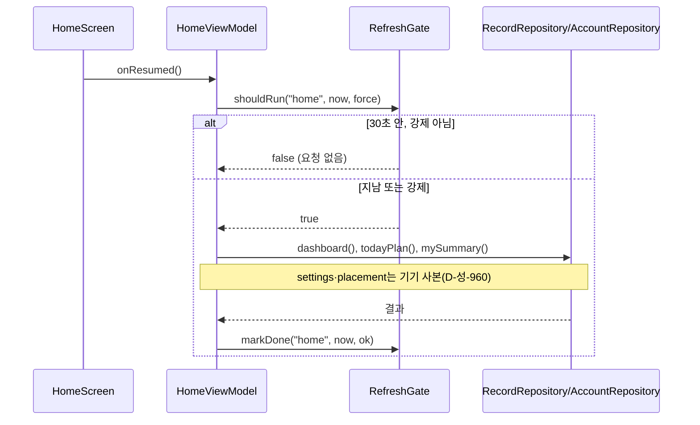
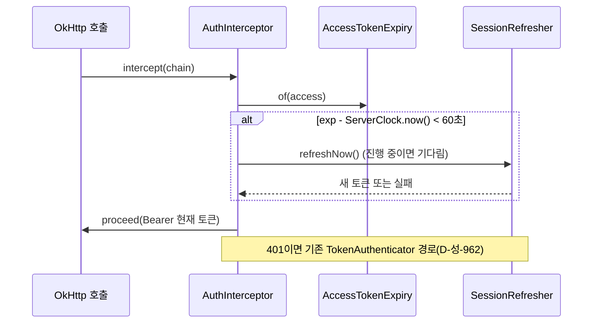
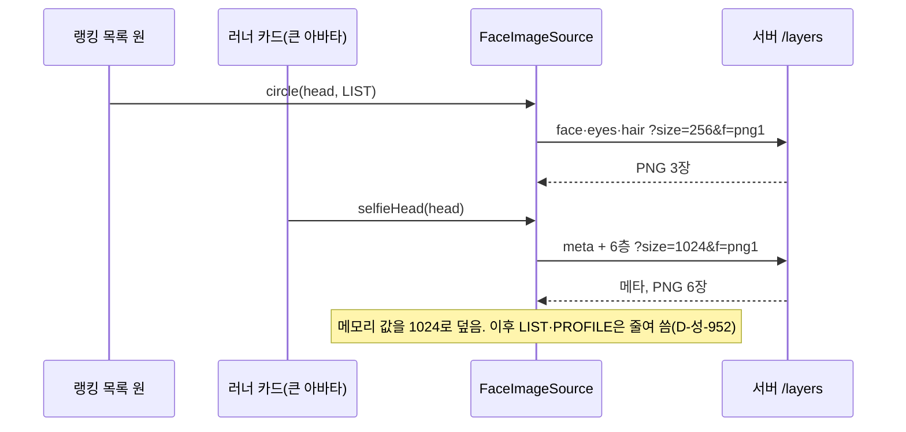
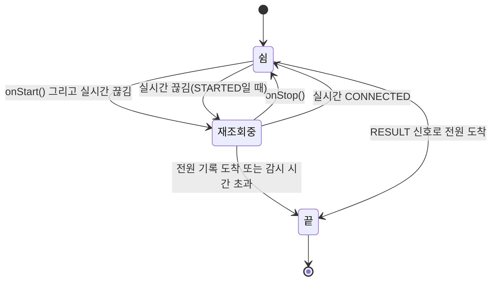
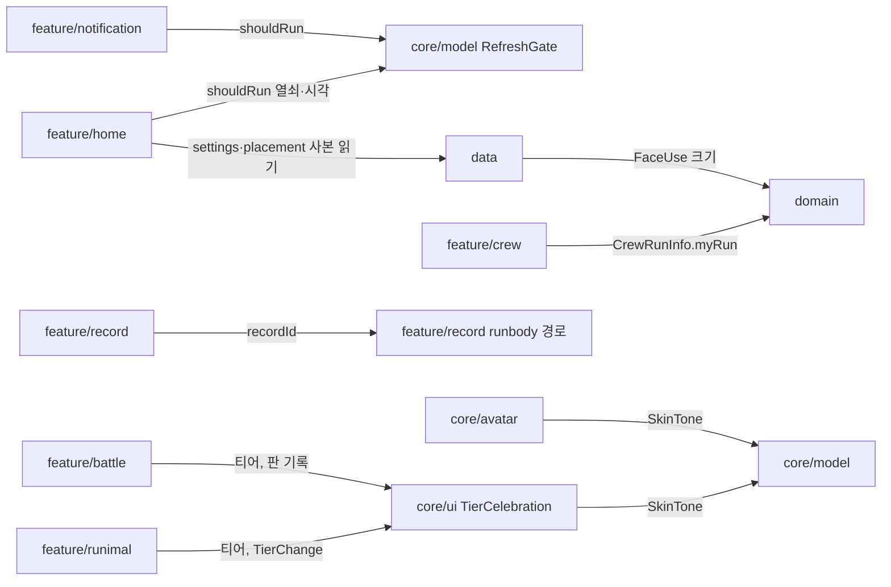

> [런크크 객체지향 분석 설계서](../design-oo.md) 목차, 이전: [05-32-설계-크루런실시간-성](05-32-설계-크루런실시간-성.md)

# 5.33 설계: v0.14 성능·화면 개선 (다음 판 변경)

> 작성: 2026-11-18 | 버전: 다음 판 변경 | 담당: 이성현(성), 브랜치 `feature/S15P31A207-307-v014` | 입력: [SRS 03-12](../srs/03-12-v014-성.md), CR [성능](../maintenance/2026-11-18_v014성능-성.md)·[화면](../maintenance/2026-11-18_v014화면-성.md)·[수정·적응](../maintenance/2026-11-18_v014수정적응-성.md)·[문서·운영](../maintenance/2026-11-18_v014문서운영-성.md), 병합 대기 `feature-S15P31A207-300-avatar-layer-heads.md`(통합 e0ffb364)

문서 설계다. 코드는 2회차에서 시험 먼저 쓴다. 화면이 바뀌는 324·331·314·312는 피그마 제안 시안의 선택안이 정해진 뒤 7절의 "디자인 의존" 칸을 확정한다. 경로 약어: `BE:` = `backend/src/main/java/com/a207/runkk/`, `DA:` = `android/data/src/main/kotlin/com/a207/runkk/app/`, `AN:` = `android/`.

## 0. 결정 목록

| 결정 | 내용 | 근거 |
|------|------|------|
| [임시:D-성-950] | 머리 받기는 통합 브랜치의 "메타 + 층" 방식을 기준선으로 삼는다(서버 `HeadLayerCache`·`HeadLayerService`, 앱 `FaceImageSource` 층 받기). 통짜 `GET /heads/{o}/{j}`는 v0.13.x 앱 호환용으로 남기고 캐시를 붙이지 않는다 | 통합 리뷰 중간 6, [임시:NFR-성-34] |
| [임시:D-성-951] | 얼굴 크기 세 단계: 목록 원 256, 큰 프로필 원 512, 큰 아바타 1024. `FaceImageSource`가 요청 용도(`FaceUse.LIST`·`PROFILE`·`FULL`)로 크기를 고른다 | [임시:A-성-2] |
| [임시:D-성-952] | 같은 머리를 더 큰 크기로 이미 가지고 있으면(메모리) 작은 크기를 따로 받지 않고 줄여 쓴다. 메모리 표의 열쇠는 (소유자, 작업)이고 값은 가진 가장 큰 크기의 층이다. 작은 크기가 먼저 있고 큰 크기가 필요하면 큰 크기를 받아 덮는다 | [임시:NFR-성-32], 통합 리뷰 중간 3 |
| [임시:D-성-953] | 서버 `HeadLayerCache`의 첫 적재(ai 결과 받기·풀기)는 동시에 4개까지(세마포어). 넘으면 기다린다(최대 10초, 넘으면 503 `HEAD_BUSY`, 앱은 한 번 다시 시도) | [임시:NFR-성-34], 통합 리뷰 중간 5. api 힙 0.9GiB에서 머리 하나 적재 약 30~40MB |
| [임시:D-성-954] | 층 404 처리: 응답 `reason`이 `LAYER_NOT_FOUND`면 그 층만 비우고, `JOB_NOT_FOUND`·`HEAD_NOT_FOUND`면 그대로 실패, `reason`이 없는 404·405만 "옛 서버"로 보고 통짜로 대체한다 | 통합 리뷰 중간 4 |
| [임시:D-성-955] | 층·메타 URL에 형식 판 `?f=png1`을 넣는다. 형식을 바꾸면 판을 올려 URL이 바뀌므로 immutable 캐시가 자연히 무효가 된다. 서버는 모르는 판이면 400 | 통합 리뷰 중간 1 |
| [임시:D-성-956] | 내 아바타 즉시 합성: `MyAvatarStore`는 마지막 얼굴 키와 마지막 성별을 기기에 남기고(`SelfFaceStore`), 앱 시작 때 프로필 응답을 기다리지 않고 그 두 값으로 디스크 층을 읽어 합성한다. 프로필 응답이 다른 값을 주면 다시 합성한다 | [임시:NFR-성-30], 통합 리뷰 307 부분 |
| [임시:D-성-957] | 계정 바뀜 경쟁: `FaceImageSource`는 디스크에 쓰기 직전에 현재 회원이 요청 시작 회원과 같은지 다시 확인한다. `SelfieHeads.look`은 같은 키를 기다리던 호출이 앞 호출 취소를 만나면 한 번 직접 받는다 | 통합 리뷰 낮음 7·8 |
| [임시:D-성-958] | 홈 다시 읽기 문지기 `RefreshGate`(앱 core, 순수 클래스): 열쇠별 마지막 성공 시각과 진행 중 여부를 가진다. `shouldRun(key, now, force)`는 진행 중이면 거짓, `force`면 참, 마지막 성공에서 30초가 안 지났으면 거짓. 실패는 시각을 남기지 않는다 | [임시:NFR-성-35], [임시:A-성-1] |
| [임시:D-성-959] | 홈 `onResumed`는 `RefreshGate("home")`를 거친다. 강제(force) 조건: 당겨서 새로고침, 기존 복귀 영수증(다른 화면에서 기록 저장 뒤 복귀), 오늘 날짜가 바뀜. 알림 점 `EventDotViewModel.refresh`도 같은 문지기(`"events"`, 30초)를 쓴다 | 같음 |
| [임시:D-성-960] | settings·placement 기기 값: 홈은 `account.settings()`·`account.placement()` 대신 기기 사본(`DataStoreSettingsRepository`의 흐름, `PlacementCache` 새 클래스)을 읽는다. 사본은 앱 시작 때 한 번, 쓰기(설정 변경 UseCase 5종, 배치고사 판 저장) 뒤에 서버에서 다시 받는다. 사본이 없을 때만 홈이 서버에서 읽는다 | Jira 325 |
| [임시:D-성-961] | 토큰 미리 갱신: 접근 토큰은 JWT(`JwtTokenIssuer`)라 앱이 페이로드의 `exp`를 읽는다(서버 변경 없음). `AuthInterceptor`가 요청 전에 `exp - ServerClock.now() < 60초`면 `SessionRefresher.refreshNow()`를 먼저 부른다(이미 진행 중이면 그 결과를 기다림). `exp`를 못 읽으면 지금처럼 401 뒤 `TokenAuthenticator`가 갱신한다 | [임시:NFR-성-36] |
| [임시:D-성-962] | 미리 갱신 실패(네트워크)는 요청을 막지 않는다. 기존 토큰으로 보내고 401이면 기존 경로. 갱신 응답 400/401/403은 기존대로 게스트 재개 → 로그아웃 | 위험 완화 |
| [임시:D-성-963] | 서버 요청 압축 해제 `GzipRequestFilter`(`BE:web/support`, `OncePerRequestFilter`): `Content-Encoding: gzip`이면 본문을 풀어 넘기고 해제 바이트가 32MB를 넘으면 413 `PAYLOAD_TOO_LARGE`, 깨진 gzip이면 400 `BAD_REQUEST`. 대상 경로는 `POST /api/v1/runs`만(허용 목록). 보안 필터보다 앞 | [임시:NFR-성-37], [임시:A-성-3] |
| [임시:D-성-964] | 앱 업로드 압축: `RunApi`의 업로드 메서드에만 붙는 표식 + OkHttp 인터셉터 `GzipRequestInterceptor`. 서버가 413·415를 주면(필터 없는 옛 서버) 그 업로드만 무압축으로 한 번 다시 보내고 그 실행 동안 압축을 끈다 | 서버 먼저 배포, 앱 먼저여도 동작 |
| [임시:D-성-965] | 일반 API 디스크 캐시: 기본 `okHttpClient`에 `Cache(cacheDir/api-http, 16MiB)`. 서버가 `Cache-Control`을 주는 응답(크루 로고 등)만 저장된다. 인증 응답은 저장 대상이 아니다. 계정 바뀜 때 얼굴 캐시와 같이 비운다 | [임시:NFR-성-38] |
| [임시:D-성-966] | 정적 파일: nginx `gzip on; gzip_types text/html text/css application/javascript image/svg+xml; gzip_min_length 1024;`를 정적 location에만. `invite/card.png` → `card.webp`(품질 80, 150KB 이하) + 앱·OG 태그 참조 변경, 옛 `card.png`는 남겨 옛 링크 호환. 이벤트 배너는 `banner.<짧은 해시>.png`로 이름을 바꾸고 `max-age=86400, immutable`. 이벤트 HTML은 max-age 60 유지 | [임시:NFR-성-39], [임시:U-성-54] |
| [임시:D-성-967] | 크루런 결과 재조회 조건: `CrewRunResultViewModel`의 재조회 반복을 `CrewRunResultScreen`의 수명 주기 STARTED 동안만 돌게 한다(화면이 `onStart`/`onStop`을 ViewModel에 알림, 기존 `CrewRunViewModel` 방식과 같게). 실시간 연결 상태가 `CONNECTED`면 재조회를 쉬고 `RESULT` 신호만 따른다. 끊기면 재조회를 다시 3초부터 | [임시:NFR-성-40], [임시:U-성-53] |
| [임시:D-성-968] | 그을림 상한 한 곳: `core/model`의 `SkinTone.MAX_TAN = 0.40f`를 `core/avatar`의 `SkinToneFilter`와 `core/ui`의 `SelfFaceTone`이 함께 쓴다(core/ui는 core/model에만 의존하므로 core/model에 둔다). D-837의 0.60을 바꾼다 | [임시:FR-성-404] |
| [임시:D-성-969] | 크루런 목록 본인 상태: 서버 `PostSummary.CrewRunInfo`에 `myRun`(`NONE`·`RUNNING`·`ENDED`, 열람자가 참여자가 아니면 `NONE`)을 더한다. 계산은 `CrewRunParticipation`(측정 시작·종료)에서. 앱 `CrewScheduleTab`은 RUNNING 카드에서 `myRun`으로 단추를 고른다(`ENDED` → 결과 보기, `RUNNING` → 이어 달리기, 그 밖 → 중간 참여하기). 필드가 없으면 `NONE` | [임시:FR-성-401] |
| [임시:D-성-970] | 기록 → 런바디: 런바디 상세를 기록 ID로 바로 여는 경로 `Routes.RunBodyDetail(recordId)`를 더하고 `RunBodyFeatureEntry`에 등록. 화면은 기존 `RunBodyDetailPage`를 쓰되 `RunBodyViewModel.openDetail(recordId)`로 시작해 러닝 선택 단계를 건너뛴다. 기록 상세의 진입점 표시 여부는 `RecordDetailUiState.runBody`(`Hidden`·`Ready`·`Analyzing`·`Unavailable`)로, 값은 기존 `GET /runbody/sessions/{recordId}`의 결과(FEATURE_CLOSED → Hidden)로 정한다. 진입점 모양은 디자인 선택(7절) | [임시:FR-성-400] |
| [임시:D-성-971] | 재평가 화면: `EvaluationScreen`을 `PlacementCompleteScreen`과 같은 부품(`CelebrationHero`, `AvatarBackdrop`, 큰 티어 배지)으로 다시 짠다. 두 화면이 쓰는 부품은 `feature/battle`에서 `core/ui`의 `TierCelebration*`로 옮긴다(feature 간 의존 금지). 결과 문장은 `TierChange.of(previous, current)`(`UP`·`KEEP`·`DOWN`·`UNKNOWN`) | [임시:FR-성-402], [임시:U-성-52] |
| [임시:D-성-972] | 직전 티어: 디자인이 승급·유지·강등 문장을 고르면 서버 `EvaluationView`에 `previousTier`(null 가능)를 더하고 `run_record.evaluation_previous_tier` 열(Flyway, null 허용)을 둔다. `Member.reevaluate`가 바꾸기 전 티어를 `TierEvaluation`에 담는다. 과거 기록은 null → `UNKNOWN` | [임시:FR-성-402] (디자인 의존) |
| [임시:D-성-973] | 목·깃 맞춤: 머리 아래에 몸 쪽 "목 층"을 깔아 머리 목 끝과 옷 깃 사이를 피부색으로 잇는다. 목 층은 몸 자산의 목 위치(`HeadTarget`의 chinY 아래 ~ 깃선)에 머리 피부색(셀카는 메타 `mobile.skinColor`, 기본 머리는 기본 피부색)으로 그린다. 목 폭은 몸 목 폭에 맞춘다. 정면에도 측면 `shortenNeck`과 같은 정합을 둔다. 확정 방식은 2회차 첫 단계 캡처 비교와 디자인 시안 선택 뒤 | [임시:FR-성-403] (디자인 의존) |
| [임시:D-성-974] | edge-to-edge: 테마 두 파일의 `statusBarColor`·`navigationBarColor` 항목을 지운다. androidx activity를 지원 중단 API를 부르지 않는 판으로 올린다. 화면 인셋 처리 방식(단일 Scaffold + 화면별 아래 여백)은 유지하고, 화면 목록 캡처 점검으로 빠진 곳만 고친다 | [임시:NFR-성-41] |

## 1. 객체 모델 변경

새 클래스와 바뀌는 클래스만 적는다. 기존 클래스 명세는 06-01~06-06d를 따른다.

| 클래스 | 패키지 | 책임 한 문장 | 속성(private) | 연산(public) |
|--------|--------|--------------|---------------|--------------|
| `RefreshGate`(새) | `core/model`(앱, 순수 Kotlin) | 같은 자료를 너무 자주 다시 읽지 않게 막는다 | `minInterval: Duration`, `lastSuccess: Map<String, Instant>`, `running: Set<String>` | `shouldRun(key: String, now: Instant, force: Boolean): Boolean`, `markDone(key: String, now: Instant, ok: Boolean)` |
| `PlacementCache`(새) | `data/account`(앱) | 배치고사 진행 사본을 기기에 둔다 | `copy: StateFlow<Placement?>` | `read(): Placement?`, `refresh(): Outcome<Placement>`, `invalidate()` |
| `AccessTokenExpiry`(새) | `data/api/core`(앱) | 접근 토큰의 만료 시각을 읽는다 | 없음(순수 함수 객체) | `of(token: String): Instant?` |
| `AuthInterceptor`(변경) | `data/api/core` | 요청에 토큰을 붙인다 | `tokens`, `refresher`, `clock: ServerClock` | `intercept(chain): Response`(만료 60초 전이면 먼저 갱신) |
| `GzipRequestInterceptor`(새) | `data/api/core` | 표식이 붙은 요청 본문을 gzip으로 바꾼다 | `enabled: AtomicBoolean` | `intercept(chain): Response`, `disable()` |
| `FaceImageSource`(변경) | `data/api/core` | 얼굴 층을 용도에 맞는 크기로 한 번만 받는다 | 메모리 표(열쇠 (소유자, 작업) → 가장 큰 층), `inflight` | `circle(head, use: FaceUse)`, `selfieHead(head)` |
| `FaceUse`(새 enum) | `domain/avatar` | 얼굴을 그릴 자리 | `LIST`, `PROFILE`, `FULL` | `size(): Int`(256·512·1024) |
| `HeadLayerCache`(변경) | `BE:avatar` | 머리 층을 상한 안에서 담는다 | `loadPermits: Semaphore(4)` 더함 | `layer(owner, job, layer, size)`, `meta(owner, job)` |
| `GzipRequestFilter`(새) | `BE:web/support` | gzip 요청 본문을 상한 안에서 푼다 | `maxInflated: long`(32MB), `paths: Set<String>` | `doFilterInternal(req, res, chain)` |
| `CrewRunInfo`(변경, record) | `BE:crew/PostSummary` | 크루런 목록 한 줄 | `myRun: MyRunState` 더함 | - |
| `MyRunState`(새 enum) | `BE:crew` | 열람자의 크루런 참여 상태 | `NONE`, `RUNNING`, `ENDED` | `of(participation)` |
| `EvaluationView`(변경, record) | `BE:running` | 평가 결과 응답 | `previousTier: Tier`(null 가능) 더함(D-성-972 확정 시) | - |
| `TierChange`(새 enum) | 앱 `domain/runimal` | 직전·새 티어로 결과 문장을 고른다 | `UP`, `KEEP`, `DOWN`, `UNKNOWN` | `of(previous: Tier?, current: Tier): TierChange` |
| `SkinTone`(새 object) | `core/model` | 그을림 상한 값을 한 곳에 둔다 | `MAX_TAN = 0.40f` | `tanFraction(amount: Int): Float` |

## 2. 동적 모델

### 2.1 홈 복귀(30초 문지기)

### 2.2 토큰 미리 갱신

### 2.3 얼굴 원 → 큰 아바타(같은 러너)

### 2.4 상태도: 크루런 결과 재조회(D-성-967)

사건 ↔ 연산: `onStart`·`onStop` → `CrewRunResultViewModel.onStart()/onStop()`, 실시간 상태 → 실시간 채널 상태 수집, 전원 도착 → `CrewRunResultViewModel.watch` 종료 조건.

## 3. 기능 모델 대응

| DFD 프로세스(SRS) | 연산 |
|-------------------|------|
| 3.3 기록 조회 → 런바디 상세 | `RecordDetailViewModel.load` → `RunBodyRepository.session(recordId)`, `RunBodyViewModel.openDetail(recordId)` |
| 1.6 티어 갱신(평가 결과) | `Member.reevaluate` → `TierApplier.apply` → `EvaluationView(kind, tier, validRuns, runimalType, previousTier)` |
| 5.x 크루런 목록 | `CrewPostService.list` → `PostSummary.CrewRunInfo(myRun)` → `CrewScheduleTab` |
| 6.x 아바타 그리기 | `HeadPlacement`·`GeneratedAvatarLayers`(목 층), `SkinTone.tanFraction` |

## 4. 시스템 설계

| 항목 | 내용 |
|------|------|
| 서브시스템 | 서버: `avatar`(캐시), `web/support`(gzip 필터), `crew`(myRun), `running`·`member`(직전 티어). 앱: `core/model`(RefreshGate), `core/avatar`(SkinTone, 목 층), `core/ui`(TierCelebration 부품), `data/api/core`(인터셉터·캐시), `feature/home`·`notification`·`crew`·`record`·`runimal`·`battle` |
| 계층 | 화면(feature) → domain → data. `RefreshGate`는 core/model이라 어느 계층도 쓸 수 있다. 하위가 상위를 모른다 |
| 동시성 | 서버 `HeadLayerCache` 세마포어 4(D-성-953). 앱 `SessionRefresher`는 기존 synchronized + generation으로 미리 갱신과 401 갱신이 겹쳐도 한 번만. `RefreshGate`는 메인 스레드에서만 부른다(ViewModel) |
| 배포 순서 | 서버(gzip 필터, myRun, previousTier, 캐시 세마포어, 형식 판) → 앱 → nginx(핫픽스 역병합 뒤). 앱이 먼저 나가도 D-성-954·964·969 대체 경로로 동작 |
| 경계 조건 | 서버 재시작 → 머리 캐시 비어 첫 요청만 느림. 앱 데이터 삭제 → 디스크 캐시·사본 없음 → 첫 실행과 같음 |

## 5. 패키지 의존도 변경

새 feature 사이 의존은 만들지 않는다(배치 완료 부품을 core/ui로 옮기는 이유).

## 6. 계약 변경

| 계약 | 바뀌는 것 | 제공 → 소비 | 호환 |
|------|-----------|-------------|------|
| `GET /api/v1/avatar/heads/{o}/{j}/meta`, `/layers/{layer}` | 쿼리 `f=png1`(없으면 png1로 봄, 다른 값 400), 503 `HEAD_BUSY` | 성 → 성 | 통합 브랜치 계약에 더함 |
| 크루 게시글 목록 `CrewRunInfo` | `myRun` 더함 | 성 → 성 | 옛 앱은 무시 |
| 러닝 저장 결과의 `evaluation` | `previousTier` 더함(디자인 확정 시) | 성(member) → 성(runimal 화면) | 옛 앱은 무시 |
| `POST /api/v1/runs` | `Content-Encoding: gzip` 허용, 해제 32MB 넘으면 413 | 성(필터) → 박(업로드) | 무압축 그대로 허용 |
| 정적 `/invite/card.webp`, `/events/*/banner.<해시>.png` | 새 파일 이름 | 성 → 앱·웹 | 옛 이름 유지 |

## 7. 디자인 의존 항목

| 항목 | 설계 고정분 | 디자인 선택 뒤 확정할 것 |
|------|-------------|---------------------------|
| 324 | 경로, 상태 4종, 서버 API | 진입점 모양·위치 |
| 331 | C-16 부품 재사용, TierChange | 직전 티어 표시 여부(D-성-972), 문구, Runimal 줄 |
| 332 | FR-281 Runimal 출력 | 배치 완료 화면의 Runimal 줄 모양(331과 같은 섹션) |
| 314 | myRun, 단추 3분기 | 단추 문구·색 |
| 312 | 목 층 방식 | 목 폭·길이 기준(몸 목 폭 맞춤안과 깃 덮기안 비교) |

## 8. 구현 지침과 시험 순서

- 구현 언어: 서버 Java 21(Spring Boot 3.5), 앱 Kotlin. 클래스는 객체지향 언어로 구현한다. 새 상태 값(enum)은 분기 대신 다형 메서드로(`FaceUse.size()`, `MyRunState.of`, `TierChange.of`).
- 단위(클래스) 시험 먼저: `RefreshGateTest`, `AccessTokenExpiryTest`, `GzipRequestInterceptorTest`, `SkinToneTest`, `TierChangeTest`, `MyRunStateTest`, 서버 `GzipRequestFilterTest`, `HeadLayerCacheTest`(세마포어).
- 통합(스레드 기반): 홈 복귀 스레드(HomeScreen → HomeViewModel → RefreshGate → 저장소 가짜), 토큰 스레드(MockWebServer: 만료 직전 → refresh 1회 → 원 요청), 업로드 스레드(서버 MockMvc gzip 본문 → 저장 동일), 크루 목록 스레드(myRun), 평가 스레드(재평가 → previousTier).
- 검증·시스템: API 36 에뮬레이터 화면 캡처(edge-to-edge 전 화면), 첫 표시 시간 10회 계측, 운영 배포 뒤 7일 비교([임시:NFR-성-31]~[임시:NFR-성-39]).

## 9. 추적

| 요구 | 설계 요소 |
|------|-----------|
| [임시:FR-성-400] | D-성-970, `Routes.RunBodyDetail`, `RecordDetailUiState.runBody` |
| [임시:FR-성-401] | D-성-969, `MyRunState`, `CrewScheduleTab` |
| [임시:FR-성-402] | D-성-971·972, `TierChange`, `TierCelebration*` |
| [임시:FR-성-403] | D-성-973, `GeneratedAvatarLayers` 목 층 |
| [임시:FR-성-404] | D-성-968, `SkinTone` |
| [임시:NFR-성-30] | D-성-956 |
| [임시:NFR-성-31]~[임시:NFR-성-33] | D-성-951·952·955·957 |
| [임시:NFR-성-34] | D-성-950·953 |
| [임시:NFR-성-35] | D-성-958·959·960 |
| [임시:NFR-성-36] | D-성-961·962 |
| [임시:NFR-성-37] | D-성-963·964 |
| [임시:NFR-성-38] | D-성-965 |
| [임시:NFR-성-39] | D-성-966 |
| [임시:NFR-성-40] | D-성-967 |
| [임시:NFR-성-41] | D-성-974 |
