> [런크크 객체지향 분석·설계서](../design-oo.md) 목차 · 이전: [06-07-알고리즘-상속-다형성](06-07-알고리즘-상속-다형성.md) · 다음: [12-의존도](12-의존도.md)

## 7. 유스케이스 다이어그램

액터 7종(러너, 크루장, 운영자, 스케줄러, 외부 시스템)과 유스케이스 70개를 기능 묶음별 6장으로 나눴다. 크루장은 러너를 일반화한 액터(크루장은 러너의 한 종류)이므로 러너의 모든 유스케이스를 쓸 수 있다. 유스케이스 이름은 동사구다. 객체는 그리지 않았다.

v0.11: 액터 운영진을 더했다. srs 2장 사용자 분류의 "크루 운영진"이고, 3.0.3 권한표에서 크루장 ⊇ 운영진 ⊇ 크루원이라 크루장 → 운영진 → 러너 순으로 일반화했다. 유스케이스는 16개를 더하고(UC14~UC16, UC35, UC39, UC69, UC76, UC88, UC90~UC97) "크루를 추천받는다"(UC52)를 지우고 UC57·UC58 이름을 바꿨다. v0.10 머리말의 70개는 실제 그림의 71개를 잘못 센 값이라 v0.11 합계는 86개다 (v0.11, CR-01~CR-09, FR-118, FR-128).

### 7.1 회원·설정

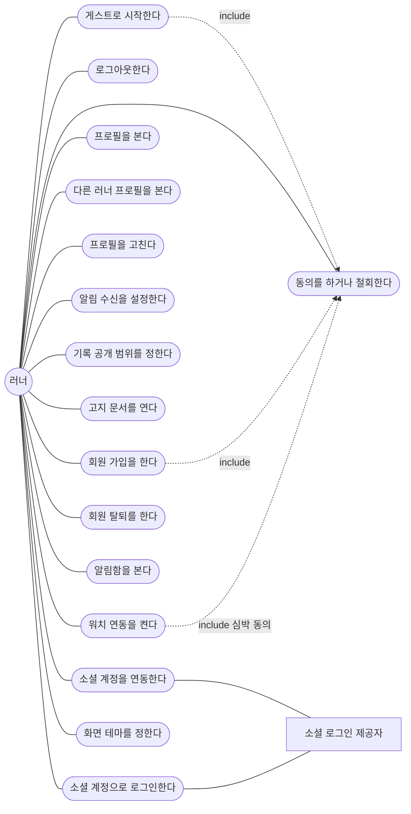

v0.11: UC14 게스트로 시작한다(FR-197, 필수 동의·만 14세 확인을 include), UC15 소셜 계정을 연동한다(FR-198), UC16 화면 테마를 정한다(FR-203)를 더했다. 게스트 자료 유실 고지(FR-199)와 미이용 게스트 파기(FR-200)는 UC14·UC12·7.6 UC87의 흐름 안에 있다 (v0.11, FR-197~FR-200, FR-203).

### 7.2 러닝·기록 분석

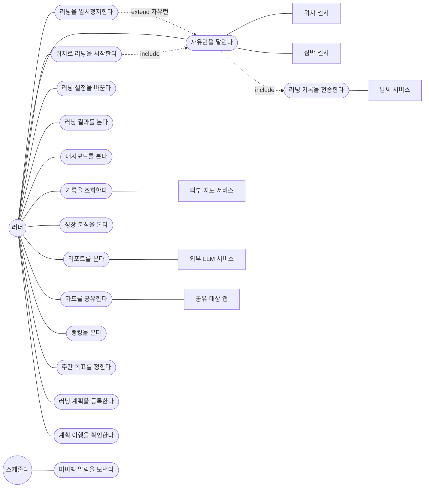

v0.11: UC35 러닝을 일시정지한다(FR-194, FR-195)는 자유런에만 붙는 확장이다. 장시간 정지 자동 종료는 UC35의 대체 흐름이다(7.7) (v0.11, FR-194, FR-195).

### 7.3 대결

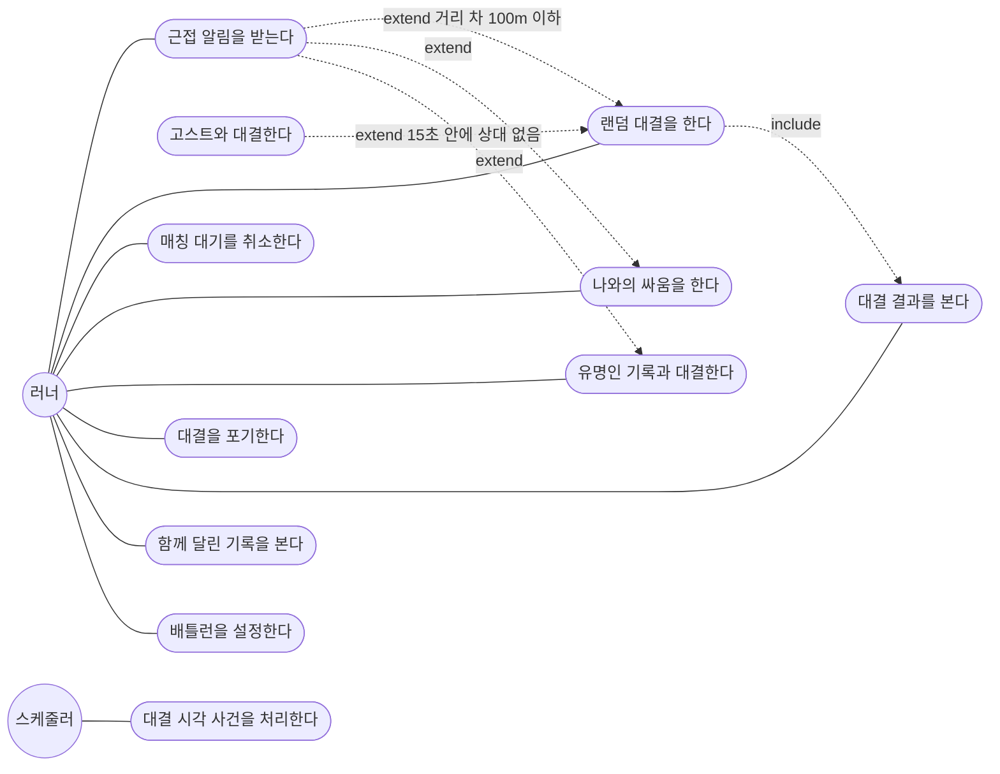

v0.11: UC39 근접 알림을 받는다(FR-196)는 1:1 대결 넷 모두에 붙는다. 고스트 대결(UC42)은 UC40의 확장이라 UC40을 거쳐 붙는다. 근접 알림 여부는 UC48 배틀런을 설정한다에서 정한다(FR-109) (v0.11, FR-196, FR-109).

### 7.4 크루

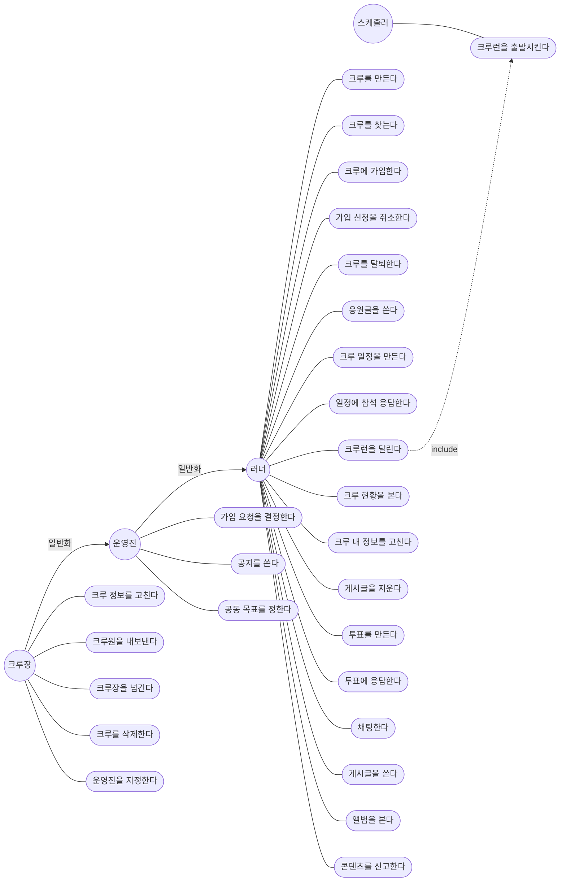

v0.11: 크루 유스케이스를 3.0.3 권한표(F.5.1)에 맞췄다. 운영진은 크루원의 유스케이스에 더해 가입 요청 결정(UC63), 공지(UC90), 공동 목표(UC97), 남의 콘텐츠 삭제(UC67)를 쓰고, 크루장은 여기에 크루 정보 수정·강제 퇴장·양도·삭제·운영진 지정(UC69)을 더 쓴다. UC57은 "크루런을 모집한다"를 "크루 일정을 만든다"(크루런·대면 모임, FR-132)로, UC58은 "크루런 참여에 투표한다"를 "일정에 참석 응답한다"(참석·불참·미정, FR-145)로 바꿨다. "투표"는 이제 크루 투표(UC91·UC92)만 뜻한다. UC52 크루를 추천받는다는 FR-118 삭제로 지웠다. UC93 채팅한다는 보내기·보기·리액션(FR-208~FR-210)을, UC96 콘텐츠를 신고한다는 FR-214를 묶는다. 크루 소식 알림(FR-218)·공동 목표 달성 판정(FR-217)은 시스템 내부 흐름이라 유스케이스로 두지 않았다 (v0.11, FR-128, FR-132, FR-145, FR-204~FR-214, FR-138, FR-118).

### 7.5 캐릭터

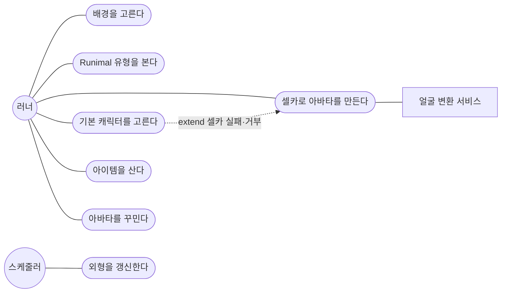

v0.11: UC76 배경을 고른다(FR-202)를 더했다. 배경 해금(FR-201)은 러닝 기록 저장 뒤 시스템이 하는 일이라(SQ-24) 유스케이스로 두지 않았다 (v0.11, FR-201, FR-202).

### 7.6 운영

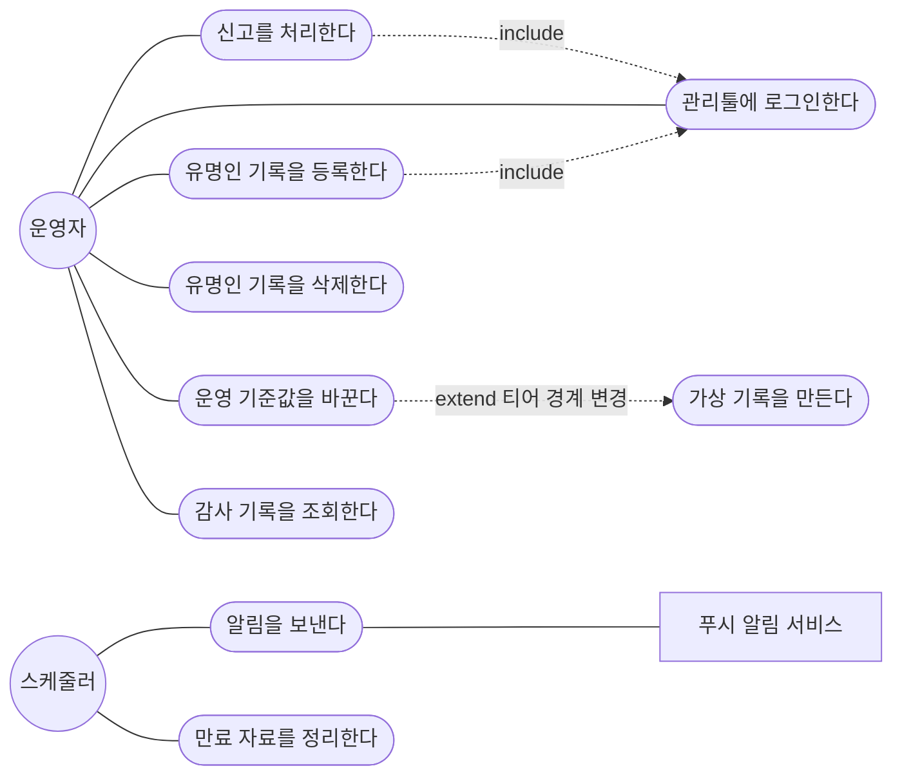

v0.11: UC88 신고를 처리한다(FR-216)를 더했다. UC87 만료 자료를 정리한다에 미이용 게스트 파기(FR-200, 3시)가 들고, UC86 알림을 보낸다에 투표 마감 임박 알림(FR-218, 1분)이 든다 (v0.11, FR-216, FR-200, FR-218).

### 7.7 유스케이스 기술서

#### UC20 자유런을 달린다
```
액터: 러너 (보조: 위치 센서, 심박 센서)
목적: 러닝 한 회를 측정해 기록으로 남긴다
사전 조건: 로그인, 위치 수집 동의, OS 위치 권한
기본 흐름:
  1. 러너가 홈에서 자유런을 누른다
  2. 시스템이 지난번 설정과 위치 신호·워치 연결 상태를 보이며 3초 카운트다운을 한다 (숫자를 누르면 바로 시작)
  3. 시스템이 1초마다 거리·시간·현재 페이스·평균 페이스를 보이고 1km마다 구간 안내를 한다
  4. 러너가 종료 버튼을 길게 누른다
  5. 시스템이 묻지 않고 기록을 저장하고 결과 화면과 기록 카드를 보인다
  6. 시스템이 기록을 전송하고 유효 러닝을 판정한다 (UC23 include)
대체 흐름:
  1a. 위치 동의가 없으면 측정을 거부하고 재동의 화면으로 안내한다
  3a. 정확도 30m 초과 포인트는 버리고, 10초 이상 이어지면 불안정 구간으로 표시한다
  3b. 오늘 계획을 따르고 평균 페이스가 목표보다 10% 이상 느리면 페이스 안내를 한다
  3c. 심박이 기준 이상 30초 이어지면 호흡 안내를 한다
  3d. 러너가 일시정지를 누르면 UC35로 간다 (v0.11, FR-194)
  4a. 짧게 누르면 "길게 눌러 종료"를 보인다
  5a. 거리가 0이면 저장하지 않고 안내한다
  6a. 전송이 실패하면 기기에 보관하고 연결되면 다시 보낸다
  6b. 유효 판정은 정지 시간을 뺀 운동 시간·평균 페이스와 다섯째 조건(보낸 거리 ≤ 경로 길이 × 2, 보낸 운동 시간 ≤ 종료 − 시작 − 정지 + 1초)으로 한다 (v0.11, FR-047, CR-10, D-94)
사후 조건: RunRecord가 저장되고 RunRecordSaved 사건으로 티어·레벨·주간 거리·리워드·Runimal·리포트·배경 해금이 갱신된다 (배경 해금 v0.11, FR-201)
```

#### UC35 러닝을 일시정지한다 (v0.11, FR-194, FR-195, FR-034, FR-036, D-93)
```
액터: 러너
목적: 자유런 중 신호 대기 같은 때 측정을 멈췄다가 이어 간다
사전 조건: 자유런 측정 중, 폰 화면 잠금이 아님(워치에서 누르면 잠금과 무관)
기본 흐름:
  1. 러너가 폰 또는 워치에서 일시정지를 누른다
  2. 시스템이 거리·경과 시간을 멈추고 "일시정지"를 보이며 정지 구간을 시작한다
  3. 러너가 재개를 누른다
  4. 시스템이 정지 구간을 닫고 측정을 잇는다. 정지 직전 포인트와 재개 첫 포인트 사이 거리는 더하지 않는다
대체 흐름:
  1a. 대결·크루런 중에는 일시정지 조작이 없다
  1b. 폰 화면 잠금 중 폰 버튼은 받지 않는다
  2a. 정지가 55분 이어지면 "5분 뒤 자동 종료"를 안내한다
  2b. 정지가 60분 이어지면 러닝을 끝내고 저장한다(UC20 5단계)
  2c. 정지 중 종료 버튼을 길게 누르면 마지막 정지 구간을 닫고 저장한다
사후 조건: CompletedRun에 정지 구간 목록이 남고 경과 시간·평균 페이스는 정지 시간을 뺀 운동 시간으로 계산된다
```

#### UC40 랜덤 대결을 한다
```
액터: 러너
목적: 같은 티어 러너와 같은 거리를 동시에 달려 먼저 도착한다
사전 조건: 로그인, 위치 동의, 티어 배치됨(유효 러닝 3회 이상), 진행 중 대기·대결 없음
기본 흐름:
  1. 러너가 홈에서 배틀런을 누른다 (지난번 대결 거리로 요청)
  2. 시스템이 같은 티어·같은 거리 대기자를 찾아 매칭 성사를 알리고 양쪽 최고 기록을 보인다
  3. 시스템이 매칭 애니메이션 뒤 10초에 두 러너를 함께 출발시킨다
  4. 시스템이 1초마다 상대 거리·거리 차를 보이고 추월·역전과 거리 차를 안내한다
  5. 먼저 도착한 러너가 생기면 상대에게 즉시 알리고 10초 카운트다운 뒤 대결을 끝낸다
  6. 시스템이 두 기록을 검증해 승패를 확정하고 비교표·적립 리워드를 보인다
대체 흐름:
  2a. 15초 안에 상대가 없으면 고스트와 매칭된다 (UC42 extend). 러너에게 다르게 보이지 않는다
  2b. 러너가 "그만 찾을래요"를 누르면 대기를 해제한다 (UC41)
  4a. 연결이 끊기면 측정은 계속하고 상대 화면에 "연결 끊김"을 보이며 다시 연결되면 최신 값부터 보낸다
  4b. 러너가 포기하면 확인 뒤 패로 기록한다 (UC45)
  4c. 상대와의 거리 차가 100m 이하이고 근접 알림이 켜져 있고 워치가 연결되어 있으면 워치가 비프음·진동을 거리 차가 줄수록 빠르게 반복하고, 추월·역전 순간 1초 긴 진동을 낸다 (UC39) (v0.11, FR-196, FR-188)
  4d. 접근 토큰이 만료되면 서버가 연결을 4401로 닫고 앱은 토큰을 갱신해 바로 다시 연결한다 (v0.11, D-110)
  6a. 먼저 도착한 쪽 기록이 아직 없으면 "보류"를 보이고 24시간 기다린다
  6b. 먼저 도착한 쪽 기록이 무효면 결과를 정정하고 알린다
  6c. 두 도착 시각 차이가 1초 이내면 무승부다
사후 조건: Battle이 FINISHED이고 승자에게 리워드 20이 적립된다
```

#### UC53 크루에 가입한다
```
액터: 러너 (보조: 크루장·운영진)
목적: 크루 하나에 소속된다
사전 조건: 로그인(게스트 포함), 다른 크루에 소속되지 않음, 퇴장 뒤 24시간 지남
기본 흐름:
  1. 러너가 크루 태그·키워드로 크루를 찾아 고른다 (UC51. 추천은 FR-118 삭제로 없앴다, v0.11 D-91)
  2. 러너가 가입을 신청한다
  3. 시스템이 정원과 가입 방식을 확인한다
  4. 자유 가입 크루면 바로 크루원이 된다
대체 흐름:
  2a. 초대 코드로 신청하면 승인제·비공개 크루도 바로 가입한다. 코드가 틀리거나 7일이 지났으면 거부한다
  3a. 정원 10명이면 거부한다
  4a. 승인제 크루면 신청을 대기로 두고 크루장에게 알린다. 크루장 또는 운영진이 승인하면 크루원이 되고(UC63), 거절·소멸·7일 만료면 신청자에게 알린다 (운영진 v0.11, FR-128)
  4b. 신청자가 대기 중 신청을 취소한다 (UC54)
사후 조건: CrewMembership이 생기거나 JoinRequest가 PENDING이다
```

#### UC59 크루런을 달린다
```
액터: 러너(크루원) (보조: 스케줄러)
목적: 정한 시각에 각자 다른 장소에서 크루원과 함께 출발해 같은 거리를 달린다
사전 조건: 크루 소속, 크루런 일정에 참석 응답(또는 대기실 입장) (v0.10 "모집글에 갈래요", v0.11 FR-145)
기본 흐름:
  1. 시작 10분 전 알림을 받고 30분 전부터 열린 대기실에 들어간다
  2. 준비 완료를 누른다
  3. 모집희망일시에 시스템이 준비 완료한 참가자를 3초 카운트다운 뒤 함께 출발시킨다 (UC68 include)
  4. 달리는 동안 참가자들의 거리·순위·연결 상태를 보고 1km마다 순위를 듣는다. 위치는 보이지 않는다
  5. 크루런 거리에 닿으면 러닝이 끝나고 기록이 저장된다
  6. 모두 도착했거나 종료 기준 시간이 지나면 순위·결과와 크루 주간 거리 반영을 본다
대체 흐름:
  3a. 준비 완료가 2명 미만이면 크루런을 취소한다
  3b. 준비 완료를 누르지 않은 참가자는 이번 크루런에서 빠진다
  4a. 중간에 그만두면 확인 뒤 순위에서 빠지고, 달린 기록은 크루 주간 거리에 더해진다
사후 조건: CrewRunPost가 FINISHED, 참가 러닝이 모집 참여에 연결되어 Runimal 동행 축 근거가 된다
```

#### UC71 셀카로 아바타를 만든다
```
액터: 러너 (보조: 얼굴 변환 서비스)
목적: 본인 얼굴을 SD 캐릭터 얼굴로 바꾼다
사전 조건: 로그인, 셀카 생성이 축소 운영으로 꺼져 있지 않음
기본 흐름:
  1. 러너가 아바타 만들기(또는 다시 만들기)를 누른다
  2. 시스템이 처리위탁·국외 이전과 원본 즉시 삭제를 알리고 얼굴 변환 전송 동의를 받는다
  3. 러너가 셀카를 찍는다
  4. 시스템이 셀카만 얼굴 변환 서비스로 보내 SD 얼굴 부위를 받는다
  5. 시스템이 아바타 얼굴을 바꾸고 셀카 원본을 지운다
대체 흐름:
  2a. 동의하지 않으면 기본 캐릭터를 안내한다 (UC72 extend)
  3a. 오늘 이미 만들었으면 "내일 다시 만들 수 있어요"와 기본 캐릭터를 안내한다
  4a. 변환이 실패하면 사유와 기본 캐릭터를 안내하고 횟수를 세지 않는다
사후 조건: Avatar.face = SelfieFace, 셀카 원본은 어디에도 없다
```

#### UC12 회원 탈퇴를 한다
```
액터: 러너
목적: 계정과 개인 자료를 지운다
사전 조건: 로그인
기본 흐름:
  1. 러너가 탈퇴를 누른다
  2. 시스템이 지워질 자료 종류와 남는 자료("탈퇴한 사용자"로 표시)를 보이고 확인을 받는다
  3. 시스템이 식별정보를 지우고 7일 안에 기록·경로·심박·목표·리포트·크루 소속·캐릭터·리워드·알림을 지운다. 크루 일정·공지·투표·게시글·채팅 메시지는 "탈퇴한 사용자"로 남기고 게시글 사진·투표 응답·리액션은 지우며 신고자는 익명화한다 (v0.11, FR-021)
대체 흐름:
  2a. 확인하지 않으면 앱 화면이 취소하고 서버에 요청을 보내지 않는다 (서버는 확인된 요청만 받는다, D-36)
  2b. 진행 중인 대결이나 매칭 대기가 있으면 거부하고 종료를 안내한다
  2c. 크루원이 있는 크루의 크루장이면 거부하고 양도를 안내한다
사후 조건: Member가 WITHDRAWN, 감사 기록에 회원탈퇴가 남는다
```

#### UC81 유명인 기록을 등록한다
```
액터: 운영자
목적: 공개된 유명인 러닝 기록을 대결 상대로 쓰게 한다
사전 조건: 화이트리스트 계정으로 관리툴에 로그인 (UC80 include)
기본 흐름:
  1. 운영자가 익명 닉네임, 기록 거리, 완주 시간, (구간 기록), 출처를 입력한다
  2. 시스템이 값을 검사하고 저장한다
  3. 기록이 유명인 대결 목록에 출처와 함께 나온다
대체 흐름:
  1a. 출처나 익명 닉네임이 비면 거부한다
  1b. 거리·시간이 0 이하이거나 구간 거리가 줄어드는 곳이 있으면 거부한다
사후 조건: CelebrityRecord가 저장되고 감사 기록에 유명인기록등록이 남는다
```

#### UC14 게스트로 시작한다 (v0.11, FR-197~FR-200, FR-004, FR-028, D-89, D-90)
```
액터: 러너
목적: 소셜 계정 없이 바로 런크크를 쓴다
사전 조건: 앱 설치
기본 흐름:
  1. 러너가 첫 화면에서 게스트로 시작을 고른다
  2. 시스템이 동의 화면 하나로 필수 동의 3종·만 14세 이상 확인·선택 동의 2종(기본 꺼짐)을 받고 "기록은 전체 공개로 시작해요"를 보인다
  3. 시스템이 "러너" + 숫자 4자리 닉네임으로 게스트 회원을 만들고 기기 자격 증명을 한 번 내준다
  4. 시스템이 연동하지 않으면 앱 삭제·기기 변경·로그아웃 때 자료를 되살릴 수 없다고 알리고 홈으로 간다
  5. 러너는 대결·크루·랭킹·프로필을 연동 회원과 똑같이 쓴다
대체 흐름:
  2a. 필수 동의를 빠뜨리거나 만 14세 확인을 하지 않으면 거부한다
  3a. 닉네임이 겹치면 다른 숫자를 붙인다
  3b. 같은 접속지에서 게스트를 너무 많이 만들면 거부한다(시간당 10회 제안)
  5a. 설정에서 소셜 계정을 연동하면 같은 회원ID로 LINKED가 된다. 그 소셜 계정이 다른 회원과 연동되어 있으면 거부하고 합치지 않는다 (UC15)
  5b. 연동하지 않은 채 로그아웃하려 하면 자료 유실을 다시 확인받는다
  5c. 마지막 접속 뒤 1년 동안 접속하지 않으면 탈퇴와 같은 방법으로 자료를 지운다
사후 조건: Member(accountType GUEST)가 생기고 기기에 자격 증명이 보관된다
```

#### UC93 채팅한다 (v0.11, FR-208~FR-210, FR-213, FR-218, NFR-040, D-101~D-103)
```
액터: 러너(크루 구성원)
목적: 소속 크루 채팅방에서 크루원과 글 메시지를 주고받는다
사전 조건: 크루 소속
기본 흐름:
  1. 러너가 크루 채팅방을 연다. 시스템이 메시지를 오래된 것부터 보이고 방 입장을 실시간 채널로 알린다
  2. 러너가 500자 이내 메시지를 보낸다
  3. 시스템이 저장하고 방 안 크루원 화면에 3초 안에 보인다. 방 밖 크루원에게는 크루채팅 알림을 묶어서 보낸다
  4. 러너가 메시지에 좋아요·하트 리액션을 달거나 뗀다
대체 흐름:
  1a. 크루 밖 러너는 보내지도 보지도 못한다
  2a. 빈 메시지이거나 500자를 넘으면 거부한다
  2b. 같은 메시지를 다시 보내도 한 번만 저장된다
  3a. 연결이 끊겼다 붙으면 마지막으로 받은 메시지 뒤의 것을 다시 읽어 메운다
  4a. 작성자 본인 또는 크루장·운영진이 메시지를 지운다. 남의 메시지면 감사기록에 남는다
사후 조건: CrewChatMessage가 저장되고 방 안 크루원에게 CrewChatPosted가 간다
```

#### UC96 콘텐츠를 신고한다 / UC88 신고를 처리한다 (v0.11, FR-214~FR-216, D-104)
```
액터: 러너(크루 구성원), 운영자
목적: 크루 콘텐츠의 욕설·음란·광고·개인정보 노출을 막는다
사전 조건: 신고자는 대상 콘텐츠 크루의 구성원. 운영자는 관리툴에 로그인 (UC80 include)
기본 흐름:
  1. 러너가 응원글·일정·공지·투표·게시글·채팅 메시지 하나를 사유와 함께 신고한다
  2. 시스템이 신고를 받는다. 서로 다른 신고자 3명이 같은 대상을 신고하면 운영자 처리 전까지 숨긴다
  3. 운영자가 접수된 신고 목록에서 사례를 열어 숨김 또는 기각으로 처리한다
  4. 시스템이 처리를 감사기록에 남기고 신고자에게 결과를 알린다
대체 흐름:
  1a. 같은 대상을 두 번 신고하거나 본인 콘텐츠를 신고하면 거부한다
  1b. 사유가 기타면 내용(200자 이내)을 받는다
  3a. 기각하면 자동 숨김을 푼다. 그 뒤 새 신고가 오면 사례가 다시 열린다
  3b. 이미 처리한 사례는 다시 처리하지 않는다
사후 조건: ReportCase가 HIDDEN 또는 DISMISSED이고 대상의 숨김 여부가 그에 맞다
```

## 8. 클래스 다이어그램 (설계 수준, 패키지 포함)

### 8.1 서버 도메인 전체 (패키지 경계)

v0.3 핵심 패키지 14개(v0.2와 같다)의 주요 클래스와 패키지를 넘는 연결만 그렸다. 사건은 발행 패키지에, 메신저 포트는 쓰는 패키지에, 조회 서비스는 테이블 소유 패키지에 있다. v0.11에서 핵심 패키지 crew.chat·report를 더하고(그림의 namespace 이름은 mermaid 제약으로 crew_chat), crew 게시 계층·신고 포트 구현·배경 해금·티어 보정 연결을 그렸으며, runimal → member의 tagsOf 연결을 지웠다. 핵심 패키지 수는 F.6.3 기준 15개다 (v0.11, D-91, D-99, D-101, D-104, D-107, D-108).

```mermaid
classDiagram
    namespace common {
        class DomainEvent {
            <<interface>>
        }
        class DomainEventPublisher {
            <<interface>>
            +publish(DomainEvent) void
        }
        class ProgressReport
    }
    namespace member {
        class Member
        class MemberSettings
        class TierProgress
        class MemberSettingService
        class TierLevelService
        class MemberQueryService
        class MemberWithdrawn
        class WithdrawalGuard {
            <<interface>>
            +check(long) Optional~String~
        }
        class ReservedNicknameChecker {
            <<interface>>
            +isReserved(String) boolean
        }
    }
    namespace running {
        class RunRecord
        class PersonalRecordBook
        class RunUploadService
        class RunQueryService
        class TierUpdateListener
        class TierReconcileService
        class TierApplier
        class RunRecordSaved
    }
    namespace runimal {
        class RunimalProfile
        class RunimalService
        class RunimalQuery
        class CrewRunParticipationQuery {
            <<interface>>
            +linkedRecordIds(long, DateRange) Set~String~
        }
    }
    namespace battle {
        class Battle
        class MatchingService
        class GhostMatcher
        class LiveBattleService
        class VirtualRecordService
        class CelebrityRecordService
        class OpponentRecord {
            <<interface>>
        }
        class VirtualRecord
        class CelebrityRecord
        class ActiveBattleGuard
        class VirtualNicknameChecker
        class BattleMessenger {
            <<interface>>
            +send(long, BattleMessage) void
            +sendAll(Collection~Long~, BattleMessage) void
        }
        class BattleJudged
    }
    namespace reward {
        class RewardWallet
        class RewardService
    }
    namespace avatar {
        class Avatar
        class AvatarService
        class AvatarQuery
        class BackgroundService
        class BackgroundUnlockListener
    }
    namespace crew {
        class Crew
        class CrewMembership
        class CrewPost {
            <<abstract>>
        }
        class CheerPost
        class SchedulePost {
            <<abstract>>
        }
        class CrewRunPost
        class MeetupPost
        class NoticePost
        class PollPost
        class BoardPost
        class CrewNewsNotifier
        class WeeklyRaceService
        class CrewLeaderGuard
        class CrewRunParticipationReader
        class CrewMembershipReader
        class CrewRunMessenger {
            <<interface>>
            +send(long, CrewRunMessage) void
            +sendAll(Collection~Long~, CrewRunMessage) void
        }
    }
    namespace crew_chat {
        class CrewChatMessage
        class CrewChatService
        class CrewChatMessenger {
            <<interface>>
            +send(Collection~Long~, CrewChatSignal) void
        }
        class ChatRoomPresence {
            <<interface>>
            +presentMembers(long) Set~Long~
        }
    }
    namespace report {
        class ReportCase
        class ContentReport
        class ReportService
        class ReportedContentPort {
            <<interface>>
            +find(ReportTargetKind, long) Optional~ReportedContent~
            +hide(ReportTargetKind, long) void
            +unhide(ReportTargetKind, long) void
        }
    }
    namespace report_target {
        class CrewPostReportAdapter
        class ChatReportAdapter
    }
    namespace analysis {
        class RankingService
        class RecordQueryService
        class Report
    }
    namespace policy {
        class OperationSettingService
        class OperationSettingChanged
    }
    namespace operator {
        class OperatorAuthorizer
        class OperatorTokenIssuer {
            <<interface>>
            +issue(OperatorId) String
            +verify(String) OperatorId
        }
    }

    Member *-- MemberSettings
    Member *-- TierProgress
    OpponentRecord <|.. VirtualRecord
    OpponentRecord <|.. CelebrityRecord
    CrewPost <|-- CheerPost
    CrewPost <|-- SchedulePost
    CrewPost <|-- NoticePost
    CrewPost <|-- PollPost
    CrewPost <|-- BoardPost
    SchedulePost <|-- CrewRunPost
    SchedulePost <|-- MeetupPost
    Crew *-- CrewMembership
    ReportCase *-- ContentReport
    ReportedContentPort <|.. CrewPostReportAdapter
    ReportedContentPort <|.. ChatReportAdapter
    ReportService ..> ReportedContentPort : find, hide, unhide
    CrewChatService ..> CrewMembershipReader : relationOf, activeMemberIds
    CrewChatService ..> CrewChatMessenger : CrewChatPosted
    CrewChatService ..> ChatRoomPresence : presentMembers
    CrewPostReportAdapter ..> CrewPostService : reportedView, hideReported, unhideReported
    ChatReportAdapter ..> CrewChatService : reportedView, hideReported, unhideReported
    BackgroundUnlockListener ..> RunRecordSaved : 수신
    BackgroundUnlockListener ..> BackgroundService : unlockReached
    BackgroundService ..> RunQueryService : validDistanceOf, memberIdsSavedBetween
    TierReconcileService ..> TierApplier : apply
    TierApplier ..> TierLevelService : recordValidRun·recordLateValidRun
    TierApplier ..> MemberQueryService : appliedValidRunCount
    WithdrawalGuard <|.. ActiveBattleGuard
    WithdrawalGuard <|.. CrewLeaderGuard
    ReservedNicknameChecker <|.. VirtualNicknameChecker
    CrewRunParticipationQuery <|.. CrewRunParticipationReader
    DomainEvent <|.. RunRecordSaved
    DomainEvent <|.. MemberWithdrawn
    DomainEvent <|.. BattleJudged
    DomainEvent <|.. OperationSettingChanged
    RunUploadService ..> RunRecordSaved : 발행
    TierUpdateListener ..> RunRecordSaved : 수신
    TierUpdateListener ..> TierApplier : apply
    RunimalService ..> RunQueryService : runSamples
    VirtualRecordService ..> MemberQueryService : isNicknameTaken
    OperatorAuthorizer ..> OperatorTokenIssuer : issue, verify
    RunimalService ..> RunRecordSaved : 수신
    MatchingService ..> MemberSettingService : rememberBattleDistance
    GhostMatcher ..> MemberQueryService : ghostEligibleOwners
    GhostMatcher ..> RunQueryService : validRunsReaching, curve
    LiveBattleService ..> BattleMessenger : 진행 중계
    VirtualRecordService ..> OperationSettingChanged : 수신
    OperationSettingService ..> OperationSettingChanged : 발행
    RewardService ..> BattleJudged : 수신
    AvatarService ..> RewardService : owns
    WeeklyRaceService ..> RunQueryService : reconcileAll
    RankingService ..> CrewMembershipReader : activeMembersByCrew, crewNames
    RankingService ..> RunQueryService : distancesByMember
    RecordQueryService ..> RewardService : accruedFor
```

크루런 메시지는 CrewRunService·CrewRunLiveService가 CrewRunMessenger로 보낸다(그림을 단순하게 두려고 두 서비스는 8.2에만 그렸다). operator는 OperatorAuthorizer와 포트 OperatorTokenIssuer를 가지며 다른 도메인 패키지가 operator를 import하지 않는다. 크루원 목록의 Runimal 유형은 web.crew의 CrewMembersAssembler가 붙이므로 crew → runimal 연결은 CrewRunParticipationQuery 구현 하나다(D-46).

v0.11: crew.chat → crew는 한 방향이고(relationOf·activeMemberIds), crew는 crew.chat을 모른다. report는 신고 대상을 ReportedContentPort로만 알고 crew·crew.chat이 어댑터로 구현한다(crew → runimal의 CrewRunParticipationQuery 구현과 같은 꼴). 그래서 순환이 없다(F.6.3). runimal은 회원 태그를 읽지 않는다(D-91). report·crew.chat의 notification·audit·member 연결과 화살표 목록은 12장(F.6.2 N1~N17)에 있다 (v0.11, D-101, D-104).

### 8.2 응용 서비스와 포트 (의존 역전)

포트(인터페이스)는 쓰는 쪽 패키지에, 구현은 infra.<도메인>·infra.integration.*·realtime에 있다. 메신저 포트 두 개는 realtime의 두 구현이 함께 구현한다.

```mermaid
classDiagram
    class RunUploadService
    class RunRecordRepository {
        <<interface>>
    }
    class WeatherGateway {
        <<interface>>
    }
    class JpaRunRecordRepository
    class KmaWeatherGateway
    class MatchingService
    class MatchQueue {
        <<interface>>
    }
    class RedisMatchQueue
    class JdbcMatchQueue
    class LiveBattleService
    class BattleMessenger {
        <<interface>>
    }
    class CrewRunLiveService
    class CrewRunMessenger {
        <<interface>>
    }
    class WebSocketMessenger
    class PollingMessenger
    class AuthService
    class SocialLoginGateway {
        <<interface>>
    }
    class KakaoLoginGateway
    class GoogleLoginGateway
    class ReportCommentService
    class LlmCommentGateway {
        <<interface>>
    }
    class AiServerCommentGateway
    class AvatarService
    class FaceTransformGateway {
        <<interface>>
    }
    class AiServerFaceGateway
    class NotificationService
    class PushGateway {
        <<interface>>
    }
    class FcmPushGateway
    class PushDeviceRepository {
        <<interface>>
    }
    class JpaPushDeviceRepository
    class OperatorAuthorizer
    class OperatorTokenIssuer {
        <<interface>>
    }
    class JwtOperatorTokenIssuer
    class DomainEventPublisher {
        <<interface>>
    }
    class SpringDomainEventPublisher
    class CrewChatService
    class CrewChatMessenger {
        <<interface>>
    }
    class ChatRoomPresence {
        <<interface>>
    }
    class ChatPresenceRegistry
    class PollingChatPresence
    class CrewChatMessageRepository {
        <<interface>>
    }
    class JpaCrewChatMessageRepository
    class CrewPostService
    class PostPhotoStore {
        <<interface>>
    }
    class JdbcPostPhotoStore
    class ReportService
    class ReportCaseRepository {
        <<interface>>
    }
    class JpaReportCaseRepository
    class RewardService
    class RewardAccrualRepository {
        <<interface>>
    }
    class JpaRewardAccrualRepository

    CrewChatService ..> CrewChatMessenger
    CrewChatService ..> ChatRoomPresence
    CrewChatService ..> CrewChatMessageRepository
    CrewChatMessenger <|.. WebSocketMessenger
    CrewChatMessenger <|.. PollingMessenger
    ChatRoomPresence <|.. ChatPresenceRegistry
    ChatRoomPresence <|.. PollingChatPresence
    CrewChatMessageRepository <|.. JpaCrewChatMessageRepository
    CrewPostService ..> PostPhotoStore
    PostPhotoStore <|.. JdbcPostPhotoStore
    ReportService ..> ReportCaseRepository
    ReportCaseRepository <|.. JpaReportCaseRepository
    RewardService ..> RewardAccrualRepository
    RewardAccrualRepository <|.. JpaRewardAccrualRepository
    RunUploadService ..> RunRecordRepository
    RunUploadService ..> WeatherGateway
    RunRecordRepository <|.. JpaRunRecordRepository
    WeatherGateway <|.. KmaWeatherGateway
    MatchingService ..> MatchQueue
    MatchQueue <|.. RedisMatchQueue
    MatchQueue <|.. JdbcMatchQueue
    LiveBattleService ..> BattleMessenger
    CrewRunLiveService ..> CrewRunMessenger
    BattleMessenger <|.. WebSocketMessenger
    BattleMessenger <|.. PollingMessenger
    CrewRunMessenger <|.. WebSocketMessenger
    CrewRunMessenger <|.. PollingMessenger
    AuthService ..> SocialLoginGateway
    SocialLoginGateway <|.. KakaoLoginGateway
    SocialLoginGateway <|.. GoogleLoginGateway
    ReportCommentService ..> LlmCommentGateway
    LlmCommentGateway <|.. AiServerCommentGateway
    AvatarService ..> FaceTransformGateway
    FaceTransformGateway <|.. AiServerFaceGateway
    NotificationService ..> PushGateway
    PushGateway <|.. FcmPushGateway
    NotificationService ..> PushDeviceRepository
    PushDeviceRepository <|.. JpaPushDeviceRepository
    OperatorAuthorizer ..> OperatorTokenIssuer
    OperatorTokenIssuer <|.. JwtOperatorTokenIssuer
    DomainEventPublisher <|.. SpringDomainEventPublisher
```

구현 클래스의 패키지: JpaRunRecordRepository(infra.running), RedisMatchQueue·JdbcMatchQueue(infra.battle), WebSocketMessenger·PollingMessenger(realtime), KakaoLoginGateway·GoogleLoginGateway·JwtOperatorTokenIssuer(infra.integration.auth), AiServerCommentGateway·AiServerFaceGateway(infra.integration.ai), FcmPushGateway(infra.integration.push), KmaWeatherGateway(infra.integration.weather), JpaPushDeviceRepository(infra.notification), SpringDomainEventPublisher(bootstrap). 포트 정의 패키지: PushDeviceRepository·PushGateway(notification), OperatorTokenIssuer(operator), DomainEventPublisher(common).

v0.11 포트와 구현: CrewChatMessenger·ChatRoomPresence·CrewChatMessageRepository(·ChatReactionRepository)는 crew.chat에 두고 WebSocketMessenger·PollingMessenger·ChatPresenceRegistry·PollingChatPresence(realtime), JpaCrewChatMessageRepository(·JpaChatReactionRepository, infra.chat)가 구현한다. PostPhotoStore(crew) ← JdbcPostPhotoStore(infra.crew), ReportCaseRepository(report) ← JpaReportCaseRepository(infra.report), RewardAccrualRepository(reward) ← JpaRewardAccrualRepository(infra.reward). 폴링 대체 모드의 PollingChatPresence는 빈 집합을 돌려주고 PollingMessenger의 채팅 전송은 아무것도 하지 않는다 (v0.11, D-100, D-101, D-104, D-109).

### 8.3 대결 설계 상세

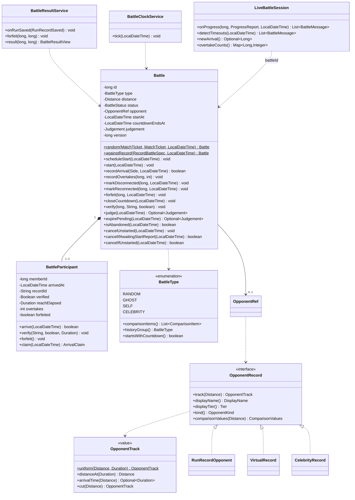

v0.11: Battle에 출발하지 못한 대결을 끝내는 isAbandoned·cancelUnstarted·cancelIfAwaitingStartReport와 BattleStatus.CANCELLED를 더했다(상태도 2.4.2). 근접 알림(FR-196)은 앱이 계산하므로 서버 battle은 바뀌지 않는다 (v0.11, CR34-01, D-96).

v0.13: Battle.cancelIfUnstarted(출발 전 포기 = 취소, BattleResultService.forfeit가 먼저 부른다, D-200)를 더했다. 그림에 없는 서비스의 새 연산은 BattleStartService.resendStart(D-207), BattleHistoryService.active → ActiveBattleView(D-202)이고 6.1.6에 있다 (v0.13, CR-16, CR-18).

### 8.4 앱 측정·대결

도메인(domain.run·battle·live)의 클래스와 포트, 그 포트를 구현하는 데이터 계층 클래스를 함께 그렸다. 실현 화살표(..|>)는 데이터 → 도메인 방향이다(D-56).

```mermaid
classDiagram
    namespace domain_run {
        class RunTracker {
            +checkStartable() Outcome
            +startRun(RunStartSpec) Outcome
            +onLocationSample(LocationSample) void
            +tick(Instant) void
            +lockScreen() void
            +onUnlockTapped() void
            +onUnlockLongPressed() void
            +onFinishTapped() void
            +onFinishLongPressed() void
            +endRun() void
            +onGapChanged(Int) void
            +onRankChanged(CrewRank) void
            +onLeadChanged(Kind) void
            +onPauseTapped() void
            +onResumeTapped() void
        }
        class RunSession {
            +start(Instant) void
            +onLocation(FilteredPoint) void
            +onHeartRate(HeartRateSample) void
            +tick(Instant) RunProgress
            +lock() void
            +hintUnlock() Guidance
            +unlock() void
            +hintFinish() Guidance
            +finish(Instant) FinishOutcome
            +end(Instant) FinishOutcome
            +arrivalAt(Distance) Instant
            +pause(Instant) Boolean
            +resume(Instant) Boolean
            +currentPause(Instant) Duration
        }
        class RunArchive {
            +saveInBackground(CompletedRun, Function) void
            +appendLateHeartRates(String, List~HeartRateSample~) void
        }
        class RunWatchBridge {
            +bind(WatchRequestListener) void
            +publish(WatchDisplay) void
            +publishHome(PlanSnapshot) void
            +publishProximity(ProximityAlert) void
            +publishLeadChange(Kind) void
            +isWatchConnected() Boolean
        }
        class RunCoach {
            +begin(RunMode) void
            +guide(RunProgress, RunSession) void
            +play(Guidance) void
            +proximityOf(Int, Boolean) ProximityAlert
            +isBattleVibrationOn() Boolean
            +isProximityAlertOn() Boolean
        }
        class MeasurementRuntime {
            +checkStartable() Outcome
            +startForeground() void
            +stop() void
            +now() Instant
        }
        class ProximityAlertRule {
            +evaluate(Int, Boolean, Boolean) ProximityAlert
            +shouldSend(ProximityAlert, ProximityAlert, Duration) Boolean
        }
        class LocationFilter {
            +accept(LocationSample) FilteredPoint
        }
        class CoachingJudge {
            +evaluate(GuidanceContext) List~Guidance~
        }
        class GuidanceRule {
            <<interface>>
            +check(GuidanceContext) Guidance
        }
        class PendingRunRepository {
            <<interface>>
            +save(CompletedRun) void
            +pending() List~CompletedRun~
            +appendHeartRates(String, List~HeartRateSample~) void
            +clear() void
        }
        class UploadScheduler {
            <<interface>>
            +requestUpload() void
        }
        class WatchGateway {
            <<interface>>
            +publish(WatchDisplay) void
            +publishProximity(ProximityMessage) void
            +publishLeadChange(LeadChangeMessage) void
            +heartRates Flow
        }
        class GuidanceOutput {
            <<interface>>
            +play(Guidance) void
        }
    }
    namespace domain_battle {
        class BattleRunCoordinator {
            +onMatched(MatchFound) void
            +onStart(BattleStart) void
            +onRecordBattleStart(RecordBattleStart) void
            +onProgress(RunProgress) void
            +onMessage(ServerMessage) void
            +onArrived() void
            +forfeit() void
            +liveState StateFlow~LiveState~
            +isRunning(Long) Boolean
        }
        class BattleRecordUploads {
            +settled(Long) Flow~Unit~
        }
    }
    namespace domain_live {
        class LiveChannel {
            <<interface>>
            +connect() void
            +send(ClientMessage) void
            +messages() Flow~ServerMessage~
            +close() void
        }
    }
    namespace data_layer {
        class MeasurementService
        class RoomPendingRunRepository
        class WorkManagerUploadScheduler
        class WatchLink
        class AndroidGuidanceOutput
        class WebSocketLiveChannel
        class PollingLiveChannel
    }

    RunTracker *-- RunSession
    RunTracker --> LocationFilter
    RunTracker --> RunArchive
    RunTracker --> RunWatchBridge
    RunTracker --> RunCoach
    RunTracker --> MeasurementRuntime
    RunCoach --> CoachingJudge
    RunCoach --> ProximityAlertRule
    CoachingJudge o-- GuidanceRule
    GuidanceRule <|.. SplitGuidanceRule
    GuidanceRule <|.. TargetReachedRule
    GuidanceRule <|.. PaceGuidanceRule
    GuidanceRule <|.. BreathGuidanceRule
    GuidanceRule <|.. GapGuidanceRule
    GuidanceRule <|.. RankGuidanceRule
    RunArchive --> PendingRunRepository
    RunArchive --> UploadScheduler
    RunWatchBridge --> WatchGateway
    RunCoach --> GuidanceOutput
    BattleRunCoordinator --> RunTracker
    BattleRunCoordinator --> LiveChannel
    BattleRecordUploads --> PendingRunRepository : observePending (v0.13, D-209)
    MeasurementService --> RunTracker : onLocationSample, tick
    MeasurementRuntime --> MeasurementService : startForeground, stop
    RoomPendingRunRepository ..|> PendingRunRepository
    WorkManagerUploadScheduler ..|> UploadScheduler
    WatchLink ..|> WatchGateway
    AndroidGuidanceOutput ..|> GuidanceOutput
    WebSocketLiveChannel ..|> LiveChannel
    PollingLiveChannel ..|> LiveChannel
```

v0.11: RunTracker의 생성자 협력 객체를 RunArchive(보관·전송 예약), RunWatchBridge(워치 표시·요청·근접 알림), RunCoach(안내·근접 알림 계산), MeasurementRuntime(시작 조건·포그라운드·시계) 넷으로 나눴다(D-95). RunSession에 pause·resume을, LiveChannel.send의 매개변수를 ClientMessage(ProgressReport·ChatPresence의 sealed 상위)로 바꿨다(D-103). MeasurementRuntime → MeasurementService 선은 D-95의 MeasurementHost 포트를 거친 호출을 줄여 그린 것이다 (v0.11, D-93, D-95, D-96, D-103).

### 8.5 크루 게시 계층·크루 채팅·신고 (설계 수준) (v0.11, D-99~D-104)

분석 수준 그림(1.4.4·1.4.4a)에 다형성 지점과 포트를 더했다. SchedulePost.answer는 크루런이면 참가자로 더하고 대면 모임이면 정원을 검사한다. CrewPost.maxBody는 하위 클래스마다 본문 길이를 정한다(응원·크루런·대면 모임·투표 200, 공지·게시글 1,000).

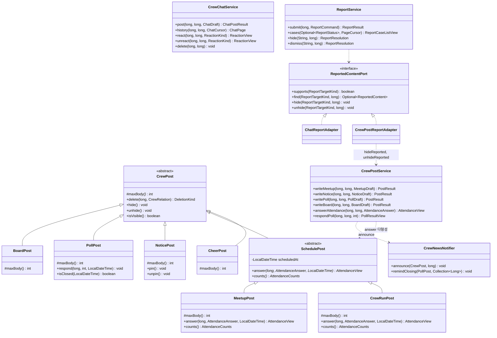

CrewPostService 연산의 매개변수 형은 F.2.2·F.5.2의 입력 객체 이름을 따랐고 반환 형 일부(PostResult 등)는 기존 v0.10 형을 이었다. CrewChatService·ReportService의 입출력은 F.6.2 N12~N14를 따랐다. pin·remindClosingPolls·album·photo 등 그 밖의 연산과 정확한 시그니처는 06-04 6.1.7·6.1.7a, 06-05 report 절이 기준이다. CrewPostReportAdapter·ChatReportAdapter는 조립 패키지 report.target에 있고 콘텐츠 패키지의 신고용 공개 연산(hideReported·unhideReported)으로 숨긴다. ReportService의 운영자 처리는 hide·dismiss 두 연산이다 (v0.11, D-99, D-101, D-104) (v0.11 검증, D-135, D-138).

## 9. 시퀀스 다이어그램

2.2의 SQ-01~SQ-24가 설계 수준 시퀀스다(v0.11에서 SQ-18 게스트 시작·세션 재개·계정 연동, SQ-19 자유런 일시정지·재개·자동 종료, SQ-20 대결 근접 알림, SQ-21 크루 채팅, SQ-22 신고, SQ-23 공동 목표, SQ-24 배경 해금을 더했다) (v0.11, CR-01~CR-10). 분석 단계부터 6.1 명세의 연산 이름으로 그렸다. v0.2에서 design-review.md 반영으로 메시지 이름과 참여자가 바뀐 곳이 있다: SQ-01(화면 종료와 조정자 endRun 분리), SQ-02(유효 러닝 순번, TierUpdateListener), SQ-03(MemberQueryService, MemberSettingService.rememberBattleDistance, BattleMessenger), SQ-04(BattleMessenger), SQ-05·SQ-16(RunQueryService), SQ-06(GhostMatcher가 MemberQueryService·RunQueryService 조합), SQ-07(selfCandidates·startSelfBattle), SQ-08(approveJoin·rejectJoin), SQ-09(CrewRunMessenger), SQ-10(onValidRun), SQ-11·SQ-14(MemberQueryService), SQ-12(withdraw(memberId)), SQ-13(withdrawConsent), SQ-15(personalRanking, 조회 서비스 조합). 설계 단계에서 시퀀스에 반영한 결정은 다음과 같다.

| 시퀀스 | 반영한 설계 결정 |
|--------|------------------|
| SQ-02 | 기록ID 중복 확인(D-11), 날씨 좌표 낮추기(NFR-038), 커밋 뒤 동기·비동기 수신자 구분(D-03) |
| SQ-03 | 원자적 배정 tryAssignPair(5.3), 실패하면 release로 되돌림·30초에 MatchFailed(D-64), 출발 = 성사 + 3초 + 10초(D-17) |
| SQ-04 | 세션은 Redis(LiveSessionStore), 1초 진행값은 DB에 쓰지 않음(6.5) |
| SQ-05 | 판정 도착 시각 = startAt + 기록상 도달 시간(D-30), 24시간 보류 만료는 BattleClockService |
| SQ-06·SQ-07 | 기록 상대는 앱이 OpponentTrack으로 보간(D-05), 기록 대결 시작 보고(R-02) |
| SQ-11 | 셀카는 저장 없이 api → ai로만 흐름(D-23) |
| SQ-12 | 탈퇴 후속 처리는 MemberWithdrawn 사건(D-28) |
| SQ-17 | 가입 티켓 15분, JWT 발급(D-19) |
| SQ-03·SQ-04·SQ-09 (v0.2) | 메신저 포트는 쓰는 패키지에(D-06), 설정 변경은 member 서비스로만(design-review.md A44) |
| SQ-05·SQ-06·SQ-15·SQ-16 (v0.2) | 다른 패키지 테이블 대신 조회 서비스 투영(D-32) |
| SQ-02·SQ-10 (v0.2) | 유효 러닝 순번 하나로 티어·Runimal 판정 시점을 맞춘다(D-37), 티어 갱신은 running 쪽 수신자(D-03 예외) |
| SQ-01·SQ-07·SQ-08·SQ-12·SQ-13·SQ-15 (v0.2) | 플래그 분기 연산 분리(D-36) |
| SQ-01 (v0.3) | 누름 종류마다 다른 연산 onFinishTapped·onFinishLongPressed(D-49) |
| SQ-04·SQ-09 (v0.3) | 채널 ID를 onProgress 매개변수로 넘김(D-48) |
| SQ-10 (v0.3) | 판정 지점 건너뜀 규칙(D-40), 좁은 조회 runSamples·tagsOf(D-41) |
| SQ-12·SQ-14 (v0.3) | 7일 뒤 purgeWithdrawn(design-review.md M3), 기기 토큰 등록·삭제(D-43) |
| SQ-15 (v0.3) | 크루 이름 crewNames(design-review.md M6) |
| SQ-02 (v0.11) | 정지 구간 수신·검사와 다섯째 조건 isBackedBy(D-94), 배경 해금 수신자(D-107), 공동 목표 달성 판정(D-105) |
| SQ-08·SQ-10·SQ-17 (v0.11) | 운영진의 가입 결정(FR-128), 태그 없는 Runimal 판정(D-91), 가입 축소(D-90) |
| SQ-18 (v0.11) | 게스트 = accountType GUEST, 기기 자격 증명은 해시만 저장, 갱신 토큰 만료 뒤 세션 재개, 연동은 같은 회원ID·합치지 않음(D-89, D-90) |
| SQ-19 (v0.11) | 정지 구간은 앱 RunSession이 만들고 서버는 검사·판정만, 자유런만, 55·60분 상수(D-93, D-113), RunTracker 협력 객체 넷(D-95) |
| SQ-20 (v0.11) | 근접 알림은 폰이 계산하고 워치는 재생만, 3초 만료(D-96), wear-contract 하위 호환(D-97) |
| SQ-21 (v0.11) | 채팅 보내기는 REST·받기는 /ws·메일함 없음·after로 메우기(D-101), 방 밖 알림 묶기(D-102), 연결 하나 임대(D-103), 4401 재연결(D-110) |
| SQ-22 (v0.11) | 대상 단위 ReportCase, report_case 행 잠금 안에서 자동 숨김, 포트로 crew·crew.chat과 순환 없음(D-104) |
| SQ-23 (v0.11) | 목표·달성은 WeeklyRace 칼럼, 조건부 UPDATE로 한 주 한 번, 축하 카드는 조회 때 생성(D-105) |
| SQ-37 (v0.16) | 셀럽 그림 키를 후보·시작·진행·결과에 같은 값으로(D-315), 카드 선택 뒤 대결하기(D-326), 취소 = cancelByRunner·기록 버림, 그만두기 = 패·기록 저장(D-317, D-318, D-324) |
| SQ-38 (v0.16) | 상대 캐릭터 성별은 매칭 때 한 번 정해 대결에 남기고 공개 성별이 아니면 무작위, 응답은 문자열(D-313, D-314) |
| SQ-24 (v0.11) | 해금은 avatar가 RunRecordSaved로, 문자열 키와 스냅숏, 취소 없음, 0시 10분 보정(D-107) |

## 10. 상태 다이어그램

2.4의 상태도 21개를 설계 단계에서도 그대로 쓴다(v0.11에서 2.4.16~2.4.21 추가, 2.4.2·2.4.7·2.4.13·2.4.14 수정) (v0.11, CR-01~CR-10, CR34-01). 설계에서 정한 것은 상태를 어떤 속성으로 저장하는가다.

| 클래스 | 상태 저장 | 전이를 일으키는 메소드 |
|--------|----------|------------------------|
| MatchTicket | status(enum) — Redis 해시 필드 | assign |
| Battle | status(enum, CANCELLED 추가), countdownEndsAt, judgement, 참가자의 active_member_id. v0.16: opponentGender·참가자 shownGender·opponentFigure는 상태가 아닌 한 번 정하는 속성 | scheduleStart, start, recordArrival, closeCountdown, forfeit, judge, expirePending, cancelUnstarted, cancelIfAwaitingStartReport, cancelIfUnstarted, cancelByRunner(v0.16, D-317. 상태도 02-04 2.4.2) (CANCELLED v0.11, CR34-01) |
| BattleParticipant 연결 | disconnections의 마지막 항목이 열려 있는가 | markDisconnected, markReconnected |
| JoinRequest | status(enum) | approve, reject, dissolve, cancel, expire |
| CrewRunPost | status(enum) + deleted | openLobby, depart, close, delete |
| CrewRunParticipation | readiness(enum), arrivedAt, quit, rank, excluded | toggleReady, arrive, quit |
| RunSession (앱) | state(enum, PAUSED·PAUSED_LOCKED 추가, D-120), 정지 구간 목록 | start, lock, unlock(해제 길게 누름), pause, resume, finish(종료 길게 누름), end(조정자·정지 60분). hintUnlock·hintFinish는 상태를 바꾸지 않는다 (PAUSED v0.11, FR-194, D-93) |
| CompletedRun (앱) | uploadState(enum) | uploadAll, remove |
| Member | status(enum), withdrawnAt | withdraw, purgeResidual |
| PlacementProgress (v0.30) | countedRounds, provisionalTier, completedAt(진행 행 없음 = 시작 전 또는 EXEMPT) | lockForMatch(행 생성), count, correctVerdict, deleteByMemberId (상태도 05-21 3.3 = 2.4.27, FR-275~FR-278, D-475·D-483) |
| PlacementResultViewModel (앱, v0.32) | state·isStillPending·progress(읽는 중·다시 읽기·정리 중·판 결과·진행 못 읽음·완료 화면) | load, onResumed, onRetry, 업로드 감시 수신 (상태도 05-22 3.3 = 2.4.28, FR-280·FR-281, D-531) |
| DisposalOrder | status(enum), deviceConfirmedAt | execute, confirmDevice |
| RunimalProfile | provisionalType·confirmedType의 유무, validRunCount(직전 반영 순번) | onValidRun, assignProvisional, confirm |
| Avatar 체형 | bodyShape(enum) | updateAppearance |
| CrewMembership | role(enum, MANAGER 추가), leftAt | promote, demote, appointManager, leave (운영진 지정은 appointManager, 해제는 demote. Crew.appointManager·dismissManager가 부른다, v0.11, D-98) |
| Notification | read(boolean), content·occurredAt(묶음 알림이면 교체) | markRead, notifyCollapsing의 교체 (v0.11, D-102) |
| Report | comment의 유무 | refresh, attachComment |
| Member 계정 유형 (v0.11) | accountType(enum), guestCredentialHash, lastAccessAt | guest, linkSocialAccount, recordAccess, withdraw (FR-197~FR-200, D-89) |
| ReportCase (v0.11) | status(enum), openReporterCount, version | addReport, hide, dismiss(D-138 (v0.11, test.md v0.6 TF-BE-38)), reopen (FR-215, FR-216, D-104) |
| WeeklyRace 공동 목표 (v0.11) | goal, achievedAt | setGoal, markAchievedIfReached(저장소 조건부 UPDATE) (FR-138, FR-217, D-105) |
| MeetupPost 참석 (v0.11) | 저장 필드 없음(attendances의 GOING 수와 scheduledAt으로 계산) | answer (FR-145, D-99) |
| PollPost (v0.11) | reminded(boolean). 마감은 closesAt으로 계산 | respond, markReminded (FR-207, D-106) |
| 크루 콘텐츠 노출 (v0.11) | CrewPost·CrewChatMessage의 deleted, hidden | delete, hide, unhide (FR-213, FR-215) |

상태 필드는 모두 private이고 setter가 없다. 다른 클래스가 상태를 직접 바꾸지 못하고, 표의 메소드만 전이를 일으킨다. 메소드는 현재 상태가 전이 출발 상태가 아니면 IllegalStateException을 던진다.

## 11. 활동 다이어그램

분기·병렬이 많은 처리 6개만 그렸다(v0.11에서 11.5 신고 처리, 11.6 일시정지와 자동 종료 추가) (v0.11, FR-194, FR-195, FR-214~FR-216). fork/join 막대는 mermaid flowchart에서 `===` 이름의 노드로 표시했다.

### 11.1 러닝 기록 저장과 후속 처리 (RunUploadService.upload, FR-038, FR-047, FR-184, D-03)

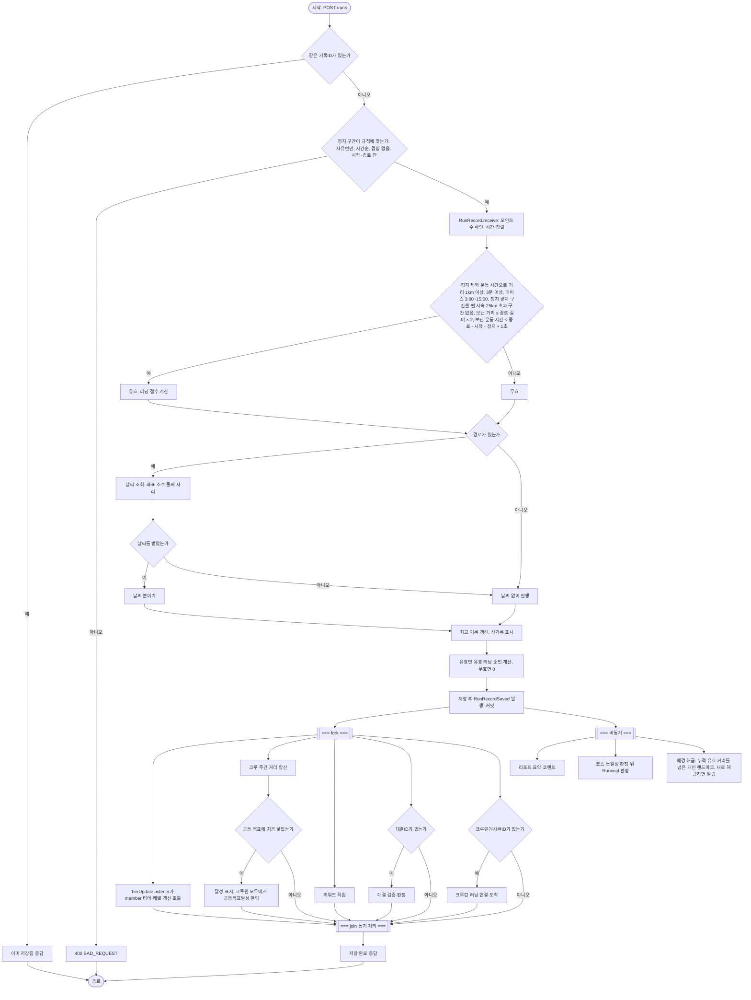

v0.11: 정지 구간 검사(C0)와 판정 조건(D)에 정지 제외·다섯째 조건을 넣었고(D-93, D-94), 주간 거리 합산 뒤 공동 목표 달성 판정(P21, D-105)과 배경 해금(BG, D-107)을 더했다. 배경 해금 수신자는 AFTER_COMMIT 비동기 묶음에 넣었다(D-129) (v0.11, FR-047, FR-217, FR-201).

### 11.2 랜덤 매칭 한 바퀴 (Matchmaker.tick, srs.md 6.3 4.1·4.2·4.6)

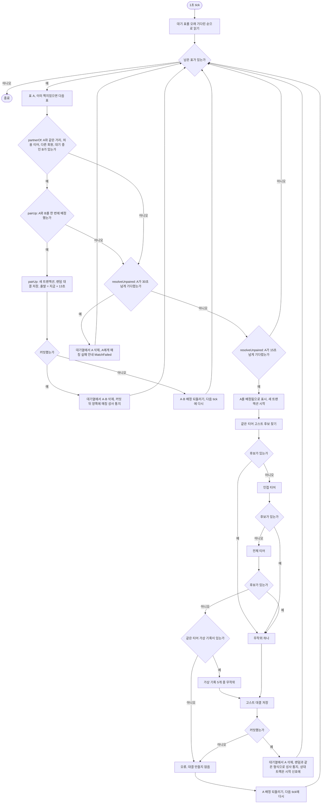

v0.10에서 tick을 연산 넷으로 나눴다(D-79, TF-BE-21): E는 partnerOf, F~G2는 pairUp, X~V1은 resolveUnpaired이고 tick은 C·D 반복만 한다. "넘게"는 정각을 포함하지 않는다(30초 정각 tick은 대기 유지, v0.10, TF-VB-15). v0.7은 후보가 있었지만 한 번에 배정하지 못한 A(F 아니오)를 다음 표로 넘겨, 15초가 지난 A가 그 tick에 고스트로 가지 않았다. FR-083과 A-06·코드대로 F 아니오도 대기 시간 판정(X·I)으로 간다(v0.8, TF-BE-12). 대결 저장·고스트 매칭이 실패하면 표를 지우지 않고 되돌려 다음 tick에 다시 하고, 30초가 지나도 대결을 만들지 못하면 A에게 MatchFailed를 보내 러너가 아무 통지도 받지 못하는 경로를 없앤다(v0.8, TF-BE-11, TF-BE-16, D-64).

### 11.3 대결 판정 (Battle.judge, srs.md 6.3 4.5)

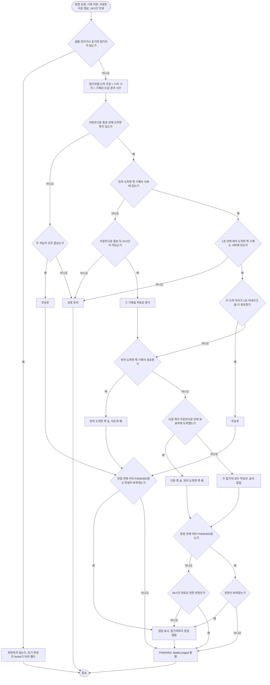

v0.7은 "이미 판정이 있었는가"로 정정을 정해 보류 중 기록이 모두 온 뒤의 첫 판정이 규칙 3이어도 정정 알림이 없었다. srs.md 6.3 4.5 규칙 3·FR-103(v0.9)대로 24시간 만료 말고는 늘 정정이다. 먼저 도착한 쪽이 무효이고 다른 쪽에 유효한 도착이 없으면 두 참가자 모두 무승부다(Q-87). 이미 FINISHED였던 판정이 다른 기록으로 바뀌는 경우도 정정이다(v0.8, TF-BE-08, TF-VB-02, TF-VB-03, TF-BE-10, D-63). 규칙 3으로 이미 FINISHED인 대결에 늦은 기록이 와서 판정이 같으면(K 예, J 아니오) 정정 알림을 다시 보내지 않는다(v0.10, TF-BE-20, D-82). 규칙 1·2·4 갈래(D2, F1, G1)는 이미 FINISHED였던 판정이 바뀐 경우만 정정이다(L, A-10 두 번째 조건).

### 11.4 크루런 하루 (CrewRunService.tick, FR-145~FR-149, FR-191)

v0.11: 모집글은 크루런 일정, 갈래요·못 가요는 참석·불참·미정 응답이다. 대면 모임 일정은 이 흐름(대기실·출발·중계)이 없다 (v0.11, FR-132, FR-145).

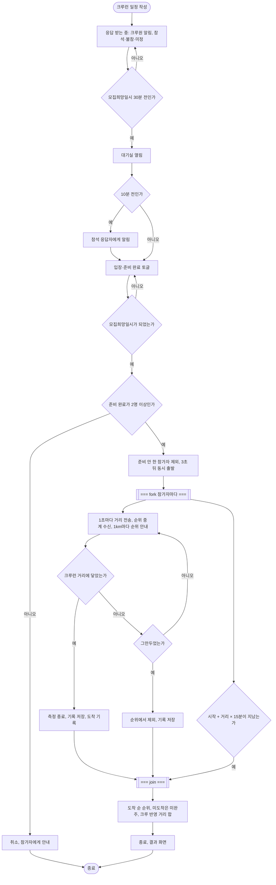

### 11.5 신고 접수와 처리 (ReportService.submit·resolve, FR-214~FR-216, D-104) (v0.11) — 같은 신고자 검사를 사례 재개보다 앞으로 옮겼다(D-149) (v0.11, 7.13.5 TF-VC-23)

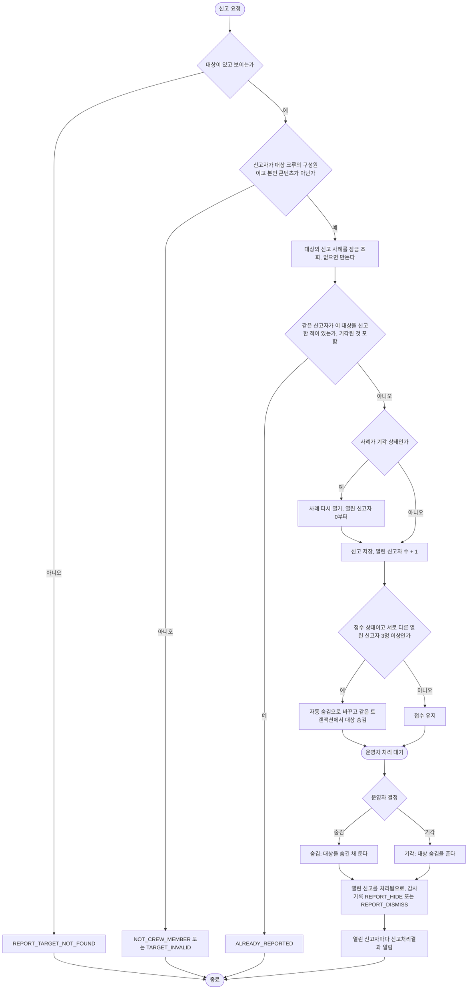

이미 숨김·기각한 사례에 처리 요청이 다시 오면 REPORT_DECIDED로 거부한다. 숨긴 대상은 찾지 못하므로(B 아니오) 숨김 사례에 새 신고가 쌓이지 않는다 (v0.11, FR-215, FR-216, D-104).

### 11.6 자유런 일시정지와 자동 종료 (RunTracker, FR-194, FR-195, D-93) (v0.11)

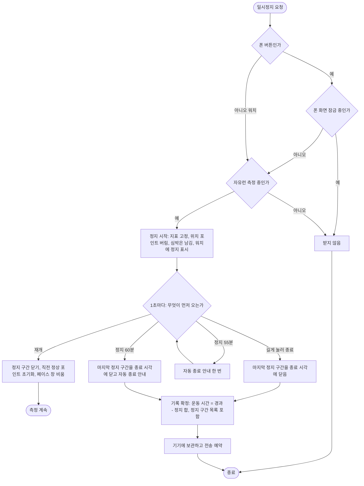

워치의 일시정지 요청은 폰 화면 잠금과 무관하게 받는다(D-93 (4), E-v011-1 잠정). 55분·60분은 PauseLimit 상수다(D-113) (v0.11, FR-194, FR-195).


---

# 4부. 패키지 의존도

