> [런크크 객체지향 분석·설계서](../design-oo.md) 목차 · 이전: [07-11-UML-다이어그램](07-11-UML-다이어그램.md) · 다음: [13-14-구현-지침-테스트-순서](13-14-구현-지침-테스트-순서.md)

## 12. 의존도

v0.14(srs v0.13, 서버 D-218~D-249·앱 D-250~D-289)에서 서버는 하위 패키지 1개(batch.runimal, RunimalShareJob)와 화살표 4개가 늘어 65개·178개다. 새 화살표는 web.record → battle(BattleHistoryService.outcomesOf, 기록 목록 행의 대결 결과), web.record → running(RunDeletionService.delete, DELETE /runs/{id}), batch.runimal → runimal, batch.runimal → common이고 12.2의 W1~W4에 적었다. 핵심 패키지 사이 화살표는 그대로다: RunRecordDeleted를 받는 runimal·crew·battle은 이미 running을 읽고(D6, D23, D9), profile → running·crew(D35, D38), analysis → reward(D31), runimal → policy(D7)도 있다. 앱은 ui.battle → domain.account 하나가 늘어 폰 화살표가 141개 → 142개다(ui.battle Fan-Out 5 → 6). 새 클래스 FriendInviteService의 Fan-Out 8은 12.4 v0.14 표에 올리고 판정 메모를 달았다. 12.3 수치는 이 판 값으로 고쳤다(common 63, running 12, runimal 6, battle 7, 하위 패키지 48개). design-review.md 18장 검증으로 web.battle → running(W5, 05-08 D-291 평가 표시)을 더해 179개이고 running Fan-In은 13이다. 폰 화살표는 v0.11 검증 반영 145개에서 시작해야 하므로 146개다(ui.battle → domain.account 추가, ui.home은 domain.avatar를 빼고 domain.settings를 더해 그대로). FriendInviteService는 D-299로 7이다 (v0.14 검증, D-299, D-300). v0.15(05-10 D-310, 코드 리뷰 앱 U8-1): 앱 코드에 ui.battle → domain.record(RunDetailSource가 RecordRepository.detail 하나로 좁혀 RecordDetail 값을 읽는다, 대결 결과 2쪽)가 있어 설계에 올린다. 폰 화살표 147개, ui.battle Fan-Out 7(상한). 스탬프 결합이고 domain.record는 ui를 모르므로 순환이 없다. 안정성 판정은 `/sw-design` review로 넘긴다. v0.16(05-11 D-328): 서버는 새 패키지·화살표가 없다(65개·179개). 상대 캐릭터 성별은 기존 battle → member 위의 MemberQueryService.publicGendersOf이고, battle.live·web.battle은 member 형식을 싣지 않고 OpponentGenders.nameFor의 문자열을 싣는다(D-314). 앱은 ui.battle → domain.runimal(랜덤 대결 잠금의 유효 러닝 수, D-320)과 ui.me → domain.settings(출생연도)가 늘어 폰 화살표 149개다. Gender를 core.model로 옮겨(D-321) core.designsystem → domain.account 역행을 만들지 않았다

v0.11에서 서버 패키지는 53개 → 61개, 화살표는 140개 → 167개다. 이 장의 수치는 12.2 목록을 스크립트로 다시 세어 얻었다(From → To 한 쌍을 하나로, *.live는 상위 패키지로 합침). 늘어난 27개는 둘이다. (1) 코드에 먼저 생긴 5개: operator → audit(운영자 로그인 감사, D75, CR34-04), batch.reward → reward·common(리워드 보정, D76, CR34-02), web.admin → analysis·audit(운영자 랭킹 다시 계산, D77, CR2-U1). (2) crew.chat·report 신설에 따른 22개: 부록 F F.6.2의 N1~N17(핵심 사이 9개, 핵심 → common 2개, 하위 → 핵심 6개, 하위 → common 5개). 쌍은 그대로이고 내용만 바뀐 화살표는 D3·D5·D13~D15·D18·D20~D23·D26·D27·D37·D40·D41·D44·D45·D50·D51·D54~D56·D58·D65·D67·D71·D72다. 순환 0과 계층 역행 0은 그대로다. 대신 안정성 방향이 거꾸로 된 쌍 2곳(member → policy, reward → battle)과 Fan-Out 상한(7)을 넘는 패키지 1곳(crew 8)이 생겼다(12.3, 12.4). 이 셋은 결정하지 않고 `/sw-design review` 판정 대상(부록 E.4 R-2~R-4)으로 넘긴다. 앱 모듈은 5.1.2(폰 화살표 125개 → 141개, 워치 3개 → 5개. v0.11 정리에서 F.6.4 누락 3개를 보탬) (v0.11, F.6.2, CR34-04, CR2-U1). design-review.md 17장 검증으로 web.attempt(D-132), report.target(D-135), web.admin.ranking(D-136)을 더해 64개, 174개다. crew → report·crew.chat → report는 report.target → crew·crew.chat·report로 바뀌어 crew Fan-Out이 7로 돌아왔고(R-4), web.admin → analysis·audit은 web.admin.ranking으로 옮겼으며(R-5), 표현 패키지 넷(web.auth·web.admin·web.chat·web.crew) → web.attempt가 생겼다(R-1). 안정성 역전 2곳(R-2·R-3)은 조건부 허용으로 정했다(D-133·D-134). 앱은 표에 없던 화살표 넷을 적어 폰 145개다(D-140) (v0.11 검증, D-132~D-136, D-140)

v0.8에서도 서버 패키지와 화살표는 그대로다(140개). 새 연산은 모두 이미 있는 쌍 위에 있다: running → member의 hasConsent(D3), policy → audit의 첫 운영자 감사(D41), battle 안 MatchQueue.tryAssign·release·MatchFailed(D-64), crew 안 CrewService·CrewPostService → CrewRunService.endByDeletion(D-66). policy의 값 객체가 받는 패키지 형식을 쓰지 않게 한 대가(번호·이름 계약)는 화살표가 아니라 숨은 의존이라 design-review 숨은 의존 표 대상이다(D-70). 앱 모듈은 코드의 Konsist 허용 표에 맞춰 화살표 5개(api.battle → domain.live, data.session → core.model, ui.home → domain.account·domain.avatar, app → core.model. 폰 화살표 120개 → 125개)가 늘었고 5.1.2 의존 표에 "주고받는 것"과 Fan-Out(최대 7)을 적었다(TF-IT-02. v0.8 본문의 "4개"는 v0.8 검증, R39로 바로잡음). v0.8 검증(design-review.md 15장)으로 화살표를 더하지 않고 다섯 곳을 고쳤다: 운영자 소셜 인증 실패 401은 operator 예외를 web.admin이 바꾸고(R36, member Fan-In 16 유지), 머리 정보 없는 늦은 심박은 domain.sync만 보내고(R37, domain.run ↔ domain.sync 순환 방지), ui.home은 쓰는 값만 받고(R35), MatchFailed는 ui.battle이 받는다(R38).

v0.6에서도 서버 패키지와 화살표는 그대로다. 바뀐 것은 design-review.md v0.5(불합격, 12.5.2)의 6차 개선이다: ai 서버 조립을 runkk_ai.main으로 떼어 core ↔ comment·face 순환을 없앴고(D-60, N7), 앱 바인딩을 각 데이터 모듈로 옮겼고(D-61, R30), domain.notification이 자기 포트 LoginState로 로그인 상태를 읽게 했고(E19), 형식 주인(TrackTable, 문자열 TokenProvider, GeoPoint)을 정했다(R31). ai 모듈의 의존도 5.1.2 표에 적었다. v0.5에서 서버 패키지와 화살표는 v0.4와 같다. 바뀐 것은 OperatorAuthorizer.authenticate의 제공자 매개변수를 문자열로 바꿔 숨은 화살표 web.admin → member를 만들지 않은 것(design-review.md R26)과 관리 결과 형식을 서비스마다 나눈 것(R29)뿐이다. 앱 모듈은 Clean Architecture로 다시 나눠 5.1.2에 따로 적었다(D-56). v0.4의 의존도는 design-review.md v0.3의 4차 개선(10.6)을 반영한 구조다. 핵심 패키지 14개와 그 사이 화살표 56개(공통 형식 참조 13개 포함)는 v0.2부터 같다(R22 공개 수준 판정은 이미 있는 crew·profile → member 위의 연산, D-51은 이미 있는 battle → running 위의 연산이다). 바뀐 것은 표현·구동 하위 패키지다: web.auth → operator가 없어지고 web.admin이 web.admin(→ operator)·web.admin.celebrity(→ battle)·web.admin.setting(→ policy)·web.admin.audit(→ audit)으로 나뉘었고(D-50), batch.tick·midnight·evening·cleanup 4개가 batch.battle·crew·analysis·avatar·running·member·audit·notification 8개로 바뀌었다(D-39). v0.3 목록의 D55~D57·D65는 번호를 유지하되 From이 바뀌었고 D68~D74를 더했다. 앱 모듈의 의존은 5.1.2 표에 있다(app.run ↔ app.store 순환 제거, D-54). 목록과 행렬은 6.1의 의존 열·매개변수·반환 형, 2.2 시퀀스, 5.5, 6.1.13에서 패키지를 넘는 참조를 다시 뽑아 만들었고, 수치는 이 목록의 화살표로 직접 셌다. 판정은 `/sw-design review`가 정한다.

### 12.1 의존도 그림

상자는 패키지, 화살표는 import·호출 방향, 화살표 라벨은 넘기는 것이다. 모든 패키지 → common 화살표는 그림에서 뺐다(12.2 D44, D53, D66, D67, N10, N17). 그림 (가)는 핵심 패키지 16개(v0.10은 14개), 그림 (나)는 표현·구동·인프라 하위 패키지에서 핵심 패키지로 가는 화살표다 (v0.11, F.6.2)

(가) 핵심 패키지

```mermaid
flowchart TB
    subgraph ASM[조립]
        profile
        operator
        rtarget[report.target]
    end
    subgraph APP[응용+도메인]
        analysis
        crew
        crewchat[crew.chat]
        report
        avatar
        reward
        battle
        runimal
        running
        member
    end
    subgraph SHARED[도메인 공통]
        notification
        policy
        audit
        common
    end
    profile -->|MemberSummary·MemberPreference·공개 수준| member
    profile -->|최장 거리 값| running
    profile -->|RunimalType| runimal
    profile -->|faceKey·배경 키| avatar
    profile -->|CrewSummary| crew
    operator -->|token → SocialAccount| member
    operator -->|OperatorWhitelist·첫 운영자 넣기| policy
    operator -->|로그인 성공·실패 감사| audit
    rtarget -->|reportedView·hideReported·unhideReported, activeMemberIds| crew
    rtarget -->|reportedView·hideReported·unhideReported| crewchat
    rtarget -->|ReportedContentPort 구현| report
    analysis -->|MemberPreference·나이·랭킹 대상| member
    analysis -->|RunSummary·RunDetail·통계| running
    analysis -->|CrewSummary·크루 이름·반영 거리| crew
    analysis -->|적립량| reward
    analysis -->|랜드마크·한도| policy
    analysis -->|PLAN_MISSED| notification
    crew -->|MemberSummary·공개 수준, 가드 구현| member
    crew -->|RunSummary·회원별 거리·SavedRun| running
    crew -->|참여 조회 포트 구현| runimal
    crew -->|CrewRunRule| policy
    crew -->|알림 14종| notification
    crew -->|감사 6종| audit
    crewchat -->|relationOf·activeMemberIds| crew
    crewchat -->|MemberSummary, 탈퇴 사건| member
    crewchat -->|CREW_CHAT 묶음 알림| notification
    crewchat -->|CHAT_FORCE_DELETE| audit
    report -->|REPORT_RESOLVED| notification
    report -->|REPORT_HIDE·DISMISS| audit
    report -->|탈퇴 사건| member
    avatar -->|동의, 탈퇴 사건| member
    avatar -->|날짜별 횟수·시작 일시·누적 거리, RunRecordSaved| running
    avatar -->|owns·balanceOf| reward
    avatar -->|외형 규칙·셀카 한도·부위·개인 랜드마크| policy
    avatar -->|BODY_SHAPE_CHANGED·BACKGROUND_UNLOCKED| notification
    reward -->|탈퇴 사건·isActive| member
    reward -->|RunRecordSaved·savedBetween| running
    reward -->|BattleJudged·winsJudgedBetween| battle
    reward -->|RewardRule·ShopCatalog| policy
    battle -->|티어·동의·닉네임 존재, 가드 구현| member
    battle -->|OwnedRun·RunComparison·RunCurve| running
    battle -->|매칭 조건·가상 기록 규칙| policy
    battle -->|알림 2종| notification
    battle -->|유명인 기록 감사| audit
    runimal -->|탈퇴 사건| member
    runimal -->|RunSampleRow·경로| running
    runimal -->|RunimalRule| policy
    running -->|recordValidRun·반영 순번, 탈퇴·철회 사건| member
    running -->|파기 감사| audit
    notification -->|pushDecision, 탈퇴 사건| member
    notification -->|보관 일수| policy
    member -->|TierBoundary| policy
    member -->|가입·동의·탈퇴 감사| audit
    policy -->|SETTING_CHANGE 감사| audit
```

그림 (가)는 v0.11 기준이다: crew.chat·report와 화살표 10개(operator → audit, N1~N9)를 더했고 라벨을 12.2에 맞췄다 (v0.11, F.6.2, CR34-04). 검증 반영(D-135): crew → report·crew.chat → report 대신 조립 패키지 report.target → crew·crew.chat·report (v0.11 검증, D-135)

(나) 표현·구동·인프라 하위 패키지

```mermaid
flowchart LR
    subgraph PRES[표현]
        wauth[web.auth]
        wme[web.me]
        wnoti[web.notification]
        wrun[web.run]
        wrec[web.record]
        wbat[web.battle]
        wcrew[web.crew]
        wrn[web.runimal]
        wav[web.avatar]
        wadm[web.admin]
        wcel[web.admin.celebrity]
        wset[web.admin.setting]
        waud[web.admin.audit]
        wadr[web.admin.report]
        wrank[web.admin.ranking]
        watt[web.attempt]
        wchat[web.chat]
        wrep[web.report]
        rt[realtime]
    end
    subgraph DRV[구동]
        bbat[batch.battle]
        bcrew[batch.crew]
        bana[batch.analysis]
        bav[batch.avatar]
        brun[batch.running]
        bmem[batch.member]
        baud[batch.audit]
        bnoti[batch.notification]
        brew[batch.reward]
    end
    subgraph INFRA[인프라]
        idom[infra.도메인 13개]
        iauth[infra.integration.auth]
        iai[infra.integration.ai]
        ipush[infra.integration.push]
        iwea[infra.integration.weather]
    end
    wauth -->|로그인·가입·토큰 확인| member
    wme -->|계정·설정·동의·탈퇴| member
    wme -->|프로필 조회| profile
    wnoti -->|알림함·기기 토큰| notification
    wrun -->|기록 전송·파기 확인| running
    wrec -->|대시보드·기록·랭킹·코치| analysis
    wbat -->|매칭·대결·결과| battle
    wbat -->|적립량 조합| reward
    wcrew -->|크루 요청| crew
    wcrew -->|크루원 Runimal 유형 조합| runimal
    wrn -->|유형·카드| runimal
    wav -->|외형·착용| avatar
    wav -->|상점·구매| reward
    wadm -->|운영자 로그인·ensureOperator| operator
    wrank -->|actorId, 랭킹 다시 계산| analysis
    wrank -->|RANKING_RECOMPUTED 감사| audit
    wauth -->|시도 제한| watt
    wadm -->|시도 제한| watt
    wchat -->|시도 제한| watt
    wcrew -->|초대 코드 시도 제한| watt
    wcel -->|actorId, 유명인 기록| battle
    wset -->|actorId, 기준값 변경| policy
    waud -->|감사 조회| audit
    wadr -->|actorId, 신고 처리| report
    wchat -->|채팅 조회·보내기·리액션·삭제| crewchat[crew.chat]
    wrep -->|신고 접수| report
    rt -->|진행값, 메신저 구현| battle
    rt -->|진행값, 메신저 구현| crew
    rt -->|토큰 확인·만료 시각| member
    rt -->|방 입장 확인, 메신저·방 입장 포트 구현| crewchat
    bbat -->|1초 tick·detectTimeouts| battle
    bcrew -->|1초 tick·detectTimeouts, reconcileAll, expireRequests| crew
    bana -->|rebuild, remindMissedPlans| analysis
    bav -->|refreshAll| avatar
    brun -->|executeDue| running
    bmem -->|purgeWithdrawn| member
    baud -->|purgeExpired| audit
    bnoti -->|purgeExpired| notification
    brew -->|reconcile| reward
    iauth -->|SocialLoginGateway·TokenIssuer 구현| member
    iauth -->|OperatorTokenIssuer 구현| operator
    iai -->|LlmCommentGateway 구현| analysis
    iai -->|FaceTransformGateway 구현| avatar
    ipush -->|PushGateway 구현| notification
    iwea -->|WeatherGateway 구현| running
```

infra.<도메인> 13개는 같은 이름의 도메인 패키지 하나씩을 가리킨다(D58, infra.chat → crew.chat은 N15, infra.report → report는 N16). 그림 (나)에서는 화살표 13개를 생략했다 (v0.11, N15, N16) web.error와 bootstrap은 common만 가리켜 그림에 없다.

- 실시간 메시지: 도메인(battle, crew, crew.chat)은 자기 패키지의 BattleMessenger·CrewRunMessenger·CrewChatMessenger 포트만 알고 realtime이 구현한다. 채팅방 입장 여부도 crew.chat의 ChatRoomPresence 포트를 realtime이 구현한다. realtime → battle·crew·crew.chat 한 방향만 있다(D-06, D-101). battle.live·crew.live·crew.chat.live는 realtime을 import하지 않고 realtime도 이들을 import하지 않는다(13.1 규칙 (7)) (v0.11, N11)
- 신고: report는 신고 대상 패키지를 모른다. 조립 패키지 report.target(CrewPostReportAdapter·ChatReportAdapter)이 crew·crew.chat의 신고용 공개 연산(reportedView·hideReported·unhideReported)으로 report.ReportedContentPort를 구현한다(V1~V3. v0.11 본문은 crew·crew.chat이 직접 구현해 crew Fan-Out이 8이었다, N5·N6, v0.11 검증 D-135). report는 notification·audit·member·common만 import하고 이 넷은 report·crew·crew.chat을 import하지 않는다. crew·crew.chat도 report를 import하지 않는다 (v0.11, D-104, F.6.3) (v0.11 검증, D-135)
- 채팅: crew.chat → crew 한 방향이다(N1). crew는 crew.chat을 import하지 않는다: 크루 삭제는 DB FK CASCADE로, 탈퇴는 crew.chat의 ChatWithdrawalListener가 MemberWithdrawn을 직접 받는다. 크루를 떠난 회원의 접근은 crew.chat이 읽을 때마다 relationOf로 막는다 (v0.11, D-101, F.6.3)
- 사건: 수신자가 발행 패키지에 의존한다(reward → running·battle, analysis·runimal·crew·battle·avatar → running, 각 패키지 → member, battle → policy). 새 화살표를 만들지 않는다(D-31). v0.11의 avatar BackgroundUnlockListener(RunRecordSaved)는 이미 있는 avatar → running(D18) 위에 있다 (v0.11, D-107)
- running → member는 탈퇴·철회 사건 수신과 티어 갱신 호출(D-03 예외) 두 가지다. member → running은 없다.
- 다른 패키지 테이블 직접 조회 0건: analysis·battle·crew·runimal·avatar·profile은 running·member·crew의 조회 서비스만 부른다(D-32).

### 12.2 의존 목록

| No | From | To | 의존 형태 | 주고받는 것 |
|----|------|----|-----------|-------------|
| D1 | member | policy | 메서드 호출 | → TierBoundary |
| D2 | member | audit | 메서드 호출 | AuditEntry(가입동의, 동의변경, 회원탈퇴) |
| D3 | running | member | 메서드 호출·사건 수신 | (memberId, RunScoreInput) → TierLevelService.recordValidRun → TierChange (TierUpdateListener, D-03 예외); MemberWithdrawn·ConsentWithdrawn 수신; (memberId, HEART_RATE) → MemberQueryService.hasConsent → boolean (RunUploadService.upload·appendLateHeartRates, v0.8 TF-IT-06); memberId → appliedValidRunCount(MemberQueryService, TierApplier, D-108) (v0.11, D-108); (memberId, RunScoreInput) → TierLevelService.recordLateValidRun → TierChange(TierApplier) (v0.11 구현 반영, U5-A-1, D-169); memberId → isActive(RunRejudgeService 2단계, v0.12 D-191) |
| D4 | running | audit | 메서드 호출 | AuditEntry(위치경로파기) |
| D5 | runimal | member | 사건 수신 | MemberWithdrawn 수신. memberId → TagSet(tagsOf)는 러너 성향 태그 제거로 지웠다(D-91) (v0.11, D-91) |
| D6 | runimal | running | 메서드 호출·사건 수신 | (memberId, limit 또는 DateRange) → List<RunSampleRow>(runSamples); recordId → List<GeoPoint>(routePoints); RunRecordSaved(validRunOrdinal) 수신 |
| D7 | runimal | policy | 메서드 호출 | → RunimalRule, CourseSimilarityRule |
| D8 | battle | member | 메서드 호출·구현·사건 수신 | memberIds → MemberSummary; (memberId, ConsentItem) → boolean; (tiers, excludeId) → Map<Long, GhostOwner>; (memberId, StandardDistance) → rememberBattleDistance; nickname → boolean(isNicknameTaken); WithdrawalGuard·ReservedNicknameChecker 구현; MemberWithdrawn 수신 |
| D9 | battle | running | 메서드 호출·사건 수신 | recordId → RunComparison(comparisonOf: elapsed·averagePace는 상대 비교 값, fastestKm은 결과 비교표, 3/3); (recordId, d) → Optional<Duration>(timeToReach); (memberId, d) → BestEntry(recordId·기록·날짜 3/4); (d, ownerIds) → List<OwnedRun>(2/2); (recordId, cut) → RunCurve(2/2); RunRecordSaved 수신. RunSummary를 받지 않는다(D-51) |
| D10 | battle | policy | 메서드 호출·사건 수신 | → MatchCondition, TierBoundary, VirtualRecordRule; OperationSettingChanged(TIER_BOUNDARY·VIRTUAL_RECORD_RULE) 수신 |
| D11 | battle | notification | 메서드 호출 | NotificationRequest(OPPONENT_ARRIVED, BATTLE_CORRECTED) |
| D12 | battle | audit | 메서드 호출 | AuditEntry(유명인기록등록, 유명인기록삭제) — CelebrityRecordService |
| D13 | reward | member | 사건 수신·메서드 호출 | MemberWithdrawn; memberId → isActive(MemberQueryService, RewardReconcileService가 탈퇴 회원 보정을 건너뜀) (v0.11, CR34-04) |
| D14 | reward | running | 사건 수신·메서드 호출 | RunRecordSaved(유효, 거리) → 적립; (from, now) → List<SavedRun>(RunQueryService.savedBetween, RewardReconcileService 보정) (v0.11, CR34-04); RunRecordRejudged(재판정으로 유효, 거리, 원래 저장 일시) 수신 → VALID_RUN 적립, 알림 없음(v0.12 D-191) |
| D15 | reward | battle | 사건 수신·메서드 호출 | BattleJudged(승자) → 적립(적립량은 RewardRule.battleWin); (from, now) → List<BattleWin>(BattleResultService.winsJudgedBetween, RewardReconcileService 보정) (v0.11, CR34-04) |
| D16 | reward | policy | 메서드 호출 | → RewardRule(perKm, battleWin, dailyCap), ShopCatalog(아이템, 판매 중지) |
| D17 | avatar | member | 메서드 호출·사건 수신 | (memberId, FACE_TRANSFER) → boolean; MemberWithdrawn 수신 |
| D18 | avatar | running | 메서드 호출·사건 수신 | (memberId, DateRange) → DayStats(날짜·횟수); (memberId, limit) → List<LocalDateTime>(recentStartTimes); RunRecordSaved 수신(BackgroundUnlockListener); memberId → Distance(validDistanceOf, 누적 유효 거리); (from, to) → Set<Long>(memberIdsSavedBetween, 배경 해금 보정) (v0.11, D-107) (v0.11 검증, D-139. 받는 쪽이 절반 미만을 쓰던 TotalStats·SavedRun을 좁혔다); RunRecordRejudged 수신(BackgroundUnlockListener.onRunRejudged → BackgroundService.unlockReachedQuietly, v0.12 D-191) |
| D19 | avatar | reward | 메서드 호출 | (memberId, itemId) → owns; memberId → balanceOf |
| D20 | avatar | policy | 메서드 호출 | → BodyShapeRule, SkinToneRule, FeatureToggles(selfieEnabled), SelfieLimit; itemId → ItemSlot(ShopCatalog.slotOf); → LandmarkTable(개인 랜드마크, Landmark.key) (v0.11, D-107) |
| D21 | avatar | notification | 메서드 호출 | NotificationRequest(BODY_SHAPE_CHANGED, BACKGROUND_UNLOCKED) (v0.11, D-107) |
| D22 | crew | member | 메서드 호출·구현·사건 수신 | memberIds → MemberSummary(표시명·티어·공개 범위. 태그는 D-91로 삭제); (viewerId, memberIds) → Map<Long, DisclosureLevel>(disclosureOf, D-52); WithdrawalGuard 구현; MemberWithdrawn 수신 (v0.11, D-91) |
| D23 | crew | running | 메서드 호출·사건 수신 | recordId → RunSummary, timeToReach(크루런 도착·결과); (memberIds, DateRange) → Map<Long, Distance>(크루 내 랭킹, 재합산); (memberId, DateRange) → RunSummary 목록(재합산); RunRecordSaved 수신; (from, now) → SavedRun 목록(savedBetween, CrewRunLinkReconcileService 보정)·SavedRun.of(RunRecordSaved)(CrewRunService.link) (v0.11, CR34-04) |
| D24 | crew | runimal | 인터페이스 구현 | CrewRunParticipationQuery 구현((memberId, DateRange) → Set<String> 연결 기록 ID). 크루원 목록의 유형 조회는 web.crew로 옮겼다(D-46) |
| D25 | crew | policy | 메서드 호출 | → CrewRunRule |
| D26 | crew | notification | 메서드 호출 | NotificationRequest 14종(JOIN_REQUESTED, JOIN_DECIDED, JOIN_EXPIRED, LEADER_TRANSFERRED, CREW_DELETED, KICKED, CREW_RUN_RECRUIT, CREW_RUN_SOON, CREW_NOTICE, CREW_POLL, POLL_CLOSING_SOON, CREW_SCHEDULE, CREW_GOAL_ACHIEVED, MANAGER_CHANGED) (v0.11, D-106) |
| D27 | crew | audit | 메서드 호출 | AuditEntry 6종(LEADER_TRANSFER, CREW_DELETE, KICK, POST_FORCE_DELETE, MANAGER_APPOINT, MANAGER_DISMISS). POST_FORCE_DELETE 행위자 역할에 CREW_MANAGER (v0.11, D-98) |
| D28 | analysis | member | 메서드 호출·사건 수신 | memberId → MemberPreference(단위, 공개 범위, 코스지도공유, LLM 동의); memberIds → MemberSummary; (memberId, year) → OptionalInt(ageOf); → rankedMemberIds; MemberWithdrawn 수신 |
| D29 | analysis | running | 메서드 호출·사건 수신 | DayStats, TotalStats, PeriodStats, RunSummary(cardKind 포함), RunDetail, 회원별·날짜별 거리, BestEntry; RunRecordSaved 수신 (v0.12: TotalStats는 유효 기록만 센다, D-192) |
| D30 | analysis | crew | 메서드 호출 | memberId → CrewSummary(crewId, name, logoUrl 가운데 crewId·name 2/3); (a, b) → sameCrew; crewId → 크루원 ID 목록; → 크루별 크루원 목록; crewIds → Map<Long, DisplayName>(crewNames); recordId → 크루 반영 거리(WeeklyRaceService.contributionOf) |
| D31 | analysis | reward | 메서드 호출 | (reason, sourceId, memberId) → 적립량 |
| D32 | analysis | policy | 메서드 호출 | Distance → LandmarkProgress(personalProgressOf, crewProgressOf); → CalorieCoefficient, LlmCallLimit, SupplementCap, FeatureToggles(aiCommentEnabled) |
| D33 | analysis | notification | 메서드 호출 | NotificationRequest(PLAN_MISSED) |
| D34 | profile | member | 메서드 호출 | memberIds → MemberSummary; memberId → MemberPreference; (viewerId, {targetId}) → Map<Long, DisclosureLevel>(disclosureOf, D-52) |
| D35 | profile | running | 메서드 호출 | memberId → Optional<Distance>(longestDistance) |
| D36 | profile | runimal | 메서드 호출 | memberIds → Map<Long, RunimalType> |
| D37 | profile | avatar | 메서드 호출 | memberId → faceKey; memberId → backgroundKey(AvatarQuery.backgroundKeyOf) (v0.11, FR-202) |
| D38 | profile | crew | 메서드 호출 | memberId → CrewSummary(crewId, name, logoUrl) |
| D39 | operator | member | 메서드 호출 | (ProviderType으로 고른 SocialLoginGateway) providerToken → SocialAccount. 관리툴 토큰은 operator의 OperatorTokenIssuer로 한다(D-42) |
| D40 | operator | policy | 메서드 호출 | → OperatorWhitelist; OperationPolicy·OperationSettingService(OperatorBootstrap이 OPERATOR_WHITELIST가 비었을 때만 첫 운영자를 넣는다. policy.OperatorWhitelistSeeder에서 옮김) (v0.11, CR2-U2) |
| D41 | policy | audit | 메서드 호출 | AuditEntry(SETTING_CHANGE) — OperationSettingService. 첫 운영자 넣기는 operator.OperatorBootstrap이 OperationSettingService를 불러 같은 경로로 남는다(v0.8 D-74, v0.11 CR2-U2) (v0.11, CR2-U2) |
| D42 | notification | member | 메서드 호출·사건 수신 | (recipientId, type) → PushDecision; MemberWithdrawn 수신(알림·기기 토큰 삭제) |
| D43 | notification | policy | 메서드 호출 | → NotificationRetention(보관 일수) |
| D44 | 핵심 패키지 15개(crew.chat·report → common은 N10. 검증 반영 report.target → common은 V4) | common | 참조 | 불변 기본 형식(값 객체, 열거형, 오류 형식), DomainEvent·DomainEventPublisher, ProgressReport, Timestamps (v0.11, N10) |
| D45 | web.auth | member | 메서드 호출 | (provider, token) → LoginResult; (memberId, refreshToken) → logout; refreshToken → TokenPair(refresh); SignUpCommand → SignUpResult; accessToken → memberId(AuthFilter, TokenIssuer.verify). 운영자 로그인은 D52(D-50); GuestStartForm → GuestStartResult(startAsGuest); guestCredential → TokenPair(resumeGuest); (memberId, provider, providerToken) → SocialLinkResult(linkSocialAccount) (v0.11, D-89) |
| D46 | web.me | member, profile | 메서드 호출 | memberId → MemberSettingsView(settingsOf); (memberId, SettingChange) → SettingResult; (memberId, ConsentItem) → ConsentResult; (memberId, ProfileEdit) → ProfileEditResult; memberId → WithdrawalResult; DocumentType → LegalDocument; (viewerId, targetId) → ProfileView |
| D47 | web.run | running | 메서드 호출 | RunUploadCommand → UploadResult; LateHeartRateCommand; memberId → DisposalOrderView 목록; (memberId, orderId) → confirmDevice |
| D48 | web.record | analysis | 메서드 호출 | DashboardView, RecordListView, RecordDetailView, RunCardData, GrowthView, ReportView, (memberId, period) → RankingView(개인·크루 연산 따로), PlanProgressView, TodayPlanView |
| D49 | web.battle | battle, reward | 메서드 호출 | (memberId, StandardDistance) → MatchAcceptance; memberId → cancel; selfCandidates·celebrityCandidates → RecordBattleCandidates; startSelfBattle·startCelebrityBattle → RecordBattleStart; (memberId, battleId) → markStarted, forfeit; BattleResultView + accruedFor(BATTLE_WIN, battleId, memberId); (memberId, DateRange, Optional<BattleType>) → BattleHistoryView |
| D50 | web.crew | crew, runimal | 메서드 호출 | CrewCreateCommand, JoinTarget, (requesterId, requestId) → DecisionResult, (memberId, postId) → LobbyView, CrewRunDraft; CrewMembersView.disclosedMemberIds → Map<Long, RunimalType>(CrewMembersAssembler, D-46); 운영진 지정·해제, 공지·고정, 투표·응답·결과, 대면 모임, 게시글(BoardDraft·PhotoUpload), 앨범, 사진 조회, 참석 응답(AttendanceAnswer), 공동 목표 설정 연산. 추천 연산 삭제(D-91) (v0.11, D-99) |
| D51 | web.avatar | avatar, reward | 메서드 호출 | byte[] selfie → AvatarResult; DefaultCharacter → AvatarResult; List<EquipChange> → AvatarView; memberId → AvatarView(view); (memberId, Optional<ItemSlot>) → ShopView; itemId → PurchaseResult; memberId → BackgroundsView(BackgroundService.backgrounds), (memberId, Optional<String>) → BackgroundsView(choose); (ownerId, set, part) → 부위 그림(FaceImageService.partImage, CR2-U1) (v0.11, D-107) |
| D52 | web.admin | operator | 메서드 호출 | (String provider, providerToken) → OperatorSession(authenticate. member 형식을 넘기지 않는다, R26. 소셜 인증 실패는 OperatorAuthFailedException → 401, v0.8 검증, R36); adminToken → OperatorId(ensureOperator, OperatorCheckInterceptor) |
| D53 | web.error | common | 참조 | BusinessRuleException, PermissionDeniedException |
| D54 | realtime | battle, crew, member | 메서드 호출·인터페이스 구현 | (memberId, 채널 ID, ProgressReport, now) → onProgress; BattleMessenger·CrewRunMessenger 구현(메시지는 type()으로 직렬화); accessToken → AccessGrant(memberId, expiresAt)(TokenIssuer.verifyGrant, D-110. v0.10은 TokenIssuer.verify, design-review.md E1). crew.chat 쪽은 N11 (v0.11, D-110). v0.13: memberId → BattleStartService.resendStart(연결 직후 BattleStart 재전송, D-207). 같은 화살표에 넘기는 것만 늘었다 |
| D55 | batch.battle | battle | 메서드 호출 | now → Matchmaker.tick, BattleClockService.tick, LiveBattleService.detectTimeouts; now → BattleStartService.cancelAbandoned(AbandonedBattleJob, 1분, CR34-01) (v0.11, CR34-02) |
| D56 | batch.crew | crew | 메서드 호출 | now → CrewRunService.tick, CrewRunLiveService.detectTimeouts, WeeklyRaceService.reconcileAll, MembershipService.expireRequests; now → CrewPostService.remindClosingPolls(PollReminderJob, D-106); now → CrewRunLinkReconcileService.reconcileLinks(CrewRunLinkReconcileJob) (v0.11, CR34-02) |
| D57 | batch.analysis | analysis | 메서드 호출 | now → RankingService.rebuild, CoachService.remindMissedPlans |
| D58 | infra.<도메인> 11개 | 같은 이름의 도메인 패키지 | 인터페이스 구현·엔티티 매핑 | 그 도메인의 Repository·Store·Counter 인터페이스, 엔티티 클래스(자기 테이블만). v0.11: infra.crew의 JdbcPostPhotoStore(PostPhotoStore, D-100), infra.reward의 JpaRewardAccrualRepository(D-109). 같은 꼴의 infra.chat → crew.chat, infra.report → report는 N15·N16으로 따로 센다 (v0.11, D-100) |
| D59 | infra.integration.auth | member, operator | 인터페이스 구현 | SocialLoginGateway(token → SocialAccount), TokenIssuer(memberId → TokenPair, SocialAccount → 가입 티켓(issueSignUpTicket), 가입 티켓 → SocialAccount(redeemSignUpTicket), accessToken → memberId, refreshToken → revoke), OperatorTokenIssuer(OperatorId → 관리툴 토큰, 관리툴 토큰 → OperatorId) |
| D60 | infra.integration.ai | analysis, avatar | 인터페이스 구현 | LlmCommentGateway(FitnessSummary, Duration → Optional<Comment>), FaceTransformGateway(byte[] → FaceTransformOutcome) |
| D61 | infra.integration.push | notification | 인터페이스 구현 | PushGateway(기기 토큰 목록, type, content → PushResult) |
| D62 | infra.integration.weather | running | 인터페이스 구현 | WeatherGateway(GeoPoint, LocalDateTime → Optional<Weather>) |
| D63 | web.notification | notification | 메서드 호출 | (memberId, Optional<DateRange>) → InboxView; (memberId, notificationId) → NavigationTarget; (memberId, token) → registerDevice |
| D64 | web.runimal | runimal | 메서드 호출 | memberId → RunimalStatusView, RunimalCardView |
| D65 | batch.avatar | avatar | 메서드 호출 | today → AppearanceService.refreshAll; now → BackgroundService.reconcile(BackgroundReconcileJob, D-107) (v0.11, D-107) |
| D66 | bootstrap | common | 인터페이스 구현 | DomainEventPublisher 구현(SpringDomainEventPublisher, design-review.md E2) |
| D67 | web.error·bootstrap을 뺀 표현·구동·인프라 하위 패키지 43개(v0.10 37개 + batch.reward + N17의 web.chat·web.report·web.admin.report·infra.chat·infra.report. 검증 반영으로 web.admin.ranking은 V5, web.attempt는 → common 없음) | common | 참조 | 값 객체, 열거형, 오류 형식, ProgressReport(realtime). 구동 패키지 9개는 LocalDateTime만 넘겨 쓰는 common 형식이 거의 없지만 오류 형식 처리를 위해 넉넉히 적는다 (v0.11, N17) |
| D68 | web.admin.celebrity | battle | 메서드 호출 | (actorId, CelebrityInput) → CelebrityResult(register); (actorId, celebrityId, reason) → CelebrityResult(delete). actorId는 요청 속성(String)으로 받는다(D-50) |
| D69 | web.admin.setting | policy | 메서드 호출 | (actorId, SettingKey, value) → SettingChangeResult(change) |
| D70 | web.admin.audit | audit | 메서드 호출 | (DateRange, Optional<AuditAction>) → List<AuditRecordView>(query) |
| D71 | batch.running | running | 메서드 호출 | now → DisposalService.executeDue; now → TierReconcileService.reconcile(TierReconcileJob, D-108) (v0.11, D-108); 기동 뒤 한 번 → RunRejudgeService.run(RunRejudgeJob, v0.12 D-191) |
| D72 | batch.member | member | 메서드 호출 | now → WithdrawalService.purgeWithdrawn; now → WithdrawalService.withdrawIdleGuests(IdleGuestWithdrawalJob, FR-200); now → AuthService.purgeExpiredRevocations(RevocationPurgeJob, CR34-05) (v0.11, FR-200) |
| D73 | batch.audit | audit | 메서드 호출 | now → AuditService.purgeExpired |
| D74 | batch.notification | notification | 메서드 호출 | now → NotificationService.purgeExpired |
| D75 | operator | audit | 메서드 호출 | AuditEntry(OPERATOR_LOGIN_SUCCESS, OPERATOR_LOGIN_FAILURE) — OperatorAuthorizer.authenticate(V16) (v0.11, CR34-04) |
| D76 | batch.reward | reward | 메서드 호출 | now → RewardReconcileService.reconcile(RewardReconcileJob, 0시 10분) (v0.11, CR34-02, CR34-04) |
| D77 | web.admin.ranking | analysis, audit | 메서드 호출 | → RankingRecomputeResult(RankingService.recompute); AuditEntry(RANKING_RECOMPUTED, 행위자 actorId, V18) — RankingAdminController. analysis → audit을 만들지 않으려고 감사를 컨트롤러가 남긴다. 코드 ArchitectureTest.ALLOWED에 이미 있다(코드는 From이 web.admin) (v0.11, CR2-U1) (v0.11 검증, D-136: From을 web.admin.ranking으로) |
| N1 | crew.chat | crew | 메서드 호출 | (memberId, crewId) → CrewRelation(`CrewMembershipReader.relationOf`, 신규 연산); crewId → 활성 구성원 ID 목록(`activeMemberIds`) (v0.11, N1) |
| N2 | crew.chat | member | 메서드 호출·사건 수신 | memberIds → MemberSummary(작성자 표시명); MemberWithdrawn 수신 (v0.11, N2) |
| N3 | crew.chat | notification | 메서드 호출 | NotificationRequest(CREW_CHAT) → notifyCollapsing (v0.11, N3) |
| N4 | crew.chat | audit | 메서드 호출 | AuditEntry(CHAT_FORCE_DELETE) (v0.11, N4) |
| N5 | crew.chat | report | (삭제) | v0.11 본문: ReportedContentPort(CHAT_MESSAGE) 구현 — ChatReportAdapter. 검증에서 어댑터를 report.target으로 옮겨 이 쌍은 없다(V2·V3) (v0.11, N5) (v0.11 검증, D-135) |
| N6 | crew | report | (삭제) | v0.11 본문: ReportedContentPort(CHEER·SCHEDULE·NOTICE·POLL·BOARD) 구현 — CrewPostReportAdapter. 검증에서 report.target으로 옮겨 이 쌍은 없다(V1·V3, crew Fan-Out 8 → 7) (v0.11, N6) (v0.11 검증, D-135) |
| N7 | report | notification | 메서드 호출 | NotificationRequest(REPORT_RESOLVED) (v0.11, N7) |
| N8 | report | audit | 메서드 호출 | AuditEntry(REPORT_HIDE, REPORT_DISMISS) (v0.11, N8) |
| N9 | report | member | 사건 수신 | MemberWithdrawn(신고자 익명화) (v0.11, N9) |
| N10 | crew.chat, report | common | 참조 | 값·enum·오류 형식, PageCursor (D44 "핵심 패키지 13개"가 15개가 된다). D44에 포함해 따로 세지 않는다 (v0.11, N10) |
| N11 | realtime | crew.chat | 메서드 호출·인터페이스 구현 | (memberId, crewId) → checkRoomAccess; CrewChatMessenger·ChatRoomPresence 구현(CrewChatSignal은 type()으로 직렬화) (v0.11, N11) |
| N12 | web.chat | crew.chat | 메서드 호출 | ChatDraft·ChatCursor → ChatPage·ChatPostResult·ReactionView (v0.11, N12) |
| N13 | web.report | report | 메서드 호출 | ReportCommand → ReportResult (v0.11, N13) |
| N14 | web.admin.report | report | 메서드 호출 | (actorId, caseId) → ReportResolution(hide·dismiss 두 연산, v0.11 검증 D-138. 본문의 ReportDecision 제어 결합을 나눴다); (status, PageCursor) → ReportCaseView 목록 (v0.11, N14) |
| N15 | infra.chat | crew.chat | 인터페이스 구현·엔티티 매핑 | CrewChatMessageRepository, ChatReactionRepository (v0.11, N15) |
| N16 | infra.report | report | 인터페이스 구현·엔티티 매핑 | ReportCaseRepository (v0.11, N16) |
| N17 | web.chat, web.report, web.admin.report, infra.chat, infra.report | common | 참조 | (D67 확장). D67에 포함해 따로 세지 않는다 (v0.11, N17) |
| V1 | report.target | crew | 메서드 호출 | postId → Optional<ReportedPostView>(CrewPostService.reportedView); postId → hideReported·unhideReported; crewId → 활성 구성원 ID 목록(CrewMembershipReader.activeMemberIds) (v0.11 검증, D-135) |
| V2 | report.target | crew.chat | 메서드 호출 | messageId → Optional<ReportedChatView>(CrewChatService.reportedView); messageId → hideReported·unhideReported (v0.11 검증, D-135) |
| V3 | report.target | report | 인터페이스 구현 | ReportedContentPort(supports, find → ReportedContent, hide, unhide) — CrewPostReportAdapter(CHEER·SCHEDULE·NOTICE·POLL·BOARD), ChatReportAdapter(CHAT_MESSAGE) (v0.11 검증, D-135) |
| V4 | report.target | common | 참조 | 값 형식(D44와 같은 꼴) (v0.11 검증, D-135) |
| V5 | web.admin.ranking | common | 참조 | 값·오류 형식(D67과 같은 꼴) (v0.11 검증, D-136) |
| V6~V9 | web.auth, web.admin, web.chat, web.crew | web.attempt | 생성·메서드 호출 | new AttemptLimiter(maxFailures, window, clock); 키(String) → isBlocked·recordFailure·reset; (remoteAddr, X-Real-IP) → ClientAddress.resolve. web.attempt는 java.*만 import한다(Fan-Out 0) (v0.11 검증, D-132) |
| W1 | web.record | battle | 메서드 호출 | (ownerId, battleIds) → Map<Long, BattleOutcome>(BattleHistoryService.outcomesOf, RecordListAssembler가 기록 목록 행에 battleType·verdict·pending을 붙인다) (v0.14, 서버 D-233) |
| W2 | web.record | running | 메서드 호출 | (memberId, recordId) → RunDeletionService.delete(DELETE /runs/{id}, 204) (v0.14, 서버 D-231) |
| W3 | batch.runimal | runimal | 메서드 호출 | now → RunimalTypeService.recomputeShares(RunimalShareJob, 매일 0시) (v0.14, 서버 D-246) |
| W4 | batch.runimal | common | 참조 | 값·오류 형식(D76과 같은 꼴) (v0.14) |
| W5 | web.battle | running | 메서드 호출 | myRecordId → Optional<EvaluationView(kind, tier, validRuns, runimalType)>(RunQueryService.evaluationOf, BattleResultAssembler가 대결 결과에 평가를 붙인다) (v0.14 검증, 05-08 D-291·D-294·D-300) |

화살표 수(From → To 한 쌍을 하나로 센다): 핵심 패키지 사이 43개 + 핵심 → common 13개 = 56개, 표현·구동·인프라 하위 패키지 → 핵심 45개 + → common 39개 = 84개, 합계 140개다. v0.3(137개)에서 web.auth → operator 1개와 구동 → 핵심 3개(11개 → 8개)가 줄고, 하위 패키지가 7개 늘어 → common이 7개 늘었다. design-review.md 9.0.3의 E1은 D54에, E2는 D66에 넣었다. 서버 시작 작업(E12)은 battle 안의 BattleStartupListener가 하므로 bootstrap → battle이 없다(D-55). 앱 모듈의 의존(E3~E11 포함)은 5.1.2 표에 있다.

v0.11 화살표 수(같은 방식, 스크립트로 셈): 핵심 패키지 사이 53개(v0.10 43개 + D75 + N1~N9) + 핵심 → common 15개(D44, N10 포함) = 68개, 표현·구동·인프라 하위 패키지 → 핵심 54개(v0.10 45개 + D76 + D77의 두 쌍 + N11~N16) + → common 45개(D53·D66·D67, N17·batch.reward 포함) = 99개, 합계 167개다. v0.10(140개)에서 27개 늘었다: 코드에 먼저 생긴 5개(D75, D76, batch.reward → common, D77의 두 쌍)와 부록 F F.6.2 N1~N17의 22개. N1~N17은 F.6.2 번호를 그대로 쓰고, D75~D77은 F.6.2 밖의 코드 화살표라 D 번호를 이어 붙였다. 코드(feature/runkk-impl 45d33ae)에서 실제 import로 뽑은 패키지 쌍 128개는 모두 이 목록 안에 있다(나머지는 아직 코드가 없는 v0.11 화살표와, 허용하지만 import하지 않는 → common 쌍이다) (v0.11, F.6.2, CR34-04, CR2-U1)

검증 반영 화살표 수(design-review.md 17장): 핵심 사이 54개(53 − N5·N6 + V1~V3) + 핵심 → common 16개(+ V4) = 70개, 하위 → 핵심 54개(D77의 두 쌍은 From만 web.admin.ranking으로) + 하위 → 하위 4개(V6~V9) + 하위 → common 46개(+ V5) = 104개, 합계 174개다. V 번호는 검증에서 생긴 화살표다 (v0.11 검증, D-132, D-135, D-136)

v0.14 화살표 수: 하위 → 핵심 54개 + W1~W3 = 57개, 하위 → common 46개 + W4 = 47개, 핵심 사이 54개와 핵심 → common 16개는 그대로여서 합계 178개(검증 반영 174개 + 4). 서버 패키지는 batch.runimal을 더해 65개다. 이 값은 12.2 목록을 손으로 다시 셌고 스크립트로 검산하지 않았다. 앱 폰은 ui.battle → domain.account(LocationConsentUseCase, 앱 D-267) 1개가 늘어 142개, 워치 5개는 그대로다. 검증 반영(design-review.md 18장): W5를 더해 하위 → 핵심 58개, 합계 179개다. 폰은 145개(v0.11 검증 D-140 반영값)에서 세어 146개이고 위의 141·142는 그 4개를 빠뜨린 값이다 (v0.14 검증, D-300, M57)

### 12.3 의존 행렬 (DSM)

행이 열에 의존하면 1이다. v0.11 검증 반영본의 핵심 패키지 17개(common을 빼면 16개)를 놓았다(Me member, Ru running, Rw reward, Rn runimal, Av avatar, An analysis, Cr crew, Ch crew.chat, Rp report, Rt report.target, Bt battle, Pr profile, Op operator, Po policy, No notification, Au audit, Co common). 열 수가 데이터 자체라 표 열 제한(5개)의 예외다. 행렬과 아래 수치는 12.2 목록을 스크립트로 세어 만들었다 (v0.11, F.6.2) (v0.11 검증, D-132, D-135, D-136)

| From \ To | Me | Ru | Rw | Rn | Av | An | Cr | Ch | Rp | Rt | Bt | Pr | Op | Po | No | Au | Co | Fan-Out |
|---|---|---|---|---|---|---|---|---|---|---|---|---|---|---|---|---|---|---|
| member (Me) | – |  |  |  |  |  |  |  |  |  |  |  |  | 1 |  | 1 | 1 | 3 |
| running (Ru) | 1 | – |  |  |  |  |  |  |  |  |  |  |  |  |  | 1 | 1 | 3 |
| reward (Rw) | 1 | 1 | – |  |  |  |  |  |  |  | 1 |  |  | 1 |  |  | 1 | 5 |
| runimal (Rn) | 1 | 1 |  | – |  |  |  |  |  |  |  |  |  | 1 |  |  | 1 | 4 |
| avatar (Av) | 1 | 1 | 1 |  | – |  |  |  |  |  |  |  |  | 1 | 1 |  | 1 | 6 |
| analysis (An) | 1 | 1 | 1 |  |  | – | 1 |  |  |  |  |  |  | 1 | 1 |  | 1 | 7 |
| crew (Cr) | 1 | 1 |  | 1 |  |  | – |  |  |  |  |  |  | 1 | 1 | 1 | 1 | 7 |
| crew.chat (Ch) | 1 |  |  |  |  |  | 1 | – |  |  |  |  |  |  | 1 | 1 | 1 | 5 |
| report (Rp) | 1 |  |  |  |  |  |  |  | – |  |  |  |  |  | 1 | 1 | 1 | 4 |
| report.target (Rt) |  |  |  |  |  |  | 1 | 1 | 1 | – |  |  |  |  |  |  | 1 | 4 |
| battle (Bt) | 1 | 1 |  |  |  |  |  |  |  |  | – |  |  | 1 | 1 | 1 | 1 | 6 |
| profile (Pr) | 1 | 1 |  | 1 | 1 |  | 1 |  |  |  |  | – |  |  |  |  | 1 | 6 |
| operator (Op) | 1 |  |  |  |  |  |  |  |  |  |  |  | – | 1 |  | 1 | 1 | 4 |
| policy (Po) |  |  |  |  |  |  |  |  |  |  |  |  |  | – |  | 1 | 1 | 2 |
| notification (No) | 1 |  |  |  |  |  |  |  |  |  |  |  |  | 1 | – |  | 1 | 3 |
| audit (Au) |  |  |  |  |  |  |  |  |  |  |  |  |  |  |  | – | 1 | 1 |
| common (Co) |  |  |  |  |  |  |  |  |  |  |  |  |  |  |  |  | – | 0 |
| **Fan-In(핵심)** | 12 | 7 | 2 | 2 | 1 | 0 | 4 | 1 | 1 | 0 | 1 | 0 | 0 | 9 | 6 | 8 | 16 | |

핵심 패키지의 Fan-In(전체)은 Fan-In(핵심)에 표현·구동·인프라 하위 패키지에서 들어오는 화살표를 더한 값이다. 불안정도 I = Fan-Out ÷ (Fan-In(전체) + Fan-Out)이다. v0.11 본문 값(검증 전)은 design-review.md 17.1에 있다.

| 패키지 | Fan-In (핵심 + 하위 = 전체) | Fan-Out | 불안정도 I |
|--------|---------------------------|---------|-----------|
| common | 16 + 47 = 63 | 0 | 0 ÷ 63 = 0.00 (v0.14: batch.runimal 추가) |
| audit | 8 + 4(web.admin.audit, web.admin.ranking, batch.audit, infra.audit) = 12 | 1 | 1 ÷ 13 = 0.08 |
| member | 12 + 6(web.auth, web.me, realtime, batch.member, infra.member, infra.integration.auth) = 18 | 3 | 3 ÷ 21 = 0.143 |
| policy | 9 + 2(web.admin.setting, infra.policy) = 11 | 2 | 2 ÷ 13 = 0.154 |
| running | 7 + 6(web.run, web.record, web.battle, batch.running, infra.running, infra.integration.weather) = 13 | 3 | 3 ÷ 16 = 0.19 (v0.14: web.record 추가, v0.14 검증: web.battle W5. running → member 0.143 여유 0.045가 정방향 쌍 가운데 가장 작다) |
| notification | 6 + 4(web.notification, batch.notification, infra.notification, infra.integration.push) = 10 | 3 | 3 ÷ 13 = 0.23 |
| runimal | 2 + 4(web.crew, web.runimal, batch.runimal, infra.runimal) = 6 | 4 | 4 ÷ 10 = 0.40 (v0.14: batch.runimal 추가) |
| reward | 2 + 4(web.battle, web.avatar, batch.reward, infra.reward) = 6 | 5 | 5 ÷ 11 = 0.455 |
| crew | 4(analysis, profile, crew.chat, report.target) + 4(web.crew, realtime, batch.crew, infra.crew) = 8 | 7 | 7 ÷ 15 = 0.467 |
| battle | 1 + 6(web.battle, web.record, web.admin.celebrity, realtime, batch.battle, infra.battle) = 7 | 6 | 6 ÷ 13 = 0.46 (v0.14: web.record 추가. reward 0.455 → battle 0.46은 여전히 역전이나 폭이 줄었다, 판정 대상 R-3) |
| report | 1(report.target) + 3(web.report, web.admin.report, infra.report) = 4 | 4 | 4 ÷ 8 = 0.50 |
| avatar | 1 + 4(web.avatar, batch.avatar, infra.avatar, infra.integration.ai) = 5 | 6 | 6 ÷ 11 = 0.55 |
| crew.chat | 1(report.target) + 3(web.chat, realtime, infra.chat) = 4 | 5 | 5 ÷ 9 = 0.56 |
| analysis | 0 + 5(web.record, web.admin.ranking, batch.analysis, infra.analysis, infra.integration.ai) = 5 | 7 | 7 ÷ 12 = 0.58 |
| operator | 0 + 2(web.admin, infra.integration.auth) = 2 | 4 | 4 ÷ 6 = 0.67 |
| profile | 0 + 1(web.me) = 1 | 6 | 6 ÷ 7 = 0.86 |
| report.target | 0 | 4 | 4 ÷ 4 = 1.00 |

표현·구동·인프라 하위 패키지 48개(v0.14에서 batch.runimal이 늘어 47개 → 48개)는 web.attempt(Fan-In 4, Fan-Out 0, 불안정도 0.00)를 빼고 Fan-In이 모두 0이고(불안정도 1.00) 의존 대상은 다음과 같다. web.admin.celebrity·setting·audit·report·ranking은 web.admin의 하위 이름이지만 web.admin을 import하지 않는다(요청 속성 이름 "actorId"만 공유, D-50) (v0.11, D-104)

| 패키지 | 의존 대상 | Fan-Out |
|--------|----------|---------|
| web.auth | web.attempt, member, common | 3 (v0.11 검증, D-132) |
| web.me | member, profile, common | 3 |
| web.notification | notification, common | 2 |
| web.run, web.runimal | running / runimal, common | 2 |
| web.record | analysis, battle, running, common | 4 (v0.14, W1·W2. DELETE /runs/{id}를 web.run으로 옮기면 W2가 없어져 3이다, 12.4 판정 메모) |
| web.battle | battle, reward, running, common | 4 (v0.14 검증, W5) |
| web.crew | web.attempt, crew, runimal, common | 4 (v0.11 검증, D-132) |
| web.avatar | avatar, reward, common | 3 |
| web.admin | web.attempt, operator, common | 3 (v0.11, D77) (v0.11 검증, D-132, D-136) |
| web.admin.ranking | analysis, audit, common | 3 (v0.11 검증, D-136) |
| web.admin.celebrity, web.admin.setting, web.admin.audit, web.admin.report | battle / policy / audit / report, common | 2 (v0.11, N14) |
| web.chat | web.attempt, crew.chat, common | 3 (v0.11, N12) (v0.11 검증, D-132) |
| web.report | report, common | 2 (v0.11, N13) |
| web.attempt | 없음(java.*만) | 0 (v0.11 검증, D-132) |
| web.error | common | 1 |
| realtime | battle, crew, crew.chat, member, common | 5 (v0.11, N11) |
| batch.battle, batch.crew, batch.analysis, batch.avatar, batch.running, batch.member, batch.audit, batch.notification, batch.reward, batch.runimal(v0.14) | 같은 이름의 응용·도메인 공통 패키지 하나, common | 2 (v0.11, D76) |
| bootstrap | common | 1 |
| infra.<도메인> 13개(+ infra.chat, infra.report) | 같은 이름의 도메인, common | 2 (v0.11, N15, N16) |
| infra.integration.auth | member, operator, common | 3 |
| infra.integration.ai | analysis, avatar, common | 3 |
| infra.integration.push, infra.integration.weather | notification / running, common | 2 |

- 순환: common → audit → policy → member → notification → report → running → runimal → battle → reward → avatar → crew → crew.chat → analysis → report.target·profile·operator 순으로 정렬하면 모든 1이 대각선 한쪽에만 놓인다(v0.11에서 report는 notification 뒤, crew.chat은 crew 뒤. 스크립트의 강결합 요소 검사에서도 크기 2 이상인 것이 0개). 하위 패키지 47개는 Fan-In이 0이거나(46개) Fan-Out이 0이라(web.attempt) 순환에 들 수 없다 (v0.11, F.6.3) (v0.11 검증, D-132, D-135). 앱 모듈도 5.1.2의 정렬 순서로 순환이 없다(v0.3의 app.run ↔ app.store 제거, D-54). ai 서버는 runkk_ai.main → core·comment·face 한 방향이다(v0.5의 core ↔ comment·face 제거, D-60). 포트 경유(WithdrawalGuard, IdleGuestWithdrawalGuard(D-141), ReservedNicknameChecker, CrewRunParticipationQuery, BattleMessenger, CrewRunMessenger, CrewChatMessenger, ChatRoomPresence, ReportedContentPort, OperatorTokenIssuer)와 사건 경유(수신자 → 발행자 한 방향)도 순환을 만들지 않는다 (v0.11, D-101, D-104).
- 순환을 끊은 곳: member ↔ battle·crew(탈퇴 가드, 닉네임 예약 → member가 정의한 포트), member ↔ running(티어 → running 쪽 TierUpdateListener, D-03 예외), runimal ↔ crew(크루런 연결 → runimal이 정의한 CrewRunParticipationQuery), battle·crew ↔ realtime·common(메신저 포트를 쓰는 패키지에, 메시지를 만드는 패키지에, D-06), policy ↔ battle(가상 기록 재생성 → OperationSettingChanged, D-34), battle ↔ reward(결과 화면 적립량 → web.battle이 조합, D-33). v0.11: report ↔ crew·crew.chat(신고 대상 숨김 → report가 정의한 ReportedContentPort를 조립 패키지 report.target이 구현, D-104·D-135), member ↔ battle(미이용 게스트 파기 가드 → member가 정의한 IdleGuestWithdrawalGuard를 battle이 구현, D-141), crew ↔ crew.chat(크루 삭제는 FK CASCADE, 탈퇴는 crew.chat이 MemberWithdrawn을 직접 받음, D-101), realtime ↔ crew.chat(CrewChatMessenger·ChatRoomPresence 포트), analysis ↔ audit(랭킹 다시 계산 감사 → web.admin이 남김, D77) (v0.11, F.6.3).
- 안정성 방향: 모든 화살표가 불안정도가 크거나 같은 쪽에서 작거나 같은 쪽으로 간다. 값이 가까운 쌍은 member(3 ÷ 19 = 0.158) → policy(2 ÷ 13 = 0.154), reward(0.50) → battle(0.50, 같은 값)이다. v0.4에서 구동 패키지가 응용 패키지마다 하나가 되어 crew의 Fan-In(전체)이 8에서 6으로 줄고 불안정도가 0.47에서 0.54로 올라, crew → runimal(0.44)의 여유가 0.02에서 0.10으로 커졌다. 같은 값인 reward → battle은 battle을 바꿀 때 reward 재시험이 필요하다는 뜻이다. v0.11 재계산에서는 이 조건이 두 곳에서 깨진다(/sw-design review 판정 대상 R-2·R-3): member(3 ÷ 21 = 0.143) → policy(2 ÷ 13 = 0.154)는 crew.chat·report → member(N2·N9)로 member Fan-In이 16 → 18이 되어서, reward(5 ÷ 11 = 0.455) → battle(6 ÷ 12 = 0.500)은 batch.reward → reward(D76)로 reward Fan-In이 5 → 6이 되어서다. 둘 다 v0.10에서 여유가 0.004·0이던 쌍이다(12.4). 처리 방법은 이 개정에서 정하지 않고 `/sw-design review`가 판정한다. 그 밖의 쌍은 방향이 맞다: crew(0.53) → report(0.44)·runimal(0.44), crew.chat(0.67) → crew(0.53)·report(0.44), report(0.44) → notification(0.23)·member(0.14)·audit(0.08), analysis(0.58) → crew(0.53)(web.admin → analysis로 analysis Fan-In 4 → 5, 여유 0.05), operator(0.67) → audit(0.08) (v0.11, F.6.2, CR34-04). 검증 판정(design-review.md 17장): 두 역전은 의존 역전 비용(D-70·D-31·D-33을 깨고 화살표·패키지가 는다)이 커서 조건부 허용으로 정했다(member → policy D-133, reward → battle D-134). 쓰는 형식을 13.1 ArchUnit 규칙 (11)로 고정하고 차이가 커지거나 쓰는 형식이 늘면 다시 본다. 검증 반영으로 crew가 0.53 → 0.467이 되어 crew → runimal(0.444) 여유 0.022가 가장 작다. report.target(1.00) → crew(0.467)·crew.chat(0.56)·report(0.50), 표현 패키지(1.00) → web.attempt(0.00)는 방향이 맞다 (v0.11 검증, D-133, D-134, D-135)
- Fan-Out: 최대 7(analysis, crew)로 상한(7)에 걸려 있다. 다음 기능 추가로 새 의존이 생기면 기준을 넘는다. analysis는 코치(RunningGoal, CoachService)를 따로 뗄 여지가 있고, crew는 notification·audit 호출을 사건으로 바꿀 여지가 있다. 하위 패키지는 realtime 4가 최대이고 나머지는 3 이하다(v0.3의 batch.cleanup 6, web.admin 5는 나눴다). 앱 모듈은 ui.home과 app 7이 가장 크고 상한에 걸려 있다(5.1.2, v0.8 TF-IT-02로 ui.home 5 → 7, app 6 → 7. 바인딩은 각 모듈로 옮겨 세지 않는다, D-61). 두 모듈에 화살표가 하나 더 필요해지면 먼저 기존 포트로 해결할 수 있는지 본다(v0.8 검증, R39). ai 서버는 runkk_ai.main 3이다. v0.11 재계산: crew가 8(crew → report, N6)로 상한 7을 넘는다(/sw-design review 판정 대상 R-4). 위 문장이 예고한 경우다. crew의 Fan-Out을 줄일지(위의 사건 전환 등)는 이 개정에서 정하지 않고 `/sw-design review`가 판정한다. 그다음은 analysis 7, avatar·battle·crew.chat·profile 6이다. 하위 패키지는 realtime 5(+ crew.chat), web.admin 4(+ analysis·audit)가 가장 크다. 앱은 ui.home·app 7 그대로이고 ui.crew가 4 → 5다(5.1.2) (v0.11, N6, N11, D77). 검증 반영: crew 7(report.target, D-135), crew.chat 5, analysis 7, 하위 최대 realtime 5(web.admin 3, web.crew 4), 앱 ui.home·app·ui.record 7, ui.share·ui.crew 6(D-140) (v0.11 검증, D-135, D-136, D-140)
- Fan-In: common 52, member 16, policy 11, running 11 순이다(v0.10). v0.11은 common 60, member 18, audit 12, policy·running 11 순이다. audit은 operator(D75)·crew.chat(N4)·report(N8)·web.admin(D77)이 더해 8 → 12다 (v0.11, F.6.2). 검증 반영 뒤 common 62, member 18, audit 12(web.admin 대신 web.admin.ranking), policy·running 11이다. web.attempt는 Fan-In 4·Fan-Out 0인 하위 공용 패키지이고 시도 제한만 담는다(기능적, 쓰레기통 아님) (v0.11 검증, D-132). Fan-In 상위 네 패키지의 Fan-Out은 0~3이고 Fan-Out 상위(analysis·crew 7, avatar·battle·profile 6)의 Fan-In(전체)은 1~8이라 둘이 겹치는 허브가 없다. common은 Fan-In이 가장 크지만 변경이 드문 불변 기본 형식만 두는 조건(5.1.1, D-48)으로 논리적 응집을 조건부 허용받았다.
- v0.2 12.3의 불안정도는 design-review.md v0.1 2차 계획 값을 옮긴 것이었다. v0.3·v0.4의 값은 위 목록의 화살표로 다시 셌다. v0.4 값은 design-review.md 10.6.3의 4차 계획 값(crew 0.54, analysis 0.64, operator 0.60)과 같다.

### 12.4 자가 점검

v0.28(05-19 D-474, design-review/ai-coach-consent-박.md, 코드 develop 0b16eafe): 새 패키지 2(domain.coach, ui.record.coach 하위 패키지), **새 화살표 4**(ui.record.coach → domain.coach·core.designsystem·core.model, domain.coach → core.model). 앱 폰 155 → **159**, 워치 37 그대로. ui.record Fan-Out 7 그대로(코치를 하위 패키지로 뗀 이유), ui.record.coach 3, domain.coach 1. 순환 0, 역행 0, 도메인의 Android 의존 0. 결합도는 모두 스탬프(CoachEvent·CoachConversation·Outcome), 응집도는 통신적. 05-19 5절의 ui.record → domain.runbody와 data api.coach·api.runbody 화살표는 아직 코드에 없어 세지 않았다. 구조 시험(Konsist `ArchitectureTest.kt`) 합계 159·37과 같다.

v0.19(srs v0.17 CR-82~CR-91, 05-14 D-344~D-357): 새 패키지 0, **새 화살표 0**. 서버는 바뀌지 않아 65개·179개, 앱 폰 150개·워치 5개 그대로다. 새 import는 모두 기존 쌍 위에 있다: app → core.designsystem(FirstScreenGate·LocalFirstScreenGate·LocalCoveredBySplash·RunkkBackgroundMusic), ui.home → core.designsystem(HoldSplashUntil·rememberSoundEffects·RunkkLimePill·LocalAvatarCharacter), ui.me → core.designsystem(RunkkBackgroundMusic·RunkkLoopingVideo·rememberSoundVolume·RunkkIcons.Volume), ui.record → core.designsystem·core.model(RunkkSelectField·Pace). 패키지 Fan-Out·Fan-In·불안정도·순환·계층 역행·안정성 방향은 v0.17 값 그대로다. 바뀐 것은 core.designsystem의 **외부 라이브러리 의존 하나(media3-exoplayer 1.11.1, :core:ui implementation)** 로 패키지 Fan-Out에 들지 않고 이 모듈을 쓰는 모듈로 새지 않는다(D-347). 판정 메모: core.designsystem에 기기 저장(RunkkSoundVolume, SharedPreferences)과 재생(ExoPlayer, SoundPool)이 들어와 data.\*이 기술마다 저장을 맡던 배치의 예외가 생겼다(D-349, 05-14 5절). `/sw-design review`가 응집도를 판정한다. 클래스 Fan-Out: LoopingMusic 2, RunkkSoundEffects 3, CoachViewModel 2(그대로).

v0.24(design-review 23장, 사용자 결정 W30, 05-18 D-415~D-426): **세는 기준**: 화살표는 core.model을 포함해 폰·워치 모두 센다(W30). 세지 않는 것은 자기 모듈 리소스 R(:wear `watch.ui.R`, :data `api.core.R`)뿐이다. 클래스 협력 객체는 Clock, CoroutineScope, 그 클래스만 여는 플랫폼 저장소 핸들(SharedPreferences·DataStore)을 빼고 세며 상한 7이다(두 클래스가 같은 파일을 열면 외부 결합으로 불허). 이 기준으로 core.model을 세면 watch.ui가 8이 되므로 새 패키지 watch.battle(WatchBattleFlow, BattleScreen, BattleVerdict, RecordCandidate)로 대결 흐름을 옮긴다. 예상(구현 확인 필요, 앱 R4): **워치 37개**(watch.battle → domain.live가 생기면 38), watch.ui 7(link·guide·session·battle·domain.run·domain.account·core.model), watch.link 7, watch.battle 5. watch.guide → domain.settings는 허용 표에서 뺀다(R76). **폰 154개** 그대로, 서버 새 화살표 0. 협력 객체 재셈(807d744a): 최대 7(DeviceCopySync, WatchFlowViewModel), WatchSessionStore 6, WatchBattleFlow 5. 순환 0, 역행 0.

v0.23(코드 3145da65에 맞춤, 05-17 D-395~D-414): 워치 **29개**(26 + watch.cache → domain.live, watch.link → domain.live MatchWaiter, watch.session → domain.settings), 폰 **154개**(153 + data.watch → core.model), 서버 새 화살표 0. watch.ui Fan-Out 7(상한), watch.link 6, data.watch 5. 워치 core.model import와 :wear R은 세지 않는다. 클래스 협력 객체는 Clock·CoroutineScope·플랫폼 저장소 핸들을 빼고 세어 최대 7(05-17 3절). Konsist 합계 시험은 "폰 154개·워치 29개". 순환 0, 계층 역행 0.

v0.22(design-review 22장 R64~R71, 05-16 9절 D-385~D-394): v0.21 문단의 "워치 5개 → 18개(새 13개)"와 "data.watch → api.account"는 틀렸다(M74, R71). 2차 구조 기준으로 다시 세면 **워치 26개**(6400955a의 5개 + 새 21개: 05-16 5절 표), **폰 153개**(150 + data.watch → domain.account, data.device → data.guide, data.guide → domain.run), 서버 새 화살표 0이다. 새 패키지: 워치 4(watch.run, watch.guide, watch.session, watch.cache), 폰 1(data.guide, 공용 :data). 새 Gradle 모듈 :data:phone(U1)은 패키지 경계를 바꾸지 않는다. 순환 0, 계층 역행 0, 최대 Fan-Out 워치 7(watch.ui, 상한) · watch.link 5(R64로 8 → 5), 안정성 위반 0, 클래스 협력 객체 최대 7(WatchFlowViewModel, R65). Konsist 합계 시험 값은 "폰 153개·워치 26개"로 바꾼다(05-16 9.1).

v0.21(srs v0.18 워치 단독 러닝, 05-16 D-365~D-384): (v0.22에서 바로잡음, 위 문단) 설계 본문은 워치 화살표를 5개 → 18개로 적었으나 3절 클래스 명세의 화살표 10개를 빠뜨렸다. 22장 판정은 불합격(불허 R64 watch.link Fan-Out 8)이었다.

v0.20(design-review 21장 R59·R60, 05-15 D-358~D-364, 코드 758de88f): 새 패키지(5.1.2 단위) 0, **새 화살표 0**, 폰 150개·서버 65개·179개 그대로. 소리 파일 넷을 하위 패키지 core.designsystem.media로 옮겼다. Konsist moduleOf가 가장 긴 접두어로 묶어 media도 core.designsystem으로 세어지므로 Fan-Out·Fan-In·불안정도는 바뀌지 않는다. 응집도: 기본 패키지(그리기)와 media(재생·소리 크기) 둘 다 통신적이고 경계는 C1이 지킨다(D-359). 위 v0.19 판정 메모의 분리 후보 가운데 새 모듈 `:core:sound`는 ui.home Fan-Out이 이미 7(상한)이라 8이 되어 **불허**이고 기각했다(M70). 저장을 데이터 계층 + composition local로 두는 안도 화살표 0이지만 비용 때문에 2차 배포 후보로 둔다(M69).

v0.17(design-review.md 19장 반영, 05-12 D-331~D-335): 새 패키지 0, 서버 화살표 그대로(65개·179개). 앱 폰 화살표는 **150개**다. v0.16 본문 149개에 표에 없던 app → domain.run·domain.record(design-review 19장 E32, 2026-10-22 코드부터)를 더하고, ui.battle → domain.runimal(D-331)과 app → domain.run·domain.record·domain.notification(D-332)을 빼고, domain.sync → domain.settings·domain.notification·domain.record(D-332)를 더했다. 코드 import 쌍은 149개이고 Konsist 허용 표 150개와의 차이는 허용만 있는 api.live → api.core 하나다(fix/design-review-v016에서 스크립트로 다시 셈). 앱 Fan-Out: ui.battle 8 → **7**, app 9(표 7) → **6**, domain.sync 2 → 5(Fan-In 3, I 0.625), 최대 7(ui.home·ui.record·ui.battle, 상한). Fan-In·불안정도: domain.runimal 3(0.25), domain.settings 10(0.09), domain.record 7(0.125), domain.notification 5(0.17), domain.run 12(0.143), domain.account 6(0.33). 순환 0, 계층 역행 0, 앱 안정성 역전 0(새 화살표 셋은 0.625에서 0.09·0.17·0.125로). 클래스 Fan-Out: DeviceCopySync 7(상한), AppStartup 3. 정정(M65): 아래 v0.16 문단의 대안 (1) "서버 /me 요약 응답에 validRuns 추가 필요"는 사실이 아니었다. 본인 프로필 응답(GET /members/{id}/profile)에 이미 runCount(유효 기록 수, v0.12 D29)가 있어 D-331은 서버를 바꾸지 않았다. 대안 (2)(서버가 남은 횟수를 줌)는 H-44 상수 복제까지 없애므로 다음 서버 변경 때 한다(R54, 그때까지 D-333 계약 시험). Konsist ArchitectureTest가 Fan-Out 7 이하와 폰 150개·워치 5개를 시험으로 지킨다(D-335). D-336~D-340(05-12): 새 패키지 0, 새 화살표 0이다. 서버 member의 ShownGender·shownGendersOf는 battle·analysis·profile·web.me → member의 기존 쌍 위에 있고 web.record는 member를 모른다(이름 문자열). 앱 GatedFeature·ReleaseLock은 domain.notification 안, BuildConfigReleaseLock은 api.notification 안(→ domain.notification 기존 쌍)이다. 클래스 Fan-Out(협력 객체, clock 제외): BattleStartService 7 → **6**(battleRandom 제거, D-336, 상한 안), GhostMatcher 6, RunkkMessagingService 주입 3(releaseLock 추가, D-339), DeviceCopySync 7(상한). 위 v0.16 문단의 "BattleStartService 7(상한)"은 이 값으로 갱신된다. 규칙 복제 둘(1차 배포 잠금 식 H-48, 취소 가능 종류 H-50)은 화살표가 아니라 설계 재검토 20장 R57로 다룬다.

v0.16(srs v0.16, 05-11 D-313~D-330): 새 패키지 0, 새 화살표 서버 0·앱 2(ui.battle → domain.runimal, ui.me → domain.settings), 순환 0, 계층 역행 0. 앱 Fan-Out: **ui.battle 8(상한 7 초과, 검토)**, ui.me 5, 나머지 그대로. 판정 메모: ui.battle → domain.runimal은 RandomBattleGate.runsLeft에 넘길 유효 러닝 수(RunimalRepository.status().validRunCount) 하나를 읽는 스탬프 결합이다. 줄일 후보(`/sw-design review` 판정 대상): (1) 유효 러닝 수를 domain.account의 MySummary(이미 ui.battle이 읽는 티어·닉네임 투영)에 더하면 화살표가 빠져 7이 된다(서버 /me 요약 응답에 validRuns 추가 필요). (2) 서버가 매칭 화면 진입 때 남은 횟수를 주면 앱 계산이 없어진다. 지금은 코드 그대로 적었다. 서버 클래스 Fan-Out(생성자 협력 객체, clock 제외)은 battleRandom(RandomGenerator)이 하나씩 늘어 BattleStartService 7(상한), GhostMatcher 6이다. 상한을 넘는 클래스는 없다.

v0.14(srs v0.13 피그마 반영, 서버 D-218~D-249, 앱 D-250~D-289): 새 패키지 1(batch.runimal), 새 화살표 서버 4(W1~W4)·앱 1(ui.battle → domain.account), 순환 0, 계층 역행 0. 서버 핵심 패키지 사이 화살표는 새로 생기지 않았다. battle에 FriendInvite·RunnerAvailability가 늘어도 battle 안의 클래스 관계이고, RunRecordDeleted(running)를 받는 battle·runimal·crew는 기존 화살표 위에서 받는다. 앱은 ui.record → domain.battle을 만들지 않으려고 FeatureEntry.Slot(core.navigation)으로 대결 이력 탭을 끼운다(앱 D-255). ui.home은 domain.settings(FirstRunGuide)가 늘고 domain.avatar(balance)를 빼 Fan-Out 7을 지킨다(앱 D-276, D-277). 안정성 방향: web.record → battle(1.00 → 0.46), batch.runimal → runimal(1.00 → 0.40)은 정상이고, reward 0.455 → battle 0.46 역전(R-3)은 폭만 줄었다(0.50 → 0.46). 클래스 Fan-Out는 D-73에 따라 7을 넘으면 "검토"로 근거를 적는다.

| 클래스 | Fan-Out(생성자 협력 객체, clock 제외) | 판정 메모 |
|--------|--------------------------------------|----------|
| FriendInviteService (battle) | 8: friendInviteRepository, runnerAvailability, memberQueryService, memberSettingService, battleRepository, battleStartService, battleMessenger, transactions | **검토(D-73, 7 초과, 불허 아님).** 참가(accept)가 초대 검사부터 대결 저장·성사 알림까지 한 트랜잭션이어야 해서 나누지 않았다(서버 D-222). 조회는 FriendInviteQuery로 이미 뗐다. 나눌 후보(`/sw-design review` 판정 대상): Battle.friend 저장을 BattleStartService의 연산(예: startFriend(invite, now))으로 옮기면 battleRepository 의존이 빠져 7이 된다. 만료 정리(expireDue)·탈퇴 정리(cancelOpenOf)만 떼는 안은 의존이 줄지 않아 효과가 없다. **검증 결정(D-299): startFriend를 받아들여 7, 통과** |
| FriendInviteQuery (battle) | 4: friendInviteRepository, runnerAvailability, memberQueryService, runQueryService | 통과 |
| RunnerAvailability (battle) | 3: matchQueue, battleRepository, friendInviteRepository | 통과. MatchingService는 BattleRepository 대신 이것을 받아 5 유지 |
| RunDeletionService (running) | 2: runRecordRepository, eventPublisher | 통과 |
| RunimalTypeService (runimal) | 2: runimalProfileRepository, runimalTypeShareRepository | 통과 |

패키지 Fan-Out: 서버 최대 7(analysis, crew)이고 web.record는 4, battle은 6 그대로다. 앱 ui.battle 6, ui.home·ui.record·app 7(상한), 상한을 넘는 패키지는 없다. 판정 메모 하나: web.record → running(W2)은 DELETE /runs/{id}를 RecordController에 두어 생겼다. GET /runs/{id}가 web.record에 있어 서버 조각은 그대로 두었지만, web.run으로 옮기면 화살표가 하나 줄어든다. 이 결정과 FriendInviteService 분리는 `/sw-design review`가 정한다. 검증 결과(design-review.md 18장): W2는 유지한다(평가 표시도 web.record → running을 쓰고 같은 자원이다, D-300), web.battle은 W5로 4, FriendInviteService는 D-299로 7, 대결 이력 칸은 Slot(key) 대신 FeatureEntry.slots(D-298), ReleaseScope는 core.designsystem(D-297) (v0.14 검증)

v0.13(배틀런 QA 반영 D-200~D-209, 계약 정정 D-210~D-217): 새 패키지 0, 새 화살표 0, 순환 0. 서버는 realtime → battle(D54)에 BattleStartService.resendStart 호출 하나, web.battle → battle(기존)에 BattleHistoryService.active·ActiveBattleView, battle 안 CelebrityRecord → common.StandardDistance(기존 battle → common)에 isCelebrity가 더해졌다. 앱은 domain.battle → domain.run(기존, BattleRecordUploads가 PendingRunRepository를 씀), domain.battle → domain.live(기존, LiveState), ui.battle → domain.battle·domain.live(기존), app → core.navigation(기존, FeatureEntry.Overlay)이다. 계약 정정 D-210~D-217은 문서만 고쳐 화살표와 무관하다. 그래서 12.2 목록·12.3 행렬·Fan-In·Fan-Out·불안정도는 v0.12 값 그대로다.

v0.12(구현 반영 D-190~D-199): 새 패키지·새 화살표 0. 기존 화살표 D3·D14·D18·D29·D71의 넘기는 것만 늘었다. 앱도 ui.battle → domain.live(BattleStart), app → core.ui(RUNKK_BOTTOM_BAR_HEIGHT), ui.record → domain.record(RunSummary.isValid), ui.run → core.ui(RunkkConfirmDialog)로 모두 기존 화살표다. 12장 개수는 그대로다.

design-review.md v0.5 12.5의 항목(N7, R30~R33)과 v0.4 11.5의 항목을 v0.6 본문 기준으로 다시 셌다. v0.5 자가 점검은 ai 모듈을 의존 표에 넣지 않아 순환을 놓쳤으므로 이번에는 ai 모듈까지 센다. 설계자의 자가 점검이고, 합격 여부는 `/sw-design review`가 이 문서를 입력으로 정한다.

v0.11 재계산(스크립트: 12.2 목록을 쌍 집합으로 읽어 행렬·Fan-In·Fan-Out·불안정도를 세고, 강결합 요소(Tarjan)로 순환을, 계층 규칙으로 역행을, 화살표마다 양 끝 불안정도를 비교해 안정성 방향을 확인했다. 코드 import에서 뽑은 쌍 128개가 목록 안에 있는지도 확인했다):

| 점검 항목 | v0.11 값 | 근거 |
|-----------|---------|------|
| 패키지·화살표 | 서버 61개, 167개(핵심 사이 53, 핵심 → common 15, 하위 → 핵심 54, 하위 → common 45). 앱 폰 141개, 워치 5개. 검증 반영: 서버 64개, 174개(핵심 사이 54, 핵심 → common 16, 하위 → 핵심 54, 하위 → 하위 4, 하위 → common 46), 폰 145개 (v0.11 검증, D-132, D-135, D-136, D-140) | 12.2, 5.1.1, 5.1.2 |
| 순환 | 0 (서버 강결합 요소 크기 2 이상 0개, 앱 5.1.2 정렬 순서, ai main → core·comment·face) | 12.3, F.6.3 |
| 계층 역행 | 0: 도메인·조립 → web.\*·realtime·batch.\*·infra.\*·bootstrap 0, infra → 표현·구동 0, 표현·구동 → infra 0, 응용+도메인·도메인 공통 → profile·operator 0, bootstrap → common 밖 0, *.live → 상위·common 밖 0. 앱 domain.\* → data·ui 0 | 13.1 규칙 (3)·(7)·(8), 5.1.2 |
| 안정성 방향 | 서버 역전 2곳(판정 대상 R-2·R-3): member 0.143 → policy 0.154, reward 0.455 → battle 0.500. 앱 0. 검증: 두 곳 조건부 허용 (v0.11 검증, D-133, D-134) | 12.3 안정성 방향 |
| 최대 Fan-Out | 서버 8(crew, 상한 7 초과, 판정 대상 R-4), 하위 패키지 5(realtime), 앱 7(ui.home, app), ai 3. 검증 반영: 서버 7(crew·analysis), 하위 5, 앱 7(ui.home·app·ui.record) (v0.11 검증, D-135, D-140) | 12.3 Fan-Out, 5.1.2 |
| common 경계 | D-132로 정함: PageCursor는 common(D-48 조건 안), AttemptLimiter·ClientAddress는 web.attempt, AfterCommit·*Transactions는 패키지 전용 사본 (v0.11 검증, D-132) | 5.1.1, D-48, CR34-11 |

(/sw-design review 판정 대상, 부록 E.4) 세 항목(안정성 역전 2곳, crew Fan-Out 8)은 부록 F F.6.2·F.6.3이 예상하지 않은 결과다. 이 문서는 수치만 적고, 합격 여부와 고칠 방향은 `/sw-design review`(design-review.md)가 정한다 (v0.11, F.6.2, F.6.3, CR34-04, CR34-11). 판정 결과는 design-review.md 17장이다: R-4는 report.target으로 해소(D-135), R-2·R-3은 조건부 허용(D-133·D-134) (v0.11 검증, 17장)

| 점검 항목 | v0.6 본문에서 센 값 | 근거 |
|-----------|-------------------|------|
| 내용·공통·외부 결합 | 0 (서버·앱·ai) | 패키지 밖으로 나가는 엔티티 없음(D-41). 기기 토큰 표는 notification 소유(D-43). 앱 설정 사본은 SettingsRepository 포트 하나(D-53), 미전송 기록은 PendingRunRepository 포트 하나(13.2). 셀카는 어떤 파일에도 쓰지 않는다(D-59) |
| 제어 결합 | 0 | LandmarkTable 범위 매개변수 제거(D-41), 앱 종료·해제 누름 연산 분리(D-49), 격차·순위 연산 분리(6.1.14) |
| 받는 쪽이 절반 미만을 쓰는 스탬프 | 0 | D6 3/3, D9 RunComparison 3/3·BestEntry 3/4·OwnedRun 2/2(D-51), D20 SelfieLimit 1/1·ItemSlot, D23 RunSummary 7/12(crew가 쓰는 항목을 6.1.7에 적음, design-review.md M38), D30 CrewSummary 2/3, D35 Distance, D43 1/1. 정확히 절반인 경계값은 D5 TagSet 1/2, D18 DayStats 2/4, D20·D32 FeatureToggles 1/2다 |
| 순환·계층 역행 | 0 · 0 (서버·앱·ai) | 서버 12.3. 앱은 5.1.2 정렬 순서가 위상 순서다. domain.\*은 Android·데이터 계층을 import하지 않는다(13.2 Gradle :domain JVM 모듈). 순환 위험이던 형식 주인을 정했다: BattleStart.opponentTrack은 domain.live의 TrackTable(domain.live → domain.battle 없음), TokenProvider는 문자열만(api.core ↔ domain.account 없음). ai는 main → core·comment·face 한 방향(D-60) |
| 안정성 방향 | 서버 0, 앱 0 | 서버: web.admin → member를 만들던 authenticate(ProviderType, …)를 문자열 매개변수로 바꿔 member Fan-In 16, member 0.158 → policy 0.154가 유지된다(design-review.md R26). member로 들어오는 하위 패키지 화살표를 더할 때는 이 쌍을 다시 센다. 앱: 포트를 domain에 두어 데이터 모듈이 모두 도메인을 향한다(D-56, design-review.md R27). domain.run 12 ÷ 2, domain.settings 7 ÷ 1, api.core 11 ÷ 1(TokenProvider 포트를 api.core에 두어 api.core → domain.account가 없다). v0.6: app → domain.notification(PushTokenSync.syncCurrent)을 더하면서 domain.notification → domain.account를 없애 domain.notification 5 ÷ 1(0.17), domain.account 4 ÷ 3(0.43)으로 방향을 지켰다. 여유가 작은 쌍은 domain.run(0.143) → domain.settings(0.125)이고, domain.run의 Fan-In이 15가 되면 뒤집힌다. v0.8 화살표 다섯으로 domain.account 5 ÷ 3(0.375), domain.live 5 ÷ 1(0.17), domain.avatar 3 ÷ 1(0.25)이 되었고 방향은 그대로다(design-review.md 15.1) |
| 최대 Fan-Out | 서버 7, 하위 패키지 4, 앱 6(ui.record, app), ai 3(runkk_ai.main). v0.8: 앱 7(ui.home, app, 상한) | 12.3, 5.1.2. app은 바인딩을 갖지 않는다(D-61). v0.8 값은 design-review.md 15.1(v0.8 검증, R39) |
| 응집도 통신적 미만 | 서버 common 1개(조건부 허용), 앱 core.model 1개(같은 조건: 변경이 드문 불변 값·오류 형식만) | 앱 모듈은 기능별(domain.\<기능\>, api.\<기능\>, ui.\<기능\>)이고 data.\*은 기술 하나(Room, DataStore, WorkManager, Data Layer, WebSocket, 기기 기능, FCM, 토큰 보관)마다 하나다. app은 기동과 화면 진입점만 갖고(바인딩 제외, D-61), runkk_ai.core는 같은 Settings를 쓰는 공용 기반만 갖는다(조립 제외, D-60). CourseMapView는 쓰는 곳인 ui.record로 옮겼다 |
| 책임·복구 경로가 없는 숨은 의존 | 0 | H-05'·H-11'·H-14~H-19 v0.4와 같다. 폰–워치 메시지 형식은 wear.contract 하나(D-56)와 왕복 계약 시험, api–ai 응답 형식은 D-58과 계약 시험(14장). H-20(actorId 요청 속성)은 T-13. H-21(ai 하루 상한)은 운영 한도에서 파생하지 않는 고정 값과 LLM_DAILY_LIMIT 상한 검사(D-62, T-11). H-22(comment-timeout ≥ 2.7초)는 AiServerClient 시작 검사(D-58). H-23(내부 토큰)은 compose 환경 변수 한 곳(5.4) |
| 명세 결함 (design-review.md v0.5 E19~E22, M39~M46) | 반영 | E19 → PushTokenSync.syncCurrent를 RunkkApp이 부르고 LoginState 포트. E20 → 바인딩을 각 모듈의 …Bindings로(D-61). E21·E22 → runkk_ai.main 분리, comment·face는 값만 생성자로(D-60). M39 → TrackTable. M40 → TokenProvider 문자열·clear(), SessionTokens는 domain.account. M41 → GeoPoint(core.model), CourseMapView는 ui.record. M42 → MeasurementHost·DisposalOrder·UploadReceipt·SessionTokens·ProviderType·SettingChangeRequest를 5.1.2에. M43 → RunTracker.watchStartRequests → RunViewModel(E-22). M44 → 조정자 범위를 applicationScope 아래 한 회 단위로. M45 → D-56 기각 대안 문장, 13.2 Gradle은 빌드 단위·:feature:share 예외. M46 → 5.4 배치도, FR-156, 14장 앱 순서 |
| 명세 결함 (design-review.md v0.6 M47~M49, v0.7) | 반영 | M47 → RunkkApp이 loggedIn 거짓 때 SettingsRepository.clear(새 화살표 없음, app → domain.settings 있음). M48 → RunTracker가 watchStartRequests(SharedFlow)의 구독자 수와 측정 상태로 판단하고 안내를 publish. M49 → app의 AppScopeModule(한정자 없는 CoroutineScope 하나, 데이터 모듈 import 없음), 한정자가 필요하면 domain에 javax.inject.Qualifier, RunTracker·두 조정자·PushTokenSync는 @javax.inject.Singleton, D-61 문장을 "포트 ↔ 구현 바인딩"으로 좁힘. 화살표·지표는 v0.6과 같다 |
| 명세 결함 (design-review.md v0.4 E13~E18, M31~M38, v0.5 이전) | 반영 | E13 → authenticate(String, …)(R26). E14~E17 → 5.1.2 재편으로 형식이 domain에 있어 해당 화살표가 도메인 방향이 됨. E18 → RunkkApp이 SettingsRepository.refresh(6.1.14). M31 → CrewRank·PlanSnapshot은 domain.run, CardSide는 ui.share, SettingsSnapshot 항목은 domain.settings, CelebrityResult(battle)·SettingChangeResult(policy). M32 → RunSession이 CompletedRun 생성, appendHeartRates는 RunTracker만. M33 → GET /me/settings(settingsOf), liveMode는 D-57. M34 → BattleRunCoordinator.onRecordBattleStart. M35 → RunkkNavHost + FeatureEntry. M36 → TokenAuthenticator. M37 → 3.2.2·SQ-01·1.2.10·6.1.12·D-39·FR-029 문장. M38 → D23 7/12 |

---

# 5부. 구현과 테스트

