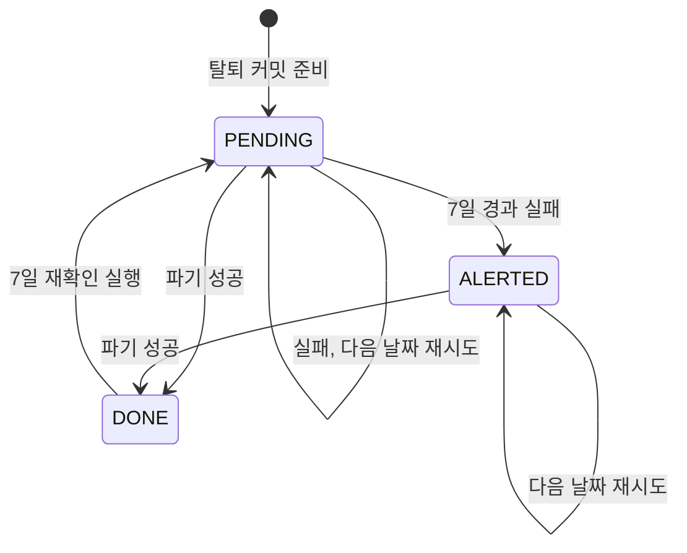

# AI 자료 파기 연결 설계

> 작성: 2026-11-04 | 버전: 다음 판 변경 | 입력: D-447·D-449, ai-자료파기-박 요구 보완, S15P31A207-244

## 책임과 계약

| 요소 | 책임 |
|------|------|
| AiDataWithdrawalListener | MemberWithdrawn·MemberPurged 사건을 파기 흐름에 연결한다. |
| AiPurgeService | 등록·실행·재시도·누락 보정을 조정한다. |
| AiPurgeRequest | 파기 진행·재확인 일정·실행 임대를 유지한다. |
| AiDataEraser | 회원별 멱등 파기 포트다. |
| AiServerPrivacyGateway | 내부 인증 DELETE와 응답 검증을 수행한다. |
| JpaAiPurgeRequestRepository | ai_purge_request를 소유한다. |
| AiPurgeRetryJob | 한국 시간 매일 03시 05분에 retryDue를 호출한다. |

## 상태와 동시성

첫 DONE은 retentionCheckDone=false와 nextAt=탈퇴 시각+7일을 보관한다. 재확인까지 성공하면 retentionCheckDone=true다. 일일 대상 조회는 재확인이 필요한 DONE도 포함한다.

등록은 탈퇴의 BEFORE_COMMIT에서 같은 트랜잭션으로 수행한다. AFTER_COMMIT 외부 호출은 별도의 짧은 요청 잠금·결과 저장 트랜잭션 사이에 둔다. 외부 DELETE 중 DB 잠금을 유지하지 않는다.

실행 임대는 1분이며 UUID 토큰으로 늦은 응답의 상태 갱신을 차단한다. DONE 재확인도 임대 획득 때 PENDING으로 바꿔 실행 중 중단이 복구된다. 실패 nextAt는 다음 한국 날짜 00시로 정해 03시 05분 스캔이 초 단위 차이로 건너뛰지 않게 한다.

기존 MemberPurged의 발행 창은 7~10일로 제한되어 있으므로 유일한 재호출 근거로 삼지 않는다. 일일 배치가 MemberQueryService.withdrawalsBefore로 실제 WITHDRAWN 회원의 ID·탈퇴 시각만 읽어 누락 요청을 등록한다.

## 의존과 저장

aiprivacy → member·audit·common, infra.aiprivacy → aiprivacy, infra.integration.ai → aiprivacy, batch.aiprivacy → aiprivacy다. 역방향 의존은 추가하지 않는다.

V37은 ai_purge_request와 AI_DATA_PURGE_OVERDUE 감사 CHECK를 만든다. 파기 요청에는 이름·대화·분석 결과·이미지를 보관하지 않는다. 회원 자료 정리 뒤에도 요청을 재시도할 수 있도록 요청 행에 회원 FK를 두지 않는다.

AI 전체 파기 제한이 10초이므로 D-449의 privacy 읽기 제한 3초를 15초로 보정한다. 재시도는 게이트웨이 내부에서 하지 않는다.
