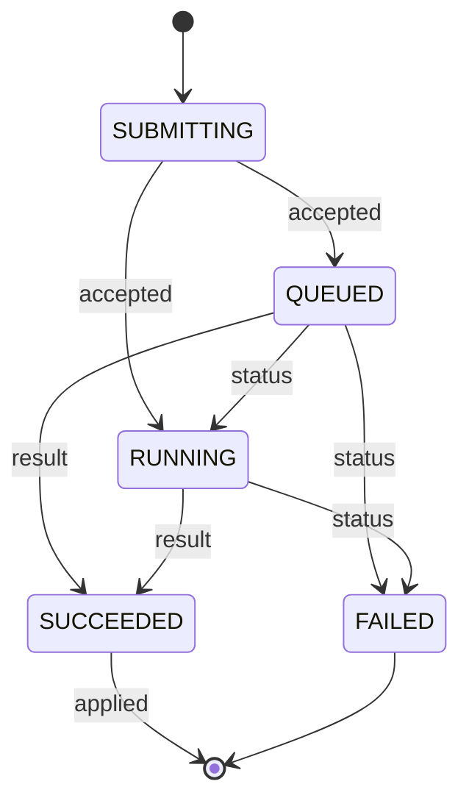

# 얼굴 비동기 연결 설계

> 작성: 2026-11-04 | 버전: 다음 판 변경 | 입력: 얼굴비동기-박 요구 변경, S15P31A207-276, develop 15479cf2

## 객체와 책임

| 객체 | 책임 | 연산 |
|------|------|------|
| FaceJobGateway | 인증 회원의 AI 얼굴 작업을 호출한다. | submit, status, result, latest, body |
| SelfieJob | 사진 요청의 작업 진행과 반영 여부를 기록한다. | accepted, failed, applied |
| SelfieJobService | 접수·조회와 아바타 반영을 조정한다. | submit, status, result, latest, head |
| Avatar | 생성 한도와 선택 얼굴을 유지한다. | beginFaceJob, applyGeneratedHead, chooseDefault |
| AiServerFaceJobGateway | HTTP 응답을 얼굴 계약으로 검증한다. | FaceJobGateway 구현 |

사진 원본은 객체·저장소에 보관하지 않는다. 요청 해시는 중복 식별에만 사용하고 응답에 노출하지 않는다.

## 동적 모델

서비스는 입력 셀카를 AI 접수로 변환하고 작업 상태를 반환한다. 결과 조회는 AI 결과를 검증한 뒤 짧은 트랜잭션에서 생성 횟수와 선택 얼굴 참조를 반영한다.

## 저장·동시성

- 새 테이블 selfie_job에 회원·사진 해시·작업 ID·접수 날짜·상태·반영 여부를 저장한다. 원본과 Data URL은 저장하지 않는다.
- Avatar 행 잠금으로 회원별 접수를 직렬화한다. 외부 호출은 트랜잭션 밖에서 한다.
- 접수 통신 실패 후 같은 사진으로 다시 요청하면 AI의 중복 방지 계약을 사용한다.
- 결과 중복 조회는 기록의 반영 플래그와 Avatar 행 잠금으로 한 번만 차감한다.
- 기본 얼굴 선택은 진행 중 작업의 자동 얼굴 교체를 취소한다. 이미 성공한 생성 횟수는 반영한다.
- 새 faceKey는 head:{회원ID}:{작업ID}다. 옛 selfie: 키와 기본 얼굴 키는 유지한다.

## 의존·검증 계획

web.avatar → avatar에 회원 ID·이미지·작업 ID를 전달한다. avatar → member에는 기존 동의·회원 공개 투영, avatar → policy에는 기존 한도를 전달받는다. infra.avatar → avatar는 저장소 포트를 구현하고 infra.integration.ai → avatar는 AI 포트를 구현한다. 새 패키지는 만들지 않는다.

단위와 계약 시험 → 서비스 통합 시험 → 기존 아바타·회원 탈퇴 회귀 → backend build 순서로 실행한다. 실제 Node 생성과 앱 합성은 후속 시스템 시험이다.
