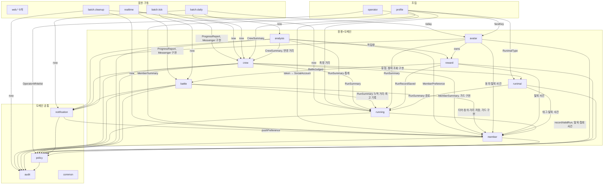

> [런크크 설계 검증 결과서](../design-review.md) 목차 · 이전: [00-04-입력-지표-결합도-응집도](00-04-입력-지표-결합도-응집도.md) · 다음: [09-v0.2-재검증](09-v0.2-재검증.md)

## 5. 판정과 개선안

### 5.1 종합 판정표 (1차)

| 항목 | 결과 | 판정 |
|------|------|------|
| 내용·공통·외부 결합 화살표 수 | 내용 1 (A44), 공통 0, 외부 0 | **불허** |
| 제어 결합 화살표 수 | 4 (A01, A03, A05, A06) | 검토 |
| 스탬프(검토) 화살표 수 | 9 (A23, A25, A37, A38, A39, A51, A57, A58, A62) | 검토 |
| 순환 의존 수 | 4 | **불허** |
| 계층 역행 수 | 2 | **불허** |
| 최대 Fan-Out | 10 (web, infra.persistence) | **불허** |
| 응집도 불허 패키지 수 | 8 (web, batch, character, admin, common, infra.persistence, infra.cache, infra.external) | **불허** |
| 응집도 검토 패키지 수 | 1 (config) | 검토 |
| 숨은 의존 중 갱신 책임 없음 | 3 (H-01, H-02, H-03) | 검토 |

1차 판정: **불합격** (불허 항목 5종).

### 5.2 개선안

| 우선 | 대상 | 문제 | 개선 기법 | 효과·비용 |
|------|------|------|-----------|-----------|
| 1 | battle → member (A44) | 내용 결합 | member가 `MemberSettingService.rememberBattleDistance(long memberId, StandardDistance d)`를 공개하고 battle은 그것만 부른다. Member.getSettings()는 불변 사본(MemberSettingsView)을 돌려준다 | 내용 → 데이터. member가 설정 변경을 한곳에서 통제. 비용 작음(메서드 1개, SQ-03 수정) |
| 1 | common·realtime ↔ battle·crew (A94~A97) | 순환 4, 계층 역행 2, 안정성 위반 2 | (1) LiveMessenger를 쓰는 쪽 포트로 나눈다: battle.BattleMessenger, crew.CrewRunMessenger. realtime이 두 인터페이스를 구현한다(realtime → battle·crew 한 방향). (2) 메시지 DTO를 만드는 패키지로 옮긴다(battle.live, crew.live 하위 패키지). (3) sealed를 쓰지 않는다. realtime은 메시지를 JSON으로 바꿀 때 형식 이름(type)만 본다. ProgressReport(거리·경과·시각 값)는 불변 기본 형식이라 common에 남긴다 | 순환 0, 역행 0, common에서 실시간 포트 제거. 비용 중간(포트 2개, 클래스 이동 10개) |
| 1 | common | 쓰레기통, 사건 형식 변경이 Fan-In 17 전체에 전파 | 도메인 사건을 **발행하는 패키지로** 옮긴다: RunRecordSaved → running, MemberWithdrawn·ConsentWithdrawn → member, BattleJudged → battle, OperationSettingChanged(신규) → policy. 수신자는 이미 발행자에 의존하고 있어 새 화살표가 생기지 않는다. 예외 하나: member가 running의 RunRecordSaved를 받으면 member → running이 되어 running → member(탈퇴 사건 수신)와 순환이 생긴다. 그래서 **티어 갱신은 running 쪽 수신자 TierUpdateListener가 member의 `TierLevelService.recordValidRun(memberId, double score, Distance distance, int validRunOrdinal)`을 부른다**(running → member 한 방향). common에는 불변 기본 형식·오류 형식·DomainEventPublisher·ProgressReport만 남기고, 책임 문장에 "변경이 드문 불변 기본 형식만 둔다"는 제약을 적는다 | common 논리적 → 조건부 허용. 사건 변경 영향이 실제 수신자로 한정. 비용 중간(사건 4개 이동, 수신자 1개 이동) |
| 2 | admin (P11) | 논리적 응집, 이동 후보 3 | CelebrityAdminService → battle.CelebrityRecordService, SettingAdminService → policy.OperationSettingService, AuditQueryService 삭제. 남은 OperatorAuthorizer는 새 이름 operator(책임: "운영자 계정을 확인한다"). web.admin이 operator로 확인한 운영자 계정 문자열(actorId)을 각 서비스에 넘긴다(서비스가 operator를 import하지 않게). 기준값이 TIER_BOUNDARY면 policy가 OperationSettingChanged를 발행하고 battle.VirtualRecordService가 받는다(policy → battle 역방향 방지) | admin 해체, operator 기능적. 비용 중간 |
| 2 | character (P10) | 논리적 응집 | runimal(Runimal 판정 묶음), avatar(Avatar·Face·외형), reward(RewardWallet·적립·상점)로 나눈다. avatar → reward(owns), crew → runimal(유형, 참여 조회 포트 구현), analysis → reward(적립량 조회). 대결 결과 화면의 적립량은 web.battle이 battle 결과와 reward 조회를 조합한다(battle → reward 제거) | 세 패키지 모두 통신적. 비용 중간 |
| 2 | web (P1), batch (P3) | 논리적 응집, Fan-Out 10·8 | web을 기능별 하위 패키지로: web.auth, web.me, web.run, web.record, web.battle, web.crew, web.character, web.admin, web.error. batch를 batch.tick(1초: battle, crew), batch.daily(0시·20시: analysis, avatar, crew, notification), batch.cleanup(3시: running, audit, member)로 | 각 하위 패키지 Fan-Out 5 이하, web.*·batch.tick·batch.cleanup 기능적, batch.daily 시간적. 비용 작음(이동만) |
| 2 | infra.persistence·cache·external (P16~P18) | 논리적 응집, Fan-Out 10 | 도메인 패키지마다 인프라 패키지 하나(infra.member, infra.running, infra.analysis, infra.battle, infra.crew, infra.runimal, infra.avatar, infra.reward, infra.policy, infra.notification, infra.audit)에 JPA·Redis 구현을 함께 둔다. 외부 서비스는 infra.integration.auth(카카오·Google·JWT), infra.integration.ai(ai 서버 게이트웨이 2개 — 같은 ai 서버 연결을 공유), infra.integration.push, infra.integration.weather | 각 패키지 통신적, Fan-Out 2~3. 비용 작음(이동만) |
| 2 | 숨은 의존 H-01~H-03 | 다른 패키지 테이블을 직접 읽는 쿼리 | 인프라를 도메인별로 나누면 H-01~H-03이 외부 결합(같은 테이블 공유)으로 드러난다. 그래서 테이블 소유 패키지가 조회 연산을 공개한다: running.RunQueryService(dailyStats, totals, periodTotals, distancesByMember(range), validRunsReaching(distance, ownerIds), recentSummaries, longest, best), member.MemberQueryService(summaries, ghostEligibleOwners(tiers), pushPreference, preferenceOf). analysis·battle·crew는 이 결과를 조합한다(랭킹 크루 평균 = crew의 멤버 목록 × running의 회원별 거리, 고스트 후보 = member의 자격 있는 주인 목록 × running의 거리 이상 유효 기록) | 다른 패키지 테이블 직접 접근 0, 갱신 책임이 테이블 소유 패키지로. 비용 중간(조회 연산 10개 안팎) |
| 3 | 스탬프(검토) 9건 | 엔티티 전체 전달 | 위 조회 연산이 엔티티 대신 필요한 값만 담은 투영을 돌려준다: RunSummary(recordId, startedAt, distance, elapsed, averagePace, valid, score, mode), MemberSummary·MemberPreference(단위, 공개 범위, LLM 동의, 푸시 허용), AvatarQuery.faceKey(memberId), RunQueryService.longest(memberId). RunRecordRepository·MemberRepository·AvatarRepository·PersonalRecordBookRepository·WeeklyRaceRepository는 자기 패키지 밖에 공개하지 않는다 | 스탬프(검토) → 스탬프(허용) 또는 데이터. 위 개선과 함께 |
| 3 | 제어 결합 4건 | 플래그·모드로 분기 선택 | 연산을 나눈다. member: `changeSetting`(일반 설정만) / `giveConsent(memberId, item)` / `withdrawConsent(memberId, item)` / `withdraw(memberId)`(확인 단계는 화면이 하고 서버는 확인된 요청만 받는다). analysis: `personalRanking(memberId, period)` / `crewRanking(memberId, period)`. battle: `selfCandidates(memberId)` / `celebrityCandidates(memberId, filter)` / `startSelfBattle(memberId, distance)` / `startCelebrityBattle(memberId, celebrityId)`. crew: `approveJoin` / `rejectJoin`, `delete(requesterId, crewId)`, `enterLobby` / `toggleReady` / `leaveLobby` | 제어 → 데이터·스탬프. 비용 작음(5.7.1 엔드포인트는 그대로) |
| 3 | H-05 | 유효 러닝 횟수를 member·character가 따로 셈 | running이 저장 때 회원의 유효 러닝 순번(validRunOrdinal)을 계산해 RunRecordSaved와 recordValidRun 호출에 싣는다. TierProgress·RunimalProfile은 순번으로 판정 시점(3, 10의 배수)을 정하고 자기 카운터는 검증용으로만 쓴다 | 두 판정 시점이 같은 값에서 나온다. 비용 작음 |
| 3 | H-06 | 주간 거리 합산 누락을 다시 맞출 경로 없음 | WeeklyRaceService에 `reconcile(crewId, Week)`(running의 distancesByMember로 다시 합산)를 두고 batch.cleanup이 지난주·이번 주를 매일 확인 | 수신자 실패가 하루 안에 바로잡힘. 비용 작음 |
| 4 | config (P19) | 시간적 응집 | 설정을 그것이 설정하는 패키지로 옮긴다: SecurityConfig → web.auth, WebSocketConfig → realtime, 스케줄 설정 → batch.*. AsyncConfig·DomainEventConfig와 애플리케이션 main은 bootstrap(책임: "애플리케이션을 시작한다")에 둔다 | config 해체, bootstrap 기능적. 비용 작음 |

### 5.3 2차 의존도

모든 패키지 → common 화살표와 web.*·infra.* 하위 패키지는 그림에서 뺐다. web.*·infra.*는 6.2 표에 있다.

2차 핵심 패키지 의존 행렬(조립·응용+도메인·도메인 공통 14개):

| From \ To | Me | Ru | Rw | Rn | Av | An | Cr | Bt | Pr | Op | Po | No | Au | Co | Fan-Out |
|-----------|----|----|----|----|----|----|----|----|----|----|----|----|----|----|---------|
| member (Me) | – | | | | | | | | | | 1 | | 1 | 1 | 3 |
| running (Ru) | 1 | – | | | | | | | | | | | 1 | 1 | 3 |
| reward (Rw) | 1 | 1 | – | | | | | 1 | | | 1 | | | 1 | 5 |
| runimal (Rn) | 1 | 1 | | – | | | | | | | 1 | | | 1 | 4 |
| avatar (Av) | 1 | 1 | 1 | | – | | | | | | 1 | 1 | | 1 | 6 |
| analysis (An) | 1 | 1 | 1 | | | – | 1 | | | | 1 | 1 | | 1 | 7 |
| crew (Cr) | 1 | 1 | | 1 | | | – | | | | 1 | 1 | 1 | 1 | 7 |
| battle (Bt) | 1 | 1 | | | | | | – | | | 1 | 1 | 1 | 1 | 6 |
| profile (Pr) | 1 | 1 | | 1 | 1 | | 1 | | – | | | | | 1 | 6 |
| operator (Op) | 1 | | | | | | | | | – | 1 | | | 1 | 3 |
| policy (Po) | | | | | | | | | | | – | | 1 | 1 | 2 |
| notification (No) | 1 | | | | | | | | | | 1 | – | | 1 | 3 |
| audit (Au) | | | | | | | | | | | | | – | 1 | 1 |
| common (Co) | | | | | | | | | | | | | | – | 0 |

common → audit → policy → member → notification → running → runimal → battle → reward → avatar → crew → analysis → profile·operator 순으로 정렬하면 모든 1이 대각선 한쪽에만 놓인다(각 패키지는 자기보다 앞에 정렬된 패키지에만 의존). 대칭 위치가 함께 1인 쌍이 없다. 순환 0건이다.

## 6. 재검증과 전후 비교

### 6.1 2차 재검증 결과

| 단계 | 결과 |
|------|------|
| 0 입력 | 핵심 패키지 14개(1차 12개에서 character → runimal·avatar·reward 3개, admin → operator) + web.* 9개 + realtime + batch.* 3개 + infra.* 15개 + bootstrap = 43개 |
| 1 지표 | 핵심 패키지 최대 Fan-Out 7(analysis, crew). web.* 최대 5(web.admin: operator, battle, policy, audit, common), infra.* 최대 3(infra.integration.ai: analysis, avatar, common), batch.daily 4 |
| 2 결합도 | 내용 0(A44 → `rememberBattleDistance(memberId, d)` 데이터 결합), 제어 0(연산 분리), 스탬프(검토) 0(투영 값), 외부 0(테이블 소유 패키지만 자기 테이블을 읽음) |
| 3 응집도 | runimal·avatar·reward·member·running·analysis·crew·battle·policy·notification·infra.<도메인> 통신적, profile·operator·audit·realtime·batch.tick·batch.cleanup·web.*·infra.integration.*·bootstrap 기능적, common 논리적(불변 기본 형식만 — 조건부 허용), **batch.daily 시간적(검토)** |
| 4 구조 | 순환 0, 계층 역행 0(도메인은 BattleMessenger·CrewRunMessenger 포트만 알고 realtime이 구현), 쓰레기통 0(common 조건부 허용), 허브 0, 고립 0. bootstrap은 컴포넌트 탐색 진입점이라 import 의존이 없다. 입력 누락이 아니라 프레임워크 진입점으로 확인했다 |

불안정도(2차): common 0.00, audit 0.11, policy 0.14, member 0.16, running 0.19, notification 0.27, runimal 0.50, battle 0.50, reward 0.50, crew 0.50, avatar 0.55, analysis 0.60, operator 0.60, profile 0.86. 모든 화살표가 I 큰 쪽 → 작거나 같은 쪽이다. 같은 값인 쌍 2개(reward → battle, crew → runimal, 모두 0.50)는 위반이 아니지만, battle·runimal을 바꿀 때 reward·crew 재시험이 필요하다는 뜻이다.

### 6.2 web.*·infra.* 하위 패키지 (2차)

| 패키지 | 의존 대상 (Fan-Out) | 응집 |
|--------|--------------------|------|
| web.auth | member, operator, common (3) | 기능적 — 로그인·가입·운영자 로그인 요청 처리 |
| web.me | member, profile, notification, common (4) | 통신적 — 본인 계정 화면 |
| web.run | running, common (2) | 통신적 |
| web.record | analysis, common (2) | 통신적 |
| web.battle | battle, reward, common (3) — 결과 화면의 적립량은 여기서 조합 | 통신적 |
| web.crew | crew, common (2) | 통신적 |
| web.character | runimal, avatar, reward, common (4) | 통신적 — 같은 "캐릭터" 탭 화면이지만 연산마다 대상 패키지 하나 |
| web.admin | operator, battle, policy, audit, common (5) | 기능적 — 관리툴 요청을 운영자 확인 뒤 위임 |
| web.error | common (1) | 기능적 |
| infra.<도메인> 11개 | 그 도메인, common (2) | 통신적 — 한 도메인의 저장 |
| infra.integration.auth | member, common (2) | 기능적 |
| infra.integration.ai | analysis, avatar, common (3) | 통신적 — 같은 ai 서버 연결 |
| infra.integration.push | notification, common (2) | 기능적 |
| infra.integration.weather | running, common (2) | 기능적 |

### 6.3 전후 비교

| 항목 | 1차 | 2차 | 판정 |
|------|-----|-----|------|
| 내용·공통·외부 결합 화살표 수 | 1 (내용) | 0 | 합격 |
| 제어 결합 화살표 수 | 4 | 0 | 합격 |
| 스탬프(검토) 화살표 수 | 9 | 0 | 합격 |
| 순환 의존 수 | 4 | 0 | 합격 |
| 계층 역행 수 | 2 | 0 | 합격 |
| 안정성 위반 수 | 2 | 0 | 합격 |
| 응집도 불허 패키지 수 | 8 | 0 (common 조건부 허용) | 합격 |
| 응집도 통신적 미만 패키지 수 | 9 (불허 8 + 시간적 1) | 2 (common 논리적 조건부 허용, batch.daily 시간적) | 검토 1 |
| 최대 Fan-Out | 10 | 7 | 합격 |
| 숨은 의존 중 갱신 책임 없음 | 3 | 0 | 합격 |
| 패키지 수 | 19 | 43 (핵심 14) | 아래 부작용 |

부작용 점검:
- **Fan-Out**: 분할로 기준을 넘은 곳이 없다. analysis·crew가 7로 상한에 걸려 있다. 다음 기능 추가 때 새 의존이 생기면 기준을 넘는다. analysis는 코치(RunningGoal, CoachService)를 분리할 여지가 있고(3.1 P6 근거상 지금은 이동 조건이 아님), crew는 notification·audit 호출을 사건으로 바꿀 여지가 있다.
- **새 인터페이스 패키지**: BattleMessenger·CrewRunMessenger는 각자의 도메인 패키지 안에 두었고 새 공용 패키지를 만들지 않았다. operator는 OperatorAuthorizer 하나만 가진다(쓰레기통 위험 없음).
- **common 조건부 허용의 유지 조건**: 책임 문장을 "모든 패키지가 공유하는 변경이 드문 불변 기본 형식(값 객체, 열거형, 오류 형식)을 정의한다"로 바꾸고, 사건·포트·유틸 함수를 넣지 않는다. 이 조건이 깨지면 다시 쓰레기통이다. DomainEventPublisher(인터페이스 하나)는 형식 정의라 예외로 둔다.
- **패키지 수**: 19 → 43으로 두 배 넘게 늘었다. 늘어난 24개 중 대부분은 web.*·infra.*처럼 도메인 패키지를 거울처럼 따라가는 하위 패키지라, 구조를 이해하는 데는 핵심 14개만 보면 된다. 핵심 패키지는 12 → 14로 2개 늘었다.
- **조회 연산 추가의 비용**: 다른 패키지 테이블 조인을 없애면서 랭킹 크루 평균과 고스트 후보는 쿼리 2번(회원 목록 → 기록)으로 나뉜다. 베타 규모(20명, 동시 50명)에서 문제없지만 NFR-001(p95 500ms) 부하 시험(10/28) 때 랭킹 집계와 고스트 탐색 시간을 따로 잰다.
- **티어 갱신 호출 방향**: running의 TierUpdateListener가 member를 부르게 되어 "running은 후속 처리를 모른다"(design-oo.md D-03)는 원칙에 예외가 하나 생긴다. member ↔ running 순환을 피하기 위한 선택이며 D-03에 예외로 적어야 한다.
- **검토 1건(batch.daily 시간적)을 남긴 이유**: batch.daily의 각 작업은 응용 서비스 호출 순서만 가지고 업무 규칙이 없다(시간적 응집의 개선 원칙 "시작 모듈은 호출 순서만 가진다"와 같은 모양). 더 나누면 0시·20시 작업마다 패키지가 하나씩 생겨 분할의 이익이 없다. 시각이 바뀌는 일(예: 랭킹 집계 시각 변경)이 생기면 그 작업만 따로 뺀다.

## 7. 확정

| 항목 | 내용 |
|------|------|
| 최종 판정 | **합격** (design-oo.md v0.7 실제 구조 기준, 14장). v0.1 불합격, v0.2 불합격(9.9), v0.3 불합격(10.8), v0.4 조건부 합격(11.7), v0.5 불합격(12.7), v0.6 조건부 합격(13.7), v0.7 합격. 불허 0, 검토 0 |
| 설계서 반영 버전 | design-oo.md v0.7 (2026-10-20) — 7차 개선(13.5.2) 반영본을 14장에서 확인 |
| 검토자 | 미정 (팀 검토 전, 분석 담당 자체 검증) |
| 날짜 | 2026-10-19 (1차), 2026-10-20 (v0.2·v0.3·v0.4·v0.5·v0.6 재검증, v0.7 확인) |

## 8. 앱 모듈 부 검증 (design-oo.md 5.1.2)

### 8.1 의존 화살표와 판정

| No | From → To | 주고받는 것 | 등급 | 판정 |
|----|-----------|-------------|------|------|
| B01 | app.ui → app.run | RunStartSpec; MeasurementService.finish(**longPress: Boolean**); progress 흐름 | 제어 | 검토 |
| B02 | app.ui → app.store | pending() → 미전송 목록 | 스탬프 | 허용 |
| B03 | app.ui → app.battle | forfeit(), 상태 흐름 | 데이터 | 허용 |
| B04 | app.ui → app.crewrun | quit(), 상태 흐름 | 데이터 | 허용 |
| B05 | app.ui → app.card | (RunCardData, CardSide) → Bitmap; share(card, side, ShareTarget) | 스탬프 | 허용 |
| B06 | app.ui → app.auth | signIn(activity) → ProviderToken | 데이터 | 허용 |
| B07 | app.ui → app.api | 화면별 REST 호출 | 스탬프 | 허용 |
| B08 | app.run → app.store | save(CompletedRun) | 스탬프 | 허용 |
| B09 | app.run → app.watch | publish(WatchDisplay), onHeartRates, isConnected | 스탬프 | 허용 |
| B10 | app.sync → app.store | pending, remove, purgeRoutes, purgeHeartRates, appendHeartRates | 데이터 | 허용 |
| B11 | app.sync → app.api | upload, disposals | 스탬프 | 허용 |
| B12 | app.battle → app.run | startRun(spec); finish(**true**) — "대결 종료 신호·도착은 longPress = true로 부른다"(design-oo.md 6.1.14) | 제어 | 검토 |
| B13 | app.battle → app.live | connect, send, messages | 스탬프 | 허용 |
| B14 | app.crewrun → app.run | 같은 finish(true) | 제어 | 검토 |
| B15 | app.crewrun → app.live | connect, send, messages | 스탬프 | 허용 |
| B16 | app.live → app.api | 폴링 대체의 REST 호출 | 데이터 | 허용 |
| B17 | app.api → app.auth | TokenStore에서 접근 토큰 | 데이터 | 허용 |

근거: B01·B12·B14는 하나의 Boolean이 "사람이 버튼을 길게 눌렀는가"와 "프로그램이 끝내라고 했는가"라는 서로 다른 두 처리를 겸한다. 대결·크루런 조정자가 화면 규칙(FR-181 길게 누르기)을 우회하려고 true를 넘기는 것은, 호출자가 호출받는 쪽의 내부 분기를 알고 있다는 뜻이다.

### 8.2 응집도와 구조

| 모듈 | 같이 있는 이유 | 등급 | 판정 |
|------|---------------|------|------|
| app.ui | 모두 화면이라서 (30종) | 논리적 | **불허** |
| app.api | 모두 REST 인터페이스라서 (화면 전 기능의 엔드포인트) | 논리적 | **불허** |
| app.run | RunSession 하나의 측정 상태 | 통신적 | 허용 |
| app.store | 미전송 기록 보관 한 기능 | 기능적 | 허용 |
| app.sync | PendingRunStore 데이터를 서버와 맞춤 | 통신적 | 허용 |
| app.watch, app.live, app.battle, app.crewrun, app.auth | 각자 한 기능 | 기능적 | 허용 |
| app.card | 카드 이미지 | 통신적 | 허용 |

구조: 순환 0(app.api → app.auth만 있고 반대 방향 없음), 계층 역행 0, 최대 Fan-Out 7(app.ui: run, store, battle, crewrun, card, auth, api — 상한).

개선안:

| 우선 | 대상 | 개선 |
|------|------|------|
| 1 | B01·B12·B14 | MeasurementService를 `requestFinish(longPress: Boolean)`(화면 전용, 짧게 누르면 안내)와 `endRun()`(조정자 전용, 무조건 종료)으로 나눈다. RunSession도 `finish(longPress, now)` / `end(now)`로 |
| 2 | app.ui | 기능별 하위 모듈 ui.home, ui.run, ui.record, ui.battle, ui.crew, ui.character, ui.me로 나눈다. 각 Fan-Out 3 이하 |
| 2 | app.api | Retrofit 인터페이스를 기능별로(RunApi, BattleApi, CrewApi …) 나눠 api.<기능>에 둔다. 공통 OkHttp 설정·토큰 부착은 api.core 하나(기능적: "서버 연결을 만든다") |

2차 앱 판정(v0.1 계획 기준): 제어 0, 응집 불허 0 → 앱 모듈 단독으로 **합격**. 이 판정은 v0.2 재검증(9.5)에서 뒤집혔다. requestFinish(longPress: Boolean)의 제어 결합(R2)과 app.api.character의 응집 불허(N4)가 남아 있다. 최종 판정은 7장을 따른다.

