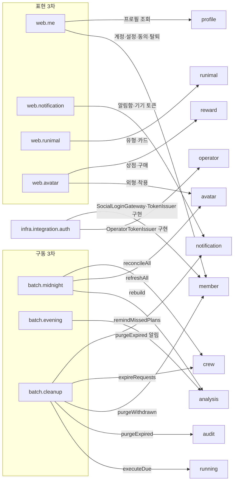

> [런크크 설계 검증 결과서](../design-review.md) 목차 · 이전: [05-08-판정-개선-확정](05-08-판정-개선-확정.md) · 다음: [10-v0.3-재검증](10-v0.3-재검증.md)

## 9. v0.2 재검증 (설계서 반영본)

0~8장은 design-oo.md v0.1에 대한 1차 검증과 그 개선 계획(2차)의 기록이다. 이 장은 2차 계획이 아니라 **design-oo.md v0.2 본문**을 입력으로 0~6단계를 다시 수행한 결과다. 설계서 12장의 의존 목록·행렬과 판정 문장은 이 검증서 v0.1의 2차 표를 옮긴 것이어서 그대로 믿지 않았다. 6.1 클래스 명세의 의존 열·매개변수·반환 형, 2.2 SQ-01~SQ-17의 참여자·메시지, 5.3~5.5, 6.2, 6.1.13, 13.1에서 패키지를 넘는 형식 참조와 호출을 모두 다시 뽑아 12.2와 대조했다. 위치 표기 "l.NNNN"은 design-oo.md v0.2의 줄 번호다.

### 9.0 입력 정리

#### 9.0.1 검증 기준

0.1의 기준을 그대로 쓰되, 1차에서 판정이 흔들린 세 가지를 명시한다.

| 항목 | 기준 |
|------|------|
| 결합도·응집도·Fan-Out·순환·계층 | 0.1과 같다 (결합도 상한 스탬프, 응집도 하한 통신적, Fan-Out 7, 순환 0, 계층 역행 0) |
| 스탬프 절반 규칙의 단위 | 화살표 하나에서 받는 패키지가 그 구조의 필드를 실제로 쓰는 합집합으로 센다. 한 화살표로 넘어가는 구조가 여럿이면 하나라도 절반 미만이면 그 화살표는 스탬프(검토)다. 조회 투영(projection)도 구조이므로 같은 규칙을 적용한다 |
| 도메인 사건의 페이로드 | 발행자가 수신자를 모르는 방송형 계약이라 절반 규칙을 적용하지 않는다. 수신자에게 맞춰 사건을 줄이면 발행자가 수신자를 알게 되어 D-03이 깨지기 때문이다. 대신 사건 항목별 수신자를 숨은 의존(9.2.4)으로 관리한다 |
| 표현·구동 하위 패키지의 응집도 | 도메인 패키지와 같은 질문표로 묻는다. 설계서가 스스로 정한 원칙 "표현·구동·인프라 계층도 기능(도메인)별 하위 패키지로 나눈다"(5.1.1, l.3131)를 판정 근거로 함께 쓴다 |

#### 9.0.2 패키지 목록 (v0.2, 43개)

| ID | 패키지 | 계층 | 책임 (설계서 그대로) | 포함 요소 (요약) |
|----|--------|------|--------------------|------------------|
| V1 | web.auth | 표현 | 로그인·가입 요청을 회원·운영자 확인 호출로 바꾼다 | AuthController(회원·운영자 로그인), SignUpController, AuthFilter, SecurityConfig |
| V2 | web.me | 표현 | 본인 계정 화면 요청을 응용 서비스 호출로 바꾼다 | MeController(프로필 조회·편집, 설정, 동의, 탈퇴, 약관), NotificationController |
| V3 | web.run | 표현 | 러닝 기록 전송 요청을 running 호출로 바꾼다 | RunController |
| V4 | web.record | 표현 | 기록 분석 화면 요청을 analysis 호출로 바꾼다 | RecordController, DashboardController, CoachController, RankingController |
| V5 | web.battle | 표현 | 대결 화면 요청을 battle 호출로 바꾼다 | BattleController, BattleResultAssembler |
| V6 | web.crew | 표현 | 크루 화면 요청을 crew 호출로 바꾼다 | CrewController, CrewAdminController, CrewPostController, CrewRunController |
| V7 | web.character | 표현 | 캐릭터 탭 요청을 runimal·avatar·reward 호출로 바꾼다 | CharacterController(Runimal 2, 아바타 4, 상점 2 엔드포인트) |
| V8 | web.admin | 표현 | 관리툴 요청을 운영자 확인 뒤 담당 서비스에 위임한다 | AdminController |
| V9 | web.error | 표현 | 예외를 API 오류 응답으로 바꾼다 | ApiExceptionHandler, ErrorResponse |
| V10 | realtime | 표현 | 실시간 채널 메시지를 응용 서비스 호출로 바꾼다 | LiveSocketHandler, SocketSessionRegistry, WebSocketMessenger, PollingMessenger, LivePollingController, RealtimeMessageSerializer, WebSocketConfig |
| V11 | batch.tick | 구동 | 1초마다 대결·크루런 시계 작업을 부른다 | SecondTickJob, TickSchedulingConfig |
| V12 | batch.daily | 구동 | 매일 0시·20시 작업을 부른다 | MidnightJob, EveningJob, DailySchedulingConfig |
| V13 | batch.cleanup | 구동 | 매일 3시 기한이 지난 자료 정리를 부른다 | DailyCleanupJob, CleanupSchedulingConfig |
| V14 | bootstrap | 시작 | 애플리케이션을 시작한다 | RunkkApplication, AsyncConfig, DomainEventConfig |
| V15 | profile | 조립 | 여러 패키지의 정보로 프로필 화면을 조립한다 | ProfileQueryService, ProfileView, ProfileDisclosure |
| V16 | operator | 조립 | 운영자 계정을 확인한다 | OperatorId, OperatorAuthorizer |
| V17 | member | 응용+도메인 | 회원 계정의 생애주기를 관리한다 | Member와 합성 부품, 서비스 7개(MemberQueryService 포함), 사건 2종, 포트 5개 |
| V18 | running | 응용+도메인 | 러닝 기록의 수신·판정·파기를 관리한다 | RunRecord, PersonalRecordBook, DisposalOrder, RunQueryService, 투영 6종, RunRecordSaved, TierUpdateListener |
| V19 | runimal | 응용+도메인 | 회원의 Runimal 유형을 판정한다 | RunimalProfile, CourseVerdict, 축 평가 4개, RunimalQuery, CrewRunParticipationQuery 포트 |
| V20 | battle | 응용+도메인 | 매칭과 대결의 생애주기를 관리한다 | Battle, MatchTicket, 상대 기록 3종, 서비스 13개, BattleMessenger, battle.live 메시지 6종 |
| V21 | reward | 응용+도메인 | 회원의 리워드 잔액**과** 보유 아이템을 관리한다 | RewardWallet, RewardService, ShopService, RewardWithdrawalListener |
| V22 | avatar | 응용+도메인 | 회원 아바타의 외형 상태를 관리한다 | Avatar, Face 3종, AppearanceCalculator, AvatarService, AppearanceService, AvatarQuery |
| V23 | crew | 응용+도메인 | 크루와 크루 활동의 생애주기를 관리한다 | Crew, 멤버십, 가입 신청, 게시글, 크루런, 주간 거리, CrewMembershipReader, CrewRunMessenger, crew.live 메시지 4종 |
| V24 | analysis | 응용+도메인 | 러닝 기록을 읽어 분석 결과를 만든다 | RunningGoal, Report, RankingSnapshot, 서비스 8개, 포트 5개 |
| V25 | policy | 도메인 공통 | 운영 기준값을 형식 있는 값으로 제공한다 | OperationSetting, OperationPolicy, OperationSettingService, OperationSettingChanged, 기준 값 객체 20종 |
| V26 | notification | 도메인 공통 | 회원 알림을 저장하고 발송한다 | Notification, NotificationService, PushGateway |
| V27 | audit | 도메인 공통 | 감사 대상 행위를 고치지 않고 남긴다 | AuditRecord, AuditEntry, AuditService |
| V28 | **common** | 도메인 공통 | 모든 패키지가 공유하는 변경이 드문 불변 기본 형식을 정의한다 | 값 객체 8개(Timestamps 포함), 열거형 10개(ItemSlot 포함), ProgressReport, 예외 2개, DomainEvent, DomainEventPublisher |
| V29~V39 | infra.<도메인> 11개 | 인프라 | 같은 이름 도메인 패키지의 저장(대기열·세션·카운터) 포트를 구현한다 | Jpa…Repository 26개, Redis 구현 5개, JdbcMatchQueue |
| V40 | infra.integration.auth | 인프라 | member의 인증 포트를 외부 제공자·JWT 라이브러리로 구현한다 | KakaoLoginGateway, GoogleLoginGateway, JwtTokenIssuer |
| V41 | infra.integration.ai | 인프라 | ai 서버 호출을 감싼다 | AiServerClient, AiServerCommentGateway, AiServerFaceGateway |
| V42 | infra.integration.push | 인프라 | 푸시 발송을 FCM으로 수행한다 | FcmPushGateway (기기 토큰 표 포함, l.4957) |
| V43 | infra.integration.weather | 인프라 | 날씨 조회를 기상청 서비스로 수행한다 | KmaWeatherGateway |

의심 표시:
- 책임 문장의 접속사: V21 reward("잔액과 보유 아이템"), V1 web.auth("로그인·가입", "회원·운영자"), V7 web.character("runimal·avatar·reward"), V12 batch.daily("0시·20시"). 앱 app.card("그리고")는 9.5에서 본다.
- common류 이름: V28 common, V14 bootstrap, V16 operator, V12 batch.daily, V10 realtime, V40~V43 infra.integration.*.
- 책임 문장과 포함 요소가 어긋남: V2 web.me(NotificationController는 "본인 계정"이 아니고, GET /members/{id}/profile은 다른 회원 프로필 조회다), V12 batch.daily(0시와 20시는 같은 시점이 아니다).

#### 9.0.3 의존 화살표 대조 (12.2 D1~D62 ↔ 본문)

검증용 화살표 목록은 12.2의 D1~D62에 아래 E1~E6을 **(추가)** 한 것이다. 대조 결과는 (a) 본문에서 쓰는데 12.2에 없는 화살표 6개(서버 2, 앱 4), (b) 12.2에 있는데 본문 근거가 없는 화살표 0개, (c) 12.2의 "주고받는 것"이 6.1과 어긋나거나 6.1에 연산이 없는 곳 13건이다.

(a) 12.2에 없는 화살표

| No | From → To | 근거 위치 | 주고받는 것 |
|----|-----------|-----------|-------------|
| E1 | realtime → member **(추가)** | 6.1.13 l.5012 LiveSocketHandler.afterConnectionEstablished "토큰 확인" | accessToken → memberId (TokenIssuer.verify, l.3710) **(추정)**. 웹소켓 연결은 AuthFilter를 거치지 않으므로 realtime이 member의 포트를 직접 부른다 |
| E2 | bootstrap → common **(추가)** | 6.1.13 l.5022 DomainEventConfig "사건 발행기 설정", 6.1.1 l.3500 "Spring ApplicationEventPublisher로 구현" | DomainEventPublisher 구현 **(추정)**. 12.2 끝 문장 "bootstrap은 import 의존이 없다"(l.6720)와 모순된다 |
| E3 | app.battle → app.api.battle **(추가)** | 6.1.14 l.5112 BattleRunCoordinator.forfeit "POST /battles/{id}/forfeit" | battleId |
| E4 | app.crewrun → app.api.crew **(추가)** | 6.1.14 l.5118 CrewRunCoordinator.quit "POST /crew-runs/{id}/quit" | postId |
| E5 | app.live → app.auth 또는 app.api.core **(추가)** | 6.1.14 l.5102 LiveChannel.connect(token), PollingLiveChannel의 /live/* 호출 | 접근 토큰 **(추정)**. 5.1.2(l.3166)는 app.live → api.<기능>이라 했지만 /live/*를 담는 api.<기능> 모듈이 없다 |
| E6 | app.ui.me → app.store **(추가)** | 6.1.14 l.5090 PendingRunStore.clear()(탈퇴) | 호출만 **(추정)** |

(b) 12.2에 있는데 근거가 없는 화살표: 없다. D1~D62 62개 모두 6.1 의존 열 또는 2.2 시퀀스에서 쓰는 곳을 찾았다.

(c) 불일치·누락

| No | 화살표 | 12.2 기재 | 본문 실제 (위치) |
|----|--------|-----------|------------------|
| M1 | D39 operator → member | "관리툴 토큰(TokenIssuer)" | TokenIssuer(l.3710)에는 issue(long memberId)와 verify(String) → long뿐이다. 운영자는 memberId가 없어 관리툴 토큰을 발급·검증할 연산이 없고, ensureOperator(adminToken)(l.4999)가 토큰에서 운영자 계정을 꺼낼 길도 없다 |
| M2 | D56 batch.daily → crew | "now → WeeklyRaceService.reconcile" | 시그니처는 reconcile(long crewId, Week week)(l.4611)이고 "크루마다 이번 주·지난주"로 부른다. batch.daily가 크루 목록과 주를 골라야 하는데 크루 목록 조회 연산이 없고, 고르는 일은 업무 규칙이라 "호출 순서만 가진다"(l.5020)와 어긋난다 |
| M3 | D57 batch.cleanup → member | "탈퇴 회원 7일 기한 확인" | 6.1.2 member에 해당 연산이 없다 |
| M4 | D28 analysis → member | MemberPreference, MemberSummary, rankedMemberIds | RecordQueryService.detail(l.4020)은 출생연도가 있을 때 심박 구간을 보이고 RunQueryService.detail(recordId, OptionalInt maxHeartRate)(l.3865)에 최대 심박을 넘겨야 한다. MemberPreference(l.3697)·MemberSummary(l.3714)에 출생연도·나이가 없다 |
| M5 | D30, D38 → crew | "memberId → CrewSummary" | CrewSummary의 항목이 6.1.7과 부록 D 어디에도 정의되지 않았다. 결합도는 (추정)으로 판정했다 |
| M6 | D30 analysis → crew | "→ 크루별 크루원 목록" | 크루 랭킹 RankEntry.displayName(l.4001)에 크루 이름이 필요한데 activeMembersByCrew()는 Map<Long, List<Long>>(l.4617)만 준다. SQ-15(l.2253)도 이름을 받지 않는다 |
| M7 | D29 analysis → running | RunSummary 등 | RecordQueryService.cardData(l.4021)가 RunQueryService.summary로 카드 앞면을 만드는데 RunSummary(l.3879)에 cardKind가 없다. 카드 종류는 러닝 모드만으로 정해지지 않는다(1.5.3 l.1578) |
| M8 | D8 battle → member | summaries, ghostEligibleOwners 등 | VirtualRecordFactory.generate(…, Predicate<String> nicknameTaken)(l.4245)가 회원 닉네임과의 중복을 검사해야 하는데(1차 H-11) MemberQueryService에 닉네임 존재 조회가 없고 VirtualRecordService의 의존 열도 없다 |
| M9 | D26, D27 crew → notification·audit | "NotificationRequest 6종", "AuditEntry 3종" | crew가 보내는 알림은 8종(JOIN_REQUESTED, JOIN_DECIDED, JOIN_EXPIRED, LEADER_TRANSFERRED, CREW_DELETED, KICKED, CREW_RUN_RECRUIT, CREW_RUN_SOON), 감사 행위는 4종(LEADER_TRANSFER, CREW_DELETE, KICK, POST_FORCE_DELETE)이다 |
| M10 | D45, D52 web.auth·web.admin | 로그인·가입 / "(DateRange, AuditAction) → 감사 기록 목록" | D45에 AuthFilter의 TokenIssuer.verify가 빠졌다. AuditService.query는 (DateRange, Optional<AuditAction>) → List<AuditRecord>(엔티티)다(l.4977) |
| M11 | 5.1.2 앱 | "각 ui.* 모듈은 Fan-Out이 3 이하"(l.3166) | ui.me는 api.auth, api.me, api.notification, app.auth에 E6 app.store까지 5다(기준 7 안) |
| M12 | 13.1 ArchUnit 규칙 (7) | "battle.live·crew.live는 자기 상위 패키지와 realtime만 import한다"(l.6780) | 도메인 하위 패키지가 realtime을 import하도록 허용하는 문장이라 규칙 (3)·D-06과 모순된다. RealtimeMessageSerializer는 메시지 클래스를 모르므로(l.5016) 맞는 규칙은 "battle.live·crew.live는 자기 상위 패키지와 common만 import하고, 이들을 import하는 패키지도 자기 상위 패키지뿐이다"다. 14장(l.6869)의 "규칙 8개"는 13.1의 8개와 목록이 다르다 |
| M13 | D15·D16 reward → battle·policy | BattleJudged → 적립, RewardRule | RewardService.onBattleJudged가 적립량을 상수 20으로 적었다(l.4802). 같은 값이 운영 기준 RewardRule.battleWin(l.4873)에 있어, 운영자가 바꿔도 적립량이 바뀌지 않는다 |

### 9.1 의존 행렬과 지표

핵심 패키지 14개의 의존 행렬은 12.3과 같다. 행마다 12.2·6.1과 대조해 확인했다. 열 수가 데이터 자체라 표 열 제한(5개)의 예외다.

| From \ To | Me | Ru | Rw | Rn | Av | An | Cr | Bt | Pr | Op | Po | No | Au | Co | Fan-Out |
|-----------|----|----|----|----|----|----|----|----|----|----|----|----|----|----|---------|
| member (Me) | – | | | | | | | | | | 1 | | 1 | 1 | 3 |
| running (Ru) | 1 | – | | | | | | | | | | | 1 | 1 | 3 |
| reward (Rw) | 1 | 1 | – | | | | | 1 | | | 1 | | | 1 | 5 |
| runimal (Rn) | 1 | 1 | | – | | | | | | | 1 | | | 1 | 4 |
| avatar (Av) | 1 | 1 | 1 | | – | | | | | | 1 | 1 | | 1 | 6 |
| analysis (An) | 1 | 1 | 1 | | | – | 1 | | | | 1 | 1 | | 1 | 7 |
| crew (Cr) | 1 | 1 | | 1 | | | – | | | | 1 | 1 | 1 | 1 | 7 |
| battle (Bt) | 1 | 1 | | | | | | – | | | 1 | 1 | 1 | 1 | 6 |
| profile (Pr) | 1 | 1 | | 1 | 1 | | 1 | | – | | | | | 1 | 6 |
| operator (Op) | 1 | | | | | | | | | – | 1 | | | 1 | 3 |
| policy (Po) | | | | | | | | | | | – | | 1 | 1 | 2 |
| notification (No) | 1 | | | | | | | | | | 1 | – | | 1 | 3 |
| audit (Au) | | | | | | | | | | | | | – | 1 | 1 |
| common (Co) | | | | | | | | | | | | | | – | 0 |
| **Fan-In(핵심)** | 10 | 7 | 2 | 2 | 1 | 0 | 2 | 1 | 0 | 0 | 9 | 4 | 5 | 13 | |

Fan-In(전체)는 핵심 패키지에 web.*·realtime·batch.*·infra.*·bootstrap에서 들어오는 화살표(E1·E2 포함)를 더한 값이고, 불안정도는 이 값으로 계산했다.

| 패키지 | Fan-In (핵심 / 전체) | Fan-Out | 불안정도 I | 해석 |
|--------|---------------------|---------|-----------|------|
| common | 13 / 42 | 0 | 0.00 | 가장 안정. E2 포함 |
| audit | 5 / 8 | 1 | 0.11 | |
| policy | 9 / 11 | 2 | 0.15 | 12.3은 0.14 |
| member | 10 / 16 | 3 | 0.16 | E1 포함 |
| running | 7 / 11 | 3 | 0.21 | 12.3은 0.19 |
| notification | 4 / 8 | 3 | 0.27 | |
| runimal | 2 / 4 | 4 | 0.50 | |
| battle | 1 / 6 | 6 | 0.50 | |
| reward | 2 / 5 | 5 | 0.50 | |
| crew | 2 / 7 | 7 | 0.50 | Fan-Out 상한 |
| avatar | 1 / 5 | 6 | 0.55 | |
| operator | 0 / 2 | 3 | 0.60 | |
| analysis | 0 / 4 | 7 | 0.64 | Fan-Out 상한. 12.3은 0.60 |
| profile | 0 / 1 | 6 | 0.86 | |

표현·구동·인프라 하위 패키지의 의존 대상:

| 패키지 | 의존 대상 | Fan-Out |
|--------|----------|---------|
| web.auth | member, operator, common | 3 |
| web.me | member, profile, notification, common | 4 |
| web.run / web.record / web.crew | running / analysis / crew, common | 2 |
| web.battle | battle, reward, common | 3 |
| web.character | runimal, avatar, reward, common | 4 |
| web.admin | operator, battle, policy, audit, common | 5 |
| web.error | common | 1 |
| realtime | battle, crew, member(E1), common | 4 |
| batch.tick | battle, crew, common | 3 |
| batch.daily | analysis, avatar, crew, notification, common | 5 |
| batch.cleanup | running, audit, member, common | 4 |
| bootstrap | common(E2) | 1 |
| infra.<도메인> 11개 | 같은 이름 도메인, common | 2 |
| infra.integration.auth / push / weather | member / notification / running, common | 2 |
| infra.integration.ai | analysis, avatar, common | 3 |

해석:
- 최대 Fan-Out은 7(analysis, crew)로 상한에 걸려 있다. 12.3의 지적(코치 분리, crew의 알림·감사 호출을 사건으로)이 그대로 유효하다.
- 12.3의 불안정도는 이 검증서 v0.1 6.1의 2차 계획 값을 옮긴 것이라 실제 v0.2 화살표로 다시 계산하면 세 패키지가 0.01~0.04 다르다. 화살표 방향 결론(모든 화살표가 I 큰 쪽 → 작거나 같은 쪽)은 바뀌지 않는다. 같은 값인 쌍은 reward → battle, crew → runimal(모두 0.50) 둘이다.

### 9.2 결합도 판정

#### 9.2.1 화살표별

| No | From → To | 주고받는 것 (받는 쪽이 쓰는 필드) | 등급 | 판정 |
|----|-----------|----------------------------------|------|------|
| D1 | member → policy | TierBoundary(전 필드) | 스탬프 | 허용 |
| D2, D4 | member·running → audit | AuditEntry(6필드, audit가 전부 저장) | 스탬프 | 허용 |
| D3 | running → member | (memberId, RunScoreInput 3/3) → TierChange; MemberWithdrawn·ConsentWithdrawn 수신 | 스탬프 | 허용 |
| D5 | runimal → member | memberIds → MemberSummary(5필드 중 tags 1); MemberWithdrawn | 스탬프 | **검토** |
| D6 | runimal → running | RunSummary(11필드 중 recordId·startedAt·distance·valid 4), routePoints → List<GeoPoint>; RunRecordSaved | 스탬프 | **검토** |
| D7 | runimal → policy | RunimalRule, CourseSimilarityRule(전 필드) | 스탬프 | 허용 |
| D8 | battle → member | MemberSummary(id·표시명·티어 3/5), hasConsent → boolean, GhostOwner(3/3), rememberBattleDistance(memberId, d); 포트 구현 2; 사건 | 스탬프 | 허용 (M8) |
| D9 | battle → running | RunSummary(7/11), RunCurve(2/2), BestEntry(3/4), **RunDetail(7필드 중 summary·fastestKm 2)**, timeToReach → Duration; 사건 | 스탬프 | **검토** |
| D10 | battle → policy | MatchCondition, TierBoundary, VirtualRecordRule(전 필드); OperationSettingChanged(key) 수신 | 스탬프 | 허용 |
| D11, D12 | battle → notification·audit | NotificationRequest(4/4), AuditEntry | 스탬프 | 허용 |
| D13~D15 | reward → member·running·battle | 사건 수신만(MemberWithdrawn, RunRecordSaved, BattleJudged) | 스탬프(사건) | 허용 (M13) |
| D16 | reward → policy | RewardRule(3/3), ShopCatalog | 스탬프 | 허용 |
| D17 | avatar → member | (memberId, FACE_TRANSFER) → boolean; MemberWithdrawn | 데이터 | 허용 |
| D18 | avatar → running | DayStats(4필드 중 date·count 2), **RunSummary(11필드 중 startedAt 1)** | 스탬프 | **검토** |
| D19 | avatar → reward | (memberId, itemId) → boolean; memberId → int | 데이터 | 허용 |
| D20 | avatar → policy | BodyShapeRule, SkinToneRule, ShopItem(2/4), FeatureToggles(1/2), **ServiceLimits(5필드 중 selfiePerDay 1)** | 스탬프 | **검토** |
| D21 | avatar → notification | NotificationRequest | 스탬프 | 허용 |
| D22 | crew → member | MemberSummary(4/5); WithdrawalGuard 구현; 사건 | 스탬프 | 허용 |
| D23 | crew → running | RunSummary(6/11), timeToReach, distancesByMember → Map; 사건 | 스탬프 | 허용 |
| D24 | crew → runimal | memberIds → Map<Long, RunimalType>; CrewRunParticipationQuery 구현(Set<String>) | 데이터 | 허용 |
| D25~D27 | crew → policy·notification·audit | CrewRunRule(4/4), NotificationRequest 8종, AuditEntry 4종 | 스탬프 | 허용 (M9) |
| D28 | analysis → member | MemberPreference(4/5), MemberSummary(3/5), Set<Long> | 스탬프 | 허용 (M4) |
| D29 | analysis → running | RunSummary(8/11), RunDetail(전부), DayStats·TotalStats·PeriodStats·BestEntry(대부분), Map 값; 사건 | 스탬프 | 허용 (M7) |
| D30 | analysis → crew | CrewSummary **(추정: crewId·이름)**, List<Long>, Map<Long, List<Long>>, contributionOf → Distance | 스탬프 | 허용 (M5·M6) |
| D31 | analysis → reward | (reason, sourceId, memberId) → int | 데이터 | 허용 |
| D32 | analysis → policy | **LandmarkTable.progressOf(total, LandmarkScope)**, CalorieCoefficient(1/1), ServiceLimits(3/5), FeatureToggles(1/2) | **제어** | **검토** |
| D33 | analysis → notification | NotificationRequest | 스탬프 | 허용 |
| D34 | profile → member | MemberSummary(4/5), MemberPreference(본인 조회 때 전부) | 스탬프 | 허용 |
| D35 | profile → running | **BestEntry(4필드 중 거리 1)** | 스탬프 | **검토** |
| D36, D37 | profile → runimal·avatar | Map<Long, RunimalType>, Optional<String> faceKey | 데이터 | 허용 |
| D38 | profile → crew | CrewSummary **(추정)** | 스탬프 | 허용 (M5) |
| D39 | operator → member | providerToken → SocialAccount; 관리툴 토큰(연산 없음) | 데이터 | 허용 (M1, R15) |
| D40, D41 | operator → policy, policy → audit | OperatorWhitelist(1/1), AuditEntry | 스탬프 | 허용 |
| D42 | notification → member | (recipientId, type) → PushDecision; MemberWithdrawn | 데이터 | 허용 |
| D43 | notification → policy | **ServiceLimits(5필드 중 notificationRetentionDays 1)** | 스탬프 | **검토** |
| D44 | 핵심 13개 → common | 불변 값·열거형·예외·DomainEvent·ProgressReport | 데이터 | 허용 |
| D45 | web.auth → member·operator | (provider, token), SignUpCommand, accessToken → memberId | 스탬프 | 허용 |
| D46 | web.me → member·profile·notification | SettingChange(item, value, notificationType), ConsentItem, memberId, (viewerId, targetId) | 스탬프 | 허용 (제어 아님, 근거 참고) |
| D47~D51 | web.run·record·battle·crew·character → 각 도메인 | 명령 객체·ID → View·Result | 스탬프 | 허용 |
| D52 | web.admin → operator·battle·policy·audit | adminToken → OperatorId, (actorId, CelebrityInput), (actorId, SettingKey, value), → List<AuditRecord>(불변 엔티티) | 스탬프 | 허용 (권고: 투영) |
| D53 | web.error → common | 예외 형식 | 데이터 | 허용 |
| D54 | realtime → battle·crew | (memberId, ProgressReport 4/5, now); 메신저 포트 구현(type()) | 스탬프 | 허용 |
| D55~D57 | batch.tick·daily·cleanup → 각 서비스 | now / today | 데이터 | 허용 (M2, M3) |
| D58~D62 | infra.* → 도메인 | 포트 구현 | 스탬프 | 허용 |
| E1 | realtime → member (추가) | accessToken → memberId | 데이터 | 허용 |
| E2 | bootstrap → common (추가) | DomainEventPublisher 구현 | 데이터 | 허용 |

근거:
- **D32 제어**: LandmarkTable.progressOf(total, LandmarkScope scope)(l.4893)는 "scope PERSONAL은 1~3단계, CREW는 1~4단계만 본다". 호출자 DashboardService(l.4010)가 넘긴 모드 값이 policy 안의 후보 단계 범위를 고른다. 갈래가 둘이고 알고리즘(가장 최근에 넘은 랜드마크 찾기)이 같아 영향은 작지만, 범위 규칙이 바뀌면 호출자와 피호출자가 함께 바뀐다. 이 매개변수는 v0.1에도 있었으나(1차 A41) 1차 검증이 놓쳤다.
- **스탬프(검토) 7건**: 9.0.1 기준대로 받는 패키지가 쓰는 필드의 합집합을 셌다.
  - D6: RunSample.of(l.4678)는 SampleRun(recordId, startedAt, distance, …)만 만들고, CourseSimilarityService(l.4708)는 recordId만 쓴다. 최근 한 달 표본은 summariesBetween(무효 포함, l.3864)이라 valid로 거른다. 11필드 중 4다.
  - D18: AppearanceService(l.4764)는 recentSummaries(10)에서 시작 일시만 쓴다(피부색, 마지막 유효 러닝 일시). 11필드 중 1이다.
  - D9: ComparisonTable.of(l.4215)는 RunDetail에서 summary의 기록·평균 페이스와 fastestKm만 쓴다. 7필드 중 2다. RunDetail은 E-13으로 더한 연산이다.
  - D35: ProfileQueryService(l.4081)는 longest의 거리만 보인다. BestEntry 4필드 중 1이다. 1차 A25(PersonalRecordBook 3필드 중 1)와 같은 모양이 투영으로 바뀌어 남았다.
  - D5: RunimalService(l.4703)는 MemberSummary의 tags만 쓴다.
  - D20·D43: ServiceLimits(l.4881)는 서로 무관한 한도 5개를 묶은 값이다. avatar는 selfiePerDay, notification은 notificationRetentionDays 하나만 쓴다. 1차 A63도 같았으나 허용으로 넘겼다.
  - 2차 계획의 "스탬프(검토) 0(투영 값)"은 투영을 범용 하나(RunSummary 11필드)로 만들면서 일부 소비자가 여전히 절반 미만을 쓰는 것을 세지 않았다.
- **제어 아님으로 본 것**:
  - MemberSettingService.changeSetting(memberId, SettingChange)(l.3666)의 item은 바꿀 설정 항목을 가리키는 키이고 처리 경로는 settings.apply 하나다. 동의 항목은 거부하고 giveConsent·withdrawConsent로 나눴다(l.3625). WATCH_LINK의 심박 동의 확인(l.3551)은 호출자가 고르는 분기가 아니라 값에 따른 업무 규칙이다. OperationSettingService.change(actorId, SettingKey, value)(l.4914)도 같은 키-값 형식이고 검사는 SettingKey 상수의 다형성이 한다.
  - 목록 거르기 값(BattleHistoryService.history의 Optional<BattleType>, celebrityCandidates의 Optional<StandardDistance>, CrewPostService.list의 PostKind, ShopService.shop의 Optional<ItemSlot>, AuditService.query의 Optional<AuditAction>)은 조회 조건이고 처리 갈래를 고르지 않는다.
  - 조회 키(RewardService.accruedFor의 AccrualReason, hasConsent의 ConsentItem, pushDecision의 NotificationType)와 집계 단위 값(AggregationPeriod)도 데이터다.
- 패키지 안 제어 플래그(화살표가 아니어서 판정에 넣지 않음): Avatar.equip(ShopItem item, boolean owned)(l.4734)는 AvatarService가 reward에서 받은 불리언을 넘겨 거부 여부를 고르게 한다. AvatarService가 보유를 확인한 뒤 equip(item)만 부르면 플래그가 사라진다.
- D52: 엔티티가 자기 패키지 밖으로 나가는 유일한 곳이 AuditService.query의 List<AuditRecord>(l.4977)다. 변경 연산이 없는 불변 엔티티이고 화면이 대부분의 필드를 보여 허용이지만, D-32 원칙("엔티티 대신 투영")에 맞추려면 AuditRecordView로 내보낸다(권고).
- 사건: RunRecordSaved(12항목, l.3504)는 수신자 7곳 모두 절반 미만을 쓴다. 9.0.1 기준에 따라 결합도 판정에서 빼고 9.2.4 H-12에서 관리한다.

#### 9.2.2 내용·공통·외부 결합과 순환 경로 재점검

| 점검 | 결과 | 근거 |
|------|------|------|
| 내용: 다른 패키지 객체의 내부 상태 변경, 엔티티 전달 | 0건 | 1차 A44는 MemberSettingService.rememberBattleDistance(l.3669)로 바뀌었고 Member.getSettings()는 불변 사본이다(l.3560). 다른 패키지 공개 API의 매개변수·반환에 Member·RunRecord·Crew 등 가변 엔티티가 없다. 밖으로 나가는 엔티티는 D52의 불변 AuditRecord 하나다 |
| 공통: static 가변 상태, 가변 싱글턴 공유 | 0건 | OperationPolicy 캐시(l.4861)는 메서드로 불변 값만 내주고 무효화는 policy 안(OperationSettingService)에서만 한다(1차 판단 유지). SocketSessionRegistry, PollingMessenger 우편함, LiveBattleSession 같은 가변 상태는 소유 패키지 밖에서 쓰지 않는다 |
| 외부: 같은 테이블·캐시 키·파일 공유 | 0건 | infra.<도메인>은 자기 테이블만 읽는다(l.5023). CrewRepository.search도 crew 테이블만 읽는다(l.4625). Redis 키(대기열·세션·한도·랭킹)는 패키지마다 따로다. LegalDocumentCatalog 파일은 member만, 운영 기준 파일은 policy만 읽는다. 단 infra.integration.push의 기기 토큰 표는 도메인 소유자가 없는 저장소다(H-16) |
| 포트 경유 순환 | 0건 | member.WithdrawalGuard·ReservedNicknameChecker는 battle·crew가 구현하고 member는 battle·crew를 import하지 않는다(WithdrawalService는 List<WithdrawalGuard>만 안다, l.3675). runimal.CrewRunParticipationQuery는 crew가 구현하고 runimal은 crew를 import하지 않는다(RunimalService 의존 열, l.4699). battle.BattleMessenger·crew.CrewRunMessenger는 realtime이 구현한다 |
| 사건 경유 순환 | 0건 | 수신자 → 발행자 방향만 있다. 발행자(running, member, battle, policy)는 수신자를 import하지 않는다. running → member(D3)는 있고 member → running은 없다. OperationSettingChanged로 policy → battle 역방향이 없다 |

#### 9.2.3 패키지 쌍 요약 (최악 등급)

| 쌍 | 화살표 | 등급 | 양방향 |
|----|--------|------|--------|
| analysis → policy | D32 | 제어 | 아니오 |
| runimal → running, runimal → member | D6, D5 | 스탬프(검토) | 아니오 |
| battle → running | D9 | 스탬프(검토) | 아니오 |
| avatar → running, avatar → policy | D18, D20 | 스탬프(검토) | 아니오 |
| profile → running | D35 | 스탬프(검토) | 아니오 |
| notification → policy | D43 | 스탬프(검토) | 아니오 |
| 그 밖의 쌍 | | 데이터 또는 스탬프(허용) | 아니오 |

양방향 쌍은 0개다.

#### 9.2.4 숨은 의존 (재조사)

| 번호 | 파생·공유 요소 | 원본 | 갱신 책임 (v0.2) |
|------|---------------|------|-----------------|
| H-01~H-03 | 다른 패키지 테이블을 읽던 쿼리 | run_record·member·crew_membership | **해소.** 조회 서비스 조합으로 바뀌었다(l.4069, l.4366, l.4625) |
| H-04, H-05 | TierProgress·RunimalProfile의 판정 시점 | running이 정한 validRunOrdinal(l.3510) | **일부 해소.** 같은 순번을 쓰므로 정상 경로에서는 같은 회차에 판정한다. 그러나 한쪽 수신자가 실패하면 그 순번은 다시 오지 않는다. TierProgress는 "건너뛰어 오면 경고하고 순번을 맞춘다"(l.3609, l.3893)고만 해, 3회째 첫 티어 판정이 실패하면 10회째까지 티어가 없다. RunimalProfile(l.4650)도 같다 → **검토 (H-05')** |
| H-06 | WeeklyRace.total | 유효 기록 거리 | **해소.** reconcile(l.4611). 단 호출 시그니처 불일치(M2) |
| H-07~H-10 | 랭킹 스냅숏, OpponentRef 사본, OperationPolicy 캐시, LiveBattleSession | | 1차와 같다(책임 있음). H-09는 부록 E-05로 관리한다 |
| H-11 | 가상 닉네임과 회원 닉네임 상호 중복 금지 | 두 테이블 | **미해소.** 회원 쪽은 ReservedNicknameChecker(l.3712)로 묻지만 가상 기록 생성 쪽 nicknameTaken(l.4245)이 회원 닉네임을 물을 연산이 없다(M8) → **검토 (H-11')** |
| H-12 | 사건 형식 | RunRecordSaved 수신자 7, MemberWithdrawn 8, ConsentWithdrawn 1, BattleJudged 1, OperationSettingChanged 1 | 사건이 발행 패키지로 옮겨져 영향이 실제 수신자로 한정되었다. validRunOrdinal은 TierUpdateListener·RunimalService만 쓴다 |
| H-13 (신규) | 판정 시점 규칙 "3이면 3, 10의 배수면 10" | member.TierProgress.evaluationPointOf(l.3610)와 runimal.RunimalProfile.onValidRun(l.4650)이 같은 규칙을 따로 구현 | 14장 단위 시험이 같은 순번 표로 두 클래스를 검증한다(l.6865). 책임 있음 |
| H-14 (신규) | VirtualRecord 100개 | TierBoundary **와** VirtualRecordRule(VirtualRecordFactory.generate 입력, l.4245) | VirtualRecordService는 key == TIER_BOUNDARY일 때만 다시 만든다(l.4324). VIRTUAL_RECORD_RULE을 바꾸면 가상 기록이 옛 규칙으로 남는다 → **검토** |
| H-15 (신규) | Avatar.equipped의 아이템 ID(l.4727), RewardWallet.ownedItems | policy SHOP_ITEMS(ShopCatalog, l.4878) | 운영자가 아이템을 지우거나 부위를 바꾸면 착용·보유 ID가 없는 아이템을 가리킨다. SHOP_ITEMS 검사(l.4838)는 가격·부위 형식만 본다 → **검토** |
| H-16 (신규) | 회원 ID → FCM 기기 토큰 표 | 앱의 FCM 등록 토큰 | infra.integration.push가 표를 관리한다고만 했다(l.4957). 등록 엔드포인트(5.7.1)·도메인 소유 패키지·탈퇴 때 삭제(MemberWithdrawn 수신자 8개, l.3505에 없음)가 없다. FR-021 삭제 대상 누락 위험 → **검토** |
| H-17 (신규) | 실시간 메시지의 JSON 항목 이름 | battle.live·crew.live record 구성요소 이름(RealtimeMessageSerializer가 그대로 직렬화, l.5016) ↔ 앱 ServerMessage 해독(l.5102) | 5.7.2 표와 10/21 API 계약이 기준이다. record 필드 이름을 바꾸면 앱이 조용히 깨지므로 계약 시험을 둔다(권고) |

### 9.3 응집도 판정

| ID | 패키지 | 같이 있는 이유 | 등급 | 판정 |
|----|--------|---------------|------|------|
| V1 | web.auth | 모든 요소가 자격 증명(제공자 토큰·JWT)을 다룬다 | 통신적 | 허용 |
| V2 | web.me | 회원 계정 요청, 프로필 조회, 알림함이 앱의 "나" 탭에 있어서 | **논리적** | **불허** |
| V3~V6 | web.run, web.record, web.battle, web.crew | 각각 도메인 패키지 하나의 자료 | 통신적 | 허용 |
| V7 | web.character | Runimal·아바타·상점이 앱의 "캐릭터" 탭에 있어서 | **논리적** | **불허** |
| V8 | web.admin | 모든 요청이 패키지 안에서 만든 같은 입력(관리툴 토큰 → OperatorId)으로 위임된다 | 통신적 | 허용 |
| V9 | web.error | 예외 변환 한 기능 | 기능적 | 허용 |
| V10 | realtime | 실시간 메시지 전달 한 기능 | 기능적 | 허용 |
| V11 | batch.tick | 1초 시계 진행 한 기능 | 기능적 | 허용 |
| V12 | batch.daily | 0시 작업과 20시 작업이 "매일 도는 작업"이라서 | **논리적** | **불허** |
| V13 | batch.cleanup | 보존·처리 기한 집행 한 기능 | 기능적 | 허용 |
| V14 | bootstrap | 기동과 사건 전달 기반 설정 | 기능적 | 허용 |
| V15, V16 | profile, operator | 프로필 조립 / 운영자 확인 | 기능적 | 허용 |
| V17~V24 | member, running, runimal, battle, reward, avatar, crew, analysis | 각자 엔티티(또는 crewId, RunRecord 투영) 하나의 자료 | 통신적 | 허용 |
| V25, V26 | policy, notification | operation_setting / Notification 자료 | 통신적 | 허용 |
| V27 | audit | 감사 기록 추가·조회·정리 | 기능적 | 허용 |
| V28 | common | 여러 패키지가 함께 쓰는 불변 형식 | 논리적 | 조건부 허용 |
| V29~V39 | infra.<도메인> | 한 도메인의 저장 | 통신적 | 허용 |
| V40, V42, V43 | infra.integration.auth, push, weather | 포트 하나의 외부 구현 | 기능적 | 허용 (V42는 H-16) |
| V41 | infra.integration.ai | 같은 ai 서버 연결(AiServerClient) | 통신적 | 허용 |

근거:
- **V7 web.character**: CharacterController 하나가 runimal(GET /runimal, /runimal/card), avatar(/avatar/*), reward(/shop, /shop/purchases) 엔드포인트를 모두 가진다(l.3361~3363). Runimal 요청과 아바타·상점 요청은 같은 자료를 다루지 않고 서로 부르지 않는다. 묶은 이유는 앱의 "캐릭터" 탭 이름뿐이다. 1차가 도메인 패키지 character를 논리적으로 판정한 근거(3.1 P10 "남은 이유는 … 묶음 이름뿐")와 같은 모양이 표현 계층에 그대로 남았고, 설계서 자신의 원칙(5.1.1 l.3131 "기능(도메인)별 하위 패키지")에도 어긋난다. 2차 계획(6.2)은 "연산마다 대상 패키지 하나"를 들어 통신적으로 보았지만 그것은 나눌 이유이지 함께 둘 이유가 아니다. 아바타와 상점은 보유 아이템·잔액을 함께 다루므로(AvatarService.equip → RewardService.owns, l.4760) 둘만 남기면 통신적이다.
- **V2 web.me**: MeController(member 계정 연산 + ProfileQueryService.view로 다른 회원 프로필 조회)와 NotificationController(notification)가 있다. 프로필 조회는 회원 자료의 조립이라 계정 요청과 통신적으로 묶을 수 있지만, 알림함은 Notification 자료이고 회원 계정 요청과 주고받는 것이 없다. "본인 계정 화면"이라는 앱 탭으로 묶였다. NotificationController 하나를 옮기면 해소된다.
- **V12 batch.daily**: 설계서는 "0시·20시 작업이 시각만 같아 모인 시간적 응집"(l.3132)이라 했지만 0시와 20시는 같은 시점이 아니다. 시간적 응집의 조건(같은 시점에 실행)을 채우지 못하고, 남는 이유는 "매일 도는 작업"이라는 종류의 유사성이다. 1차 검증 6.1의 "batch.daily 시간적(검토)" 판정이 틀렸다. MidnightJob 안도 성격이 갈린다. RankingService.rebuild·AppearanceService.refreshAll·WeeklyRaceService.reconcile은 파생 자료 재계산이고, MembershipService.expireRequests·NotificationService.purgeExpired는 기한 집행이라 batch.cleanup의 기능과 같다.
- V8 web.admin: 각 요청 처리가 ensureOperator(adminToken) → OperatorId.actorId() → 담당 서비스 순서로, 패키지 안에서 만든 같은 입력을 모든 위임에 쓴다(l.5010). 관리툴은 앱과 다른 클라이언트이고 인증 방식도 다르다. 도메인 계층의 admin을 해체한 이유(서비스마다 다른 도메인 자료를 직접 다룸)는 위임만 하는 표현 계층에 해당하지 않는다.
- V13 batch.cleanup: DisposalService.executeDue(철회 뒤 7일 파기), AuditService.purgeExpired(6개월 보존), 탈퇴 7일 확인은 모두 "기한이 지난 자료를 정리한다"는 한 기능이다(연산 누락 M3는 별도).
- V21 reward: 책임 문장에 "과"가 있지만 잔액과 보유 아이템은 한 엔티티 RewardWallet의 두 속성이고(l.4783), 구매(purchase)가 잔액을 아이템으로 바꾼다. 두 책임이 아니라 한 자료의 두 면이다. "회원의 리워드 지갑(잔액·보유 아이템)을 관리한다"로 문장만 고친다(권고).
- **V28 common 조건부 허용의 유지 조건**: 값 객체·열거형·예외·DomainEvent 표지는 조건을 지킨다. 걸리는 것이 셋이다. 셋 다 권고이고 판정을 바꾸지 않는다.
  1. ItemSlot(D-33)은 상점이 부위를 늘릴 때 바뀌는 기능 열거형이다. 쓰는 패키지(policy.ShopItem, avatar, reward)가 모두 이미 policy에 의존하므로 policy로 옮기면 새 화살표 없이 Fan-In 42가 상점 변경에 흔들리지 않는다.
  2. ProgressReport의 channel(BATTLE / CREW_RUN, l.3513)은 realtime의 경로 선택 값이라 실시간 채널이 하나 늘면 common이 바뀐다. channel은 realtime의 전송 형식에 두고 common에는 (distance, elapsed, sentAt)만 둔다. channelId(대결 ID·게시글 ID)는 onProgress 매개변수로 따로 넘긴다.
  3. Timestamps(l.5027)는 수정 일시를 담으므로 불변 record로 두고 엔티티가 바꿔 끼우는 방식이어야 "불변 기본 형식" 조건을 지킨다.

이동 후보:

| 요소 | 현재 패키지 | 내부 연결 | 외부 연결 | 이동 대상 |
|------|------------|-----------|-----------|-----------|
| NotificationController | web.me | 0 | 1 (notification) | web.notification (신설) |
| Runimal 엔드포인트(GET /runimal, /runimal/card) | web.character | 0 | 1 (runimal) | web.runimal (신설). CharacterController를 RunimalController와 AvatarController(아바타·상점)로 나눈다 |
| EveningJob | batch.daily | 0 | 1 (analysis) | batch.evening (신설) |
| MembershipService.expireRequests, NotificationService.purgeExpired 호출 | batch.daily (MidnightJob) | 0 | crew 1, notification 1 | batch.cleanup (기한 집행) |
| ItemSlot | common | 0 | 3 (policy, avatar, reward — 모두 policy에 의존) | policy (권고) |

### 9.4 구조 결함

| 결함 | 결과 | 관련 패키지 | 근거 |
|------|------|------------|------|
| 순환 의존 | 0건 | — | 9.1 정렬 순서에서 모든 1이 대각선 한쪽에 있다. E1·E2를 더해도 0이다(realtime·bootstrap은 Fan-In 0). 포트·사건 경유 순환도 0이다(9.2.2). battle ↔ battle.live, crew ↔ crew.live는 한 패키지의 하위 패키지 사이 상호 참조(MatchFound가 battle.BattleMessage를 구현, 서비스가 battle.live를 import)라 ArchUnit slice를 최상위 이름(`com.a207.runkk.(*)..`)으로 잡아야 오탐이 없다 |
| 계층 역행 | 0건 (실제 화살표) | — | 도메인 → web·realtime·batch·infra 화살표가 없다. 단 13.1 ArchUnit 규칙 (7)(M12)이 battle.live·crew.live → realtime import를 허용하는 문장이라, 규칙대로 구현하면 역행과 realtime ↔ battle 순환이 다시 생길 수 있다 → R16 |
| 허브 | 0건 | — | Fan-Out 최대 7(analysis, crew)이고 Fan-In 상위(common 42, member 16, policy 11, running 11)와 겹치지 않는다 |
| 쓰레기통 | 0건 | common | Fan-In 42 + 논리적이지만 조건부 허용(9.3 V28) |
| 안정성 위반 | 0건 | — | 9.1 |
| Fan-Out 7 초과 | 0건 | — | 서버 최대 7, 앱 최대 5 |
| 고립 | 0건 | bootstrap | 12.2는 "import 없음"이라 했으나 E2로 Fan-Out 1이다. 0/0이 아니다 |
| 정보 은닉 위반 | 0건 | — | 내용 결합 0 |

1차 검증 누락(사후 발견): v0.1 5.1.1은 Timestamps를 infra.persistence에 두었고 Member 등 엔티티가 Timestamps 필드를 가졌다(design-oo.md l.3544). 그러면 도메인 → infra.persistence(계층 역행)와 infra.persistence → 도메인(인터페이스 구현)이 함께 있어 순환이었다. 1차 검증 0.3·4장은 이 화살표를 찾지 못했다. v0.2가 Timestamps를 common으로 옮겨 해소했다.

### 9.5 앱 모듈 재검증 (5.1.2, 6.1.14)

| No | From → To | 주고받는 것 | 등급 | 판정 |
|----|-----------|-------------|------|------|
| B01' | app.ui.run → app.run | startRun(RunStartSpec); requestFinish(**longPress: Boolean**); progress | 제어 | **검토** |
| B02' | ui.home·ui.record → app.store | pending() → 미전송 목록 | 스탬프 | 허용 |
| B03', B04' | ui.battle → app.battle, ui.crew → app.crewrun | forfeit() / quit(), 상태 흐름 | 데이터 | 허용 |
| B05' | ui.record → app.card | (RunCardData, CardSide) → Bitmap; share | 스탬프 | 허용 |
| B06' | ui.me → app.auth | signIn(activity) → ProviderToken | 데이터 | 허용 |
| B07' | ui.* → api.<기능> | 기능별 REST | 스탬프 | 허용 |
| B08~B11' | run → store·watch, sync → store·api.run | 1차와 같다 | 스탬프·데이터 | 허용 |
| B12', B14' | app.battle·app.crewrun → app.run | startRun(spec), endRun() | 데이터 | 허용 (1차 제어 해소) |
| B13, B15 | app.battle·app.crewrun → app.live | connect, send, messages | 스탬프 | 허용 |
| B17' | api.<기능> → api.core → app.auth | 접근 토큰 | 데이터 | 허용 |
| E3~E6 | 9.0.3 (추가) | battleId, postId, 토큰, 호출 | 데이터 | 허용 |

근거 B01': 1차 B01의 문제는 Boolean 하나가 "길게 눌렀는가"와 "프로그램이 끝내라는가"를 겸한 것이었다. v0.2는 조정자용 endRun()을 떼어 B12·B14를 해소했다. 그러나 화면이 부르는 requestFinish(longPress: Boolean)(l.5081)는 여전히 불리언 하나로 "안내만 띄우기 / 종료" 두 갈래를 고른다(RunSession.finish, l.5052: 짧게 누름이면 rejected). 1차 개선안(8.2)이 이 형태를 그대로 제안했고 2차 앱 판정 "제어 0"이 이것을 놓쳤다. RunSession.unlock(longPress)(l.5051)도 같은 모양이고, MeasurementService에 잠금 연산이 없어 화면이 잠금을 어떻게 부르는지도 빠졌다.

| 모듈 | 같이 있는 이유 | 등급 | 판정 |
|------|---------------|------|------|
| app.run, app.store, app.sync, app.watch, app.live, app.battle, app.crewrun, app.auth, app.api.core | 1차와 같다 | 기능적·통신적 | 허용 |
| app.card | render가 만든 Bitmap이 share의 입력이다(l.5121) | 순차적 | 허용 |
| app.api.character | CharacterApi 하나에 runimal·avatar·shop 엔드포인트 | **논리적** | **불허** (V7과 같은 원인) |
| 나머지 app.api.<기능> | 서버 web.* 하나와 1:1 | 통신적 | 허용 |
| ui.home, ui.run, ui.record, ui.battle, ui.crew | 한 기능의 화면과 ViewModel | 통신적 | 허용 |
| ui.me | 로그인·가입·프로필·설정·알림함이 같은 탭 안 화면 이동 순서로 묶였다. 화면 사이 자료 공유는 로그인 → 가입(가입 티켓)뿐이다 | 절차적 | 검토 |
| ui.character | Runimal·아바타·상점이 같은 탭 안 화면 이동 순서로 묶였다. 아바타 ↔ 상점만 보유 아이템을 공유한다 | 절차적 | 검토 |

화면 모듈을 서버 web.*와 달리 절차적으로 본 이유: 화면은 사용자가 한 탭 안에서 차례로 거치는 이동 순서가 있지만, 서버 컨트롤러 사이에는 그런 순서가 없다. app.card의 책임 문장 "카드를 그리고 공유한다"의 "그리고"는 두 책임이 아니라 한 흐름이다. "러닝 카드 이미지를 만들어 공유한다"로 고치면 접속사가 사라진다(권고). 앱 구조: 순환 0, 계층 역행 0, 최대 Fan-Out 5(ui.me, M11).

### 9.6 2차 계획과 다르게 간 곳 평가

| 항목 | 2차 계획 (1차 검증 5.2) | v0.2 실제 | 평가 |
|------|------------------------|-----------|------|
| E-13 조회 연산 추가 | 5.2에 나열한 연산 | rankedMemberIds, summariesBetween, detail(RunDetail), activeMembersByCrew, balanceOf를 더함 | **수용.** 모두 이미 있는 쌍 위의 연산이라 화살표가 늘지 않는다. 다만 RunDetail을 battle도 받으면서 7필드 중 2만 쓴다(D9 검토) |
| E-14 reconcile 위치 | batch.cleanup | batch.daily의 MidnightJob | **수용(조건).** reconcile은 파생 자료 재계산이라 기한 집행(cleanup)보다 0시 재계산 묶음에 맞다. 조건: 크루 목록·주 선택을 crew 안으로 넣은 reconcileAll(now)로 바꾼다(M2) |
| Timestamps → common | 계획에 없음 | common | **수용.** v0.1의 숨은 도메인 → infra.persistence 역행·순환을 없앤다(9.4). 조건: 불변 record(V28 3) |
| BattleResultAssembler (web.battle) | "web.battle이 조합" | 조합 클래스로 명시 | **수용.** 업무 규칙 없이 두 조회 결과만 붙이고 battle → reward를 만들지 않는다. web.battle Fan-Out 3. analysis는 같은 적립량을 RewardService.accruedFor로 직접 읽는데(l.4015) 정렬 순서상 reward 뒤라 방향이 맞다. 두 방식이 섞인 이유를 설계서 5.2에 한 줄 적기를 권한다 |
| RealtimeMessageSerializer | "realtime은 type 이름만 본다" | type() + 나머지 항목 그대로 직렬화 | **수용.** realtime이 battle.live·crew.live를 import하지 않는다. 대신 JSON 항목 이름이 record 이름에 숨어 묶인다(H-17, 계약 시험 권고). ArchUnit 규칙 (7) 문장은 고친다(M12) |
| OperatorAuthorizer가 member.TokenIssuer 사용 | operator 의존은 SocialLoginGateway·OperatorWhitelist | TokenIssuer도 사용(l.4994) | **불수용.** TokenIssuer에는 운영자 토큰 연산이 없다(M1). 회원 인증 포트에 운영자 책임을 얹거나 회원 토큰을 운영자에게 발급하게 된다 → R15 |
| reward 책임 문장의 "과" | — | "잔액과 보유 아이템" | **수용.** 한 엔티티의 두 속성이다(V21). 문장만 고친다 |
| app.card 책임 문장의 "그리고" | — | "그리고 공유한다" | **수용.** 순차적이다(9.5). 문장만 고친다 |
| ItemSlot → common (D-33) | common에는 불변 형식만 | ItemSlot 추가 | **수용, 권고 있음.** policy가 더 맞다(V28 1) |
| batch.daily | 시간적(검토)으로 판정 | 0시·20시 묶음 그대로 | **불수용.** 0시와 20시는 같은 시점이 아니어서 논리적이다(V12) |
| web.character, web.me | 통신적으로 판정 | 계획대로 | **불수용.** 9.3 V7·V2 |
| 앱 requestFinish(longPress) | 화면 전용으로 남김 | 계획대로 | **불수용.** 불리언 제어가 남았다(B01') |

### 9.7 판정과 개선안

#### 9.7.1 종합 판정표 (v0.2 실제)

| 항목 | 결과 | 판정 |
|------|------|------|
| 내용·공통·외부 결합 화살표 수 | 0 | 합격 |
| 제어 결합 화살표 수 | 서버 1 (D32), 앱 1 (B01') | 검토 |
| 스탬프(검토) 화살표 수 | 7 (D5, D6, D9, D18, D20, D35, D43) | 검토 |
| 순환 의존 수 | 0 | 합격 |
| 계층 역행 수 | 0 (규칙 문장 결함 1, M12) | 합격 |
| 최대 Fan-Out | 7 (analysis, crew) | 합격 |
| 응집도 불허 패키지 수 | 서버 3 (web.character, web.me, batch.daily), 앱 1 (app.api.character) | **불허** |
| 응집도 검토 패키지 수 | 앱 2 (ui.me, ui.character) | 검토 |
| 숨은 의존 중 책임·복구 경로 없음 | 5 (H-05', H-11', H-14, H-15, H-16) | 검토 |
| 인터페이스 명세 결함 | 12.2 누락 화살표 6 (E1~E6), 불일치·누락 13 (M1~M13) | 검토 |

v0.2 판정: **불합격**(불허 4건). 핵심 패키지 14개만 보면 불허 0건이다.

#### 9.7.2 불허·검토 항목과 개선안

불허 4건:

| 번호 | 대상 | 문제 | 개선안 |
|------|------|------|--------|
| N1 | web.character (V7) | 논리적 응집 | CharacterController를 RunimalController(web.runimal 신설: runimal, common)와 AvatarController(web.character → web.avatar로 이름 변경: avatar, reward, common)로 나눈다 |
| N2 | web.me (V2) | 논리적 응집 | NotificationController를 web.notification(신설: notification, common)으로 옮긴다. 기기 토큰 등록 엔드포인트(R14)도 여기 둔다. web.me는 member·profile만 남는다 |
| N3 | batch.daily (V12) | 논리적 응집 | batch.midnight("매일 0시 파생 자료를 다시 계산한다": RankingService.rebuild, AppearanceService.refreshAll, WeeklyRaceService.reconcileAll)와 batch.evening("매일 20시 계획 미이행 알림을 부른다": CoachService.remindMissedPlans)으로 나눈다. MembershipService.expireRequests·NotificationService.purgeExpired는 batch.cleanup("기한이 지난 자료를 정리한다")으로 옮긴다 |
| N4 | app.api.character | 논리적 응집 | CharacterApi를 api.runimal(RunimalApi)과 api.avatar(AvatarApi, 아바타·상점)로 나눈다. N1과 함께 한다 |

검토 17건:

| 번호 | 대상 | 문제 | 개선안 |
|------|------|------|--------|
| R1 | D32 analysis → policy | 제어(LandmarkScope) | LandmarkTable에 personalProgressOf(total)·crewProgressOf(total)를 두거나, LandmarkScope를 다형성 열거형으로 만들어 상수가 볼 단계 범위(maxStage())를 내주게 한다 |
| R2 | B01' ui.run → app.run | 제어(longPress) | MeasurementService에 onFinishTapped()(안내만)와 onFinishLongPressed()(종료)를 두고 RunSession도 finish(now)·hintFinish()로 나눈다. 잠금 해제도 같은 방식으로 하고 MeasurementService에 잠금 연산을 명세한다 |
| R3 | D5 runimal → member | MemberSummary 1/5 | MemberQueryService.tagsOf(long memberId) → TagSet |
| R4 | D6 runimal → running | RunSummary 4/11 | RunQueryService.runSamples(memberId, limit 또는 DateRange) → List<RunSampleRow(recordId, startedAt, distance)>(유효만) |
| R5 | D9 battle → running | RunDetail 2/7 | RunQueryService.comparisonOf(recordId) → (elapsed, averagePace, fastestKm) |
| R6 | D18 avatar → running | RunSummary 1/11 | RunQueryService.recentStartTimes(memberId, 10) → List<LocalDateTime> |
| R7 | D35 profile → running | BestEntry 1/4 | RunQueryService.longestDistance(memberId) → Optional<Distance> |
| R8 | D20, D43 → policy | ServiceLimits 1/5 (2화살표) | OperationPolicy에 selfiePerDay(), notificationRetentionDays() 같은 항목별 접근자를 두거나 ServiceLimits를 SettingKey별 값 객체로 나눈다 |
| R9 | 앱 ui.me, ui.character | 절차적 | N1·N2와 맞춰 ui.me → ui.me(로그인·가입·프로필·설정) + ui.notification(알림함), ui.character → ui.runimal + ui.avatar(아바타·상점). 탭 구성은 앱 내비게이션 그래프가 맡는다 |
| R10 | H-05' | 판정 회차 유실 | TierProgress·RunimalProfile이 "직전 반영 순번 < 판정 지점 ≤ 새 순번"이면 판정하게 한다. H-13 시험 표에 건너뛴 순번 행을 더한다 |
| R11 | H-11' (M8) | 가상·회원 닉네임 중복 | MemberQueryService.isNicknameTaken(String) → boolean을 공개하고 VirtualRecordService가 nicknameTaken으로 넘긴다(D8 위, 새 화살표 없음). VirtualRecordService 의존 열을 채운다 |
| R12 | H-14 | 가상 기록이 옛 규칙으로 남음 | VirtualRecordService.onOperationSettingChanged가 key ∈ {TIER_BOUNDARY, VIRTUAL_RECORD_RULE}이면 다시 만든다 |
| R13 | H-15 | 착용·보유 아이템 ID가 사라진 아이템을 가리킴 | SettingKey.SHOP_ITEMS 검사에 "기존 아이템 ID 삭제·부위 변경 금지(판매 중지 표시만)"를 더한다 |
| R14 | H-16 | 기기 토큰 표의 소유자·등록·삭제 경로 없음 | notification이 기기 토큰을 소유한다: NotificationService.registerDevice(memberId, token), PushGateway에 register·remove, NotificationWithdrawalListener가 토큰도 지운다, PUT /me/push-token(web.notification) |
| R15 | M1 (D39) | 운영자 토큰 연산 없음 | operator가 포트 OperatorTokenIssuer(issue(OperatorId) → String, verify(String) → OperatorId)를 정의하고 infra.integration.auth가 구현한다(infra.integration.auth → operator 추가, Fan-Out 3). operator → member는 SocialLoginGateway만 남는다. AuthFilter는 /admin/*에서 관리툴 토큰을 구분한다 |
| R16 | M12 | ArchUnit 규칙 문장 결함 | 규칙 (7)을 "battle.live·crew.live는 자기 상위 패키지와 common만 import하고, 이들을 import하는 패키지도 자기 상위 패키지뿐이다"로 고친다. slice는 `com.a207.runkk.(*)..`로 잡는다. 14장 "규칙 8개" 목록을 13.1과 같게 맞춘다 |
| R17 | E1~E6, M2~M11, M13 | 의존 목록·시그니처 누락 | 12.2에 E1·E2를, 5.1.2에 E3~E6을 더한다. M2 WeeklyRaceService.reconcileAll(LocalDateTime now). M3 WithdrawalService.purgeWithdrawn(now)(member 자기 자료만). M4 MemberQueryService.ageOf(memberId, year) → OptionalInt 또는 MemberPreference에 birthYear. M5 CrewSummary(crewId, name, logoUrl) 정의. M6 CrewMembershipReader.crewNames(Collection<Long>). M7 RunSummary에 cardKind. M9·M10·M11 기재 수정. M13 RewardService가 rule.battleWin을 쓴다 |

우선순위: 불허 N1~N4(이동·분할만) → 명세 결함 R15~R17(구현 전에 고쳐야 ArchUnit 규칙 (1)이 맞게 작동한다) → 숨은 의존 R10~R14 → 제어 R1·R2 → 스탬프 R3~R8 → 앱 화면 R9.

#### 9.7.3 3차 의존도 (바뀌는 부분)

핵심 패키지 14개의 화살표는 바뀌지 않는다(R3~R8은 이미 있는 쌍 위의 연산 교체, R11은 D8 위의 연산 추가). 바뀌는 것은 표현·구동 하위 패키지와 infra.integration.auth다.

모든 패키지 → common 화살표는 그림에서 뺐다.

| 패키지 (3차) | 의존 대상 (Fan-Out) | 응집 |
|-------------|--------------------|------|
| web.me | member, profile, common (3) | 통신적 — 회원 자료 |
| web.notification | notification, common (2) | 통신적 |
| web.runimal | runimal, common (2) | 통신적 |
| web.avatar | avatar, reward, common (3) | 통신적 — 외형과 보유 아이템·잔액 |
| batch.midnight | analysis, avatar, crew, common (4) | 기능적 — 파생 자료 재계산 |
| batch.evening | analysis, common (2) | 기능적 |
| batch.cleanup | running, audit, member, crew, notification, common (6) | 기능적 — 기한 집행 |
| infra.integration.auth | member, operator, common (3) | 기능적 — 인증 포트 구현 |

3차 재검증(계획 기준): 불허 0, 제어 0, 스탬프(검토) 0, 순환 0(infra.integration.auth → operator는 인프라 → 조립 한 방향), 계층 역행 0, 최대 Fan-Out 7, 응집도 통신적 미만은 common(조건부 허용) 하나다.

### 9.8 전후 비교

| 항목 | v0.1 1차 (실제) | v0.1 2차 (계획) | v0.2 (실제) | 3차 (계획) |
|------|----------------|----------------|-------------|-----------|
| 내용·공통·외부 결합 화살표 | 1 | 0 | 0 | 0 |
| 제어 결합 화살표 | 4 (+앱 3) | 0 (+앱 0, 실제로는 1) | 1 (+앱 1) | 0 |
| 스탬프(검토) 화살표 | 9 | 0 | 7 | 0 |
| 순환 의존 | 4 (+누락 1종, 9.4) | 0 | 0 | 0 |
| 계층 역행 | 2 (+누락 1종, 9.4) | 0 | 0 | 0 |
| 안정성 위반 | 2 | 0 | 0 | 0 |
| 응집도 불허 패키지 | 8 (+앱 2) | 0 | 3 (+앱 1) | 0 |
| 응집도 통신적 미만 패키지 | 9 (+앱 2) | 2 | 4 (+앱 3) | 1 (common 조건부) |
| 최대 Fan-Out | 10 | 7 | 7 | 7 |
| 숨은 의존 중 책임·복구 없음 | 3 | 0 | 5 | 0 |
| 패키지 수 (핵심) | 19 (12) | 43 (14) | 43 (14) | 46 (14) |
| 판정 | 불합격 | 조건부 합격 | 불합격 | 합격 예상 |

부작용 점검(3차):
- Fan-Out: batch.cleanup이 4 → 6으로 늘지만 상한 7 안이다. infra.integration.auth는 2 → 3이다.
- 패키지 수: 43 → 46. 늘어난 3개(web.runimal, web.notification, batch.evening)와 이름이 바뀐 2개(web.avatar, batch.midnight)는 모두 표현·구동 하위 패키지이고 핵심 14개는 그대로다.
- 좁은 조회 연산(R3~R8): RunQueryService 공개 연산이 15개 안팎에서 19개 안팎으로 늘어 running의 공개 표면이 커진다. "다른 패키지가 읽을 투영" 한 기능이라 응집은 유지되지만, 20개를 넘기면 소비 목적별 조회 클래스로 나눌 시점이다.
- 새 포트 OperatorTokenIssuer: 구현이 하나뿐이지만 operator가 JWT 라이브러리를 모르게 하는 의존 역전이 목적이라 불필요한 간접 계층이 아니다.
- 실행 시각: 가입 신청 만료(JOIN_EXPIRED 알림)가 0시에서 3시로 옮겨진다. "7일" 기한 판정에는 영향이 없으나 새벽 푸시 정책을 함께 확인한다.

### 9.9 최종 판정

**불합격** (design-oo.md v0.2). 불허 4건(N1~N4), 검토 17건(R1~R17).

핵심 패키지 14개는 1차의 내용 결합·순환·계층 역행·쓰레기통을 모두 없앴고 이번 재검증에서도 0건이다. 불허는 표현·구동·앱 API 하위 패키지를 앱 탭이나 실행 주기로 묶은 데서 나왔고, 1차 검증의 2차 판정이 이를 허용·검토로 잘못 본 탓에 v0.2까지 남았다. 3차 개선(9.7.2)을 반영한 v0.3에서 0~4단계를 다시 돌린다. 3차를 모두 반영하면 불허 0·검토 0으로 합격 조건을 채운다. 스탬프(검토) R3~R8만 미루면 조건부 합격이다.

