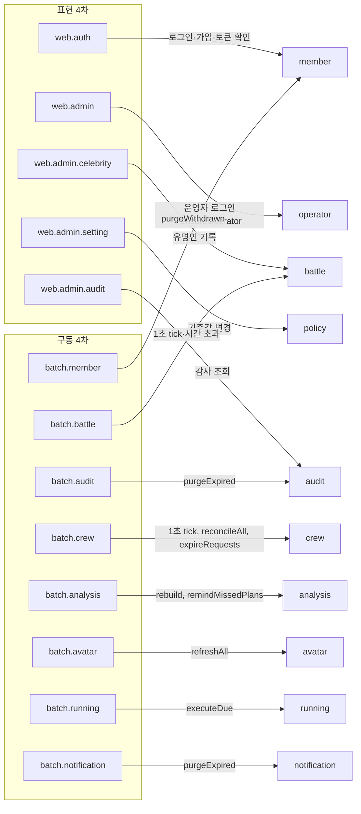
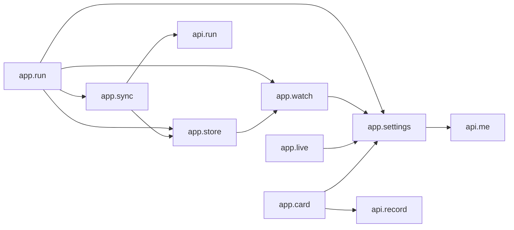

> [런크크 설계 검증 결과서](../design-review.md) 목차 · 이전: [09-v0.2-재검증](09-v0.2-재검증.md) · 다음: [11-v0.4-재검증](11-v0.4-재검증.md)

## 10. v0.3 재검증 (3차 반영본)

이 장은 **design-oo.md v0.3 본문**을 입력으로 0~6단계를 다시 수행한 결과다. v0.3 12장은 설계자가 화살표를 직접 다시 셌다고 밝혔으므로 수치를 검산했고, 6.1(핵심 패키지), 6.1.13(표현·구동·인프라), 6.1.14(앱), 2.2 시퀀스, 5.1·5.5·5.7, 13·14장, 부록 A에서 패키지·모듈을 넘는 참조를 다시 뽑아 12.2·5.1.2와 대조했다. 위치 표기 "l.NNNN"은 design-oo.md v0.3의 줄 번호다.

### 10.0 입력 정리

#### 10.0.1 검증 기준

9.0.1의 기준을 그대로 쓰고, 9장에서 판정이 흔들린 두 곳을 명시한다.

| 항목 | 기준 |
|------|------|
| 결합도·응집도·Fan-Out·순환·계층 | 0.1·9.0.1과 같다 |
| 시각 구동 패키지의 응집도 | 시각 작업 클래스는 업무 규칙 없이 호출만 하므로(l.3349) "왜 같이 있는가"의 답은 부르는 시각이다. "파생 자료 재계산", "기한 집행" 같은 묶음 이름이 아니라 같이 있는 이유로 묻는다. 같은 시각이면 시간적, 시각마저 다르면 논리적이다. 9.3 V12에 쓴 질문을 같은 시각 묶음에도 똑같이 쓴다 |
| 표현 패키지를 "같은 클라이언트·같은 탭"으로 묶은 경우 | 모든 요청이 같은 인증 결과(memberId, OperatorId)를 입력으로 쓴다는 것은 같은 자료를 다루는 이유가 아니다. web.me의 모든 요청도 memberId를 썼지만 9.3 V2는 논리적으로 판정했다 |
| 스탬프 셈의 식별자 | 9.2.1과 같이 맵의 키로 쓰는 id도 쓰는 필드로 센다 |

#### 10.0.2 3차 개선 반영 확인

| 번호 | 개선안 | v0.3 본문 위치 | 결과 |
|------|--------|---------------|------|
| N1 | web.runimal·web.avatar 분할 | l.3143~3144, 3456~3458, 5144, D51·D64 | 반영 |
| N2 | web.notification 신설, PUT /me/push-token | l.3137~3138, 3459~3460, 3467, 5079 | 반영. web.me는 member·profile만 |
| N3 | batch.midnight·evening 분할, 정리 호출을 cleanup으로 | l.3149~3151, 3349, 3780, 4691, 5080 | 반영. 응집도는 10.3에서 다시 판정했다 |
| N4 | api.runimal·api.avatar | l.3208, 3224 | 반영 |
| R1 | personalProgressOf·crewProgressOf | l.5012~5013, 4119 | 반영. LandmarkScope 0건 |
| R2 | 누름 종류별 연산 | l.5189~5192, 5226~5231, D-49 | 반영. longPress 매개변수 0건 |
| R3~R7 | tagsOf, runSamples, comparisonOf, recentStartTimes, longestDistance | 정의 l.3800, 3969, 3973, 3970, 3985. 소비자 l.4816, 4791·4821, 4324·4421, 4877, 4190 | 반영. 소비자가 새 연산을 쓰고 넓은 투영을 쓰지 않는다 |
| R8 | 한도 값 객체 분리 | l.4961~4964, 4997~5000 | 반영. ServiceLimits 0건 |
| R9 | ui.me·ui.notification, ui.runimal·ui.avatar, api.live, app.push | l.3206~3217, D-39 | 반영 |
| R10 | 판정 지점 건너뜀 | l.3710~3711, 4763, 14장 l.7180 | 반영 |
| R11·R12 | isNicknameTaken, 두 키 변경 때 재생성 | l.3802, 4431, 4436~4437 | 반영. 시험 T-11(l.7182)은 VIRTUAL_RECORD_RULE 변경만 본다(권고: TIER_BOUNDARY 행 추가) |
| R13 | 아이템 ID·부위 불변, 판매 중지 | l.4945, 4994~4995, 5036, D-44 | 반영 |
| R14 | 기기 토큰을 notification이 소유 | l.5066, 5079, 5086, 3601, D-43 | 반영. 방식이 다르다(10.5) |
| R15 | OperatorTokenIssuer | l.5124~5133, 5141, 5166, D-42 | 반영 |
| R16 | ArchUnit 규칙 (7), 14장 목록 | l.7094, 7184 | 반영. 규칙 (1)·(4)에 새 결함이 있다(R21, M27) |
| R17 | E1~E6, M2~M13 | 12.2 D54·D66, 5.1.2, l.3780, 3801, 3988, 4724, 4730, 4915 | 반영. D30 표기 한 곳(M17) |
| 권고 | Timestamps 불변, ProgressReport 채널 분리, AuditRecordView, Avatar.equip 플래그 제거, 책임 문장 | l.3612, 3609, 5103, 4847, 3204 | 반영 |

3차 개선 21건과 권고는 모두 본문에 들어갔다. 낡은 이름(web.character, batch.daily, CharacterApi, ui.character, requestFinish)은 변경 이력(l.7438~7439)에만 남았다.

#### 10.0.3 패키지 목록 (v0.3, 서버 46개)

9.0.2에서 바뀐 것만 적는다.

| ID | 패키지 | 계층 | 책임 (설계서 그대로) | 포함 요소 |
|----|--------|------|--------------------|-----------|
| V2 | web.me | 표현 | 본인 계정 화면 요청을 member·profile 호출로 바꾼다 | MeController |
| V7a | web.runimal | 표현 | Runimal 요청을 runimal 호출로 바꾼다 | RunimalController |
| V7b | web.avatar | 표현 | 아바타·상점 요청을 avatar·reward 호출로 바꾼다 | AvatarController |
| V44 | web.notification | 표현 | 알림함·기기 토큰 요청을 notification 호출로 바꾼다 | NotificationController |
| V8 | web.admin | 표현 | 관리툴 요청을 운영자 확인 뒤 담당 서비스에 위임한다(l.3145) | AdminController(유명인 기록·기준값·감사 조회, l.3462~3464) |
| V11 | batch.tick | 표현(시각 구동) | 1초마다 대결·크루런 시계 작업을 부른다(l.3148) | SecondTickJob(battle 3, crew 2 연산) |
| V12a | batch.midnight | 표현(시각 구동) | 매일 0시 파생 자료를 다시 계산한다(l.3149) | MidnightJob(analysis, avatar, crew) |
| V12b | batch.evening | 표현(시각 구동) | 매일 20시 계획 미이행 알림을 부른다 | EveningJob(analysis) |
| V13 | batch.cleanup | 표현(시각 구동) | 매일 3시 기한이 지난 자료 정리를 부른다(l.3151) | DailyCleanupJob(running, audit, member, crew, notification) |

의심 표시:
- 책임 문장: V8 web.admin("담당 서비스"가 셋이다), V11 batch.tick("대결·크루런"), V1 web.auth("회원·운영자" — D-42 뒤 두 로그인은 포트·토큰을 공유하지 않는다), 앱 app.auth("소셜 로그인 토큰을 받는다"인데 TokenStore가 있다).
- common류: V12a·V13(묶음 이름이 기능이 아니라 종류다), V8.

#### 10.0.4 의존 화살표 대조 (12.2 D1~D67 ↔ 본문)

12.2·12.3의 수치를 검산했다. 핵심 사이 43개 + 핵심 → common 13개, 하위 → 핵심 49개 + 하위 → common 32개, 합계 137개와 패키지별 Fan-In(전체)이 모두 맞다.

(a) 12.2·5.1.2에 없는 화살표

| No | From → To | 근거 위치 | 주고받는 것 |
|----|-----------|-----------|-------------|
| E7 | app.store → app.run **(추가)** | PendingRunStore.save(run), pending(): List\<CompletedRun\>(l.5243). CompletedRun은 app.run 소속이다(l.3196) | CompletedRun. 5.1.2는 app.store의 Fan-Out을 0이라 했다(l.3247) → **순환**(N5) |
| E8 | app.run → api.run **(추가)** | CompletedRun.toUploadPayload(): RunUploadRequest(l.5240). RunUploadRequest는 api.run의 DTO다(l.3208) | 요청 DTO |
| E9 | app.card → api.record **(추가)** | RunCardRenderer.render(data: RunCardData, …)(l.5274). RunCardData는 기록 API의 응답 형식이다 | 응답 DTO |
| E10 | (미정) → app.sync **(추가)** | UploadWorker는 "러닝 종료 직후"(l.5246), DisposalSync는 "로그인·앱 시작 때"(l.5249) 돈다 | 기동 주체가 없다. app.sync의 Fan-In이 0이다 |
| E11 | app.watch·app.run·app.store → HeartRateSample 소유 모듈 (미정) | RunSession.heartRates(l.5180), appendHeartRates(l.5243), WatchLink.onHeartRates(l.5252), 2.2 표 "WatchLink.onHeartRates → RunSession.onHeartRate"(l.2853) | HeartRateSample. app.run이 소유하면 app.watch → app.run이 생겨 app.run → app.watch와 순환이다 |
| E12 | (미정) → battle **(추가, 추정)** | 5.5 시작 절차 (2) VirtualRecordService.ensureGenerated, (3) LiveBattleSession 이어 가기(l.3350) | 부르는 클래스가 없다. bootstrap이 부른다면 bootstrap → battle이고 "bootstrap은 common만 가리킨다"(l.6898)와 모순이다 |

(b) 12.2에 있는데 근거가 약한 화살표: D67 가운데 batch.* 4개, web.runimal, infra.integration.push → common은 쓰는 common 형식이 본문에 없다(시각 작업은 LocalDateTime만 넘긴다). 의존을 넉넉히 적은 쪽이라 판정에는 영향이 없다.

(c) 불일치·누락

| No | 대상 | 설계서 기재 | 본문 실제 (위치) |
|----|------|-----------|------------------|
| M14 | D49 web.battle → reward | accruedFor(BATTLE_WIN, battleId)(l.3444, 5145, 6957) | 시그니처는 accruedFor(reason, sourceId, memberId)(l.4916)라 memberId가 빠졌다 |
| M15 | RunimalQuery.typesOf 설명 | "crew(크루원 목록)와 profile이 쓴다"(l.4829) | D-46 뒤 crew는 부르지 않는다. web.crew와 profile이 쓴다 |
| M16 | 부록 A FR-135, 6.5 | ProfileDisclosure·profile(l.7333), "FR-135 크루원 목록"(l.5725) | 크루원 목록 경로(CrewQueryService.members l.4677 → CrewMembersAssembler)에 ProfileDisclosure를 부르는 클래스가 없다. crew가 공개 범위를 스스로 판단한다 → H-18 |
| M17 | D30 | CrewSummary(crewId, name)(l.6938) | 형식 정의는 (crewId, name, logoUrl)(l.4730)이다. analysis가 쓰는 2개를 형식처럼 적었다 |
| M18 | 12.2 누락 연산 | D45, D49, D51, D59, D39, D60, D62 | D45에 logout·refresh, D49에 cancel·markStarted·forfeit와 history 입력(DateRange, Optional\<BattleType\>), D51에 AvatarService.view, D59에 issueSignUpTicket·redeemSignUpTicket·revoke, D39에 ProviderType 매개변수가 없다. D60·D62의 반환은 본문에서 Optional\<…\>이다(l.4176, 4013). 대상 쌍은 맞고 연산만 빠졌다 |
| M19 | runimal 시그니처 | CourseSimilarityService.judge(String recordId)(l.4821), judgeConfirmed(RunSample, RunimalRule)(l.4799) | judge가 runSamples(memberId, 30)을 부르는데 memberId 입력이 없다. judgeConfirmed는 TagSet 입력 없이 태그의 코스 값으로 대체한다고 적었다 |
| M20 | battle 나와의 싸움 | startSelfBattle(l.4406)이 RunRecordOpponent를 만든다 | RunRecordOpponent는 summary의 기록·평균 페이스를 쓰는데(l.4285) 이 흐름은 best·curve만 부른다. comparisonOf(recordId)로 채우면 같은 쌍 위에서 해결된다 |
| M21 | D9 battle → running의 RunSummary | 12.4는 D9를 RunComparison 3/3으로만 셌다(l.7059) | 본문이 battle에서 쓴다고 적은 RunSummary 항목은 recordId·memberId·valid·elapsed·averagePace 5개다(l.4285, 4419). 12개 중 5개면 스탬프(검토)다. 거리 도달 확인에 distance, 날짜 표시에 startedAt을 쓴다면 7/12로 허용이다 **(추정)**. 쓰는 항목을 본문에 적는다 |
| M22 | 12.4 자가 점검 수치 | D5 TagSet "1/1"(l.7059) | TagSet은 (tags, owner) 2필드라 1/2다(절반, 허용). FeatureToggles도 avatar·analysis가 각각 1/2인데 목록에 없다 |
| M23 | ProfileView 항목 형식 | "유형", "소속 크루"(l.505) | 형식이 RunimalType·CrewSummary면 web.me가 runimal·crew 형식에 닿는다. 표시용 값(문자열 등)으로 정한다 |
| M24 | 앱 코칭 입력 경로 | GuidanceContext(DailyPlan, …, 출생연도)(l.2851), GapGuidanceRule·RankGuidanceRule(l.5212~5213) | 오늘 계획이 ui.run → app.run으로 갈 길(RunStartSpec l.5180에 없다)과, 격차·순위가 app.battle·app.crewrun → app.run으로 갈 길이 없다 |
| M25 | 앱 계층 문구 | ConsentGate "없으면 재동의 화면으로"(l.5237), BattleRunCoordinator.onMatched "매칭 화면·애니메이션"(l.5260) | 문자 그대로 읽으면 app.* → ui.* 역행이다. 상태(Flow) 방출로 적는다 |
| M26 | CardSharer.share(card, side, target)(l.5274) | "코스지도공유 꺼짐이면 뒷면 거부" | 그 설정 값을 받을 입력이 없다 → H-19 |
| M27 | 13.1 규칙 (4)·(10) | (4) "infra.\<도메인\>에서만 참조한다"(l.7094) | 14장은 "패키지 밖 참조 0"(l.7184)이다. 13.1 문장대로면 선언 패키지의 서비스도 Repository를 못 쓴다. MatchQueue(battle 포트)는 이름 규칙(…Repository·…Store)에 걸리지 않아 빠진다. (10)도 두 곳의 범위가 다르다 |
| M28 | app.card 범위 | 책임 "러닝 카드 이미지를 만들어 공유한다"(l.3204), render(RunCardData) 하나 | ui.runimal → app.card "유형 카드 공유"(l.3235)가 있는데 Runimal 카드를 그리는 연산이 없다 |
| M29 | 6.1 의존 열 | AppearanceService, CoachService, CrewRunService, WeeklyRaceService | 의존 열이 비었다. 12.2의 쌍은 다른 클래스로 근거가 있어 화살표에는 영향이 없다 |
| M30 | 5.4 배치도(l.3308) | 앱 모듈 목록 | app.store, app.watch, app.auth가 빠졌다 |

### 10.1 의존 행렬과 지표

핵심 패키지 14개의 의존 행렬은 12.3과 같고 9.1과도 같다. 행마다 6.1의 의존 열·연산과 대조해 확인했다. Fan-In(전체)과 불안정도는 12.3 값을 검산해 그대로 맞다.

| 패키지 | Fan-In (핵심 / 전체) | Fan-Out | 불안정도 I | 해석 |
|--------|---------------------|---------|-----------|------|
| common | 13 / 45 | 0 | 0.00 | |
| audit | 5 / 8 | 1 | 0.11 | |
| policy | 9 / 11 | 2 | 0.15 | member(0.158)와 차이 0.004 |
| member | 10 / 16 | 3 | 0.16 | |
| running | 7 / 11 | 3 | 0.21 | |
| notification | 4 / 8 | 3 | 0.27 | |
| runimal | 2 / 5 | 4 | 0.44 | web.crew → runimal로 0.50 → 0.44(D-46) |
| crew | 2 / 8 | 7 | 0.47 | batch.cleanup → crew로 0.50 → 0.47. Fan-Out 상한 |
| battle | 1 / 6 | 6 | 0.50 | |
| reward | 2 / 5 | 5 | 0.50 | battle과 같은 값 |
| operator | 0 / 3 | 3 | 0.50 | infra.integration.auth → operator로 0.60 → 0.50 |
| avatar | 1 / 5 | 6 | 0.55 | |
| analysis | 0 / 5 | 7 | 0.58 | Fan-Out 상한 |
| profile | 0 / 1 | 6 | 0.86 | |

표현·구동·인프라 하위 패키지의 의존 대상은 12.3 표(l.7022~7042)와 같다. 최대는 batch.cleanup 6, web.admin 5다.

앱 모듈의 실제 Fan-Out은 E7~E11을 더하면 app.run 3(app.store, app.watch, api.run), app.store 1(app.run), app.card 1(api.record), ui.me 4다. 모두 7 이하다.

해석:
- 서버 안정성 방향 위반은 0건이다. 여유가 작은 쌍이 셋이다: member 0.158 → policy 0.154, crew 0.467 → runimal 0.444, reward 0.50 → battle 0.50. crew에 하위 패키지 의존이 하나만 더 들어와도 crew가 7 ÷ 16 = 0.44가 되어 crew → runimal이 위반 경계에 선다(10.5).
- 최대 Fan-Out 7(analysis, crew)은 v0.2와 같다. 12.3이 적은 분리 여지(코치, crew의 알림·감사 사건화)가 그대로 유효하다.

### 10.2 결합도 판정

#### 10.2.1 화살표별 (v0.2에서 바뀐 화살표)

| No | From → To | 주고받는 것 (받는 쪽이 쓰는 필드) | 등급 | 판정 |
|----|-----------|----------------------------------|------|------|
| D5 | runimal → member | memberId → TagSet(tags 1/2); MemberWithdrawn | 스탬프 | 허용 (경계: 절반) |
| D6 | runimal → running | RunSampleRow(3/3, 합집합), List\<GeoPoint\>; RunRecordSaved | 스탬프 | 허용 |
| D8 | battle → member | MemberSummary(id·표시명·티어 3/5), isNicknameTaken → boolean 추가, GhostOwner(3/3) | 스탬프 | 허용 |
| D9 | battle → running | RunComparison(3/3), RunCurve(2/2), BestEntry(3/4), RunSummary(본문 기재 5/12) | 스탬프 | 허용 **(추정, M21)** |
| D15 | reward → battle | BattleJudged 수신, 적립량은 RewardRule.battleWin | 스탬프(사건) | 허용 (M13 해소) |
| D18 | avatar → running | DayStats(날짜·횟수 2/4), List\<LocalDateTime\> | 스탬프 | 허용 (경계: 절반) |
| D20 | avatar → policy | BodyShapeRule(2/2), SkinToneRule(1/1), SelfieLimit(1/1), FeatureToggles(1/2), ShopCatalog.slotOf → ItemSlot | 스탬프 | 허용 (경계: FeatureToggles) |
| D23 | crew → running | RunSummary(6/12), timeToReach, Map\<Long, Distance\> | 스탬프 | 허용 (경계: 절반) |
| D24 | crew → runimal | CrewRunParticipationQuery 구현만(Set\<String\>) | 데이터 | 허용 |
| D28 | analysis → member | MemberPreference(4/5), MemberSummary(3/5), ageOf → OptionalInt | 스탬프 | 허용 (M4 해소) |
| D30 | analysis → crew | CrewSummary(2/3), crewNames → Map, contributionOf → Distance | 스탬프 | 허용 (M5·M6 해소, M17) |
| D32 | analysis → policy | Distance → LandmarkProgress(개인·크루 연산 따로), LlmCallLimit(2/2), SupplementCap(1/1), FeatureToggles(1/2) | 스탬프 | 허용 (제어 해소) |
| D35 | profile → running | Optional\<Distance\> | 데이터 | 허용 |
| D38 | profile → crew | CrewSummary(3/3) | 스탬프 | 허용 |
| D39 | operator → member | providerToken → SocialAccount | 데이터 | 허용 (M1 해소) |
| D43 | notification → policy | NotificationRetention(1/1) | 데이터 | 허용 |
| D49 | web.battle → battle·reward | 명령·ID → View, accruedFor | 스탬프 | 허용 (M14) |
| D50 | web.crew → crew·runimal | 명령 객체, disclosedMemberIds → Map\<Long, RunimalType\> | 스탬프 | 허용 |
| D52 | web.admin → operator·battle·policy·audit | adminToken → OperatorId, List\<AuditRecordView\> | 스탬프 | 허용 (투영 권고 해소) |
| D54 | realtime → battle·crew·member | (memberId, 채널 ID, ProgressReport 3/3, now), 메신저 구현, accessToken → memberId | 스탬프 | 허용 |
| D56, D57, D65 | batch.midnight·cleanup·evening → 각 서비스 | now / today | 데이터 | 허용 |
| D59 | infra.integration.auth → member·operator | 포트 3개 구현 | 스탬프 | 허용 |
| D63, D64 | web.notification, web.runimal | memberId·명령 → View | 스탬프 | 허용 |
| E7 | app.store → app.run (추가) | CompletedRun | 스탬프 | 허용 (결합도), **순환**(10.4) |
| E8, E9 | app.run → api.run, app.card → api.record (추가) | RunUploadRequest, RunCardData | 스탬프 | 허용 |

나머지 화살표는 9.2.1과 같다.

근거:
- **서버 스탬프(검토) 0, 제어 0.** v0.2의 검토 8건(D5, D6, D9, D18, D20, D32, D35, D43)이 모두 좁은 연산으로 바뀌었다. 그러나 정확히 절반인 경계값이 넷이다: D5 TagSet 1/2, D18 DayStats 2/4, D20·D32 FeatureToggles 1/2, D23 RunSummary 6/12. 특히 RunSummary는 analysis·crew·battle이 함께 받는 범용 투영이라, cardKind 하나가 더해지면서 crew가 6/11에서 6/12로 내려왔다. 항목을 하나 더 넣으면 crew와 battle이 절반 아래로 떨어진다. RunSummary에 항목을 더할 때 소비자별 사용 수를 다시 센다는 문장을 13.1 "조회 투영" 지침에 넣기를 권한다.
- D9(M21): 본문 기재만으로는 5/12다. 판정은 거리·시작 일시를 쓴다고 보아 허용으로 두었지만 근거가 설계서에 없다. 본문에 쓰는 항목을 적는다. M20을 comparisonOf로 고치면 battle의 RunSummary 사용이 판정용 recordId·memberId·valid로 줄어 오히려 검토가 된다. 그때는 판정용 좁은 연산(예: verdictOf(recordId) → (valid, 도달 경과 시간))을 함께 둔다.
- 사건 페이로드: RunRecordSaved 12항목 가운데 runimal 5, reward 4, battle 3~4를 쓴다. 9.0.1 기준대로 결합도 판정에서 빼고 H-12로 관리한다.
- 앱의 RunStartSpec.mode: ui.run·app.battle·app.crewrun이 넘긴 mode로 CoachingJudge가 규칙 묶음을 고른다(l.5204). mode는 서버로 보내는 기록의 속성(RunMode)이고 호출자가 처리 갈래를 고르려고 만든 값이 아니라서 데이터로 본다(9.2.1의 SettingKey 판단과 같은 이유). 권고: 모드별 규칙 묶음을 RunMode 다형성으로 둔다.
- 앱 TokenStore: ui.me가 쓰고 api.core가 읽고 app.push가 구독하는 가변 상태지만 app.auth 안에 캡슐화되어 메서드로만 다룬다. 공통 결합이 아니다.

#### 10.2.2 내용·공통·외부 결합과 순환 경로 재점검

| 점검 | 결과 | 근거 |
|------|------|------|
| 내용 | 0건 | 패키지 밖으로 나가는 엔티티가 없다. 감사 조회도 AuditRecordView다(l.5103) |
| 공통 | 0건 | 9.2.2와 같다 |
| 외부 (서버) | 0건 | 기기 토큰 표가 notification 소유가 되어(l.5066) 소유자 없는 저장소가 사라졌다 |
| 외부 (앱) | 0건 확인, 위험 2 | (1) "서버 설정 캐시"를 app.run·app.watch·app.live·app.card가 읽는데 소유 모듈이 없다(H-19). 각자 같은 저장소(SharedPreferences 등)를 직접 읽게 구현되면 외부 결합이다. (2) 13.2는 "쓰기는 PendingRunStore를 거친다"(l.7158)고만 해 ui.home·ui.record가 Room을 직접 읽는 길이 열려 있다 |
| 포트 경유 순환 | 0건 | OperatorTokenIssuer가 더해졌다. operator는 infra를 import하지 않는다 |
| 사건 경유 순환 | 0건 | 9.2.2와 같다 |
| 앱 형식 참조 순환 | **1건** | app.run → app.store(save) + app.store → app.run(CompletedRun, E7) |

#### 10.2.3 패키지 쌍 요약 (최악 등급)

| 쌍 | 화살표 | 등급 | 양방향 |
|----|--------|------|--------|
| 서버의 모든 쌍 | | 데이터 또는 스탬프(허용) | 아니오 |
| app.run ↔ app.store | app.run → app.store(save), E7 | 스탬프 | **예** |

#### 10.2.4 숨은 의존 (재조사)

| 번호 | 파생·공유 요소 | 원본 | 갱신 책임 (v0.3) |
|------|---------------|------|-----------------|
| H-05' | 판정 회차 유실 | validRunOrdinal | **해소.** D-40 건너뜀 규칙(l.3710, 4763), 시험 행(l.7180) |
| H-11' | 가상·회원 닉네임 중복 | 두 테이블 | **해소.** isNicknameTaken(l.3802, 4436) |
| H-13 | 판정 시점 규칙 | TierProgress·RunimalProfile | 책임 있음. 건너뛴 순번 행이 시험 표에 더해졌다 |
| H-14 | 가상 기록 100개 | TierBoundary·VirtualRecordRule | **해소.** 두 키 변경 때 재생성(l.4437) |
| H-15 | 착용·보유 아이템 ID | SHOP_ITEMS | **해소.** 판매 중지만 허용(D-44) |
| H-16 | 기기 토큰 표 | 앱 FCM 토큰 | **해소.** PushDevice, 탈퇴 때 삭제(D-43) |
| H-17 | 실시간 메시지 JSON 항목 이름 | battle.live·crew.live ↔ 앱 ServerMessage | 서버 → 앱은 계약 시험이 생겼다(l.7181). 앱 → 서버(앱 ProgressReport ↔ 서버 InboundProgress, l.5255·3475)는 시험이 없다(권고) |
| **H-18 (신규)** | 프로필 공개 범위 규칙 | MemberSummary.profileVisibility와 열람자 관계 | profile.ProfileDisclosure.of(viewerId, MemberSummary)(l.4200)와 crew.CrewQueryService.members "개인정보 비공개 크루원은 표시명·역할·소개만, disclosedMemberIds"(l.4677)가 같은 규칙을 따로 구현한다. 부록 A는 FR-135에 ProfileDisclosure를 적었지만 부르는 곳이 없다(M16). crew → profile은 금지 방향이라(l.3189, 순환) crew가 쓸 수 없다. 공개 범위 규칙이 바뀌면 두 곳을 함께 고쳐야 하는데 시험·문장 어디에도 묶여 있지 않다 → **검토** |
| **H-19 (신규)** | 앱의 서버 설정 사본 | 서버 member 설정(위치·심박 동의, 워치 연동, 코스지도공유, 실시간 방식, 출생연도) | ConsentGate(l.5237), WatchLink(l.5252), LiveChannelFactory(l.5255), CardSharer(l.5274), GuidanceContext(l.2851)가 "서버 설정 캐시"를 읽는데 소유 모듈, 갱신 시점, 갱신 책임이 없다. 설정을 바꾼 뒤 사본이 낡으면 철회한 심박 동의로 워치 수집을 계속하는 식의 개인정보 위험이 있다(NFR-023) → **검토** |

### 10.3 응집도 판정

| ID | 패키지 | 같이 있는 이유 | 등급 | 판정 |
|----|--------|---------------|------|------|
| V1 | web.auth | 자격 증명 처리. 운영자 로그인은 D-42 뒤 회원 인증과 포트·토큰을 공유하지 않는다 | 통신적 (경계) | 허용, 권고(N6과 함께 운영자 로그인을 옮긴다) |
| V2 | web.me | 회원 자료(계정·설정·동의·탈퇴·프로필 조회·약관) | 통신적 | 허용 (N2 해소) |
| V7a | web.runimal | Runimal 조회 한 기능 | 기능적 | 허용 |
| V7b | web.avatar | 외형과 보유 아이템·잔액을 함께 다룬다 | 통신적 | 허용 (N1 해소) |
| V44 | web.notification | Notification·PushDevice 자료 | 통신적 | 허용 |
| V8 | **web.admin** | 유명인 기록·기준값·감사 조회가 "관리툴 클라이언트"에 있어서 | **논리적** | **불허** |
| V11 | **batch.tick** | 대결 시계 3개와 크루런 시계 2개가 같은 1초마다 실행되어서 | **시간적** | **검토** |
| V12a | **batch.midnight** | 랭킹·외형·주간 거리 재계산이 같은 0시에 실행되어서 | **시간적** | **검토** |
| V12b | batch.evening | 계획 미이행 알림 한 기능 | 기능적 | 허용 |
| V13 | **batch.cleanup** | 다섯 패키지의 기한 집행이 같은 3시에 실행되어서 | **시간적** | **검토** |
| 그 밖 | V3~V6, V9, V10, V14~V43 | 9.3과 같다 | | 허용 (V28 common 조건부) |

근거:
- **V8 web.admin**: AdminController 하나가 battle(유명인 기록), policy(기준값), audit(감사 조회) 요청을 모두 가진다(l.3462~3464). 세 요청은 같은 자료를 다루지 않고 서로 부르지 않는다. 함께 있는 이유는 운영자가 쓰는 관리툴이라는 클라이언트뿐이다. 9.3 V8은 "모든 요청이 패키지 안에서 만든 같은 입력(OperatorId)으로 위임된다"를 들어 통신적으로 보았다. 그러나 인증 결과를 입력으로 쓰는 것은 같은 자료를 다루는 이유가 아니다(10.0.1). 같은 이유라면 web.me도 통신적이어야 했다. D-34가 도메인 계층의 관리툴 패키지를 해체한 이유("운영자가 쓴다", l.654)가 표현 계층에 그대로 남았고, 설계서가 v0.3에서 세운 원칙(D-39 "앱 탭이나 실행 주기가 아니라 부르는 응용 패키지 기준")에도 어긋난다. **9.3 V8 판정은 오판이다.**
- **V11·V12a·V13 batch.***: 시각 작업 클래스는 호출 순서만 가진다(l.3349). SecondTickJob은 battle 연산 3개와 crew 연산 2개를, MidnightJob은 analysis·avatar·crew를, DailyCleanupJob은 running·audit·member·crew·notification을 부른다. 같은 묶음 안의 호출끼리 자료를 주고받지 않는다. 함께 있는 이유는 같은 시각이다. "시계 진행", "파생 자료 재계산", "기한 집행"은 종류의 이름이고 기능 하나가 아니다. 랭킹 스냅숏 재계산과 아바타 외형 재계산은 서로 무관하다. 9.3은 batch.daily에 이 질문을 써서 0시·20시 묶음을 논리적으로 판정해 놓고, 같은 시각 묶음인 batch.tick·batch.cleanup(V11·V13)과 3차 계획의 batch.midnight(9.7.3)는 묶음 이름만 보고 기능적으로 판정했다. **오판이다.** 설계서 D-39는 "구동 하위 패키지를 실행 주기가 아니라 부르는 응용 패키지 기준으로 나눈다"(l.3399)고 스스로 정했는데 batch.*는 실행 주기로 나뉘어 자기 원칙과도 어긋난다. 같은 시점에 실행된다는 시간적 응집의 조건은 채우므로 논리적이 아니라 시간적(검토)이다.
- 앱 모듈:
  - app.auth는 통신적(경계)이다. 책임 문장은 "소셜 로그인 토큰을 받는다"인데 TokenStore(서비스 토큰·로그인 상태)도 있다. 들어오는 화살표(api.core, app.push)는 TokenStore만 쓰고, SocialLoginClient를 쓰는 곳은 ui.me뿐이다. 문장을 "로그인 자격 증명을 얻어 보관한다"로 고치거나 TokenStore를 따로 뗀다(권고).
  - app.run은 통신적이다. 측정·코칭·동의 확인·카운트다운이 RunSession·RunProgress를 함께 쓴다. 코칭(CoachingJudge, 규칙 6개, GuidancePlayer)은 뗄 여지가 있다(권고).
  - app.card는 순차적이다. 범위 문제는 M28이다.
  - ui.me, ui.notification, ui.runimal, ui.avatar는 통신적 또는 기능적이다(R9 해소).
  - 나머지는 9.5와 같다.

이동 후보:

| 요소 | 현재 패키지 | 내부 연결 | 외부 연결 | 이동 대상 |
|------|------------|-----------|-----------|-----------|
| CompletedRun | app.run | 1 (MeasurementService가 만든다) | 3 (app.store 보관, app.sync 전송, ui.home·ui.record 미전송 목록) | app.store (N5) |
| CompletedRun.toUploadPayload | app.run | 0 | 1 (api.run) | app.sync RunUploader (N5, E8 해소) |
| 공개 수준 판정(ProfileDisclosure.of의 관계 판단) | profile | 1 (filter) | 1 (crew가 같은 규칙을 다시 구현) | member (R22) |
| 운영자 로그인 엔드포인트 | web.auth | 0 | 1 (operator) | web.admin (N6) |

### 10.4 구조 결함

| 결함 | 결과 | 관련 패키지 | 근거 |
|------|------|------------|------|
| 순환 의존 | 서버 0건, **앱 1건** | app.run ↔ app.store | E7과 5.1.2의 app.run → app.store(save). v0.1부터 있었다(1차 B08 "run → store"). 1·2차와 9장 검증은 호출 방향만 보고 PendingRunStore 시그니처의 형식 참조(CompletedRun)를 보지 않아 놓쳤다. 잠재 순환이 하나 더 있다: HeartRateSample을 app.run에 두면 app.watch → app.run이 생긴다(E11) |
| 계층 역행 | 0건 | — | 서버는 9.4와 같다. 앱은 문구 결함 2곳(M25)이 있으나 클래스 의존으로는 0이다 |
| 허브 | 0건 | — | Fan-In 상위(common 45, member 16, policy·running 11)와 Fan-Out 상위(analysis·crew 7)가 겹치지 않는다 |
| 쓰레기통 | 0건 | common | D-48로 조건 셋을 지킨다. 9.3 V28 권고 1(ItemSlot 이동)은 10.5에서 철회했다 |
| 안정성 위반 | 0건 | — | 10.1. 여유가 작은 쌍 3 |
| Fan-Out 7 초과 | 0건 | — | 서버 최대 7, 앱 최대 4 |
| 고립 | 0건 | — | app.sync는 Fan-In이 0이지만 Fan-Out이 2라 고립이 아니다. 기동 주체 누락(E10)이다 |
| 정보 은닉 위반 | 0건 | — | 내용 결합 0 |

ArchUnit 규칙 (1)의 단위 결함(R21): 13.1은 모든 규칙의 slice를 최상위 이름 `com.a207.runkk.(*)..`로 잡는다(l.7094). 이렇게 하면 web.*·batch.*·infra.* 하위 패키지가 각각 web·batch·infra 한 덩어리가 되어, 규칙 (1) "12.2 의존 목록에 없는 패키지 사이 import 0"이 web.me → battle(web.battle → battle이 있으니 통과), batch.evening → crew, infra.member → crew 같은 금지 화살표를 통과시킨다. 반대로 패키지 전체 이름으로 잡으면 battle ↔ battle.live, crew ↔ crew.live가 12.2에 없어 오탐이 된다. 순환 규칙 (2)는 web·batch·infra·realtime·bootstrap의 Fan-In이 0이라 최상위 slice로도 문제가 없다. 규칙 (1)만 5.1.1의 46개 이름으로 slice를 잡고 *.live를 상위 패키지로 합치는 방식이 필요하다.

### 10.5 3차 계획과 다르게 간 곳 평가

| 항목 | 3차 계획 (9.7) | v0.3 실제 | 평가 |
|------|---------------|-----------|------|
| R14 기기 토큰 | PushGateway에 register·remove | PushDeviceRepository가 저장하고 PushGateway는 발송 포트 하나(D-43) | **수용.** 저장과 외부 발송을 나눈 쪽이 계획보다 낫다. 무효 토큰을 PushResult로 돌려받아 정리하는 경로도 생겼다 |
| D-46 크루원 Runimal 유형 | (계획 없음) | web.crew의 CrewMembersAssembler가 RunimalQuery.typesOf로 붙인다 | **수용(조건).** D-33(BattleResultAssembler)과 같은 방식이고 crew가 화면용 조합을 하지 않게 되어 그 자체로 낫다. 다만 설계서 근거가 "불안정도 숫자를 맞추려고"(l.3406)라, 하위 패키지 Fan-In 하나를 늘려 runimal의 불안정도를 낮춘 결과의 여유가 0.02다. crew에 하위 패키지 의존이 하나 더 생기면 다시 위반 경계에 선다. R18~R20을 (가)로 고치면 crew의 Fan-In(전체)이 6으로 줄어 crew 0.54 → runimal 0.44로 여유가 커진다. 근거 문장을 "crew는 화면 조합을 하지 않는다"로 고치기를 권한다 |
| D-48 ItemSlot | policy로 옮기기(권고) | common 유지 | **수용, 권고 철회.** policy로 옮기면 web.avatar·infra.avatar → policy 화살표 2개가 새로 생기고 줄어드는 것이 없다는 근거가 맞다. D-44로 기존 부위가 바뀌지 않아 "변경이 드문 불변 형식" 조건을 지킨다 |
| D-47 reconcileAll | reconcileAll(now) | 대상 크루 선택을 crew 안으로(crewIdsActiveBetween) | **수용** |
| D-42 AuthFilter | /admin/*에서 관리툴 토큰 구분 | AuthFilter가 /admin/*을 검사하지 않고 AdminController가 ensureOperator로 확인 | **수용.** N6 개선안에서 이 확인을 인터셉터 하나로 모은다 |
| D-41 RunQueryService 공개 연산 | 20개 넘으면 분할 | 19개(겹쳐 쓰기 포함 20) | **수용, 경계.** 다음 조회 연산 하나가 분할 기준을 넘긴다 |
| N3 batch 분할 | batch.midnight 기능적, batch.cleanup 기능적 (검증서 판정) | 계획대로 | **검증서 계획 오판.** 시간적이다(10.3) |
| 9.3 V8 web.admin | 통신적 (검증서 판정) | 그대로 | **검증서 오판.** 논리적이다(10.3) |

### 10.6 판정과 개선안

#### 10.6.1 종합 판정표 (v0.3 실제)

| 항목 | 결과 | 판정 |
|------|------|------|
| 내용·공통·외부 결합 화살표 수 | 0 | 합격 |
| 제어 결합 화살표 수 | 서버 0, 앱 0 | 합격 |
| 스탬프(검토) 화살표 수 | 0 (경계값 4, 추정 1 — D9, M21) | 합격 |
| 순환 의존 수 | 서버 0, **앱 1** (app.run ↔ app.store) | **불허** |
| 계층 역행 수 | 0 | 합격 |
| 최대 Fan-Out | 서버 7, 앱 4 | 합격 |
| 응집도 불허 패키지 수 | **1** (web.admin) | **불허** |
| 응집도 검토 패키지 수 | 3 (batch.tick, batch.midnight, batch.cleanup) | 검토 |
| 숨은 의존 중 책임·복구 경로 없음 | 2 (H-18, H-19) | 검토 |
| 인터페이스 명세 결함 | 누락 화살표 6 (E7~E12), 불일치·누락 17 (M14~M30), ArchUnit 규칙 (1) 단위 결함 | 검토 |

v0.3 판정: **불합격**(불허 2건). 3차 개선 21건은 모두 반영되었다. 핵심 패키지 14개는 v0.2에 이어 불허·검토가 0건이다(D9 추정 제외).

#### 10.6.2 불허·검토 항목과 개선안

불허 2건:

| 번호 | 대상 | 문제 | 개선안 |
|------|------|------|--------|
| N5 | app.run ↔ app.store | 순환 | CompletedRun을 app.store로 옮긴다. 보관 대상 기록이므로 store가 형식의 주인이다. toUploadPayload는 app.sync의 RunUploader로 옮긴다(app.sync → api.run은 이미 있다, E8 해소). app.run은 측정을 마치면 CompletedRun을 만들어 save한다(app.run → app.store 한 방향). HeartRateSample은 만드는 쪽인 app.watch에 둔다(E11): app.run·app.store → app.watch 한 방향이다. 다른 방법(app.run이 저장 포트를 정의하고 app.store가 구현)은 app.sync·ui.home·ui.record가 CompletedRun 때문에 app.run을 import해야 해 화살표가 늘어 권하지 않는다 |
| N6 | web.admin | 논리적 응집 | 기능별로 나눈다. web.admin은 운영자 로그인(POST /admin/login을 web.auth에서 옮김)과 /admin/* 요청의 운영자 확인(인터셉터 하나에서 OperatorAuthorizer.ensureOperator)만 맡는다(operator, common). web.admin.celebrity(battle), web.admin.setting(policy), web.admin.audit(audit)은 확인된 actorId를 요청 속성(long)으로 받아 operator를 import하지 않는다. web.auth → operator가 사라져 web.auth는 회원 인증만 남는다(V1 권고 해소) |

검토 8건:

| 번호 | 대상 | 문제 | 개선안 |
|------|------|------|--------|
| R18~R20 | batch.tick, batch.midnight, batch.cleanup | 시간적 응집 | **(가) 권장.** D-39 원칙대로 부르는 응용 패키지별로 나눈다. 대상: batch.battle(1초: Matchmaker.tick, BattleClockService.tick, LiveBattleService.detectTimeouts), batch.crew(1초 tick·detectTimeouts, 0시 reconcileAll, 3시 expireRequests), batch.analysis(0시 rebuild, 20시 remindMissedPlans, batch.evening 흡수), batch.avatar(0시 refreshAll), batch.running·batch.member·batch.audit·batch.notification(3시 정리 각 1개). 시각은 각 패키지의 스케줄 설정이 갖는다. 모두 대상 패키지 하나라 통신적이고 Fan-Out 1이다. **(나)** 시각 단위를 유지하고 D-39에 "구동 계층은 업무 규칙이 없는 시각 → 호출 대응표라 시간적 응집을 허용한다"는 예외와 근거를 적는다. 이 경우 검토로 남아 최종 판정의 상한이 조건부 합격이다. 어느 쪽인지는 팀이 정한다 |
| R21 | 13.1 ArchUnit 규칙 (1)·(4) | slice 단위 결함, 문장 결함 | 규칙 (1)은 5.1.1의 패키지 이름 그대로 slice를 잡고(SliceAssignment, *.live는 상위 패키지로 합침) 12.2 목록과 대조한다. 순환 규칙 (2)만 최상위 slice를 쓴다. 규칙 (4)는 14장 문장("선언 패키지와 같은 이름의 infra.\<도메인\> 밖 참조 0")으로 통일하고 MatchQueue를 대상에 넣는다. (10)의 범위도 두 곳을 맞춘다(M27) |
| R22 | H-18 공개 범위 규칙 중복 | 숨은 의존 | 공개 수준 판정(열람자 관계 → 수준)을 member로 내린다: MemberQueryService.disclosureOf(viewerId, targetIds) → Map\<Long, DisclosureLevel\>. profile은 수준별 항목 거르기(filter)만 하고, crew는 같은 수준으로 disclosedMemberIds를 만든다. profile·crew → member 화살표가 이미 있어 새 화살표가 없다. 부록 A FR-135·6.5를 고친다(M16) |
| R23 | H-19 앱 설정 사본 | 숨은 의존, 외부 결합 위험 | 앱 모듈 app.settings("서버 설정 사본을 보관한다": SettingsCache)를 둔다. 동기화는 로그인 직후와 설정 변경 성공 뒤(app.settings → api.me), 읽기는 app.run(ConsentGate, GuidanceContext), app.watch, app.live, app.card가 메서드로만 한다. 값이 바뀌면 Flow로 알려 WatchLink가 수집 금지 플래그를 바로 보낸다. CardSharer.share에 공유 허용 여부를 넘긴다(M26). 이 모듈에는 서버 설정 사본 외의 캐시를 넣지 않는다 |
| R24 | 앱 명세 결함 | E9, E10, M24, M25, M28, 형식 소유 | (1) 5.1.2에 E9를 적는다. (2) 기동 주체를 정한다: app.run이 종료 직후 app.sync에 전송을 맡기고(app.run → app.sync), 앱 시작·로그인 때의 DisposalSync는 앱 진입점(Application) 모듈에서 부른다. (3) ServerMessage와 그 하위 메시지, 앱 ProgressReport, RunStartSpec, GuidanceContext의 소유 모듈을 클래스 목록에 적는다. (4) 오늘 계획과 격차·순위가 app.run에 들어갈 경로를 연산으로 정한다(M24). (5) M25 문구를 상태 방출로 고친다. (6) app.card에 Runimal 카드 그리기 연산을 두거나 책임 범위를 고친다(M28). (7) 13.2의 Room 규칙을 "읽기·쓰기 모두 PendingRunStore를 거친다"로 고친다 |
| R25 | 서버 명세 불일치 | E12, M14~M23, M27, M29, M30 | 10.0.4 표대로 고친다. E12는 시작 작업을 부르는 클래스를 정한다. bootstrap이 부르면 12.2에 bootstrap → battle을 더하고 D66·l.6898 문장을 고친다(bootstrap Fan-In 0이라 순환은 없다). M21은 battle이 쓰는 RunSummary 항목을 본문에 적는다 |

우선순위: N5(순환) → N6 → R21(규칙을 고쳐야 나머지 분할을 기계로 지킨다) → R18~R20 → R22·R23 → R24·R25.

#### 10.6.3 4차 의존도 (바뀌는 부분, (가) 기준)

핵심 패키지 14개 사이의 화살표는 바뀌지 않는다(R22는 이미 있는 crew·profile → member 위의 연산). 바뀌는 것은 표현·구동 하위 패키지와 앱 모듈이다.

| 패키지·모듈 (4차) | 의존 대상 (Fan-Out) | 응집 |
|------------------|--------------------|------|
| web.auth | member, common (2) | 통신적 — 회원 자격 증명 |
| web.admin | operator, common (2) | 기능적 — 운영자 확인 |
| web.admin.celebrity / setting / audit | battle / policy / audit, common (2) | 통신적 |
| batch.battle, batch.crew, batch.analysis, batch.avatar | 각 대상 1 | 통신적 — 대상 패키지 하나 |
| batch.running, batch.member, batch.audit, batch.notification | 각 대상 1 | 기능적 |
| app.store | app.watch (1) | 기능적 |
| app.run | app.store, app.watch, app.settings, app.sync (4) | 통신적 |
| app.sync | app.store, api.run (2) | 통신적 |
| app.watch | app.settings (1) | 기능적 |
| app.settings | api.me (1) | 기능적 |
| app.card | api.record, app.settings (2) | 순차적 |
| ui.me | api.auth, api.me, app.auth, app.store, app.settings (5) | 통신적 |

4차의 핵심 패키지 지표: crew의 Fan-In(전체)이 8에서 6(핵심 2 + web.crew, realtime, batch.crew, infra.crew)으로 줄어 불안정도 0.54, analysis는 0.64, operator는 0.60이 된다. 다른 패키지는 하위 Fan-In 수가 같아 값이 그대로다. 모든 화살표가 불안정 → 안정 방향을 지키고, crew → runimal의 여유는 0.02에서 0.10으로 커진다.

4차 재검증(계획 기준): 불허 0, 제어 0, 스탬프(검토) 0, 순환 0(서버·앱), 계층 역행 0, 최대 Fan-Out 서버 7·앱 5, 응집도 통신적 미만은 common(조건부 허용) 하나다. (나)를 택하면 batch 4개가 검토로 남는다.

### 10.7 전후 비교

| 항목 | v0.2 (실제) | 3차 (계획) | v0.3 (실제) | 4차 (계획, (가)) |
|------|-------------|-----------|-------------|-----------------|
| 내용·공통·외부 결합 화살표 | 0 | 0 | 0 | 0 |
| 제어 결합 화살표 | 1 (+앱 1) | 0 | 0 | 0 |
| 스탬프(검토) 화살표 | 7 | 0 | 0 (경계 4, 추정 1) | 0 |
| 순환 의존 | 0 (실제로는 앱 1, 미발견) | 0 | 0 (+앱 1) | 0 |
| 계층 역행 | 0 | 0 | 0 | 0 |
| 안정성 위반 | 0 | 0 | 0 | 0 |
| 응집도 불허 패키지 | 3 (+앱 1) | 0 | 1 | 0 |
| 응집도 통신적 미만 패키지 | 4 (+앱 3) | 1 | 5 (common, web.admin, batch 3) | 1 (common 조건부) |
| 최대 Fan-Out | 7 | 7 | 7 (앱 4) | 7 (앱 5) |
| 숨은 의존 중 책임·복구 없음 | 5 | 0 | 2 | 0 |
| 명세 결함 | E 6, M 13 | 0 | E 6, M 17, 규칙 1 | 0 |
| 패키지 수 (핵심) | 43 (14) | 46 (14) | 46 (14) | 53 (14) |
| 판정 | 불합격 | 합격 예상 | 불합격 | 합격 예상 ((나)면 조건부 합격) |

3차 계획이 "합격 예상"을 맞히지 못한 이유는 셋이다. (1) 검증서가 구동 패키지를 묶음 이름으로 판정했다(10.3). (2) web.admin을 인증 입력 공유로 통신적이라 보았다(10.3). (3) 앱 store 시그니처의 형식 참조를 보지 않아 v0.1부터 있던 순환을 놓쳤다(10.4). 셋 다 설계가 v0.3에서 새로 만든 결함이 아니라 검증서 쪽 판정·대조의 누락이다. v0.3에서 새로 드러난 설계 결함은 H-18(D-46으로 드러난 공개 범위 경로)과 명세 불일치 일부다.

부작용 점검(4차):
- 패키지 수 46 → 53. 늘어나는 7개(web.admin.* 3, batch 순증 4)는 모두 클래스 1~3개짜리 표현·구동 하위 패키지이고 핵심 14개는 그대로다.
- web.admin의 인터셉터는 /admin/* 전부가 지나는 단일 지점이다. 이것이 업무 규칙을 갖지 않도록 "운영자 확인만 한다"를 책임 문장으로 고정한다.
- app.settings는 Fan-In 5(app.run, app.watch, app.live, app.card, ui.me)가 된다. 서버 설정 사본 외의 캐시를 넣으면 새 쓰레기통이 된다.
- ui.me의 Fan-Out이 4 → 5가 된다(기준 7 안).
- RunSummary 경계값(10.2.1)과 RunQueryService 공개 연산 수(20개)는 4차에서도 그대로라 다음 기능 추가 때 먼저 걸린다.

### 10.8 최종 판정

**불합격** (design-oo.md v0.3). 불허 2건(N5 앱 순환, N6 web.admin 논리적 응집), 검토 8건(R18~R25).

3차 개선 21건은 모두 본문에 반영되었다. 핵심 패키지 14개의 화살표·지표는 v0.2부터 바뀌지 않았고 내용·공통·외부 결합, 제어, 스탬프(검토), 순환, 계층 역행, 안정성 위반이 모두 0이다. 불허 2건 가운데 앱 순환은 v0.1부터 있었고 web.admin은 9장 판정이 놓친 것이다. 둘 다 클래스 이동·분할만으로 해소된다. N5·N6과 R18~R20 (가)를 반영하고 명세 결함을 고치면 합격 조건을 채운다. R18~R20을 (나)로 정하면 조건부 합격이다.

