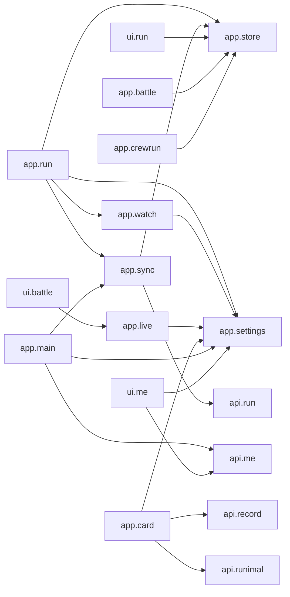

> [런크크 설계 검증 결과서](../design-review.md) 목차 · 이전: [10-v0.3-재검증](10-v0.3-재검증.md) · 다음: [12-v0.5-재검증](12-v0.5-재검증.md)

## 11. v0.4 재검증 (4차 반영본)

이 장은 **design-oo.md v0.4 본문**을 입력으로 0~6단계를 다시 수행한 결과다. 구동 패키지는 2026-10-20 팀 결정 (가)(응용 패키지별 분할)를 따랐다. 12장 수치를 검산했고, 5.1·5.5·5.6(D-50~D-55)·5.7.1, 6.1(핵심), 6.1.13·6.1.14, 2.2 시퀀스, 3.2.2, 13·14장, 부록 A에서 패키지·모듈을 넘는 참조를 다시 뽑아 12.2·5.1.2와 대조했다. 시그니처의 형식 참조(어느 모듈이 형식의 주인인가)까지 대조했다. 10장이 호출 방향만 보고 앱 순환을 놓친 일을 되풀이하지 않기 위해서다. 위치 표기 "l.NNNN"은 design-oo.md v0.4의 줄 번호다.

### 11.0 입력 정리

#### 11.0.1 검증 기준

10.0.1과 같다. 다음 두 가지를 이번에 명시한다.

| 항목 | 기준 |
|------|------|
| 안정성 위반의 등급 | 1차(5.1)부터 안정성 위반은 구조 결함으로 세고 개선안을 붙였으나 판정 기준의 불허 항목(순환, 계층 역행, Fan-Out, 내용 결합, 고립)에는 없다. 이번에도 **검토**로 둔다 |
| 앱 모듈의 지표 | 10장까지는 앱 모듈의 Fan-Out과 순환만 보았다. 이번부터 앱 모듈에도 불안정도와 안정성 방향을 계산한다 |

#### 11.0.2 4차 개선 반영 확인

| 번호 | 개선안 (10.6.2) | v0.4 본문 위치 | 결과 |
|------|----------------|---------------|------|
| N5 | CompletedRun → app.store, 변환 → RunUploader, HeartRateSample → app.watch | 5.1.2 l.3213~3216, 3273, 6.1.14 CompletedRun·RunUploader, D-54 | 반영. 앱 순환 0. 형식 주인 잔여는 11.0.4 |
| N6 | web.admin 분할, 운영자 로그인 이동 | 5.1.1 l.3152~3155, 3202, 6.1.13 OperatorCheckInterceptor, 5.7.1, D-50 | 반영. 누락 화살표 하나(E13) |
| R18~R20 | (가) 응용 패키지별 batch.* 8개 | 5.1.1 l.3158~3165, 5.5 l.3376, 6.1.13, D-39, 12.2 D55~D57·D65·D71~D74 | 반영 |
| R21 | ArchUnit 규칙 (1) 5.1.1 이름 slice, (4) MatchQueue·14장 문장, (10) 범위 | 13.1, 14장 | 반영 |
| R22 | 공개 수준 판정을 member로 | MemberQueryService.disclosureOf, DisclosureLevel, ProfileDisclosure.from, CrewQueryService.members, D-52, FR-135, T-12 | 반영 |
| R23 | app.settings | 5.1.2, 6.1.14 SettingsCache, D-53 | 부분 반영. 서버 쪽 GET /me/settings가 설계되지 않았다(M33), 앱 쪽 안정성 방향(11.4) |
| R24 | 앱 명세 결함 (1)~(7) | (1) 5.1.2 app.card → api.record, (2) UploadScheduler·RunkkApp, (4) RunStartSpec.todayPlan·onGapChanged·onRankChanged, (5) consentRequired·BattleRunState, (6) RunimalCardRenderer, (7) 13.2 | 대부분 반영. (3) 형식 주인 일부 미기재(M31), (4)·(5)는 3.2.2와 SQ-01이 옛 문장(M37) |
| R25 | 서버 명세 불일치 | E12 → BattleStartupListener(D-55), M14·M15·M17~M23·M27·M29·M30 반영 | 반영. D23 crew의 RunSummary 사용 항목은 여전히 본문에 없다(M38) |

#### 11.0.3 패키지 목록 (v0.4, 서버 53개)

10.0.3에서 바뀐 것만 적는다.

| ID | 패키지 | 계층 | 책임 (설계서 그대로) | 포함 요소 |
|----|--------|------|--------------------|-----------|
| V1 | web.auth | 표현 | 회원의 로그인·가입 요청을 member 호출로 바꾼다 | AuthController, SignUpController, AuthFilter, SecurityConfig |
| V8 | web.admin | 표현 | 관리툴 요청을 보낸 운영자를 확인한다 | AdminAuthController, OperatorCheckInterceptor, AdminWebConfig |
| V8a | web.admin.celebrity | 표현 | 유명인 기록 관리 요청을 battle 호출로 바꾼다 | CelebrityAdminController |
| V8b | web.admin.setting | 표현 | 운영 기준값 변경 요청을 policy 호출로 바꾼다 | SettingAdminController |
| V8c | web.admin.audit | 표현 | 감사 기록 조회 요청을 audit 호출로 바꾼다 | AuditAdminController |
| V11a | batch.battle | 구동 | battle의 시각 작업을 부른다 | BattleTickJob, BattleSchedulingConfig |
| V11b | batch.crew | 구동 | crew의 시각 작업을 부른다 | CrewRunTickJob, WeeklyRaceReconcileJob, JoinRequestExpiryJob, CrewSchedulingConfig |
| V12a | batch.analysis | 구동 | analysis의 시각 작업을 부른다 | RankingRebuildJob, PlanReminderJob, AnalysisSchedulingConfig |
| V12b | batch.avatar | 구동 | avatar의 시각 작업을 부른다 | AppearanceRefreshJob, AvatarSchedulingConfig |
| V13a~d | batch.running·member·audit·notification | 구동 | 그 패키지의 기한 집행 하나를 부른다 | 작업 1개 + SchedulingConfig |

앱 모듈 신설·변경: app.settings(SettingsCache, SettingsSnapshot), app.main(RunkkApp), app.store(+CompletedRun, StoredPoint, StoredSegment, RunMode, CardKind, UploadState), app.watch(+HeartRateSample), app.sync(+UploadScheduler), app.live(+ServerMessage·하위 10종, ProgressReport, ServerMessageDecoder), app.card(+RunimalCardRenderer).

의심 표시: 책임 문장에 "그리고/및"이 있는 패키지 없음. common류 이름은 common 하나.

#### 11.0.4 의존 화살표 대조 (12.2 D1~D74, 5.1.2 ↔ 본문)

12.2 수치를 검산했다. 핵심 사이 43 + 핵심 → common 13 = 56, 하위 → 핵심 45(D45~D74를 쌍마다 셈), 하위 → common 39(D67 37 + web.error + bootstrap), 합계 140이 맞다.

(a) 12.2·5.1.2에 없는 화살표

| No | From → To | 근거 위치 | 주고받는 것 |
|----|-----------|-----------|-------------|
| E13 | web.admin → member **(추가)** | OperatorAuthorizer.authenticate(ProviderType provider, String providerToken)(l.5186). ProviderType은 member 소속이다(l.3169, 712). v0.3까지는 운영자 로그인이 web.auth에 있어 이미 있던 web.auth → member 위에 숨어 있었다 | ProviderType. **안정성 위반을 만든다(11.4)** |
| E14 | ui.run → app.store **(추가)** | RunStartSpec의 mode·cardKind는 app.store의 RunMode·CardKind다(l.5251, 5318) | RunMode, CardKind |
| E15 | app.battle·app.crewrun → app.store **(추가)** | startRun(BATTLE)(l.5339)으로 RunStartSpec을 만든다 | RunMode |
| E16 | ui.battle → app.live **(추가)** | BattleRunState.MATCHED(m: MatchFound)(l.5338). MatchFound는 app.live 소유다 | MatchFound |
| E17 | app.sync → app.watch **(추가)** | RunUploader.toRequest가 CompletedRun의 HeartRateSample 목록을 바꾼다 | HeartRateSample |
| E18 | app.main → app.settings **(미정)** | SettingsCache.sync "실패하면 다음 앱 시작 때 다시 부른다"(l.5359)인데 앱 시작 때 부르는 주체가 없다 | 기동 주체 없음 |

(b) 형식 주인·호출 주체가 없는 곳 (순환 위험)

| No | 대상 | 본문 | 위험 |
|----|------|------|------|
| M31 | CrewRank(l.5267, 5306), PlanSnapshot(l.5251), CardSide(l.5352), SettingsSnapshot의 guidanceSettings·liveMode 형식(l.5355), AdminResult(battle l.4500, policy l.5098) | 소유 모듈이 없다 | CrewRank를 app.crewrun에 두면 app.run ↔ app.crewrun, liveMode 형식을 app.live에 두면 app.settings ↔ app.live, PlanSnapshot이 api.record DTO면 app.run → api.record 누락. AdminResult를 battle에 두면 policy → battle로 순환(policy는 battle보다 안정) |
| M32 | CompletedRun을 만드는 연산, PendingRunStore.appendHeartRates를 부르는 쪽 | 3.2.2 2.5·2.6(l.2860~2861)은 "WatchLink.onHeartRates → … appendHeartRates", "CompletedRun.of"라 적었고 6.1.14에는 정의가 없다 | appendHeartRates를 app.watch가 부르면 app.watch ↔ app.store 순환. CompletedRun.of가 RunSession·FilteredPoint를 받으면 app.store → app.run이 되살아난다 |

(c) 불일치·누락

| No | 대상 | 설계서 기재 | 본문 실제 |
|----|------|-----------|-----------|
| M33 | GET /me/settings | SettingsCache.sync가 부른다(l.5359), liveMode를 응답에 싣는다(E-19 제안) | 5.7.1·MemberSettingService·D46에 이 엔드포인트가 없다. liveMode(서버 배치 설정)를 member가 내주면 member가 실시간 방식을 알게 된다 |
| M34 | 기록 대결 시작 | SQ-07 "시작 정보"(RecordBattleStart)를 앱이 받는다 | BattleRunCoordinator에 RecordBattleStart를 받는 연산이 없고(onStart(BattleStart)는 랜덤용), ui.battle → app.battle의 시작 연산도 5.1.2에 없다 |
| M35 | 내비게이션 그래프·MainActivity | "앱 내비게이션 그래프가 맡는다"(5.1.2, 13.2) | 소유 모듈이 없다. ui.* 9개를 import하면 Fan-Out 9로 기준을 넘는다. 경로를 문자열로만 잇는다면 그렇게 적는다 |
| M36 | 앱 토큰 갱신 | 서버 POST /auth/refresh(5.7.1) | 앱 호출 경로가 없다. api.core의 Authenticator가 api.auth를 부르면 api.core ↔ api.auth 순환 |
| M37 | 옛 문장 | 3.2.2 2.2~2.4(l.2857~2859: RunStartSpec 옛 항목, GuidanceContext(DailyPlan, RunSettings, CoachingRule), TodayPlan), SQ-01(l.1737 VM->>VM: ensureLocationConsent, l.1751 evaluate(progress, heartRate), 저장 뒤 requestUpload 없음), 1.2.10 BattleRunCoordinator onFinish(), 6.1.12 머리말 "web.admin이 바로 부른다"(l.5172), D-39 "구동 패키지마다 Fan-Out 1"(12.3은 common 포함 2), 12.4 경계값 목록의 D30(2/3은 절반 초과), FR-029 모듈 열에 app.store 없음 | 6.1.14·5.1.2·12.3과 어긋난다 |
| M38 | D23 crew → running의 RunSummary | 12.4 "6/12" | crew가 쓰는 항목이 본문에 없다(10.0.4 M21과 같은 결함). 추정으로는 recordId·memberId·startedAt·distance·elapsed·averagePace·valid 6~7개 **(추정)** |

### 11.1 의존 행렬과 지표

핵심 패키지 14개 사이 행렬은 12.3과 같다(v0.2부터 불변). Fan-In(전체)과 불안정도를 12.3 목록으로 검산했다. 12.3 값은 맞다. 아래 "E13 반영" 열은 누락 화살표를 넣은 실제 값이다.

| 패키지 | Fan-In(전체) 12.3 | I 12.3 | Fan-In(전체) E13 반영 | I E13 반영 |
|--------|------------------|--------|----------------------|-----------|
| common | 52 | 0.00 | 52 | 0.00 |
| audit | 8 | 0.11 | 8 | 0.11 |
| policy | 11 | 0.154 | 11 | 0.154 |
| member | 16 | 0.158 | **17** | **0.150** |
| running | 11 | 0.21 | 11 | 0.21 |
| notification | 8 | 0.27 | 8 | 0.27 |
| runimal | 5 | 0.44 | 5 | 0.44 |
| battle | 6 | 0.50 | 6 | 0.50 |
| reward | 5 | 0.50 | 5 | 0.50 |
| crew | 6 | 0.54 | 6 | 0.54 |
| avatar | 5 | 0.55 | 5 | 0.55 |
| operator | 2 | 0.60 | 2 | 0.60 |
| analysis | 4 | 0.64 | 4 | 0.64 |
| profile | 1 | 0.86 | 1 | 0.86 |

하위 패키지 Fan-Out: realtime 4가 최대다. web.admin은 E13을 넣으면 operator, member, common으로 3이다.

앱 모듈 (5.1.2 + E14~E17):

| 모듈 | Fan-In | Fan-Out | I |
|------|--------|---------|---|
| app.auth | api.core, app.push, app.main, ui.me (4) | 0 | 0.00 |
| app.settings | app.run, app.watch, app.live, app.card, ui.me (5) | api.me (1) | 0.17 |
| app.store | app.run, app.sync, ui.home, ui.record, ui.me, ui.run, app.battle, app.crewrun (8) | app.watch (1) | 0.11 |
| app.watch | app.run, app.store, app.sync (3) | app.settings (1) | 0.25 |
| app.sync | app.run, app.main (2) | app.store, api.run, app.watch (3) | 0.60 |
| app.run | ui.run, app.battle, app.crewrun (3) | app.store, app.watch, app.settings, app.sync (4) | 0.57 |
| app.live | app.battle, app.crewrun, ui.battle (3) | api.core, api.live, app.settings (3) | 0.50 |
| app.battle, app.crewrun | ui.battle / ui.crew (1) | 4 | 0.80 |
| api.me | ui.me, app.settings (2) | api.core (1) | 0.33 |
| api.run | app.sync (1) | api.core (1) | 0.50 |
| ui.me | 0 | 5 | 1.00 |

최대 Fan-Out은 서버 7(analysis, crew), 하위 패키지 4(realtime), 앱 5(ui.me)다.

### 11.2 결합도 판정

#### 11.2.1 화살표별 (v0.3에서 바뀐 화살표)

| No | From → To | 주고받는 것 (받는 쪽이 쓰는 필드) | 등급 | 판정 |
|----|-----------|----------------------------------|------|------|
| D9 | battle → running | RunComparison 3/3, BestEntry 3/4, OwnedRun 2/2, RunCurve 2/2, Optional\<Duration\> | 스탬프 | 허용 (10장 추정 해소, D-51) |
| D22 | crew → member | + (viewerId, memberIds) → Map\<Long, DisclosureLevel\> | 스탬프 | 허용 |
| D34 | profile → member | + disclosureOf | 스탬프 | 허용 |
| D45 | web.auth → member | 회원 로그인·로그아웃·갱신·가입·토큰 확인 | 스탬프 | 허용 |
| D52 | web.admin → operator | (ProviderType, token) → OperatorSession, adminToken → OperatorId | 스탬프 | 허용 |
| E13 | web.admin → member (추가) | ProviderType(열거형) | 데이터 | 허용 (안정성 위반, 11.4) |
| D68~D70 | web.admin.celebrity·setting·audit → battle·policy·audit | actorId, 입력 값 → AdminResult / List\<AuditRecordView\> | 스탬프 | 허용 |
| D55~D57, D65, D71~D74 | batch.* → 각 대상 | now / today | 데이터 | 허용 |
| 앱 | app.run → app.store | CompletedRun(전 항목 저장) | 스탬프 | 허용 |
| 앱 | app.store → app.watch | HeartRateSample 형식 | 스탬프 | 허용 (안정성 위반, 11.4) |
| 앱 | app.run → app.sync | requestUpload() | 데이터 | 허용 |
| 앱 | app.run·app.watch·app.live·app.card → app.settings | Boolean·Int 값, Flow\<SettingsSnapshot\> | 데이터·스탬프 | 허용 |
| 앱 | app.settings → api.me | GET /me/settings 응답 | 스탬프 | 허용 (안정성 위반, 11.4) |
| 앱 | app.battle → app.run | onGapChanged(Int) | 데이터 | 허용 (M24 해소) |
| 앱 | app.crewrun → app.run | onRankChanged(CrewRank) | 스탬프 | 허용 (CrewRank 주인 미정, M31) |
| 앱 | app.card → api.runimal | RunimalCardView | 스탬프 | 허용 |
| E14~E17 | ui.run·app.battle·app.crewrun → app.store, ui.battle → app.live, app.sync → app.watch | RunMode·CardKind, MatchFound, HeartRateSample | 데이터·스탬프 | 허용 |

나머지 화살표는 10.2.1과 같다.

근거:
- **제어 결합 0.** 격차·순위를 종류 값 하나로 받지 않고 연산 둘로 나눴다. RunStartSpec.mode는 10.2.1과 같이 기록 속성이라 데이터로 본다.
- **스탬프(검토) 0.** 경계값은 D5 TagSet 1/2, D18 DayStats 2/4, D20·D32 FeatureToggles 1/2, D23 RunSummary 6/12 **(추정, M38)**이다. 12.4가 D30 CrewSummary 2/3을 경계값 목록에 넣었으나 절반을 넘는다(M37).
- 사건 페이로드(RunRecordSaved)는 9.0.1 기준대로 결합도 판정에서 빼고 H-12로 관리한다. BattleResultService.onRunSaved가 이번에 사건의 valid를 직접 쓰게 되었다.

#### 11.2.2 내용·공통·외부 결합과 순환 경로 재점검

| 점검 | 결과 | 근거 |
|------|------|------|
| 내용 | 0건 | 10.2.2와 같다 |
| 공통 | 0건 | SettingsCache는 가변 상태지만 app.settings 안에 캡슐화되어 연산·Flow로만 다룬다 |
| 외부 (서버) | 0건 | 10.2.2와 같다 |
| 외부 (앱) | 0건 | 10.2.2의 위험 두 가지가 해소되었다: 설정 사본은 SettingsCache만 DataStore를 연다(D-53), Room은 읽기·쓰기 모두 PendingRunStore를 거친다(13.2) |
| 앱 형식 참조 순환 | **0건** | 5.1.2 정렬 순서(l.3271)가 E14~E17을 넣어도 위상 순서로 성립한다. 다만 M31·M32의 형식·호출 주체가 잘못 정해지면 순환 세 곳(app.run ↔ app.crewrun, app.settings ↔ app.live, app.watch ↔ app.store)과 서버 한 곳(policy ↔ battle)이 생길 수 있다 |
| 서버 순환 | 0건 | 하위 패키지 Fan-In 0. BattleStartupListener가 battle 안에 있어 bootstrap → battle이 없다 |

#### 11.2.3 패키지 쌍 요약

서버·앱의 모든 쌍이 데이터 또는 스탬프(허용)이고 양방향 쌍이 없다.

#### 11.2.4 숨은 의존 (재조사)

| 번호 | 파생·공유 요소 | 원본 | 갱신 책임 (v0.4) |
|------|---------------|------|-----------------|
| H-17 | 실시간 메시지 JSON 항목 이름 | battle.live·crew.live ↔ 앱 ServerMessage, 앱 ProgressReport ↔ InboundProgress | **해소.** 두 방향 계약 시험(14장) |
| H-18 | 공개 범위 규칙 | MemberSummary.profileVisibility와 열람자 관계 | **해소.** 판정은 DisclosureLevel 한 곳(D-52), 시험 T-12. 화면마다 남기는 항목(프로필은 PRIVATE에도 티어, 크루원 목록은 표시명·역할·소개)은 서로 다른 FR의 화면 규칙이라 중복이 아니다. MemberSummary.profileVisibility는 이제 쓰는 곳이 없다(권고: 투영에서 빼기) |
| H-19 | 앱의 서버 설정 사본 | 서버 member 설정 | **책임 있음.** 소유 SettingsCache, 갱신 시점(로그인 직후, 변경 성공 뒤), 철회 즉시 Flow. 단 원본 엔드포인트가 서버 설계에 없다(M33) |
| **H-20 (신규)** | 요청 속성 이름 "actorId" | web.admin(OperatorCheckInterceptor가 붙임) ↔ web.admin.celebrity·setting·audit(받음) | 형식 없는 문자열 키라 ArchUnit이 보지 못한다. 한쪽 이름이 바뀌면 actorId가 null로 서비스에 들어간다. 시험 T-13(actorId가 감사 기록에 남는지)이 지킨다 → **책임 있음.** 권고: 키 상수 또는 인자 해석기를 web.admin에 두고 web.admin.* → web.admin을 12.2에 정식 화살표로 적는다(순환 없음) |

### 11.3 응집도 판정

| ID | 패키지 | 같이 있는 이유 | 등급 | 판정 |
|----|--------|---------------|------|------|
| V1 | web.auth | 회원 자격 증명(로그인·갱신·가입·토큰 확인) | 통신적 | 허용 (10.3 경계 해소) |
| V8 | web.admin | 운영자 확인 한 기능(로그인 발급, 요청마다 검증) | 기능적 | 허용 (N6 해소) |
| V8a~c | web.admin.celebrity·setting·audit | 각각 한 패키지의 한 자료 | 기능적 | 허용 |
| V11a | batch.battle | battle 시계 연산 셋. 같은 1초이고 모두 battle의 대결·매칭 상태를 다룬다 | 통신적 | 허용 |
| V11b | batch.crew | crew의 크루런·주간 거리·가입 신청 작업 | 통신적 | 허용 |
| V12a | batch.analysis | analysis의 랭킹·계획 작업 | 통신적 | 허용 |
| V12b, V13a~d | batch.avatar·running·member·audit·notification | 작업 하나 | 기능적 | 허용 |
| 앱 | app.settings | 서버 설정 사본 하나 | 기능적 | 허용 |
| 앱 | app.main | 시작 때 할 일(현재 DisposalSync 하나) | 기능적 | 허용 |
| 앱 | app.store | 보관 기록과 그 형식 | 통신적 | 허용 |
| 앱 | app.card | 카드 그리기 → 공유 | 순차적 | 허용 (M28 해소) |
| 앱 | app.auth | 로그인 자격 증명 | 통신적 | 허용 (책임 문장 고침) |
| 그 밖 | | 10.3과 같다 | | 허용 (common 조건부) |

근거:
- batch.crew·batch.analysis는 "같은 응용 패키지를 부른다"가 같이 있는 이유다. 작업끼리 자료를 주고받지 않으므로 순수하게는 crew·analysis의 서로 다른 엔티티(CrewRunPost·WeeklyRace·JoinRequest, RankingSnapshot·RunningGoal)를 다룬다. web.crew·web.record를 통신적으로 본 기준(같은 응용 패키지의 자료를 표현·구동 계층에서 옮긴다)과 같게 판정했다. 10.0.1의 "같은 인증 입력"과 달리 호출 대상 패키지라는 실제 자료 경계를 공유한다.
- OperatorCheckInterceptor는 업무 규칙 없이 ensureOperator 호출과 속성 붙이기만 한다(6.1.13). 쓰레기통이 될 조짐이 없다.
- 이동 후보 없음. v0.3 후보 넷(CompletedRun, toUploadPayload, 공개 수준 판정, 운영자 로그인)은 모두 옮겨졌다.

### 11.4 구조 결함

| 결함 | 결과 | 관련 패키지 | 근거 |
|------|------|------------|------|
| 순환 의존 | 서버 0, 앱 0 (위험 4, M31·M32) | — | 11.2.2 |
| 계층 역행 | 0건 | — | 앱 화면 호출 문구가 상태 방출로 바뀌었다(M25 해소). SQ-01의 옛 문장(M37)은 문구 결함이다 |
| 허브 | 0건 | — | 서버 Fan-In 상위(common 52, member 17, policy·running 11)와 Fan-Out 상위(analysis·crew 7)가 겹치지 않는다 |
| 쓰레기통 | 0건 | common | D-48 조건 유지. app.settings는 "설정 사본 외 캐시 금지" 문장이 있다 |
| **안정성 위반** | **서버 1, 앱 2** | member → policy, app.store → app.watch, app.settings → api.me | 아래 |
| Fan-Out 7 초과 | 0건 | — | 서버 7, 하위 4, 앱 5. 내비게이션 그래프 주인이 정해지면 다시 본다(M35) |
| 고립 | 0건 | — | app.main은 Fan-In 0, Fan-Out 2(진입점) |
| 정보 은닉 위반 | 0건 | — | 내용 결합 0 |

안정성 위반 근거:
- **member(0.150) → policy(0.154).** E13으로 member의 Fan-In이 17이 되면 member가 policy보다 안정해져 member → policy(TierBoundary)가 더 불안정한 쪽을 향한다. 10.1에서 이미 여유가 0.004뿐이라고 적은 쌍이다. 운영자 로그인을 web.auth에서 옮기면서 숨어 있던 형식 참조가 새 패키지의 화살표로 드러났다.
- **app.store(0.11) → app.watch(0.25).** CompletedRun이 HeartRateSample을 담아서 생긴다. app.store는 Fan-In 8로 앱에서 가장 많이 불리는 보관 모듈인데, 워치 통신 모듈의 형식 변경에 따라 바뀐다.
- **app.settings(0.17) → api.me(0.33).** SettingsCache.sync가 api.me를 직접 부른다. Fan-In 5인 설정 사본이 회원 API 형식 변경에 흔들린다.

### 11.5 판정과 개선안

#### 11.5.1 종합 판정표 (v0.4 실제)

| 항목 | 결과 | 판정 |
|------|------|------|
| 내용·공통·외부 결합 화살표 수 | 0 (서버·앱) | 합격 |
| 제어 결합 화살표 수 | 0 (서버·앱) | 합격 |
| 스탬프(검토) 화살표 수 | 0 (경계 4, 추정 1 — D23, M38) | 합격 |
| 순환 의존 수 | 0 (서버·앱) | 합격 |
| 계층 역행 수 | 0 | 합격 |
| 최대 Fan-Out | 서버 7, 하위 4, 앱 5 | 합격 |
| 응집도 불허 패키지 수 | 0 | 합격 |
| 응집도 검토 패키지 수 | 0 | 합격 |
| 안정성 위반 수 | 서버 1, 앱 2 | 검토 |
| 숨은 의존 중 책임·복구 경로 없음 | 0 (H-20은 T-13) | 합격 |
| 인터페이스 명세 결함 | 누락 화살표 6 (E13~E18), 형식·호출 주체 미정 2 (M31·M32, 순환 위험 4), 불일치·누락 6 (M33~M38) | 검토 |

v0.4 판정: **조건부 합격**. 불허 0건, 검토 4건(R26~R29). 4차 개선 N5·N6·R18~R22는 모두 반영되었고 R23~R25는 일부가 남았다. 남은 것은 모두 형식 주인·호출 주체를 정하고 화살표를 적는 일로, 패키지 구조를 바꾸지 않는다.

#### 11.5.2 검토 항목과 개선안

| 번호 | 대상 | 문제 | 개선안 |
|------|------|------|--------|
| R26 | E13, member → policy | 누락 화살표와 서버 안정성 위반 | OperatorAuthorizer.authenticate의 제공자 매개변수를 member 형식이 아닌 값으로 받는다: `authenticate(String provider, String providerToken)`로 두고 operator 안에서 ProviderType으로 바꾼다(operator → member는 이미 있다). web.admin → operator만 남아 member Fan-In 16, 0.158 → 0.154 방향이 돌아온다. 여유가 0.004뿐이므로 12.3에 "member로 들어오는 하위 패키지 화살표를 더할 때 policy 방향을 다시 센다"를 적는다 |
| R27 | app.store → app.watch, app.settings → api.me | 앱 안정성 위반 | (1) app.store가 StoredHeartRate(측정 시각, bpm, 측정 상태)를 갖고 RunSession이 CompletedRun을 만들 때 바꿔 담는다(StoredPoint와 같은 방식). app.store → app.watch, app.sync → app.watch(E17)가 사라진다. (2) SettingsCache는 `replace(snapshot)`만 갖고 원본 조회는 app.settings 밖에서 한다: ui.me(로그인 직후·변경 성공 뒤)와 app.main(앱 시작 재시도, E18)이 api.me로 받아 replace를 부른다. app.settings의 Fan-Out이 0이 된다. SettingsSnapshot의 항목 형식(guidanceSettings, liveMode)은 app.settings 소유로 적는다 |
| R28 | 앱 명세 결함 | E14~E18, M31(앱), M32, M34~M36 | (1) 5.1.2에 E14~E16을 적는다(R27 반영 뒤 E17은 없어진다). (2) 형식 주인: CrewRank·PlanSnapshot → app.run(앱 내부 값), CardSide → app.card. (3) CompletedRun 생성은 RunSession.finish·end 안에서 app.store 형식만으로 만든다고 적고, 3.2.2의 "CompletedRun.of"를 그 문장으로 바꾼다. 늦은 심박 appendHeartRates는 app.run(MeasurementService가 WatchLink.onHeartRates를 받아 넘김)이 부른다고 적는다. (4) BattleRunCoordinator에 `onRecordBattleStart(s: RecordBattleStart)`(기록 대결 시작)와 ui.battle → app.battle의 시작 연산을 정한다. (5) 내비게이션 그래프 주인(app.main 또는 별도 app.nav)을 정하고, ui.*를 import하지 않고 경로 문자열·각 ui 모듈이 등록하는 방식이면 그렇게 적는다. (6) 토큰 갱신은 api.core 안의 Authenticator가 Retrofit 없이 OkHttp로 POST /auth/refresh를 부른다고 적어 api.core → api.auth를 만들지 않는다 |
| R29 | 서버 명세 결함 | M31(AdminResult), M33, M37, M38 | (1) AdminResult를 서비스마다 둔다: battle.CelebrityResult, policy.SettingChangeResult(또는 void + 예외). 한 형식을 battle·policy가 함께 쓰지 않는다. (2) GET /me/settings를 5.7.1·MemberSettingService(`MemberSettingsView settingsOf(long memberId)`)·D46에 넣는다. liveMode는 member 설정이 아니므로 별도 GET /config로 내주거나 앱 빌드 설정으로 정한다(E-19 확정). (3) M37의 옛 문장을 고친다. (4) D23의 crew가 쓰는 RunSummary 항목을 6.1.7 본문에 적는다(M38) |

권고(판정에 넣지 않음): MemberSummary.profileVisibility 제거, H-20 키 상수화, T-13에 "actorId 누락 시 400" 행 추가.

우선순위: R26(서버 방향) → R27(앱 방향) → R28·R29.

#### 11.5.3 5차 의존도 (바뀌는 부분)

핵심 패키지 14개 사이 화살표와 서버 하위 패키지는 그대로다(R26은 web.admin → member를 만들지 않는 시그니처 변경). 바뀌는 것은 앱 모듈이다.

| 모듈 (5차) | Fan-In | Fan-Out | I |
|-----------|--------|---------|---|
| app.settings | 6 (app.run, app.watch, app.live, app.card, ui.me, app.main) | 0 | 0.00 |
| app.store | 8 | 0 | 0.00 |
| app.watch | 1 (app.run) | 1 (app.settings) | 0.50 |
| app.sync | 2 | 2 | 0.50 |
| api.me | 2 (ui.me, app.main) | 1 | 0.33 |
| app.main | 0 | 4 (app.sync, app.auth, app.settings, api.me) | 1.00 |

모든 앱 화살표가 불안정 → 안정 방향이고, 최대 Fan-Out은 ui.me 5 그대로다. 서버는 member 0.158 → policy 0.154로 돌아온다.

5차 재검증(계획 기준): 불허 0, 검토 0 → **합격 예상**. R29 (2)에서 liveMode를 GET /config로 내면 서버 화살표가 하나 늘어난다(설정을 내주는 표현 패키지 → policy). 그때 policy의 Fan-In이 12가 되어 0.143으로 내려가므로 member → policy 방향(0.158 → 0.143)은 더 넉넉해진다.

### 11.6 전후 비교

| 항목 | v0.3 (실제) | 4차 (계획) | v0.4 (실제) | 5차 (계획) |
|------|-------------|-----------|-------------|-----------|
| 내용·공통·외부 결합 화살표 | 0 | 0 | 0 | 0 |
| 제어 결합 화살표 | 0 | 0 | 0 | 0 |
| 스탬프(검토) 화살표 | 0 (경계 4, 추정 1) | 0 | 0 (경계 4, 추정 1) | 0 |
| 순환 의존 | 0 (+앱 1) | 0 | 0 (위험 4) | 0 |
| 계층 역행 | 0 | 0 | 0 | 0 |
| 안정성 위반 | 0 (앱 미계산) | 0 | 서버 1, 앱 2 | 0 |
| 응집도 불허 패키지 | 1 | 0 | 0 | 0 |
| 응집도 통신적 미만 패키지 | 5 | 1 (common 조건부) | 1 (common 조건부) | 1 |
| 최대 Fan-Out | 7 (앱 4) | 7 (앱 5) | 7 (하위 4, 앱 5) | 7 (앱 5) |
| 숨은 의존 중 책임·복구 없음 | 2 | 0 | 0 | 0 |
| 명세 결함 | E 6, M 17, 규칙 1 | 0 | E 6, M 8 | 0 |
| 패키지 수 (핵심) | 46 (14) | 53 (14) | 53 (14) | 53 (14) |
| 판정 | 불합격 | 합격 예상 | **조건부 합격** | 합격 예상 |

4차 계획이 "합격 예상"을 맞히지 못한 이유는 둘이다. (1) 운영자 로그인을 옮길 때 그 시그니처의 형식 참조(ProviderType)를 보지 않았다. 10.4에서 앱 순환을 놓친 것과 같은 종류의 누락이고, 이번에는 검증서의 계획 단계에서 생겼다. (2) 10장까지 앱 모듈의 불안정도를 계산하지 않아 app.store → app.watch, app.settings → api.me 방향을 계획에서 보지 못했다. 둘 다 v0.4 설계가 계획을 어긴 것이 아니라 계획 자체가 놓친 것이다.

부작용 점검(v0.4):
- 패키지 46 → 53. 늘어난 7개는 클래스 1~4개짜리 표현·구동 하위 패키지이고 핵심 14개는 그대로다.
- web.admin의 인터셉터와 app.settings, app.main은 "업무 규칙 없음", "설정 사본 외 캐시 금지", "시작 때 할 일만"이 책임 문장·본문에 고정되어 있다.
- crew → runimal 여유는 0.02 → 0.10으로 커졌다(4차 계획대로).
- RunSummary 경계값(D23)과 RunQueryService 공개 연산 20개는 그대로라 다음 기능 추가 때 먼저 걸린다.

### 11.7 최종 판정

**조건부 합격** (design-oo.md v0.4). 불허 0건, 검토 4건(R26 서버 안정성 방향, R27 앱 안정성 방향, R28 앱 명세, R29 서버 명세), 각각 개선안이 있다.

v0.1부터 이어진 불허 항목(내용 결합, 순환, 계층 역행, Fan-Out 초과, 논리적·시간적 응집)이 모두 없어졌다. 핵심 패키지 14개는 v0.2부터 결합도·응집도·구조 모두 깨끗하다. 남은 검토 항목은 형식의 주인과 호출 주체를 정하는 명세 작업이라 구현을 막지 않는다. 단 R26·R27은 ArchUnit·앱 구조 시험을 처음 돌릴 때 실패로 드러나므로 구현 시작 전에 고친다. 5차 개선을 반영하면 합격 조건을 채운다.

