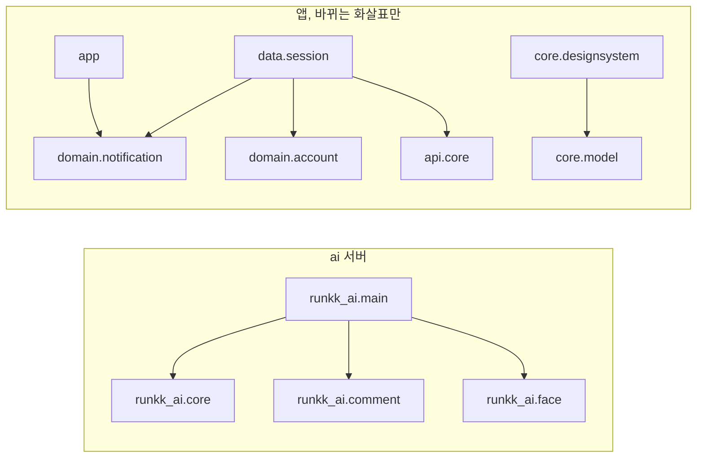

> [런크크 설계 검증 결과서](../design-review.md) 목차 · 이전: [11-v0.4-재검증](11-v0.4-재검증.md) · 다음: [13-v0.6-재검증](13-v0.6-재검증.md)

## 12. v0.5 재검증 (5차 반영본)

이 장은 **design-oo.md v0.5 본문**을 입력으로 0~6단계를 다시 수행한 결과다. v0.5는 5차 개선(11.5.2) 외에 계획에 없던 변경 두 가지를 함께 담았다. 앱을 Clean Architecture 계층으로 다시 나눈 것(D-56)과 ai 서버에 runkk_ai.core를 둔 것(D-58·D-59)이다. 그래서 서버는 바뀐 화살표만 보고, 앱·ai는 모듈 목록부터 다시 했다. 11장처럼 시그니처의 형식 참조(어느 모듈이 형식의 주인인가)와 호출 주체까지 대조했다. 위치 표기 "l.NNNN"은 design-oo.md v0.5의 줄 번호다.

### 12.0 입력 정리

#### 12.0.1 검증 기준

11.0.1과 같다. 이번에 다음 세 가지를 명시한다.

| 항목 | 기준 |
|------|------|
| 앱 의존의 단위 | 5.1.2 머리말(l.3267)대로 코드 import를 센다. Gradle implementation 선언은 세지 않는다. 바인딩 코드(Hilt @Binds·@Provides 모듈)는 코드 import라 센다 |
| ai 서버 | runkk_ai.* 모듈도 같은 기준(순환 0, Fan-Out 7, 응집도)으로 본다. v0.4까지는 comment·face 두 모듈이 서로 참조하지 않아 따로 볼 것이 없었다 |
| 검증 단위 | 패키지(모듈)다. 13.2의 Gradle 모듈 묶음(:domain, :data)은 빌드 단위라 응집도 판정에 쓰지 않고, 패키지 경계와 어긋나는 곳만 불일치로 적는다 |

#### 12.0.2 5차 개선 반영 확인

| 번호 | 개선안 (11.5.2) | v0.5 본문 위치 | 결과 |
|------|----------------|---------------|------|
| R26 | authenticate(String provider, …) | 6.1.12 l.5227, 12.2 D52 | 반영. web.admin → member 없음, member Fan-In(전체) 16 |
| R27 | (1) StoredHeartRate (2) SettingsCache.replace | 5.1.2 l.3221~, D-56 | **다른 방법으로 해소.** CompletedRun·HeartRateSample을 domain.run에 두어 data.store와 data.watch가 서로 모르고, 원본 조회를 domain.settings.SettingsRemote 포트로 해 data.settings가 api.account를 모른다 |
| R28 | (1) E14~E16 기재 (2) 형식 주인 (3) CompletedRun 생성·appendHeartRates 주체 (4) onRecordBattleStart (5) 내비게이션 주인 (6) 토큰 갱신 | (1) 형식이 domain에 있어 E14~E17은 도메인을 향하는 화살표가 됨 (2) CrewRank·PlanSnapshot → domain.run, CardSide → ui.share (3) RunSession.finish·end, RunTracker.onLateHeartRates (4) l.5424 (5) RunkkNavHost + FeatureEntry (6) TokenAuthenticator l.5446 | 반영. 새 구조에서 생긴 결함은 12.0.4 |
| R29 | (1) 결과 형식 분리 (2) GET /me/settings (3) 옛 문장 (4) D23 | (1) CelebrityResult l.4540, SettingChangeResult l.5139 (2) l.3496, 3844 (3) 3.2.2·SQ-01·1.2.10·6.1.12·D-39·FR-029 (4) 6.1.7 reconcileAll 설명, 12.4 7/12 | 반영. liveMode는 D-57(연결 결과로 폴링 전환)로 서버 화살표 없이 풀었다 |
| 권고 | MemberSummary.profileVisibility 제거, actorId 키 상수, T-13 400 행 | l.434 등 | 미반영(판정 무관) |

#### 12.0.3 모듈 목록 (앱·ai v0.5)

서버 53개 패키지와 책임 문장은 11.0.3과 같다. 앱은 5.1.2(l.3227~3263)의 모듈 44개(core 3, domain 11, api 10, data 8, ui 10, app, wear.contract), 워치 3개, ai 3개다.

| 구분 | 모듈 | 계층 | 책임 (설계서 그대로) |
|------|------|------|--------------------|
| 공통 | core.model, core.navigation, core.designsystem | 공통·표현 공통 | 불변 값·오류 형식 / 경로 이름·기능 등록 계약 / 공용 Compose 구성 요소 |
| 도메인 | domain.settings·run·sync·live·battle·crew·record·runimal·avatar·notification·account | 도메인(순수 Kotlin) | 기능 하나의 규칙·모델·포트·UseCase |
| 데이터 | api.core, api.account·run·record·battle·crew·runimal·avatar·notification, api.live | 데이터 | 서버 연결 / 그 기능의 포트를 REST로 구현 / 폴링 REST |
| 데이터 | data.store·settings·sync·watch·live·device·push·session | 데이터 | 기술 하나로 포트를 구현 |
| 표현 | ui.share, ui.home·run·record·battle·crew·runimal·avatar·me·notification | 표현 | 카드 공유 / 한 기능의 화면 |
| 조립 | app | 조립 | 앱 프로세스를 시작하고 모듈을 잇는다 |
| 폰·워치 | wear.contract | 공통 | 폰–워치 메시지 형식을 정의한다 |
| ai | runkk_ai.core, runkk_ai.comment, runkk_ai.face | ai 서버 | 설정·조립·내부 인증 / LLM 코멘트 / 셀카 변환 |

의심 표시:
- 책임 문장에 둘 이상의 일: app("시작하고 … 잇는다"), runkk_ai.core("설정·조립·내부 인증").
- core류 이름: core.model, core.designsystem, runkk_ai.core. 종류 이름: data.device("기기 기능").

#### 12.0.4 의존 화살표 대조 (5.1.2 표 ↔ 6.1.14~6.1.16, 13.2·13.3)

5.1.2 의존 표를 검산했다. 폰 모듈 화살표 119개(core·domain 21, api 28, data 19, ui 46, app 5), 워치 3개다. 12.4의 domain.run 12 ÷ 2, domain.settings 7 ÷ 1, api.core 11 ÷ 1이 맞다. ai 모듈은 의존 표에 행이 없다.

(a) 표에 없는 화살표

| No | From → To | 근거 위치 | 주고받는 것 |
|----|-----------|-----------|-------------|
| E19 | app → domain.notification **(미정)** | PushTokenSync "실패하면 다음 앱 시작 때 다시 보낸다"(l.5440)인데 RunkkApp.onCreate(l.5468)는 SyncDisposalsUseCase·SettingsRepository.refresh만 부른다. onNewToken은 앱을 시작할 때마다 오지 않는다 | 재전송 주체 없음. 11.0.4 E18과 같은 모양이다 |
| E20 | app → api.\<기능\> 8·data.\* 7·domain.\* 11·api.core **(기재대로)** | 5.1.2 app 포함 클래스 "Hilt @Binds 모듈"(l.3256). @Binds는 포트(domain)와 구현(api·data)을 함께 import한다. 5.1.2 표(l.3298)는 app의 Fan-Out을 5로 적었다 | 포트 ↔ 구현 바인딩. 기재대로면 app의 Fan-Out 약 29 **(추정)** |
| E21 | runkk_ai.core → runkk_ai.comment, runkk_ai.face | create_app(라우터 등록)과 lifespan의 "LlmClient·FaceTransformer를 한 번 만들고"(l.5489). ClaudeClient·OpenAiClient·ExternalFaceApi·LocalSdModel이 comment·face 소유다 | CommentRouter, FaceRouter, 구현 클라이언트 생성 |
| E22 | runkk_ai.comment, runkk_ai.face → runkk_ai.core | ClaudeClient "모델은 Settings.llm_model"(l.5497), CommentService llm_daily_cap(l.5494), FaceRouter max_image_bytes(l.5498), FaceTransformService face_timeout_s, "모든 라우터는 verify_internal_token을 거친다"(13.3 l.7423), "라우터에는 Depends로 넘긴다"(l.7417)와 dependencies가 core 소유(l.3261) | Settings(10개 항목 중 1~3개 사용), verify_internal_token, 주입 함수. **E21과 함께 순환** |

(b) 형식 주인·호출 주체가 없는 곳 (순환·역행 위험)

| No | 대상 | 본문 | 위험 |
|----|------|------|------|
| M39 | BattleStart.opponentTrack의 형식 | BattleStart는 domain.live의 ServerMessage(l.3233)이고 opponentTrack(경과 시간·누적 거리 표, l.3549)을 담는다. 앱 OpponentTrack은 domain.battle 소유(l.3234) | opponentTrack을 OpponentTrack 형식으로 두면 domain.live → domain.battle이 생겨 이미 있는 domain.battle → domain.live와 **순환** |
| M40 | 토큰 쌍 형식, 갱신 실패 → 로그아웃 경로 | SessionRepository.save(tokens)(domain.account), TokenProvider.update(tokens)(api.core, l.5412), EncryptedTokenStore가 둘을 구현. "갱신도 실패하면 SessionRepository 쪽에서 로그아웃 상태가 된다"(l.5446)인데 TokenProvider에는 지우는 연산이 없다 | tokens 형식을 domain.account에 두면 api.core → domain.account(api.core 0.08 → domain.account 0.38, **안정성 위반**), api.core에 두면 domain.account → api.core(**계층 역행**). TokenAuthenticator가 SessionRepository를 부르게 해도 api.core → domain.account |
| M41 | CourseMapView의 입력 좌표 형식 | core.designsystem의 CourseMapView(Kakao 지도, l.3229). core.model에는 좌표 형식이 없다(l.3227) | RoutePoint(domain.run)나 domain.record의 경로 모델을 받으면 core.designsystem → domain.\* 화살표가 표에 없다. domain.run이면 Fan-In 13이 되어 domain.settings와의 여유(12.1)가 더 줄어든다 |
| M42 | 모듈 목록에 없는 형식 | MeasurementHost(domain.run 포트, l.5375. RunTracker 의존 열에도 없음), DisposalOrder·UploadReceipt(domain.sync 포트 시그니처, l.5387), SettingChangeRequest·ProviderType(앱 domain.account, l.5410·5465), FaceTransformOutcome·FailureReason(서버 avatar 포트 시그니처, l.5035) | 포트 위치로 주인을 짐작할 수 있어 순환 위험은 작다. FailureReason을 infra.integration.ai에 두면 avatar → infra 역행 |
| M43 | WatchGateway.startRequests 구독 주체 | 워치 시작 요청(FR-183, l.7630)을 받아 startRun을 부르는 쪽이 없다 | RunTracker 또는 ui.run이면 새 화살표는 없다. 정하지 않으면 FR-183이 구현되지 않는다 |
| M44 | 대결·크루런 조정자의 코루틴 범위 | "data.device.MeasurementService가 가진 코루틴 범위를 주입받아"(l.5435, 13.2 비동기 행) | 조정자는 MATCHED(onMatched)와 onRecordBattleStart 때 이미 있어야 하는데 MeasurementService는 그 뒤 RunTracker.startRun → MeasurementHost.startForeground로 시작한다. 생성 시점에 받을 범위가 없다. 서비스의 lifecycleScope를 Hilt 그래프로 내보내려면 data.device와 조정자 사이 형식이 하나 더 생긴다 |

(c) 불일치·누락

| No | 대상 | 설계서 기재 | 본문 실제 |
|----|------|-----------|-----------|
| M45 | Gradle 모듈 제안 | D-56(l.3477) 기각 대안: "계층별 단일 모듈(:domain 하나에 모든 포트)". 13.2 계층 규칙(l.7395): ":feature:\*는 :domain·:core:\*만" | 13.2 Gradle 모듈(l.7394)이 바로 :domain 하나, :data 하나다. ui.record·ui.runimal → ui.share(5.1.2)는 :feature:record·runimal → :feature:share라 13.2 규칙에 걸린다 |
| M46 | 옛·누락 문장 | 5.4 배치도 ai 컨테이너 "runkk_ai.comment, runkk_ai.face"(l.3381), FR-156 추적 "transform(finally 삭제)"(l.7606), 14장 앱 통합 순서(l.7437) | core가 빠졌다. 6.1.16은 "지역 변수로만, 반환 뒤 참조를 버린다"이다. 14장 순서에 core.navigation·core.designsystem·wear.contract·data.device·data.push·data.session이 없다 |

### 12.1 의존 행렬과 지표

서버는 12.3 행렬·지표를 목록으로 다시 셌고 값이 맞다. R26으로 member Fan-In(전체)이 16으로 돌아와 member(3 ÷ 19 = 0.158) → policy(2 ÷ 13 = 0.154) 방향이 회복되었다. 하위 패키지 최대 Fan-Out은 realtime 4다.

앱 모듈 (5.1.2 표 기준, Fan-In이 있는 모듈만):

| 모듈 | Fan-In | Fan-Out | I |
|------|--------|---------|---|
| core.model | 36 | 0 | 0.00 |
| core.navigation | 10 (ui 9, app) | 0 | 0.00 |
| wear.contract | 2 (data.watch, watch.link) | 0 | 0.00 |
| api.core | 11 | 1 | 0.08 |
| core.designsystem | 10 | 1 | 0.09 |
| domain.settings | 7 | 1 | 0.13 |
| domain.run | 12 | 2 | 0.14 |
| domain.record | 5 | 1 | 0.17 |
| domain.live | 4 | 1 | 0.20 |
| domain.runimal | 3 | 1 | 0.25 |
| domain.avatar | 2 | 1 | 0.33 |
| domain.account | 5 (domain.notification, api.account, data.session, ui.me, app) | 3 | 0.38 |
| domain.sync | 3 | 2 | 0.40 |
| domain.notification | 3 | 2 | 0.40 |
| api.live | 1 | 1 | 0.50 |
| domain.battle, domain.crew | 2 | 3 | 0.60 |
| ui.share | 2 | 4 | 0.67 |
| api.\<기능\>, data.\*, ui.\<기능\>, app | 0 | 1~6 | 1.00 |

워치: watch.heart 1 ÷ 0(0.00), watch.link 1 ÷ 2(0.67), watch.ui 0 ÷ 1(1.00). ai: runkk_ai.core 2 ÷ 2(0.50), comment·face 1 ÷ 1(0.50).

해석:
- 모든 앱 화살표가 불안정 → 안정 방향이다. 여유가 작은 쌍은 domain.run(0.143) → domain.settings(0.125)과 domain.notification(0.40) → domain.account(0.375)다. domain.run은 Fan-In이 15가 되면(2 ÷ 17 = 0.118) domain.settings보다 안정해진다.
- E19를 지금 구조에 넣으면 domain.notification Fan-In 4, 0.33이 되어 domain.notification → domain.account(0.375)가 **안정성 위반**이 된다.
- E20을 기재대로 세면 app의 Fan-Out이 약 29다. 지표는 5.1.2 표 값으로 계산했다.
- 최대 Fan-Out: 서버 7, 하위 4, 앱 6(ui.record), ai 2.

### 12.2 결합도 판정

#### 12.2.1 화살표별 (v0.5에서 새로 생긴 화살표)

| No | From → To | 주고받는 것 (받는 쪽이 쓰는 필드) | 등급 | 판정 |
|----|-----------|----------------------------------|------|------|
| D52 | web.admin → operator | (String provider, providerToken) → OperatorSession | 스탬프 | 허용 (R26) |
| D68·D69 | web.admin.celebrity·setting → battle·policy | → CelebrityResult / SettingChangeResult | 스탬프 | 허용 (R29, 공유 형식 없음) |
| 앱 | ui.run·domain.battle·domain.crew → domain.run | RunStartSpec(mode·cardKind는 기록 속성), onGapChanged(Int), onRankChanged(CrewRank), endRun() | 데이터·스탬프 | 허용 |
| 앱 | domain.run → domain.settings | locationConsented()·birthYear() 등 값 읽기, GuidanceSettings | 데이터·스탬프 | 허용 |
| 앱 | data.store·api.run → domain.run | CompletedRun 전 항목(엔티티·전송 형식으로 매핑) | 스탬프 | 허용 |
| 앱 | domain.sync → domain.run | PendingRunRepository 연산, CompletedRun | 스탬프 | 허용 |
| 앱 | data.watch → domain.run·domain.settings·wear.contract | List\<HeartRateSample\>, WatchDisplay, heartRateConsented()·watchLinked()·changes() | 스탬프 | 허용 |
| 앱 | data.settings → domain.settings | SettingsSnapshot(fetch 결과 전부 저장) | 스탬프 | 허용 |
| 앱 | api.account → domain.account·domain.settings | AccountRepository·SettingsRemote 구현 | 스탬프 | 허용 |
| 앱 | domain.battle·crew → domain.live | LiveChannelProvider.open(), send(ProgressReport), Flow\<ServerMessage\> | 스탬프 | 허용 |
| 앱 | data.live → api.core·api.live | 인증된 OkHttp, LiveApi 호출 | 스탬프 | 허용 |
| 앱 | data.session → domain.account·api.core | SessionRepository·TokenProvider 구현 | 데이터 | 허용 (형식 주인 M40) |
| 앱 | domain.account → domain.run·domain.settings | PendingRunRepository.clear(), SettingsRepository.refresh()·clear() | 데이터 | 허용 |
| 앱 | domain.notification → domain.account | SessionRepository.loggedIn(StateFlow\<Boolean\>) | 데이터 | 허용 |
| 앱 | ui.share → domain.record·runimal·settings | RunCard·RunimalCard 전체로 그림, courseMapShared() | 스탬프·데이터 | 허용 |
| 앱 | ui.\<기능\> → domain.\<기능\> | Repository 연산 결과 도메인 모델, UseCase 호출 | 스탬프 | 허용 |
| 앱 | app → domain.sync·account·settings | SyncDisposalsUseCase(), loggedIn, refresh() | 데이터 | 허용 |
| E21 | runkk_ai.core → comment·face | 라우터 등록, 클라이언트 생성 | 스탬프 | 허용 (순환, 12.4) |
| E22 | runkk_ai.comment·face → core | Settings 전체를 받아 1~3개 항목만 사용 **(추정)**, verify_internal_token | 스탬프 | 검토 표시 (절반 미만). N7 개선으로 함께 없어진다 |

나머지 서버 화살표는 11.2.1·10.2.1과 같다.

근거:
- **제어 결합 0.** BattleStart의 opponentTrack 유무로 보간 모드를 고르는 것(l.5423)은 보간에 쓰는 자료 자체가 오는 것이라 데이터로 본다. RunStartSpec.mode는 10.2.1과 같다.
- 스탬프 경계값은 서버 D5·D18·D20·D32 그대로이고, D23은 7/12로 추정이 풀렸다(M38 해소).

#### 12.2.2 내용·공통·외부 결합과 순환 경로 재점검

| 점검 | 결과 | 근거 |
|------|------|------|
| 내용 | 0건 | 화면은 DTO·Room 엔티티를 받지 않는다(13.2). RunTracker의 RunSession은 StateFlow로만 밖에 보인다 |
| 공통 | 0건 | RunTracker·SettingsRepository 구현은 가변 상태를 가지지만 연산·Flow로만 다룬다. applicationScope는 주입받는 범위라 공유 상태가 아니다 |
| 외부 (앱) | 0건 | Room은 data.store, DataStore는 data.settings, EncryptedSharedPreferences는 data.session, WorkManager는 data.sync만 연다 |
| 외부 (ai) | 0건 | 셀카는 어떤 파일에도 쓰지 않는다(D-59). 두 컨테이너가 같이 읽는 값은 12.2.4 숨은 의존으로 본다 |
| 서버 순환 | 0건 | 11.2.2와 같다 |
| 앱 순환 | **0건** (위험 2) | 5.1.2 정렬 순서(l.3302)가 위상 순서다. M39(domain.live ↔ domain.battle), M40(api.core ↔ domain.account 방향 중 하나)이 잘못 정해지면 생긴다 |
| ai 순환 | **2쌍** | runkk_ai.core ↔ comment, core ↔ face(E21·E22). 조립 함수(create_app·lifespan)와 공용 기반(Settings, verify_internal_token, 주입 함수)이 한 모듈에 있어서 생긴다. v0.1 config(P19)가 여러 패키지의 설정을 한곳에 모아 생긴 문제와 같은 모양이다 |

#### 12.2.3 패키지 쌍 요약

서버·앱의 모든 쌍이 데이터 또는 스탬프(허용)이고 양방향 쌍이 없다. ai는 core–comment, core–face 두 쌍이 양방향이다.

#### 12.2.4 숨은 의존 (재조사)

| 번호 | 파생·공유 요소 | 원본 | 갱신 책임 (v0.5) |
|------|---------------|------|-----------------|
| H-17 | 실시간 메시지 JSON 항목 이름 | battle.live·crew.live ↔ 앱 ServerMessage | 책임 있음. 두 방향 계약 시험(14장 l.7434) |
| H-19 | 앱의 서버 설정 사본 | 서버 member 설정 | **해소.** 원본 GET /me/settings(l.3496)와 SettingsRemote 포트가 생겼다 |
| 폰–워치 | 메시지 형식 | wear.contract | 숨은 의존이 아니다. 한 모듈을 컴파일로 함께 쓰고 왕복 시험이 있다 |
| **H-21 (신규)** | ai 하루 상한 llm_daily_cap(= api 전체 한도 × 1.2, 환경 변수, l.5488) | policy LLM_DAILY_LIMIT(운영자가 관리툴에서 바꾼다, l.5065) | **책임 없음.** 운영자가 전체 한도를 올리면 ai 상한은 그대로라 넘친 요청이 모두 실패해 규칙 문구로 바뀐다(조용한 기능 저하). 내리면 ai 쪽 가드가 실제 한도보다 느슨해져 비용 가드 두 겹 중 하나가 뜻을 잃는다 |
| H-22 (신규) | 시간 제한·크기 상한의 다중 기재: ai 2.5/2.7초 ↔ api 읽기 3초, 셀카 1MB(앱·api max-file-size·ai max_image_bytes), api–ai 실패 응답 형식(FailureReason 6종) | D-58, D-59 | 책임 있음. 한 결정에 값을 함께 고정했고 응답 형식은 계약 시험(14장)이 지킨다. 권고: api의 runkk.ai.comment-timeout(l.4167)은 설정 값이라 2.7초 아래로 바꾸면 ai가 답하기 전에 끊긴다. 시작 때 하한 검사를 넣거나 상수로 둔다 |
| H-23 (신규) | 내부 토큰(X-Internal-Token) | api 설정 ↔ ai Settings.internal_token | 권고. 값의 출처(배치 환경 변수 한 곳)와 교체 절차를 5.4에 적는다. 어긋나면 모든 코멘트·셀카가 401로 실패한다 |
| H-24 (신규) | 화면 경로 문자열 | core.navigation.Routes ↔ 각 ui 모듈의 FeatureEntry 등록·이동 | 책임 있음(core.navigation). 권고: 경로 인자(기록 ID 등)의 키와 경로 생성 함수도 Routes에 둔다 |

### 12.3 응집도 판정

| 모듈 | 같이 있는 이유 | 등급 | 판정 |
|------|---------------|------|------|
| core.model | 변경이 드문 불변 값·오류 형식(종류가 같아서) | 논리적 | 조건부 허용 (서버 common과 같은 조건, 12.4가 명시) |
| core.navigation | 화면 이동 계약 하나 | 기능적 | 허용 |
| core.designsystem | RunkkTheme 토큰을 함께 쓰는 공용 구성 요소 | 통신적 | 허용. CourseMapView는 이동 후보(아래) |
| domain.settings, domain.live | 설정 사본 계약 / 실시간 메시지 계약 하나 | 기능적 | 허용 |
| domain.run | RunSession 측정 상태를 중심으로 한 측정 흐름과 그 포트 | 통신적 | 허용 |
| domain.sync | 보관 기록(PendingRunRepository)을 서버와 맞추는 두 절차 | 통신적 | 허용 |
| domain.battle·crew·record·runimal·avatar·notification·account | 그 기능의 자료 | 통신적 | 허용 |
| api.core, api.live | 서버 연결 하나 / 폴링 REST 하나 | 기능적 | 허용 |
| api.account, api.\<기능\> | 그 기능의 REST 자료 | 통신적 | 허용 |
| data.store·settings·sync·watch·push | 기술 하나로 포트 하나를 구현 | 기능적 | 허용 |
| data.live, data.session | 실시간 채널 구현 / 토큰 자료 | 통신적 | 허용 |
| data.device | domain.run의 기기 포트(MeasurementHost, GuidanceOutput, LocationPermission) 구현 | 통신적 | 허용 (infra.\<도메인\>과 같은 기준: 한 도메인 패키지의 포트 구현) |
| ui.share | 그리기 → 공유 | 순차적 | 허용 |
| ui.\<기능\> | 한 기능의 화면 | 통신적 | 허용 |
| **app** | 기동 작업(RunkkApp) + 화면 진입점(MainActivity, RunkkNavHost) + 모든 데이터 모듈의 바인딩(@Binds) | **시간적** (기재대로) | **검토 (R30).** 바인딩을 각 모듈로 옮기면 "기동과 화면 진입점"으로 기능적(bootstrap 선례, 9.3 V14) |
| wear.contract, watch.\* | 메시지 형식 / 각 기능 하나 | 기능적 | 허용 |
| **runkk_ai.core** | 공용 기반(Settings, verify_internal_token, HealthRouter) + 조립(create_app, lifespan, 주입 함수) | **시간적** (프로세스 시작 때 함께 만들어져서) | **검토 (N7).** 조립을 떼면 남는 것은 같은 Settings를 쓰는 공용 기반이라 통신적 |
| runkk_ai.comment, runkk_ai.face | 그 기능의 자료와 처리 | 통신적 | 허용 |

근거:
- data.device는 책임 문장의 "기기 기능"이 종류 이름이라 쓰레기통이 될 위험이 있다. 실제 포함 요소는 모두 domain.run의 포트 구현이라 통신적으로 본다. 권고: 책임 문장을 "domain.run의 기기 포트를 구현한다"로 고친다.
- domain.record는 RecordRepository 포트 하나에 대시보드·기록·성장·리포트·랭킹·코치·오늘 계획·카드 값이 다 들어 있다. 같은 analysis 자료라 통신적이지만, 화면 하나의 연산을 바꾸면 모든 가짜 구현이 다시 컴파일된다. 권고: 화면 영역별 포트로 나눈다(판정 무관).

이동 후보:
- **CourseMapView (core.designsystem → ui.record).** 모듈 안의 다른 요소와 테마 외 연결이 없고, 본문상 쓰는 곳은 ui.record 하나다(v0.4 열 "ui.record의 CourseMapView"). 지금 위치에서는 Kakao 지도 SDK 의존이 :core:ui를 통해 모든 기능 모듈로 번진다. ui.share 뒷면 지도도 같은 뷰를 쓴다면 지도 전용 모듈(core.map)을 둔다.

### 12.4 구조 결함

| 결함 | 결과 | 관련 모듈 | 근거 |
|------|------|-----------|------|
| **순환 의존** | **서버 0, 앱 0 (위험 2), ai 2쌍** | runkk_ai.core ↔ comment, core ↔ face | E21·E22 |
| 계층 역행 | 0건 (위험 1) | — | M40에서 tokens 형식을 api.core에 두면 domain.account → api.core |
| 허브 | 0건 | — | 앱 Fan-In 상위(core.model 36, domain.run 12, api.core 11, core.designsystem·navigation 10)의 Fan-Out은 0~2이고 Fan-Out 상위(ui.record 6, ui.\* 5)의 Fan-In은 0이다 |
| 쓰레기통 | 0건 | core.model, data.device | core.model은 조건부. data.device는 책임 문장 권고 |
| 안정성 위반 | 0건 | — | 서버 member → policy 회복. 앱 근접 쌍 둘(12.1). E19를 지금 구조에 넣으면 1건 |
| Fan-Out 7 초과 | 0건 (표 기준) | app | E20 기재대로면 app 약 29(R30) |
| 고립 | 0건 | — | app, watch.ui는 Fan-In 0의 진입점 |
| 정보 은닉 위반 | 0건 | — | 내용 결합 0 |

### 12.5 판정과 개선안

#### 12.5.1 종합 판정표 (v0.5 실제)

| 항목 | 결과 | 판정 |
|------|------|------|
| 내용·공통·외부 결합 화살표 수 | 0 (서버·앱·ai) | 합격 |
| 제어 결합 화살표 수 | 0 | 합격 |
| 스탬프(검토) 화살표 수 | 0 (서버 경계 4, ai 추정 1은 N7에 포함) | 합격 |
| **순환 의존 수** | **ai 2쌍** (서버·앱 0, 앱 위험 2) | **불허** |
| 계층 역행 수 | 0 (위험 1) | 합격 |
| 최대 Fan-Out | 서버 7, 하위 4, 앱 6, ai 2 (app 바인딩 기재대로면 약 29) | 검토 (R30) |
| 응집도 불허 패키지 수 | 0 | 합격 |
| 응집도 검토 패키지 수 | 2 (app 기재대로, runkk_ai.core) | 검토 (R30, N7) |
| 안정성 위반 수 | 0 (근접 2) | 합격 |
| 숨은 의존 중 책임·복구 경로 없음 | 1 (H-21) | 검토 (R32) |
| 인터페이스 명세 결함 | 누락 화살표 4 (E19~E22), 형식·호출 주체 미정 6 (M39~M44, 순환 위험 2·역행 위험 1), 불일치 2 (M45·M46) | 검토 (R31, R33) |

v0.5 판정: **불합격**. 불허 1건(N7 ai 순환), 검토 4건(R30~R33). 5차 개선 R26~R29는 모두 반영되었고 서버는 불허 0·검토 0이다. 결함은 모두 계획 밖에서 새로 만든 구조(앱 재편, ai core)에서 나왔다.

#### 12.5.2 불허·검토 항목과 개선안

| 번호 | 대상 | 문제 | 개선안 |
|------|------|------|--------|
| **N7** | runkk_ai.core ↔ comment·face | 순환 2쌍(불허), core 시간적 응집, Settings 전체 전달 | 조립을 떼어 **runkk_ai.main**(create_app, lifespan, 라우터 등록, 서비스 객체를 app.state에 둔다)을 만든다. runkk_ai.core에는 Settings, verify_internal_token, HealthRouter만 남겨 Fan-Out 0으로 둔다. 내부 토큰 검사는 main이 `include_router(…, dependencies=[Depends(verify_internal_token)])`로 한 번에 건다. 라우터의 서비스 주입 함수(get_comment_service 등)는 각 기능 모듈 안에서 `request.app.state`를 읽게 해 main을 import하지 않는다. ClaudeClient·CommentService·FaceTransformService에는 Settings 전체 대신 쓰는 값(model, max_tokens, timeout, daily_cap, face_timeout, max_image_bytes)을 `__init__` 인자로 넘긴다. 그러면 comment·face → core도 없어진다. 5.1.2(행 추가와 의존 표에 ai 행), 6.1.16, 13.3 구조 행, 5.4 배치도를 함께 고친다. 14장의 dependency_overrides는 기능 모듈의 주입 함수를 덮으면 그대로 된다 |
| R30 | app의 바인딩 위치 | 기재대로면 Fan-Out 약 29, 시간적 응집, Konsist "5.1.2 표 밖 import 0"(14장)이 app에서 실패 | 5.1.2 app 포함 클래스에서 "Hilt @Binds 모듈"을 빼고, 각 데이터 모듈(api.\<기능\>, data.\*)이 자기 구현을 바인딩하는 Hilt 모듈(`@Module @InstallIn(SingletonComponent::class)`)을 갖는다. 서버 5.1.1 "설정 클래스는 그것이 설정하는 패키지에 둔다"와 같은 원칙이고 v0.1 config(P19)가 앱에서 되풀이되는 것을 막는다. domain의 UseCase·RunTracker는 `javax.inject.Inject`(JSR-330, Android·Hilt 아님) 생성자 주입만 허용한다고 13.2에 적는다. 그래야 @Provides가 app에 모이지 않는다. app은 Fan-Out 5(E19 반영 시 6), 기능적이 된다 |
| R31 | 앱 형식 주인·호출 주체 | E19, M39~M44 | (1) M39: BattleStart.opponentTrack을 domain.live 소유 원시 표 `TrackTable(points: List<TrackPoint(elapsedSeconds, distanceMeters)>)`로 정하고 BattleRunCoordinator가 `OpponentTrack.from(table)`로 바꾼다. (2) M40: TokenProvider(api.core)는 원시 값만 쓴다: `accessToken(): String?`, `refreshToken(): String?`, `update(access, refresh)`, `clear()`. SessionTokens는 domain.account 소유. TokenAuthenticator는 갱신이 실패하면 TokenProvider.clear()를 부르고 EncryptedTokenStore가 loggedIn을 거짓으로 방출한다. (3) M41: core.model에 GeoPoint(위도, 경도)를 두고 CourseMapView는 List\<GeoPoint\>를 받는다. CourseMapView를 쓰는 곳이 ui.record뿐이면 ui.record로 되돌린다. (4) M42: 5.1.2 포함 클래스와 RunTracker 의존 열에 빠진 형식을 적는다(FaceTransformOutcome·FailureReason은 서버 5.1.1 avatar). (5) E19: RunkkApp.onCreate가 PushTokenSync.retryPending()을 부른다. 이때 domain.notification이 domain.account보다 안정해지므로, PushTokenSync는 SessionRepository 대신 domain.notification의 포트 `LoginState(val loggedIn: StateFlow<Boolean>)`를 보고 data.session.EncryptedTokenStore가 구현한다. domain.notification → domain.account가 없어진다. (6) M43: startRequests 구독 주체를 적는다(RunViewModel이 구독해 checkStartable → startRun, 또는 RunTracker). (7) M44: 조정자는 onMatched·onRecordBattleStart·크루런 대기 때 app의 applicationScope 아래에 자기 범위(SupervisorJob)를 만들고 endRun 뒤 취소한다. MeasurementService는 프로세스를 살려 두는 일만 한다. 5.1.2 설계 규칙, 6.1.14 l.5435, 13.2 비동기 행을 고친다 |
| R32 | H-21 | 숨은 의존 책임 없음 | ai 하루 상한을 운영 한도에서 파생하지 않는 절대 비용 상한으로 D-58에 적고, policy의 LLM_DAILY_LIMIT 값 검사(SettingKey.validate)에 "전체 한도 ≤ ai 상한 ÷ 1.2"를 넣는다. 운영자가 넘기려 하면 관리툴이 거부하므로 두 값이 어긋나지 않는다. T-11에 LLM_DAILY_LIMIT 상한 거부 행을 더한다 |
| R33 | 문서 불일치 | M45, M46 | (1) D-56의 기각 대안을 "패키지 경계 없이 계층별 단일 패키지"로 고치거나 Gradle을 기능별(:domain:\<기능\>)로 나눈다. 어느 쪽이든 Konsist 규칙이 패키지 경계(5.1.2 표)를 지킨다고 13.2에 적는다. :feature:\* 규칙에 :feature:share 예외(record·runimal → share)를 넣는다. (2) 5.4 배치도 ai 모듈, FR-156 추적 문장, 14장 앱 통합 순서를 고친다 |

권고(판정에 넣지 않음): data.device 책임 문장, RecordRepository 분리, H-22 comment-timeout 하한 검사, H-23 내부 토큰 출처·교체 절차, H-24 Routes 인자 키, 11.5.2 권고 셋.

우선순위: N7(불허) → R30(구현 첫 주에 Konsist가 실패) → R31(순환·역행 위험 M39·M40 먼저) → R32 → R33.

#### 12.5.3 6차 의존도 (바뀌는 부분)

서버 패키지와 화살표는 그대로다. 바뀌는 것은 ai 모듈과 앱 모듈 몇 곳이다.

없어지는 화살표: runkk_ai.core → comment·face, comment·face → core, domain.notification → domain.account, app → 데이터 모듈(바인딩).

| 모듈 (6차) | Fan-In | Fan-Out | I |
|-----------|--------|---------|---|
| runkk_ai.main | 0 | 3 | 1.00 |
| runkk_ai.core | 1 | 0 | 0.00 |
| runkk_ai.comment, face | 1 | 0 | 0.00 |
| domain.notification | 5 (api.notification, data.push, ui.notification, data.session, app) | 1 | 0.17 |
| domain.account | 4 (api.account, data.session, ui.me, app) | 3 | 0.43 |
| data.session | 0 | 3 | 1.00 |
| app | 0 | 6 | 1.00 |

모든 화살표가 불안정 → 안정 방향이고 순환이 없다. 최대 Fan-Out은 서버 7, 하위 4, 앱 6, ai 3이다. 6차 재검증(계획 기준): 불허 0, 검토 0 → **합격 예상**.

### 12.6 전후 비교

| 항목 | v0.4 (실제) | 5차 (계획) | v0.5 (실제) | 6차 (계획) |
|------|-------------|-----------|-------------|-----------|
| 내용·공통·외부 결합 화살표 | 0 | 0 | 0 | 0 |
| 제어 결합 화살표 | 0 | 0 | 0 | 0 |
| 스탬프(검토) 화살표 | 0 (경계 4, 추정 1) | 0 | 0 (경계 4, ai 추정 1) | 0 (경계 4) |
| 순환 의존 | 0 (위험 4) | 0 | **ai 2쌍** (앱 위험 2) | 0 |
| 계층 역행 | 0 | 0 | 0 (위험 1) | 0 |
| 안정성 위반 | 서버 1, 앱 2 | 0 | 0 (근접 2) | 0 |
| 응집도 불허 패키지 | 0 | 0 | 0 | 0 |
| 응집도 통신적 미만 | 1 (common 조건부) | 1 | 조건부 2 (common, core.model) + 검토 2 (app, runkk_ai.core) | 조건부 2 |
| 최대 Fan-Out | 7 (하위 4, 앱 5) | 7 (앱 5) | 7 (하위 4, 앱 6 — app 기재대로 약 29, ai 2) | 7 (하위 4, 앱 6, ai 3) |
| 숨은 의존 중 책임·복구 없음 | 0 | 0 | 1 (H-21) | 0 |
| 명세 결함 | E 6, M 8 | 0 | E 4, M 8 | 0 |
| 모듈 수 (서버(핵심) / 앱 / ai) | 53(14) / — / 2 | 53(14) / — / 2 | 53(14) / 44 / 3 | 53(14) / 44 / 4 |
| 판정 | 조건부 합격 | 합격 예상 | **불합격** | 합격 예상 |

5차 계획이 "합격 예상"을 맞히지 못한 이유: 계획이 다룬 항목(R26~R29)은 모두 맞았다. 서버는 계획대로 member → policy 방향이 돌아왔고, 앱 안정성 역전 둘은 계획과 다른 방법(포트를 domain에)으로 풀렸다. 새 결함은 모두 계획 밖 변경에서 나왔다. 특히 ai 모듈은 5.1.2 의존 표에 행이 없어 설계서 자가 점검(12.4 "순환 0 (서버·앱)")에서 빠졌다. 계획 밖으로 모듈을 추가할 때는 의존 표에 행을 함께 적어야 이 검증이 첫 단계에서 잡을 수 있다.

부작용 점검(v0.5):
- 앱 모듈이 기능·계층별로 늘어 인터페이스(포트) 수가 늘었다. "포트 하나 조회는 ViewModel이 Repository 직접"(5.1.2 설계 규칙)으로 UseCase 남발은 막혀 있다.
- domain.run Fan-In 12로 domain.settings와의 여유가 0.018이다. M41에서 core.designsystem → domain.run을 만들면 13이 된다. GeoPoint를 core.model에 두는 쪽이 낫다.
- ui.record Fan-Out 6이 앱 최대라 다음 기능 추가 때 먼저 기준에 걸린다.
- 서버 RunSummary 경계값(D23 7/12)과 RunQueryService 공개 연산 20개는 그대로다.

### 12.7 최종 판정

**불합격** (design-oo.md v0.5). 불허 1건(N7: ai runkk_ai.core ↔ comment·face 순환 2쌍), 검토 4건(R30 app 바인딩 위치, R31 앱 형식 주인·호출 주체, R32 H-21 LLM 한도 파생값, R33 문서 불일치), 각각 개선안이 있다.

서버는 v0.4 검토 항목(R26·R29)이 모두 풀려 서버만 보면 불허 0·검토 0이다. 앱은 Clean Architecture 재편으로 v0.4의 안정성 역전 둘이 없어지고 순환·역행이 0이지만, 바인딩 위치(R30)와 형식 주인(R31)이 남았다. 불허 1건은 runkk_ai.core 한 모듈을 main과 core로 나누는 일이라 바뀌는 범위가 작다. N7·R30을 반영하면 조건부 합격, R31~R33까지 반영하면 합격 조건을 채운다.

