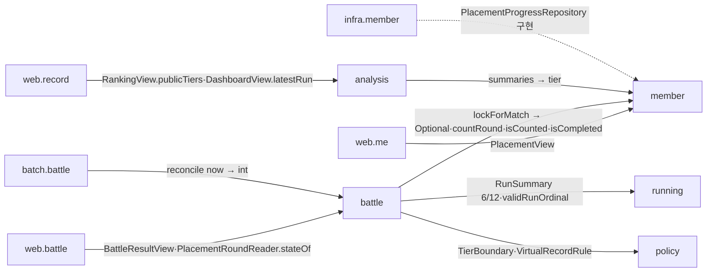

> [런크크 설계 검증 결과서](../design-review.md) 목차 · 이전: [24-v0.27-검증](24-v0.27-검증.md) · 다음: [27-v0.33-검증](27-v0.33-검증.md)

## 25. v0.30 검증·v0.31 재확인 (배치고사·티어 표시·화면 개편, 2026-11-04)

이 장은 **design-oo.md v0.30**의 새 조각 [05-21](../design-oo/05-21-설계-배치고사-화면개편-성.md)(D-475~D-510)과 계약 [05-03 5.7.3](../design-oo/05-03-API-실시간-메시지.md)을 입력으로 review 0~6단계를 적용한 결과다. 설계를 쓴 사람과 다른 눈으로 보도록 설계서 문장을 코드 사실(S15P31A207-hotfix `hotfix/S15P31A207-275-v0111-feedback` df211dc5, main f2f3a13d 기준, 읽기만 함)과 origin/develop 마이그레이션(V36·V37)에 하나씩 대조했다. 요구 쪽 입력은 srs v0.24(03-08 FR-274~FR-290, J24-1~J24-23), 2026-11-04 PM 브리프(배치고사 규칙 1~13, 화면 범위), 피그마 추출 명세 9절(차이 17건), 총괄 결정 기록(self-decisions)이다.

기준은 0.1 기본값 그대로다(결합도 상한 스탬프, 응집도 하한 통신적, Fan-Out 7, 순환 0). 클래스 협력 객체는 Clock을 빼고 7 이하(05-18 D-419와 같은 규칙을 서버에도 씀). 이 장은 구조 판정에 더해 브리프가 요구한 **정합성 검토**(요구 → 설계 추적, 계약 완결성, 경합·멱등, 마이그레이션, 개인정보, 화면)를 함께 하고, 찾은 결함을 다음 세 등급으로 매겼다.

| 등급 | 뜻 | 판정 기준표 대응 |
|------|----|------------------|
| 치명 | 이대로 구현하면 요구(FR·브리프 규칙)를 어기는 동작이 생긴다 | 불허 |
| 중 | 구조 규칙(허용 화살표·out-of-order 금지)을 어기거나, 경합·장애 때 결함·자료 잔존이 생길 수 있다 | 검토(개선안 필수) |
| 경 | 표기·화면 연결·작은 경합처럼 구현자가 추측하게 되는 빈칸 | 검토(권고 수준) |

치명·중은 이 단계에서 설계서를 직접 고쳐 해소하고(design-oo v0.31, 05-21 1.1절 D-511~D-520) 25.6에서 재확인했다. 경도 모두 같은 판에 반영했다.

### 25.0 입력 정리

#### 25.0.1 바뀐 패키지 목록 (새 패키지 0)

| ID | 패키지 | 계층 | 이번에 들어온 요소 | 책임 한 문장(표시) |
|----|--------|------|--------------------|-------------------|
| S1 | member | 도메인 | PlacementProgress·PlacementRound·PlacementService·PlacementProgressRepository·값 5·enum 2, Member·TierProgress·TierLevelService·WithdrawalService 변경 | 회원 자료와 티어(배치 진행 포함)를 관리한다 |
| S2 | battle | 도메인 | PlacementMatcher·PlacementOpponentFactory·PlacementOpponent·PlacementRoundListener·PlacementReconcileService·PlacementRoundState·RecordCheck, Battle·BattleParticipant·MatchingService 등 변경 | 대결을 만들고 진행·판정한다 |
| S3 | analysis | 응용 | RankingView.publicTiers, DashboardView.latestRun | 기록을 집계해 보여 준다 |
| S4 | web.me / web.battle / web.record | 표현 | PlacementResponse, DTO 항목 추가, BattleResultAssembler 변경 | HTTP 경계 변환 |
| S5 | infra.member / batch.battle | 인프라·구동 | 진행 저장소 구현, PlacementReconcileJob | 저장소 구현 / 정해진 시각 구동 |
| A1 | core.model | 앱 공용 | TierDisplay | 화면 공용 값 |
| A2 | core.designsystem | 앱 공용 | TierBadge·TierEmblem·RunkkTierColors·HeartZoneBands·결과 부품, 드로어블 24 | 공용 화면 부품을 그린다 |
| A3 | domain.account / domain.battle / domain.live / domain.record | 앱 도메인 | Placement* 값·포트, 항목 추가, RandomBattleGate 워치 전용 | 앱 업무 규칙과 포트 |
| A4 | ui.home / ui.run / ui.record / ui.me / ui.battle, wear watch.battle | 앱 표현 | 화면·ViewModel·UiState | 화면 |

이름이 `core`인 두 패키지(A1·A2)는 0단계 규칙대로 응집도 의심 대상으로 표시했다(25.3).

#### 25.0.2 주고받는 것이 바뀐 화살표 (설계서 + 코드 import 대조)

| No | From → To | 의존 형태 | 주고받는 것 | 근거 |
|----|-----------|-----------|-------------|------|
| E1 | battle → member | 메서드 호출 | lockForMatch(memberId) → PlacementBasis; countRound(memberId, PlacementRoundInput) → PlacementCount; isCounted(memberId, battleId) → boolean | 05-21 2.1·2.2, 기존 화살표(ArchUnit `battle → member`) |
| E2 | battle → running | 메서드 호출 | summary(recordId) → RunSummary(12 중 recordId·valid·score·distance·elapsed·averagePace 6); RunRecordSaved.validRunOrdinal(사건) | 기존 화살표 |
| E3 | battle → policy | 메서드 호출 | tierBoundary(), virtualRecordRule() → 값 | 기존 |
| E4 | analysis → member | 메서드 호출 | summaries(ids) → Map<Long, MemberSummary>(tier·shownGender) | 기존(D-334와 같은 방식) |
| E5 | web.me → member | 메서드 호출 | view(memberId) → PlacementView(전부 씀) | 기존 |
| E6 | web.battle → battle | 메서드 호출 | MatchAcceptance·BattleResultView·ActiveBattleView·BattleHistoryView.Entry(항목 추가) | 기존 |
| **E7** | **web.battle → member** | 메서드 호출 | **PlacementService.isCounted(memberId, battleId) → boolean** | **05-03 5.7.3.2 P4 "BattleResultAssembler (+ PlacementService.isCounted)"**. 코드 `web/battle/BattleResultAssembler.java` import는 battle·reward·running뿐이고 ArchUnit 허용 `web.battle → {battle, reward, running}`에 member가 없다. 05-21 9절 "새 화살표 0"과 어긋나는 **숨은 새 화살표**(R84) |
| E8 | web.record → analysis | 메서드 호출 | RankingView·DashboardView(항목 추가) | 기존 |
| E9 | batch.battle → battle | 메서드 호출 | reconcile(now) → int | 기존(batch.X → X) |
| E10 | infra.member → member | 포트 구현 | PlacementProgressRepository | 기존(infra.X → X) |
| E11 | member(TierLevelService) ↔ placement_progress | 같은 패키지 안 | confirmedRunOrdinal 읽기 | 패키지 안. 단 티어 반영과 판 셈의 커밋 순서에 걸린 숨은 의존(H-65) |
| E12 | 앱 ui.home → domain.account | 포트 호출 | placement() → Outcome<PlacementProgress> | 기존(Konsist `ui.home` 허용에 domain.account) |
| E13 | 앱 ui.battle → domain.account·domain.record·domain.battle·domain.live | 포트 호출 | placement(), run(), requestMatch(), MatchFound.placementRound | 기존(Konsist `ui.battle` 허용 넷) |
| E14 | 앱 ui.home·ui.battle·ui.record·ui.me·ui.run → core.designsystem | 함수 호출 | TierBadge(display, size), TierEmblem, 결과 부품, **PlacementProgressCard(progress, mode)** | 기존 화살표. `mode`·`TierBadgeSize.LARGE`가 제어 인자(R93) |
| E15 | wear watch.battle → domain.battle | 함수 호출 | RandomBattleGate.isWatchRandomLocked(tier) → Boolean | 기존 |

#### 25.0.3 코드 사실 대조 (설계 문장을 뒤집거나 보탠 것)

| # | 설계 문장 | 코드 사실 | 결과 |
|---|-----------|-----------|------|
| C1 | D-481 "기록 검증이 참(`getVerified() == Optional.of(true)`)이면 센다" | `BattleResultService.applyRecord`가 `battle.verify(…, e.valid() && reach.isPresent(), …)`로 검증값에 **대결 거리 도달**을 함께 넣는다. 앱 `BattleRunCoordinator`는 `BattleEnded`를 받으면 `finish → endMeasuring`(측정 종료·기록 저장). 서버는 유령 도착 10초 뒤(`Battle.COUNTDOWN`) 카운트다운을 닫는다 | 유령보다 10초 넘게 늦은 러너(대부분의 패배)는 기록이 대결 거리보다 짧아 검증값 거짓 → **세지 않음**. FR-275·J24-4("미도착 종료도 유효면 셈")·브리프 10("승패 무관") 위반 → **R82 치명** |
| C2 | D-481 "결과 보류는 판정이 날 때 BattleJudged가 와서 그때 센다" | `Battle.mayStillRun`: 기록이 없어도 도착(arrivedAt)했으면 기다리지 않는다. 유령이 먼저 도착하면 `decide`가 유령 승으로 판정한다. 뒤에 온 기록은 `judge`가 같은 판정이면 empty(사건 없음) | 유령 먼저 + 러너 카운트다운 안 도착 + 업로드가 마감 뒤면 BattleJudged에 기록이 없고 다시 오지 않는다. 다음 날 0시 20분 복구까지 PENDING → **R83 중** |
| C3 | D-478 "비관 잠금 + isBusy로 한 개만 통과" | `RecordBattleService.create`는 활성 칸 고유 제약(V15 `uq_battle_participant_active_member`) 위반을 `UniqueViolations`로 잡아 ALREADY_IN_BATTLE로 바꾼다. 셀프·셀럽 시작, 친구 초대 수락은 배치 진행 잠금을 잡지 않는다 | 다른 경로와의 동시 생성은 DB 제약이 막지만 설계에 변환 규칙이 없어 500 → **R86 중** |
| C4 | D-476 "V38 + develop·prod out-of-order" | hotfix(main)·release/v0.11·hotfix/v0.11.1-wear-r8 최대 V35, origin/develop 최대 V37. 13-14 구현 지침·F.5.3 "out-of-order는 켜지 않는다". develop DB는 V37까지 적용돼 V38은 develop에서 out-of-order가 필요 없다(설계 문장 오류) | 25.4.3 비교 → **R85 중** |
| C5 | D-489 "FK ON DELETE CASCADE도 둔다" | `Member.withdraw`는 행을 지우지 않고 WITHDRAWN으로 바꾼다(소프트). `purgeResidual`도 행을 남긴다 | CASCADE는 실제로 일어나지 않고 같은 트랜잭션의 명시 삭제가 유일한 파기 수단이다. 그러면 탈퇴 뒤 판 셈·복구 작업이 행을 다시 만들지 않아야 한다 → **R87 중** |
| C6 | D-484 "TierLevelService가 confirmedRunOrdinal을 읽어 넘긴다 … 무엇이 먼저 커밋돼도 같다" | `TierLevelService.recordValidRun`은 지금 Member를 먼저 읽는다. Member는 `@Version`. TierUpdateListener는 일시 오류 3회 재시도 | 읽는 순서를 정하지 않으면 READ COMMITTED에서 진행 행(셈 전) → Member(셈 뒤) 순서일 때 3판째 = 10번째 순번 재평가가 난다 → **R88 중** |
| C7 | 05-21 5절 SQL `SMALLINT` | develop·prod `ddl-auto: validate`, 기존 SMALLINT 칼럼은 `@JdbcTypeCode(SqlTypes.SMALLINT)`(PollOption·PollResponse·PostPhoto) | 매핑 문장 없음 → **R92 경** |
| C8 | D-501 "PlacementResult를 대신 연다" | `RunkkNavigator`에 `navigate`·`replace`가 있고 `BattleRunningScreen`은 `replace(Routes.BattleResult(id, isJustFinished = true))`. 이력 탭도 `BattleResult(id)`를 연다 | navigate로 쌓으면 뒤로 → BattleResult → 다시 판 결과로 튐, 이력의 옛 판도 판 결과로 감 → **R91 경** |
| C9 | D-510 "옛 앱은 기기 잠금 때문에 요청을 보내지 않는다" | `RandomBattleGate.runsLeft`: 언랭이면 1 이상(coerceAtLeast(1)), tier가 null(프로필 못 읽음)이면 잠그지 않음 | 대체로 맞으나 예외가 있고, 배포 뒤 새 언랭 회원은 옛 앱에서 티어를 얻지 못한다 → **R94 경** |
| C10 | D-495 `RunkkColors.isDark` | 코드는 `LocalRunkkColors.current.isDark` | 표기 → **R95 경** |
| C11 | 클래스 협력 객체 | BattleResultService 이미 7(Clock 빼고), MatchingService 4, WithdrawalService 6, DashboardService 6, TierLevelService 2 | BattleResultService에 배치 판 상태 계산을 넣으면 8이 된다(R84 개선안이 이것을 피함). 나머지는 +1해도 7 이하 |

### 25.1 의존 행렬과 지표

새 패키지가 없으므로 바뀐 행만 적는다. 값은 화살표 수(설계서 v0.30 문장 그대로 구현한 경우 / v0.31 반영본).

| From \ To | member | running | policy | battle | analysis | Fan-Out (v0.30 문장대로 / v0.31) |
|-----------|--------|---------|--------|--------|----------|-----------------------------------|
| battle | 1 | 1 | 1 | - | 0 | 5 / 5 (member, running, policy, notification, audit, 그대로) |
| web.battle | **1(E7)** / 0 | 1 | 0 | 1 | 0 | **4 / 3** (battle, reward, running) |
| web.me | 1 | 0 | 0 | 0 | 0 | 2 / 2 |
| analysis | 1 | 1 | 1 | 0 | - | 6 / 6 |
| batch.battle | 0 | 0 | 0 | 1 | 0 | 1 / 1 |

- Fan-In: member는 이미 가장 안정한 쪽(불안정도 낮음)이고 이번 변경으로 들어오는 화살표가 늘지 않는다(v0.31). v0.30 문장대로면 web.battle(표현, 불안정 1.0) → member 화살표 하나가 생긴다. 방향은 불안정 → 안정이라 안정성 위반은 아니지만 허용 표(ArchUnit)에 없는 **새 화살표**다.
- 앱: 폰 159·워치 37 그대로. ui.battle Fan-Out 4(domain 넷) + core 셋 = 7(그대로), ui.home 그대로. 새 화살표 0을 Konsist 허용 표(`app/src/test/.../ArchitectureTest.kt` 534·543·551행)와 대조해 확인했다.

### 25.2 결합도 판정 (화살표마다, 나쁜 것부터)

| No | From → To | 주고받는 것 | 등급 | 기준 대비 | 근거 |
|----|-----------|-------------|------|-----------|------|
| E1 | battle → member | memberId·battleId(값), PlacementRoundInput(9개 모두 씀), PlacementBasis(2개 모두), PlacementCount(sealed 결과) | 스탬프 | 허용 | 넘기는 묶음을 피호출자가 전부 쓴다. PlacementVerdict를 member에 따로 두어 member가 battle을 모른다 |
| E2 | battle → running | RunSummary 12개 중 6개(절반) | 스탬프 | 허용 | 절반 미만이 아님. running이 내주는 공개 요약(D-32) |
| E3 | battle → policy | TierBoundary·VirtualRecordRule 값 | 스탬프 | 허용 | 기존 |
| E4 | analysis → member | MemberSummary(tier·shownGender) | 스탬프 | 허용 | 기존 D-334와 같은 화살표·같은 형식 |
| E5 | web.me → member | PlacementView 전부 | 스탬프 | 허용 | |
| E6 | web.battle → battle | View 항목 추가 | 스탬프 | 허용 | |
| E7 | web.battle → member (v0.30 문장) | isCounted → boolean | 데이터 | **검토(허용 표에 없는 새 화살표)** | 등급은 데이터지만 D-314("web.battle은 member 비참조")와 9절 "새 화살표 0"을 어기고 ArchUnit이 깨진다. R84 |
| E8~E10 | web.record → analysis, batch.battle → battle, infra.member → member | 값·포트 | 데이터·스탬프 | 허용 | |
| E14 | ui.battle → core.designsystem | `PlacementProgressCard(progress, mode: PlacementCardMode)` | **제어** | 검토 | mode가 부르는 쪽에서 카드 내부 분기(제목·칸 이름·안내)를 정한다. R93 |
| E14' | 여러 ui → core.designsystem | `TierBadge(display, size)`의 `LARGE` | **제어** | 검토 | XSMALL·SMALL은 치수만 다르지만 LARGE는 세로 배치·바탕 없음으로 그리는 길이 다르다. R93 |
| E15 | watch.battle → domain.battle | tier 문자열 → Boolean | 데이터 | 허용 | |

화면 데이터 쪽 Boolean 인자 `HeartZoneSection(…, hasBirthYear)`은 부르는 쪽이 고르는 모드가 아니라 회원 자료의 사실이라 데이터로 본다. 응답 enum(`PlacementRoundState`, `PlacementStatus`)은 상태 값이라 데이터다.

**숨은 의존**(갱신 책임과 함께 적음)

| ID | 원본 → 따라 바뀌어야 하는 것 | 갱신 책임 |
|----|------------------------------|-----------|
| H-62 | battle.Verdict 값 → member.PlacementVerdict 값 | battle `PlacementRoundListener`가 이름으로 옮김. 계약 enum 두 파일을 계약 시험이 대조(5.7.3.1) |
| H-63 | member.PlacementProgress.ROUNDS → 앱 `RandomBattleGate.PLACEMENT_RUNS`(진행 분모) | 계약 `TierPlacement.txt`, TierPlacementContractTest(D-509) |
| H-64 | 운영 기준 TierBoundary·VirtualRecordRule → 배치고사 상대 페이스 | 판 생성 때 값으로 고정해 대결에 남김(J24-13). 지난 판 재계산 없음 |
| H-65 | 판 셈의 confirmedRunOrdinal ↔ 티어 반영의 재평가 조건(J24-6) | 커밋 순서와 무관하게 하려면 읽는 순서 고정이 필요(R88, D-517) |
| H-66 | develop 프로필 `out-of-order: true` ↔ V35_1 | 35.1이 develop에 한 번 적용되면 지워도 되고 v0.12 릴리스 MR에서 지운다(D-514) |
| H-67 | 기록 유효 판정(running, FR-047) → 배치고사 판 인정 | 판 인정이 RunSummary.valid에 기대므로 유효 러닝 기준이 바뀌면 배치고사 셈도 따라 바뀐다(의도된 의존, FR-275가 "유효 러닝"을 기준으로 정함) |

### 25.3 응집도 판정 (패키지마다, 좋은 것부터)

| ID | 패키지 | 같이 있는 이유 | 등급 | 기준 대비 | 근거 |
|----|--------|----------------|------|-----------|------|
| S1 | member | 회원 티어라는 같은 자료를 다룸. PlacementProgress는 회원 1:1, 티어 확정은 Member.tier | 통신적 | 허용 | PlacementService의 연산 5개가 모두 진행 행과 Member.tier에 닿는다 |
| S2 | battle | 대결 생성·판정·결과라는 같은 자료(Battle) | 통신적 | 허용 | 새 클래스 6개 모두 Battle·BattleParticipant를 읽거나 만든다. 잘못 배치 점검: PlacementRoundListener는 battle 안 연결 3(Battle, BattleRepository, 사건) > 밖 2(running, member) |
| S3 | analysis | 기록 집계 | 통신적 | 허용 | 그대로 |
| A1 | core.model | 화면 공용 값(TierDisplay) | 기능적(값 모음 중 화면 표시 규칙 하나) | 허용 | ofSelf·ofPublic만 있는 순수 규칙 |
| A2 | core.designsystem | 공용 화면 부품을 그림 | 기능적 | 허용 | 새 요소는 모두 그리기(배지·엠블럼·색·결과 부품)이고 HeartZoneBands는 HeartZoneSection 한 곳이 쓰는 표시 변환이라 잘못 배치 아님(안 연결 1, 밖 0). 18.6 기준선("그리기와 무관한 것을 넣으면 논리적")을 넘지 않는다 |
| A3 | domain.account | 회원 자료(본인 프로필·동의·배치 진행) | 통신적 | 허용 | 서버가 /me 아래로 주는 같은 자료(D-493) |
| A4 | ui.battle | 대결 화면 | 기능적 | 허용 | 화면 5개 추가, Fan-Out 그대로 7 |

### 25.4 구조 결함과 정합성 검토

#### 25.4.1 구조 결함

| 결함 | 결과 | 근거 |
|------|------|------|
| 순환 의존 | 0 | member → battle·running 없음. 앱 ui.home → ui.battle 없음(경로 상수만, D-499) |
| 계층 역행 | 0 | |
| 허브·쓰레기통 | 0 | A2는 25.3대로 기능적 |
| 안정성 위반 | 0 | |
| 고립 | 0 | |
| 허용 표 밖 화살표 | **1(v0.30 문장)** → 0(v0.31) | E7 web.battle → member(R84) |
| Fan-Out 초과 | 0 | 최대 7(ui.battle, ui.home 그대로) |
| 클래스 협력 객체 7 초과 | 0(v0.31) | v0.30 문장을 BattleResultService에 넣으면 8이 될 수 있었다(C11). PlacementMatcher 7, PlacementRoundReader 3, PlacementRoundListener 4, WithdrawalService 7 |

#### 25.4.2 요구 → 설계 추적 (브리프 배치고사 규칙 1~13, 화면 범위)

| 규칙·범위 | 설계 | 판정 |
|-----------|------|------|
| 1 잠금 제거, 언랭 랜덤 = 배치고사 | D-478, D-500, 계약 P2 | 충족 |
| 2 첫 배치는 배치고사 3판만, 일반 러닝 미산입, 재평가 그대로 | D-484(3회 창 제거, placementOrdinal), J24-6 | 충족(R88로 경합 보완) |
| 3 1판 = 브론즈 하한 일정 페이스, 고른 거리 | D-480, A-38(openLowScore 27) | 충족 |
| 4 임시 티어 = 1판 기록, 3판 상대 = 1·2판 | D-483, A-37 | 충족 |
| 5 2·3판 상대 = 임시 티어 가운데 페이스, 대기 없음 | D-479·D-480 | 충족 |
| 6 거리 자유 선택 | 판마다 요청 거리 | 충족 |
| 7 승패·리워드 평소처럼 | D-477(GHOST, rewardsWin) | 충족 |
| 8 랭킹에 배치 중 포함, 티어 자리 「배치 중」 | D-486(publicTier), J24-14R | 충족 |
| 9 포기·무효 미산입, 처리는 기존 포기 흐름 | D-481 | **v0.30은 무효가 아닌 "미도착 유효" 판까지 빼서 과잉 제외**(R82) → v0.31 충족 |
| 10 확정 = 3판 기록만, 승패 무관, 거리 차이 기존 규칙 | D-483(점수 평균) | **v0.30은 패배 대부분이 세지 않아 사실상 승패가 셈 여부를 정함**(R82) → v0.31 충족 |
| 11 임시 티어는 본인만 | D-485, 계약 5.7.3.2 끝 문단(P1에만) | 충족. 서버 응답 전체를 훑어 provisionalTier가 P1 밖에 없음을 확인 |
| 12 기존 티어 그대로 | EXEMPT, 배포 자료 이전 없음 | 충족 |
| 13 티어 다섯 단계 | Tier enum 그대로 | 충족 |
| 화면: 홈 요약·헤더 배지 | D-491, 2.4.3, 7.1 | 충족 |
| 화면: 러닝 결과 상용안 | D-502·D-503, 7.1 | 충족 |
| 화면: 랜덤·친구 분리 + 진입 시트 | D-498·D-499, 2.4.3 | 충족 |
| 화면: 랭킹 시상대 | 2.4.3 RankingPodium, J24-15 | 충족 |
| 화면: 배치고사 3개, 하단 내비 숨김·뒤로 | D-498(tabOf null), D-501 | 충족(뒤로 동작은 R91로 보완) |
| 화면: 티어 엠블럼·배지 벡터 | D-495·D-496·D-506, 7.3·7.4 | 충족(제어 인자 R93 보완) |

#### 25.4.3 계약(05-03 5.7.3) 완결성

| 점검 | 결과 |
|------|------|
| enum 값·순서 고정 | PlacementStatus 3, PlacementRoundState 3, PlacementVerdict 3, Tier 그대로. 계약 파일 경로와 원천 상수(D-509)까지 있음 |
| null 여부 | 새 항목마다 null 열이 있고 앱 이름 표가 기본값 null로 맞음. `rounds`는 빈 배열 가능, `tier`는 null 아님 |
| 옛 앱 호환 | 모든 변경이 항목 추가, `ignoreUnknownKeys = true`. P3·P5·P6의 새 항목도 null 허용. 옛 앱 MatchFound 해석 그대로 |
| 오류 코드 | P2 거부 사유 5개, 모두 기존 ReasonCode이고 `ApiExceptionHandler`가 409로 냄(MATCH_FAILED·ALREADY_IN_BATTLE·QUEUE_UNAVAILABLE 확인). v0.31에서 ALREADY_IN_BATTLE에 생성 경합 포함(R86) |
| 뜻의 빈칸 | **placementState**: (1) "기록이 무효·없음" 판정이 참가자 검증값 기준이라 미도착 유효 판이 NOT_COUNTED로 보임(R82) (2) 앞 판 보류 중 만든 판이 3판째 확정 뒤 판정되면 셈 대상도 무효도 아니라 **PENDING이 영원히 남음**(R89, 앱은 30초 뒤 「결과를 정리하고 있어요」를 계속 보임). v0.31에서 뜻 문장 보완, 값·형식은 그대로 |
| 따로 구현해도 맞물리는가 | 서버 연산 이름(P4)이 허용 표 밖 화살표를 요구(R84)한 것 말고는 맞물린다. v0.31에서 P4 연산을 battle 안으로 옮겨 BE가 ArchUnit을 깨지 않고 계약대로 낼 수 있다 |

#### 25.4.4 경합·멱등 (판 셈과 티어 반영, 중복·동시 요청, 재시도)

| 시나리오 | v0.30 설계대로면 | v0.31 |
|----------|------------------|-------|
| 같은 회원 배치고사 요청 둘이 동시에 | 진행 행 비관 잠금 → 뒤 요청은 isBusy로 ALREADY_IN_BATTLE. 맞음 | 그대로 |
| 배치고사 요청과 셀프런 시작·친구 초대 수락이 동시에 | 두 경로가 다른 잠금을 쓰므로 둘 다 isBusy 통과 → 활성 칸 고유 제약 위반 → 변환 규칙 없음(500) | D-515: saveImmediately + 고유 제약 → ALREADY_IN_BATTLE. 회원당 활성 대결 1개는 DB 제약이 보장 |
| 같은 요청 HTTP 재시도 | 첫 요청이 만든 대결이 활성이라 ALREADY_IN_BATTLE(기존 랜덤과 같음). 대결은 하나 | 그대로 |
| 3판째 셈과 다음 판 요청이 겹침 | tierOf(언랭) → 셈 커밋 → lockForMatch가 랭크 티어를 보고 IllegalStateException(500) | D-518: 잠근 뒤 다시 보고 대기열 흐름 |
| 같은 판을 판정 사건·기록 연결 사건·복구 작업이 함께 셈 | 진행 행 낙관 잠금 충돌·uq 위반 처리 규칙 없음(uq 위반은 일시 오류가 아니라 재시도 없이 실패 로그) | D-516: findByIdForUpdate로 잠근 뒤 hasCounted → Ignored, uq 위반도 Ignored |
| 3판째 = 10번째 순번(J24-6), 티어 반영과 셈 경합 | 셈 먼저·티어 먼저 두 순서는 맞음. 단 진행 → Member 순서로 읽으면 사이에 셈이 끼어 재평가 | D-517: Member 먼저 읽기 고정 + @Version 재시도로 같은 시점 |
| 앞 판 결과 보류 중 다음 판 | D-483(셀 때 번호). 맞음. 다만 이력에 같은 「n판」이 둘 보일 수 있음 | 문장 보완(R95) |
| 판정 뒤 기록 도착 | 셈이 다음 날 0시 20분으로 밀림(C2) | D-512 사건으로 바로 셈 |
| 탈퇴 뒤 셈(결과 보류 대결은 활성이 아니라 탈퇴 가능) | 행이 없을 때 동작 미정, 만들면 탈퇴 회원 배치 자료가 되살아남 | D-516: 행을 만들지 않고 Ignored |

#### 25.4.5 마이그레이션 두 안 비교 (운영 데이터 쪽 보수성)

| 기준 | 안 A: `V38` + develop·prod out-of-order (v0.30) | 안 B: `V35_1`(버전 35.1) + develop만 out-of-order (v0.31) |
|------|-----------------------------------------------|-----------------------------------------------------------|
| prod 적용 순서 | V35 → V38 → (다음 릴리스) V36 → V37. 새 DB 순서(…V36, V37, V38)와 다름 | V35 → 35.1 → (다음 릴리스) V36 → V37. **새 DB 순서와 같음** |
| prod 설정 | out-of-order 상시 켬. 뒤에 실수로 낮은 번호가 들어와도 조용히 적용 | 바꾸지 않음(13-14·F.5.3 규칙 그대로) |
| develop 환경 | V38 > V37이라 사실 out-of-order 불필요(v0.30 문장 오류) | V37 뒤 35.1 적용에 out-of-order 필요(develop 프로필만, 한 번) |
| 번호 충돌 | main 병합 ~ 역병합 사이 develop 작업이 V38을 쓰면 겹침(develop은 이미 V37까지 소비) | 35.1을 쓸 다른 작업 없음 |
| V36·V37과 겹침 | 35.1/38이 만지는 표: member(참조), battle·battle_participant(칼럼 추가·제약·색인), 새 표 2. V36: avatar 칼럼, selfie_job. V37: ai_purge_request, audit_record 제약. **겹치는 표·제약 없음**, 서로 참조 없음 → 순서가 바뀌어도 결과 같음 | 같음 |
| 시험 | Testcontainers(ContainersIntegrationTest)는 새 DB에 번호 순서로 올림 → prod 순서를 재현하지 못함 | 새 DB 순서 = prod 순서라 시험이 prod를 재현. develop 순서는 별도 Testcontainers 시험 하나(V37까지 올린 뒤 out-of-order) |
| 되돌림 | prod out-of-order를 끄려면 V36·V37이 prod에 적용된 뒤여야 함 | develop 설정만 지우면 됨 |

결론: **안 B(V35_1)가 운영 데이터 쪽으로 더 보수적**이다. prod의 적용 순서와 설정이 바뀌지 않고, 바뀌는 곳은 develop 환경 한 번뿐이다. 05-21 D-476을 고치고 D-514를 더했다(R85).

#### 25.4.6 개인정보

| 점검 | 결과 |
|------|------|
| 임시 티어 노출 범위 | P1(본인 GET /me/placement)에만. 프로필·MatchFound.opponentTier·크루 목록·랭킹 publicTier는 회원 티어(UNRANKED)다. 고스트 후보는 랭크 티어 주인만이라 배치 중 기록이 남에게 상대로 나가지 않음(D-504, `Tier.searchLadder`) |
| 탈퇴 파기 | 두 탈퇴 경로가 같은 트랜잭션에서 명시 삭제(D-489). 회원 행이 소프트 삭제라 CASCADE는 보조일 뿐임을 확인(C5). v0.30에는 탈퇴 뒤 판 셈·복구 작업이 행을 다시 만들 빈칸이 있었다 → D-516(행 생성은 lockForMatch만, 활성 회원만)으로 막음. 가장 보수적 |
| 게스트 1년 파기 | 게스트마다 트랜잭션(withdrawIdleGuest) 안에서 같은 삭제. 충족 |
| 새로 드러나는 정보 | 이력 opponentMemberId는 이미 대결 이력에 보이는 친구 대결 상대(J24-18). 문제 없음 |

#### 25.4.7 화면 (하단 내비·뒤로·다크·피그마 차이 17건)

- 하단 내비: `tabOf` null(숨김) = BATTLE_RANDOM·PLACEMENT·PLACEMENT_COMPLETE·PlacementResult, 보임 = BATTLE_FRIEND. 브리프·피그마와 같다.
- 뒤로: 판 결과로 넘어갈 때 navigate로 쌓으면 뒤로 → BattleResult → 다시 판 결과(되풀이), 이력의 옛 판도 판 결과로 감 → R91. 완료 화면 뒤로 = 홈(8절 10)과 맞춰 판 결과도 홈.
- 다크: 앱 테마가 Compose 수준이라 `drawable-night` 대신 `_dark` 드로어블 12개와 `RunkkTierColors.dark`를 고른 것은 타당하다(D-495·D-496). 표기만 R95.
- 피그마 차이 17건(8절): 규칙(브리프 > 피그마 > 설계 결정)이 일관되고 17건 모두 처리 열이 있다. 2(패널 자리), 7(기간 칩 선택 표시는 접근성 결함을 막음), 9(빈 틀), 10(뒤로 있음), 16(다크 가장 빠른 구간 숫자 Lavender)은 타당하다. 16은 피그마 값 기준 추정으로 Lavender #9D94F0 / 다크 Surface ≈ 6.7:1, Violet #5C4BDB ≈ 2.9:1이라 글자 대비 4.5:1을 넘는 쪽은 Lavender다. 17(시안 없는 다크는 토큰 다크 값)은 구현 뒤 에뮬레이터 다크 확인(11절 5)으로 닫는다. 결함 없음.

### 25.5 결함 목록과 개선안

| ID | 등급 | 결함 | 위치(v0.30) | 개선(v0.31 반영 위치) |
|----|------|------|-------------|------------------------|
| R82 | **치명** | 판 인정 조건이 참가자 검증값(유효 && 거리 도달)이라 유령보다 10초 넘게 늦은 유효 기록(대부분의 패배)이 세지지 않음. FR-275·J24-4·브리프 9·10 위반 | D-481, D-487, D-490, 계약 placementState | 판 인정 = 붙은 기록의 `RunSummary.valid()`. 규칙 한 곳 `PlacementRoundCheck`(D-511), D-481·D-487·D-490·계약 문장 |
| R83 | 중 | 판정 뒤 붙은 기록은 BattleJudged가 다시 나지 않아 셈이 다음 날 복구 작업으로 밀림(그동안 PENDING, 같은 판을 또 뛰게 됨) | D-481 | `PlacementRecordAttached` 사건(D-512), 2.2, SQ-50 |
| R84 | 중 | 계약 P4가 web.battle에서 member.PlacementService를 부르게 해 허용 표 밖 화살표(D-314 위반). BattleResultService에 넣으면 협력 객체 8 | 05-03 P4, D-487 | battle `PlacementRoundReader.stateOf`(D-513), BattleResultView.placementRound, 12.4 문단 |
| R85 | 중 | V38 + prod out-of-order: 13-14 규칙 위반, prod 순서 ≠ 새 DB 순서, develop 번호 충돌 위험, develop 문장 오류 | D-476, 5절, 10절, 11절, 14절 | V35_1 + develop만 out-of-order(D-476 개정, D-514) |
| R86 | 중 | 배치고사 대결과 다른 생성 경로의 동시 생성 때 활성 칸 고유 제약 위반을 바꾸는 규칙 없음(500) | D-478, 2.2 PlacementMatcher | saveImmediately + UniqueViolations → ALREADY_IN_BATTLE(D-515), 계약 P2 뜻 |
| R87 | 중 | countRound의 잠금·중복·행 없음 처리 미정. 탈퇴 뒤 판 셈·복구가 진행 행을 다시 만들 수 있음(개인정보) | 2.1 countRound | findByIdForUpdate, 행 생성 금지, 비활성·랭크·완료·중복 Ignored, uq 위반 Ignored(D-516) |
| R88 | 중 | 티어 반영이 진행 행을 Member보다 먼저 읽으면 J24-6(3판째 = 10의 배수면 확정만)이 깨짐 | D-484, 2.1 TierLevelService | Member 먼저 읽기 고정(D-517), 단위 시험 |
| R89 | 중 | placementState가 배치고사가 끝난 뒤 판정된 판에서 PENDING으로 영원히 남음 | D-487, 계약 | progressCompleted이면 NOT_COUNTED(D-487 개정), `PlacementService.isCompleted` |
| R90 | 경 | lockForMatch가 잠근 뒤 랭크 티어면 IllegalStateException(500) | 2.1 | `Optional<PlacementBasis>`, 비면 대기열 흐름(D-518) |
| R91 | 경 | 판 결과 화면 연결이 navigate/replace 미정, 이력의 옛 판도 넘어감, 뒤로 동작 미정 | D-501 | isJustFinished일 때만 replace, 뒤로 = 홈(D-501 개정, D-519) |
| R92 | 경 | SMALLINT 칼럼의 Java 매핑 미기재(ddl validate) | 5절 | `@JdbcTypeCode(SqlTypes.SMALLINT)`(D-514, 5절) |
| R93 | 경 | 제어 결합: PlacementCardMode, TierBadgeSize.LARGE | 2.4.1, 2.4.3 | 함수 둘(BeforeRound·AfterRound), TierBadgeLarge 분리, TierBadgeSize는 치수 값(D-520) |
| R94 | 경 | 옛 앱 문장이 예외(티어 못 읽음)를 빠뜨리고, 배포 뒤 새 언랭 회원이 옛 앱에서 티어를 못 얻는 점을 안내하지 않음 | D-510 | D-510 문장 보완, 출시 공지 |
| R95 | 경 | 표기: `RunkkColors.isDark`, 이력 「배치고사 n판」 번호가 만든 때 기준이라 겹칠 수 있음 | D-495, D-483 | 문장 정정 |

합계: **치명 1, 중 7, 경 6.** 우선순위는 25.5 표 순서다(치명 R82 → 구조 R84·R85 → 경합 R83·R86~R89 → 경).

### 25.6 2차 의존도(v0.31 반영본)와 전후 비교

25.0~25.4를 반영본으로 다시 적용했다. 새 화살표 0(서버 ArchUnit 허용 표, 폰 159·워치 37 Konsist 표 그대로), 순환·역행 0, Fan-Out 최대 7 그대로, 클래스 협력 객체 최대 7(PlacementMatcher, WithdrawalService), 제어 결합 0, 계약 항목·enum 값 변경 0.

| 항목 | v0.30(문장대로 구현 시) | v0.31 |
|------|------------------------|-------|
| 내용·공통·외부 결합 화살표 | 0 | 0 |
| 허용 표 밖 화살표 | 1(web.battle → member) | 0 |
| 제어 결합 화살표 | 2(PlacementCardMode, TierBadgeSize.LARGE) | 0 |
| 순환 / 계층 역행 | 0 / 0 | 0 / 0 |
| 응집도 통신적 미만 패키지 | 0 | 0 |
| 최대 Fan-Out | 7 | 7 |
| 패키지 수 | 그대로 | 그대로 |
| 요구 위반(치명) | 1(R82) | 0 |
| 경합·멱등 빈칸(중) | 4(R83·R86·R87·R88) | 0 |
| 계약 뜻 빈칸 | 2(placementState 둘) | 0 |
| prod out-of-order | 켬 | 안 켬 |

부작용 점검: (1) 새 클래스 PlacementRoundReader·PlacementRoundCheck·PlacementRecordAttached는 모두 battle 안이라 Fan-Out이 늘지 않는다. PlacementRoundCheck는 판 인정 규칙만 담아 쓰레기통이 아니다. (2) 기록 연결 사건은 판정이 나지 않은 때만 발행해 판정 사건과 겹치는 일이 적고, 겹쳐도 D-516이 한 번만 센다. (3) develop 프로필 out-of-order는 develop 환경에서만 낮은 번호를 받아 주므로, 같은 기간 develop에 실수로 낮은 번호가 들어오는 위험이 develop에 남는다(H-66, v0.12 릴리스 MR에서 지움). (4) 판 인정이 RunSummary.valid에 기대는 것은 FR-275가 "유효 러닝"을 기준으로 정했기 때문이라 의도된 의존이다(H-67).

### 25.7 최종 판정

| 구분 | v0.30 본문 | v0.31 반영본(재확인) |
|------|-----------|----------------------|
| 불허(치명) | 1: R82(요구 위반) | 0 |
| 검토(중·경) | 13: R83~R95(중 7: R83~R89, 경 6: R90~R95) | 0(모두 반영) |
| 판정 | **불합격** | **합격** (v0.30~v0.31 배치고사·화면 개편 범위) |

**v0.30~v0.31 범위 최종 판정: ■ 합격  □ 조건부 합격  □ 불합격 (design-oo.md v0.31 05-21 1.1절 D-511~D-520 + 05-03 5.7.3 v0.31 보완, 코드 df211dc5 대조, 25장).** 구현(`/sw-implement`, 05-21 10절 BE-0 → BE ∥ AN-1 → AN-2)을 시작해도 된다. 문서 전체의 이어진 검토 항목(24장 R77·R-2·R-3·R54·R57 등)은 이번 변경이 건드리지 않았고 그 판정은 24장 그대로다.

시험에 넘길 것(`/sw-test`, 05-21 11절 v0.31 추가분): 대결 거리 미도착 유효 기록 = 셈(R82), 유령 먼저·러너 카운트다운 안 도착·마감 뒤 업로드(R83), 배치고사 요청 ∥ 셀프런 시작(R86), 판 셈 중복 세 계기·탈퇴 뒤 셈(R87), 셈이 Member·진행 읽기 사이에 커밋(R88), 완료 뒤 판정된 판 = NOT_COUNTED(R89), 새 DB V35 → 35.1 validate와 V37 뒤 out-of-order 35.1(R85·R92), 판 결과 → 뒤로(R91).
