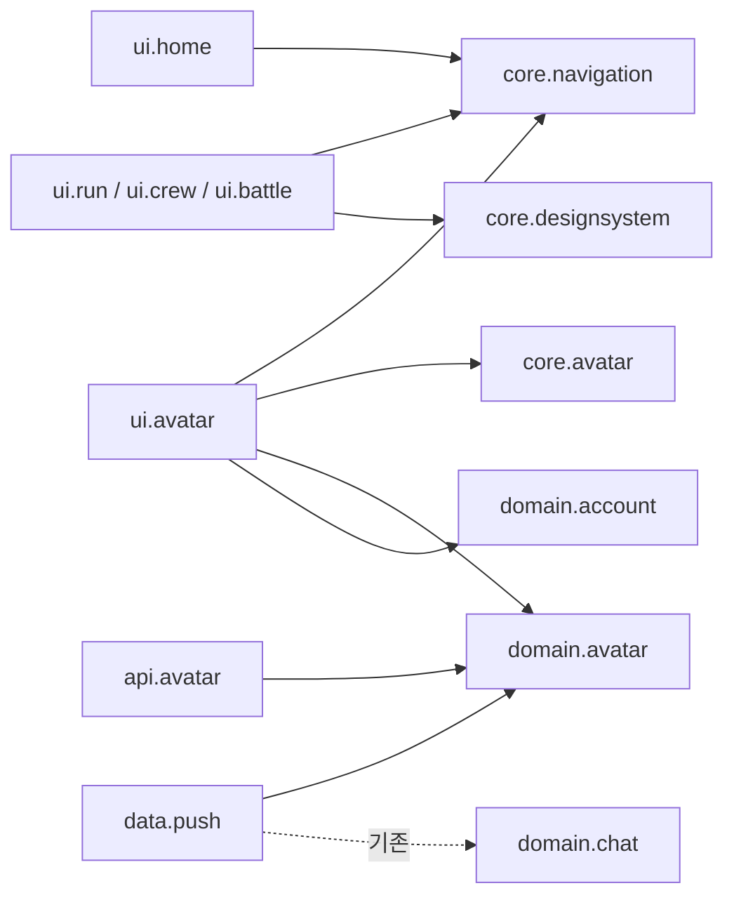

> [런크크 설계 검증 결과서](../design-review.md) 목차 · 이전: [27-v0.33-검증](27-v0.33-검증.md)

## 28. 아바타 추가 요구 검증 (design-oo 05-30, 2026-11-10, 다음 판 변경)

> 작성: 2026-11-10 | 버전: v0.24 (다음 판 변경, 협업 모드라 판 번호는 병합 때) | 담당: 이성현, 브랜치 `docs/S15P31A207-300-avatar-docs` | 입력: design-oo [05-30](../design-oo/05-30-설계-아바타요구-성.md)(D-성-100~130)과 [05-29](../design-oo/05-29-설계-피그마맞춤-성.md) 5.5·5.6·6절, srs 03-06 3.6.0b([임시:FR-성-17]~[임시:FR-성-23]), 07-25 7.13.29([임시:CR-성-10]~[임시:CR-성-18], [임시:NFR-성-4]~[임시:NFR-성-6]), 유지보수 기록 [2026-11-10_아바타요구-성](../maintenance/2026-11-10_아바타요구-성.md)(U-1~U-9), 코드 develop fbeda71f(android `core/avatar` 전부와 `res/raw/*.riv` 네 파일, `core/ui` `SlotKey`·`LocalSlots`·`FeatureEntry`·`RunkkRunningFigure`·`KakaoRunMap`·`AvatarCharacter`, `feature/avatar`·`feature/home`·`feature/run` 해당 파일, `data`·`data/phone` 구조, `app` `ArchitectureTest`·`MainActivity`·`RunkkAppContent`), 통합 브랜치 `feature/S15P31A207-289-figma-align` b66c292d(중립색)

이 장은 아바타 추가 요구 AV-1~AV-10의 확정 설계 05-30을 review 0~6단계로 검증한 결과다. 사용자 결정 U-5(구현 재개 전 설계 검증)의 조건이다. 05-30은 코드보다 먼저 쓴 설계라, 설계 문장을 코드·riv 파일·허용 표와 하나씩 대조했다(설계가 쓴 「허용 표 178 그대로」, 「riv 슬롯 크기」, 「남자 서기 슬롯」을 그대로 믿지 않고 다시 읽음). 같은 날 받은 사용자 결정 U-6~U-9는 검증 전에 05-30에 반영했고, 이 장은 반영된 판을 대상으로 한다.

기준은 0.1 기본값 그대로다(결합도 상한 스탬프, 응집도 하한 통신적, Fan-Out 7, 순환 0). 결함 등급은 25·27장과 같다(치명 = 불허, 중·경 = 검토). 이번에는 구조 외에 요구 점검 항목(추적, 동시성·생명주기, 실패 경로, 성능 근거, 바닥 수치 계산, 의상 자산 규격 완전성, 시험 가능성, 사용자 결정 일치, 피그마 제안 관계)을 함께 본다. 결함 번호는 [임시:DR-성-n], 숨은 의존 번호는 [임시:H-성-n]이다.

### 28.0 입력 정리

#### 28.0.1 바뀐 패키지 (새 패키지 0)

| ID | 패키지 | 계층 | 바뀐 요소 | 책임 한 문장 |
|----|--------|------|-----------|--------------|
| A1 | 앱 core.navigation(`:core:ui`) | 표현 공용 | `SlotKey.HOME_AVATAR`·`RUN_AVATAR`, `AvatarSlotPose`, `LocalSlotAvatarPose`, `LocalSlotAvatarFacingLeft` | 화면 사이 이동과 칸 계약을 둔다 |
| A2 | 앱 core.designsystem(`:core:ui`) | 표현 공용 | `KakaoRunMap(myMarkerSize)`, `AvatarBackdrop.STAGE_OF_KEY`(CHUNCHEON), 중립색 토큰 | 디자인 토큰·공용 부품을 제공한다 |
| A3 | 앱 ui.home | 표현 | 홈 아바타 칸 자리, 칸이 비면 `RoomAvatar` | 홈 화면을 그린다 |
| A4 | 앱 ui.run·ui.crew·ui.battle | 표현 | 내 위치 마커를 `RUN_AVATAR` 칸으로, 동작·방향 인자 | 측정 화면을 그린다 |
| A5 | 앱 ui.avatar | 표현 | `MyAvatarStore`, `AvatarStage`, 칸 내용 둘, Overlay, AV-6 제거, 셀카 화면 단계 | 내 아바타 화면과 칸 내용을 그린다 |
| A6 | 앱 core.avatar(`:core:avatar`) | 표현 공용(렌더러) | `preloadRiveAvatar`, `prepareRiveAvatarLook`, `onReady`, `mirrored`, `RiveAvatarGeometry`, `OutfitCatalog`·`OutfitLayerComposer`·`SharedToneCache`, `AvatarOutfit(assetKey)` | Rive 아바타를 그린다 |
| A7 | 앱 domain.avatar | 도메인 | 포트 `SelfieJobFollower`·`PendingSelfiePhoto`·`SelfieScreenPresence`·`SelfieResultNotifier`, `SelfieProgress`, `AvatarRepository.selfieProgress()` | 아바타 규칙과 포트를 둔다 |
| A8 | 앱 api.avatar(`:data`) | 인프라 | `SelfieJobWorker`, `WorkManagerSelfieJobFollower`, `FilePendingSelfiePhoto` | 아바타 서버 연동과 기기 저장을 구현한다 |
| A9 | 앱 data.push(`:data:phone`) | 인프라 | `SelfieNoticeTracker` | 푸시·기기 알림을 구현한다 |
| S1 | 서버 policy·avatar | 도메인 | `SettingKey.Defaults.LANDMARKS`, Flyway V65 | 운영 기준값과 아바타 배경을 다룬다 |

#### 28.0.2 화살표 (1차 설계 기준, 코드 허용 표 대조)

| No | From → To | 의존 형태 | 주고받는 것 | 허용 표에 있나 |
|----|-----------|-----------|-------------|----------------|
| D1 | ui.home → core.navigation | 상수·CompositionLocal | `SlotKey.HOME_AVATAR`, `LocalSlots` | 예 |
| D2 | ui.run·crew·battle → core.navigation | 상수·CompositionLocal | `SlotKey.RUN_AVATAR`, `AvatarSlotPose`, `Boolean` 방향 | 예 |
| D3 | ui.run·crew·battle → core.designsystem | 호출 | `rememberHeadingLeft(route)` → Boolean, `KakaoRunMap(figure, myMarkerSize)` | 예 |
| D4 | ui.avatar → core.avatar | 호출 | 성별·의상 키 셋·체형·러닝량·머리 레이어, `mirrored`, `onReady` 콜백 | 예 |
| D5 | ui.avatar → domain.avatar | 호출·구독 | `avatar()`·`runner()` 결과, `selfieProgress()` 흐름, 작업 ID | 예 |
| D6 | ui.avatar → domain.account | 구독 | `myGender: StateFlow<Gender?>` | 예(1차 설계는 이 화살표 대신 `LocalAvatarCharacter`를 썼다, DR-성-8) |
| D7 | api.avatar → domain.avatar | 구현·호출 | 포트 구현, 워커가 `SelfieResultNotifier.notify(jobId, succeeded)` | 예 |
| D8 | (1차) data 워커 → data(phone) `SelfieResultNotifier` | 직접 호출 | 작업 ID, 성공 여부 | **아니오: `:data:phone` → `:data` 모듈 의존이 있어 역방향은 컴파일 불가**(DR-성-2) |
| D8' | (2차) data.push → domain.avatar | 구현 | `SelfieScreenPresence`·`SelfieResultNotifier` 구현 | 새 한 줄(178 → 179) |
| D9 | 서버 avatar → policy | 호출(기존) | LANDMARKS 목록 | 예 |

#### 28.0.3 코드·자산 사실 대조

| No | 설계 문장 | 코드·자산 사실 | 판정 |
|----|-----------|----------------|------|
| C1 | 5.1 「riv 네 파일 아트보드 800x1000」 | 네 파일 모두 아트보드 너비(키 7)=800.0, 높이(키 8)=1000.0 객체가 `Idle`/`Runner` 이름 바로 앞에 있다 | 일치 |
| C2 | 5.1 슬롯 크기 | 내장 PNG IHDR: 여 서기 1024²×6, 512x768 / 남 서기 1024²×6, 512x768, 1122x1402 / 달리기 둘 1024²×2, 256x384×3, 256x768, 256x160, 256x1024. `BodySkinLayers.dimensions`와 같다 | 일치 |
| C3 | 5.1 「남 서기 의상 슬롯 = `male_selected_body` 1122x1402」, D-115 「`selected_*` 입력 사용을 지운다」 | `BodySkinLayers.render`: 「남자 선택 몸의 옷은 Rive 메시가 직접 보여 준다. 그 밖의 옷은 512×768 아틀라스 메시에 그린다」. `MaleOutfitStyles.apply`는 `standing_body`(512x768)에 그리고 「Male cuts in the same atlas registration」. `FootwearTypes`도 남녀 같은 `standing_body` 발 칸. `RiveAvatarScene.topSurface`: 긴소매 3..6은 「팔·몸통 UV가 따로라 2」 | **불일치**(DR-성-1) |
| C4 | 4.2 「그림자 폭 A × 0.30, 근거 정면 몸 폭 x 281..519 ≈ 0.30A」 | 519 − 281 = 238 = 아트보드 너비 800의 0.30, 높이 A(1000)의 0.24. riv Ground shadow는 Shape (200, 402) × 2 = (400, 804), Ellipse 105x8 × 2 = 210x16, SolidColor 0x143D2D25(알파 20/255 = 7.8%) | 계산 오류(DR-성-5). 그림자 중심·불투명도 설명은 일치 |
| C5 | D-120 「채팅방 `OpenChatRooms` 선례」, 6.1 「data(phone) `SelfieResultNotifier`」, 「data `SelfieJobWorker`(HiltWorker)」 | 선례 이름은 domain.chat `OpenChatRoomRegistry`(포트) ← data.push `OpenChatRoomTracker`. 푸시 채널 `runkk-push`는 `:data:phone`. `:data:phone` → `:data` 의존. `UploadWorker`는 HiltWorker가 아니라 EntryPoint(D-61) | **불일치**(DR-성-2) |
| C6 | 10.1 「허용 표 178 그대로」 | data.push 허용은 `domain.notification`, `domain.chat`뿐. 알림 구현이 domain.avatar 포트를 구현하면 한 줄 늘어난다 | **불일치**(DR-성-2) |
| C7 | D-103 「성별은 `LocalAvatarCharacter.current`」 | `LocalAvatarCharacter` 기본값 MALE, MainActivity는 `AvatarCharacter.of(myGender)`로 내리고 `of(null)` = MALE. 성별을 읽기 전에는 여자 회원도 MALE | **불일치**(DR-성-8) |
| C8 | D-105·NFR-성-4 「준비된 경우 0.3초」 | `RiveAvatarView`마다 `AvatarToneCache()`와 `Executors.newSingleThreadExecutor()`가 따로다. `preloadRiveAvatar`는 riv·PNG 바이트만 읽으므로 칸이 새로 그려질 때마다 피부·의상 합성을 다시 한다 | 근거 부족(DR-성-10) |
| C9 | 7절 「마커 위치가 아래 가운데 기준인지 구현에서 확인」 | `atScreenPoint`가 `at.y − markerSize`에 놓아 마커 상자 아래 끝이 점이다. 내 마커만 크기를 다르게 줄 인자는 없다 | 확인 닫음, 인자 필요(DR-성-7) |
| C10 | 9.1 중립색 대응표 | b66c292d `RunkkColors`와 여섯 토큰이 다르다(라이트 surfaceHigh·runimalTile·inputHigh, 다크 inputHigh·menuDivider·radioStroke·toggleOff·outline, scrim). 「HSL 채도 5% 이하」는 b66c292d의 시험이 아니고, zinc #E4E4E7(5.9%)·#09090B(10.0%)가 떨어진다 | **불일치**(DR-성-11) |
| C11 | D-115 21가지·키 대응 | `AvatarRender.RIVE_OUTFITS`: 상의 1~6 키 6개, 하의 1~3, 신발 1·3·6 = 12, 키 없는 것 9(기본 셋 + 하의 4~6 + 신발 2·4·5). `avatar_outfits.xml` 이름 21개 | 일치(U-8) |
| C12 | 5.3 신발 기준점 (105,600)·(266,600), 발 칸 (96,627)-(257,768)·(260,627)-(421,768) | `FootwearTypes.apply` `standing_body` 분기와 같다 | 일치 |
| C13 | 6.1 「`POLL_DELAYS`, 약 16분」 | 3·3·5·8·10·15초, `MAX_POLLS` 68 → 29 + 63 × 15 = 974초(16.2분) | 일치 |
| C14 | D-130 방향 판정 재사용 | `rememberHeadingLeft`: `DIRECTION_METERS` 20m, `MIN_EAST_WEST_DEGREES` 0.00003, 애매하면 앞 값, 처음 오른쪽. 지도 회전 코드 없음(북쪽 위) | 일치 |
| C15 | D-104 Overlay·스플래시 | RunkkNavHost가 `featureEntries.forEach { it.Overlay(top) }`, `FIRST_SCREEN_MAX_WAIT_MS = 4_000L` | 일치 |

### 28.1 의존 행렬과 지표

바뀐 화살표는 D8'를 빼면 모두 기존 쌍이다. 패키지 Fan-Out(허용 표 기준): ui.home 7, ui.battle 7, ui.crew 7, ui.run 6, ui.avatar 6, api.avatar 3, data.push 2 → 3. 최대 7 그대로, 순환 0. 칸 장치 덕분에 홈·측정 화면 → ui.avatar·core.avatar 화살표가 없다(1.3 비교표 A·B가 7 → 8~9로 넘는 것을 확인했다).

불안정도 방향: data.push(I = 3/3 = 1.0, 불안정) → domain.avatar(Fan-In 많음, 안정). 불안정 → 안정이라 맞다.

### 28.2 결합도 판정 (나쁜 것부터)

| No | 주고받는 것 | 등급 | 기준 대비 | 근거 |
|----|-------------|------|-----------|------|
| D1 | 칸 이름 상수, 칸 표 | 데이터 | 허용 | 칸 표는 람다 목록이고 화면은 꺼내 그리기만 한다 |
| D2 | 동작 enum, 방향 Boolean | 데이터 | 허용 | `AvatarSlotPose`는 칸 내용이 「무엇을 그릴지」의 입력 값이다. 칸 내용 안의 분기를 고르는 제어 플래그로 볼 수도 있으나, 칸 내용이 동작별 다른 절차를 고르지 않고 렌더러에 그대로 넘기는 값이라 데이터로 판정(27장 D2 기간 enum과 같은 판단) |
| D3 | 경로 → Boolean, 마커 크기 | 데이터 | 허용 | |
| D4 | 모습 값 여섯과 콜백 | 데이터 | 허용 | `mirrored`는 그림 변환 값. 매개변수 8개로 5 초과지만 기존 공개 API(6개)에 기본값 인자 둘을 더한 것이라 스탬프로 묶지 않는다(검토 메모: 9개 이상이 되면 `AvatarLook` 값으로 묶음) |
| D5 | 아바타 응답·흐름 | 스탬프 | 허용 | `MyAvatarLook`은 응답 일부 필드만 모은 값 |
| D6 | 성별 흐름 | 데이터 | 허용 | |
| D7·D8' | 포트 구현, 작업 ID·성공 여부 | 데이터 | 허용 | |
| D8 | 모듈 역방향 직접 호출 | (판정 불가: 컴파일되지 않는 화살표) | 불허 | DR-성-2. 2차에서 D8'로 대체 |

제어 결합 0, 내용·공통·외부 결합 0. `MyAvatarStore`(@Singleton 가변 상태)는 ui.avatar 안에서만 쓰고 밖에는 `StateFlow` 읽기만 내므로 공통 결합이 아니다(쓰기는 저장소 메서드 셋 `warm`·`refresh`·`clear`).

**숨은 의존(새로 찾음).**

| ID | 두 쪽 | 무엇이 같아야 하나 | 갱신 책임 |
|----|-------|--------------------|-----------|
| [임시:H-성-1] | riv 메시 UV ↔ 의상 템플릿 허용 영역 ↔ `OutfitAssetSpecTest` 마스크 | 텍스처마다 화면에 보이는 UV 영역 | riv를 바꾸는 쪽이 `uv-mask`를 다시 돌리고 템플릿·마스크를 함께 커밋한다(riv는 승인본 SHA라 바뀌면 `ApprovedAvatarAssetsTest`가 먼저 실패해 알린다) |
| [임시:H-성-2] | 서버 `LANDMARKS` 키 ↔ 앱 `AvatarBackdrop.STAGE_OF_KEY` ↔ V65 JSON 원소 ↔ 기기 확인한 배경 목록 | 랜드마크 키 문자열 CHUNCHEON, 지운 KAESONG | 키를 더하거나 지우는 쪽(landmark-kr)이 셋을 한 MR에서 고친다. 회귀 기준: 서버 「기본 목록 키 ⊆ 앱 STAGE_OF_KEY」 시험이 없으므로 앱 `AvatarBackdrop` 시험에 서버 기본 키 목록 사본 대조를 더한다(05-30 11절 1번에 넣음) |
| [임시:H-성-3] | `PendingSelfieStore`(작업 ID·접수 시각·상태) ↔ `SelfieJobWorker` ↔ `selfieProgress()` ↔ `MyAvatarStore` | 작업 하나의 상태 | 원본은 `PendingSelfieStore` 하나, 쓰는 쪽은 워커뿐([임시:D-성-117] 정정) |
| [임시:H-성-4] | `RiveAvatarGeometry.FOOT_LINE`(0.804)·`ASPECT`(0.8) ↔ riv 아트보드·발끝 ↔ 피그마 제안 프레임 가이드 | 발끝 줄과 비율 | riv가 바뀌면 렌더러 쪽(outfit-assets)이 상수와 4.3 가이드를 함께 고친다 |
| [임시:H-성-5] | `RunkkColors` 중립 토큰 ↔ 05-30 9.1 표 | 값 | 코드가 원본, 표는 확인용([임시:D-성-126] 정정) |

### 28.3 응집도 판정 (좋은 것부터)

| ID | 같이 있는 이유 | 등급 | 기준 대비 |
|----|----------------|------|-----------|
| A5 ui.avatar | `MyAvatarStore`·`AvatarStage`·칸 내용은 모두 「내 아바타 한 벌」을 그리는 데 쓰이고 같은 `MyAvatarLook`을 다룬다 | 통신적(내 아바타) | 허용 |
| A6 core.avatar | 묶음 목록·합성·공용 캐시·뒤집기 모두 Rive 아바타 그리기 한 기능 | 기능적 | 허용 |
| A7 domain.avatar | 셀카 포트 넷은 「셀카 작업 하나」의 상태·사진·화면 표시·알림 | 통신적(셀카 작업) | 허용 |
| A8 api.avatar | 워커·사진 파일은 아바타 연동 구현 | 통신적 | 허용 |
| A9 data.push | `SelfieNoticeTracker`는 기기 알림 구현으로 기존 `OpenChatRoomTracker`와 같은 이유(알림을 낼지 말지와 알림 내기) | 통신적(기기 알림) | 허용 |
| A1 core.navigation | 칸 이름·칸 인자 | 기능적(칸 계약) | 허용 |

잘못 배치된 요소: 1차 설계의 `SelfieScreenPresence`는 위치가 없었고 data(phone) 알림은 `:data` 워커와 연결될 수 없었다(DR-성-2에서 domain.avatar 포트로 옮김). `MyAvatarStore`를 `:app`에 두지 않고 ui.avatar에 둔 것은 맞다(app이 ui.avatar를 import하지 않음).

### 28.4 구조 결함과 요구 점검

#### 28.4.1 구조 결함

| 결함 | 1차 | 2차 |
|------|-----|-----|
| 순환 의존 | 0 | 0 |
| 계층·모듈 역행 | 1(D8: `:data` → `:data:phone` 직접 호출, DR-성-2) | 0 |
| 허브·쓰레기통 | 0 | 0 |
| 안정성 위반 | 0 | 0 |
| 고립 | 0 | 0 |
| 정보 은닉 위반 | 0(`RiveAvatarAssets`·`AvatarToneCache`는 internal 유지, 공개는 함수로만) | 0 |

#### 28.4.2 요구 → 설계 추적

| 요구 | 설계 절·결정 | 판정 |
|------|--------------|------|
| [임시:FR-성-17] 홈 Rive | 2절, D-100~102 | 일치 |
| [임시:FR-성-18] 러닝 중 | 7절, D-121·122·130 | 일치(U-9 뒤집기 포함) |
| [임시:FR-성-19] 로딩·미리 준비 | 3절, D-103~106 | 1차: 성별 출처·경합·0.3초 근거 결함(DR-성-8·9·10) → 2차 일치 |
| [임시:FR-성-20] 셀카 진행 | 6절, D-117~119 | 1차: 상태 원본 불명(DR-성-13) → 2차 일치 |
| [임시:FR-성-21] 셀카 알림 | 6절, D-120 | 1차: 모듈 배치 불가(DR-성-2) → 2차 일치 |
| [임시:FR-성-22] 바닥 정렬 | 4절, D-107~109 | 1차: 그림자 폭·너비 제약(DR-성-5·6) → 2차 일치 |
| [임시:FR-성-23] 규격 의상 | 5절, D-110~116 | 1차: 남자 서기 슬롯 오류·템플릿 불명(DR-성-1·3) → 2차 일치 |
| [임시:NFR-성-4] 표시 시간 | 3절 측정 로그, D-105·106 | 2차: 공용 합성 캐시로 근거 생김. 값은 기준 측정 뒤 확정(조건 1) |
| [임시:NFR-성-5] 바닥선 1% | 4.2·4.4, 11절 2·5번 | 일치 |
| [임시:NFR-성-6] 자산 규격 100%, 코드 변경 0 | 5.5(여덟 항목), D-110 | 일치. 단 새 상의는 `maleTopSurface`를 목록에 적어야 하며 이는 데이터라 「코드 변경 0」을 지킨다 |
| FR-163·FR-164·[임시:FR-성-13](AV-6) | 9.2, D-128 | 일치(U-6) |
| FR-201·FR-202(AV-5) | 8절, D-124·125·129 | 일치(U-7) |
| [임시:NFR-성-2] 정정 | 9.1, D-126 = D-성-93 | 1차: 값·시험 불일치(DR-성-11) → 2차 일치 |

FR-성-17~23, NFR-성-4~6 열 개 모두 설계 절과 결정이 있다. 설계에만 있고 요구가 없는 것: 없음(`SharedToneCache`는 NFR-성-4의 수단).

#### 28.4.3 동시성·생명주기

- 미리 준비: 1차 설계는 `warm(gender)`을 Overlay의 `LaunchedEffect(Unit)`에서 `LocalAvatarCharacter`로 불렀다. 성별을 읽기 전 값이 MALE이라 여자 회원은 남자 riv를 먼저 준비하고, 성별이 바뀌어도 다시 준비하지 않는다(DR-성-8). 또 `clear()`와 진행 중 준비의 순서 규칙이 없어 로그아웃 직후 앞 회원의 `Ready`가 다음 회원 화면에 설 수 있었다(FR-성-19 「앞 사람의 아바타」 금지 위반 가능, DR-성-9). 2차: 저장소가 `myGender`를 구독, 작업 하나·최신 우선·세대 번호.
- 셀카 워커: `REPLACE`로 자기 자신을 이어 걸면 실행 중인 자기가 취소된다(DR-성-12). 시스템 정지 때 재시작은 WorkManager가 하고, 총 상한은 저장된 접수 시각 기준(2차 명시). 워커가 상태를 쓰는 곳과 화면이 읽는 곳이 1차에 없었다(DR-성-13).
- Rive 자원: 뷰마다 합성 스레드 하나와 네이티브 파일 둘(서기·달리기)이다. 홈·내 러너·꾸미기 칸이 동시에 살아 있으면 뷰가 쌓인다. 화면을 떠나면 `AndroidView.onRelease → RiveAvatarView.release`가 놓으므로 구조 문제는 아니고, 실기기 메모리 확인을 11절 7번에 더했다. 측정 화면에서 칸 호출 자리가 바뀌면(경로 첫 점, 지도 → 격자) 뷰를 새로 만든다. 한 번씩은 허용, 위치 갱신마다면 결함(DR-성-14, 11절 5번 시험).
- 화면 멈춤: `ON_PAUSE`에 재생 정지(기존). 측정 중 화면이 꺼지면 아바타 재생이 멈추고 측정 서비스는 무관하다(일치).

#### 28.4.4 실패 경로

| 경로 | 설계 | 판정 |
|------|------|------|
| 아바타 입력 읽기 실패 | `Failed` → 로딩 표시 거두고 성별 기본 그림, 오류 문구 없음, 다음 `refresh`·칸 진입에서 한 번 다시 | 일치 |
| 성별 모름 | 1차 없음 → 2차 `Loading` 유지(다른 성별 그림 금지) | 정정(DR-성-8) |
| riv·묶음 파일 읽기 실패 | `onError`, 앞 그림 유지, 칸은 `Failed`처럼 기본 그림 | 일치(기존 렌더러 규칙) |
| 자산 없음(묶음 없는 키, 검사 실패 묶음) | 그 부위 `base_*`, 상점은 부위 아이콘 | 일치. 시험은 1차 11절에 없음 → 2차 2번에 더함(DR-성-16) |
| 셀카 보내기 실패 | `Choose`로, 사진 지움 | 일치 |
| 셀카 작업 실패·상한 초과·연속 연결 실패 | `Failed`(사유), 횟수에 안 셈, 알림 | 일치. 업무 거부 즉시 실패는 2차에 명시 |
| 셀카 회수(서버에 작업 없음) | 사진·작업 ID 지움, `None` | 일치(D-119), 시험은 2차에 더함 |
| 알림 권한 없음 | 알림 없이 다음 진입 때 결과 | 일치 |
| 지도 오류 | 격자로 바꾸고 칸 그대로 | 일치(뷰 재생성 한 번) |

#### 28.4.5 성능 수치의 근거 ([임시:NFR-성-4] 0.3 / 1.5 / 3.0초)

- 0.3초(같은 실행에서 준비됨): 1차 설계의 준비는 riv·PNG 바이트 읽기와 입력 셋뿐이었다. 칸마다 새 `RiveAvatarView`가 피부 판정(512x768 픽셀 순회)·의상 합성·1024² 머리 톤을 다시 하므로 「준비됨」이 합성 시간을 줄이지 못한다. 0.3초의 근거가 없다(DR-성-10). 2차: `prepareRiveAvatarLook`과 프로세스 공용 합성 캐시로 준비된 경우 남는 일은 네이티브 파일 해석과 텍스처 넣기·첫 프레임뿐이다.
- 1.5초(콜드 스타트, 홈 첫 표시 뒤): 준비가 스플래시(최대 4초) 동안 시작되므로 홈 첫 표시 시점에 이미 일부가 끝나 있다. 수치는 타당한 목표지만 측정 근거가 없다.
- 3.0초(설치 직후): riv 최대 5MB 읽기 + 합성 + 네트워크 세 호출. 목표값(제안)으로 둔다.
- 조건: 세 값 모두 develop의 내 러너 진입 → 첫 그림을 같은 기기에서 먼저 재어 기준을 두고 확정한다(07-25 7.13.29.2에 문장 더함). 기준이 목표를 넘으면 값을 다시 정하는 사용자 결정이 필요하다.

#### 28.4.6 바닥 규격 수치 계산식 검증

| 항목 | 설계 값 | 검산 | 판정 |
|------|---------|------|------|
| 배경 바닥선 18% | 350x390 카드에서 70px | 0.18 × 390 = 70.2 | 일치 |
| 아트보드 0.9 | A = 351, 위 끝 약 38px | floorY = 319.8, 319.8 − 0.804 × 351 = 37.6 ≥ 0.06 × 390 = 23.4 | 일치 |
| 발끝 0.804 | riv 발끝 y≈800, 그림자 중심 804 | 발 아래 끝 800/1000 = 0.800, 0.804와 차이 0.004A = 1.4px(350x390) < 허용 3.9px(1%) | 일치(허용 안) |
| 너비 | (없음) | 해금 팝업 280x500: A = 450, 너비 360 > 280 | **누락**(DR-성-6) |
| 그림자 폭 | A × 0.30 | 몸 폭 238 = 0.238A | **오류**(DR-성-5) |
| 러닝 중 칸 | A = 1.17 × 88, 위 끝 = 칸 위 끝 | 0.94 × 88 − 0.804 × 103 = −0.1 ≈ 0, 너비 82.4 ≤ 88, 그림자 아래 끝 85.1 < 88 | 일치. 기준점 문장만 정정(DR-성-7) |
| Crop·BottomCenter 공식 | drawnImageH = max(slotH, slotW × imageH / imageW) | Crop 배율 max(slotW/imageW, slotH/imageH) × imageH와 같다 | 일치 |

2차 4.4에 다섯 칸 검산 표를 넣었다.

#### 28.4.7 의상 자산 규격의 완전성 (디자이너가 이 문서만으로 21종 × 남녀 × 서기/달리기를 그릴 수 있는가)

1차 판정: **그릴 수 없다.**

1. 남자 서기 그림을 1122x1402 `male_selected_body`에 그리라고 한다. 실제 남자 의상은 512x768 `standing_body`(여자와 같은 아틀라스 좌표)에 그려지고 riv 입력이 메시 표면(반팔·긴소매)을 고른다(C3). 1차 규격대로 그린 남자 서기 21장은 들어갈 자리가 없다(DR-성-1).
2. 「허용 영역」, 「금지 영역」, 「슬롯 템플릿」을 말하지만 만드는 방법이 없다. 텍스처는 몸 메시 UV가 덮는 곳만 화면에 나오고, 남자 서기는 표면 1·2마다 UV가 다르다. 템플릿이 없으면 디자이너는 어디까지 그려야 보이는지 모른다(DR-성-3).
3. 옷 실루엣이 몸 메시 밖으로 나갈 수 없다는 제약이 없다. 와이드 팬츠·후드를 몸보다 넓게 그리면 넓은 부분이 잘린다(DR-성-3).
4. 달리기 몸통 슬롯 셋 중 「쓰지 않음」이라 한 둘에 무엇을 넣는지 렌더러 규칙이 없다(DR-성-4, 지금 코드는 셋 모두 같은 그림).

2차 판정: 그릴 수 있다. 5.1(남자 서기 = 512x768 + 표면), 5.2(파일 크기 남녀 같음, `maleTopSurface`), 5.3(템플릿 11장의 세 층, `uv-mask`, 메시 밖 금지, 겹침 띠), 5.4(세 몸통 슬롯), 5.5(여덟 항목). 남은 조건: `uv-mask`(riv Mesh·MeshVertex 읽기)는 이 저장소에서 처음 만드는 도구라 outfit-assets 첫 단계에서 남녀 서기·달리기 템플릿을 만들어 실기기 검사 무늬로 확인한 뒤 그림 작업을 시작한다(조건 2).

slot 크기·좌표의 riv·렌더러 대조 결과는 28.0.3 C1~C3·C12다.

#### 28.4.8 시험 가능성 (11절)

1차 11절은 정상 경로 위주였다. 성별 모름·경합·자산 없음·셀카 회수·알림 중복·워커 이어 걸기 정책·뷰 재생성·뒤집기 기준점이 없었다(DR-성-16). 2차 11절에 모두 들어갔고 각 항목이 관찰 가능한 값(상태 전이, 스냅샷 발끝 행, 뷰 생성 횟수, 허용 표 179)으로 적혔다. 실기기 항목은 RD-1~RD-13(RD-3b 포함).

#### 28.4.9 사용자 결정과의 일치

| 결정 | 설계 반영 | 판정 |
|------|-----------|------|
| U-1~U-5 | 1차 그대로 | 일치 |
| U-6 근거 문장까지 제거 | D-127 → D-128(카드 전체, 문자열 목록, 상태 필드 제거, `runner()`는 유지), srs FR-163·FR-164·[임시:FR-성-13] | 일치 |
| U-7 춘천 왕복 150 하나 | D-123 → D-129(대권 74.8km × 2), D-124 V65 원소 하나, D-125, 8절, srs FR-201·FR-202·07-25 | 일치 |
| U-8 21가지 | D-115 유지(C11) | 일치 |
| U-9 좌우 뒤집기 | D-130, 7절, srs [임시:FR-성-18] | 일치 |
| 중립색 = D-성-93 | D-126, 9.1(b66c292d 값) | 2차 일치 |

#### 28.4.10 피그마 제안과의 관계

1차 설계는 [임시:D-성-127]에 「피그마 시안이 이 결정을 덮는다」만 있어, 진행 중인 제안 작업이 바닥 수치나 제거 범위를 다르게 그리면 어느 쪽이 맞는지 정해지지 않았다(DR-성-15). 2차: 4.3 첫 항목과 [임시:D-성-128]에 「바닥선 18%, 아트보드 0.9와 너비 제약, 발끝 0.804, 그림자 규격, AV-6 제거 범위는 시안이 따라야 하고, 시안이 정하는 것은 카드 크기·배치·글자·단추」를 적었다. 시안으로 칸 크기가 바뀌면 4.4 계산에 새 크기를 넣는다.

### 28.5 결함 목록과 조치

| ID | 등급 | 결함 | 위치 | 조치(05-30에 반영) |
|----|------|------|------|-------------------|
| [임시:DR-성-1] | 치명 | 남자 서기 의상 슬롯을 `male_selected_body` 1122x1402로 적고 `selected_*` 입력을 지운다고 했다. 실제는 512x768 `standing_body` + 메시 표면 입력 | 5.1, 5.2, 5.4, 5.5, D-115 | 남자 서기 512x768, 입력 유지, `maleTopSurface`(1·2) 목록 필드, 이전 뒤 표면 0 미사용, 검사 8번 |
| [임시:DR-성-2] | 치명 | `:data` 워커가 `:data:phone` 알림을 직접 부르는 구조(모듈 역방향), 화면 표시 객체 위치 없음, 선례 이름 틀림, HiltWorker(D-61과 다름), 「허용 표 178 그대로」 | D-117, D-120, 6.1, 10.1 | domain.avatar 포트 `SelfieScreenPresence`·`SelfieResultNotifier`, data.push `SelfieNoticeTracker`, 워커·사진은 api.avatar, EntryPoint, 허용 표 179 |
| [임시:DR-성-3] | 중 | 템플릿·허용 영역을 만드는 방법과 메시 밖 금지 제약이 없음 | 5.3 | 템플릿 11장(세 층), `uv-mask`, 메시 밖 금지, 겹침 띠 8px |
| [임시:DR-성-4] | 경 | 달리기 몸통 세 슬롯 중 둘에 넣을 것 미정 | 5.1, 5.4 | 세 슬롯에 같은 합성 결과 |
| [임시:DR-성-5] | 중 | 그림자 폭 0.30A(너비 비율을 높이에 곱함) | D-107, 4.2, 4.4 | 0.24A, 높이 0.048A |
| [임시:DR-성-6] | 중 | 아트보드 너비가 칸 너비를 넘는 경우 규칙 없음(해금 팝업) | D-107, 4.2, 4.4 | A ≤ 칸 너비 / 0.8, 검산 표 |
| [임시:DR-성-7] | 경 | 「머리 위 여백」 용어, 러닝 중 기준점과 발끝 6% 차이 설명 없음, 「구현에서 확인」 남음, 내 마커 크기 인자 없음 | D-121, 4.2, 7절 | 「아트보드 위 여백」, 기준점 = 상자 아래, 발끝 5dp 위, `KakaoRunMap(myMarkerSize)` |
| [임시:DR-성-8] | 중 | 미리 준비 성별을 `LocalAvatarCharacter`(모르면 MALE)에서 읽음, 성별 바뀜 무시 | D-103, D-104, 3절 | 저장소가 `myGender` 구독, null이면 Loading, 바뀌면 다시 |
| [임시:DR-성-9] | 중 | `clear()`·겹친 `refresh()` 경합 규칙 없음(앞 회원 아바타 노출 가능) | D-103, 3절 | 작업 하나·최신 우선·세대 번호 |
| [임시:DR-성-10] | 중 | 「준비됨 0.3초」 근거 없음(합성이 뷰마다) | D-104, D-105, NFR-성-4 | `prepareRiveAvatarLook`, `SharedToneCache`, 기준 측정 뒤 확정 |
| [임시:DR-성-11] | 중 | 9.1 표가 b66c292d와 여섯 토큰 다름, 「HSL 5%」 시험이 zinc를 떨어뜨림, D-126이 D-성-93과 중복 | D-126, 9.1, 07-25 7.13.29.2 | 표를 b66c292d 값으로, 시험은 G ≤ max(R, B), D-126 = D-성-93 |
| [임시:DR-성-12] | 경 | 워커가 자기를 `REPLACE`로 이어 걸면 자기가 취소됨, 시스템 정지 재시작 규칙 없음 | D-117 | 새 접수만 `REPLACE`, 이어 걸기 `APPEND_OR_REPLACE`, 상한은 저장된 접수 시각 |
| [임시:DR-성-13] | 경 | 셀카 상태 원본과 화면 없을 때의 `refresh` 경로 없음 | D-117, D-104, 3절 | 원본 `PendingSelfieStore`(워커만 씀), 저장소가 `selfieProgress` 구독 |
| [임시:DR-성-14] | 경 | 측정 화면 칸 호출 자리 바뀜에 따른 Rive 뷰 재생성 언급 없음 | 7절 | 한 번씩 허용, 위치 갱신마다면 결함, 시험 11절 5번 |
| [임시:DR-성-15] | 경 | 피그마 제안이 바닥 수치·제거 범위를 덮을 수 있는지 불명 | D-127, 4.3 | 4.3·D-128에 「시안이 따른다」 |
| [임시:DR-성-16] | 경 | 시험 순서에 실패 경로·경합·뒤집기·구조 179 없음 | 11절 | 11절 1~7번 보완 |

합계(1차): **치명 2, 중 7, 경 7.** 사용자 결정 반영은 결함이 아니라 입력 변경이라 따로 셈하지 않았다.

### 28.6 1차 판정, 자가 수정, 2차 의존도

**1차 판정: 불합격**(불허 2: DR-성-1 남자 서기 슬롯, DR-성-2 모듈 역방향). 같은 작업에서 05-30을 고쳤다(각 행에 「(검증 정정, [임시:DR-성-n])」). srs 07-25 7.13.29.2(NFR-성-2 측정, NFR-성-4 빈 칸 정의·기준 측정)와 03-06 [임시:FR-성-22](바닥선 기준 = 그려진 그림 높이)도 고쳤다.

2차 의존도(바뀐 부분만):

전후 비교:

| 항목 | 1차 | 2차 |
|------|-----|-----|
| 내용·공통·외부 결합 화살표 | 0 | 0 |
| 모듈 역방향(컴파일 불가) 화살표 | 1(D8) | 0 |
| 허용 표 밖 화살표 | 1(D8, 표에도 모듈에도 없음) | 0(data.push → domain.avatar를 표에 더함, 178 → 179) |
| 제어 결합 화살표 | 0 | 0 |
| 순환 / 계층 역행 | 0 / 1 | 0 / 0 |
| 응집도 통신적 미만 패키지 | 0 | 0 |
| 최대 Fan-Out | 7 | 7(data.push 3) |
| 패키지 수 | 그대로 | 그대로 |
| 숨은 의존 | - | [임시:H-성-1]~[임시:H-성-5](갱신 책임 있음) |
| 요구 점검 결함(구조 밖) | 14 | 0(조건 3건은 아래) |

부작용 확인: 포트 둘을 더해 domain.avatar 포트가 넷이 됐지만 모두 「셀카 작업 하나」를 다루어 응집도 통신적 그대로다. data.push가 두 도메인(chat, avatar)을 구현하지만 「기기 알림을 낼지와 내기」 한 이유라 쓰레기통이 아니다. `SharedToneCache`는 상한(성별 × 동작 4묶음)이 있어 메모리 무한 증가 없음.

### 28.7 확인 판정

| 구분 | 2차 |
|------|-----|
| 불허(치명) | 0 |
| 검토 | 3(조건 1~3, 개선 방법 있음) |
| 판정 | **조건부 합격** |

**05-30 범위 최종 판정: □ 합격  ■ 조건부 합격  □ 불합격 (design-oo 05-30 D-성-100~130, srs 3.6.0b·7.13.29, 코드 fbeda71f·b66c292d 대조, 28장).** 07-25 7.13.29.4의 「구현 재개 조건(합격 또는 조건부 합격)」을 채운다.

조건:

1. [임시:NFR-성-4] 세 시간 값은 home-run 브랜치 첫 단계에서 develop 기준 측정(내 러너 진입 → 첫 그림, 같은 기기 10회)을 먼저 기록하고 확정한다. 기준이 목표를 넘으면 사용자에게 값을 다시 묻는다.
2. outfit-assets 브랜치는 그림 작업 전에 `uv-mask`로 템플릿 11장을 만들고, 실기기 검사 무늬로 남녀 서기(표면 1·2)·달리기의 덮임을 확인한다. riv에서 UV를 읽을 수 없으면 조정자에게 알리고 템플릿을 승인 텍스처의 불투명 영역으로 대신할지 정한다.
3. [임시:D-성-130]의 「뒤집기 전후 몸 가로 위치 차이 칸 너비 3% 이하」를 RUN 동작 스냅샷으로 확인한다. 넘으면(옆모습 캐릭터가 아트보드 가운데에서 벗어나 있으면) 뒤집을 때 그만큼 옮기는 보정값을 `RiveAvatarGeometry`에 더한다.

시험에 넘길 것(`/sw-test`): 05-30 11절 1~7번, 유지보수 기록 RD-1~RD-13, 이 장 28.4.4 실패 경로 표.
