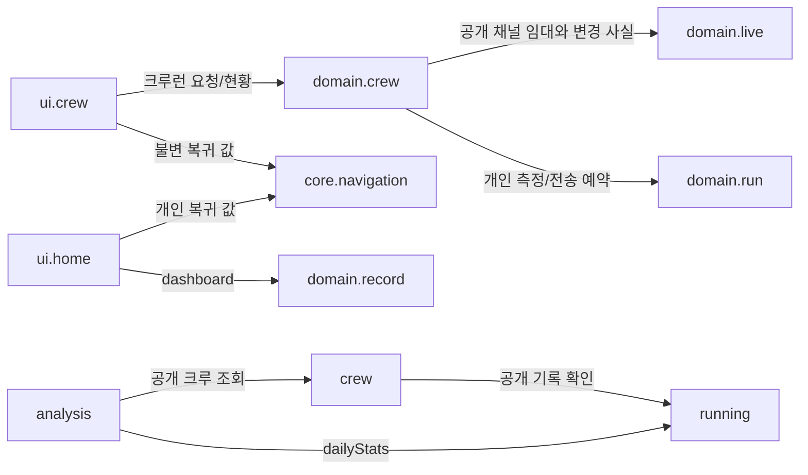

# 설계 검증: 크루런 실시간 반영

> 작성: 2026-11-16 | 버전: 다음 판 변경(design-review v0.26 기준) | 담당: 이성현(성) | 입력: [05-32 설계](../design-oo/05-32-설계-크루런실시간-성.md) [임시:D-성-877]~[임시:D-성-892], [03-11 SRS](../srs/03-11-크루런실시간-성.md), [CR](../maintenance/2026-11-16_크루런실시간-성.md), 코드 879f6e98의 ArchitectureTest 허용표, sw-design review 본문과 coupling/cohesion/structural-defects 참조

문서 설계 검증이다. 구현 코드 리뷰나 시험 실행 결과가 아니다. (다음 판 변경) PM 이성현 2026-11-16 U-31~U-36 답변을 반영했다. 3초 조회/전체 정산/새로 표식은 삭제 이력이며 모집 푸시 설정은 다음 이슈다. 29장 형식에 따라 바뀐 흐름만 검증한다. 기본 기준은 결합도 상한 스탬프(제어 검토, 외부/공통/내용 불허), 응집도 하한 통신적, 최대 Fan-Out 7, 순환/계층 역행/내용 결합 0이다.

## 0. 입력 정리

### 0.1 패키지와 포함 요소

행렬은 05-32의 투영 그래프에 등장한 15개 패키지를 사용한다. Java/Kotlin의 실제 패키지 경계이며 화면 상태/DB 테이블을 패키지로 세지 않는다.

| ID | 패키지, 계층 | 포함 요소 | 책임 한 문장 |
|----|--------------|-----------|-------------|
| P1 | 서버 web.crew, 표현 | CrewRunController/DTO | 크루런 HTTP 계약을 변환한다 |
| P2 | 서버 crew, 응용/도메인 | Post/Participation/Service/Announcer/포트, crew.live 메시지. Settlement 삭제됨(사유: U-34) | 크루런 참가 자료의 규칙을 지킨다 |
| P3 | 서버 running, 도메인 | RunQueryService, 기록 공개 조회 포트 | 저장 기록을 공개 조회로 제공한다 |
| P4 | 서버 realtime, 전송 어댑터 | WebSocketMessenger/PollingMessenger/Serializer | 지정된 회원에게 메시지를 전달한다 |
| P5 | 서버 infra.crew, 저장 어댑터 | Post/Session 저장소 구현 | 크루 영속 자료를 보관한다 |
| P6 | 서버 analysis, 응용 | DashboardService | 본인 기록을 대시보드 값으로 바꾼다 |
| P7 | 앱 ui.crew, 표현 | CrewRun/Home/Result ViewModel, 탭 | 크루 화면의 값을 표시한다 |
| P8 | 앱 domain.crew, 도메인 | Coordinator, ReadSession, Completion, Repository 포트 | 크루런 사용 흐름을 조정한다 |
| P9 | 앱 data.live, 전송 어댑터 | WebSocket/Polling/Decoder/Lease | 실시간 채널을 구현한다 |
| P10 | 앱 api.crew, 조회 어댑터 | API/DTO/Repository 구현 | 크루 조회 계약을 변환한다 |
| P11 | 앱 domain.live, 포트/값 | LiveChannel, ServerMessage | 실시간 통신의 공개 계약을 정의한다 |
| P12 | 앱 domain.run, 도메인 | RunTracker, UploadScheduler, 내 전송 상태 공개 포트 확장 제안 | 개인 러닝 기록의 수명을 관리한다 |
| P13 | 앱 ui.home, 표현 | HomeViewModel | 홈의 본인 요약 값을 표시한다 |
| P14 | 앱 domain.record, 포트 | RecordRepository.dashboard | 개인 기록 조회 계약을 정의한다 |
| P15 | 앱 core.navigation, 탐색 계약 | 불변 ReturnReceipt와 기존 경로 | 화면 이동의 입력 값을 전달한다 |

P15는 `core` 이름이므로 응집도를 따로 검토한다. 모든 책임 문장에 ‘그리고/및/등’을 넣지 않았다. 이 투영에서 P2/P8의 중계와 기록은 같은 크루런 참여 자료에 연결된다.

### 0.2 화살표와 주고받는 것

E 번호는 이 조각의 화살표 번호이며 정식 설계 결정 D와 혼동하지 않는다. 포트 구현 화살표는 import/implements 방향이다. 서버 발신의 런타임 콜백을 역방향 import로 세지 않는다.

| No | From → To | 의존 형태 | 주고받는 것 |
|----|-----------|-----------|-------------|
| E1 | P1 → P2 | 공개 서비스 호출 | memberId/postId, ready 선택 → LobbyView/ParticipationView. Settlement 삭제됨(사유: U-34) |
| E2 | P2 → P3 | 공개 기록 조회 | recordId/회원 ID/기간 → 유효성/거리/기록 요약 |
| E3 | P4 → P2 | CrewRunMessenger 구현/메시지 참조 | 수신자 ID 목록, CrewRunChanged/Departure/Start |
| E4 | P5 → P2 | Repository/SessionStore 포트 구현 | Post/Participation/Session 스냅숏 |
| E5 | P6 → P2 | 기존 공개 크루 조회 | memberId/crewId → 소속/회원 ID 목록 |
| E6 | P6 → P3 | dailyStats 공개 호출 | 본인 ID/기간 → 날짜별 유효 거리/횟수 |
| E7 | P7 → P8 | 공개 연산과 상태 수집 | ReadKey/준비/합류/확인 → 현황/CompletionState |
| E8 | P7 → P15 | 탐색 값 전달 | ReturnReceipt 전체 값, 경로/결과 전달 |
| E9 | P8 → P12 | 측정/전송 상태 공개 호출 | RunStartSpec/개인 joinedAt/recordId, 업로드 요청 → 측정 결과/본인 업로드 상태 |
| E10 | P8 → P11 | 채널 임대/신호 수신 | LiveChannel과 CrewRunChanged.resource, postId/revision |
| E11 | P9 → P11 | 포트 구현/JSON 매핑 | 서버 메시지 값/연결 상태. 새 resource는 전송 경계에서 검증 |
| E12 | P10 → P8 | Repository 구현 | HTTP DTO → 도메인 현황 값 |
| E13 | P13 → P14 | 공개 조회 | baseDate → 본인 dashboard |
| E14 | P13 → P15 | 탐색 입력 수령 | ReturnReceipt의 본인 기여/기록/주/식별 |

이는 코드에서 복원한 기존 경계에 **새 계약 제안**을 얹은 목록이다. 구현에 이미 존재한다고 적지 않는다.

## 1. 의존 행렬과 Fan-In/Fan-Out

행이 From, 열이 To다. 1은 패키지 쌍의 존재이며 메서드 수가 아니다.

```text
From/To  01 02 03 04 05 06 07 08 09 10 11 12 13 14 15 | Out In I
P01       0  1  0  0  0  0  0  0  0  0  0  0  0  0  0 |  1  0 1.00
P02       0  0  1  0  0  0  0  0  0  0  0  0  0  0  0 |  1  4 0.20
P03       0  0  0  0  0  0  0  0  0  0  0  0  0  0  0 |  0  2 0.00
P04       0  1  0  0  0  0  0  0  0  0  0  0  0  0  0 |  1  0 1.00
P05       0  1  0  0  0  0  0  0  0  0  0  0  0  0  0 |  1  0 1.00
P06       0  1  1  0  0  0  0  0  0  0  0  0  0  0  0 |  2  0 1.00
P07       0  0  0  0  0  0  0  1  0  0  0  0  0  0  1 |  2  0 1.00
P08       0  0  0  0  0  0  0  0  0  0  1  1  0  0  0 |  2  2 0.50
P09       0  0  0  0  0  0  0  0  0  0  1  0  0  0  0 |  1  0 1.00
P10       0  0  0  0  0  0  0  1  0  0  0  0  0  0  0 |  1  0 1.00
P11       0  0  0  0  0  0  0  0  0  0  0  0  0  0  0 |  0  2 0.00
P12       0  0  0  0  0  0  0  0  0  0  0  0  0  0  0 |  0  1 0.00
P13       0  0  0  0  0  0  0  0  0  0  0  0  0  1  1 |  2  0 1.00
P14       0  0  0  0  0  0  0  0  0  0  0  0  0  0  0 |  0  1 0.00
P15       0  0  0  0  0  0  0  0  0  0  0  0  0  0  0 |  0  2 0.00
```

행렬은 E1~E14의 14개 화살표이며 Out 합계 14, In 합계 14다.

I = Out/(In+Out)다. P2의 Fan-In 4가 변경 파급 지점이므로 web/realtime/infra/analysis를 회귀에 포함한다. P8의 Fan-In 2는 UI/API 계약 양쪽에 영향을 준다는 뜻이다. 모든 화살표는 I가 같거나 낮은 쪽으로 향하며 이 투영에서 안정성 역전과 고립은 각각 0이다.

### 1.1 실제 기존 경계와 수치의 한계

서버 허용표에서 crew는 member/running/runimal/policy/notification/audit 6개(ArchitectureTest.java:191), analysis도 6개(:192), realtime은 4개(:249)다. 앱 CORE_UI는 3개(ArchitectureTest.kt:486), ui.crew는 그 3개와 domain.crew/domain.report/ui.share/domain.account로 7개(:605), ui.home도 7개(:580), domain.crew는 3개(:530)다. 이는 허용 집합의 크기이며 실제 전 import 개수를 다시 센 값은 아니다. 이번 변경은 기존 허용 패키지 쌍 안의 계약을 늘리는 안이므로 직접 의존 상한을 늘릴 필요가 없다. 구현 시 ArchitectureTest와 실제 import를 재검증해야 한다.

## 2. 결합도 판정

나쁜 것부터 내용 → 공통 → 외부 → 제어 → 스탬프 → 데이터 순서로 질문했다. DTO/목록은 객체 전체이므로 단순히 ‘값’이라는 이유로 데이터 결합으로 낮추지 않는다.

| No | 등급 | 기준 대비 | 근거/개선 |
|----|------|-----------|-----------|
| E1 | 스탬프 | 허용 | 입력은 단순값, 출력 현황은 DTO. 상대 내부 필드 접근 없음 |
| E2 | 스탬프 | 허용 | 공개 요약을 확인한다. running 저장소 직접 접근안은 DR-21에서 제거 |
| E3 | 스탬프 | 허용 | 타입이 있는 메시지 전체를 직렬화, 수신자 권한은 발신 책임 |
| E4 | 스탬프 | 허용 | 소유 포트 구현. 서로 다른 패키지가 테이블에 직접 SQL을 쓰는 외부 결합과 구별 |
| E5 | 스탬프 | 허용 | 소속/회원 목록 전체를 필요한 조회 범위로 사용 |
| E6 | 스탬프 | 허용 | dailyStats 묶음에서 횟수/거리 사용, 본인 집계 경계 유지 |
| E7 | 스탬프 | 허용 | 현황/완료 상태 계약. 화면은 자신의 값을 갱신 |
| E8 | 스탬프 | 허용 | 공개 탐색 계약으로 불변 값 전달. 싱글턴 가변 map 공유 없음 |
| E9 | 스탬프 | 허용 | 측정 spec과 시작시각, 기존 전송 요청. RunTracker 내부 상태 직접 변경 없음 |
| E10 | **제어** | **검토** | resource 값이 어느 자료를 재조회할지 결정한다. 단일 경계 매핑과 대상별 읽기 연산으로 제한, generic refresh(mode) 확산 금지(DR-22) |
| E11 | 스탬프 | 허용 | JSON 분류와 유효성 검증, 채널 구현. 도메인 private 필드 공유 없음 |
| E12 | 스탬프 | 허용 | DTO/불변 현황 변환. API와 UI가 DB 파일 공유 안 함 |
| E13 | 스탬프 | 허용 | 기존 dashboard 공개 응답 사용 |
| E14 | 스탬프 | 검토 후 허용 | 홈은 영수증의 일부만 사용한다. 홈 전달 시 개인용 값으로 투영하는 개선 반영(5절) |

패키지 쌍의 최악 등급은 E10(P8→P11) 제어, 나머지는 스탬프다. (다음 판 변경) E14의 홈 투영은 `receiptId/postId/myRecordId/ownMeters/weekStart/uploadedAt`이다. 크루용 값도 본인 업로드 완료만 담으며 crewId를 추가할 뿐 참가자 정산 맵을 만들지 않는다. `participantMeters/confirmedAt`의 전체 정산 계약은 **삭제됨(사유: U-34)**. 내 상태 포트는 domain.run에 두어 domain.crew→domain.sync/data 의존을 추가하지 않는다.

### 2.1 숨은 의존

| 번호 | 의존 | 갱신 책임/TC |
|------|------|--------------|
| H1 | 결과 total은 임시 거리일 수 있고 내 업로드 성공도 전체 기여 완료를 보장하지 않음 | U-34/D-888/890: 내 성공만 기다려 복귀, 홈/레이스는 각 원본 확정분만 조회, 지연 기록은 기존 집계로 추가. TC-11016/11018/11035/11036 |
| H2 | recordId의 크루 기여는 시작 당시 소속/주에 의존 | 기존 WeeklyRaceService, 주/소속 경계 TC-11045 |
| H3 | DB 참여와 Redis 참가자 목록/개인 시작시각 | CrewRunAnnouncer가 이미 존재하는 세션의 누락 참가자까지 복원. TC-11046 |
| H4 | 서버 startAt와 앱 측정 기준이 같은 절대시각이어야 함 | 서버/앱 계약 D-881, +3초 이중 적용 TC-11043 |
| H5 | Changed의 resource/revision은 serializer/decoder/폴링 양쪽 계약 | D-892, TC-11039/11042. 타인 레이스 분기 TC-11038 |
| H6 | 모집 푸시는 CREW_RELEASED/수신 설정/토큰에 의존하나 열린 앱 변경 신호와 별개 | **삭제됨(사유: U-36): 이번 운영값 점검/푸시 인수**. 다음 이슈. TC-11030은 변경 신호의 독립성만 검증 |
| H7 | 본인 업로드 복귀 값/강조 수명은 화면/백스택에 의존 | ViewModel/탐색 소유자, TC-11037. 새로 표식/TC-11032는 **삭제됨(사유: U-35)** |
| H8 | 내 저장과 업로드 완료는 비동기 Archive/업로더의 실제 성공에 의존 | domain.run 공개 상태 포트가 내 recordId 성공을 보존/전달. pending 부재로 성공 추정 금지. TC-11016/11044 |
| H9 | COUNTDOWN 후보는 시작 순간 준비자이며 이후 감소만 가능 | U-33/D-882: 최소 인원 재판정 없음, 0명/1명 유지, 늦은 입장/재준비는 출발 뒤 join. TC-11024/11026 |
| H10 | 신규 주기 조회 폐기와 기존 결과 폴링/전송 대체 채널은 서로 다른 수명 | U-31/32/D-880: 새 타이머 없음, 기존 결과 최대60초/최대10회 읽기 유지. TC-11050/11042 |

## 3. 응집도 판정

좋은 것부터 기능적 → 순차적 → 통신적 → 절차적 → 시간적 → 논리적 → 우연적 순서로 질문했다.

| 패키지 | 같이 있는 이유 | 등급/기준 대비 |
|--------|----------------|----------------|
| P1 web.crew | 크루 요청/응답의 변환 | 통신적, 허용 |
| P2 crew | 같은 크루런/참가/기여 자료의 규칙 | 통신적, 허용. Settlement 삭제(U-34), 기존 결과/기여 공개 경계 유지 |
| P3 running | 같은 기록 자료의 저장/공개 조회 | 통신적, 허용 |
| P4 realtime | 지정 수신자에게 메시지를 전달하는 기능 | 기능적, 허용. 새 화면 정책은 넣지 않음 |
| P5 infra.crew | 크루 저장 자료를 보관 | 통신적, 허용 |
| P6 analysis | 기록에서 대시보드 요약으로 변환 | 순차적(이번 Dashboard 흐름), 허용. 전체 패키지 판정 확대 안 함 |
| P7 ui.crew | 같은 크루 화면 상태 | 통신적, 허용 |
| P8 domain.crew | 크루런 참여/확인 수명 | 통신적, 허용. ReadSession/Completion은 크루런 전용으로 제한 |
| P9 data.live | 한 통신 채널의 연결/JSON/폴링 대체 | 기능적, 허용 |
| P10 api.crew | 크루 도메인과 HTTP 값의 변환 | 통신적, 허용 |
| P11 domain.live | 같은 실시간 메시지/채널 계약 | 통신적, 허용 |
| P12 domain.run | 같은 개인 러닝/기록 수명 | 통신적, 허용 |
| P13 ui.home | 같은 본인 대시보드 값 표시 | 기능적(이번 변경 요소), 허용 |
| P14 domain.record | 개인 기록 조회 계약 | 통신적, 허용 |
| P15 core.navigation | 같은 탐색 경로와 결과 전달 | 기능적(추가 요소), 허용. 영수증은 이동 입력으로만 사용, 집계/캐시 저장 서비스는 금지 |

잘못 배치 후보: 일반적인 ‘모든 화면 새로고침 버스’를 core.navigation에 넣으면 P15 외부 호출 수가 커지고 탐색 자료와 무관해진다. 불변 결과 값만 남기고 읽기/강조 소유권은 각 ViewModel에 둔다(D-888/889). ReadSession은 ui.home에서 재사용하려고 범용 core 싱글턴으로 승격하지 않는다.

## 4. 구조 결함 점검

| 항목 | 결과 | 근거 |
|------|------|------|
| 순환 | 0 | E1~E14에 역방향 경로 없음. crew↔realtime, ui.crew↔ui.home 없음 |
| 계층 역행 | 0 | 인프라/전송이 도메인의 포트를 구현한다. 도메인은 상위 UI나 구체 어댑터를 import하지 않음 |
| 허브 | 없음(투영 범위) | 최대 Out 2. P2 In4/Out1, P8 In2/Out2. 기존 전체 허용상한은 1.1절 |
| 쓰레기통 | 추가 없음 | P15에 전역 상태/조회 버스를 추가하지 않는 조건 |
| 안정성 위반 | 0(투영 범위) | 모든 화살표가 동일/더 낮은 I 방향 |
| 고립 | 0 | E11을 포함한 행렬 기준. P1/P4/P5/P6/P7/P9/P10/P13의 In0은 진입/주입 어댑터라 누락된 양방향 관계가 아님 |
| 정보 은닉 위반 | 0 | 다른 패키지 private 필드/직접 테이블 변경 없음 |

## 5. 1차 문제와 개선안

1차는 다음 **기각한 설계 대안**을 포함한 검토다. 현재 코드에 그 대안의 결함이 존재한다고 주장하지 않는다. 앞 설계 조각처럼 개선 후 그래프를 다시 판정한다.

| 지적 | 대안의 문제 | 개선/반영 |
|------|-------------|-----------|
| [임시:DR-성-20] | 결과 확인에서 ui.crew/ui.home이 공용 dirty 싱글턴을 쓰면 공통 결합 2개, 화면 책임이 섞임 | D-888: 탐색 소유자가 불변 영수증을 목적지별로 전달. 홈은 개인 값만 투영. 닫힘 |
| [임시:DR-성-21] | crew/analysis가 running/weekly 테이블을 직접 읽어 즉시 합계를 조립하면 외부 결합, 접근 책임 중복 | (다음 판 변경) D-888/890: 기존 원본 조회/소유 집계로 확정분만 확인. D-887 전체 정산은 삭제됨(사유: U-34). Dashboard 기존 경로 유지. 닫힘 |
| [임시:DR-성-22] | resource 하나로 generic refresh(mode)를 전 계층에 전파하면 제어 결합 확산 | (다음 판 변경) D-878/880: 한 경계에서 대상별 읽기. 화면은 refreshLobby/refreshSchedule 등 자기 연산만 노출. 전체 settlement check 삭제됨(사유: U-34), 내 완료는 observeOwnUpload. 제어 검토 유지 |

개선 우선순위는 공통/외부 제거, 제어 제한이다. 새 패키지를 만들지 않고 기존 포트를 활용한다. E14는 부분 DTO를 홈 전용 입력 값으로 줄여 쓰지 않는 참가자 필드를 전달하지 않는다.

## 6. 2차 의존도와 재검증



2차 전체 투영 행렬은 1절(E1~E14)이다. 이 그림은 그중 개선한 경계만 재표시한다.

| 비교 항목 | 1차 대안 | 2차 설계 |
|-----------|----------|----------|
| 내용 결합 | 0 | 0 |
| 공통 결합 | 2(DR-20) | 0 |
| 외부 결합 | 2(DR-21의 두 직접 접근) | 0 |
| 제어 결합 | 1 경계에서 다수 계층으로 확산 위험 | 1 경계로 한정, 개선안 있음 |
| 순환/계층 역행 | 0/0 | 0/0 |
| 통신적 미만 추가 패키지 | dirty 버스 책임이 논리적 | 0 |
| 최대 Fan-Out(변경 투영) | 3(공유 상태 의존 포함) | 2 |
| 패키지 수(변경 투영) | 16(공유 dirty 버스 포함) | 15 |

표의 1차 공용 버스는 분석용 대안으로 폐기했으며 2차 행렬에 넣지 않았다. 개선 후 Out/In 합계는 각각 14, 고립 0, 불허 결합 0이다. 구성 원리/소유권을 줄였고 새 범용 버스나 새 상호 의존을 만들지 않았다.

**최종 판정: 조건부 합격.** 불허 0, 제어 결합 검토 1(E10/DR-22), 개선안 있음. 조건은 다음과 같다.

1. resource 분기는 한 경계에 두고 새 generic flag/전역 상태를 만들지 않는다. TC-11039/11042/11047로 확인한다.
2. Q1~Q6은 U-31~U-36으로 해소했다. 기존 A2~A6과 D-887을 구현 기준으로 쓰지 않는다. 남은 검토는 내 전송 상태/복귀 값/개인 시작시각의 제공자와 소비자 계약이다.
3. 구현 후 실제 import/ArchitectureTest, 공개 계약, 유효 33개 TC와 기존 회귀를 실행한다. TC-11021/11032 삭제 이력, TC-11050 추가를 유지한다. 혼용 앱 한계는 TC-11042에 기록한다.

이 판정은 설계 구조에 대한 조건부 판정이며 PM 승인, SRS 최종 합격, 코드 검증, 배포 승인과 다르다. 버전/정식 번호/공용 상태는 pending에 요청한다.
