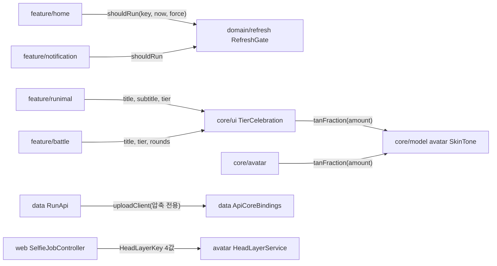

> [런크크 설계 검증 결과서](../design-review.md) 목차, 이전: [30-크루런실시간-성](30-크루런실시간-성.md)

# 31. 설계 검증: v0.14 성능·화면 개선 (다음 판 변경)

> 작성: 2026-11-18 | 버전: 다음 판 변경 | 담당: 이성현(성), 브랜치 `feature/S15P31A207-307-v014` | 입력: [design-oo 5.33](../design-oo/05-33-설계-v014-성.md)(결정 [임시:D-성-950]~[임시:D-성-974]), [SRS 03-12](../srs/03-12-v014-성.md), 통합 커밋 e0ffb364 코드(모듈 의존: `android/*/build.gradle.kts`)

검증 범위는 5.33이 더하거나 바꾸는 의존 화살표만이다. 바뀌지 않는 화살표는 [30-크루런실시간-성](30-크루런실시간-성.md)까지의 판정을 따른다. 기준(기본값): 결합도 상한 스탬프(제어는 검토, 외부·공통·내용 불허), 응집도 하한 통신적, Fan-Out 7 이하, 순환 0.

## 0. 입력 정리

### 0.1 패키지(모듈) 목록

| ID | 이름 | 계층 | 책임 한 문장 | 이번 변경 요소 | 표시 |
|----|------|------|--------------|----------------|------|
| A1 | feature/home | 표현 | 홈 화면 상태를 만든다 | `HomeViewModel.onResumed` 문지기 사용 | |
| A2 | feature/notification | 표현 | 알림·이벤트 점을 보여 준다 | `EventDotViewModel.refresh` 문지기 사용 | |
| A3 | feature/crew | 표현 | 크루 화면 상태를 만든다 | `CrewScheduleTab` myRun 분기, `CrewRunResultViewModel` 재조회 조건 | |
| A4 | feature/record | 표현 | 기록·런바디 화면 상태를 만든다 | 기록 상세 진입점, `Routes.RunBodyDetail` | |
| A5 | feature/runimal | 표현 | Runimal·평가 화면을 만든다 | `EvaluationScreen` 재구성 | |
| A6 | feature/battle | 표현 | 대결·배치고사 화면을 만든다 | 배치 완료 부품을 core/ui로 내보냄 | |
| A7 | core/ui | 표현(공용) | 디자인 시스템 부품을 그린다 | `TierCelebration*`(옮겨 옴), `SelfFaceTone` | `core` 이름 |
| A8 | core/avatar | 도메인(그림) | 아바타 층을 합성한다 | 목 층, `SkinToneFilter` | `core` 이름 |
| A9 | core/model | 도메인(값) | 화면·도메인이 함께 쓰는 값 형식을 정의한다 | `SkinTone`·`RefreshGate`(1차안) | `core` 이름 |
| A10 | domain | 응용 | 저장소 계약과 유스케이스를 정의한다 | `FaceUse`, `TierChange` | |
| A11 | data | 인프라 | 서버·기기 저장소를 구현한다 | `AuthInterceptor`, `AccessTokenExpiry`, `GzipRequestInterceptor`, `FaceImageSource`, `PlacementCache`, 일반 캐시 | |
| B1 | backend web | 표현 | HTTP 요청을 응용 서비스로 옮긴다 | `SelfieJobController` 층 요청, `GzipRequestFilter`(web/support) | |
| B2 | backend avatar | 응용·도메인 | 셀카 머리를 다룬다 | `HeadLayerService`, `HeadLayerCache` 세마포어 | |
| B3 | backend crew | 응용·도메인 | 크루·크루런을 다룬다 | `MyRunState`, `CrewRunInfo.myRun` | |
| B4 | backend running | 응용·도메인 | 러닝 기록을 저장한다 | `EvaluationView.previousTier`, `TierApplier` | |
| B5 | backend member | 도메인 | 회원·티어를 다룬다 | `TierEvaluation` 직전 티어 | |

`core` 이름 세 개는 3단계에서 응집도를 본다.

### 0.2 의존 화살표 목록(1차, 5.33 그대로)

| No | From | To | 형태 | 주고받는 것 |
|----|------|----|------|-------------|
| D1 | A1 | A9 | 메서드 호출 | `RefreshGate.shouldRun(key: String, now: Instant, force: Boolean): Boolean`, `markDone(key, now, ok: Boolean)` |
| D2 | A2 | A9 | 메서드 호출 | D1과 같음 |
| D3 | A1 | A10 | 메서드 호출 | `SettingsRepository.settings(): Flow<Settings>`, `PlacementCache.read(): Placement?` |
| D4 | A3 | A10 | 메서드 호출 | 도메인 `CrewRun`(myRun 포함) 목록 |
| D5 | A4 | A10 | 메서드 호출 | `RunBodyRepository.session(recordId: String): Outcome<RunBodySession>` |
| D6 | A5 | A7 | 컴포저블 호출 | `TierCelebration(tier: Tier, change: TierChange, runimal: RunimalType?, onPrimary, onSecondary)` |
| D7 | A6 | A7 | 컴포저블 호출 | `TierCelebration(tier, rounds: List<PlacementRound>, …)` |
| D8 | A7 | A9 | 상수·함수 | `SkinTone.tanFraction(amount: Int): Float` |
| D9 | A8 | A9 | 상수·함수 | D8과 같음 |
| D10 | A11 | A10 | 구현·호출 | `FaceUse`(enum, `size(): Int`) |
| D11 | A11 | A11(OkHttp 표식) | 요청 표식 | `RunApi` 업로드에 붙인 압축 표식(Invocation tag) → `GzipRequestInterceptor`가 표식을 보고 압축 |
| D12 | A11 | A9 | 메서드 호출 | `ServerClock.now(): Instant` |
| D13 | B1 | B2 | 메서드 호출 | `HeadLayerService.layer(owner: long, job: String, layer: HeadLayer, size: int, format: String)` |
| D14 | B4 | B5 | 메서드 호출 | `TierEvaluation(kind, point, previousTier)` record |
| D15 | B1 | B3 | 응답 DTO | `PostSummary.CrewRunInfo`(myRun 포함) |
| D16 | B1(web/support) | 서블릿 체인 | 요청 감싸기 | 풀린 본문 `HttpServletRequestWrapper` |

## 1. 의존 행렬(이번 변경 화살표만)

| From \ To | A7 | A9 | A10 | A11 | B2 | B3 | B5 | Fan-Out(변경분) |
|-----------|----|----|-----|-----|----|----|----|-----------------|
| A1 | | 1 | 1 | | | | | 2 |
| A2 | | 1 | | | | | | 1 |
| A3 | | | 1 | | | | | 1 |
| A4 | | | 1 | | | | | 1 |
| A5 | 1 | | | | | | | 1 |
| A6 | 1 | | | | | | | 1 |
| A7 | | 1 | | | | | | 1 |
| A8 | | 1 | | | | | | 1 |
| A11 | | 1 | 1 | 1 | | | | 3 |
| B1 | | | | | 1 | 1 | | 2 |
| B4 | | | | | | | 1 | 1 |
| Fan-In(변경분) | 2 | 5 | 4 | 1 | 1 | 1 | 1 | |

불안정도(전체 모듈 의존 기준, build.gradle.kts): core/model I≈0(의존 없음, 많이 쓰임), domain I 낮음(core/model만 의존), core/ui I 낮음(core/model만 의존), feature/* I≈1. 모든 변경 화살표는 불안정(feature) → 안정(core·domain) 방향이다. 최대 Fan-Out(변경분) 3(A11). feature 모듈 전체 Fan-Out은 30장 판정(7 이하)을 유지한다.

## 2. 결합도 판정(화살표마다)

| No | From → To | 등급 | 기준 대비 | 근거 |
|----|-----------|------|-----------|------|
| D1 | home → core/model | 데이터 | 허용 | 문자열 열쇠·시각·참거짓만 넘긴다. `force`는 "강제면 통과"라는 연산 정의의 입력 값이고 다른 처리 경로를 고르지 않는다 |
| D2 | notification → core/model | 데이터 | 허용 | D1과 같음 |
| D3 | home → domain | 스탬프 | 허용(검토 표시) | `Settings`·`Placement` 전체 객체. 홈이 쓰는 필드는 일부(설정 3개, 배치 진행 2개). 기존 홈 상태 구성이 객체를 그대로 받으므로 유지 |
| D4 | crew → domain | 스탬프 | 허용 | 기존 `CrewRun` 목록에 필드 하나 더함 |
| D5 | record → domain | 스탬프 | 허용(검토 표시) | 기존 런바디 세션 객체에서 진입점 상태만 쓴다. 2회차 선택 개선: `runBodyAvailability(recordId)` 좁은 연산 |
| D6 | runimal → core/ui | **제어** | **검토** | `TierChange`(UP·KEEP·DOWN·UNKNOWN)를 넘겨 부품 안에서 문구를 고르게 하면 호출자가 피호출자 내부 분기를 정한다 |
| D7 | battle → core/ui | 스탬프 | 허용 | 판 기록 목록 |
| D8 | core/ui → core/model | 데이터 | 허용 | 정수 → 실수 |
| D9 | core/avatar → core/model | 데이터 | 허용 | D8과 같음 |
| D10 | data → domain | 데이터 | 허용 | `FaceUse`는 크기 값을 담은 열거형이고 `FaceImageSource`는 `use.size()`만 읽는다(분기 없음) |
| D11 | data 내부(RunApi → 인터셉터) | **제어** | **검토** | 요청 표식(flag)이 인터셉터의 압축 여부를 정한다 |
| D12 | data → core/model | 데이터 | 허용 | 시각 |
| D13 | web → avatar | 데이터(매개변수 5개) | **검토** | 단순 값이지만 5개라 인터페이스 기준(4개 이하)을 넘는다 |
| D14 | running → member | 스탬프 | 허용 | 기존 record에 필드 하나 |
| D15 | web → crew | 스탬프 | 허용 | 기존 응답 DTO |
| D16 | web/support → 서블릿 | 데이터 | 허용 | 표준 서블릿 감싸기 |

패키지 쌍 요약: 최악 등급 제어 2쌍(runimal→core/ui, data 내부), 나머지 스탬프 이하. 양방향 없음.

숨은 의존(파생 데이터·공유 설정):

| 숨은 의존 | 원본 → 파생 | 갱신 책임 |
|-----------|-------------|-----------|
| H1 `run_record.evaluation_previous_tier` | member.tier(바뀌기 전) → 기록 저장 시점 사본 | `TierApplier`가 저장 때 한 번 쓰고 다시 고치지 않는다(뜻이 "그때의 직전 티어") |
| H2 앱 settings·placement 기기 사본 | 서버 설정·배치 진행 → `DataStoreSettingsRepository`·`PlacementCache` | 쓰기 UseCase 5종과 배치고사 판 저장 경로가 `invalidate()`/`refresh()`를 부른다. 빠뜨리면 홈이 옛 값을 보인다 → 2회차 시험에 "쓰기 뒤 사본 갱신" TC 필수 |
| H3 정적 파일 이름(배너 해시, card.webp) | nginx 정적 폴더 → 이벤트 HTML, 앱 공유 링크, OG 태그 | 파일을 바꿀 때 참조 세 곳을 같은 커밋에서 바꾼다(infra/README에 규칙) |
| H4 머리 형식 판 `png1` | 서버 `HeadLayerCache.FORMAT` → 앱 URL 상수 | 서버가 판을 올리면 새 앱 판을 함께 낸다. 서버는 옛 판도 한 판 동안 받는다 |

## 3. 응집도 판정(패키지마다, `core` 이름 중심)

| ID | 패키지 | 같이 있는 이유 | 등급 | 기준 대비 | 근거 |
|----|--------|----------------|------|-----------|------|
| A9 | core/model | 화면·도메인이 함께 쓰는 값 형식(거리, 페이스, 티어 표시, 얼굴 층 이름) | 통신적 | 허용 | 같은 값 형식을 다룬다 |
| A9+ | core/model + `SkinTone`(1차안, 최상위 패키지) | 그을림 계산 규칙(값이 아니라 아바타 그리기 규칙) | 논리적 위험 | **검토** | "값 형식" 모듈 최상위에 그림 규칙이 섞이면 공용 모음이 된다 |
| A9+ | core/model + `RefreshGate`(1차안) | 화면 다시 읽기 정책(값이 아니라 응용 정책) | 논리적 위험 | **검토** | 같은 이유 |
| A7 | core/ui + `TierCelebration*` | 디자인 시스템 부품 | 기능적 | 허용 | 두 화면이 쓰는 같은 축하 화면 부품 |
| A8 | core/avatar + 목 층 | 아바타 합성 | 기능적 | 허용 | |
| A11 | data + 인터셉터 3종 | 서버 통신 구현 | 통신적 | 허용 | 같은 HTTP 클라이언트를 다룬다 |
| B1 | web/support + `GzipRequestFilter` | 요청 전처리 | 기능적 | 허용 | 기존 web/support와 같은 성격 |

잘못 배치 후보: `SkinTone`(아바타 표시 쪽과만 연결), `RefreshGate`(화면 ViewModel과만 연결).

## 4. 구조 결함 점검

| 결함 | 결과 | 근거 |
|------|------|------|
| 순환 의존 | 0건 | 모든 변경 화살표가 feature → core/domain, web → 도메인 방향 |
| 계층 역행 | 0건 | 배치 완료 부품을 core/ui로 옮겨 feature 사이 의존(runimal → battle)을 만들지 않았다 |
| 허브 | 없음 | 변경분 최대 Fan-Out 3 |
| 쓰레기통 | 위험 1(A9에 규칙 두 개를 넣는 1차안) | 3단계 |
| 안정성 위반 | 0건 | |
| 고립 | 0개 | |
| 정보 은닉 위반 | 0건 | 서버 `HeadLayerCache` 내부 표를 밖에서 직접 보지 않는다 |

## 5. 개선안(2차)

| 문제 | 개선 | 바뀐 결정 |
|------|------|-----------|
| D6 제어 결합 | `TierCelebration`은 `title: String`, `subtitle: String?`, 배지 티어만 받는다. 문구는 호출 화면(runimal)이 `TierChange.headline(…)`(열거형 다형 메서드)로 만들어 넘긴다 → 데이터 결합 | [임시:D-성-971] 보강 |
| D11 제어 결합 | 표식 대신 업로드 전용 클라이언트: `ApiCoreBindings`가 `okHttpClient.newBuilder().addInterceptor(GzipRequestInterceptor)`로 `uploadClient`를 만들고 `RunApi`만 그 클라이언트로 만든다(얼굴 전용 클라이언트와 같은 방식) → 인터셉터는 받는 요청을 모두 압축(분기 없음) | [임시:D-성-964] 보강 |
| D13 매개변수 5개 | 형식 판은 컨트롤러가 검증하고 서비스로 넘기지 않는다(지원 판 하나). 서비스는 `HeadLayerKey(owner, job, layer, size)` 4값 | [임시:D-성-955] 보강 |
| A9 규칙 유입 | `SkinTone`은 core/model의 아바타 값 하위 패키지 `core.model.avatar`에 "아바타 표시 규칙 값"으로 둔다(core/ui와 core/avatar가 공통으로 의존하는 모듈은 core/model뿐). `RefreshGate`는 domain(`domain/refresh`)으로 옮긴다(feature는 이미 domain에 의존) | [임시:D-성-958]·[임시:D-성-968] 보강 |

2차 의존도(바뀐 화살표만):

## 6. 재검증과 확정

| 항목 | 1차 | 2차 |
|------|-----|-----|
| 내용·공통·외부 결합 화살표 | 0 | 0 |
| 제어 결합 화살표 | 2(D6, D11) | 0 |
| 매개변수 5개 이상 | 1(D13) | 0 |
| 순환 | 0 | 0 |
| 계층 역행 | 0 | 0 |
| 응집도 통신적 미만 위험 | 1(A9 규칙 두 개) | 0 |
| 최대 Fan-Out(변경분) | 3 | 3 |
| 스탬프 "검토" 표시 | 2(D3, D5) | 2(유지, 필드 일부만 씀. 2회차 선택 개선) |

부작용: `uploadClient`가 하나 늘어 클라이언트는 기본·얼굴·업로드 셋이 된다(`newBuilder`로 연결 풀 공유). `RefreshGate`를 domain에 두어도 domain은 Android 의존이 없어 순수 시험이 된다.

**최종 판정: 조건부 합격.** 불허 0건. 남은 검토 2건(D3, D5 스탬프 일부 필드)은 기존 객체 전달을 유지하는 이유와 선택 개선안이 있다. 2차 개선 네 건은 design-oo 5.33의 해당 결정에 "31장 2차안" 표시로 반영했다.
