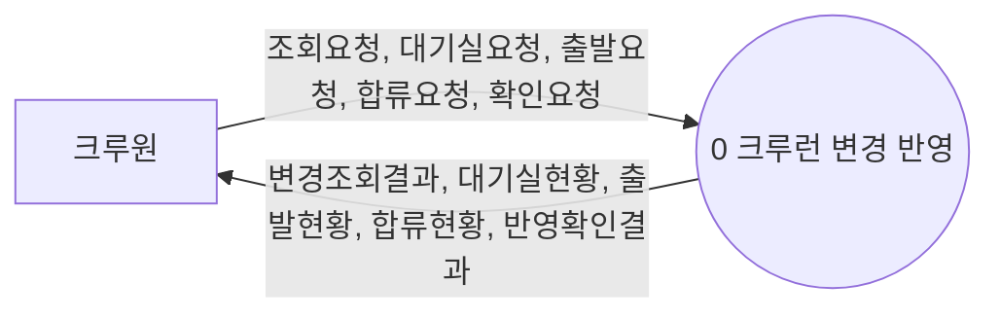
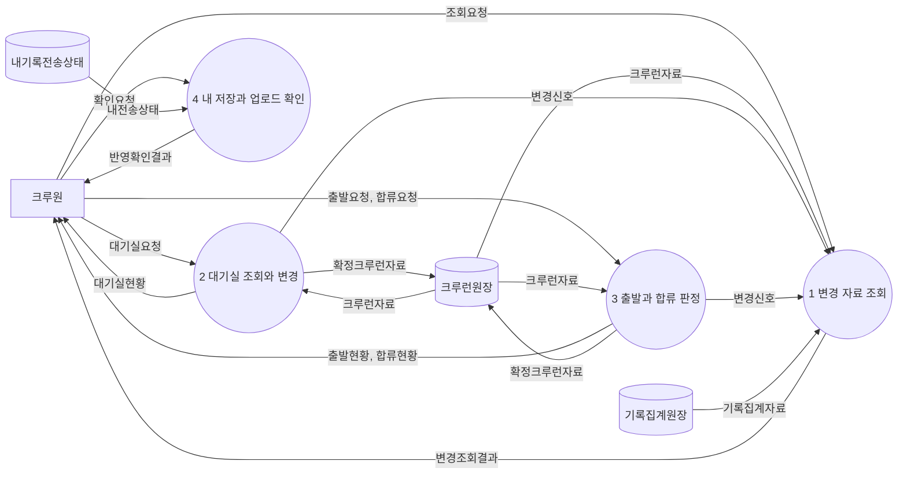
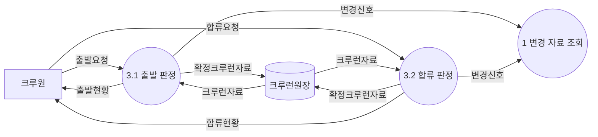

> [런크크 요구사항 명세서](../srs.md) 목차, 이전: [03-10-실기기수정-성](03-10-실기기수정-성.md)

### 3.11 크루런 실시간 반영 (다음 판 변경)

> 작성: 2026-11-16 | 버전: 다음 판 변경 | 담당: 이성현(성), 브랜치 `impl/S15P31A207-306-realtime` | 입력: [개선 보수 CR](../maintenance/2026-11-16_크루런실시간-성.md) [임시:CR-성-214], PM 이성현 2026-11-16 결정, Jira S15P31A207-306, MR !170 작업 묶음, plan.md의 크루 범위, 03-05, 03-10 U-23, 코드 879f6e98

이 조각은 크루런 변경과 결과 반영의 인수 기준 초안이다. 도출은 PM이 제공한 사용 경험과 결정, 현행 코드 경로 분석, 정상/예외 시나리오 작성으로 수행했다. 기존 문서 판 번호는 올리지 않는다. PM의 질문 답변 U-31~U-36을 반영했으며, 경계 계약의 소비자 검토와 구현/시험/인수는 별도다.

## 1. PM 결정

아래는 사용자가 전달한 PM 결정과 이번 문서의 적용 범위다. 설계 적용 선택은 구분해 적고 과거 결정의 폐기 부분도 보존한다. 앞 조각의 U-23 다음 번호부터 쓴다.

| 번호 | PM 결정(2026-11-16) |
|------|--------------------|
| U-24 | 반영 방식: 서버가 크루 단위로 "무엇이 바뀌었다" 실시간 신호를 보내고 앱은 받으면 그 화면만 다시 읽는다. 화면에 다시 들어오면 읽는다. 대기실 다시 읽기 GET API 신설(지금 enter 재호출은 READY를 ENTERING으로 되돌려 안 됨). **삭제됨(사유: U-32): 진행 화면의 3초 고정 주기 다시 읽기.** |
| U-25 | 출발: 대기실 입장자 전원 준비(2명 이상)면 3초 카운트다운 뒤 자동 출발. 모집자 「지금 시작」(준비한 사람 2명 이상일 때) 단추. 정해진 시각 자동 출발은 유지. |
| U-26 | 출발 알림은 준비 안 한 대기실 입장자에게도 간다(「함께 뛰기」로 합류 또는 나가기). 출발 뒤 끝나기 전까지 크루원 누구나 중간 참여 가능. 중간 참여자는 참여 순간부터 잰다. 순위는 달린 거리 그대로, 「중간 참여」 표시 없음. |
| U-27 | (다음 판 변경, U-35) 크루원이 모집, 수정, 취소, 참석 변경하면 열린 크루런 목록에 실시간 반영하고 새 크루런은 날짜 순서대로 넣는다. 크루 홈 등 목록 화면에 당겨서 새로고침. **삭제됨(사유: U-35): 「새로」 표시.** |
| U-28 | (다음 판 변경, U-34) 결과 「확인」은 내 기록 저장과 업로드 완료만 기다린 뒤 바로 나간다. 홈 이번 주 목표에는 내 거리가 반영되고, 크루 레이스 탭의 이번 주 크루 목표와 러닝 보드는 그때까지 확정된 참가자 거리만 반영한다. 나머지는 기록이 도착하는 대로 반영한다. 새로 반영된 거리는 2초 강조. 다른 크루원이 보고 있던 레이스 탭은 재진입/당겨서 새로고침으로 갱신한다. **삭제됨(사유: U-34): 확인 전에 참가자 전체 거리가 이미 반영돼야 한다는 조건.** |
| U-29 | 범위는 크루런만. 대결 결과 보류, 친구 대결 초대 취소, 한 번만 읽는 화면은 범위 밖(다음 이슈). |
| U-30 | 피그마: 파일 NMTtVMWIT22D0CwOU2y0I9 제안 섹션 ⑪ 행 노드 62514:2874 (흐름 1 대기실, 2 출발 뒤·중간 참여, 3 크루런 목록, 4 결과→이번 주 목표·레이스 탭). |
| U-31 | Q1 답변: 기존 `/ws` JSON WebSocket과 연결 실패 시 기존 폴링 대체 경로를 재사용한다. STOMP는 도입하지 않는다. |
| U-32 | Q2 답변: “다시 읽기 하지마 새로고침만 있으면 돼”. 3초 주기 다시 읽기를 폐기하고 실시간 변경 신호, 당겨서 새로고침, 화면 재진입 읽기만 둔다. **설계 적용:** 결과 화면을 신규 3초 주기로 바꾸던 설계는 삭제하고, 신호/새로고침을 추가하되 기존 최대 60초 폴링 동작은 변경하지 않는다. 전송 폴링 대체와 화면 주기 조회는 구별한다. |
| U-33 | Q3 답변: 카운트다운 시작 순간의 준비자를 출발 후보로 고정하고 3초 뒤 그대로 출발한다. 그 사이 준비 취소하거나 퇴장한 사람은 후보에서 빠진다. 늦게 입장한 사람은 출발 뒤 중간 참여로 합류한다. 「지금 시작」도 같은 3초 규칙이며 중복 예약은 금지한다. |
| U-34 | Q4 답변: 내 기록 저장과 업로드 완료만 기다리고 바로 복귀한다. 홈은 내 거리, 레이스 탭은 그때까지 확정된 참가자 거리만 반영하며 나머지는 기록 도착에 따라 반영한다. U-28의 전체 참가자 반영 조건을 위 내용으로 변경한다. **설계 적용:** 전체 정산을 기다리는 settlement API는 불필요하므로 삭제 표시하고 기존 업로드 응답/집계 조회만 사용한다. |
| U-35 | Q5 답변: 「새로」 표시는 넣지 않는다. 새 크루런은 날짜 순서대로 목록에 실시간으로 들어간다. |
| U-36 | Q6 답변: 모집 푸시 설정 CREW_RELEASED는 이번 범위 밖이며 다음 이슈에서 다룬다. 열린 앱의 변경 신호와 분리한다. |

## 2. 범위, 용어와 제약

하는 일은 크루런 목록, 대기실, 출발과 합류, 신호/당기기/재진입 조회, 내 업로드 완료 후 결과 복귀와 개인/크루 거리 반영이다. 대결 결과 보류, 친구 초대 취소, 다른 단발 조회 화면, 크루 채팅 기능 변경, 모집 푸시 설정 점검/변경은 제외한다(U-36, 다음 이슈). 결과 화면의 기존 3초 시작/최대 60초 간격 증가 폴링과 종료 후 내 기록 미연결 시 최대 10회 읽기는 그대로 유지한다. 신설 3초 주기 조회는 없다. 참가자 수는 기존 크루 정원 안이다. 실제 서비스 동시 사용자 수는 미계측이다.

| 용어 | 뜻 |
|------|----|
| 입장자 | 대기실에 들어와 있고 나가지 않은 사람. 참석 응답만 한 미입장자는 제외 |
| 준비자 | 입장자 중 준비 완료를 선택한 사람 |
| 모집자 | 해당 크루런을 만든 사람. 크루장 권한과 다름 |
| 진행 참가자 | 출발 때 확정되거나 출발 뒤 합류해 실제 측정하는 사람 |
| 변경 신호 | 바뀐 자료의 종류와 대상을 알리는 신호. 거리 자체를 화면 합계에 더하는 자료가 아님 |
| 내 업로드 완료 | 본인 recordId의 로컬 저장 뒤 서버가 STORED 또는 ALREADY_STORED로 응답한 상태. 타인 기록이나 크루 기여 복구의 완료를 뜻하지 않음 |
| 확정 기여 | 유효 기록의 실제 집계 반영이 조회에서 확인되는 거리. 결과의 임시 중계/끝내기 거리와 다름 |
| 출발 후보 | 카운트다운 시작 때 준비했던 입장자 집합. 취소/퇴장으로 줄어들 수 있으나 새 입장이나 재준비로 늘리지 않음 |
| 새로 | 삭제됨(사유: U-35). 표식과 수명 상태를 만들지 않음 |

최종 사용자는 크루원, 업무 결정자는 PM 이성현, 운영자는 기존 장애 대응 담당이다. 신규 관리자 기능은 없다. 기존 Android 앱, Spring Boot 서버, `/ws` JSON WebSocket, 연결 실패 시 기존 폴링 대체 채널, 기록 업로드와 유효 기록 집계 규칙을 제약으로 둔다(U-31). STOMP를 도입하지 않는다. 운영 푸시 설정은 U-36으로 이월한다.

## 3. 기능 요구사항

아래 FR-354~372 중 FR-356은 삭제 이력이고 유효 요구는 18개다. 유효 행은 유형 FR, 우선순위 필수(Must), 범위 크루런이다. 출처는 행의 U 번호와 PM 2026-11-16 요청/답변이다. 바뀐 행은 다음 판 변경으로 취급한다. 번호는 재사용하지 않는다.

### 3.11.1 변경 조회와 대기실

| ID, 명칭 | 설명 | 입력 | 처리와 예외 | 출력 | 출처, DFD |
|----------|------|------|-------------|------|------------|
| [임시:FR-성-354] 해당 화면 다시 읽기 | 앱은 크루런 변경 신호를 받으면 해당 화면의 자료만 다시 읽어야 한다 | 변경신호, 조회요청 | 자신의 크루와 보이는 대상을 대조한다. 다른 자료를 함께 새로 읽거나 신호의 거리 값을 누적하지 않는다. 중복/역순은 최신 원본으로 수렴한다 | 변경조회결과 | U-24, 1 |
| [임시:FR-성-355] 대기실 읽기 | 시스템은 대기실 재조회로 참가자의 준비 상태를 바꾸지 않아야 한다 | 대기실요청 | 입장 연산과 읽기 연산을 구분한다. 비크루원과 삭제 대상 요청은 거부한다 | 대기실현황 | U-24, 2 |
| [임시:FR-성-356] 진행 화면 보완 조회 | **삭제됨(사유: U-32)** | 종전 3초 주기/재진입 조회 | 3초 고정 재조회 요구를 폐기한다. 재진입은 새 FR-372로 분리하며 번호를 재사용하지 않는다 | 해당 없음 | U-24 → U-32, 1 |
| [임시:FR-성-372] 화면 재진입 읽기 | 앱은 크루런 대상 화면에 다시 들어오면 현재 자료를 읽어야 한다 | 조회요청 | 목록/대기실/진행/결과의 현재 화면과 대상만 읽는다. 탭 재진입도 포함한다. 정기 조회 타이머는 추가하지 않는다. 결과 화면의 기존 최대 60초 폴링은 유지한다 | 변경조회결과 | U-24, U-32, 1 |

### 3.11.2 출발과 중간 참여

| ID, 명칭 | 설명 | 입력 | 처리와 예외 | 출력 | 출처, DFD |
|----------|------|------|-------------|------|------------|
| [임시:FR-성-357] 전원 준비 출발 | 시스템은 대기실 입장자 전원이 준비했고 2명 이상이면 3초 뒤 자동 출발시켜야 한다 | 출발요청 | (다음 판 변경) 예약 순간 준비자를 고정한다. 이후 준비 취소/퇴장자는 제외하고 새 입장자는 추가하지 않는다. 후보가 1명/0명으로 줄어도 시작시각/토큰을 바꾸거나 다시 세지 않는다. 늦은 입장자는 출발 뒤 합류한다 | 출발현황 | U-25, U-33, 3.1 |
| [임시:FR-성-358] 모집자 지금 시작 | 시스템은 준비자 2명 이상인 대기실에서 모집자의 「지금 시작」을 받아야 한다 | 출발요청 | (다음 판 변경) 모집자가 아니면 거부한다. 최초 예약 때 준비자 2명 이상이어야 하며 같은 3초와 후보 고정/제외 규칙을 적용한다. 이미 예약됐으면 같은 예약 결과를 반환한다 | 출발현황 | U-25, U-33, 3.1 |
| [임시:FR-성-359] 예약 출발 유지 | 시스템은 정해진 시각의 자동 출발을 유지해야 한다 | 출발요청 | (다음 판 변경) 최초 예약 시 준비자 최소 2명 조건과 부족 시 취소는 유지한다. 이미 카운트다운이 있으면 재예약하지 않으며 그 뒤의 준비 취소/퇴장으로 출발을 취소하지 않는다 | 출발현황 | U-25, U-33, 3.1 |
| [임시:FR-성-360] 미준비 입장자 출발 알림 | 시스템은 준비하지 않은 대기실 입장자에게도 출발을 알려야 한다 | 출발현황 | 준비하지 않은 사람의 측정을 자동 시작하지 않는다. 「함께 뛰기」 또는 「나가기」를 고르게 한다. 누락 시 재조회로 같은 선택 상태를 복원한다 | 출발현황 | U-26, 3.1 |
| [임시:FR-성-361] 진행 중 합류 | 시스템은 출발 뒤 종료 전까지 소속 크루원의 합류를 받아야 한다 | 합류요청 | 미입장/불참 응답이었어도 현재 크루원이면 허용한다. 종료/취소/삭제 대상은 거부한다. 같은 참가자의 재시도는 중복 참가를 만들지 않는다. 별도 ‘종료 몇 분 전’ 마감은 두지 않는다 | 합류현황 | U-26, 3.2 |
| [임시:FR-성-362] 합류 시점 측정 | 앱은 중간 참가자의 참여가 승인된 순간부터 측정해야 한다 | 합류현황 | 전체 출발 뒤 지난 시간을 자기 경과에 더하지 않는다. 재접속은 기존 참여의 시작시각을 유지한다 | 합류현황 | U-26, 3.2 |
| [임시:FR-성-363] 합류자 거리 표시 | 앱은 참가자의 실제 달린 거리로 순위를 표시해야 한다 | 대기실현황, 합류현황 | 중간 참가자의 거리를 시간 비례 보정하지 않는다. 「중간 참여」 표식은 두지 않는다. 보상/결과의 기존 합산 규칙은 유지한다 | 변경조회결과 | U-26, 3.2 |

### 3.11.3 목록

| ID, 명칭 | 설명 | 입력 | 처리와 예외 | 출력 | 출처, DFD |
|----------|------|------|-------------|------|------------|
| [임시:FR-성-364] 타인 목록 변경 반영 | 앱은 크루원의 모집, 수정, 취소, 참석 변경을 열린 크루런 목록에 반영해야 한다 | 변경신호 | 다시 읽은 원본을 기준으로 삽입/변경/제거한다. 수정/참석 취소도 신호 대상이다 | 변경조회결과 | U-27, 1 |
| [임시:FR-성-365] 새 목록 날짜 정렬 | 앱은 새 크루런을 날짜 순서의 위치에 삽입해야 한다 | 변경조회결과 | (다음 판 변경) 날짜는 예정 일시다. 같은 일시는 postId 오름차순으로 안정 정렬하며 중복 삽입하지 않는다. **삭제됨(사유: U-35): 「새로」 표식과 표식 수명** | 변경조회결과 | U-27, U-35, 1 |
| [임시:FR-성-366] 당겨서 새로고침 | 앱은 크루 홈의 목록 화면에서 당겨서 새로고침을 제공해야 한다 | 조회요청 | 크루런 목록과 레이스 탭을 포함한다. 현재 페이지/필터의 최신 자료를 읽고, 실패 시 기존 값을 보존하면서 기존 오류/재시도 방식으로 알린다 | 변경조회결과 | U-27, U-28, 1 |

### 3.11.4 결과 확인과 목표

| ID, 명칭 | 설명 | 입력 | 처리와 예외 | 출력 | 출처, DFD |
|----------|------|------|-------------|------|------------|
| [임시:FR-성-367] 개인 목표 반영 | 앱은 크루런 결과 「확인」 뒤 홈 이번 주 목표에 내 거리만 반영된 값을 표시해야 한다 | 확인요청 | (다음 판 변경) 본인 기록의 로컬 저장과 업로드 완료만 기다린 뒤 바로 복귀한다. 홈 진입에서 본인 유효 기록을 새로 읽는다. 타인 종료/업로드/크루 집계 복구는 기다리지 않는다 | 반영확인결과 | U-28, U-34, 4 |
| [임시:FR-성-368] 크루 레이스 반영 | 앱은 결과 복귀 후 레이스 탭에 조회 시점까지 확정된 참가자 거리만 표시해야 한다 | 조회요청 | (다음 판 변경) 목표와 러닝 보드 모두 원본을 다시 읽는다. 미도착 기록은 합산하지 않고 도착 후 기존 집계에 추가한다. 열린 타인 레이스의 표시는 FR-370에 따른다. **삭제됨(사유: U-34): 전체 참가자 반영 대기** | 변경조회결과 | U-28, U-34, 1/4 |
| [임시:FR-성-369] 추가 거리 강조 | 앱은 결과 복귀 후 새로 표시된 거리를 2초 강조해야 한다 | 반영확인결과, 변경조회결과 | (다음 판 변경) 홈은 업로드된 내 유효 기여, 레이스는 이전/최신 성공 조회 사이의 확정 거리 증가를 강조한다. 이전 값이 없으면 처음 표시한 확정 거리 값을 강조하고 증가량은 추정하지 않는다. 뒤늦은 기록도 다음 읽기에서 강조한다. 동일 기록/동일 스냅숏은 중복 강조하지 않는다 | 화면 강조 상태 | U-28, U-34, 4 |
| [임시:FR-성-370] 타인 레이스 수동 갱신 | 앱은 레이스 탭을 보고 있던 다른 크루원의 값을 재진입 또는 당겨서 새로고침 시 갱신해야 한다 | 조회요청 | 결과/거리 변경 신호만으로 그 열린 레이스를 자동 재조회하지 않는다. 레이스 탭을 떠났다가 다시 선택하는 것도 재진입이다 | 변경조회결과 | U-28, 1 |
| [임시:FR-성-371] 내 저장/전송 실패 복구 | 앱은 내 기록 저장이나 업로드에 실패하면 재시도 가능한 상태를 유지해야 한다 | 확인요청 | (다음 판 변경) 미전송/저장 실패/서버 거부를 성공으로 표시하지 않는다. 기존 재전송을 이용하고 내 성공만 관찰한다. 기록 미존재/미전송 목록에서 사라짐만으로 성공을 추정하지 않는다. 타인 미전송과 집계 실패는 복귀 차단 조건이 아니다 | 반영확인결과 | U-24, U-28, U-34 예외 분석, 4 |

## 4. 비기능 요구사항

공통 출처는 PM U-24/U-28과 이번 변경의 예외 분석이다. 기술 검증의 표본 수는 시험 계획값이며 서비스 규모 실측값이 아니다. ‘가정’ 행의 목표는 승인된 SLA가 아니다.

| ID | 분류 | 요구 | 측정 조건과 방법 | 우선순위/상태 |
|----|------|------|------------------|---------------|
| [임시:NFR-성-9] | 반응 시간 | 앱은 정상 연결에서 변경 커밋부터 대상 화면 반영까지 95%를 1초 이내에 완료해야 한다 | 크루원 10명, 100회 변경, 왕복 지연 100ms 이하 시험망. 커밋/수신/조회/렌더 시간을 연결해 측정한다. 3초 주기와 무관한 신호 성능 목표 | 권장, **시험 계획 가정, PM SLA 승인 아님**(다음 판 변경) |
| [임시:NFR-성-10] | 자원/가용성 | **삭제됨(사유: U-32)**: 3,000ms 고정 보완 조회 | 종전 60초/20주기와 배경 주기 기준을 인수 목록에서 제외한다. 단일 요청 합치기는 D-880 설계로만 유지한다 | 삭제 이력, 번호 재사용 금지 |
| [임시:NFR-성-11] | 자료 품질 | 시스템은 같은 크루런 기록의 집계 기여를 정확히 한 번 반영해야 한다 | (다음 판 변경) 본인 2,000m 도착 시 홈 +2,000m, 크루는 확정분만 증가. 타인 3,000m 지연 도착 후 크루 총 증가 5,000m. 중복 업로드/집계 재시도 10회에도 보드 +2,000/+3,000m, 제외 기록 0m | 필수, U-34 |
| [임시:NFR-성-12] | 보안 | 시스템은 소속이 없는 계정의 크루런 읽기와 변경 신호 수신을 100% 차단해야 한다 | 다른 크루/탈퇴/미인증/위조 crewId 각각 10회. 조회 거부, 신호 수신 0건. 신호는 수신 시점 소속을 검증한다 | 필수 |
| [임시:NFR-성-13] | 사용성 | 앱은 추가 거리 강조를 화면 표시 시점부터 2,000ms 유지해야 한다 | 가상 시계 1,999ms 강조, 2,000ms 종료. 홈/레이스 각각 10회. 화면 밖에서 시간이 먼저 소진되지 않게 한다 | 필수 |
| [임시:NFR-성-14] | 일관성 | 시스템은 출발/합류 요청 중복과 순서 역전으로 측정을 두 번 시작하지 않아야 한다 | 세 출발 조건 동시 실행, 같은 합류 요청 10회, 늦은 신호/조회 응답 재생. 출발 예약 1개, 참가자별 측정 1회, 최신 상태 역행 0건 | 필수 |

## 5. 화면과 외부 인터페이스

| 흐름 | 입력 | 보이는 값과 동작 |
|------|------|------------------|
| 1 대기실 | 입장, 준비, 나가기, 모집자 시작 | 참가자/준비, 카운트다운 숫자, 「지금 시작」 |
| 2 출발 뒤와 합류 | 「함께 뛰기」, 「나가기」 | 출발 선택 대화상자 제목, 필요한 한 줄 본문, 두 단추. 진행 값과 거리 순위. 중간 참여 표식 없음 |
| 3 크루런 목록 | 모집, 참석 변경, 당겨서 새로고침 | 날짜 순 목록. 「새로」 표시 없음(U-35) |
| 4 결과, 목표/레이스 | 결과 「확인」, 레이스 재진입/당기기 | 홈 내 주간 거리, 크루 목표/러닝 보드 거리, 2초 강조 |

화면 문구에는 가운뎃점을 구분자로 쓰지 않는다. 라벨, 값, 단추, 대화상자 제목과 필요한 한 줄 본문만 둔다. 제한 설명/규칙 고지/필드 밑 보조 문단은 추가하지 않는다. 피그마 U-30은 PM 제공 위치만 연결하며 이번 문서 작업은 시각 설계나 원격 파일 수정을 포함하지 않는다.

새 하드웨어 인터페이스는 없다. 기존 기록 측정/전송, 푸시 경로를 사용한다. 신호는 변경 사실, 조회 응답은 현재 값으로 역할을 나눈다. 상세 경로/JSON/오류는 설계 5절의 계약 제안이다.

## 6. 분석 모델

### 6.1 배경도, Level 1과 Level 2

배경도는 이번 변경 하위시스템만 나타낸다. 단말은 크루원이며 모집자는 그 역할이다. 운영 설정/기록 저장은 기존 앱/서버 안의 자료로 통합한다.





기존 모집/수정/취소/참석 저장은 크루런원장에 포함하며 그 변경신호도 프로세스 1의 입력이다. 신호는 내부 자료 흐름이고 외부 출력은 그 신호에 대응하는 변경조회결과이므로 배경도 균형을 유지한다. Level 2에서는 3을 둘로 나눈다.



### 6.2 자료사전 추가분

기존 자료사전의 이름을 재정의하지 않기 위해 이번 조각의 흐름은 아래 이름을 쓴다. ID/거리/시각의 기존 형식은 그대로 사용한다.

```text
조회요청 = 크루식별 + (크루런식별) + 조회대상
    * 현재 화면 진입, 변경신호 수신, 당기기에서 나온다. 신규 주기 없음. 기존 결과 폴링만 유지. 조회대상은 목록, 진행현황, 결과, 레이스 중 하나 *
대기실요청 = 크루런식별 + 대기실동작 + (준비선택)
    * 읽기, 입장, 준비변경, 나가기를 구별한다. 읽기는 상태를 바꾸지 않는다 *
출발요청 = 크루런식별 + 출발계기 + 판정시각
    * 전원준비, 모집자지금시작, 예약시각 중 하나. 내부 시계의 판정도 포함 *
합류요청 = 크루런식별 + 참가자식별
    * 로그인한 현재 크루원의 참여 요청 *
확인요청 = 크루런식별 + 참가자식별
    * 내 기록 저장/업로드 확인 요청. 같은 결과 확인은 재시도 가능하며 전체 정산 조회가 아님 *
변경신호 = 크루식별 + 크루런식별 + 변경대상 + 변경식별
    * 현재 값이 아닌 변경 사실이다. 변경대상은 목록, 대기실, 진행현황, 결과 중 하나 *
변경조회결과 = 조회대상 + [목록현황 | 대기실현황 | 합류현황 | 반영확인결과 | 레이스현황]
    * 해당 화면의 원본 조회 결과 또는 기존 거부 사유 *
목록현황 = {크루런식별 + 예정일시 + 제목 + 참석인원 + 내참석}
    * 날짜 순서, 같은 크루런식별은 한 번만 존재 *
대기실현황 = 크루런식별 + 크루런상태 + {참가자식별 + 입장상태 + 준비선택} + (실제출발시각) + {출발후보식별}
    * 입장과 준비의 현재 상태. 미입장자는 전원 준비의 분모에서 제외. 후보는 카운트다운 시작 때 고정하며 취소/퇴장 때만 제거 *
출발현황 = 크루런식별 + 크루런상태 + (실제출발시각) + {진행참가자} + 판정결과
    * 실제출발시각은 카운트다운 종료 뒤 측정 시작을 뜻함 *
합류현황 = 크루런식별 + {진행참가자} + 판정결과
    * 신규 합류자의 측정시작시각은 합류 승인 순간이며 기존 참가자의 시각은 유지 *
진행참가자 = 참가자식별 + 측정시작시각 + 달린거리 + 경과시간 + 종료여부
    * 중간 참여 표시용 별도 속성은 화면에 제공하지 않음 *
반영확인결과 = 크루식별 + 크루런식별 + 기록식별 + 내전송상태 + (개인반영거리) + (기준주) + (전송완료시각) + (반영식별)
    * (다음 판 변경, U-34) 본인 저장/업로드 완료와 화면 복귀 값. 전체 집계 완료 증명이 아니며 크루/참가자 합계를 담지 않음 *
내기록전송상태 = {기록식별 + 내전송상태 + (유효여부) + (실패사유)}
    * 앱의 기존 저장/업로드 경로가 소유하는 내 recordId별 상태. 성공 응답을 기록하며 미전송 목록의 부재만으로 성공을 추정하지 않음 *
내전송상태 = [로컬저장중 | 미전송 | 전송완료 | 이미저장됨 | 저장실패 | 전송실패 | 서버거부]
실패사유 = * 기존 저장/전송/서버 거부 오류 코드, 성공으로 대체하지 않음 *
전송완료시각 = * 본인 서버 저장 성공을 확인한 시각, 전체 정산 시각이 아님 *
출발후보식별 = 참가자식별
    * 카운트다운 시작 때 준비했던 입장자 중 취소/퇴장하지 않은 사람 *
레이스현황 = 기준주 + 크루합계거리 + (크루목표거리) + {참가자반영거리}
    * 러닝 보드의 기간 선택은 기존 규칙을 따른다 *
참가자반영거리 = 참가자식별 + 유효기여거리
    * 참가자의 유효 기록에서 확인된 기여. 임시 중계값은 확정 기여가 아님 *
크루런원장 = {크루런자료}
크루런자료 = 크루식별 + 크루런식별 + 예정일시 + 크루런상태 + {진행참가자} + 대기실현황
확정크루런자료 = 크루런자료 + 변경식별
    * 상태 변경 검증이 끝난 저장 자료. 조회 요청은 쓰지 않음 *
기록집계원장 = {기록집계자료}
기록집계자료 = 참가자식별 + 기록식별 + 기록시작시각 + 유효여부 + 유효기여거리 + 집계반영여부
    * 기존 기록과 주간 기여의 논리적 조회 자료. 새 이중 합계 저장소를 뜻하지 않음 *
크루식별 = * 양의 정수, 현재 소속 크루 *
크루런식별 = * 양의 정수, 기존 모집 게시글 식별자 *
참가자식별 = * 기존 회원 식별자, 탈퇴 익명화는 기존 규칙 *
기록식별 = * 기존 러닝 기록 식별 문자열, 타인 기록 상세 접근 권한을 부여하지 않음 *
변경식별 = * 중복 판별용 식별값. 구체 형식은 설계 제안 *
반영식별 = * 같은 결과를 여러 번 강조하지 않기 위한 식별값 *
조회대상 = [목록 | 대기실 | 진행현황 | 결과 | 레이스]
변경대상 = [목록 | 대기실 | 진행현황 | 결과]
대기실동작 = [읽기 | 입장 | 준비변경 | 나가기]
출발계기 = [전원준비 | 모집자지금시작 | 예약시각]
크루런상태 = * 기존 모집/대기/진행/종료/취소, 카운트다운 상태 추가 여부는 설계 계약 *
반영상태 = * 삭제됨(사유: U-34). 전체 정산 상태는 만들지 않음 *
판정결과 = * 허용된 현재 현황 또는 권한/상태/입력 거부 사유 *
입장상태 = [미입장 | 입장]
준비선택 = [준비 | 준비안함]
내참석 = * 기존 참석 응답, 응답 없음 허용 *
새표식 = * 삭제됨(사유: U-35). 목록/화면 상태에서 제거 *
종료여부 = [종료 | 미종료]
유효여부 = [유효 | 제외]
집계반영여부 = [반영 | 미반영]
예정일시 = * 기존 크루런 모집 일시 *
판정시각 = * 서버 기준 현재시각 *
실제출발시각 = * 3초 카운트다운 종료 시각 *
측정시작시각 = * 개인 측정 기준 시각 *
기록시작시각 = * 기록의 주/소속 판정 기준 시각 *
기준주 = * 기존 월요일 시작 주, 한국 시간대 *
제목 = * 기존 크루런 제목, 입력 길이 제한 유지 *
참석인원 = * 0부터 기존 크루 정원까지 *
달린거리 = * 0 이상 미터, 중계 또는 개인 측정 거리 *
유효기여거리 = * 0 이상 미터, 유효 기록만 집계 *
개인반영거리 = * 본인에게 반영된 해당 기록 거리 *
크루반영거리 = * 해당 크루런 참가자 기록의 크루 반영 거리 합 *
크루합계거리 = * 해당 주 전체 유효 기여 거리, 다른 러닝도 포함 *
크루목표거리 = * 기존 공동 목표 거리 *
경과시간 = * 0 이상 초, 개인 측정시작시각 기준 *
```

### 6.3 소단위 명세서

최하위 프로세스는 1, 2, 3.1, 3.2, 4의 다섯 개다.

| 프로세스 | 입력과 처리 | 출력/예외 |
|----------|-------------|-----------|
| 1 변경 자료 조회 | 조회요청의 크루/대상 권한을 확인한다. 신호는 같은 대상의 읽기 필요성만 정한다. 원장을 읽어 화면 자료를 만든다. 현재 레이스에서 타인 거리 신호는 자동 읽기를 시작하지 않는다. 목록은 예정일시 순으로 정리한다 | 변경조회결과. 실패면 이전 값과 재시도 상태를 보존한다 |
| 2 대기실 조회와 변경 | 대기실요청의 동작을 구별한다. 읽기는 현재 현황만 반환한다. 입장/준비변경/나가기는 검증 후 상태를 저장하고 변경신호를 만든다 | 대기실현황 또는 권한/시점 거부 |
| 3.1 출발 판정 | 최초 입장자 수/준비자 수/모집자/시각/현재 상태로 아래 의사결정표를 적용한다. 시작 시 준비자를 후보로 고정한다. 준비 취소/퇴장자는 제거하며 재추가하지 않는다. 3초 뒤 남은 후보로 출발하고 미준비 입장자에게도 알린다 | 출발현황, 변경신호. 후보 감소/늦은 입장으로 재예약하지 않음(U-33) |
| 3.2 합류 판정 | 현재 소속과 RUNNING을 확인한다. 새 참가자는 승인 순간을 시작시각으로 등록한다. 같은 사람의 재시도는 기존 현황을 반환한다. 종료/취소면 거부한다 | 합류현황, 변경신호. 별도 분 단위 마감 없음 |
| 4 내 저장과 업로드 확인 | 본인 recordId의 로컬 저장/서버 업로드 성공만 관찰한다. 성공이면 복귀 값을 즉시 전달한다. 목표/레이스는 목적지에서 기존 조회로 읽으며 타인 기록 도착은 기존 집계가 처리한다 | 반영확인결과. 내 실패는 재시도, 타인/집계 지연은 복귀 차단 안 함(U-34) |

| 출발 조건 | 전원 준비 2명 이상 | 모집자 요청과 준비자 2명 이상 | 예약 시각과 준비자 2명 이상 | 예약 시각과 준비자 2명 미만 | 이미 출발 예약/진행 |
|-----------|-------------------|------------------------------|---------------------------|-------------------------|--------------------|
| 판정 | 후보 고정, 3초 출발 예약 | 후보 고정, 3초 출발 예약 | 후보 고정, 기존 3초 출발 예약 | 최초 예약이 없을 때만 기존 취소 | 인원 재판정 없이 동일 예약/현황, 후보 제외만 허용, 재출발 없음 |

## 7. 시나리오, 가정과 확인

| 시나리오 | 정상 | 예외/대응 요구 |
|----------|------|---------------|
| S1 타인 모집 | A 모집, B 열린 목록 재조회, 날짜 위치에 삽입, 표식 없음 | 신호 누락 후 재진입/당기기, 중복 신호는 같은 행 하나(354/364~366/372) |
| S2 준비 | A/B 입장, 준비 보존 GET, 전원 준비 순간 후보 고정, 3초 뒤 출발 | 예약 전 C 미준비면 전원 준비 불가. 예약 후 A 취소/이탈은 후보 제외만, 늦은 C는 출발 뒤 join. 0명/1명이어도 예약 유지(355~360) |
| S3 중간 합류 | C가 출발 알림 또는 목록에서 함께 뛰기, C만 승인부터 측정 | 종료와 합류 경합은 서버 판정, 비소속 거부, 중복 참가 없음(361~363) |
| S4 결과 확인 | A 2km 업로드 완료 즉시 복귀, 홈 A만 +2km, 크루 확정분 +2km. B 3km 도착 뒤 크루 +5km | B 진행/오프라인은 A 복귀 차단 안 함. 집계 실패 시 확정분만 보이며 기존 복구 후 다음 읽기에 증가. 내 업로드 실패는 재시도(367~371) |
| S5 타인 레이스 | D가 보고 있던 값 유지, 당기면 5km 반영 | 신호가 와도 자동 갱신 없음, 재진입은 강제 읽기(366/370) |

| 종전 가정 | 처리(다음 판 변경) | 결정 |
|-----------|-------------------|------|
| A1 | 기존 JSON WebSocket/폴링 대체 재사용으로 확정. STOMP 도입 없음 | U-31(Q1 답변) |
| A2 | **삭제됨(사유: U-32): 3초 주기**. 신호/당기기/재진입으로 변경. 기존 결과 폴링 유지. NFR-9의 신호 지연 시험 목표는 독립된 미승인 계획 가정 | U-32(Q2 답변) |
| A3 | **삭제됨(사유: U-33): 조건 상실 시 취소/재판정**. 시작 때 후보 고정, 취소/퇴장자 제외, 시각 유지 | U-33(Q3 답변) |
| A4 | **삭제됨(사유: U-34): 전체 종료/집계 대기**. 내 업로드 완료만 기다리고 복귀. settlement 삭제 | U-34(Q4 답변) |
| A5 | **삭제됨(사유: U-35): 새로 표식/수명**. 날짜순 삽입만 수행 | U-35(Q5 답변) |
| A6 | **삭제됨(사유: U-36): 이번 운영 푸시 설정 점검/변경**. 다음 이슈로 이월 | U-36(Q6 답변) |

중간 참여 마감은 U-26의 ‘종료 전까지’를 유지한다. Q1~Q6은 PM 답변으로 해소했으며 임시 질문 파일은 삭제한다. PM 정책 결정과 소비자의 세부 계약 승인/실행 인수는 구별한다.

| 6대 요건 | 점검 결과 |
|----------|-----------|
| 이해 가능성 | 용어/역할과 네 화면 흐름을 구분함. PM 워크스루 미실시 |
| 명확성 | U-31~36 반영. 3초는 출발 카운트다운만 신설하며 재조회 주기로 쓰지 않음 |
| 완전성 | 후보 고정/제외/늦은 합류, 내 전송 실패/타인 지연, 표식 폐기, 푸시 범위 이월 포함 |
| 일관성 | 기존 FR-148 출발자/시점, FR-133 목록, FR-137/140/191/300 결과의 다음 판 보충이 필요함 |
| 검증 가능성 | FR 입력/출력, NFR 수치/조건, 설계 TC-11016~11050 중 유효 33개와 대응함. 11021/11032는 삭제 이력, 나머지도 미실행 |
| 추적 가능성 | 전 항목에 U/DFD, 아래 설계/TC 대응. 공용 추적표는 pending에 요청 |

### 7.1 추적표 (sw-design-oo 작성 후 보충)

| 요구 | DFD | 설계 결정/클래스 | TC(계획) |
|------|-----|------------------|----------|
| FR-성-354 | 1 | D-877/878/888, CrewReadSession | 11020, 11039, 11040 |
| FR-성-355 | 2 | D-879, CrewRunService.readLobby | 11019 |
| FR-성-356 | 1 | **삭제됨(사유: U-32)**, 종전 D-880 주기 부분 폐기 | 11021 삭제 이력 |
| FR-성-372 | 1 | D-880/888, CrewReadSession | 11034, 11039, 11050 |
| FR-성-357 | 3.1 | D-881/882, CrewRunPost | 11022~11024, 11043 |
| FR-성-358 | 3.1 | D-881/882, CrewRunService.startNow | 11025, 11026 |
| FR-성-359 | 3.1 | D-881, CrewRunService.tick | 11026, 11043 |
| FR-성-360 | 3.1 | D-883, CrewRunCoordinator | 11027 |
| FR-성-361~363 | 3.2 | D-884/885, CrewRunPost.join/CrewRunCoordinator.join | 11028, 11029, 11046 |
| FR-성-364 | 1 | D-878/886, CrewHomeViewModel | 11030, 11031 |
| FR-성-365 | 1 | D-886, CrewScheduleTab, 표식 삭제(U-35) | 11031, 11033, 11032 삭제 이력 |
| FR-성-366 | 1 | D-886/888, CrewHomeViewModel.refresh | 11034 |
| FR-성-367 | 4 | D-888/889/890, CrewRunCompletion/HomeViewModel | 11016, 11035, 11044, 11045 |
| FR-성-368 | 1/4 | D-888/890, CrewHomeViewModel, 기존 집계 | 11017, 11018, 11036, 11044 |
| FR-성-369 | 4 | D-889, HomeViewModel/CrewRaceTab | 11037 |
| FR-성-370 | 1 | D-888, CrewHomeViewModel.onTab | 11038 |
| FR-성-371 | 4 | D-890, CrewRunCompletion/내 전송 상태 포트 | 11016, 11018, 11044 |
| NFR-성-9/11~14 | 1~4 | D-880/881/888/889/890/891 | 11026, 11035~11043, 11048~11050 |
| NFR-성-10 | 1 | **삭제됨(사유: U-32)** | 11021 삭제 이력 |

표의 FR/NFR/D/TC 성 번호는 모두 `[임시:<종류>-성-N]`을 줄여 쓴 것이다.

### 7.2 승인과 변경 이력

| 날짜 | 검토자 | 기록 | 상태 |
|------|--------|------|------|
| 2026-11-16 | 작성자 이성현 명의 문서 작업 | U-24~U-30과 코드 근거를 대조하고 가정 6개를 분리함 | 문서 자체 점검, PM 검토 회의/승인 미실시 |
| 2026-11-16 | PM 이성현 답변, 사용자 전달 | U-31~U-36 확정 입력 반영. FR-356/NFR-10, 표식/전체 정산/운영 푸시 가정 삭제 이력 유지 | PM 질문 해소, 코드/시험 미실시 |
| 다음 판 변경 | 제공자/소비자 | U-31~36 기준 경계 계약 검토 후 공용 추적표/번호 반영 | 계약 소비자 검토/최종 문서 인수 미완료 |
