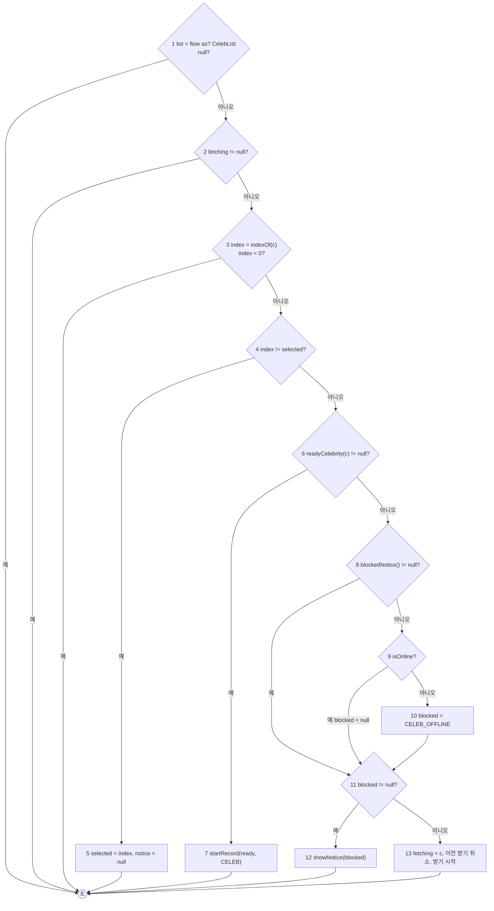

> [런크크 테스트 계획 및 케이스](../test.md) 목차 · 이전: [10-23-v015-워치-v022-통합-검증-시스템-판정](10-23-v015-워치-v022-통합-검증-시스템-판정.md) · 다음: [10-25-v018-배치고사-계획-단위](10-25-v018-배치고사-계획-단위.md)

## 17. v0.17 변경 케이스 (워치 v2 R16·R17, SRS v0.22 CR-130·CR-132, 설계 v0.28)

이 장은 16장(v0.15, 코드 cc8c138b) 뒤에 들어온 두 묶음을 덮는다. R16(cc8c138b..4017839f)은 설계 검증 24장 R79~R81과 사용자 결정 W48·W49(홈 재전송 안내 띠)를 넣고 시험 34개(구현 기록 14.3의 R16a 17개 + R16w 17개)를 자동화했다. R17(4017839f..793eb85e)은 W50(셀프 기록 카드·셀럽 목록은 두 번 눌러 시작)을 넣었다. W50의 기본 동작 넷은 v0.15 보충으로 16.3.8 TC-5508~TC-5511에 이미 있으므로 여기서는 남은 경우만 더한다. 16장 케이스 가운데 R16에서 자동화된 것의 상태는 17.9에서 바꾼다.

| 절 | TC |
|----|----|
| 17.2 단위 폰·공용 | TC-5641~TC-5655 |
| 17.3 단위 워치 | TC-5661~TC-5669 |
| 17.4 화이트박스 | TC-5671~TC-5679 |
| 17.5 통합 | TC-5681~TC-5683 |
| 17.6 검증 | TC-5686~TC-5688 |
| 17.7 실기기 확인 | TC-5691~TC-5692 |

### 17.1 계획 보강

| 항목 | 내용 |
|------|------|
| 기준 문서 | srs.md v0.22(03-02 FR-039, 03-04 FR-258·FR-259, 07-15 CR-130·CR-132), design-oo.md v0.28(05-20 D-473, 10.1 R16 반영, 10.2 R17 반영, 05-19 D-474는 범위 밖), code-review 17차(14-17차-v022-확인 4절 "W48 셈·홈 띠·R81 문자열 경로", 5절 시험 품질)·18차(15-18차-v022-확인 2절 W50 동작 점검, WR18-2), 구현 기록 14.3 R16a·R16w·R17 |
| 기준 코드 | develop **0b16eafe**(워치 v2 599dc319 = 793eb85e 병합, AI 코치 09e568dc 포함). 범위 diff는 `--first-parent cc8c138b..793eb85e` |
| 실행 결과 | 이번 판은 시험을 직접 돌렸다: `android/` `./gradlew testLocalDebugUnitTest :domain:test :wear-contract:test --continue`(JDK 21, 2026-11-03). 결과 칸의 **통과(실행)** = 이 실행의 JUnit XML에서 대응 시험이 통과했다는 뜻이다. ktlint·lint·Roborazzi 비교·에뮬레이터는 돌리지 않았다 |
| 상태 열 | 15.1·16.1과 같다(자동화됨, 자동화됨(일부: …), 미자동화, 실기기) |
| 번호 대역 | TC-5641~TC-5699. v0.15 대역(TC-5401~TC-5699)의 마지막 사용 번호 TC-5640(v0.16 AI 코치 병합) 다음을 이어 쓴다. 단위 폰·공용 5641~5659, 단위 워치 5661~5669, 화이트박스 5671~5679, 통합 5681~5685, 검증 5686~5689, 실기기 5691~5699 |
| 단위 | 클래스(또는 함수). 폰·공용: RoomPendingRunRepository(needsReminder, observeRejectedCount, resetRejected), PendingRunMapper(uploadStateOf), HomeViewModel·HomeScreen. 워치: WatchFlowViewModel(onDistanceSelected, onCelebritySelected), WatchDistancePicker.DistanceRow, WatchCelebListScreen.CelebRow |
| 통합 전략 | 사용 기반: data.store(Room, 판 5) → domain.run(PendingRunRepository 포트) → ui.home(HomeViewModel) 순. 스레드 기반: T-57 홈 재전송 안내(보관함 변화 → 셈 → 띠), T-58 W50 화면(누름 → 고름 → 다시 누름 → 카운트다운) |
| 기법 | 경곗값(미전송 20·21건, 가장 오래된 기록 7일 −1ms·정각·+1ms), 동치 분할(전송 상태 문자열 NOT_SENT·REJECTED·모르는 값, 띠 조건 참·거짓·읽기 실패, 누른 카드 고름·안 고름·누를 수 없음), 상태 전이(02-06 SelfDistance·CelebList 자기 전이, 05-20 10.2), 기초 경로(onCelebritySelected), 오류 예측(받는 중 다른 항목, 실패 뒤 다시 누름, 보낸 머리 정보, 빈 보관함) |
| 화이트박스 대상 | 18차 리뷰 4절이 길이(38줄)와 판단 수를 짚은 `WatchFlowViewModel.onCelebritySelected`. `onDistanceSelected`는 V(G) 9이지만 SelfDistance 가지의 갈래 셋이 TC-5508·TC-5509·TC-5661로, 나머지 가지가 v0.14 케이스로 이미 덮여 따로 기초 경로를 세우지 않는다. 17·18차가 새로 더한 우선 대상은 없다(17차 7절) |
| 기대 결과 | SRS v0.22 FR-039·FR-258·FR-259 문장이 먼저이고, SRS가 정하지 않은 값은 설계 05-20 10.1·10.2와 사용자 결정 W48~W50을 따른다(7.2 규칙). 코드가 지금 내는 값을 기대 결과로 쓰지 않았다. 코드와 SRS가 다른 곳은 17.11.3 TF-V17에 적었다 |
| 범위 밖 | AI 코치(TC-5627~TC-5640, v0.16), 서버(R16·R17에 서버 변경 없음), 17차 AN17-1(홈이 미전송 목록 전체를 바뀜 신호로 구독하는 효율 결함)은 요구가 아니라 구현 품질이라 케이스로 두지 않고 TF-V17-03에 적는다 |

### 17.2 단위 — 폰·공용 (TC-5641~TC-5655)

#### 17.2.1 재전송 안내 셈 (data.store RoomPendingRunRepository.needsReminder, FR-039, CR-130, D-473)

기존 TC-3182(19·20건)·TC-3184(21건째)·TC-3183(7일 정각)·TC-5417(거부 기록 뺌)이 기본 경계를 덮는다(17.9에서 자동화로 바뀜). 여기서는 남은 경계와 오류 예측이다.

| TC | 요구 ID | 입력 | 실행 조건 | 기대 결과 | 기법 | 상태 | 대응 시험 | 결과 |
|----|---------|------|-----------|-----------|------|------|-----------|------|
| TC-5641 | FR-039 | 가장 오래된 미전송 기록 저장 시각 = now − 7일, needsReminder(now − 1ms) / (now) / (now + 1ms) | Robolectric 메모리 Room, 고정 시계 | false / false / true (7일 정각은 안내 안 함, 초과부터 안내) | 경곗값(7일 −1ms·정각·+1ms) | 자동화됨(일부: −1ms 대신 −1시간을 본다) | RoomPendingRunRepositoryTest#TC-3183 가장 오래된 미전송 기록이 6일 23시간·7일 정각이면 안내하지 않고 7일 1시간이면 안내한다 | 통과(실행 2026-11-03, 0b16eafe) |
| TC-5642 | FR-039 | 빈 보관함에서 needsReminder(now) | 같음 | Success(false). 오류 없음(가장 오래된 시각이 없음) | 오류 예측(0건) | 미자동화 | - | 미실행 |
| TC-5643 | FR-039 | 보낸 기록의 머리 정보 21건(sentAtMillis 있음, 그중 하나는 8일 전 저장) + 미전송 0건 | 같음 | Success(false). 보낸 머리 정보는 건수·가장 오래된 시각 어느 쪽에도 들지 않는다(셈은 "연결되면 올라갈 미전송 기록만") | 오류 예측(보낸 기록) | 미자동화 | - | 미실행 |
| TC-5644 | FR-039 | 저장된 전송 상태가 모르는 문자열 "SENDING"인 기록 21건 | 같음 | Success(true). 모르는 문자열은 미전송으로 읽으므로(R81) 셈에 든다. 거부 건수(observeRejectedCount)는 0 | 동치 분할(모르는 상태) | 미자동화 | - | 미실행 |
| TC-5645 | FR-039 | 미전송 21건으로 안내가 참인 상태에서 22번째 기록 저장 | 같음 | 22건 모두 남는다(지우지 않음). 저장은 Success. 새 측정 시작(RunTracker.checkStartable)은 보관 건수로 막히지 않는다 | 오류 예측(한도 넘김) | 자동화됨(일부: 21번째에서 지우지 않음만, 측정 시작 단언 없음) | RoomPendingRunRepositoryTest#TC-3182 TC-3184 미전송 19건·20건은 안내하지 않고 21번째를 저장하면 안내한다(기록은 지우지 않는다) | 통과(실행 2026-11-03, 0b16eafe) |

#### 17.2.2 전송 상태 읽기와 거부 건수 (data.store PendingRunMapper.uploadStateOf·PendingRunDao, FR-040·FR-273, R80·R81)

| TC | 요구 ID | 입력 | 실행 조건 | 기대 결과 | 기법 | 상태 | 대응 시험 | 결과 |
|----|---------|------|-----------|-----------|------|------|-----------|------|
| TC-5646 | FR-040 | 칼럼 값 "NOT_SENT" / "REJECTED" / "SENDING" / "" / "rejected" | Room에 markState로 직접 씀 | NOT_SENT / REJECTED / NOT_SENT / NOT_SENT / NOT_SENT (알려진 두 값만 그대로, 그 밖은 미전송, 05-20 10.1 R81) | 동치 분할(알려진 값 2, 모르는 값 3) | 자동화됨(일부: "SENDING"만) | RoomPendingRunRepositoryTest#R81 모르는 전송 상태 문자열(옛 SENDING)은 미전송으로 읽는다 | 통과(실행 2026-11-03, 0b16eafe) |
| TC-5647 | FR-273 | REJECTED 2건 + "SENDING" 1건에서 resetRejected() | 같음 | Success(2). REJECTED 둘만 NOT_SENT로 바뀌고 "SENDING" 행은 건드리지 않는다. 그 뒤 observeRejectedCount = 0 | 동치 분할 | 미자동화 | - | 미실행 |
| TC-5648 | FR-273 | REJECTED 0 → markRejected 1건 → NOT_SENT 1건 저장 → resetRejected | observeRejectedCount 구독 | 0, 1, 0 순으로 낸다. NOT_SENT 저장 때는 같은 값(1)을 다시 내지 않는다 | 상태 전이, 오류 예측(같은 값) | 자동화됨(일부: 같은 값 거름 단언 없음) | RoomPendingRunRepositoryTest#R80 거부 기록 건수를 세어 바뀔 때마다 낸다 | 통과(실행 2026-11-03, 0b16eafe) |
| TC-5649 | FR-273 | 거부 건수를 쓰는 쪽 둘이 건수 구독 | observePending()이 부르면 error()를 던지는 가짜 보관소 | ResendRejectedRunsUseCase·RejectedCountReporter 모두 observeRejectedCount만 쓰고 전체 목록을 읽지 않는다(05-20 10.1 R80) | 오류 예측 | 자동화됨 | ResendRejectedRunsUseCaseTest#R80 폰 건수는 보관소의 거부 건수를 쓰고 전체 목록을 읽지 않는다, RejectedCountReporterTest#R80 보관소의 거부 건수를 구독하고 전체 목록은 읽지 않는다 | 통과(실행 2026-11-03, 0b16eafe) |

#### 17.2.3 홈 재전송 안내 띠 (ui.home HomeViewModel·HomeScreen, FR-039, W48·W49, D-473)

| TC | 요구 ID | 입력 | 실행 조건 | 기대 결과 | 기법 | 상태 | 대응 시험 | 결과 |
|----|---------|------|-----------|-----------|------|------|-----------|------|
| TC-5650 | FR-039 | needsReminder = Success(true) | 가짜 PendingRunRepository, 홈 열기 | isResendReminderVisible = true. 홈 상단 띠(RunkkBanner) 문구가 정확히 "올리지 못한 기록이 있어요. 인터넷에 연결해 주세요"(W49). 띠 아래 20건·7일 설명 줄 없음 | 동치 분할(참) | 자동화됨(일부: 문구·설명 줄 없음은 화면 단언 없음) | HomeViewModelTest#W48 미전송 기록 안내가 필요하면 상단에 재전송 안내 띠를 보인다 | 통과(실행 2026-11-03, 0b16eafe) |
| TC-5651 | FR-039 | needsReminder = Success(false) | 같음 | 띠 없음 | 동치 분할(거짓) | 자동화됨 | HomeViewModelTest#W48 안내가 필요 없으면 띠를 보이지 않는다 | 통과(실행 2026-11-03, 0b16eafe) |
| TC-5652 | FR-039 | needsReminder = Failure | 같음 | 띠 없음(읽지 못하면 안내하지 않는다). 홈의 다른 칸은 그대로 | 동치 분할(읽기 실패) | 자동화됨 | HomeViewModelTest#W48 보관함을 읽지 못하면 띠를 보이지 않는다 | 통과(실행 2026-11-03, 0b16eafe) |
| TC-5653 | FR-039 | 띠가 보이는 중 미전송 1건이 전송 성공으로 빠져 20건 | observePending 방출 | 다시 세어 띠가 사라진다 | 상태 전이(보임 → 안 보임) | 자동화됨 | HomeViewModelTest#W48 보관함이 바뀌어 조건이 풀리면 띠가 사라진다 | 통과(실행 2026-11-03, 0b16eafe) |
| TC-5654 | FR-039 | 7일 전 정각에 저장한 기록 1건, 홈을 떠났다가 1시간 뒤 다시 표시 | 시계를 1시간 앞으로, onResumed | 다시 표시할 때 지금 시각으로 다시 세어 띠가 보인다(시간이 지나 생기는 7일 초과) | 상태 전이(안 보임 → 보임) | 자동화됨 | HomeViewModelTest#W48 홈에 다시 돌아오면 지금 시각으로 다시 센다(7일 초과는 시간이 지나 생긴다) | 통과(실행 2026-11-03, 0b16eafe) |
| TC-5655 | FR-039 | 오프라인이라 대시보드를 못 읽어 오류 화면(RunkkErrorState), needsReminder = true | Compose 화면 시험 | 띠가 상단에 보인다(띠는 Top, 오류 표시는 본문). 재전송 안내는 폰에만 보이고 워치 화면에는 없다 | 오류 예측(오프라인) | 미자동화 | - | 미실행 |

### 17.3 단위 — 워치 (TC-5661~TC-5669)

#### 17.3.1 두 번 눌러 시작의 남은 경우 (watch.ui WatchFlowViewModel·WatchDistancePicker·WatchCelebListScreen, FR-258·FR-259, CR-132, 05-20 10.2)

| TC | 요구 ID | 입력 | 실행 조건 | 기대 결과 | 기법 | 상태 | 대응 시험 | 결과 |
|----|---------|------|-----------|-----------|------|------|-----------|------|
| TC-5661 | FR-258 | 셀프 거리 화면에서 기록 없는 10km 카드 누름(두 번) | 1km만 기록 있음, 처음 강조 1km | 상태 그대로(selected 1km 위치, 카운트다운 아님). 카드에 "기록 없음" | 동치 분할(누를 수 없는 카드) | 미자동화 | - | 미실행 |
| TC-5662 | FR-258 | "연결되면 고를 수 있어요" 안내가 떠 있는 셀프 거리 화면에서 강조되지 않은 카드 누름 | 안내가 있는 SelfDistance | selected가 바뀌고 안내가 지워진다(notice = null) | 상태 전이 | 미자동화 | - | 미실행 |
| TC-5663 | FR-259 | 셀럽 A를 받는 중(fetching = A)에 셀럽 B 누름 | 받기를 멈춰 둔 가짜 | selected는 A 그대로, B 받기 0회, A 받기가 끝나면 A로 카운트다운 | 오류 예측(받는 중 다른 항목) | 자동화됨(일부: 같은 항목 다시 누름만 본다) | WatchFlowViewModelTest#셀럽을 고르면 받는 동안 그 항목을 받는 중으로 보이고 다시 눌러도 한 번만 받은 뒤 카운트다운이다(W31) | 통과(실행 2026-11-03, 0b16eafe) |
| TC-5664 | FR-259 | 고른 셀럽 받기가 일시 거부로 실패 → 같은 셀럽 다시 누름 | 첫 받기 Rejected(일시), 둘째 받기 성공 | 첫 실패 뒤 "잠시 후 다시 시도해 주세요", 그 셀럽은 고른 채 목록에 남는다. 다시 누르면 받기 1회 더 → 카운트다운 | 상태 전이, 오류 예측(실패 뒤 다시) | 미자동화 | - | 미실행 |
| TC-5665 | FR-259 | 고른 셀럽 받기가 404(기록 없음·내려짐) | 셀럽 둘인 목록 | "고를 수 없는 기록이에요"를 보이고 **그 셀럽을 목록에서 뺀다**(FR-259). 남은 셀럽 하나가 보인다 | 동치 분할(없는 기록) | 자동화됨(일부: 안내만 단언, 목록에서 빠짐 단언 없음) | WatchFlowViewModelTest#셀럽 구간 기록이 없으면(404) 고를 수 없는 기록이고 받다가 끊기면 연결 안내다(W31) | 통과(실행 2026-11-03, 0b16eafe). 목록에서 빠짐은 실패 예상(TF-V17-01) |
| TC-5666 | FR-258, FR-259 | 셀프 거리 목록·셀럽 목록에서 베젤로 두 칸 넘김 / 쓸어 넘김 | Compose 화면 시험(RotaryScrollEvent) | 목록만 움직이고 강조(selected)는 처음 고른 카드에 남는다. 그 상태에서 보이는 다른 카드를 누르면 고르기만 한다 | 상태 전이(넘김은 전이 아님) | 미자동화 | - | 미실행 |
| TC-5667 | FR-258, FR-259 | 셀프 거리 카드·셀럽 항목의 누르기 동작 이름 | Compose 의미 트리(onClickLabel) | 고른 카드는 "시작", 고르지 않은 카드는 "선택". 카드 내용 설명(거리·기록·셀럽 표시명)은 그대로 | 동치 분할(고름·안 고름) | 미자동화 | - | 미실행. 18차 WR18-2 |
| TC-5668 | FR-259 | 셀럽런 거리 카드(5km) 한 번 누름 | 5km 셀럽 기록 둘 | 바로 셀럽 목록으로 간다(거리 카드는 두 번 누르기 대상이 아니다, CR-132) | 회귀 | 미자동화 | - | 미실행 |
| TC-5669 | FR-244, FR-257 | 자유런·배틀런 거리 다이얼에서 카드 누름 | FreeGoal·BattleDistance | selected만 바뀌고 시작하지 않는다. 시작은 "달리기 시작"·"매칭 시작" 버튼(CR-132 범위 밖, 바뀌지 않음) | 회귀 | 미자동화 | - | 미실행 |

### 17.4 화이트박스 (TC-5671~TC-5679)

#### 17.4.1 WatchFlowViewModel.onCelebritySelected (WatchFlowViewModel.kt, 793eb85e)

**제어 흐름도.** 노드는 판단 하나 또는 분기 없는 문장 묶음이다. 코루틴 안 람다(받기 결과 처리)는 따로 실행되는 함수라 이 그래프에 넣지 않고 아래 "람다 경로"로 덮는다. `blocked`는 `blockedNotice() ?: CELEB_OFFLINE.takeUnless { isOnline }`라 판단 둘(8, 9)로 펼쳤다.

**순환 복잡도.** 노드 N = 14(1~13, E), 간선 E = 21.
- V(G) = E − N + 2 = 21 − 14 + 2 = **9**
- 단순 조건 수 + 1 = 판단 노드 8(1, 2, 3, 4, 6, 8, 9, 11) + 1 = **9**
- 영역 수 = 닫힌 영역 8 + 바깥 1 = **9**

세 값이 같다. 10 이하라 리팩터링 권고는 없다.

**독립 경로와 케이스.**

| TC | 경로 | 새 간선 | 입력 | 실행 조건 | 기대 결과 | 상태 | 대응 시험 | 결과 |
|----|------|---------|------|-----------|-----------|------|-----------|------|
| TC-5671 | B1: 1예 → E | 1→E | 셀프 거리 화면(SelfDistance)에서 셀럽 항목 누름 이벤트 | 화면이 CelebList가 아님 | 상태 그대로, 받기 0회 | 미자동화 | - | 미실행 |
| TC-5672 | B2: 1 → 2예 → E | 1→2, 2→E | A 받는 중 A 다시 누름 | fetching = A | 상태 그대로, 받기 1회만(TC-5663과 같은 길) | 자동화됨 | WatchFlowViewModelTest#셀럽을 고르면 받는 동안 그 항목을 받는 중으로 보이고 다시 눌러도 한 번만 받은 뒤 카운트다운이다(W31) | 통과(실행 2026-11-03, 0b16eafe) |
| TC-5673 | B3: 1 → 2 → 3예 → E | 2→3, 3→E | 목록을 다시 받아 더는 없는 셀럽 객체 누름 | 목록에 없는 RecordOpponent | 상태 그대로, 받기 0회 | 미자동화 | - | 미실행 |
| TC-5674 | B4: … 3 → 4예 → 5 → E | 3→4, 4→5, 5→E | 강조되지 않은 둘째 셀럽 누름 | 셀럽 둘, selected 0 | selected = 1, 받기 0회, 카운트다운 아님 | 자동화됨 | WatchFlowViewModelTest#셀럽 목록은 처음 누르면 고르기만 하고 고른 셀럽을 다시 누르면 시작한다(W50) | 통과(실행 2026-11-03, 0b16eafe) |
| TC-5675 | B5: … 4 → 6예 → 7 → E | 4→6, 6→7, 7→E | 구간 기록을 받아 둔 셀럽을 고른 채 누름 | 오프라인, readyCelebrity가 기록을 돌려줌 | 받지 않고 바로 카운트다운(셀럽 모드). 오프라인이어도 시작(FR-259 "저장해 둔 셀럽은 서버에 닿지 않아도 된다") | 미자동화 | - | 미실행 |
| TC-5676 | B6: … 6 → 8예 → 11예 → 12 → E | 6→8, 8→11, 11→12, 12→E | 받아 두지 않은 셀럽을 고른 채 누름 | 폰이 러닝 측정 중(isPhoneRunning) | "폰에서 러닝 중" 안내(PHONE_RUNNING), 받기 0회 | 미자동화 | - | 미실행 |
| TC-5677 | B7: … 8 → 9아니오 → 10 → 11예 → 12 → E | 8→9, 9→10, 10→11 | 받아 두지 않은 셀럽을 고른 채 누름 | 막힘 없음, 오프라인 | "연결되면 고를 수 있어요"(CELEB_OFFLINE), 받기 0회 | 자동화됨 | WatchFlowViewModelTest#연결이 없고 받아 둔 구간 기록이 없으면 받지 않고 연결 안내를 보인다(W31) | 통과(실행 2026-11-03, 0b16eafe) |
| TC-5678 | B8: … 9예 → 11아니오 → 13 → E | 9→11, 11→13, 13→E | 받아 두지 않은 셀럽을 고른 채 누름 | 막힘 없음, 온라인, 받기 성공 | "받는 중" 표시(fetching = c), 받기 1회 뒤 카운트다운(TC-5511과 같은 길) | 자동화됨 | WatchFlowViewModelTest#셀럽 목록에서 처음 강조된 셀럽은 한 번 누르면 시작한다(W50) | 통과(실행 2026-11-03, 0b16eafe) |
| TC-5679 | B9: … 8예 → 11아니오 | (8예일 때 11아니오) | - | - | **도달 불가.** blockedNotice()가 null이 아니면 blocked도 null이 아니다. 엘비스 식을 판단 둘로 펼친 데서 생긴 경로이고 결함이 아니다(TF-V17-04, 참고) | 해당 없음 | - | 도달 불가 |

**람다 경로(받기 결과 처리).** (가) 받는 동안 화면이 바뀌었거나 다른 받기가 끼어듦 → 버림: v0.14 시험 "셀럽 구간 기록을 받는 동안 뒤로 가면 받은 뒤에도 카운트다운으로 가지 않는다(W31)". (나) 성공 → 카운트다운: TC-5678. (다) 실패 → 사유별 안내: TC-5664·TC-5665와 v0.14 시험 "셀럽 구간 기록 받기가 CELEBRITY_REMOVED가 아닌 거부면 잠시 후 다시 안내다(WR14-1)".

**조건 검사.** 판단 4(`index != selected`)는 화면을 열 때 selected = 0이라, 첫 항목 누름은 거짓(바로 시작, TC-5678), 다른 항목 누름은 참(TC-5674)이다. 판단 2와 4가 함께 참인 경우(받는 중 다른 항목)는 2에서 끝나므로 4는 평가되지 않는다(TC-5663).

### 17.5 통합 (TC-5681~TC-5683)

스레드 번호는 v0.15의 T-56 다음이다.

| TC | 스레드 | 요구 ID | 입력 | 실행 조건(대역) | 기대 결과 | 확인 항목(메시지 순서) | 상태 | 대응 시험 | 결과 |
|----|--------|---------|------|-----------------|-----------|------------------------|------|-----------|------|
| TC-5681 | T-57 홈 재전송 안내 | FR-039 | 미전송 21건 저장 → 홈 → 1건 전송 성공 | 실제 Room(메모리) + 실제 RoomPendingRunRepository + HomeViewModel, 가짜 대시보드 | 홈 상단 띠가 보였다가 전송 성공 뒤 사라진다. 거부 기록 3건을 섞어도 띠 판단은 미전송만 센다 | save → observePending 방출 → HomeViewModel.checkResendReminder → needsReminder(COUNT·MIN 쿼리) → HomeUiState.isResendReminderVisible | 미자동화 | - | 미실행. 지금은 Room 셈(TC-3182~3184)과 홈 다시 세기(TC-5650~5654)가 반쪽씩 나뉘어 있다(17차 5절) |
| TC-5682 | T-58 W50 두 번 눌러 시작 | FR-258, FR-259 | 셀프 거리 화면에서 3km 카드 누름 → 같은 카드 누름 / 셀럽 목록에서 둘째 누름 → 같은 항목 누름 | Compose 화면 + 실제 WatchFlowViewModel, 가짜 battleFlow | 첫 누름 뒤 강조가 3km로 옮고 화면은 그대로, 둘째 누름 뒤 카운트다운 화면 | DistanceRow.onClick → onDistanceSelected → flow(selected) → 다시 그림 → onClick → startRecord → Countdown | 미자동화 | - | 미실행 |
| TC-5683 | 구조 | FR-273(R79 배치) | ArchitectureTest | Konsist 허용 표 | 폰 159·워치 37(v0.15의 154에 R79 ui.me → domain.run 1, v0.16 AI 코치 4), 모든 패키지 Fan-Out 7 이하, 표 밖 import 0 | 허용 표 합계·Fan-Out·표 밖 import | 자동화됨 | ArchitectureTest#모듈 Fan-Out은 7 이하이고 허용 표는 폰 159개·워치 37개다 | 통과(실행 2026-11-03, 0b16eafe) |

### 17.6 검증 (TC-5686~TC-5688)

| TC | 요구 ID | 시나리오 | 입력 | 기대 결과(SRS) | 상태 | 관련 TC | 결과 |
|----|---------|----------|------|----------------|------|---------|------|
| TC-5686 | FR-039 | 오래 오프라인인 러너 | 폰 비행기 모드로 자유런 21회 저장(또는 저장 뒤 기기 시각을 8일 뒤로) → 홈 | 홈 상단에 "올리지 못한 기록이 있어요. 인터넷에 연결해 주세요". 기록 21건이 보관함에 남고 22번째 러닝을 시작할 수 있다. 연결 뒤 전송되면 띠가 사라진다 | 미자동화 | TC-3182~3184, TC-5650~5655, TC-5681 | 미실행 |
| TC-5687 | FR-258 | 셀프런을 고르는 러너 | 워치 에뮬레이터 셀프 거리 화면에서 강조 안 된 카드 누름 → 다시 누름, 화면을 열자마자 강조된 카드 한 번 누름 | 첫 누름은 강조만, 다시 누르면 카운트다운. 열자마자 강조된 카드는 한 번에 카운트다운 | 미자동화 | TC-5508, TC-5509, TC-5682 | 미실행 |
| TC-5688 | FR-259 | 셀럽런을 고르는 러너 | 셀럽 목록에서 둘째 항목 누름 → 다시 누름(처음 고르는 셀럽, 온라인) | 첫 누름은 강조만, 다시 누르면 "받는 중" 뒤 카운트다운 | 미자동화 | TC-5510, TC-5678 | 미실행 |

### 17.7 실기기 확인 (TC-5691~TC-5692)

v0.14·v0.15 실기기 회차(TC-5381~TC-5396, TC-5621~TC-5626)와 함께 사용자가 돌린다(W21).

| TC | 요구 ID | 항목 | 할 일 | 합격 기준 | 상태 | 결과 |
|----|---------|------|-------|-----------|------|------|
| TC-5691 | FR-258, FR-259 | 베젤·화면 읽기 | 갤럭시 워치6에서 셀프 거리 목록을 베젤로 넘긴 뒤 다른 카드 누름, TalkBack을 켜고 카드에 머묾 | 넘겨도 강조가 따라가지 않는다. TalkBack이 고른 카드는 "시작", 아닌 카드는 "선택"으로 읽는다 | 실기기 | 미실행 |
| TC-5692 | FR-039 | 홈 띠 표시 | S10에서 TC-5686 상태로 홈, 글자 크기 최대 | 띠 문구가 잘리지 않고 홈 다른 칸을 가리지 않는다 | 실기기 | 미실행 |

### 17.8 상태도 전이 커버리지 (02-06 SelfDistance·CelebList, 05-20 10.2)

| 상태도 | 전이(사건 / 동작) | TC |
|--------|-------------------|----|
| SelfDistance | 자기 전이: 고르지 않은 카드 누름 / selected = 그 위치, notice = null | TC-5508, TC-5662 |
| SelfDistance | → Countdown: 고른 카드 누름 / startRecord(SELF) | TC-5508, TC-5509 |
| SelfDistance | (금지) 기록 없는 카드 누름 → 그대로 | TC-5661 |
| SelfDistance·CelebList | (전이 아님) 베젤·쓸어 넘김 → selected 그대로 | TC-5666 |
| CelebList | 자기 전이: 고르지 않은 항목 누름 / selected = 그 위치 | TC-5510, TC-5674 |
| CelebList | 자기 전이: 고른 항목 누름(받아 두지 않음, 온라인) / fetching = c | TC-5678 |
| CelebList | → Countdown: 받기 성공 또는 받아 둔 항목 | TC-5675, TC-5678 |
| CelebList | 자기 전이: 막힘·오프라인 / notice | TC-5676, TC-5677 |
| CelebList | (금지) 받는 중 누름 → 그대로 | TC-5663, TC-5672 |

### 17.9 기존 케이스 상태 갱신 (R16a·R16w 자동화, 코드 0b16eafe 실행)

구현 기록 14.3이 R16에서 자동화했다고 적은 34개(R16a 17, R16w 17)다. 34개 모두 대응 시험을 찾았고 이번 실행에서 통과했다. 이전 상태는 미자동화 30, 이미 자동화로 적힌 것 1(TC-5473), 상태 열이 없는 04-01 검증 표 3(TC-3182~3184, 그 표의 "구현" 칸도 "있음(v0.17)"으로 고쳤다)이다. 16장 해당 행의 상태·대응 시험·결과 칸도 같은 내용으로 고쳤다(행 끝 "(v0.17)" 표시). 대응 시험은 시험 이름에 TC 번호가 붙은 것을 JUnit XML에서 찾았다.

| TC | 조각 | 이전 상태 | 묶음 | 대응 시험 | 결과 |
|----|------|-----------|------|-----------|------|
| TC-3182 | 04-01 | - | R16a | RoomPendingRunRepositoryTest#TC-3182 TC-3184 미전송 19건·20건은 안내하지 않고 21번째를 저장하면 안내한다(기록은 지우지 않는다) | 통과(실행 2026-11-03, 0b16eafe) |
| TC-3183 | 04-01 | - | R16a | RoomPendingRunRepositoryTest#TC-3183 가장 오래된 미전송 기록이 6일 23시간·7일 정각이면 안내하지 않고 7일 1시간이면 안내한다 | 통과(실행 2026-11-03, 0b16eafe) |
| TC-3184 | 04-01 | - | R16a | HomeViewModelTest#W48 TC-3184 미전송 기록이 안내 기준을 넘으면 홈 상단에 재전송 안내를 보인다, RoomPendingRunRepositoryTest#TC-3182 TC-3184 미전송 19건·20건은 안내하지 않고 21번째를 저장하면 안내한다(기록은 지우지 않는다) | 통과(실행 2026-11-03, 0b16eafe) |
| TC-5413 | 10-22 | 미자동화 | R16a | UploadWorkerTest#TC-5413 (a) 실패가 없으면 재시도를 예약하지 않고 거부 건수는 0이다, UploadWorkerTest#TC-5413 (b) 거부 1건만 남으면 재시도를 예약하지 않고 거부 건수는 1이다, UploadWorkerTest#TC-5413 (c) 거부 1건과 네트워크 실패 1건이면 재시도 1회를 예약하고 거부 건수는 1이다, UploadWorkerTest#TC-5413 (d) 예외로 결과가 없으면 재시도 1회를 예약하고 거부 건수는 0이다 | 통과(실행 2026-11-03, 0b16eafe) |
| TC-5417 | 10-22 | 미자동화 | R16a | RoomPendingRunRepositoryTest#TC-5417 8일째인 기록이 거부 기록뿐이면 안내하지 않는다, RoomPendingRunRepositoryTest#TC-5417 거부 3건과 미전송 17건에서 21번째를 저장해도 미전송은 18건이라 안내하지 않는다 | 통과(실행 2026-11-03, 0b16eafe) |
| TC-5426 | 10-22 | 미자동화 | R16a | ResendRejectedRunsUseCaseTest#TC-5426 폰 거부 2건과 워치 3건이 그대로이고 미전송만 바뀌면 5를 한 번만 낸다 | 통과(실행 2026-11-03, 0b16eafe) |
| TC-5439 | 10-22 | 미자동화 | R16a | MeViewModelsTest#TC-5439 다시 보내기를 진행 중에 또 누르면 유스케이스는 한 번만 부르고 진행 중으로 남는다 | 통과(실행 2026-11-03, 0b16eafe) |
| TC-5447 | 10-22 | 미자동화 | R16a | PausesInRangeBoundaryTest#TC-5447 두 정지의 간격이 0ms면 하나로 합치고 1ms면 둘로 둔다, PausesInRangeBoundaryTest#TC-5447 정지 끝이 기록 끝과 같거나 1ms 앞이면 그대로 둔다, PausesInRangeBoundaryTest#TC-5447 정지 시작이 기록 시작과 같으면 그대로 둔다, PausesInRangeBoundaryTest#TC-5447 정지 시작이 기록 시작보다 1ms 앞이면 기록 시작으로 자르고 운동 시간을 1ms 늘린다 | 통과(실행 2026-11-03, 0b16eafe) |
| TC-5448 | 10-22 | 미자동화 | R16a | PausesInRangeBoundaryTest#TC-5448 기록 끝 뒤에만 있는 정지는 빼고 운동 시간은 끝 − 시작 − 나머지 정지다, PausesInRangeBoundaryTest#TC-5448 다른 구간을 통째로 품는 구간은 바깥 구간 하나로 남는다, PausesInRangeBoundaryTest#TC-5448 시각 순서가 뒤섞인 정지 목록은 정렬한 것과 같은 결과다 | 통과(실행 2026-11-03, 0b16eafe) |
| TC-5456 | 10-22 | 미자동화 | R16w | RejectedResendReceiverTest#직전 요청 시각보다 앞선 시각도 처리하고 같은 시각만 버린다(TC-5456 D-464) | 통과(실행 2026-11-03, 0b16eafe) |
| TC-5458 | 10-22 | 미자동화 | R16w | RejectedResendReceiverTest#앱이 다시 떠 같은 요청을 다시 받아도 결과가 같고 그 사이 다시 거부된 기록은 되돌린다(TC-5458) | 통과(실행 2026-11-03, 0b16eafe) |
| TC-5462 | 10-22 | 미자동화 | R16a | RejectedCountReporterTest#TC-5462 건수 항목 넣기가 실패해도 구독은 이어지고 다음 변화 때 새 건수를 넣는다, RejectedCountReporterTest#TC-5462 앱 프로세스가 다시 뜨면 같은 건수라도 지금 건수를 다시 넣는다 | 통과(실행 2026-11-03, 0b16eafe) |
| TC-5466 | 10-22 | 미자동화 | R16w | WatchResultHeadlineTest#서버 판정 WIN에 내 도달 시간이 없으면 워치가 잰 앞선 시간으로 BEST와 WIN 문구를 낸다(TC-5466) | 통과(실행 2026-11-03, 0b16eafe) |
| TC-5467 | 10-22 | 미자동화 | R16w | WatchResultHeadlineTest#워치가 잰 시간 차가 서버 판정과 어긋나면 머리말은 판정대로이고 문구가 없다(TC-5467) | 통과(실행 2026-11-03, 0b16eafe) |
| TC-5468 | 10-22 | 미자동화 | R16w | WatchResultHeadlineTest#서버 판정 LOSE에서 워치 시간 차 -1초는 1초 모자람 0초는 같은 시간 문구 +1초는 문구가 없다(TC-5468) | 통과(실행 2026-11-03, 0b16eafe) |
| TC-5471 | 10-22 | 미자동화 | R16w | WatchFlowViewModelTest#자유런을 1m 달리고 길게 눌러 끝내면 기록을 저장하고 목표 전이라 STOP 결과다(TC-5471) | 통과(실행 2026-11-03, 0b16eafe) |
| TC-5472 | 10-22 | 미자동화 | R16w | WatchFlowViewModelTest#이동 없이 일시정지 화면에서 길게 눌러 끝내면 저장하지 않았다는 안내와 메인으로 간다(TC-5472) | 통과(실행 2026-11-03, 0b16eafe) |
| TC-5473 | 10-22 | 미자동화 | R16w | WatchFlowViewModelTest#배틀런 출발 직후 거리 0으로 끝내면 포기를 보내고 기록 없이 결과 화면이다(TC-5473 W46), WatchFlowViewModelTest#서버 셀프런 출발 직후 거리 0으로 끝내면 그만두기를 보내고 기록 없이 결과 화면이다(TC-5473 W46) | 통과(실행 2026-11-03, 0b16eafe) |
| TC-5478 | 10-22 | 미자동화 | R16w | WatchFlowViewModelTest#연결된 셀럽런은 서버가 대결을 열 때까지 연결 중을 보이고 답이 오면 3부터 센다(TC-5478) | 통과(실행 2026-11-03, 0b16eafe) |
| TC-5480 | 10-22 | 미자동화 | R16w | WatchFlowViewModelTest#연결 중 서버 대결을 열지 못하고 Network로 끝나면 미리 받은 기록으로 오프라인 대결을 3부터 센다(TC-5480 M89) | 통과(실행 2026-11-03, 0b16eafe) |
| TC-5482 | 10-22 | 미자동화 | R16w | WatchFlowViewModelTest#연결 중 서버 오류로 실패하면 거리 선택으로 돌아가 시작 실패 안내를 보이고 측정하지 않는다(TC-5482 M89) | 통과(실행 2026-11-03, 0b16eafe) |
| TC-5483 | 10-22 | 자동화됨(WatchFlowViewModelTest, R16 68091a57) | R16w | WatchFlowViewModelTest#연결 중에 뒤로 가도 카운트다운에 머물고 늦게 온 서버 답으로 3부터 센다(TC-5483) | 통과(실행 2026-11-03, 0b16eafe) |
| TC-5521 | 10-22 | 미자동화 | R16w | WatchFlowViewModelTest#화면 흐름에 회가 없으면 조정자 카운트다운이 와도 메인 그대로다(TC-5521 P1) | 통과(실행 2026-11-03, 0b16eafe) |
| TC-5522 | 10-22 | 미자동화 | R16w | WatchFlowViewModelTest#자유런 중 조정자가 Finished로 끝나도 무시하고 자유런 결과는 측정 끝에서 정한다(TC-5522 P2) | 통과(실행 2026-11-03, 0b16eafe) |
| TC-5526 | 10-22 | 미자동화 | R16w | WatchFlowViewModelTest#셀럽런 측정 중 조정자 격차를 측정 화면에 옮기고 앞서면 앞섬 색이다(TC-5526 P6) | 통과(실행 2026-11-03, 0b16eafe) |
| TC-5527 | 10-22 | 미자동화 | R16w | WatchFlowViewModelTest#종료 카운트다운이 오면 마지막 격차로 측정 화면을 유지한다(TC-5527 P7) | 통과(실행 2026-11-03, 0b16eafe) |
| TC-5530 | 10-22 | 미자동화 | R16w | WatchFlowViewModelTest#셀럽런 회가 열려 있을 때 조정자가 Idle로 가도 화면 흐름은 그대로다(TC-5530 P10) | 통과(실행 2026-11-03, 0b16eafe) |
| TC-5532 | 10-22 | 미자동화 | R16a | PausesInRangeBoundaryTest#TC-5532 기록 끝이 시작보다 앞이면 정지가 모두 빠지고 운동 시간은 0이다(음수로 두지 않는다) | 통과(실행 2026-11-03, 0b16eafe) |
| TC-5551 | 10-23 | 미자동화(구성 요소 시험만) | R16a | RejectedResendThreadTest#TC-5551 폰에만 거부 기록 2건이면 줄은 2건이고 다시 보내면 폰 기록이 올라가 줄이 사라지며 워치 요청 항목이 1건 남는다 | 통과(실행 2026-11-03, 0b16eafe) |
| TC-5552 | 10-23 | 미자동화(구성 요소 시험만) | R16a | RejectedResendThreadTest#TC-5552 워치에만 거부 기록 2건이면 줄은 2건이고 다시 보내면 워치가 되돌려 0건을 알려 줄이 사라진다 | 통과(실행 2026-11-03, 0b16eafe) |
| TC-5553 | 10-23 | 미자동화 | R16a | RejectedResendThreadTest#TC-5553 워치가 끊긴 동안은 폰 건수만 세고 남긴 요청은 다시 연결되면 전달되어 워치가 되돌린다 | 통과(실행 2026-11-03, 0b16eafe) |
| TC-5554 | 10-23 | 미자동화 | R16a | UploadWorkerTest#TC-5554 서버가 400 PAUSE_OUT_OF_RANGE로 거부하면 사유와 함께 REJECTED로 남기고 재시도하지 않는다 | 통과(실행 2026-11-03, 0b16eafe) |
| TC-5555 | 10-23 | 미자동화 | R16a | UploadWorkerTest#TC-5555 서버 408이면 미전송으로 두고 재시도 1회를 예약한다, UploadWorkerTest#TC-5555 서버 503이면 미전송으로 두고 재시도 1회를 RetryPolicy 간격으로 예약한다, UploadWorkerTest#TC-5555 응답 없이 소켓 시간이 지나면 미전송으로 두고 재시도 1회를 예약한다, UploadWorkerTest#TC-5555 인증 갱신에 실패해 401이면 미전송으로 두고 재시도 1회를 예약한다 | 통과(실행 2026-11-03, 0b16eafe) |
| TC-5556 | 10-23 | 미자동화(구성 요소 시험만) | R16a | RejectedResendThreadTest#TC-5556 워치 거부 기록이 0에서 1, 3으로 늘면 줄 건수가 폰 건수에 더해 바뀐다 | 통과(실행 2026-11-03, 0b16eafe) |

### 17.10 기존 케이스 영향과 추적 보강

| 기존 TC | 영향 | 처리 |
|---------|------|------|
| TC-5417 | 셈 변경(D-473)이 R16a로 구현됐다. "지금 코드에서는 실패 예상"이 풀렸다 | 17.9에서 자동화됨·통과로 바꿨다. TF-V15-04는 v0.15에서 이미 해소 |
| TC-5473 | 대결 거리 0 종료 기대 결과(D-472)에 R16w 시험이 생겼다 | 17.9. TF-V15-03 해소 그대로 |
| TC-5508~TC-5511 | v0.15 안에 "2026-11-03 보충, R17"로 들어갔다 | 그대로 두고 남은 경우를 17.3에 더했다 |
| TC-3182·TC-3183·TC-3184(02-02, 04-01) | R16a 시험이 TC 번호로 붙었다 | 17.9 |

srs 추적표(07-01·07-11)에 넣을 값(공용 파일, 나중에 한꺼번에 넣는다):

| 요구 ID | 추적표 | 넣을 값 |
|---------|--------|---------|
| FR-039 | 07-01 | v0.17: 단위 11·통합 1·검증 1·실기기 1 (test.md 17장) |
| FR-040 | 07-01 | v0.17: 단위 1 (test.md 17장) |
| FR-244, FR-257 | 07-11 | v0.17: 단위 1 회귀 (test.md 17장) |
| FR-258 | 07-11 | v0.17: 단위 5·통합 1·검증 1·실기기 1 (test.md 17장) |
| FR-259 | 07-11 | v0.17: 단위 6·화이트박스 9·통합 1·검증 1·실기기 1 (test.md 17장) |
| FR-273 | 07-11 | v0.17: 단위 3·통합 1(구조) (test.md 17장) |

### 17.11 판정, 자동화 필요, 확인 필요, 위험

#### 17.11.1 케이스 수와 현재 상태 (2026-11-03, 코드 0b16eafe, 시험 직접 실행)

| 절 | TC | 수 | 자동화됨 | 미자동화 | 실기기 | 도달 불가 |
|----|----|----|----------|----------|--------|-----------|
| 17.2 단위 폰·공용 | TC-5641~TC-5655 | 15 | 10 | 5 | 0 | 0 |
| 17.3 단위 워치 | TC-5661~TC-5669 | 9 | 2 | 7 | 0 | 0 |
| 17.4 화이트박스 | TC-5671~TC-5679 | 9 | 4 | 4 | 0 | 1 |
| 17.5 통합 | TC-5681~TC-5683 | 3 | 1 | 2 | 0 | 0 |
| 17.6 검증 | TC-5686~TC-5688 | 3 | 0 | 3 | 0 | 0 |
| 17.7 실기기 확인 | TC-5691~TC-5692 | 2 | 0 | 0 | 2 | 0 |
| 합계 | | **41** | **17** | **21** | **2** | **1** |

자동화됨 17 가운데 "자동화됨(일부)" 7개(TC-5641, TC-5645, TC-5646, TC-5648, TC-5650, TC-5663, TC-5665)는 기대 결과의 일부만 단언한다. 결과: 자동 17건 모두 통과(실행 2026-11-03, 0b16eafe). 다만 TC-5665의 "목록에서 뺌"은 단언이 없고 코드도 하지 않아 실패 예상이다(TF-V17-01). 미자동화 21과 실기기 2는 미실행이다.

**전체 실행(2026-11-03, 코드 develop 0b16eafe).** `./gradlew testLocalDebugUnitTest :domain:test :wear-contract:test --continue`, JDK 21, 14분 30초, BUILD SUCCESSFUL. 이번 실행이 만든 JUnit XML(실행 시작 뒤 쓰인 파일만, 옛 결과 3개 제외)에서 시험 2,312건, 실패·오류·건너뜀 0이다(testLocalDebugUnitTest 888, 기능 모듈 testDebugUnitTest 991, JVM test 433). ArchitectureTest(폰 159·워치 37)도 포함이다.

**16장 상태 변화.** 16.12.1의 자동화됨 101 · 미자동화 49 · 실기기 13이 R16으로 **자동화됨 131 · 미자동화 19 · 실기기 13**이 됐다(17.9의 30개). 16.12.2 자동화 필요 목록의 1~8순위가 모두 끝났고 9순위("자동화됨(일부)" 21개)만 남는다. 16장 자동 131건은 이번 실행으로 통과다.

#### 17.11.1.1 판정

| 판정 기준 | 결과 |
|-----------|------|
| 기초 경로 커버리지 | onCelebritySelected 독립 경로 9개 모두에 케이스(실행 가능 8 + 도달 불가 1 표시). 세 계산법 일치(9), 10 초과 없음 |
| 경곗값 | 미전송 19·20·21건(TC-3182), 7일 −1ms·정각·+1ms(TC-5641, 시험은 −1시간), 거부 기록 섞인 20·21건(TC-5417). SRS가 한쪽 끝만 정한 단일 경계라 양옆 셋으로 덮었다 |
| 동치 분할 | 전송 상태 문자열(알려진 2, 모르는 3), 띠 조건(참·거짓·읽기 실패), 누른 카드(고름·안 고름·누를 수 없음), 셀럽 받기 결과(성공·일시 거부·404·연결 없음) 모두 대표값이 있다 |
| 요구 커버리지 | 바뀐 FR 3개(FR-039, FR-258, FR-259) 100%, 회귀 FR-040·FR-244·FR-257·FR-273. 새 NFR 없음 |
| 통합 | 새 스레드 2개(T-57, T-58)와 구조 시험 1개에 케이스가 있다. 05-20 10.1·10.2에 새 시퀀스 다이어그램은 없다 |
| 상태 전이 | 02-06 SelfDistance·CelebList의 W50 전이 9개 모두 1회 이상(17.8) |
| 케이스 형식 | 41개 모두 입력·실행 조건·기대 결과가 있다(도달 불가 1은 표시) |

**판정: 계획 완성(조건부, v0.17).** 조건은 TF-V17-01(셀럽 404 뒤 보이는 목록에서 빼기: SRS와 코드 중 무엇을 고칠지) 사용자 결정 하나다. 실행 합격률은 따로 적는다: 이번 범위 자동 17건과 16장 자동 131건 통과, 전체 Android 단위 시험 2,312건 실패 0. 미자동화 21건(17장)과 19건(16장), 실기기 15건은 미실행이다.

#### 17.11.2 자동화 필요 목록 (우선순위 순)

| 우선 | 대상 | 케이스 | 이유 |
|------|------|--------|------|
| 1 | 셀럽 404 뒤 보이는 목록에서 빼기 | TC-5665 | SRS 문장과 코드가 다르다(TF-V17-01). 정해지면 단언을 더한다 |
| 2 | 누르기 이름 "선택"·"시작"과 베젤 넘김 | TC-5666, TC-5667 | 18차 WR18-2. 화면 읽기 사용자에게 두 번 누르기 규칙이 드러나는 유일한 길이다 |
| 3 | 홈 띠 끝에서 끝(실제 Room + HomeViewModel)과 오프라인 오류 화면의 띠 | TC-5681, TC-5655 | 셈과 다시 세기가 반쪽씩 나뉘어 있다(17차 5절) |
| 4 | 셀럽 누름 남은 경로 | TC-5671, TC-5673, TC-5675, TC-5676, TC-5664 | 기초 경로 8개 중 4개, 실패 뒤 다시 누름 |
| 5 | 보관함 경계·오류 예측 | TC-5642~TC-5644, TC-5647, TC-5641(−1ms) | 빈 보관함, 보낸 머리 정보, 모르는 상태 문자열이 셈·되돌리기에 드는지 |
| 6 | W50 회귀와 남은 화면 | TC-5661, TC-5662, TC-5668, TC-5669, TC-5682 | 바뀌지 않아야 할 다른 거리 카드 |

#### 17.11.3 확인 필요(TF-V17)와 넘길 것

| 번호 | 내용 | 관련 TC | 넘길 곳 |
|------|------|---------|---------|
| TF-V17-01 | FR-259는 받기가 404(기록 없음·내려짐)면 "그 셀럽을 목록에서 빼며"라고 한다. 코드는 캐시에서만 빼고 지금 보이는 CelebList는 그대로라(18차 2절 "위치가 밀리지 않는다") 목록을 다시 열 때까지 그 셀럽이 남는다. 기대 결과는 SRS대로 두었다(TC-5665 실패 예상). 고칠 쪽(코드: 보이는 목록에서 빼고 selected 조정, 또는 SRS: "다음에 목록을 열 때 빠진다")은 사용자 결정. **결정(2026-11-03): 즉시 뺀다(코드 수정).** TC-5665 기대 결과는 그대로이고 구현 뒤 단언을 더한다 | TC-5665 | /sw-implement |
| TF-V17-02 | 화면을 열 때 강조된 카드(셀프는 첫 기록 있는 카드, 셀럽은 첫 항목)를 이미 고른 카드로 보는 규칙은 SRS CR-132에 들어갔다. 다만 셀프 거리 화면에서 첫 카드가 "기록 없음"이면 강조는 첫 기록 있는 카드다(firstEnabled). SRS 문장 "화면을 열 때 강조된 카드"가 이것을 덮는다고 읽었다(R3) | TC-5509 | 참고 |
| TF-V17-03 | 17차 AN17-1: 홈이 재전송 안내를 다시 세려고 미전송 목록 전체(경로·심박 해제)를 바뀜 신호로 구독한다. 동작은 맞고 효율 결함이라 케이스로 두지 않았다. 고칠 때 TC-5653·TC-5654가 회귀 시험이다 | TC-5653, TC-5654 | /sw-implement |
| TF-V17-04 | onCelebritySelected의 `blocked` 엘비스 식이 판단 둘로 펼쳐져 도달 불가 경로 1개(B9)가 생긴다. 결함 아님 | TC-5679 | /sw-code-review(참고) |

#### 17.11.4 sw-sqa가 알아야 할 위험

| 번호 | 위험 | 근거 |
|------|------|------|
| R-V17-01 | 셀럽이 내려진(404) 뒤에도 목록에 남아 러너가 같은 셀럽을 다시 눌러 같은 안내를 거듭 볼 수 있다 | TF-V17-01 |
| R-V17-02 | 두 번 누르기 규칙이 화면 읽기 이름 말고는 화면에 드러나지 않는데 그 이름에 시험이 없다. 회귀로 이름이 빠지면 TalkBack 사용자는 첫 누름에 아무 일도 안 일어난다고 느낀다 | TC-5667, TC-5691 |
| R-V17-03 | 홈 띠 셈과 다시 세기가 서로 다른 시험에 나뉘어 있어, 둘을 잇는 연결(HomeViewModel이 실제 Room 결과를 받는 길)이 깨져도 단위 시험은 통과한다 | TC-5681 |
