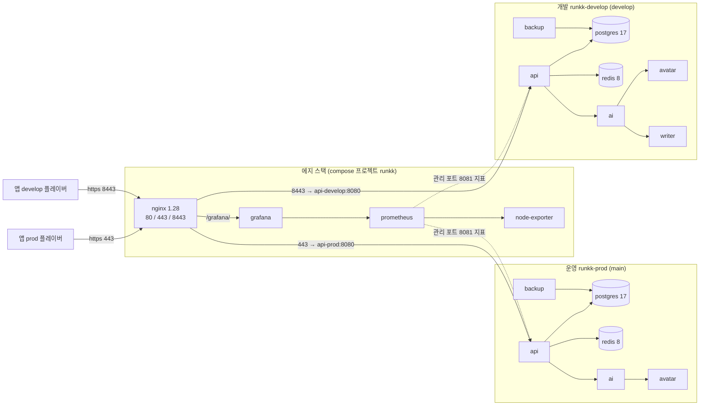

# 런크크 포팅 매뉴얼

> 기준: main 브랜치(2026-11-18), 앱 versionName 0.13.0, 운영 DB Flyway V67. 저장소 https://lab.ssafy.com/s15-final/S15P31A207
> 비밀값은 이 문서에 없다. 값이 필요한 항목은 "팀에 별도 전달"이다.

## 1. 시스템 구성

### 1.1 한눈에 보기

| 구성 요소 | 폴더 | 내용 |
|---|---|---|
| 앱(폰) | `android/app` 외 모듈 | Kotlin, Jetpack Compose, Hilt. 플레이버 local·develop·prod |
| 앱(워치) | `android/wear` | Wear OS 앱. 폰 앱과 같은 플레이버·applicationId로 짝지어진다 |
| api 서버 | `backend/` | Spring Boot. REST `/api/v1/**`, WebSocket `/ws`, 관리 API `/api/v1/admin/**` |
| ai 서버 | `ai/` | FastAPI. AI 코멘트, 런바디 분석, AI 코치, 셀카 아바타 중계. api만 내부 망으로 부른다 |
| 아바타 서버 | `avatar-ai/` | Node(Express, sharp). 셀카로 아바타 머리 그림을 만든다. ai만 내부 망으로 부른다 |
| writer | (이미지만) | llama.cpp 서버로 자체 소형 모델(Qwen3-4B QLoRA, GGUF)을 CPU에서 돌려 분석 피드백 문장을 다듬는다. 선택 서비스 |
| 인프라 | `infra/` | Docker Compose, nginx, Prometheus·Grafana, 백업 스크립트, 배포 스크립트 |
| CI/CD | `.gitlab-ci.yml`, `ci/android/` | GitLab CI. 같은 EC2에 러너 2개(docker, deploy) |

### 1.2 서버 구성

EC2 한 대(`k15a207.p.ssafy.io`, Ubuntu 24.04.4 LTS, 4코어, 메모리 15GiB)에서 Docker Compose로 띄운다. 운영(prod, main 브랜치)과 개발(develop, develop 브랜치) 두 환경이 DB·Redis·api·ai·아바타·백업을 각자 가지고, nginx와 모니터링은 한 벌을 함께 쓴다.



| 포트 | 대상 | 비고 |
|---|---|---|
| 22 | SSH | |
| 80 | nginx | 인증서 발급(ACME) 확인과 https 301 이동 |
| 443 | nginx → 운영 api | 운영 앱(prod 플레이버), `/grafana/`, 공개 홈·법정 고지(`/legal/*`)·초대 안내 페이지 |
| 8443 | nginx → 개발 api | 개발 앱(develop 플레이버). release/* 확인 서버도 여기 |
| 내부만 | api 8080(서비스)·8081(actuator), ai 8000, avatar 3000, writer 8080, postgres 5432, redis 6379, prometheus 9090, grafana 3000, node-exporter 9100 | 호스트에 게시하지 않는다 |

- 컨테이너 이름: 환경 스택은 `runkk-<환경>-<서비스>-1`(예: `runkk-prod-api-1`), 에지는 `runkk-<서비스>-1`(예: `runkk-nginx-1`).
- 2026-11-18 서버에서 도는 컨테이너: 운영 api·ai·avatar·backup·postgres·redis, 개발 같은 6개와 writer, 에지 nginx·grafana·prometheus·node-exporter.
- 망: api만 에지 망 `runkk_default`에 `api-<환경>` 별칭으로 붙는다. ai와 avatar는 전용 망 `avatar`로만 통한다. postgres는 Grafana 읽기 전용 조회를 위해 `runkk_db-<환경>` 망에도 붙는다.
- 같은 EC2에 팀 위키(AppFlowy) 스택도 있다. nginx의 `wiki.conf`가 그쪽으로 넘긴다. 런크크 포팅에는 필요 없다.

## 2. 사용 제품과 버전

버전은 저장소 파일에서 읽었다. "서버 실측"은 2026-11-18 운영 서버에서 읽은 값이다.

### 2.1 백엔드 (`backend/`)

| 항목 | 버전 | 근거 |
|---|---|---|
| JDK | 21 (Gradle toolchain이 foojay로 내려받음, 로컬에는 JDK 17 이상만 있으면 됨). 이미지 eclipse-temurin:21-jdk / 21-jre | `build.gradle.kts`, `Dockerfile` |
| Spring Boot | 3.5.16 | `build.gradle.kts` |
| Spring Dependency Management | 1.1.7 | `build.gradle.kts` |
| Gradle | 9.8.1 (wrapper) | `gradle/wrapper/gradle-wrapper.properties` |
| springdoc-openapi | 2.8.17 | `build.gradle.kts` |
| Spotless | 8.10.4 (google-java-format) | `build.gradle.kts` |
| Flyway, PostgreSQL 드라이버, nimbus-jose-jwt, Testcontainers | Spring Boot BOM이 정함 | `build.gradle.kts` |
| ArchUnit | 1.5.1 | `build.gradle.kts` |
| embedded-redis(로컬 실행용) | 1.4.4 | `build.gradle.kts` |

### 2.2 앱 (`android/`)

| 항목 | 버전 | 근거 |
|---|---|---|
| Kotlin | 2.4.21 | `gradle/libs.versions.toml` |
| Android Gradle Plugin | 9.4.1 | `gradle/libs.versions.toml` |
| Gradle | 9.8.1 (wrapper) | `gradle/wrapper/gradle-wrapper.properties` |
| compileSdk / targetSdk / minSdk | 37 / 36 / 26 (워치 minSdk 30) | `build-logic/.../Common.kt`, `wear/build.gradle.kts` |
| Java·JVM 대상 | 17 | `build-logic/.../AndroidApplicationConventionPlugin.kt` |
| KSP / Hilt | 2.3.12 / 2.60.1 | `libs.versions.toml` |
| Compose BOM | 2026.09.00 | `libs.versions.toml` |
| Navigation 3 | 1.2.0 | `libs.versions.toml` |
| Retrofit / OkHttp | 3.0.0 / 5.5.0 | `libs.versions.toml` |
| Room / DataStore / WorkManager | 2.8.5 / 1.2.1 / 2.12.0 | `libs.versions.toml` |
| Kakao SDK(로그인·공유) / Kakao 지도 SDK | 2.24.0 / 2.15.1 | `libs.versions.toml` |
| Credential Manager / Google ID | 1.6.0 / 1.2.1 | `libs.versions.toml` |
| Firebase Messaging | 26.0.0 | `libs.versions.toml` |
| Rive(아바타 렌더링) | 11.16.0 | `libs.versions.toml` |
| ktlint | 1.8.0 (ktlint-gradle 14.2.0) | `build-logic/.../Common.kt`, `libs.versions.toml` |
| CI 빌드 이미지 | eclipse-temurin:21-jdk + Android SDK platform 37, build-tools 36.0.0 | `ci/android/Dockerfile` |

### 2.3 ai 서버 (`ai/`)

| 항목 | 버전 | 근거 |
|---|---|---|
| Python | 3.12 (이미지 python:3.12-slim) | `pyproject.toml`, `Dockerfile` |
| uv | 0.12.5 | `Dockerfile`, `.gitlab-ci.yml` |
| FastAPI / uvicorn / pydantic | 0.150.0 / 0.54.0 / 2.14.1 | `pyproject.toml` |
| anthropic / openai (Python SDK) | 1.15.0 / 3.35.1 | `pyproject.toml` |
| SQLAlchemy / asyncpg / alembic | 2.1.6 / 0.32.0 / 1.20.1 | `pyproject.toml` |
| pandas / numpy | 3.1.0 / 2.5.4 | `pyproject.toml` |
| 검증 도구 | ruff 0.17.1, mypy 2.4.0, pytest 9.1.1, import-linter 2.15 | `pyproject.toml` |
| 기본 LLM 모델 | `claude-haiku-5-5` (코멘트·AI 코치) | `runkk_ai/core/config.py`, `infra/.env.example` |

### 2.4 아바타 서버 (`avatar-ai/`)

| 항목 | 버전 | 근거 |
|---|---|---|
| Node.js | 22 (이미지 node:22-bookworm-slim, package.json은 20 이상) | `Dockerfile`, `package.json` |
| express / multer / sharp | 4.22.3 / 2.5.0 / 0.34.5 | `package-lock.json` |
| openai (Node SDK) | 5.23.2 | `package-lock.json` |
| 사용 모델 | 이미지 `gpt-image-2.5-sunburst`, 특징 분석 `gpt-4.1-mini` (GMS 경유) | `.env.example`, `infra/docker-compose.yml` |

### 2.5 인프라

| 항목 | 버전 | 근거 |
|---|---|---|
| PostgreSQL | 17 (이미지 postgres:17-alpine, 서버 실측 17.12) | `infra/docker-compose.yml` |
| Redis | 8 (이미지 redis:8) | `infra/docker-compose.yml` |
| nginx | 1.28 (nginx:1.28-alpine) | `infra/docker-compose.edge.yml` |
| Prometheus / node-exporter | v3.15.1 / v1.12.1 | `infra/docker-compose.edge.yml` |
| Grafana | 13.2.4 | `infra/docker-compose.edge.yml` |
| certbot | certbot/certbot (태그 지정 없음) | `infra/docker-compose.edge.yml` |
| writer | ghcr.io/ggml-org/llama.cpp:server (sha256 다이제스트로 고정), 모델 `runkk-writer-v1-qwen3-4b-q4_k_m.gguf` | `infra/docker-compose.yml` |
| Docker Engine / Compose | 29.9.2 / 5.6.1 (서버 실측. 저장소에 고정한 버전 없음) | 서버 `docker version` |
| OS | Ubuntu 24.04.4 LTS (서버 실측) | 서버 `/etc/os-release` |
| GitLab CI 이미지 | node:22-bookworm-slim, python:3.12-slim, eclipse-temurin:21-jdk, runkk-android-sdk:37(EC2 로컬 빌드) | `.gitlab-ci.yml` |

### 2.6 개발 도구(IDE)

저장소에 IDE 버전을 정한 파일은 없다. 팀 결정(2026-11-18)으로 권장만 적는다. 빌드는 Gradle Wrapper와 JDK 17 이상이면 IDE 없이 된다.

- 앱: Android Studio 최신 안정판 권장(AGP 9.4.1과 compileSdk 37을 지원해야 한다). SDK Manager에서 Android SDK Platform 37을 설치한다.
- 서버: IntelliJ IDEA 최신판 권장(Gradle 프로젝트를 여는 다른 IDE도 된다).
- ai: uv가 Python 3.12 가상 환경을 만든다(`uv python install 3.12`).

## 3. 빌드와 실행

### 3.1 로컬 (AGENTS.md 명령 표)

| 대상 | 커밋 전 포맷 | 검증 | 실행 |
|---|---|---|---|
| backend | `./gradlew spotlessApply` | `./gradlew build` (spotlessCheck·test 포함) | `./gradlew bootRun` |
| android | `./gradlew ktlintFormat` | `./gradlew ktlintCheck lintLocalDebug testLocalDebugUnitTest` | `./gradlew assembleLocalDebug` 후 에뮬레이터 설치 |
| ai | `cd ai && uv run ruff format .` | `uv run ruff check . && uv run lint-imports && uv run mypy && uv run pytest` | `uv run uvicorn --factory runkk_ai.main:create_app` |
| avatar-ai | | `npm ci && npm run check && npm test` | `npm start` (`GMS_KEY` 필요) |

- backend `bootRun`은 기본 프로필 local로 뜬다. 설치할 것이 없다: H2 메모리 DB(PostgreSQL 모드)와 내장 Redis가 앱과 함께 뜨고, Flyway 대신 `import.sql`·`import-local.sql`로 초기 데이터를 넣는다. 기본으로 127.0.0.1:8080에서만 받는다(같은 망의 실기기는 `SERVER_ADDRESS=0.0.0.0`).
- PostgreSQL·Redis로 develop 프로필을 PC에서 돌려 보려면 `backend/compose.yaml`(postgres 17, redis 8)을 띄우고 `SPRING_PROFILES_ACTIVE=develop`으로 실행한다.
- 앱 local 플레이버는 에뮬레이터에서 PC의 backend(`http://10.0.2.2:8080/api/v1/`, `ws://10.0.2.2:8080/ws`)에 붙는다.
- ai는 `RUNKK_INTERNAL_TOKEN`(16자 이상, 자리표시 값 거부)이 있어야 뜬다. LLM 키가 없어도 뜨고, 그때 api는 규칙 문구와 기본 캐릭터로 대신한다.
- 서버 전체 구성(nginx 포함)을 PC Docker에서 띄우는 방법은 `infra/README.md` 5절.

### 3.2 앱 빌드

| 플레이버 | applicationId | 붙는 서버 | 용도 |
|---|---|---|---|
| local | `com.a207.runkk.local` | PC backend (10.0.2.2:8080) | 개발 |
| develop | `com.a207.runkk.dev` | `https://k15a207.p.ssafy.io:8443` | 팀 시험 APK (CI `android:build`가 developDebug arm64 APK를 만든다) |
| prod | `com.a207.runkk` | `https://k15a207.p.ssafy.io` | Play 배포 (CI `android:release`가 prodRelease AAB를 만든다) |

- 서명: 키스토어 파일과 비밀번호는 저장소에 없다. 환경 변수 `RUNKK_KEYSTORE_PATH`·`RUNKK_KEYSTORE_PASSWORD`·`RUNKK_KEY_ALIAS`·`RUNKK_KEY_PASSWORD`가 있을 때만 그 키로 debug·release를 서명한다. 없으면 debug는 기기 디버그 키, release는 서명 없이 빌드된다. 값은 팀에 별도 전달한다.
- 로그인 키 등 빌드 속성은 `android/local.properties` → Gradle 속성(`-P`) → 환경 변수 순으로 읽는다(4.4절). 키가 비어도 빌드는 되고 그 기능만 "준비 중"으로 동작한다.
- Play 업로드용 번들: `./gradlew :app:bundleProdRelease :wear:bundleProdRelease -Prunkk.playBundle=true -Prunkk.versionCode=<번호>`. CI는 versionCode를 파이프라인 번호 × 10(폰), × 10 + 1(워치)로 정한다.
- FCM 푸시를 쓰려면 `android/app/google-services.json`이 있어야 한다(저장소에 없음, CI 변수 `GOOGLE_SERVICES_JSON`). 없으면 푸시 없이 빌드된다.

### 3.3 서버 배포 (GitLab CI)

| 브랜치 | 환경 | 주소 | 배포 |
|---|---|---|---|
| develop | develop (`runkk-develop`, develop 프로필, Swagger 열림) | `https://k15a207.p.ssafy.io:8443` | 병합하면 자동 |
| release/* | develop 환경에 올라감(베타 전 확인 서버) | `https://k15a207.p.ssafy.io:8443` | push마다 자동 |
| main | prod (`runkk-prod`, prod 프로필, Swagger 닫힘) | `https://k15a207.p.ssafy.io` | 파이프라인에서 수동 승인 |

파이프라인 단계(`stages: lint, test, build, deploy, smoke`):

1. lint: `backend:lint`(spotlessCheck), `ai:lint`(ruff·import-linter·mypy), `android:lint`(ktlintCheck·lintLocalDebug)
2. test: `backend:test`(JUnit·ArchUnit·Testcontainers PostgreSQL 17·Redis 8), `ai:test`(pytest, postgres 서비스), `avatar:test`, `android:test`(단위 시험·Roborazzi 스크린샷 비교)
3. build: 이미지 빌드 `backend:build`·`ai:build`·`avatar:build`(EC2 로컬 Docker), `android:build`(develop APK), `android:release`(main, prod AAB), `android:play`(release/*, 수동)
4. deploy: `backend:deploy`가 CI 변수로 `infra/.env`·`infra/edge.env`를 만들고 `infra/deploy.sh`를 돌린다. `android:beta`(release/*, 수동)는 Firebase App Distribution에 베타 APK를 올린다
5. smoke: `backend:smoke`(`infra/smoke.sh`)

그 밖의 수동·예약 잡: `backup:restore-check`(복구 리허설), `backup:offsite`(매일 00:00, 덤프를 GitLab 아티팩트로 서버 밖 보관), `dev:seed`(develop DB 더미 데이터), `android:ci-image`(Android 빌드 이미지).

### 3.4 수동 배포 (`infra/deploy.sh`)

`deploy.sh`가 하는 일(`./deploy.sh edge`는 2번만):

1. `../backend`·`../ai`·`../avatar-ai`로 환경별 이미지(`runkk-api:<환경>` 등)를 만들고 직전 이미지는 `<환경>-prev` 태그로 남긴다.
2. 에지(nginx·모니터링)를 맞춘다. 새 nginx 설정은 일회용 컨테이너에서 `nginx -t`로 검사한 뒤 다시 읽힌다.
3. 배포 직전 DB 덤프를 뜬다(Flyway 마이그레이션 전). 실패하면 배포를 멈춘다.
4. 환경 스택을 `up -d`로 올리고 api·ai healthy와 nginx를 거친 `/actuator/health`를 기다린다.

실행 중인 컨테이너는 `$RUNKK_HOME/<스택>/`(기본 `/srv/runkk`, 현재 서버는 `/home/gitlab-runner/runkk`)에 복사한 설정 파일을 쓴다. 두 배포가 겹치지 않게 CI는 `resource_group: runkk-server`, 스크립트는 잠금 파일을 쓴다.

### 3.5 새 서버에 처음 설치하는 순서 (`infra/README.md` 1·2절 요약)

1. Ubuntu에 Docker를 설치하고 사용자를 docker 그룹에 넣는다. Testcontainers를 위해 `/etc/docker/daemon.json`에 `{"min-api-version": "1.24"}`를 둔다. UFW에서 `docker0` 들어옴을 허용한다(CI 잡 컨테이너용).
2. 설정 복사 폴더를 만든다: `sudo install -d -m 2775 -g docker /srv/runkk`.
3. 저장소를 받고 `infra/edge.env.example` → `edge.env`, `infra/.env.example` → `.env`로 복사해 값을 채운다(4절 이름 참고).
4. `./deploy.sh`로 HTTP 모드에서 먼저 띄운다.
5. 도메인이 EC2를 가리키는지 확인하고 `./init-letsencrypt.sh <관리자 이메일>`로 인증서를 받는다. 스크립트가 nginx를 HTTPS 설정으로 바꾸고, 갱신용 cron 한 줄을 출력한다. 이 줄을 crontab에 넣는다.
6. CI를 쓰려면 GitLab 러너 2개(docker executor, shell executor `deploy`)를 같은 서버에 등록하고, `docker build -t runkk-android-sdk:37 ci/android`로 Android 빌드 이미지를 만든다. CI 변수는 4.3절.
7. 운영 첫 배포 뒤 관리툴 첫 운영자는 `.env`의 `RUNKK_BOOTSTRAP_OPERATORS`로 넣는다.

## 4. 환경 변수와 설정 파일

값은 쓰지 않는다. 모두 팀에 별도 전달한다. "필수"는 비어 있으면 compose나 서버가 기동을 멈추는 값이다.

### 4.1 환경 스택 `infra/.env` (원본 `infra/.env.example`, CI 변수 `INFRA_ENV`·`INFRA_ENV_PROD`)

| 이름 | 쓰는 곳 | 용도 |
|---|---|---|
| `RUNKK_ENV` (필수) | compose | 환경 이름 develop·prod. 프로젝트 이름, 이미지 태그, 별칭이 된다 |
| `POSTGRES_VOLUME`, `REDIS_VOLUME` (필수) | compose | DB·Redis 볼륨 이름. 다른 환경 볼륨을 넣으면 안 된다 |
| `SPRING_PROFILES_ACTIVE` | api | develop 또는 prod(운영은 prod 필수) |
| `SWAGGER_ENABLED` | api | prod 프로필에서 Swagger 여부. 운영에는 넣지 않는다 |
| `SELFIE_ENABLED` | api | 셀카 아바타 서버 스위치 |
| `DB_NAME`, `DB_USER`, `DB_PASSWORD` (필수) | api, postgres, backup | DB 이름·사용자·비밀번호 |
| `RUNKK_AI_DB_PASSWORD` (필수) | api(Flyway V29) | ai 전용 DB 계정 `runkk_ai` 비밀번호. `RUNKK_DB_URL` 안의 비밀번호와 같다 |
| `DB_POOL_SIZE` | api | Hikari 최대 풀 |
| `REDIS_PASSWORD` (필수) | api, redis | Redis 비밀번호 |
| `API_MEM_LIMIT`, `API_JAVA_OPTS` | api | 컨테이너 메모리 제한과 JVM 옵션 |
| `BACKUP_TIME`, `BACKUP_KEEP_DAYS`, `BACKUP_DIR`, `BACKUP_OWNER` | backup | 매일 백업 시각·보존 일수·폴더·소유자 |
| `JWT_SECRET` (필수) | api | 회원 JWT 서명 키 |
| `ADMIN_JWT_SECRET` (필수) | api | 관리툴 토큰 서명 키(JWT_SECRET과 달라야 함) |
| `RUNKK_BOOTSTRAP_OPERATORS` | api | 첫 운영자(화이트리스트가 비었을 때만) |
| `RUNKK_BOOTSTRAP_SETTINGS` | api | 운영 기준값 처음 값(크루·아바타·런바디 공개 스위치 등) |
| `SCHEDULER_POOL_SIZE` | api | 주기 작업 스레드 수(27 이상) |
| `AVATAR_BACKFILL_CUTOFF` | api | 랜드마크 배경 채우기 기준 시각 |
| `AUTH_CLIENT_REQUESTS_PER_MINUTE` | api | 로그인 계열 요청 분당 상한 |
| `LEGAL_TERMS_URL`, `LEGAL_PRIVACY_POLICY_URL`, `LEGAL_LOCATION_TERMS_URL`, `LEGAL_HELP_URL` | api | 법정 고지 문서 주소 |
| `FRIEND_INVITE_LINK_BASE` (필수) | api | 친구 대결 초대 링크 앞부분(환경마다 다름) |
| `KAKAO_APP_ID` | api | 카카오 토큰 검증용 앱 ID. 비면 카카오 로그인 거부 |
| `GOOGLE_CLIENT_IDS` | api | 구글 ID 토큰 aud로 받을 클라이언트 ID 목록. 비면 구글 로그인 거부 |
| `FCM_PROJECT_ID`, `FCM_CREDENTIALS_FILE` | api | FCM 푸시. 서비스 계정 JSON은 `infra/secrets/`에 두고 `/run/secrets/...`로 가리킨다 |
| `KMA_SERVICE_KEY` | api | 공공데이터포털 기상청 서비스 키. 비면 날씨 없이 저장 |
| `RUNKK_QUEUE`, `RUNKK_LIVE` | api | 매칭 대기열 저장소(redis·jdbc), 실시간 방식(websocket·polling) |
| `RUNKK_INTERNAL_TOKEN` (필수) | api, ai | api ↔ ai 내부 호출 토큰 |
| `RUNKK_LLM_PROVIDER`, `RUNKK_LLM_MODEL` | ai | AI 코멘트 LLM 제공자·모델 |
| `RUNKK_ANTHROPIC_API_KEY`, `RUNKK_ANTHROPIC_BASE_URL` | ai | Anthropic 키와 주소(SSAFY GMS 프록시 주소 가능) |
| `RUNKK_OPENAI_API_KEY` | ai | 제공자를 openai로 둘 때의 키 |
| `RUNKK_FACE_API_URL` | ai | 아바타 서버 기준 경로. 비면 셀카 아바타 503 |
| `RUNKK_EXPOSE_DOCS` | ai | ai 문서 페이지 노출 |
| `RUNKK_COACH_MODEL`, `RUNKK_COACH_DAILY_HARD_CAP`, `RUNKK_COACH_USER_DAILY_CAP` | ai | AI 코치 모델과 하루 상한 |
| `RUNKK_DB_URL` | ai | 분석 결과 저장 DB 주소(`runkk_ai` 계정). 비면 메모리 저장 |
| `COMPOSE_PROFILES` | compose | 켤 선택 서비스(`writer`, `avatar`) |
| `RUNKK_WRITER_URL`, `RUNKK_WRITER_MODEL_URLS` | ai, api | writer 주소와 관리 API가 등록할 수 있는 주소 |
| `WRITER_MODEL_DIR`, `WRITER_MODEL_FILE`, `WRITER_THREADS` | writer | 모델 파일 폴더·이름·CPU 스레드 |
| `AVATAR_GMS_KEY`, `AVATAR_GMS_BASE_URL` | avatar | GMS(OpenAI 호환) 키와 주소 |
| `HEAD_PNG_COMPRESSION` | avatar | 머리 PNG 압축 방식(palette·lossless·off) |

compose에만 있고 `.env.example`에 없는 ai 선택 값: `RUNKK_LLM_TIMEOUT_S`, `RUNKK_LLM_MAX_TOKENS`, `RUNKK_LLM_DAILY_HARD_CAP`, `RUNKK_FACE_TIMEOUT_S`, `RUNKK_MAX_IMAGE_BYTES`, `RUNKK_MAX_IMAGE_PIXELS`, `RUNKK_PURGE_TIMEOUT_S`, `RUNKK_COACH_MAX_TOKENS`, `RUNKK_COACH_TIMEOUT_S`, `RUNKK_WRITER_TIMEOUT_S`, `RUNKK_WRITER_TEMPERATURE`, `RUNKK_WRITER_MODEL_VERSION`.

### 4.2 에지 `infra/edge.env` (원본 `infra/edge.env.example`, CI 변수 `INFRA_ENV_EDGE`)

| 이름 | 용도 |
|---|---|
| `SERVER_NAME` | 서버 도메인(인증서 이름) |
| `NGINX_HTTP_PORT`, `NGINX_HTTPS_PORT`, `NGINX_DEVELOP_PORT` | 호스트 포트 80·443·8443 |
| `GRAFANA_ADMIN_USER`, `GRAFANA_ADMIN_PASSWORD` (필수) | Grafana 관리자 계정 |
| `GRAFANA_ALERT_WEBHOOK_URL` | 장애 알림 Mattermost 웹훅 |
| `GRAFANA_DB_READONLY_PASSWORD` | Grafana 이벤트 현황용 읽기 전용 DB 계정 `runkk_grafana_ro` 비밀번호 |
| `GRAFANA_DB_NAME_PROD`, `GRAFANA_DB_NAME_DEVELOP` | 두 환경 DB 이름 |
| `NODE_EXPORTER_HOST_ROOT`, `NODE_EXPORTER_ROOT_PROPAGATION` | 로컬 Docker Desktop 전용 |

### 4.3 GitLab CI 변수 (`.gitlab-ci.yml` 머리 주석)

| 이름 | 종류 | 용도 |
|---|---|---|
| `INFRA_ENV`, `INFRA_ENV_PROD`, `INFRA_ENV_EDGE` | File | 위 4.1·4.2 파일 내용(develop, prod, 에지) |
| `FCM_SERVICE_ACCOUNT` | File | Firebase 서비스 계정 JSON(배포 때 `infra/secrets/fcm-service-account.json`) |
| `GOOGLE_SERVICES_JSON` | File | 앱 `google-services.json` |
| `ANDROID_KEYSTORE_BASE64`, `ANDROID_KEYSTORE_PASSWORD`, `ANDROID_KEY_ALIAS`, `ANDROID_KEY_PASSWORD` | Variable | 앱 서명 키 |
| `KAKAO_NATIVE_APP_KEY`, `KAKAO_NATIVE_APP_KEY_DEVELOP`, `GOOGLE_WEB_CLIENT_ID` | Variable | 앱 로그인 키(prod 패키지용, develop 패키지용) |
| `GRAFANA_ADMIN_PASSWORD`, `GRAFANA_ALERT_WEBHOOK_URL`, `GRAFANA_DB_READONLY_PASSWORD` | Variable(masked) | 배포가 edge.env 끝에 붙인다 |
| `FIREBASE_APP_DISTRIBUTION_SA` | File(선택) | Firebase App Distribution 업로드 서비스 계정 |
| `RUNKK_HOME` | Variable | 서버 설정 복사 폴더 |
| `SKIP_ANDROID_CHECKS` | Variable | 1이면 android lint·test·build를 건너뜀(임시) |
| `RELEASE_FREEZE` | Variable | release/* 기간에 1. develop 자동 배포를 수동으로 바꾼다 |

protected 변수는 보호 브랜치에서만 보인다. release/*도 보호 브랜치로 등록해야 한다.

### 4.4 앱 빌드 속성 (`android/local.properties` 또는 `-P` 또는 환경 변수)

| 이름 | 용도 |
|---|---|
| `sdk.dir` | Android SDK 위치(local.properties) |
| `KAKAO_NATIVE_APP_KEY` | 카카오 네이티브 앱 키(prod 패키지). 로그인·지도·공유·초대 링크 스킴 |
| `KAKAO_NATIVE_APP_KEY_DEVELOP`, `KAKAO_NATIVE_APP_KEY_LOCAL` | `.dev`, `.local` 패키지용 카카오 키. 비면 기본 키를 쓴다 |
| `GOOGLE_WEB_CLIENT_ID` | 구글 로그인(Credential Manager)용 웹 클라이언트 ID |
| `RUNKK_LOCAL_API_URL`, `RUNKK_LOCAL_WS_URL`, `RUNKK_DEVELOP_API_URL`, `RUNKK_DEVELOP_WS_URL`, `RUNKK_PROD_API_URL`, `RUNKK_PROD_WS_URL` | 플레이버별 서버 주소를 바꿀 때만 |
| `RUNKK_E2E_KAKAO_TOKEN` | E2E 시험 전용(localDebug에만 들어감) |
| `RUNKK_KEYSTORE_PATH`, `RUNKK_KEYSTORE_PASSWORD`, `RUNKK_KEY_ALIAS`, `RUNKK_KEY_PASSWORD` | 서명(환경 변수만) |

### 4.5 그 밖의 예시 파일

| 파일 | 내용 |
|---|---|
| `backend/.env.example` | api를 따로 띄울 때의 값 이름(`SPRING_PROFILES_ACTIVE`, `SERVER_PORT`, `DB_*`, `REDIS_*`, `JWT_SECRET`, 외부 연동 키 등) |
| `ai/.env.example` | ai를 따로 띄울 때의 값 이름(`RUNKK_INTERNAL_TOKEN`, `RUNKK_LLM_*`, `RUNKK_ANTHROPIC_API_KEY` 등) |
| `avatar-ai/.env.example` | 아바타 서버를 따로 띄울 때: `GMS_KEY`, `GMS_BASE_URL`, `IMAGE_MODEL`, `VISION_MODEL`, `IMAGE_QUALITY`, `AVATAR_NETWORK`, `AI_CALLBACK_URL`, `AI_CALLBACK_TOKEN`, `HEAD_PNG_COMPRESSION` |

### 4.6 서버 설정 파일 (`backend/src/main/resources/application.yml`)

한 파일에 프로필 4개가 있다.

| 프로필 | DB | 스키마 | 비고 |
|---|---|---|---|
| local(기본) | H2 메모리 | Hibernate create-drop + `import.sql`·`import-local.sql` | 내장 Redis, h2-console |
| develop | PostgreSQL | Flyway(out-of-order 허용) + ddl validate | Swagger `/docs` 열림, 관리 포트 8081 |
| prod | PostgreSQL | Flyway + ddl validate | Swagger 닫힘, 필수 비밀값이 비면 기동 실패 |
| test | `src/test/resources/application-test.yml` | | 시험 전용 |

외부 연동 기본 주소도 이 파일에 있다: `KAKAO_API_BASE_URL`(kapi.kakao.com), `GOOGLE_TOKENINFO_BASE_URL`(oauth2.googleapis.com), `KMA_API_BASE_URL`(apis.data.go.kr 기상청 단기예보), `AI_SERVER_URL`.

## 5. 배포 특이사항

- **포트**: 밖에서 들어오는 포트는 22, 80, 443, 8443이다. SSAFY 보안 그룹이 8443을 허용한다. Docker가 게시한 포트는 UFW 규칙을 거치지 않으므로 UFW에 8443을 따로 더하지 않는다.
- **인증서**: Let's Encrypt. 443과 8443이 같은 인증서를 쓴다. 갱신은 crontab에 등록된 주 1회 명령(월요일 04:17, 서버 시각 UTC 기준)이 `certbot renew` 뒤 `nginx -s reload`를 한다(2026-11-18 서버 crontab에서 확인).
- **운영 배포는 수동 승인**: main 파이프라인의 `backend:deploy`를 사람이 눌러야 운영에 올라간다. `deploy.sh`는 운영인데 프로필이 prod가 아니거나 `SWAGGER_ENABLED=true`면 멈추고, `smoke.sh`는 운영에서 `/v3/api-docs`가 열려 있으면 실패한다.
- **RELEASE_FREEZE**: release/* 브랜치가 있는 동안 CI 변수 `RELEASE_FREEZE=1`을 켠다. develop 자동 배포가 수동으로 바뀌어 8443의 release 확인 서버를 덮지 않는다. 릴리스가 끝나면 지운다.
- **에지 설정**: nginx·모니터링 설정은 마지막에 배포한 브랜치의 것이 반영된다. 바꾸면 develop에서 확인한 뒤 main에도 곧 반영한다.
- **기능 공개 스위치**: 크루(`CREW_RELEASED`), 아바타(`AVATAR_RELEASED`), 런바디(`RUNBODY_ENABLED`), AI 코치(`COACH_ENABLED`)는 관리툴 운영 기준값으로 연다. DB에 행이 없으면 꺼져 있다. 셀카 아바타는 서버 스위치 `SELFIE_ENABLED`도 켜져 있어야 한다.
- **백업**: 각 환경 backup 컨테이너가 매일 04:30(한국 시각)에 `pg_dump -Fc`와 아바타 볼륨 tar.gz를 `/var/backups/runkk/<환경>/`에 남기고 7일이 지난 것은 지운다. 배포 직전에도 DB 덤프를 하나 뜬다. 매일 00:00 `backup:offsite` 잡이 최근 덤프를 GitLab 아티팩트(7일 보존)로 올린다.
- **복구**: api를 멈추고, 현재 상태를 한 번 더 덤프한 뒤, `pg_restore --clean --if-exists --single-transaction`으로 넣고 api를 다시 띄운다(명령 전체는 `infra/README.md` 7절 "실제 복구"). 운영 DB를 건드리지 않는 복구 리허설은 `backup:restore-check` 잡이다.
- **롤백**: 보통은 이전 성공 파이프라인의 `backend:deploy`를 다시 돌린다. 스키마가 바뀐 배포는 배포 직전 덤프로 되돌린다. 서버 시간대 마이그레이션 V48이 적용된 환경은 V48 이전 이미지로 되돌리지 않는다(`infra/README.md` 3절).
- **서버 시간대 주의**: EC2 호스트 시각은 UTC다(2026-11-18 확인). 컨테이너(api·postgres·backup)는 `TZ=Asia/Seoul`이고, V48 적용 뒤 DB에는 한국 시각 그대로 저장한다. crontab과 호스트 로그 시각은 UTC로 읽는다.
- **메모리**: api 1536m(힙 60%), ai 512m, avatar 768m, writer 3500m, redis maxmemory 256mb, backup 256m, prometheus·grafana 512m씩.
- **로그**: api 파일 로그는 `api-logs` 볼륨 `/var/log/runkk/api.log`에 날마다 돌려 30일 보관한다. 컨테이너 로그는 20MB × 5개까지.
- **모니터링**: `https://k15a207.p.ssafy.io/grafana/`(Grafana 관리자 계정). 장애 알림은 Mattermost 채널로 간다.
- **App Links**: `infra/nginx/static/.well-known/assetlinks.json`에 운영 앱(Play 앱 서명 키, 업로드 키)과 `.dev` 앱(업로드 키) 지문이 있다. 서명 키를 바꾸면 이 파일도 바꾼다.

## 6. DB 접속 정보

| 항목 | 값 |
|---|---|
| DBMS | PostgreSQL 17 |
| 컨테이너 | 운영 `runkk-prod-postgres-1`, 개발 `runkk-develop-postgres-1` |
| DB 이름 / 앱 사용자 | `runkk` / `runkk` (`.env`의 `DB_NAME`·`DB_USER`, 예시 파일 기준) |
| 비밀번호 | 서버 `.env`의 `DB_PASSWORD`(CI 변수 `INFRA_ENV_PROD`·`INFRA_ENV`). 팀에 별도 전달 |
| 다른 계정 | `runkk_ai`(ai 서버, `analytics` 스키마. Flyway V29가 만든다), `runkk_grafana_ro`(Grafana 읽기 전용) |
| 스키마 | `public`(api, Flyway), `analytics`(ai, alembic) |
| 포트 | 5432. 호스트에 게시하지 않는다. 밖에서 직접 붙을 수 없다 |

접속은 SSH로 서버에 들어간 뒤 컨테이너 안의 psql을 쓴다.

```bash
ssh -i <팀 키 파일> ubuntu@k15a207.p.ssafy.io
docker exec -it runkk-prod-postgres-1 psql -U runkk runkk
```

Redis도 같은 방식이다(`runkk-<환경>-redis-1`, 비밀번호는 `.env`의 `REDIS_PASSWORD`).

- 마이그레이션: `backend/src/main/resources/db/migration/V{n}__{설명}.sql`(Flyway, V1~V67, 파일 62개. 핫픽스용 V35_1~V35_3 포함). develop·prod 프로필에서 api 기동 때 적용된다. ai의 `analytics` 스키마는 alembic(`ai/alembic.ini`, `ai/runkk_ai/storage/migrations/versions/`)이 맡고, `RUNKK_DB_URL`이 있으면 ai 기동 때 적용된다.
- 스키마 덤프: [3_DB_덤프/runkk_schema.sql](3_DB_덤프/runkk_schema.sql)
- ERD·자료사전: `docs/sw/srs/06-07-ERD-상태전이도.md`, `docs/sw/srs/06-04-자료사전.md`(이어서 `06-04b`), 클래스 설계는 `docs/sw/design-oo/06-*.md`
- 개발 DB 더미 데이터: `infra/dev-seed.sql`(CI 수동 잡 `dev:seed`, develop 전용)

## 7. 계정·프로퍼티가 정의된 파일

| 경로 | 내용 |
|---|---|
| `infra/.env.example` | 환경 스택 값 이름(DB·Redis·JWT·외부 연동·ai·avatar) |
| `infra/edge.env.example` | nginx·Grafana 값 이름 |
| `infra/docker-compose.yml` | 컨테이너별로 넘기는 환경 변수 목록 |
| `infra/docker-compose.edge.yml` | 에지 컨테이너 환경 변수 |
| `infra/monitoring/grafana/runkk-db/readonly-role.sql` | Grafana 읽기 전용 DB 계정 권한 |
| `infra/monitoring/grafana/runkk-db/datasources.yml` | Grafana DB 데이터소스 |
| `.gitlab-ci.yml` | CI 변수 이름(머리 주석) |
| `backend/src/main/resources/application.yml` | 서버 프로퍼티(프로필별) |
| `backend/.env.example` | api 단독 실행 값 이름 |
| `backend/compose.yaml` | PC용 postgres·redis(개발용 고정 계정) |
| `ai/.env.example`, `ai/runkk_ai/core/config.py` | ai 설정 값 이름과 기본값 |
| `avatar-ai/.env.example` | 아바타 서버 값 이름 |
| `android/build-logic/convention/src/main/kotlin/Common.kt` | 앱 비밀 빌드 속성 읽는 순서 |
| `android/build-logic/convention/src/main/kotlin/AndroidApplicationConventionPlugin.kt` | 플레이버, 서명 환경 변수 |
| `android/data/build.gradle.kts` | 플레이버별 서버 주소 |
| `android/app/build.gradle.kts`, `android/feature/me/build.gradle.kts` | 카카오·구글 키 빌드 속성 |
| `infra/nginx/static/.well-known/assetlinks.json` | App Links 서명 지문 |
